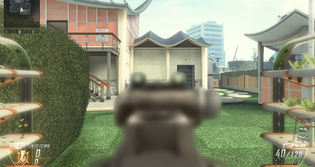
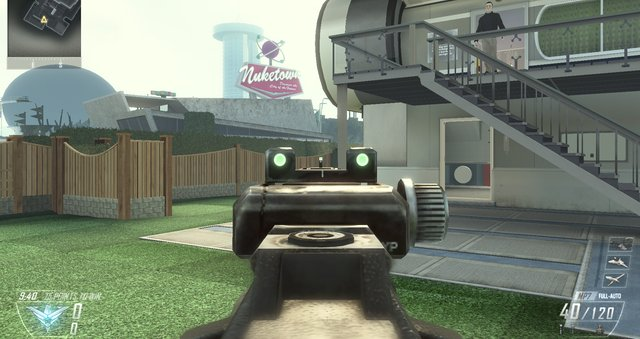
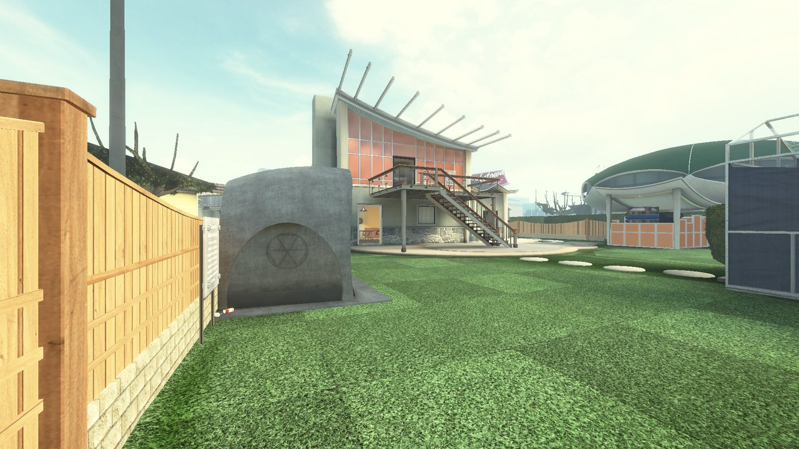
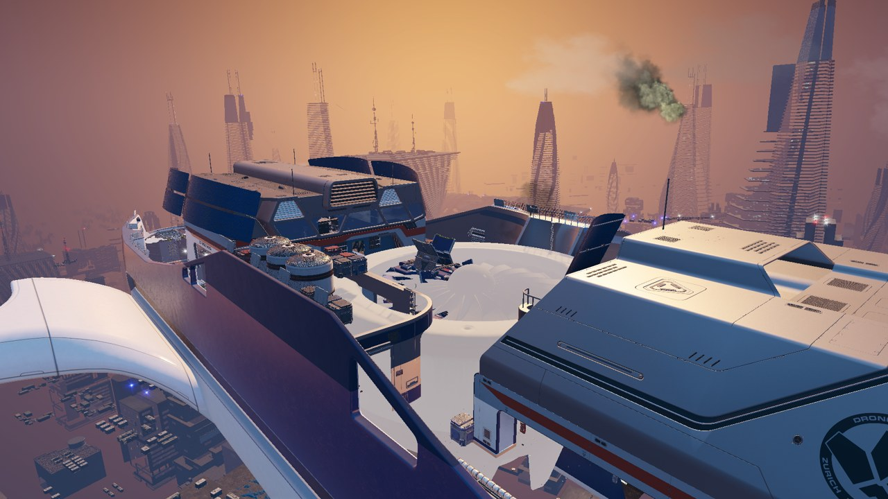

# BO2 Multiplayer Rebuild

A fan rebuild of Call of Duty: Black Ops II multiplayer in an engine written in Rust, built to feel exactly like
Black Ops II: its movement, gunplay, rules, menus and bots. It is a fork of [IW4L](https://github.com/vladtrc/iw4L),
an open-source Call of Duty runtime built on [Bevy](https://bevyengine.org/) and [wgpu](https://wgpu.rs/), and runs
Black Ops II's own multiplayer scripts without ever starting the original executable.

On top of Black Ops II it brings in the classic era's other games, played under Black Ops II's rules:

- **Maps** from Call of Duty 4, World at War (custom maps too), Modern Warfare 2, Modern Warfare 3, Black Ops and
  Black Ops III, plus Horizon MW / Modern Warfare Remastered usermaps, with each game's own lighting, fog and
  soldiers; Ghosts maps are in progress (Prison Break first).
- **Guns** from Black Ops, Modern Warfare 2, Ghosts, Horizon MW and Infinite Warfare as extra weapons in
  Create-a-Class, all firing with Black Ops II gunplay.
- **Online play**: host on your PC, a friend's PC or a VPS; friend codes, a friends list, lobby browser and joining a
  friend's lobby in one press ([docs/ONLINE.md](docs/ONLINE.md)).
- **Zombies**: every Black Ops II Zombies map through the companion Zombies rebuild.

**No game files are included.** This repository holds no Black Ops II (or any other Call of Duty) files: no maps,
models, textures, sounds, scripts or executables. You need your own legally owned copy of Black Ops II for PC with
Multiplayer installed (and of any other game whose maps or guns you want). The engine reads that install read-only at run time and never patches, copies or
redistributes it. Unofficial fan project, not affiliated with or endorsed by Activision, Treyarch or Infinity Ward.

## Contents

- [Map completion](#map-completion)
- [Features](#features)
- [Screenshots](#screenshots)
- [Requirements](#requirements)
- [Build and run](#build-and-run)
- [Configuration](#configuration)
- [How it works](#how-it-works)
- [Status](#status)
- [Recent changes](#recent-changes)

- Ghosts effects: material falloff/near ramp/eye offset, blend by technique, oriented sprite axes fixed, `iw6_tech_dump`, effect PERF harness line (see docs/exe_notes/IW6_FX_EXE.md).
- [Coming soon](#coming-soon)
- [Credits and license](#credits-and-license)

## Map completion

How far along each multiplayer map is, mechanically (loads, spawns, each mode, bots, scorestreaks, killcam, match
end) and visually (fixed spots shot in the original game and here from the same place, side by side). Every number
comes from [docs/maps.json](docs/maps.json), where each passing item names the test run or screenshot that proves
it; [docs/make_bars.py](docs/make_bars.py) draws this table. A visual spot only counts once it has a same-spot
comparison shot from the original, so visuals read 0% until those shots are taken.

<!-- map-bars:start -->
```text
                Mechanics         Visuals
Aftermath       ████░░░░░░  38%   not compared yet
Cargo           ██░░░░░░░░  25%   not compared yet
Carrier         ██░░░░░░░░  25%   not compared yet
Drone           ██░░░░░░░░  25%   not compared yet
Express         ██░░░░░░░░  25%   not compared yet
Hijacked        ██░░░░░░░░  25%   not compared yet
Meltdown        ██░░░░░░░░  25%   not compared yet
Overflow        ██░░░░░░░░  25%   not compared yet
Plaza           ██░░░░░░░░  25%   not compared yet
Raid            ██░░░░░░░░  25%   not compared yet
Slums           ██░░░░░░░░  25%   not compared yet
Standoff        ██░░░░░░░░  25%   not compared yet
Turbine         ██░░░░░░░░  25%   not compared yet
Yemen           ██░░░░░░░░  25%   not compared yet
Nuketown 2025   ███████░░░  72%   not compared yet
Downhill        ██░░░░░░░░  25%   not compared yet
Mirage          ██░░░░░░░░  25%   not compared yet
Hydro           ██░░░░░░░░  25%   not compared yet
Grind           ██░░░░░░░░  25%   not compared yet
Encore          ██░░░░░░░░  25%   not compared yet
Magma           ██░░░░░░░░  25%   not compared yet
Vertigo         ██░░░░░░░░  25%   not compared yet
Studio          ██░░░░░░░░  25%   not compared yet
Uplink          ██░░░░░░░░  25%   not compared yet
Detour          ██░░░░░░░░  25%   not compared yet
Cove            ██░░░░░░░░  25%   not compared yet
Rush            ██░░░░░░░░  25%   not compared yet
Dig             ██░░░░░░░░  25%   not compared yet
Frost           ██░░░░░░░░  25%   not compared yet
Pod             ██░░░░░░░░  25%   not compared yet
Takeoff         ██░░░░░░░░  25%   not compared yet
All maps        ███░░░░░░░  27%   not compared yet
```

Mechanics: each map's systems and modes work by Black Ops II's rules. Visuals: set spots compared side by side with Black Ops II. Scored in [`docs/maps.json`](docs/maps.json) (pass or match 1, part or close half, not yet 0), last updated 2026-10-08; drawn by [`docs/make_bars.py`](docs/make_bars.py).
<!-- map-bars:end -->

## Features

- **Black Ops II's own front end.** `frontend t6mp` opens the multiplayer main menu built from the game's UI
  scripts: custom games lobby, Setup Game, Setup Bots, Create-a-Class, Scorestreaks, then Start Match. Classes are
  saved next to the binary.
- **Every multiplayer map.** All maps on your disc and in the DLC packs you own load and can be played, each with
  its own factions, lighting, colour grading, sky, water and foliage.
- **The game's own match rules.** Black Ops II's compiled multiplayer scripts run the match: spawns, scoring,
  score and time limits, rounds, the end of the match. The one script no PC file carries (`_globallogic`, the match
  flow) is written for the engine from what the other scripts call, and compiled by the engine's own script compiler
  (`crates/sim/src/t6/scripts/mp_globallogic.gsc`).
- **Bots.** The game's bot scripts choose goals, classes and targets; the engine walks them over the map's path
  nodes, aims, jumps, climbs ladders and fires. Bots play Team Deathmatch, Free-for-All, Domination, Kill
  Confirmed, Hardpoint, Capture the Flag, Demolition and Headquarters.
- **In the match.** The class menu at spawn, the HUD with the turning minimap, compass, clock, score bars, kill feed
  and scoreboard, the pause menu, menu sounds, the killcam, dropped guns and Scavenger bags, and the end-of-match
  screen back to the main menu.
- **Public Match.** Combat Training plays the original's map rotation, with its vote for the next map in the
  lobby.
- **Scorestreaks.** Score earns streaks through the game's own momentum code; bots call in Orbital VSAT,
  Counter-UAV, EMP, Death Machine, War Machine, Swarm, Escort Drone and K9 Unit.
- **Black Ops III maps, drawn by BO3's own method.** BO3 multiplayer maps play by Black Ops II's rules and are
  read and drawn natively (`crates/render_t7`): the G-buffer, deferred lighting with probes and map lights, sky,
  ambient occlusion, forward surfaces and the post chain, following what `BlackOps3.exe` itself does
  ([docs/T7_NATIVE.md](docs/T7_NATIVE.md), [docs/T7_MAPS.md](docs/T7_MAPS.md)). They load without the old converted
  world, and Options > BO3 NATIVE RENDERER turns the native path off. Not built yet: sun shadows, lens flares, lit
  sprites, decals and the explosion overlay.
- **Horizon MW / Modern Warfare Remastered maps.** Usermaps built with the x64 zone tools (for example MW2 Rust)
  are read from your Horizon MW install ([docs/H1.md](docs/H1.md)).

## Screenshots

<!-- shots:start -->
Drawn by this engine; the art is Black Ops II's own, read from the player's install at run time.

**Aiming down the sights** (fixed 2026-10-10): the gun used to blur whenever you aimed; now the sights and the gun
stay sharp, as in the original.

| | |
|---|---|
|  |  |
| Before: the MP7 blurred while aiming | Now: sharp, as in the original |

**Nuketown 2025**, the map you play from the menus, from a spawn point with the HUD hidden (build r129, 2026-10-11).
Each other map goes on this page once it is proven started from the menus.


**Black Ops III, Skyjacked**, drawn by the native BO3 renderer (2026-10-23). Before the fixes this map had black
bands, a black sky and stair-step seams in its shading; sun shadows are not drawn yet, so flat surfaces look washed
out.


<!-- shots:end -->

## Requirements

- Your own Call of Duty: Black Ops II for PC (Steam) with Multiplayer installed.
- Optional: the other games whose maps or guns you want (Black Ops, Black Ops III, MW2, MW3, CoD4, Horizon MW,
  Infinite Warfare, ...), each in its own folder named in `game_paths.cfg`.
- Windows x64 (built and played on Windows 11 only so far).
- Rust (stable, via [rustup](https://rustup.rs/); the code uses the 2024 edition) and Visual Studio 2022 Build Tools
  with the C++ workload (MSVC).
- A GPU with DirectX 12 or Vulkan.
- Tens of GB of free disk space for the Rust build output.

## Build and run

There are no release downloads: you build it from this source tree. These steps have been done on the author's PC
only, not yet on a fresh one by someone else.

1. Install Rust and the Visual Studio 2022 Build Tools (C++ workload).
2. Clone or download this repository.
3. Optional: set `CARGO_TARGET_DIR` to a folder on a drive with plenty of room (the default is `target\` inside the
   repository).
4. Build the game:

   ```powershell
   cargo build -p launcher --profile play
   ```

   The binary is `<target-dir>\play\CodLegacy.exe`.
5. Make a play folder anywhere and copy `CodLegacy.exe` into it. On every launch the game scans this PC for the games
   it reads (Steam libraries, Battle.net, Epic, Program Files, `Games` / `SteamLibrary` on every drive, your
   Documents, Desktop and Downloads, folders named like `bo2_game_files`) and writes what it finds to
   `game_paths.cfg` beside `CodLegacy.exe`; only games it does not find are asked for. Optionally create a `.env` file
   next to it that points at the folder holding your Black Ops II install (quoted, forward slashes); with the scan
   finding Black Ops II it can be left out:

   ```text
   CODLEGACY_GAMES="C:/Program Files (x86)/Steam/steamapps/common/Call of Duty Black Ops II"
   ```

6. From the play folder, start the multiplayer front end:

   ```powershell
   .\CodLegacy.exe frontend t6mp
   ```

   Pick a mode, map and bots in the custom games lobby and press Start Match. A Windows shortcut with that target
   and "Start in" set to the play folder works the same way. Keys follow Black Ops II's PC defaults; Esc opens the
   pause menu.

Settings, saved classes, caches and logs go to `codlegacy-artifacts\` next to `CodLegacy.exe`.

Other tools: `cargo build -p bo2zm_tools --profile play` builds the zone readers described in
[`docs/BO2ZM.md`](docs/BO2ZM.md). Tests: `cargo test -p gsc_t6` (and `cargo test -p <crate>` for the others).
More documentation is indexed in [`docs/INDEX.md`](docs/INDEX.md).

## Configuration

- `.env` next to the binary: `CODLEGACY_GAMES` (optional when the game scan finds Black Ops II; then its folder is the
  games root).
- `game_paths.cfg` next to the binary: one `key=folder` line per game (`bo2`, `bo1`, `mw2`, `mw3`, `bo3`, `aw`,
  `jup`, `waw`, `cod4`, `ghosts`, `iw`, `mwr`, `cw`, `vg`, and the mods `bo2mod`, `bo2extra`). On every launch the
  automatic game scan (`asset_transport::game_scan`, in the background) fills in each game with no valid folder and
  never replaces a folder you set; a game is told by its program (`t6mp.exe`, `iw4mp.exe`, `iw5mp.exe`, ...), its
  zones (`zone/all/patch_mp.ff` for Black Ops II, a map of its own in `zone/`) or a folder name such as
  `<key>_game_files` with a `zone` folder. The first launch asks only for the games not found. Options > GAME
  FOLDERS (F10) changes folders and has SCAN FOR GAMES (Enter, or F5 on that page) to scan again.
  `CODLEGACY_NO_DETECT=1` turns the scan off; `CODLEGACY_GAME_PATHS` moves the file.
- `codlegacy-artifacts\settings.cfg`: saved settings; `codlegacy-artifacts\bo2mp_stats.txt`: saved classes.
- Test switches for scripted test matches (`BO2MP_SCRIPTS`, `BO2MP_BOTS`, `BO2MP_GAMETYPE`, `BO2MP_AUTOCLASS`, ...)
  are listed in [`docs/BO2ZM.md`](docs/BO2ZM.md).

## How it works

On top of IW4L's engine, this fork adds the crates that read Black Ops II (`fastfile_t6`, `asset_t6`, `gsc_t6`,
`hks_t6`, `bo2zm_tools`) and the multiplayer modules in `sim`:

| Part | What it does |
|---|---|
| `fastfile_t6`, `asset_t6` | read Black Ops II's zone files from your install |
| `gsc_t6::compile` | a compiler for Black Ops II script source, for the scripts the engine must provide (`_globallogic`) |
| `sim` `t6::mp`, `natives_mp` | the multiplayer runtime: game types, team scores, the match clock, spawn choice, objectives |
| `sim` `t6::bots` | the engine half of the game's bot scripts: test clients, goals, paths, view, buttons, threats |
| `sim` `t6::loadout`, `t6::items` | classes from the game's stats table; guns and Scavenger bags on the ground |
| `hks_t6::mp`, `bo2_profile` | the game's multiplayer menus, classes and stats |

## Status

Work in progress, first playable build. Matches against Black Ops II's own bots play on every multiplayer map, started
from the game's own menus. Many menus and HUD pieces are close to the original but not one-for-one, and some
scorestreaks and effects are still missing. Black Ops III maps are drawn natively; the black-lighting bugs are fixed
and checked on Skyjacked only, and the sun shadows and effects listed above are not done. It has been run on one
Windows 11 PC (Radeon RX 9060 XT 16 GB, 1920x1080) only. Like upstream IW4L, much of this code was written by an LLM
(Claude), directed and play-tested by the author.

## Recent changes
- 2026-11-09, **Prepare All Maps**: Options > PREPARE MAPS opens a per-game checklist with a live ETA per game and a total for the checked games. AT LAUNCH (off by default) prepares the checked games' missing or out-of-date map files at every start, with a bar at the bottom of the menus (Esc stops it; the next start goes on from there); PREPARE NOW runs it on demand and skips maps already done. Seconds per map are measured per game on this PC. A full run of 218 maps in 7 games took 62 min and wrote 72 GB.
- 2026-11-09, **MWR filmic exposure read from the game's own shader: maps no longer too dark or washed out (untested on PC)** (`render_h1::tonemap::FILMIC_GAIN`; `cargo test -p render_h1` not run, no cargo in the cloud session). `cs_logaccumfinish` (code_post_gfx_mp) feeds the filmic curve `x E / 0.18`; we fed `x E` (2.47 stops dark) and hid it with the fitted key boost (x3.5-8, which left Terminal dark and Oil/Trailer Park white). The boost and the fixed light sets' black cap are off, and fixed-exposure maps no longer take their EV twice. `BO2MP_H1_FILMIC_EXPOSURE=old` restores the old look. See `docs/H1_NATIVE.md`, "Tone curves".
- 2026-11-07, **Black Ops II's own hit marker**: a hit now shows the original's own hit marker picture, fading the way its script fades it, with its hit sound, only on the shooter's screen (never on the one being hit). A head hit also cracks in the shooter's ears with the original's headshot sound; Black Ops II has no separate headshot picture. The old white X stays behind `BO2MP_OWN_HITMARKER=1`.
- 2026-11-07, **Ghosts maps: pictures baked once per map**: the first load of a Ghosts map writes every picture the renderer uploads to `<bake>\iw6\<map>\pictures.pak` (lz4-packed, the same format 2 as Black Ops III); later loads read it start to end on one thread while the others unpack and upload, before the renderer's warm, so the scattered reads across Ghosts' picture packages (mp_ca_rumble: 3.8 GB, most of a 96 s load) are gone. A picture the file lacks loads the old way. `BO2MP_IW6_BAKE=0` (or `CODLEGACY_BAKE=0`) restores the old load. Advanced Warfare's maps are MWR's versions and load through MWR, so they have no separate bake.
- 2026-11-07, **Black Ops III maps launch in under half the time, and their baked files can live on the solid-state drive**: `pictures.pak` is now lz4-packed per picture (Stronghold 1.6 GB -> 1.1 GB; the one reading thread stays on the disk and the upload threads unpack), so a fresh Stronghold launch went from 24.4 s to 10.4 s on the owner's PC. One game's bake root can sit elsewhere (`CODLEGACY_BAKE_DIR_T7=C:/codlegacy-bake/t7`, the owner's word for Black Ops III only); CLEAR CACHE empties it too. The finished-guns cache is off by default (`CODLEGACY_GUNS_CACHE=1` turns it on): its first-load writes cost more than the guns take to build. See `docs/GUEST_BAKE.md`, `docs/GUN_STREAMING.md`.
- 2026-11-07, **Finished guns kept in the bake folder**: every gun loader writes `<bake>\<game>\...\finished_guns.pak` on the first build and reads it back on the next, including Black Ops II's own combat load, the Black Ops / MW2 / MW3 common walks, and Modern Warfare III when that feature is on (`CODLEGACY_BAKE_DIR`, else `D:\codlegacy-bake`; `CODLEGACY_BAKE=0` leaves the old path; CLEAR CACHE deletes the file). A new zone file or a change to the loader drops the file; weapon names are not registered one by one. The default build's empty Infinite Warfare and MWIII stubs write nothing. Not timed on a match start, and not seen on a GPU. See `docs/GUN_STREAMING.md`.
- 2026-11-06, **BO3 maps load faster under the native renderer**: the light stage (4.5 s of Skyjacked's 16.4 s first load) no longer builds an occlusion tracer over the map's ~6.4 million triangles; only the old converted draw ever read it. A new log line times the light bake's pieces. `BO2MP_T7_NATIVE_TRACER=1` = the old way.
- 2026-11-06, **BO2 match start: the players' and AI's animations decoded on several threads**: the match install decoded every actor animation (Nuketown: 858) one by one on the main thread inside its 9.8 s preflight; they are now decoded first on up to 8 threads. New log lines time the animations, the match scripts' compile and the world scene, so the rest of the preflight can be cut next. `BO2MP_T6_CLIP_THREADS=1` = the old way.
- 2026-11-06, **BO3 maps: effect pipelines and pictures made with the rest**: the effect sprites' pipelines and pictures are now made in the load's warm step on every thread, not one by one on the render thread when the first frame is drawn (Skyjacked's first load: 0.97 s of the 1.02 s forward prepare). `BO2MP_T7_FX_WARM=0` = the old way.
- 2026-11-06, **BO2 map pictures from one file, and BO2 in BAKE ALL**: a map's pictures (Nuketown: 999, 179 MB) are read from one file in the map bake's folder on the data drive (`D:\codlegacy-bake\t6\<map>\t6pictures.pak`, or `CODLEGACY_BAKE_DIR`) instead of 999 cached files, which took 3.75 s of the load on a busy PC. BAKE ALL writes it ahead for every BO2 multiplayer map (`cargo run -p assets --release --example bake_all -- bo2 <BO2 folder>`); a map not baked yet writes it on its first load; CLEAR CACHE deletes it. Only pictures are in it, never gameplay data. `BO2MP_T6_MAP_BUNDLE=0` = one cached file per picture (the old way). The front end's HUD-icon bundle is now read entry by entry, so it is not held in memory twice.
- 2026-11-06, **BAKE ALL in Options > GAME FOLDERS, and one bake-all runner for every game** (`map_bake::ahead`, the games' table in `assets::bake_all`; `cargo run -p assets --release --example bake_all` = every game set in GAME FOLDERS, or `-- bo3 <zone folder or map .ff>...`): the button makes every map's fast-load copy in the background; the row shows "Map 3 of 37: Black Ops 3 - Skyjacked - pictures (first load) 412/2190" and a second press cancels (the half-made copy is thrown away, maps done stay). A match loading stops it; CLEAR CACHE waits for it. A new game is one more entry in `assets::bake_all::GAMES` (its maps, and the function that bakes one), not a second runner. BO3 first; `t7_bake_all` is gone (same bake, `render_t7::bake_ahead`).
- 2026-11-06, **Bake all BO3 maps ahead** (now `cargo run -p assets --release --example bake_all -- bo3 <BO3 zone folder>`): writes each multiplayer map's pictures file now, so even a first load reads one file; no GPU or game needed, maps already baked are skipped. The key now covers every material texture of the map instead of the warm list (which only a GPU can make), so existing copies are made again once ("made by an older version"). Gameplay data never comes from the bake.
- 2026-11-06, **The other games' bakes show on the loading screen too: the first load of a BO1, MW2, MW3, CoD4, WaW or Terminal map shows "Black Ops - Nuked - pictures 412" and "... - programs 3,900"; cancelling the load throws that half-written bake away; the row says why ("first load", "game files changed", "made by an older version")** (`asset_material::map_pak` feeds `map_bake::status`; off with the bake's own switches `CODLEGACY_BAKE_MIPS=0` / `CODLEGACY_BAKE_PROGRAMS=0`).
- 2026-11-06, **The map bake's loading-screen row says why a copy is made again** (`map_bake::why`, `Job::set_why`; `cargo test -p map_bake`): "Black Ops 3 - Skyjacked - pictures (game updated) 412/2190". Each part of the key (settings, game files, the map's list, the code) is kept in the manifest and compared on the next load: first load, game files changed, graphics setting changed, map's list changed, game updated, made by an older version, the last copy was cleared, the last copy did not read back whole. The whole key is unchanged (existing copies stay valid).
- 2026-11-06, **BO3 zones unzip on up to 8 threads; the forward prepare logs where its time goes** (`fastfile_t7::container::inflate_blocks`, render_t7 `Forward::prepare`; `cargo test -p fastfile_t7 --lib -- container`). Each zlib block of a zone is its own stream, so blocks are checked first and then inflated in parallel straight into their place in the image (a Skyjacked load waited 2.5 s on the shared zones, core_common's 271 MB on one thread last). `BO2MP_T7_INFLATE_PAR=0` = the old way. The new "timing: forward prepare" log line splits its 2 s (measuring only). Not yet measured in a real load.
- 2026-11-06, **CLEAR CACHE in Options, and the map bake on the loading screen: the first load of a map shows "Black Ops 3 - Skyjacked - pictures 412/2190"; cancelling the load throws the half-written file away** (`asset_transport::clear_cache::clear_all` (prepared-file cache, graphics pipeline caches, `map_bake::clear`: exact names only, press twice), `map_bake::status`, `StageId::Bake`, `assets::map_load_process::mirror_bake_stage`). Gameplay data (stats, hitboxes, collision) is never in any of these.
- 2026-11-06, **Guest map shader programs baked too: the same one-file pack as the pictures, for the translated programs** (`asset_material::map_pak`, which replaces `mip_pak` and holds both kinds; hooked in `render_frontend` `wgsl_disk_cache`; `cargo test -p asset_material --lib`). A guest map's programs came from the program cache one small file each (Terminal: 4,105 cache hits cost 94 s of disk time summed over 18 loading threads, inside a 15.7 s programs step). The first load now also writes `<bake>\<game>\<map>\programs.pak` and `programs.idx`; the next load reads it start to end, and an entry can be handed out more than once. `CODLEGACY_BAKE_PROGRAMS=0` = the old way (pictures: `CODLEGACY_BAKE_MIPS=0`, both: `CODLEGACY_BAKE=0`). Not yet measured in a real load.
- 2026-11-06, **Guest map pictures baked (Black Ops, Modern Warfare 2 and 3, Call of Duty 4, World at War): the first load of a map writes the mip chains it used, in order, to one file read start to end on the next load; Modern Warfare III (2023) collision is no longer cached** (`asset_material::mip_pak`, hooked in `material_images`, `match_load`, `map_load_process`; `assets::lane::jup_map`; `cargo test -p asset_material --lib`, `-p assets --lib`). These maps took each picture from its own small file in the mip cache (Terminal: about 5,000 of them, about 160 s of disk time summed over the loading threads, in a 52.1 s load). Now the first load also writes `<bake>\<game>\<map>\mips.pak` and `mips.idx` (index last, so a cut-short file is a miss) on a thread of its own; the next load reads the pack on one thread and the per-picture cache stands behind it. Every entry keeps its own mip-cache key, so a stale pack never hands out a wrong picture; too many misses drop it and the next load bakes again. `CODLEGACY_BAKE_MIPS=0` (or `CODLEGACY_BAKE=0`) = the old way. Collision is gameplay data and is now built from the map's own files on every Modern Warfare III load (`BO2MP_JUP_CLIP_CACHE=1` = the old cache). Not yet measured in a real load.
- 2026-11-06, **Black Ops III baked pictures read ahead: the map's `pictures.pak` streams off the disk from the moment its load begins, beside the zone read** (`map_bake::read_ahead`, `render_t7::read_ahead_pictures`, called in `render_gpu::drawsurf::t7_native`; `cargo test -p map_bake`). A cold read of Skyjacked's 1010 MB pak takes about 5.5 s on the hard drive; the pictures are only wanted after the scene is ready (9.7 s into his load), so a thread of its own now reads the file start to end into the system's file cache as the load begins and the warm finds it in memory (1.4 s warm). A newer map's read ahead stops an older one; nothing when the map has no pak yet. Log `bake: <file> read ahead (N MB in Xs)`. `CODLEGACY_BAKE_READ_AHEAD=0` = off. Not yet measured in a real load.
- 2026-11-06, **Black Ops III map pictures baked: the first load of a map writes its pictures, each as the graphics card takes it, to one file read start to end on the next load** (new crate `map_bake` (`Key`, `pictures::{Reader, Writer}`), `render_t7::{bake, warm, gbuffer}`, `fastfile_t7::map::T7Map::sources`; example `map_bake` `t7_pictures_pak <zone.ff> <out folder>`; `cargo test -p map_bake`, `-p render_t7 --lib`, `-p fastfile_t7 --lib`). Skyjacked's load spent 28.5 s of 43.7 s on the owner's PC reading about 950 MB of pictures from some 2000 scattered places in the game's packages. Now the first load also writes `<bake>\t7\<map>\pictures.pak` (plus `manifest.json`) on a thread of its own, in the order the pictures finished; the next load reads it on one thread while the others upload, and a picture the file lacks, or one the card has no memory for, loads the old way. The file's key covers the zone, every package beside it, the picture list, the size cap and the reading code, so a changed game file or reader makes a new file, never a stale picture; a file cut short is a miss; nothing is kept when the card's memory cap stepped in. The bake folder is `CODLEGACY_BAKE_DIR`, else `D:\codlegacy-bake` (Windows, when D: exists); `CODLEGACY_BAKE=0` = the old way only. *Measured offline (Skyjacked, his game files on the D: hard drive):* 2190 pictures, 1010 MB, the same bytes as the old way; the pak reads past the file cache in 5.5 s (184 MB/s) and from the cache in 1.4 s. Not yet measured in a real Skyjacked load.
- 2026-11-06, **Modern Warfare Remastered scriptables: the zone's cars, bowls and lights are read, and their damage rules run as the exe has them** (`fastfile_h1::scriptable`, `fastfile_h1::scriptable_run`, example `h1_scriptables`, `docs/exe_notes/MWR_H1_SCRIPTABLES.md`; `cargo test -p fastfile_h1 --lib scriptable`, plus `H1_ZONE=<mp_crash.ff> cargo test -p fastfile_h1 --lib real_crash -- --ignored`). Checked against the real Crash zone: its 18 scriptable instances of 6 defs (the three 80s sedans with 20 parts and their health chain 250 / 200 / 100 / 300 / 400, the fruit bowl, two flickering lights, a fire light), every part, state and event decoded (smoke and fire effects, sounds, the burning drain of 12 per 200 ms, the destroyed model, the explosion of radius 375 and damage 20..300, the loose hood and doors, the glass). The damage routine (health carried over into the next state, the two-group damage flag test, the parent share, the burning drain) was read from the exe and is translated in `Machine` (burning to the blast takes about 11.7 s). Not wired into a match yet: nothing places these in the sim or draws their model swaps, and the map scripts for movers and exploders are not run (the map scripts' opcodes are not Ghosts', see the exe notes). Not seen in game.
- 2026-11-06, **See-through props, round 1: an opaque surface the depth pre-pass left out writes its own depth (MWR, Ghosts); another game's prop or gun material read by name is solid when its base layer replaces or alpha-tests (Ghosts, MWR, AW guest guns and Ghosts props in the BO2 pass); a Black Ops II material that blends over an alpha-tested depth pre-pass draws as a cut-out whatever it is (was: leaves only); a missing picture no longer makes an MWR prop vanish; a vertex-lit MWR placement no longer disappears past its first level's end** (`render_h1::{state, world, scene, host}`, `render_iw6::{state, world, host}`, `asset_core::t6_draw`, `assets::lane::t6_materials`; new example `render_h1` `h1_prop_depth`; `cargo test -p render_h1 --lib`, `-p render_iw6 --lib`, `-p asset_core --lib`, `-p assets --lib t6_materials`; read from the code and the owner's Scrapyard (`mp_boneyard`) zone, NOT seen on a GPU: the cloud box's software Vulkan was killed for memory on every Whiteout render). *Confirmed from the zone:* every opaque MWR model material's lit pass tests less-equal and writes no depth (`dw false dt 3`), trusting its `zprepass` technique; on Scrapyard every opaque model material has one (16,566 draws) or writes depth itself (the alpha-tested foliage), so the see-through props there are not this; it stays as a safety net, with a count in the `bo2mp h1 props:` and `iw6 native:` lines, for the sets whose pre-pass is missing or whose pre-pass pipeline did not build (`BO2MP_H1_OWN_DEPTH=0`, `BO2MP_IW6_OWN_DEPTH=0` = as before). *Confirmed from the code:* `T6Draw::from_name` (no state bits: Ghosts, MWR and AW models read through `iw6_model_draw`, BO3's fallback map) took a `_r0c0_` / `_t0c0_` material with a sort key over 4 as blended, so it drew with no depth; MWR props carry keys 10, 17, 38 beside the usual 2 (`BO2MP_T6_NAME_BLEND=sort` = as before). *Inferred:* BO2 materials other than leaves built the same way (nets, tarps, wires, grates) lost their depth the same way the leaves did (`BO2MP_T6_PREPASS_CUTOUT=foliage` = leaves only). *Confirmed from the code:* the MWR renderer's stand-in for a picture that is not loaded was grey with alpha 0 on opaque passes too, so an alpha-tested prop with a missing picture vanished (`BO2MP_H1_GREY_ALPHA0=1` = as before); a vertex-lit placement's only level kept its first level's far end (`BO2MP_H1_VLIT_LOD_END=1` = as before). Not done: no MWR or Ghosts frame could be drawn here to show a prop before and after; `h1_prop_depth <map.ff> <zone.ff>...` prints each model material's lit state and pre-pass for any map the owner names.
- 2026-11-06, **4 GB cards: the graphics card's memory is read at start and lowers what the renderers make; a match's material pictures are held to a share of it** (`native_quality::{Vram, VramClass, Quality::fit_vram, vram_picture_cap}`, `render_gpu::drawsurf::vram`, `bootstrap::plugins` (the `render: graphics card memory:` line), `render_frontend::prepare::scene::picture_budget`, `world_images`, `assets::lane::t6_materials::mip_skip`, the `bo2 gpu:` timing line; `cargo test -p native_quality`, `-p render_frontend --lib picture_budget`, `-p assets --lib mip_skip`; compiled, not run on a card). DirectX 12 reports the adapter's dedicated memory, Vulkan its device-local heaps; a card at or under 4.5 GB, or a 6 GB laptop part, is `Low` (pictures at or under 1024 a side, one sun cascade at or under 1024, two spot shadows at 512), at or under 3 GB or an integrated chip `Tight` (512, 512, one at 256, six effect lights); nothing is switched off, and the player's own rows still only take away (`BO2MP_LOW_VRAM=0` = the preset as is; `BO2MP_VRAM_MB=<n>` stands in for the figure read). *Measured in the owner's own log (RX 9070 XT, Ghosts Freight under BO2 rules):* the match handed 20,262 material pictures, 7.67 GB, to the asset server, most of them the guest gun packs' (MW2022/MW3 1,283, MW3 2011 2,190, Black Ops 2,230, BO2 first-person 1,613): more than a 4 GB card holds at all. The reachable pictures are now summed against a picture budget (60% of the card with plenty, 40% of a 4 GB card, 35% of a 2 GB one; `BO2MP_PICTURE_BUDGET_MB=<n>`, 0 = none) and, when they do not fit, every picture over the largest cap that fits (2048, 1024, 512, 256) hands over its mip chain from the first level under the cap, nothing resampled; the `load ledger:` line gives `picture_cap`, `capped` and `capped_bytes_saved`. A 16 GB card has a 9.6 GB budget, so the owner's pictures are unchanged. Black Ops II's own pictures (`gpu_image`) take the card's cap too. The `bo2 gpu:` line (`BO2MP_GPU_TIMING=1`) now ends with what wgpu's allocator holds (`vram allocated N MB in M allocations, reserved N MB`).
- 2026-11-06, **BO3 and Workshop guns, third pass: camo pictures never reached the GPU (confirmed in his log), the MW2019 pack's stocks, barrels and magazines hung on the gun's root (confirmed from the zone, 28 guns), colourless parts drawn bright green (confirmed in his log); the RAM-7 guarded and measured, still not confirmed** (`asset_core::weapon_camos::pattern_images`, `render_frontend::prepare::scene::world_images`, `fastfile_t7::walk::weapon` (`list`, `is_tag_name`), `assets::lane::t7` (`solid_colour`, `camo_max`, `hidden_bone_set`, `hide_collapse`); `cargo test -p asset_core --lib weapon_camos`, `-p render_frontend --lib world_images`, `-p fastfile_t7 --lib weapon`, `-p assets --lib t7::`; not seen in game). CAMOS: the world's picture upload hands the GPU only pictures a material binds (plus the engine's `$` ones); a pattern camo's picture (Black Ops III's 27, Black Ops' 14, Black Ops II's own patterns) is bound by none, the gun shader lays it from the camo table, so it was never uploaded: his 5 Nov log has `bo2mp shine maps not ready: ... specular 0x1612 [not uploaded]` for every gun material of several guns at once (one picture, the worn camo) and `bo2mp dynamic draw without its shine group` for each, which draws the gun plain (no camo, no normal or specular map). Now `weapon_camos::pattern_images` lists every installed pattern's picture and the upload counts them reachable (log `bo2mp camo pictures: N pattern camo pictures reach the GPU with the map's`); Black Ops III's camo pictures are kept at 512 a side (`BO2MP_T7_CAMO_TEXTURE=<size>`; 1024 before, about 9 MB for 27 instead of 36) now that they are uploaded. `BO2MP_CAMO_PICTURES=0` leaves them out as before. ATTACH TAGS: a Black Ops III weapon's `attachViewModelTag` list is one array the linker shares among most of a pack's guns (`[-, -, tag_stock_attach, tag_barrel_attach, tag_mag_attach]`); the walk read a shared list's entries only where they were references, and the first owner's inline strings (right after the list in the stream, in slot order) not at all, so 28 MW2019 weapons (25 roster guns: AK-47, M4A1, M16A4, RAM-7, FAL, AN-94, MP5, MP7, Uzi, PKM, Bruen, ...) had no tags and `weapon_ref` hung their stock, barrel and magazine on `tag_weapon`, the gun's root. The walk now reads them (`BO2MP_T7_SHARED_TAGS=0` restores the old read); a list placed wrong in CoD Online 2's `core_mod` reads as bytes and is refused (`is_tag_name`), so its six such guns stay as they were. CONSTANTS: a material with no colour picture took its specular or tint constants as a colour even past 1 (an ISR's sight glow `[0, 13, 0]` drew bright green, a tiled material's `[11, 17, 1]` yellow): a constant past 1 is a step or a tile count, not a colour, and such parts draw dark grey now. RAM-7: read again from the owner's zone: its view model is 33 bones, every bone a child of `tag_sling`, the body rigid on `tag_sling`, the sights on `tag_sight_off`/`_on` (2735 vertices each), its idle keys only `tag_weapon_right` (as the AX-50's and Model 680's do, at a like place), its materials and pictures all present, its stream layout exact; by the rigid lists NOTHING of it hid under the old or the new part bits, so from the zone alone the gun should have drawn. What the zone cannot show is the skin weights (the 1.5 GB `.xpak`). Guard: a gun whose hide tags (each tag's bone and every bone under it) would collapse more than half its view model's weighted vertices keeps them off (log `bo2mp t7 gun <gun>: hide tags [...] would collapse N of M vertices ...: left off`; report line `hide tags left off N guns they would have collapsed`; `BO2MP_T7_HIDE_GUARD=0` keeps them). The `bo2mp t7 pack gun:` line now also gives `collapse N vertices (P%) with [bones]` and `vertices per bone [...]` from the real weights: on his PC the RAM-7's line settles the weights question either way. Also: a scope lens material with no colour picture is no longer drawn as a dark grey disc (`stand_in_colour` skips `lens`). The `t7_pack_lods` probe takes `FIELDS=1` (every field and animation slot of a weapon).
- 2026-11-05: load speed: a HUD-icon bundle being written reads with its own 64 KB gap, not the shared 1 MiB one; its report gives both plans (CODLEGACY_HUD_BUNDLE_EXACT_READ=0 = the shared gap).
- 2026-11-05: load speed: the front end's zones are read beside the window and renderer (CODLEGACY_FRONTEND_BESIDE_RENDERER=0 = first); on a hard drive the content scan starts after them (CODLEGACY_SCAN_AFTER_BUNDLE=0 = beside them); the map list logs when it ran and who waited for it.
- 2026-11-05: load speed: a map's HUD-icon bundle takes the pictures an earlier bundle of the run (the front end's) holds and reads only the rest from the packs; CODLEGACY_HUD_BUNDLE_REUSE=0 = all from the packs.
- 2026-11-05: load speed: the map list is walked once per run on a map-list boot thread beside the front end (the console's startup waited 190 s on it on a cold, busy hard drive); CODLEGACY_MAP_LIST_EARLY=0 = walked on every call.
- 2026-11-05: audio memory: float clips (resampled or folded) are rounded to 16-bit in the clip store (half a step at most, about -96 dB; a clip past full scale stays float); CODLEGACY_AUDIO_PCM16_LOSSY=0 = float.
- 2026-11-05: audio memory and load: decoded clips whose samples are exact 16-bit steps are kept as 16-bit (half the memory, played back bit-for-bit the same; CODLEGACY_AUDIO_PCM16=0 = float), and the AudioReady line splits the clips into 16-bit and float. Each sound archive folder's index is opened once per run, so the match reuses the boot's instead of opening it again while AudioReady waits (CODLEGACY_IWD_INDEX_MEMO=0 = every time).
- 2026-11-05: load speed: the startup systems are timed one by one ("startup lap" lines, a "still running after N s" warning every 10 s; CODLEGACY_STARTUP_LAPS=0 = off), a wait on another thread's cache file over 1 s is logged, the hang sampler logs raw frames at once and names them on its own thread, the front end's pictures decode on up to 8 threads (CODLEGACY_T6_ICON_THREADS=1 = old way), the hard-drive check now sees hard drives, and on a hard drive the game-folder scan runs at background disk priority (CODLEGACY_SCAN_BG_IO=0 = normal).

- 2026-11-05, **Our kill banners are off, Black Ops II's are back** (`hud_modern::own_kill_banners`, `hud_match::kill_banner`, `hud_medals`, `lui_frontend::match_events`; `cargo test -p ui --lib hud_` passes, 46). The victim's kill card under the gun and the Black Ops style medal text no longer draw; BO2's own medal banner (`NotificationPopups`) gets its notify again, and BO2's score popup was never blocked. The kill feed, hit marker, Killed By card, killcam card and scoreboard stay ours. `BO2MP_OWN_KILL_BANNERS=1` brings the old ones back. Not yet seen on the PC.
- 2026-11-06, **MOAB runs a Ghosts map's own nuke event (Strikezone) and kills every player** (`iw6_script/boot.rs`, `mod.rs`, `builtins.rs`, `gsc_iw6_vm/vm/exec.rs`, `scripts/moab.gsc`, `natives_game.rs`; `docs/MOAB.md`). The MOAB asks the map's `level.nukeoverride` first (match flags `bo2mp_moab_call` / `bo2mp_moab_handled`); Strikezone's teleport event runs in the script host with no script errors, other maps use the normal blast; either way all players but the caller die and the match ends in the caller's victory. Tests pass; not seen in a match.
- 2026-11-05, **Tactical Nuke: MOAB banner, the blast tells a Ghosts map's scripts (`nuke_death`), and ends the match in the caller's victory by default** (`sim/t6/scripts/moab.gsc`, `natives_game.rs` (`bo2mp_moab` match flag), `iw6_script/mod.rs`, `ui/hud_nuke.rs`; `docs/MOAB.md`). The banner reads MOAB INBOUND / CALLED A MOAB!. `scr_moab_endsgame` now defaults to 1 (the caller's team wins; `0` keeps the match going). On a Ghosts map the host notifies the level `nuke_death` once at the blast (what Ghosts' nuke does); in the staged zones only Favela waits on it (its death-vision loop). Not run in a match; the other maps' events are unread.

- 2026-11-05: load speed: the first map's "match preparation" line names each part's time (preflight, resources staged, sim tables, scripts and the rest), so a slow cold first map shows which part.
- 2026-11-05: load speed: a foreign map's BO2 rules zones are read on a thread while the map loads (CODLEGACY_RULES_READ_AHEAD=0 = old way); the combat census line is split into its parts.
- 2026-11-05, **The loading screens' and 3D backdrop's pictures come from one bundle file** (`assets::lane::t6_frontend::preload_extra_pictures`, `PackSet::preload`): a cold boot read the 20-odd 2048 square loading screens and the globe and holotable textures one by one, seeking for each and writing each to the cache too (5.6 s with the tables on a hard drive). They are now read in disk order in runs and kept as one bundle; later boots read that one file. The pictures and how they are decoded are unchanged.
- 2026-11-05, **Tactical Nuke: Modern Warfare 2 Remastered's icon and announcer, Ghosts' countdown kept** (`fastfile_h1::ui_image::read_hmw_killstreak_icon`, `asset_audio::sound_load_h1::hmw_killstreak_sounds`, `sim/t6/scripts/moab.gsc`, `docs/MOAB.md`; example `h1_names`, `h1_ks_icon`). With Modern Warfare 2 (2009) left out, the streak's icon is Horizon MW's `dpad_killstreak_nuke` (the D-pad sheet's steady lit frame, 48 x 48, checked off the real zone) and the voice lines are its announcer's (`PC_1mc_use_tnuke`, `_enemy_tnuke`, `_achieve_nuke`, read from `hmw_dlc_killstreaks.ff`; test with the zones: `CODLEGACY_HMW_ZONE=<hmw-mod/zone> cargo test -p asset_audio --lib sound_load_h1 -- --include-ignored`). Ghosts' KEM Strike voice is gone; its countdown alarm, launch, incoming and blast stay, and the 2009 `nuke_wave` is dropped. Only the PC faction speaks (the one set whose lines are in the DLC zone; US/UK/RU lines are in the retail zone, not read). Not seen or heard on the PC.

- 2026-11-05, **Guns that were never read no longer show in the in-game class editor** (`bo2_profile::guest::{begin_match, end_match, read_by_match}`, `gun_available`; `cargo test -p bo2_profile --lib guest`). A match reads only the guest guns of the games his saved classes hold as it starts, so a class edited in the game could take a gun of another game that was never loaded: it drew as nothing or as a blob (his Black Ops gun on a Black Ops III map, the CoD Online and MW2019 pack guns, Rust). While a match runs, only the games it read are listed; all come back at the menu. Cause inferred from the code and his report, not seen in a log; to use another game's gun, put it in a saved class before the match.
- 2026-11-05, **The menu music's sound archives are read after the front end, not at the same time** (`bootstrap::launch`): both read the same hard drive, and together its head sought between them (cold boot: front end 43.8 s, archives 72 s). On a hard drive (Windows says whether the drive pays for a seek) the archives' thread now starts once the front end's zones are read, beside the window and renderer setup; on a solid-state drive it still starts with the boot. `CODLEGACY_MENU_SOUNDS_AT_BOOT=1` restores the old order.
- 2026-11-05, **A cold front end's pictures are read in runs, not one by one** (`asset_t6::images`, `PackSet::preload`): the first boot built the menu's one picture bundle with a read and a cache file per picture (about 1,700 of each, 34 s on a hard drive). Each pack's pictures are now read in runs of near neighbours and only the bundle is written. The bundle's key, order and format are unchanged.
- 2026-11-05, **Ghosts' knife sounds on every gun's melee** (owner: the knife should play Ghosts' sounds too; `asset_game::ghosts_melee`, `xmodel_runtime::HitWarp::retime_note`, `audio::entity_events`, `fastfile_iw6` example `iw6_melee_probe`, docs/ANIM.md). Read from the owner's `common_core_mp` (notes, weapon file) and `common_mp` (aliases): the swipe clip's one note is `ps_melee_knife_swing_plr` at 0; the stab's are `melee_start_upper`, `melee_knife_stab_upper_plr`, `blade_hide`, `contact`, `melee_contact_upper`, `melee_upper_push`, `melee_upper_pullout`, `blade_show`, `start_ragdoll`; `iw6_knifeonly_mp` names `melee_pistol_swing_npc/plr` (the same two `h2h_knife_swing` clips as `melee_knife_swing_*`) for the swing and nothing for hit or miss. The re-timing now keeps the notes on the same warp as the poses (a note stays on its frame of the swing). A gun that took the Ghosts clips plays Ghosts' aliases on the melee events: swing `melee_knife_swing_plr` (own view) / `_npc` (others), a body hit `melee_knife_hit_body_plr` / `melee_knife_hit_body`, a blow on a surface `melee_knife_hit_other`; the lunge's notes play `melee_start_upper_plr`, `melee_knife_stab_upper_plr`, `melee_upper_push`, `melee_upper_pullout` at their re-timed moments (the swing note and `melee_contact_upper` are the events', not played twice; the blade and contact notes are silent). A missing alias keeps Black Ops II's sound (logged once). `BO2MP_GHOSTS_MELEE_SOUNDS=0` keeps the Ghosts animation with Black Ops II's sounds; `BO2MP_GHOSTS_MELEE=0` restores everything. Log line `bo2mp ghosts melee sounds:` lists what resolved. Unit tests (note warp, alias picking, report); not heard in game.

- 2026-11-05, **Workshop pack guns: the CoD Online CheyTac's blob is its aiming overlay model (confirmed from the zone); the pack guns' part bits were in the wrong bit order (confirmed, hid body surfaces of other guns); the invisible RAM-7 is NOT yet confirmed** (`assets::lane::t7` `is_ads_overlay`, `is_own_scope_model`, `part_bit`, `own_root_tag`, `pack_gun_line`; `render_anim::fpv_rig`; `t7_pack_lods` example with `BONES=1 SURFS=1 MATS=1 HIDESIM=1 IDLE=1`; `cargo test -p assets --lib t7`; not seen in game). Read from the owner's zones (`zm_mod.ff` of 1798855811 and 3829658749; the 1.5 and 2.4 GB `.xpak` meshes cannot be staged, so no vertex was read). CHEYTAC: its weapon lists two view-model attachments, `codol_sco_sniper_cheytac` (the scope: 4358 vertices, tag not named, so `tag_weapon`) and `codol_sco_sniper_cheytac_ads` (866 vertices in 3 surfaces: a reticle disc and a stencil disc of 17 vertices / 16 triangles each and an 832-vertex scope cover, tag `tag_scope`): the model Black Ops III aims through, sized to fill the eye from a hand's length. The sniper rule that takes a gun's own scope off (BO2's scope shows when aimed) matched `_scope` and the overlay filter `_ads_view`; CoD Online names them `_sco_` and `_ads`, so both stayed on the gun as ordinary attachments (the log's "pass 11" for the CheyTac = 6 body + 5 of these, 1 stencil refused). Now: a pack's `<gun>_ads` models are dropped, `codol_sco_*` is the sniper's own scope and, with no tag named, hangs on its own root bone where the gun has it (`tag_scope`, 4.0 back and 3.8 up from the origin). Same fix for CoD Online's `..._scope_ads` (AS50 Hellwalker, Tac-300, RSRT3) and `codol_wpn_ar_scarsaprorbit_ads`. Modern Warfare's `vm_iw8_*_ads_scope` is unchanged (the AX-50 draws right). PART BITS: `Builder::model_ref` set a surface's part bits from the bottom (`1 << bone`), Black Ops II reads a bone from the top bit (`xmodel_no_scale_bit`, `set_hide_part_bit`), so a hide tag hid the surfaces of the MIRROR bone (31 - bone % 32 in its word). With each surface's rigid-list bones as the stand-in for its weights, the old compare takes whole body surfaces off MW 2019's M16A4 (surfaces 0 and 1), M4A1 (0), AUG LMG (0), FAL (0), R90 (0, 1, 4), UZI (5, 6, 9) while the right ones stay; the bits are now top-first. First-person hide for Black Ops III guns now follows Black Ops II's rule (a surface goes only when all its bones are hidden; a hidden tag's vertices collapse, already done at pose time), since a Workshop gun's sights surface holds both `tag_sight_on` and `tag_sight_off` and the any-bone rule would take the lit sight with the unlit. RAM-7 (MW 2019, 33 bones, 3 surfaces of 13011 / 12090 / 5470 vertices, all skinned, rigid lists on bones 1, 28-31, 6, 27, 22, 23; hide tag `tag_sight_off` = bone 22): the zone shows every vertex reaches the draw (the log's rows 43785 = the arms' 7656 + the gun's 30571 + stock 459 + barrel 983 + magazine 4116, 12 draws), its idle clip leaves every gun bone at its bind pose (as the AX-50's and M4A1's), the materials are the AX-50's technique, the layout of its mesh stream adds up to the byte. With the old bits nothing of RAM-7 hides by its rigid bones, so the mirror bug explains it ONLY if its body vertices also weigh to bone 9 (`tag_folding_grip`, the mirror of 22); that needs the vertices. Not confirmed. New log line per pack gun in the game log, `bo2mp t7 pack gun: <gun> view <model>: bones, lods, surfaces, vertices, triangles, box size and centre from tag_weapon, weights on bones the model lacks, none, positions not finite, largest bone, hide tags and the surfaces they touch / take whole, per-surface bones | attach <model> at <tag> <vertices> <box> [DROPPED]`; send the RAM-7 line. `BO2MP_T7_PACK_FIX=0` restores the old behaviour (all three changes).
- 2026-11-05, **MWR props washed out or see-through in shade: the models' light grid no longer takes the full sun-lift shade factor** (`render_h1::{light, scene, world, host}`; read from the code and his four screenshots, not seen on a GPU; `cargo test -p render_h1 --lib`). On the owner's Scrapyard shots the props in shade (ammo crates and a fridge inside a container) were pure white or translucent while the sunlit props and the ground looked right. The recent old-style sun lift (0d633b8, a4e5554: sun 1.5 -> 15) also multiplies the baked shade by the same factor (about 10 on Rust-like maps), on the lightmap and on every model's light grid. It was only compared with the ground (the loading pictures); props had been checked at favela's 3.48. SUSPECTED cause (not confirmed): the grid's ambient on props, in shade where the sun term is absent, at ten times. The model grid now takes at most 3.8 of the shade factor (`light::model_shade`, `MODEL_SHADE_CAP`); the lightmap and the sun are unchanged. `BO2MP_H1_PROPS_SHADE=full` keeps the whole factor (before), `=<n>` sets the cap. His other red patches are the gun's camo layer (a BO3 gun on an MWR map, separate). New log lines at frame 240 (game log, prefix `bo2mp h1 props:`): placed models by lighting kind, whether the sun weights are baked, the shade factors, the median/p95/max luminance of the light grid tiles before and after the cap, the sun diffuse; and the model draws (opaque count, blended ones by material with depth write and blend, model draws whose picture was not loaded). Ruled out by the code: blend state (read from the material, unchanged since 31 Oct), pictures (the crates show their lettering; the missing-picture stand-in is grey with alpha 0 and is logged).
- 2026-11-05, **Workshop gun pictures cache: each pack keeps its own entry** (`assets::lane::t7_gun_cache`, `t7_pack_lods` example). The cache key now starts with its scope (`bo3` or the pack's game, `t7ol-...`) and a store prunes only that scope; before, every pack's store used an empty prefix and deleted the other packs' (and BO3's) files, so each start rebuilt most pictures. Format number 2. Measured on the owner's CoD Online and MW 2019 zones: every model has ONE LOD, all meshes streamed from the pack's .xpak (CheyTac 7378 verts / 6581 tris, RAM-7 30571 verts / 33216 tris, all colour maps named in the zone), so the blob and the missing gun are NOT a LOD choice; the cause is not yet confirmed (docs/WORKSHOP_GUNS.md, Open).
- 2026-11-05, **Ghosts (IW6) round 5: real PathData bot navigation (all 36 `_path.ff` zones parse), mp_snow as the second map, script builtins with exe-derived argument rules, pipeline-cache cap, instanced pipelines built in parallel** (`fastfile_iw6::pathdata`, `bots::nav`, `sim::t6::iw6_script`, `render_iw6::pipecache`; `BO2MP_IW6_PATHDATA=0`, `BO2MP_IW6_PIPE_THREADS=1`; `docs/exe_notes/IW6_BOTS.md`, `docs/IW6_NATIVE.md`). Tiny-draw merging measured but not done.
- 2026-11-05, **Ghosts' quick melee on every gun** (owner: "the animation for knifing is the animation Ghosts uses"; `asset_game::ghosts_melee`, `xmodel_runtime::HitWarp`/`AnimClip::{hit_time, retimed}`, docs/ANIM.md). Every Ghosts gun's melee swipe is one clip, `viewmodel_knife_melee_slice` (23 frames; the lunge `viewmodel_knife_melee_stab`, 30 frames, has a `contact` note), read from `common_core_mp`. Black Ops II's guns melee with `knife_mp`'s slots, a guest gun with its own: all four melee slots (plain/empty to the swipe, charge/empty to the stab) now bind that clip, tracks to bones by name (Ghosts' arms are named as Black Ops II's; the gun hangs on `tag_weapon`, a rig without it takes `tag_weapon_right` then `j_gun`). Shield bashes keep their clip; Black Ops III (own arm skeleton, retargeted) and Infinite Warfare keep theirs. Gameplay stays the gun's: the clip is resampled to the gun's `iMeleeTime` with its blow (the `contact` note, else the right arm's fastest turn) on `iMeleeDelay`, the numbers the simulation hits with. `BO2MP_GHOSTS_MELEE=0` restores each gun's own animation. Unit tests (warp, hit finding, resample, bone binding, slot timing); not seen in game.
- 2026-11-05, **BO3 and Workshop guns: solid red on Modern Warfare Remastered maps, wrong on other maps (fix untested on PC; logs added)** (`render_gpu::drawsurf::geometry_diagnostic.{rs,wgsl}`, `render::extract`; `cargo test -p render_gpu --lib`). On an MWR map `t7_shade` read a first-person gun's and arms' specular maps (Black Ops II/III encoding) as MWR's own (squared colour, gloss from alpha^2 = 2 / (2^(16 a) + 2)), so the sun's lobe on a tight gloss washed the gun in the sun's colour; viewmodel rows now carry an eighth in the fraction of `primary.w` (flag 2; 4 = another game's gun, 1 = glow, `gun_flags`) and read the maps in their own encoding on any map. A guest gun with no probe near it takes no reflection (it took probe 0's), and probe indexes are clamped to the probe array. Not found by reading: a cause for the CheyTac blob and the invisible RAM-7 on Ghosts maps. Log lines: `bo2mp viewmodel look:` (rows, draws, shine maps, flags, t6_rules, slots), `bo2mp shine maps not ready:` (picture state per slot), `bo2mp dynamic draw without its shine group:`, `bo2 dynamic draw skipped:`.

- 2026-11-05, **MW3 (2023) exe pass: stopped, the uploaded `cod23.exe` is a running process's memory image, not the shipped file** (`docs/exe_notes/JUP_COD23_EXE_PASS.md`). Header-level checks only (resolved import table, relocations already applied, TLS at a runtime base, checksum mismatch; second 226 MB `.text` has no function table and flat entropy). Per the no-dumps rule nothing was read from its code or strings, no Ghidra project was made, the extracted copy was deleted, and no Rust changed. Needs the exe as the installer lays it down.
- 2026-11-05, **Ghosts (IW6) motion blur from the engine's velocity buffer** (`render_iw6::mblur`, `dof`; docs/IW6_NATIVE.md 'the finish list', docs/exe_notes/IW6_POST.md 5-6, IW6_FX_EXE.md). The zones' own `postfx_mblurhq_velocity_pass0` (x then y, 20-texel tiles), `_pass1` (3 x 3 neighbour max) and `postfx_mblurhq` run over a velocity picture made from FLOATZ and last frame's camera; nothing is drawn while the view is still (byte-identical to off); `BO2MP_IW6_MOTION_BLUR_MODE=old` keeps the camera-reprojection blur. The engine's gaussian DOF kernel is translated as pure code (`dof::gaussian_pairs`, tests) but not wired; the hq DOF chains, the vector field (exe's 256-slot trilinear field table) and the runner handler are read and written up. Not done: the scope's 512 x 512 second scene, vector-field forces, the Ghosts effect simulation on a worker thread (reasons in the docs). Nothing seen on a GPU.
- 2026-11-05, **Games left out of the game (owner): Infinite Warfare, Modern Warfare III (2023)'s maps, guns, operators and sounds, Battlefield 1, Black Ops III Zombies, and the guns of Modern Warfare 2 (2009), Modern Warfare 3 (2011) and Call of Duty 4.** Cargo features, off by default: `assets`/`asset_audio`/`render_gpu`/`ui` `iw7` and `jup`, `ui`/`asset_transport` `bf1`; `lane::dropped` (assets), `dropped` (asset_audio, ui) stand in with the same names, so the game binary no longer compiles those lanes or renderers. MW3 (2023)'s emblems and calling cards stay (its install lookup and `fastfile_jup` stay linked for them). Guest guns: `bo2_profile::guest::LEFT_OUT` (`iw4`, `iw5`, `iw3`, `iw7`, `jup`) are never listed, loaded or walked; their rows stay, so every other gun keeps its statstable index (`CODLEGACY_ALL_GUEST_GUNS=1` brings them back). Map list: MW3 (2023)'s maps gone; an MW3 (2011) map with an MWR/Horizon MW version is listed as that version only (the 2011 copy is left out); BO3 Zombies maps (official and Workshop) are not offered (`CODLEGACY_BO3_ZOMBIES=1`). Helpers the kept games used were moved out of the dropped lanes first: `lane::disk_cache` (the packed cache files; same format), `lane::geom::tri_overlaps_box`, `t7_map::t6_vertex_signed`, `fx_standin` (was `jup_fx_standin`, its table `data/fx_standins.tsv`), `t5_soldiers::soldier_skeleton`. Dead map-list code removed (the CoD4/MW2 and MW3/MW2-port pairings, unreachable since MW2 and CoD4 maps left the list on 11-04). Compiles both ways; `cargo test` for the touched crates passes. Not yet: the one-game package and the single renderer.
- 2026-11-05, **BO2 equipment, second batch: placing sounds, dud, extra explosion effects, projectile flight loops, notetrack map, audit of client scripts** (`audio::{entity_events,projectile_loops}`, `asset_game::{equipment_audit,weapon_catalog}`, `sim::equipment`, `entity_iw4::events`, `render_frontend` explosion/dud; `docs/EQUIPMENT_AUDIT.md`). Read from the weapon file and played: `deploySound`/`finishDeploySound`/`breakdownSound`/`finishBreakdownSound` (+ `...Player` for the owner), `projDudSound`, `projDudEffect`, `projExplosionEffect2-5`, `projectileSound` (a looping emitter rides the shot and stops when it lands; no per-frame allocation). New events 0x06-0x09 and 0x0d; deploy when a thrown item comes to rest, finish after `deployTime`, breakdown when a script retires a placed item at rest (approximation), dud on the unarmed-impact path. Black Ops II's weapon-file notetrack sound map (sounds are inline `sndnt#`, the map was ignored) is now folded in, and a map value naming `plr npc` plays the player's. `BO2MP_EQUIP_AUDIT=1` also lists every animation note with its sound or `carries no sound`, the effect slots, and which client scripts the zones hold for the 12 items with one. Client-script lights/effects (Claymore, Trophy, Sensor, Camera Spike, Motion Sensor, Scrambler, Tactical Insertion, Nightingale) and the Shock Charge victim effect are NOT done: no client script source in the repo (list in the doc). Unit tests only, nothing heard.
- Ghosts (IW6) frame cost: constant bind groups shared by content, block-indexed draws and multi-draw-indirect runs cut the inward opaque pass from about 6,600 to 1,900 calls and bind-group sets by half (pixels identical; `BO2MP_IW6_G0_SHARE`, `BO2MP_IW6_BLOCKIDX`, `BO2MP_IW6_MULTIDRAW` = 0 turn them off); a dropped last draw run per pass is fixed (docs/IW6_NATIVE.md, Performance round 8).

- 2026-11-05, **BO2 equipment sounds and effects audit: C4 detonator sound, stick sound by surface, BO2 flash/concussion tinnitus, `BO2MP_EQUIP_AUDIT=1`** (`asset_game::equipment_audit`, `audio::entity_events`, `audio::shellshock`, `sim::equipment`, `render_frontend` equipment lights; `docs/EQUIPMENT_AUDIT.md`). The detonate event was dropped as 'no handler' (new `detonateSound`/`detonateSoundPlayer` slots, read from the weapon file and played); a stick event now carries its surface so Semtex, axe and blade play the weapon's per-surface `bounceSound` instead of always the default one; the shellshock tinnitus loop/end sounds look in the Black Ops II bank before MW2's. `BO2MP_EQUIP_AUDIT=1` logs every sound/effect each of 19 equipment weapons names and whether the loaded data has it. Open (in the doc): `projectileSound` flight loops, deploy/breakdown/dud sounds, `projExplosionEffect2-5`, client-script lights of the Claymore/Trophy/Sensor/etc, Shock Charge victim effect. No Black Ops II zones were staged on the cloud box: unit tests only, nothing heard.
- Ghosts (iw6) frame profile: `BO2MP_IW6_PROFILE=1` or `BO2MP_GPU_TIMING=1` logs a per-pass GPU/CPU table, the opaque list's makeup and the effect sprites' overdraw estimate every 5 s; inward views were measured to cost 15x the opaque draws of outward ones; occlusion buffer filled on threads (`BO2MP_IW6_OCC_THREADS`), draw loop through optional bundles (`BO2MP_IW6_BUNDLE_THREADS`); see docs/IW6_NATIVE.md "Performance round 7".

- GPU timing in every renderer (`allgames-fps`): `BO2MP_GPU_TIMING=1` (every `BO2MP_GPU_TIMING_EVERY` seconds, default 5) prints one line per game, `<game> gpu: pass ms <pass> <ms>, ..., total <ms> over <n> frames; draws, tris, fx quads, lights, shadow draws` (`mwr`, `t7`, `bo2`; a counter a renderer lacks prints `n/a`). Scene depth view kept between frames in the MWR and BO3 glue (`BO2MP_NATIVE_VIEW_CACHE=0` restores). See docs/GPU_TIMING.md.
- 2026-11-05, **Faster boot: no 58 s HUD stall, a lighter menu, a saved sound index** (`hud::images`, `assets::lane::t6_frontend`/`t6_m2`, `asset_transport::iwd`). The MW2 picture index the HUD's first picture needs is built on its own thread instead of the window thread (one 63 s frame before the menu); the background warm-up waits for the menu's first frame; the menu's icons are read in disk order; each part of the front end logs its own time ("t6 front end: ... in X s"); the archive sound index is kept in the artifact cache and read back while the archives are unchanged. Unit tests only; not yet timed in a game.
- 2026-11-05, **Hang sampler off by default and no longer crashes a stalled game** (`diag::hang`). It stops walking a stack when the frame register it would unwind through is outside the thread's stack, or once the rescuer has resumed the thread (2 of 3 measurement runs died there during map loads). It now runs only with `CODLEGACY_HANG_SAMPLER=1`; thread names are asked once per stall, at background I/O priority.
- 2026-11-05, **Ghosts (IW6) frame audit, round 6** (`render_iw6` switch/code/post/world, `fx_light`, `caster`, `decal`, `native_cull`; docs/IW6_NATIVE.md 'Performance round 6', docs/exe_notes/IW6_FRAME_BUDGETS.md). Steady-state record allocations 4027 -> 199 per frame, byte-identical pictures; effect-light pass scissored, still-view motion blur and the caster atlas copy skipped when nothing changed; the occluder set raised to 40000/150/96 (byte-identical on 13 views, still and turning); decals follow the exe's near limit (5) and 512-mark pool. Switches: `BO2MP_IW6_CODE_SCAN`, `_LIGHT_CACHE`, `_FX_LIGHT_SCISSOR`, `_MBLUR_STILL`, `_CASTER_SKIP`, `_DECAL_NEARLIMIT`, `_DECAL_POOL`, `IW6_OCC_*`. Measured on lavapipe/noop only; no GPU fps claimed.
- 2026-11-05, **Launcher Games tab: copy only what CodLegacy needs from the player's own games, verify it, then say which originals can be removed** (`call_of_claude::pack::{plan, build, verify}`, `player_launcher` Games tab, `tools/launcher/run-launcher.cmd` also puts a Desktop shortcut). Hashes every file as it copies, writes `call_of_claude.manifest.json`, re-checks the folder, adopts it, and only then lists removable games; never deletes anything itself; Infinite Warfare and Battlefield 1 are never copied. 5 + 20 tests; the window has not been seen on a screen and the copy has not been run on real game folders.
- 2026-11-05, **Players and gun cast into the Ghosts sun shadow** (`render_iw6::caster`, `asset_world::Iw6SunCasters`, `render_frontend` xmodel merge, `iw6_native`; `BO2MP_IW6_SUN_CASTERS=0`): capsule proxies drawn into both cascades over a static/live atlas copy. A proxy silhouette, not the model; not seen on a GPU (docs/IW6_NATIVE.md).
- 2026-11-05, **Ghosts distortion effects** (`render_iw6::distort`, `asset_world::Iw6DistortionQuads`, `render_fx::present`; `BO2MP_IW6_DISTORTION=0`): distortion elements draw as quads over a copy of the fogged scene, only in frames where one is visible. Not seen on a GPU (docs/IW6_NATIVE.md, Distortion).
- 2026-11-05, **Ghosts decals (effect element type 15) on the Ghosts world** (`render_iw6::decal`, `asset_world::Iw6Decals`, `render_fx::present`; `BO2MP_IW6_DECALS=0`; test `crates/render_iw6/tests/decal_ring.rs`). The mark is cut out of the map's world mesh with the engine's mark clipper (`marks_iw4`) and drawn from a ring of slots per decal material and surface lighting. Not seen on a GPU. See `docs/IW6_NATIVE.md` 'Decals'.
- 2026-11-05, **Ghosts (IW6) quality change no longer panics in wgpu** (`render_iw6::world` plan buffers; regression test `crates/render_iw6/tests/quality_cycle.rs`). A plan whose object count grew when a list was made again (after `Host::apply_quality` or the in-game graphics option) was not re-made because the buffer was compared without the instancing padding, so an instanced `iw6_cb_inst` binding ran past it; the buffer and mirror are now checked at the padded size and lists holding the old bind groups are dropped. See `docs/IW6_NATIVE.md` 'Quality change'.
- 2026-11-05, **Ghosts script animations, pass 2, and scope decode** (`iw6_pose`, `fastfile_iw6::anim`, `sim::t6::iw6_script::anim`, `render_iw6::scope`; `BO2MP_IW6_ANIM_BLEND_MS` (default 200, 0 = cut), `BO2MP_IW6_ROOT_MOTION=0`, `BO2MP_IW6_ANIM_ANY_CLASS=0`, `BO2MP_IW6_SCOPE_CONSTS=0`). A script that starts a clip over another cross-fades them (the blend time is a stand-in: the exe's handler has none); the clips' root motion (the delta translation, now decoded: 662 clips in common_mp / common_core_mp, none in mp_frag) moves the model and the tags linked to it and stays banked across a switch; any entity class with a model and a playing animation is published, not only `script_model`. The lens material's pixel shader is decoded (offset map, clamp to `SCOPE_SAMPLE_LIMITS_PS`, times the colour map; consumer found: `blur_scene_nc`), the thermal constants and blur, the sample-limit packing and the `mp/reticleTable.csv` columns the exe reads (1 name, 6 unlock bit) are tested pure code. Thermal technique shaders are not in the install. Not seen on a GPU (docs/IW6_NATIVE.md, docs/exe_notes/IW6_SCOPES.md).
- 2026-11-05, **Ghosts flares (type 4) and model elements (11)** (`render_fx::iw6_flare`, `assets::lane::iw6_fx`; `BO2MP_IW6_FX_FLARE=0`, `BO2MP_IW6_FX_MODELS=0`). Not seen on a GPU; decals, distortion, vector field and a simulation worker are not done (docs/IW6_NATIVE.md, 'Flares and model elements').
- 2026-11-05, **Ghosts (IW6) script builtins, pass 3** (`sim::t6::iw6_script::{builtins,host,census}`, `gsc_iw6` names, `render_iw6::scope`; `cargo test -p gsc_iw6_host`). The remaining mp_frag census builtins are named and taken: player-data banks (ranked, private, coop, common, player, reserved-int forms) keep what scripts write, match data and client match data are global stores, team scores, spectate permissions, player commands, contents, move-speed scale, stance, camera points, client dvars, telefrag test, nearest point on a segment, `isitemunlocked`, `getxuid`; ids with no readable meaning are named `unk_XXXX` no-ops. 0x8291 answers 1 and 0x83fe / 0x0253 answer 0 (meaning unknown). Hold-breath helpers in `render_iw6::scope` are inferred, not read from the exe. Clip blending, root motion, non-script_model animated props and the scope decode followed in the next entry. Not seen on a GPU.

- 2026-11-05, **Ghosts (IW6) post effects and sun shadow texel from the exe: SSAO, depth of field, motion blur, sun blind and glare** (`render_iw6::{ssao,dof,mblur,sun_fx}`, `fastfile_iw6::walk::SunFlareRec`, `docs/exe_notes/IW6_POST.md`, `docs/IW6_NATIVE.md` "Post effects"). Each is gated by the graphics options (off on LOW) and has a switch: `BO2MP_IW6_SSAO=0`, `BO2MP_IW6_DOF=0`, `BO2MP_IW6_MOTION_BLUR=0`, `BO2MP_IW6_SUN_FX=0` (`BO2MP_IW6_SUN_FROM_DVARS=1`, `BO2MP_IW6_SSAO_MODE=2`). SSAO and DOF run Ghosts' own translated passes with the exe's constants; the far sun cascade's texel is 4 times the near's (READ; was inferred 8; `BO2MP_IW6_SHADOW_FAR_RATIO`). `iw6_shot` gained `IW6_SHOT_VARIANTS` (one process, every camera per variant, byte-compare against the first), `IW6_SHOT_DOF`, `IW6_SHOT_SUN_VIS`. Only checked on lavapipe; needs the owner's GPU.
- 2026-11-05, **Launcher: signed updates, self-update, Windows installer** (`crates/player_launcher` `signing`, `selfupdate`, `codlegacy-publish`; `tools/installer/`). Manifests are Ed25519-signed with a key kept off the server and the repo; the launcher refuses updates until `update_key.pub` holds the public key. It updates itself (rename swap, size and hash checked) and an NSIS per-user installer is included. 18 launcher unit tests; installer script compile-checked only, not run; installer is not code-signed.
- 2026-11-05, **Launcher** (new crate `crates/player_launcher`, binary `codlegacy-launcher`; `docs/LAUNCHER_ACCOUNTS.md`). Window with news, servers, settings and Play: launcher-key sign-in against the account service, Black Ops II folder lookup through `game_scan`, build updates from a hashed manifest (size and SHA-256 checked before install), then starts `CodLegacy.exe` with a one-minute join ticket in its environment. 11 tests, including the client against the real account service on loopback. Not seen on a screen; the game side does not read the ticket yet; no installer.
- 2026-11-05, **Ghosts sky audit: the sky surface was the wrong surface, and a missing sky pak no longer draws a white sky** (`fastfile_iw6::map::sky_surface_of`, `render_iw6::sky`, `examples/iw6_sky{,_notes}.rs`; table and the files the owner must provide in `docs/IW6_NATIVE.md`, "Sky audit"). `GfxSky::skyStartSurfs` holds positions in the sorted surface index (mp_frag: a cargo door was drawn as the sky and the real sky surface as opaque geometry). The stand-in for an unreadable sky pak (was the flat-1.0 probe 0) is built from the map's fog colour and sun; the log says `iw6 sky: <picture> NOT RESOLVED (map <map> needs pak imagefileN.pak)`. Only mp_frag is staged; not seen on a GPU.
- 2026-11-05, **Ghosts flares (type 4) and model elements (11)** (`render_fx::iw6_flare`, `assets::lane::iw6_fx`; `BO2MP_IW6_FX_FLARE=0`, `BO2MP_IW6_FX_MODELS=0`). Not seen on a GPU; decals, distortion, vector field and a simulation worker are not done (docs/IW6_NATIVE.md, 'Flares and model elements').
- 2026-11-05, **Ghosts (IW6) script builtins, pass 3** (`sim::t6::iw6_script::{builtins,host,census}`, `gsc_iw6` names, `render_iw6::scope`; `cargo test -p gsc_iw6_host`). The remaining mp_frag census builtins are named and taken: player-data banks (ranked, private, coop, common, player, reserved-int forms) keep what scripts write, match data and client match data are global stores, team scores, spectate permissions, player commands, contents, move-speed scale, stance, camera points, client dvars, telefrag test, nearest point on a segment, `isitemunlocked`, `getxuid`; ids with no readable meaning are named `unk_XXXX` no-ops. 0x8291 answers 1 and 0x83fe / 0x0253 answer 0 (meaning unknown). Hold-breath helpers in `render_iw6::scope` are inferred, not read from the exe. Not done: clip blending, root motion (delta part is walked but not decoded), animated non-script_model props, the lens/thermal shader decode and reticleTable columns. Not seen on a GPU.
- 2026-11-05, **Website rebuilt as a multi-page app** (`web/`: router, home, play, servers, leaderboard, league, tournaments, teams, updates, support and tickets, streamers, account, stream overlay; store, wallet, media and battle pass are marked coming soon). Layout and feature set follow the ROTK site; code, art and wording are our own. New account-service routes in `crates/accounts/src/site.rs`: live server list (`POST /servers/heartbeat`), filtered leaderboard (sum of a player's ten best games), `/me/stats`, teams, support tickets, creator requests, stream overlay links, competitions, and `X-Admin-Key` admin routes (`ACCOUNTS_ADMIN_KEY`). The static handler falls back to `index.html` for site routes. 26 API tests pass; the pages have not been viewed in a browser and Steam sign-in has not run live.
- 2026-11-05, **Accounts: Steam sign-in, launcher keys, join tickets, leaderboard** (new crate `crates/accounts`, binary `codlegacy-accounts`; `web/index.html` account panel; `tools/accounts/run-local.cmd`, `deploy/`, `docs/HOSTING.md`, `docs/LAUNCHER_ACCOUNTS.md`). Players sign in on the website with Steam (OpenID) or a password, the site issues a 32-character launcher key, and the launcher trades it for one-minute single-use tickets that a game server confirms. SQLite storage, argon2id, hashed secrets, rate limits. 27 tests run the real router against a stand-in for Steam; the live Steam round trip has not been run (the cloud session cannot reach Steam). The launcher program itself is not built yet.
- 2026-11-05, **Black Ops II seas (Carrier, Takeoff, Frostbite's): no salt-and-pepper glitter, no hard shadow wedge, far ripples fade smoothly** (`assets::lane::sea_filter`, `render_gpu::drawsurf` water; `cargo test -p assets --lib sea_filter`, the shader through naga (SHINE+WATER sets); NOT seen on a GPU, and no Carrier zone was staged on the cloud box, so the numbers are from the shader, not from his data). From his 13 s recording of Carrier: the first half (Black Ops II HUD, "Combat Knife") is the default Black Ops II path (fallback pass, `BO2MP_CARRIER_LOOK` unset); the second half (Black Ops HUD, CIA vs Spetsnaz) is lit differently (a brighter sun, flat grey deck) and looks like the shared / Black Ops III look (`BO2MP_BO2_SHARED_LOOK=1` or `BO2MP_BO3_LOOK=1`), which the HUD style cannot switch (the HUD only picks Black Ops or Black Ops II soldiers and UI); both use the same water shader. Causes found in that shader: (1) the sun glint is two sharp lobes (powers in the hundreds) read from three normal layers per pixel; a far ripple spans several pixels, so single texels flash (aliased specular), worse under the brighter sun of the shared look; (2) the sea took the live sun shadow in full, while the game's own sea term is the baked shadow plus 0.75, so the carrier's and the ships' shadows (live under the shared look) drew a dark wedge with a hard edge and no glint inside it; (3) nothing flattened the small ripples toward the horizon. Now (sea only; pools unchanged): the glint lobe is widened by the half vector's change across the pixel (slope variance, widening capped at 0.18) with its power lowered and its height scaled so the energy stays; the live shadow goes into the baked term so it takes the sea down by a quarter at most (the game's formula); the ripples fade toward flat from 2500 to 14000 units by 0.6. Switches: `BO2MP_SEA_FILTER=0` (all of it off, the old water), `BO2MP_SEA_AA` (1; 0 no anti-aliasing), `BO2MP_SEA_SHADOW` (1; 0 the shadow ignored on the sea), `BO2MP_SEA_FAR` (0.6), `BO2MP_SEA_FAR_START` (2500), `BO2MP_SEA_FAR_END` (14000). The sea's table rows 20 and 21 carry them. Not changed: colours, wave layers, foam and the dusk look's own sea (`BO2MP_CARRIER_LOOK=1`). Still open: the first half's dark flat sea could not be judged against the zone's constants here; if it is still too dark after this, send a screenshot with `BO2MP_SEA_FILTER=0` for comparison.
- 2026-11-05, **Infinite Warfare is parked: its maps, guns and Zombies maps are not listed or played** (`ui::foreign_maps::iw7_parked`, the map list, the guest-gun list and the Zombies menu; the renderer's speed, lighting and collision are not right yet, work resumes later). The code stays; `BO2MP_IW7=1` lists them again.
- 2026-11-05, **Ghosts effect lights (types 12 and 13) light the native frame** (`render_fx::iw6_lights`, `render_iw6::fx_light`, `fx_iw4::iw6::light_state`, `native_quality::Quality::fx_lights`; `BO2MP_IW6_FX_LIGHTS=0`, `BO2MP_IW6_FX_LIGHT_GAIN`). Not seen on a GPU; flares, decals, models, distortion and a simulation worker are not done (docs/IW6_NATIVE.md, 'Effect lights').
- 2026-11-04, **The engine is called CodLegacy everywhere (was IW4L)** (new crate `codlegacy_env`; `crates/iw4l-master` is now `crates/codlegacy-master`). Settings are `CODLEGACY_*` environment variables; an old `IW4L_*` name in a `.env` file, a launch script or a release manifest is still read. The online server binary is `codlegacy-master`, and both server installers replace the old `iw4l-master` one. Commands, log lines, thread and trace names and the docs say CodLegacy. Kept as they were, so nothing already installed or connected breaks: the wire and certificate names, the server install folders and services, the save and report format names, the settings and cache folders, and the move of an old `iw4l-artifacts` folder.
- 2026-11-04, **Ghosts (IW6) script animations, doors in the bots' graph, more builtins, localized door hints, scope rules** (`iw6_pose`, `fastfile_iw6::{anim,walk}`, `sim::t6::iw6_script::{anim,builtins,census}`, `render_iw6::{skin,scope}`, `bots::NavGraph::set_gate`, `asset_world::{Iw6MoverPose::skin,Iw6PathGate}`; `cargo test -p gsc_iw6 -p gsc_iw6_vm -p gsc_iw6_host -p bots -p fastfile_iw6 -p render_iw6`, `cargo test -p sim --lib iw6_script`, `cargo check -p assets -p render_gpu -p launcher`; headless on mp_frag, not seen on a GPU). `scriptmodelplayanim` / `useanimtree` now play the zone's animations (decoded with the IW decoder, sampled over level time, the `end` and notetrack notifies delivered, `scriptmodelclearanim` stops them), children linked to a bone follow it, and skinned script models (the crane, the gate, the chain) draw in parts, one per bone. `connectpaths` / `disconnectpaths` on a brush entity open and close the links through its volume in the bots' graph (mp_frag's 8 shut doors hold links, the two the switch gives back return them). Player-side builtins are named no-ops or sane values (rank data keeps what scripts write), `game_ended` is notified, and door hints read the English zones ("Hold [F] to Operate Door"). The scope rules of the exe notes are tested code in `render_iw6::scope`; the lens and thermal shaders, the second scene and the view-model parts still need the owner's GPU and the undecoded shaders. See `docs/IW6_NATIVE.md` "Script animations, doors and builtins".
- 2026-11-04, **Ghosts inward views: occlusion and small-draw culling in the native frame** (`render_iw6::world`, `native_cull::{OccluderSet, Occlusion::from_set}`; `BO2MP_IW6_OCCLUSION=0`, `BO2MP_IW6_SMALL_CULL=<radians>` switches). The scene pass leaves out draws hidden behind the map's big opaque triangles (192x108 depth buffer) and, on LOW/MEDIUM/HIGH, draws under 5 / 3.5 / 1.6 px; ULTRA has no small cull. On mp_frag's inward cameras draws fall 25-65% (north hall 31,907 -> 10,530) and triangles 20-58%; ten 1080p/720p shots are byte-identical to before (CPU numbers on a software GPU only; see `docs/IW6_NATIVE.md` Round 5).

- 2026-11-04, **Ghosts props and effects audit: 396 glow-card surfaces and the effect techsets with no lit slot now draw, props whose model only another zone holds are drawn, one `iw6 fx NOT RESOLVED` log line per map, the snow-map black gaps verified fixed** (`render_iw6::world::plain_twin`, `scene` cross-zone models, `assets::lane::iw6_fx`; `iw6_techset` example; see `docs/IW6_NATIVE.md` "Props and effects audit" and `docs/exe_notes/IW6_FX_HANDOFF_PROPS.md`).
- 2026-11-04, **BO3 Zombies fidelity pass: zombies move at their clips' root-motion speed, Five runs, the client scripts run** (`fastfile_t7::walk::anim`, `sim::t6::{t7_ai,t7,t7_client}`, `gsc_t6::t7::translate_ext`; `BO2MP_T7_SPEEDS=standin`, `BO2MP_T7_CLIENT=0`, `BO2MP_T7_GAMESKILL=1`; `T7_ZONES=<dir> cargo test --release -p fastfile_t7 --test anim_root_motion`, `-p gsc_t7 --test csc`). Zombie walk/run/sprint/super-sprint speeds were stand-ins (60/130/200/250); they are now the ground the zombie's own locomotion clip covers a second (walk 23-53, run 57-132, sprint 140-160, super sprint 176 units/s on Shadows of Evil), decoded from the delta translation of the anim data. Five stalled because its Mod Tools developer script polls the devgui variable `add_bots` through the unbound `modvar` and spun adding test clients every frame; `modvar` and `addtestclient` are bound and Five plays rounds 1-4. Cam-anim builtins and a handful of stats/presentation builtins are bound. The map's `.csc` client scripts now run in a second VM and receive the server's client fields as callbacks (fx and sounds reach the renderer; lighting states, fog banks and post-effects are accepted but not yet drawn); see `docs/T7_ZOMBIES_PLAN.md` "Fidelity pass". Not done: the `zm_nuked`/`zm_town_hd` zone readers (zones not available here), GobbleGums (out of scope). Untested on a PC.
- 2026-11-05, **Infinite Warfare sky: the sky picture's brightness is the map's `r_hdrSkyIntensity`** (`render_iw7`; it was one for every map, so Fallen's sky, 1.5 in its vision, drew a third too dark; `BO2MP_IW7_SKY_INTENSITY=0` takes one). Looking up on Riot the sky is blue with clouds, as it should be; only the horizon is white. Not yet seen on a GPU.
- 2026-11-04, **Black Ops II water: Takeoff's sea draws its whitewater and shore picture, and its sky reflection blurs with distance** (`assets::lane` sea layers, `render_gpu::drawsurf` water; new probe `assets` example `t6_water_probe`). The open sea drew only its three repeating normal layers, so Takeoff's water showed a 64-unit tiling pattern. As the game's shore-water shader does, the sea now also draws whitewater (a mask sampled at four periods, each scrolling its own way, weighted by the noise map), a 50% blend with the 8192-unit shore picture, the waves map's depth colour and foam, and its specular scaled by the waves' alpha; pools draw as before. The reflection was read at the cube's sharpest level, so far ripples picked dark texels below the horizon (a grid of black flecks); the level now follows the ray's change across the pixel, as in the game, and the whitecap/shore picture has mips. Still open: the water looks too shiny next to the original.
- 2026-11-04, **Black Ops II lighting: placed models outside the light grid use their own stored sun visibility (Downhill's halfpipe flags)** (`asset_t6::capture`, `assets::lane`; the `t6mat` tool's model dump prints it as `vis`). Placements outside the light grid and every sky volume were given no sun at all and drew black up close; each placement's own visibility from the map is now read and used where neither the grid nor a sky volume answers. Still open: some flags inside the play area are still too dark.
- 2026-11-04, **Black Ops III Workshop remasters: Zombies maps run their own scripts, more zones walk to the end, pictures on the tiles; no duplicate of a Black Ops II map in the MP list** (`gsc_t6::t7::ops::SLOTS_HI`, `fastfile_t7::walk::{gap, gfxworld}`, `assets::lane::t7_zm_scripts::script_zones`, `sim::t6::t7::program_objects`, `ui::foreign_maps::is_bo2_remake`, `ui::shell::zombies::pictures`, `asset_transport::workshop::display_title`; `cargo test -p gsc_t6 -p fastfile_t7 -p asset_transport -p sim -p assets -p ui --lib`, `cargo check -p launcher`; headless on the owner's staged Workshop zones). (1) Every Workshop map's own scripts failed to decode (`invalid opcode 0x200d`): the VM clears bit 13 of an opcode and, with it set, runs a second handler table (read from the exe; retail scripts never set it, the mod tools' linker always does). Both tables are generated now (`crates/gsc_t7/gen/t7gen.py`); `BO2MP_T7_LOW_OPCODES=1` for the old table only. A script object that still does not decode is left out and named instead of failing the whole install (`BO2MP_T7_STRICT_OBJECTS=1`: fail as before). (2) A community map has no `<map>_patch` zone: its scripts are read from its own zone (the game path asked for `zm_town_hd_patch` and fell back to the Black Ops II kit). (3) Walks: a `customizationtable` gap no longer resumes inside its own header and name (Mob of the Dead stopped at asset 7124 of 10183, now 10182); a run of header-only, nameless scripts/rawfiles is not taken for the next asset; GfxWorld LUT modifiers are 64 bytes (Dome Night stopped at its GfxWorld, now walks to the end). (4) Zombies picker: a Workshop map's tile shows its own loading or preview picture (BO3 tiles had none). (5) Multiplayer picker: the Workshop's Slums (`mp_slums`, item 3802778645) is Black Ops II's own map and is not listed (BO2's original is); all-capitals Workshop titles are shown as the games write them (`FIRING RANGE` -> `Firing Range`, `Dome (Nuketown reimagined)`). Headless with their own scripts (`T7_KILL=6 T7_GOD=1`, 80 s): Town Remastered, Town Reimagined, Farm, The Giant, Weeping Pines and Water Park reach round 3; Mob of the Dead, Die Rise and Five start but no zombie spawns by 80 s. Not done: Nuketown Zombies' GfxWorld (its sun volume array is misplaced: the walk stops at asset 9695 of 11068, so no entities); Mob of the Dead Remastered (`zm_alcatraz_island.ff`, 498 MB) and Call of the Dead (`zm_coast.ff`, 606 MB) are over the bridge's 400 MB limit and were not checked. Skies: every map's sky material has its technique (`t7_sky_check` now also lists `sky_hdr` and other sky materials); the sky meshes stream from the packages, which were not staged, so whether they draw needs the owner's run. Collision (`t7_barriers`): the invisible stops are mostly each map's own `clip` brushes; placed-model stops left: Five 259 (`pentagon_offices`), Mob 100, Die Rise 75, others under 50.
- 2026-11-04, **Ghosts bots route over the map's own path nodes and see with Ghosts' sight mask** (`fastfile_iw6::pathnode`, `bots::from_path_nodes`, `sim::bullet_collision::MASK_SIGHT_IW6`; `BO2MP_IW6_BOT_NAV=grid` bakes the walk grid instead, `BO2MP_IW6_SHOT_MASK=0` keeps Black Ops II's sight; `cargo test -p fastfile_iw6 -p bots`). No staged Ghosts zone holds a `PathData` asset (so the engine's own links and visibility tables are not in the install, and neither are the bot scripts): what the map zone does hold is every node as a `node_*` entity (mp_frag: 1902, of them 1356 path nodes, 272 cover nodes and 137 authored traversals). The bots now use those nodes as their graph (walk links rebuilt from the real collision, the 137 `Begin` -> `End` traversals as jump links) and the bots' line of sight uses `sighttracepassed`'s contents (`0x0080A831`: glass blocks, foliage and characters do not). See `docs/IW6_NATIVE.md` "Bots" and `docs/exe_notes/IW6_BOTS.md`.

- 2026-11-05, **Ghosts effects: white fans** (`cargo test -p fx_iw4 -p render_fx`). Screen-blended effect techniques (the lamp beams) were drawn added, which turns them into hard white pyramids over bright snow; they now blend by INV_DEST_COLOR / ONE (`BO2MP_IW6_FX_SCREEN=0` for the old). Also the exe's per-element draw cull (`BO2MP_IW6_FX_CULL`), tail length by flag (`BO2MP_IW6_FX_TAIL_SIZE`), and `BO2MP_IW6_FX_HIDE` to bisect a bad effect. Needs the owner's screenshot. See `docs/exe_notes/IW6_FX_EXE.md`.
- 2026-11-04, **Ghosts effects audit and offline effect harness** (`fastfile_iw6` example `iw6_fx_audit`, `render_fx` example `iw6_fx_shot`; `cargo test -p assets -p asset_game`). The harness runs the game's own effect system on any mp_frag effect or placement headless and writes a text dump and PNGs at 0.1, 0.5, 1, 2, 4 s; the audit found that the exe's clouds (types 8 and 9) were dropped as unsupported (now kept, `BO2MP_IW6_FX_CLOUDS=0` for the old behaviour), flares are optionally drawn as sprites (`BO2MP_FX_FLARE_SPRITE=1`), and lists what remains (dual-source blend of the alpha materials, model debris, missing paks). See `docs/IW6_NATIVE.md`, "VFX audit (2026-11-04)".
- 2026-11-04, **BO3 Zombies logic audit and fixes** (`assets::lane::t7_zm_scripts`, `gsc_t6::t7::ops`, `sim::t6::natives_player`): merged the pushed `bo3-zombies-fixes` branch (T-posed zombies, gate zbarriers, round-start voice, English strings) with the headless audit of every Zombies zone in the cloud (table in `docs/T7_ZOMBIES_PLAN.md`, "Headless audit, 2026-11-04"). BO3's own scripts are now on by default (`BO2MP_T7_SCRIPTS=0` turns them off); Workshop maps' scripts load and run without a `_patch` zone; their custom menus are answered by the sim (`BO2MP_T7_MENU_REPLIES=ModeSelect=modern,...`). Die Rise and Mob of the Dead have a long scripted intro (80 s / 70 s) before round 1. Zombie speeds are still stand-ins. `cargo test --release -p gsc_t6 -p assets --lib`; `cargo test --release -p sim --lib t7_menu`.

- 2026-11-04, **Ghosts map scripts: spawned entities, damage rules, script effects, any map** (`sim::t6::iw6_script::{events,census}`, `gsc_iw6_host`, `gsc_iw6_vm::analysis`; `cargo test -p gsc_iw6_host`, `cargo run -p gsc_iw6_host --example iw6_script_census -- <zone dir> <map>`). Entities a script `spawn`s get real sim entities (damage tap, trigger volume, moves, hide, delete) and are drawn through hidden per-model instances the renderer keeps (`BO2MP_IW6_SPAWN_POOL`); damage follows the engine's rules (takedamage, health, `damage` with ten arguments, `death`, `radiusdamage` on entities and players); `playfx`/`playfxontag`/`triggerfx`/`playloopedfx`/`stopfxontag`/`killfxontag`/`exploder` play any effect the scripts name (the lane converts every `fx/` and `vfx/` literal the reachable scripts hold), bounded per tick; mp_frag's toy transformers break through the whole script path (smoke, sparks, model swap, explosion, blast) in a headless test; every staged map boots in a test. Unknown builtins are counted, named once in the log and return undefined. Census of the builtins mp_frag's scripts call: `docs/exe_notes/IW6_SCRIPT_CENSUS.md`. See `docs/IW6_NATIVE.md`, "Map scripts". Nothing of the renderer side was seen on a GPU.

- 2026-11-04, **Ghosts map events run from the map's real compiled scripts** (`sim::t6::iw6_script`, `fastfile_iw6::scripts`; `BO2MP_IW6_SCRIPTS=0` falls back to the inferred `iw6_doors`; `cargo test -p sim --lib iw6_script`). The map, patch and common zones' scripts (cached) and the map's entity blocks boot `maps/mp/<map>::main` in `gsc_iw6_vm` over a host that holds the map's entities; use presses, damage on triggers and models, and players joining go in; movers (`moveto`/`rotateto` with the script's own time and easing, `movedone`/`rotatedone` back), hide/show/delete, solidity, usable and hint, sounds, loop sounds and createfx exploders come out, and Ghosts' renderer is told where every script-touched model stands (now with hidden/deleted). mp_frag test (zones needed): door switches move their pieces over 3.0 s (accel and decel 0.75) with the script's sounds, the gate and warehouse door open on explosive damage, the ladder drops, a toy transformer smokes, and the underground trigger fires exploder 1. Nothing has been seen on a GPU. See `docs/IW6_NATIVE.md`, "Map scripts".

- **MWR: hidden and tiny draws are skipped (4 Nov).** New `native_cull` crate: a small software occlusion buffer from the map's big opaque triangles (one-sided surfaces hide only from their front) and a too-small-to-see test per quality preset, applied in `render_h1`'s depth, lit and light passes. Pictures are identical where it hides draws (mp_highrise2); `BO2MP_H1_OCCLUSION=0` and `BO2MP_H1_SMALL_CULL=0` turn them off. See `docs/H1_NATIVE.md`.

- 2026-11-04, **IW7: map load roughly halved on 2 cores, scales with core count** (`render_iw7::world` `make_pipe`; `BO2MP_IW7_PIPE_THREADS=n` sets the worker count, default the core count up to 12). Pipeline compile was about 98% of the host build; shader modules and render pipelines now compile on worker threads while the build carries on, joined before the draw sort. Renaissance host build 38.2 s to 19.7 s and 21.5 s to 10.5 s here, image unchanged.
- 2026-11-04, **IW7: placed props (obelisk, statues, benches) drew black** (`render_iw7::world`; `BO2MP_IW7_UNLIT_PROBE=0` for the old path). This map's zones carry no baked vertex lighting, so the probe-lit passes got a zero lighting word, whose scale bits multiplied the probe result by zero. Models without it now get a synthesised lighting stream (octahedral normal from the vertex, full probe scale, first probe weight 1), one block per model.
- 2026-11-04, **IW7: layered ground and wall materials drew their extra layers black (the black blotches on Renaissance's ground, walls and trees' shade)** (`render_iw7::world` `material_buffer`; checked on Renaissance in the cloud with the owner's recorded texture pack, before/after render of the courtyard; `cargo test -p render_iw7 -p fastfile_iw7`). Cause: a layered material (`*57n_58n`, `r0c0 .. b1c1`) keeps one constant buffer per technique group, and the lit technique's buffer holds `colorTint` only (16 bytes, its offset table `[ffff, ffff, 0, ffff]`) while the pixel program reads `colorTint1` (and `colorTint2`) from the rows after it; the missing rows were zero-filled, so `layer colour x tint` was black wherever a layer showed (the blotch shapes are the layers' masks). The material's other buffer (32 bytes, `colorTint1` at byte 16) now stands in when the technique's own is shorter than the program reads (`BO2MP_IW7_CB_FILL=0`: as stored). Also new debug switches: `IW7_DBG_SKIP=<material or set substrings>` (leave surfaces out), `IW7_DBG_TEX`, `IW7_DBG_LAYER`, `IW7_DBG_CB`, `IW7_DBG_DRAWS`, `IW7_DBG_DUMP=<picture names>` + `IW7_DBG_DIR`, `IW7_DBG_WHITE=<hex slot hashes>`, `IW7_DBG_WGSL=<dir>`, `IW7_DBG_OFFSETS` (fastfile_iw7). Not seen on the owner's screen yet.
- 2026-11-04, **MWR: repeated placements drawn instanced** (`render_h1::instancing`, `BO2MP_H1_INSTANCING=0` for the old path). Shipment at LOW on lavapipe: frame CPU 13.7 to 10.1 ms, scene record 5.3 to 3.7 ms, pictures byte-identical. See `docs/H1_NATIVE.md`, "Instanced placements".

- 2026-11-04, **Ghosts script builtins and engine fields named from the exe** (`gsc_iw6::builtins`, `crates/gsc_iw6/data/{builtins_iw6,fields_iw6}.names`, `docs/exe_notes/{iw6_builtins.tsv,IW6_GSC_BUILTINS.md}`; `cargo test -p gsc_iw6`). 254 builtin ids named from their handler functions (120 verified, 60 likely, 74 guessed) and 119 engine field ids read from the exe's class field tables; `gsc_dis` now prints names by default. The old shape-only guesses for 0x8056/57 and 0x15e were wrong and are corrected.
- 2026-11-04, **Ghosts script VM: runs the real compiled GSC with no engine attached** (`crates/gsc_iw6_vm`: `Vm`, `Host`, `ScriptSet`, `Census`; threads, wait, waittill, notify, endon, arrays, vectors, far calls, function pointers, builtins through a `Host` trait with an unknown-id log and strict mode; `cargo test -p gsc_iw6_vm`). The real test starts `maps/mp/mp_frag::main` from the zones, steps 60 s and writes a builtin/notify census; main finishes clean. Semantics and inferred items are in `docs/exe_notes/IW6_GSC.md`.
- 2026-11-04, **Ghosts compiled GSC decoder and disassembler** (`crates/gsc_iw6`: `Decoder`, `Script::parse`, `disassemble`, examples `gsc_dis`/`gsc_check`; layout and the 150-opcode table in `docs/exe_notes/IW6_GSC.md`). Decodes all 328 scripts of the mp_frag, patch and common zones (612,308 instructions, 0 unknown opcodes, every function and jump target on an instruction boundary). Names are ids: the engine string table is not in the data. The VM is not written yet; `cargo test -p gsc_iw6`.
- 2026-11-04, **"BO3 crashed" (owner, 4 Nov 05:51): the effects worker and the spot shadows fail soft, and a crash now leaves `logs\last-crash.log`, a plain copy readable while the game's logs are hard-linked; the cause is NOT confirmed** (`render_t7::{fx_draw, spot_shadow, lighting}`, `diag::keep_crash_copy`, `bootstrap::plugins`; `cargo test --release -p render_t7 -p diag --lib`, `cargo check -p launcher`; headless on lavapipe). His run log of that game (05:33-05:51, 34 MB) could not be read: it is still one hard-linked file with `latest.log` (the bridge refuses those, and the bridge went offline before a copy could be made); the run before it (3 Nov 20:34) is the Shadows of Evil out-of-memory fixed by 1d13a841. His settings: ultra, bloom off, shadows on, texture filter 2, Vulkan. Headless (`t7_host_check`, Nuketown, bloom off, ultra, the new `T7_WALK=1` moving camera with cuts, with and without `T7_FIXED_CLOCK_MS` so the worker's frames are taken: 112 of 129) ran 150 + 130 frames with spot shadow tiles drawn and no panic or validation error, so the overnight code paths did not reproduce it here. Changes: (1) a panic in the effects simulation (on the worker or the render thread) ends the map's effect sprites with a `t7 fx:` line instead of the game; (2) a panic in the spot shadow packing or tile drawing turns spot shadows off for the map (`t7 spot shadows: their code panicked`); (3) after a panic, an unhandled exception or a fatal render error (out of memory, device lost) the last MiB of the run log is copied to `iw4l-artifacts\logs\last-crash.log`. Old behaviour: `BO2MP_T7_FX_INLINE=1`, `BO2MP_T7_SPOT_SHADOWS=0`, `BO2MP_T7_BLOOM=1` take the three overnight paths out one at a time. If it crashes again: send `last-crash.log` (or, after the next start, the numbered log of the crashed run, which is then no longer linked).
- 2026-11-04, **"Omni Movement" removed: sprinting is forward only, as in Black Ops II** (`movement_iw4::feel::bo2_sprint_cmd`, `walk`, `single`; `sim::step`, `frame::GameSettings`, `console::user_settings`, `ui::shell::options`, `ui::lui_hud{,_zm}`, `net::transport::meta_wire`; `cargo test -p movement_iw4 --lib feel::`). The opt-in bo2zm option (Options > Controls and the BO2 Controls menu's Move tab, off by default; it predates the repo's first commit of 2026-10-20, the code marks it as a tester's request of 10-10) let a sprint run back and sideways at full speed. It is gone: the sprint key is dropped while moving back (CL_KeyMove), a sprint starts and keeps going only while the forward push is above player_sprintForwardMinimum (105), and sideways input while sprinting is always scaled by player_sprintStrafeSpeedScale (0.667). An old settings file's `omni_movement=` line is ignored; the network flag bit it used is sent as 0 and ignored when read. The Warzone playlists' Modern Warfare III (2023) movement (`movement_iw4::modern`) is unchanged.
- 2026-11-04, **IW7 maps black: the renderer took more than four minutes to build, so no world was drawn** (`render_iw7::world::Programs`; `cargo test -p render_iw7`, `cargo check -p launcher`). The owner's log: `iw7 native: giving up the wait after 240s (the host is still being made)`. Programs found by scanning the zones (for names the walks don't file) were scanned again for every surface and state that used them, each scan a byte-by-byte pass over every zone; with mp_geneva's 16,000 model surfaces the build never finished. Scans are now cached (misses too) and use a fast substring search (about 1 ms each on mp_geneva).
- 2026-11-04, **IW7 maps black: the exposure no longer takes an infinite or NaN pixel, and the model effect sets are off again** (`render_iw7::{post, world}`; `cargo test -p render_iw7`, `cargo check -p launcher`; lavapipe). After the last IW7 change the owner's map went completely black. The automatic exposure averaged every pixel's luminance with no guard, so one pixel that was not finite made the metered luminance infinite, the exposure 0 and, through the adaptation (which blends with the last frame), every later frame black. Post now treats such a pixel as 0 (metering, veil, display) and the adaptation never keeps a value that is not finite. The unlit effect-style sets on placed models, the likeliest source of such a pixel, are off by default until seen on a GPU (`BO2MP_IW7_EFFECT_SETS=1` draws them). Alpha-tested shadows only use pictures that can be sampled filtered (a 32-bit float one would have made the frame's commands invalid).
- 2026-11-03, **BO3 native: lens flares, lit particles, forward decals, OIT and wave water looked into** (`docs/T7_NATIVE.md` "Graphical gaps", addresses in `docs/exe_notes/T7_RENDER_GAPS.md`; no runtime change). Lens flares: the exe's chain is now traced end to end (the view's flare source list, its 200-byte emitter records, the occlusion queries); drawing them needs our effect player to run lens-flare elements first, not built yet. Lit particles stay opt-in (`BO2MP_T7_FX_LIGHT=1`): valid and cheap headless, but they brighten every lit smoke and spark about 2.5x and have not been seen on a GPU. Forward decals: the packer of their constants and texture arrays is not found. Order-independent transparency and wave water are skipped: no material in any staged multiplayer map uses them (and OIT needs texture atomics, which WGSL lacks).
- 2026-11-03, **BO3 native: bloom, spot shadow size and render scale follow the shared graphics settings** (`render_t7::{quality, post_run}`; table in `docs/T7_NATIVE.md` "Graphics settings"; `cargo test -p render_t7 --lib`). With the shared BLOOM row off (LOW) the bloom's ten blur passes are skipped and the level the grade adds is cleared (Nuketown: passes 43 -> 34), while the downsamples that meter the auto exposure still run, so the exposure is unchanged; `BO2MP_T7_BLOOM=0|1` overrides. Spot shadows take `spot_shadows` (count) and `spot_shadow_res` (atlas size); the view size already carries the upscaler's render scale (logged in `t7 fps:`). The sun cascades stay at the exe's 1024 (its fill program has no smaller size; reason in the table). ULTRA unchanged.
- 2026-11-03, **BO3 native: the effects simulation moved off the render thread** (`render_t7::fx_draw::SimWorker`, `fx::SortScratch`; `docs/T7_NATIVE.md` "Performance"; `cargo test -p render_t7 --lib`; lavapipe). The placed effects' particles (the biggest CPU cost left, about 2 ms a frame) are simulated on a worker thread one frame ahead, into two buffers handed back and forth, with no per-frame allocation; a stall or camera cut falls back to this frame's own simulation. Nuketown, fixed camera: effects 1.7-1.9 ms -> 0.14-0.27 ms on the render thread, whole CPU recording 2.7-3.0 -> 1.1-1.6 ms, image identical with `T7_FIXED_CLOCK_MS`. `BO2MP_T7_FX_INLINE=1` simulates on the render thread as before. To check on the PC: the `t7 profile` line's `effects sim+upload` and `record` with and without `BO2MP_T7_FX_INLINE=1`.
- 2026-11-03, **BO3 native: spot and omni light shadows as BlackOps3.exe draws them** (`render_t7::spot_shadow`, `lights`, `lighting`, `quality`; `docs/T7_NATIVE.md` "Spot and omni shadows", addresses in `docs/exe_notes/T7_RENDER_GAPS.md`; `cargo test -p render_t7 --lib`, `cargo check -p launcher`; headless on lavapipe, not seen on a GPU). Per view the exe ranks the shadowed spot and omni lights by the light they throw into the view and gives the first four a tile of its shadow atlas (an omni light as a 90 degree spot looking at the view), fits the light's projection to it, draws the casters depth only and hands the lighting a shadow record per tile; all of that is translated, with the exe's tile allocator (8 x 8 cells a 2048 layer, spot tiles 256 px, omni 512 px), shadow depth bias and 8-tap kernel. A tile is drawn once while its light keeps it, so the frame's draws and state switches are unchanged after the first view (Nuk3town: 4 tiles of 28 to 81 draws, once). The shared `spot_shadows` row drives it (ULTRA 4, HIGH 2, MEDIUM and LOW off), `spot_shadow_res` the atlas size. `BO2MP_T7_SPOT_SHADOWS=0` draws as before; `BO2MP_T7_SHADOW_FILTER=0` keeps the one-tap lookup (the kernel also softens the sun cascades, as in the exe). Not done: the exe's static cached slots for some lights, the view model's own set; cut-out materials do not cast. To check on the PC: indoor lamps on Nuk3town and Sector at ULTRA, with and without `BO2MP_T7_SPOT_SHADOWS=0`.
- 2026-11-03, **Ghosts (IW6) native renderer: the final colour table is the colorization set's low / mid / high grade, as the exe bakes it; SSAO's inputs read** (`render_iw6::{look::Lmh, post::macroclut_lmh, host}`, `docs/exe_notes/IW6_SHADERS.md` 13-14, `docs/IW6_NATIVE.md` "Colour grading"; `cargo test -p render_iw6`; lavapipe). Ghosts' `MACROCLUT` holds the colorization set's three-band grade, not the vision's film (read from the exe's bake; no shader applies the film). The film table we baked lifted and blued mp_frag's shadows (dark tint 1.22 / 1.32 / 1.51): with the read grade the intermission view is darker and more neutral (mean 148 to 131, darks 47 to 36). `BO2MP_IW6_LMH=0` returns to the film table. SSAO's six constants, blur steps and its rotation picture are read from the exe; it is not drawn yet (its depth input's scale differs from ours).
- 2026-11-03, **Ghosts (IW6) mp_frag lumber stacks and gravel lines looked into** (`render_iw6::host::tessellation_consts`, `docs/IW6_NATIVE.md` "Lumber stacks and the gravel's lines", `docs/exe_notes/IW6_SHADERS.md` 13; `cargo test -p render_iw6`; lavapipe). The black stripes on the plank stacks were the stacks shadowing themselves in the sun cascades; frame cost round 4's caster rules remove them (checked in the same view; the stacks' baked vertex light was checked too and is read right). The lines on the gravel are cracks between displaced ground surfaces; the exe's tessellation constants are read and wired behind `BO2MP_IW6_TESS_PARMS=1` (off: the displacement pictures are not in the cloud, so it cannot be judged here).
- 2026-11-03, **Ghosts (IW6) native renderer: players, the gun and effects graded by Ghosts' own post and lit in Ghosts' units** (`render_iw6::host::{record_scene, record_fog, record_post}`, `render_gpu::drawsurf::{iw6_native, geometry_diagnostic, colour_submit}`, `geometry_diagnostic.wgsl` `IW6_HDR`, `assets::lane::iw6_map::native_hdr_row`; `docs/IW6_NATIVE.md` "Players, the gun and effects"; `cargo test -p render_iw6 -p render_gpu`, `cargo check -p launcher`; offline with a stand-in box, not seen on a GPU). The gun was milky white: it was drawn after Ghosts' tone map in display values at the converted look's light level. A frame on a Ghosts map is now drawn in stages: the native scene, then the opaque characters and gun into Ghosts' HDR target, Ghosts' fog and colorization, effects and the view model, then bloom, iris and the final pass, so exposure, Hable's curve and the film reach them. The fallback pass lights them with Ghosts' model maths and Ghosts' grid level and sun (`BO2MP_IW6_CHAR_GRADE=0`: the old order).
- 2026-11-03, **IW7 renderer: placed models' light maps, technique sets other zones define, effect sets, alpha-tested shadows** (`render_iw7::{world, screen, vertex}`, `fastfile_iw7::{walk::model, map}`; `docs/IW7_ENGINE_PLAN.md` "Placed models, technique sets and alpha-tested shadows"; `cargo test -p render_iw7 -p fastfile_iw7`, `cargo check -p launcher`; lavapipe, not on a GPU). Lightmapped placed models (vehicles, the distant city) read light map 0 at uv (0,0), which made them dark: their unwrap uv, light map place (code constant 117) and light map are now fed (`BO2MP_IW7_MODEL_LIGHTMAPS=0`: as before). Technique sets whose first copy is empty now take the whole copy from a later zone (169 on Renaissance; most of the 8423 model surfaces the game log listed with no forward technique), and unlit effect-style sets on models are drawn from their own first colour technique (`BO2MP_IW7_EFFECT_SETS=0`: not drawn). Leaves, fences and grates cast sun and spot shadows through their alpha (`BO2MP_IW7_CUTOUT_SHADOWS=0`: none); `_nocast` sets and decals cast nothing, which also keeps road decals from shadowing the road under them.
- 2026-11-03, **BO3 Zombies, Shadows of Evil: running out of video memory while the map loads no longer ends the game** (`render_t7::gbuffer::{load_image, upload_or_oom, oom_cap}`, `render_t7::host`; `cargo test -p render_t7 --lib oom_`: on lavapipe an allocation the device cannot hold, made inside the scope, is caught and never reaches the uncaptured handler; headless `t7_host_check zm_zod.ff` (with and without `T7_STAND_IN=1`) and `map_check_probe t7 zm_zod.ff` load and draw with no panic or validation error, on `main` as built on his PC (`4e08cea5`)). Owner report 3 Nov 21:05: "zombies, shadows of evil crashes when trying to load". Today's crash log could not be read from here (`latest.log` is a hard link while the game runs or until the next start); the last Shadows of Evil load in his logs (2 Nov) ended with `render: OutOfMemory error, the game ends` as the lighting stage began, right after 3889 pictures loaded, in a long session (on 29 Oct, the first map of a session, the same load drew). Shadows of Evil is the heaviest BO3 map the game loads (18362 draws, 3055 materials, 63660 placed models, 1.7M world vertices), and wgpu's uncaptured out-of-memory error is fatal by our render error policy. Now: each picture is uploaded inside an out-of-memory error scope of its own thread; a picture the card has no room for is retried at half the size (to 256 px), and the rest of that map's pictures stay at that size (`t7 native: out of video memory loading <picture> at N px ...; this map's pictures from now on at most M px`, and a `t7 native: the card ran out of video memory during the picture load` summary); the lighting stage and post chain are made inside such a scope too, and if they do not fit the map is drawn unlit with `t7 native: out of video memory making the lighting stage and post chain (...)` instead of the game ending. The next map starts at the quality's size again. Out of memory during a frame (render targets, Bevy's own uploads) is still fatal. `t7_host_check` prints `gpu memory:` (the allocator's total and largest allocations; 232 MB on Shadows of Evil here without the texture packs). NOT verified on his PC; if it is not out of memory, the log names the cause.
- 2026-11-03, **Aiming depth of field on Infinite Warfare maps** (`render_iw7::dof`, `render_gpu::drawsurf::iw7_native`). On maps drawn by the IW7 renderer Black Ops II's post pass is skipped, so aiming down the sights had no blur. The IW7 renderer now applies Black Ops II's own depth-of-field numbers for the frame (near and far start, end and blur, from the view effects) before its tone map, with Graphics > DEPTH OF FIELD and the quality's `depth_of_field` (`BO2MP_IW7_DOF=0` off).
- 2026-11-04, **MWR usermaps: the automatic exposure aims at a display level (inferred):** the MW2/MW3/AW usermaps (automatic exposure, filmic curve) came out about three stops dark because the exe's key went into the curve as a scene value; `tonemap::shown_key` lifts it so the frame average matches the retail maps. `BO2MP_H1_AUTO_KEY=exe` restores the old key. See `docs/H1_NATIVE.md`, "Usermap exposure".

- 2026-11-03, **IW7 renderer: specular occlusion** (`render_iw7::spec_occlusion`). The lit shaders scale reflections by a 3D lookup (code texture 65: visibility cone, lobe width, angle between) that was bound white, so nothing ever hid a reflection: occluded corners and dark ground mirrored the sky. It is now made at load (the share of the specular lobe inside the visibility cone).
- 2026-11-03, **Ghosts (IW6) native renderer, frame cost round 4: sun cascades kept while moving, the map's own shadow caster sets, instanced placements** (`render_iw6::{sun_shadow, sun_cache, scene, world, instancing, layout}`, `examples/iw6_shot` (`IW6_SHOT_WALK`); `docs/IW6_NATIVE.md` "Performance", round 4, addresses in `docs/exe_notes/IW6_LIGHTING.md` 3.3a; `cargo test -p render_iw6`, `cargo check -p launcher`; measured on wgpu's noop backend and lavapipe, not on a GPU). The sun cascades are centred on their own texel grid as Ghosts does it, so the far cascade (9,400 draws on the owner's log) keeps its centre while the player moves and is redrawn only about once every 1-2 s of walking (`BO2MP_IW6_SUN_CACHE=0`, `BO2MP_IW6_SUN_SNAP=0` for the old behaviour). The sun casters are the zone's own: surface flag bit 0 and the map's iwRad-optimised set, placements without flag 0x10 and with their sun flag bit (READ; far cascade 9,115 -> 2,158 draws; `BO2MP_IW6_CASTER_FLAGS=0`, `BO2MP_IW6_SHADOW_OPT=0`), and casters under one far texel are left out (`BO2MP_IW6_FAR_MIN=0`). Repeated placements are drawn instanced: the translated vertex programs read their per-object block from a storage array by instance (`BO2MP_IW6_INSTANCING=0`; byte-identical). Walking on mp_frag at 1080p: draw calls 16,420 -> 8,138 a frame (view 0), `render_iw6` record 11.7 -> 7.6 ms on the noop backend. Pictures: soft shadow edges move by under half a texel (the snap), and some props (the yard's plank stacks, flagged 0x10) no longer cast a dynamic sun shadow; that needs a comparison with Ghosts itself.
- 2026-11-03, **Ghosts (IW6) native renderer, frame cost round 3: the profile's GPU times work, the owner's frame broken down, a cheaper cull** (`render_iw6::{profile, world}`, `native_quality::Quality::options_off`, `examples/iw6_shot`; `docs/IW6_NATIVE.md` "Performance", round 3; `cargo test -p render_iw6 -p native_quality`, `cargo check -p launcher`; lavapipe and wgpu's noop backend, not on a GPU). With `BO2MP_IW6_PROFILE=1` the timestamp readback was mapped before its frame was submitted, so wgpu refused that frame's whole submit (the "iw6 profile read ... still mapped" validation error) and the GPU times read 0; fixed, and the GPU line is real again. The `iw6 fps:` quality line names the option rows that switched parts off (the owner's REAL-TIME LIGHTING, BLOOM and DEPTH OF FIELD rows, not the ULTRA preset). The cull walks packed per-entry data before encoding (about 20% less encoding time, byte-identical). From his logs: frames are render-bound (main thread waits ~9 ms of 13), `render_iw6`'s recording is 3.2 ms of that and the rest of the render thread is not measured yet; the round-3 notes list what to run next (`CODLEGACY_RENDER_LOG=1`, the bench report) and what stands between this and Ghosts' 2-3 ms (fewer draws, the sun cascades while moving, Black Ops II's per-frame work on a native map).
- 2026-11-03, **IW7 display as the game's own post program, and the map's SSAO strength** (`render_iw7::post`, `render_iw7::screen`, `iw7_post_programs`). The game's post shaders are now readable straight out of `code_post_gfx.ff` (found by their DXBC containers). The display follows `postfx_tonemap_veil_filmgrain_macroclut`: veil (`veilStrength`), the game's encode, film grain (`tonemapGrainStrength`), adaptation at `tonemapAdaptSpeed`. SSAO follows the map's `r_ssaoStrength` (off on Throwback, whose vision sets 0).
- 2026-11-03, **IW7 maps keep the pak ranges they read** (`fastfile_iw7::pack`, `render_gpu::drawsurf::iw7_native`). The first time an Infinite Warfare map loads, the parts of the multi-gigabyte `assetfile`/`imagefile` paks it reads (its models, its pictures at the size drawn, the light maps and probes) are written once into `iw4l-artifacts/cache/iw7_packs/iw7pack_<map>.*` (chunks of at most 350 MB, 12 GB at most in all; `BO2MP_IW7_PACK=0` off). A pak that isn't there is read from the packs beside it, so a map can be drawn offline with its real pictures and models.
- **MWR usermap shade (3 Nov, inferred):** a light set with its own diffuse scale (favela 3.48) now also scales the baked secondary lightmap, so the shade of the MW2/MW3/AW usermaps is no longer black beside the sun. The models' light grid takes the same factor (checked on favela and MW3 Lockdown; AW maps carry scale 1 and are unchanged). `BO2MP_H1_LM_SCALE=off` restores the page as baked. See `docs/H1_NATIVE.md`, "Usermap shade".

- 2026-11-03, **BO3 native: texture filtering follows the graphics setting** (`render_t7::sampler::material_quality`, `quality`; `docs/T7_NATIVE.md` "Graphics settings"; `cargo test -p render_t7 --lib`). The materials' samplers take the exe's texture-filter row (its anisotropy table by sampler level): row 1 (what was always drawn) at ULTRA, HIGH and MEDIUM, row 0 (x2 at most) when the shared anisotropy is off (LOW). `BO2MP_T7_TEX_FILTER=0|1|2` picks a row at any preset (2: x16 on every anisotropic state, the exe's high). Applies at the next map.
- 2026-11-03, **BO3 native: static model LODs and the small-on-screen cull as BlackOps3.exe does them; a ranked list of the exe's graphics `render_t7` still lacks** (`render_t7::{lod, cull, scene, quality}`, `docs/T7_NATIVE.md` "Graphical gaps (2026-11-03)", addresses in `docs/exe_notes/T7_RENDER_GAPS.md`; `cargo test -p render_t7 --lib`, `cargo check -p launcher`; checked headless on lavapipe, not on a GPU). The exe's per-placement LOD pick (distance scaled by the view's pixel size and field of view against the model's own LOD distances, a placement whose radius covers under a pixel not drawn) is translated and runs in the GPU culling: every LOD of a model is built at load and each placement lands in its LOD's draw, with no CPU work per frame. On at MEDIUM and LOW (the shared `lod_distance` / `draw_distance` become the exe's LOD scale and smallest radius); ULTRA and HIGH draw the finest LOD as before. `BO2MP_T7_LOD=exe` turns it on at any preset, `BO2MP_T7_LOD=finest` off. Offline the GPU's picks match the CPU's for every draw; triangles per spawn view Nuk3town 0.23 M -> 0.08 M, Sector 2.43 M -> 0.55 M; pipeline and bind group switches unchanged, draws up (each LOD is its own indirect draw); with the finest LOD the image is identical pixel for pixel. To check on the PC: MEDIUM (or `BO2MP_T7_LOD=exe`) on Nuk3town and Sector, look for LOD pops, send the `t7 fps` / `t7 profile` lines.
- 2026-11-03, **IW7 renderer: alpha-tested surfaces (tree canopies, foliage cards) kept out of the depth pre-pass and sun cascades** (`render_iw7::world`). Those passes draw no pictures, so a canopy card covered its whole quad: the shadow mask and SSAO were worked out at the card, which turned canopies into black polygons and darkened the ground seen through them (Throwback). A surface is left out when its pixel program discards or its technique set says `atest`.
- 2026-11-03, **BO3 maps: invisible barriers beside props and round turned brushes fixed (collision read as the game stores it)** (`fastfile_t7::map::{read_clip, clip_model_axes, sides_from_corners}`, `assets::lane::t7_map` tests `t7_barriers`, `t7_clip_census`, `t7_smodel_fit`; `docs/T7_NATIVE.md` "Collision", `docs/exe_notes/T7_COLLISION.md`; `cargo test -p fastfile_t7 -p assets --lib`, `cargo check -p launcher`; measured headless, not played). Two misreadings of the clip map. (1) Every turned static model collided turned the other way: the stored inverse axes are columns (the IW/T traces multiply a row vector by them), they were read as rows; on Nuk3town 2185 of 2260 placements had the transpose of their drawn axes, now 0 (Sector 3457 -> 9 of 4878). (2) Many brushes are stored with a side or more missing (a box turned 18 degrees keeps three of its four upright sides) while their corners are whole, so the bounding box's corner past the missing side stood solid, up to 250 units from anything built; the corners' missing faces are now added as sides. Player-solid brushes bigger than their corners: Nuk3town 931 -> 1 of 1826, Sector 1514 -> 0 of 5170, Evac 4290 -> 0 of 14642, Metro 975 -> 0 of 5753. Barrier check (player box a step up, 24 directions from every spawn and the ends of its walks; a stop with nothing drawn within 12 units): stops on placed models' collision where nothing is drawn, Nuk3town 11122 in 34512 sweeps -> 1370 in 40488, Sector 1943 in 21696 -> 310 in 23088, Evac 678 in 23832 -> 561 in 23640 (more sweeps now: the props' misplaced collision had blocked spawns and walks; Metro's run ran out of memory on the build box). No walk-level stop fell in a brush's missing-side corner (they lie under floors, inside walls, over roofs: grenades, bullets and falls meet them). Most invisible stops left are the maps' own `*_clip` player clip (round tanks, planters, roofs), which Black Ops III has too. The contents mask was not the cause (Black Ops III's player mask is Black Ops II's plus one bit no surface on these maps carries). Old behaviour: `BO2MP_T7_OLD_CLIP_AXES=1`, `BO2MP_T7_OLD_BRUSH_SIDES=1`.
- 2026-11-03, **IW7 renderer: Renaissance (mp_geneva) lit in the shade** (`render_iw7::world`; `cargo test -p render_iw7`). Its secondary light map is stored as DXGI R9G9B9E5 (shared exponent), which the picture upload didn't know, so the light map was left out and everything in shadow drew black (and the auto exposure then blew out the sun). It is now uploaded as `Rgb9e5Ufloat`. Retaliation (mp_riot) stores its light map as BC6H and wasn't affected.
- 2026-11-03, **IW7 renderer: black shadows and blown-out sunlight fixed** (`render_iw7::brdf`; `cargo test -p render_iw7`). The lit shaders' specular lookup table (code texture 64) was bound white, which made every surface a full mirror and threw away its diffuse light. It is now the split-sum GGX table, made at load.
- 2026-11-03, **Ghosts (IW6) native renderer, frame cost round 2: shadow atlases reused, bind groups shared, cells and portals read** (`render_iw6::{host, world, cells}`, `fastfile_iw6::walk` (`GfxWorldRec::{dpvs_planes, dpvs_nodes, cells}`), `docs/IW6_NATIVE.md` "Performance"; `cargo test -p render_iw6 -p fastfile_iw6 --lib`, `walk_retail` on mp_frag, `cargo check -p launcher`; lavapipe, not on a GPU). Each change byte-identical on the five standard shots and on a turn-and-return (`IW6_SHOT_MOVE`, which found the constants freezing after the first frame with a moving view, fixed on main first). A still view reuses last frame's sun and spot shadow atlases (exact: same projections, view, lights, nothing moved; `BO2MP_IW6_SHADOW_CACHE=0` draws them): CPU per frame 10-16 ms to 4-7 ms on mp_frag. Texture and sampler bind groups are shared by content: switches 21,597 to 13,156 at the intermission view. The map's cells, portals and cell trees are now captured and walked (`dpvs_iw4::visit_cells`), off by default (`BO2MP_IW6_CELLS=1`): on mp_frag's non-convex cells the camera's cell and the portal clip planes lost visible things.
- 2026-11-03, **Graphics > MOTION BLUR, and motion blur on Infinite Warfare maps** (`ui::shell::options`, `frame::settings::GameSettings::motion_blur`, `native_quality::Options::motion_blur`, `render_iw7::blur`; `cargo test -p native_quality -p render_iw7 -p frame`, `cargo test -p ui --lib options`). A new row (on by default, saved as `motion_blur=`) switches motion blur off for the renderers that have one; LOW and MEDIUM quality leave it off. The IW7 renderer now draws camera motion blur before its tone map (a fixed 1/120 s shutter, capped at 4% of the width). Black Ops II maps are unchanged (BO2 has none).
- 2026-11-03, **IW7 renderer follows the graphics settings** (`render_iw7::world::Host::apply_quality`, `render_gpu::drawsurf::iw7_native`; table in `docs/IW7_ENGINE_PLAN.md` "Performance"). The shared `native_quality` presets and option rows drive the sun cascades (on/off, 2048 or 1024), spot shadows, local lights, SSAO and the placed models' draw distance live, and the texture size cap and anisotropy at the next map; ULTRA is unchanged. Street view on riot (software device): CPU 3.9 ms at ULTRA, 2.9 ms at LOW.
- 2026-11-03, **Ghosts (IW6) native renderer: frame cost cut, graphics settings applied, model LODs** (`render_iw6::{world, host, post, profile, layout, scene}`, `render_gpu::drawsurf::iw6_native`, `docs/IW6_NATIVE.md` "Performance"; `cargo test -p render_iw6 -p native_quality --lib`, `cargo check -p launcher`; measured headless on lavapipe with `iw6_shot`, not on a GPU). `BO2MP_IW6_PROFILE=1` prints the frame's CPU time per phase (prepare, constants, encoding), draws, culled, calls, state switches, bytes uploaded and the GPU's timestamps per phase; one `iw6 fps:` line per map. The sun cascades and the four spot tiles are views of one list each in the frame's one submission (the spot tiles' own submissions were 145 ms of a 190 ms lavapipe frame); per-object blocks are made once and only the rows that follow the view are rewritten (7.5 MB uploaded a frame before, 0 with a still view); frame blocks shared; draws sorted (sort key, pipeline, groups, mesh) and adjacent ones merged (31,133 draw calls to 16,157 at the intermission view, pipeline switches 2,301 to 442); post and iris keep their groups; every list made at load, on the loading thread in game. mp_frag CPU per frame 132-302 ms before, 8-23 ms after (lavapipe, 1080p). GRAPHICS QUALITY and the option rows now drive it (`native_quality`): shadows, spot tiles, lamps, texture filtering, bloom and draw distance change at once, the picture size from the next map. Static models draw every LOD in its band, capped by the placement's own cull distance (`BO2MP_IW6_LOD=0`: the first LOD everywhere); a coarser LOD reads its own run of the baked vertex light (each surface's run rounded to an even count, read from the data; the first LOD's later surfaces were one vertex off after an odd surface).
- 2026-11-03, **BO3 native renderer performance and graphics settings** (`render_t7::{profile, quality}`, `forward`, `fx_draw`, `present`; `docs/T7_NATIVE.md`, "Performance"; `cargo test -p render_t7 --lib`; not seen on a GPU: lavapipe in the cloud, so the CPU numbers and counts are real and the GPU milliseconds are not). `BO2MP_T7_PROFILE=1` prints `t7 profile:` lines (CPU per phase, draws, passes, pipeline and bind group switches, bytes uploaded, draws left after culling) and a `t7 fps:` line at load. Forward surfaces and effect sprites outside the view are no longer issued, and repeated state is not set again. Nuketown 1080p, two fixed cameras, before -> after: draws 2319 -> 1377 / 2323 -> 1407, pipeline switches 1628 -> 638 / 1632 -> 659, bind group switches 5380 -> 2554 / 5392 -> 2644, uploads 259 -> 154 / 314 -> 167 KB per frame, forward recording 0.60 -> 0.22 ms. Images identical at ultra. The shared Graphics > GRAPHICS QUALITY setting (`native_quality`) now drives SSAO, motion blur, sun shadows, local lights and the picture cap (`BO2MP_T7_QUALITY` overrides it). Fog, grading and tone mapping are never scaled, and ULTRA draws exactly what this renderer drew before. On the PC: `$env:BO2MP_T7_PROFILE = "1"` before `.\CodLegacy.exe frontend t6mp`, then send the `t7 fps`, `t7 profile` and `frame ms` lines.
- 2026-11-03, **Graphics quality for the native renderers: one shared setting** (`native_quality`, re-exported as `frame::settings::native_quality`; `GameSettings.graphics_quality`; OPTIONS > Graphics > GRAPHICS QUALITY; `cargo test -p native_quality`, `cargo test -p ui --lib options`). LOW / MEDIUM / HIGH / ULTRA (default ULTRA, saved as `graphics_quality=`, `BO2MP_QUALITY=` overrides) plus the individual graphics options, which only ever take away from the preset. Every native renderer (`render_iw6`, `render_h1`, `render_t7`, `render_jup`, `render_iw7`) reads `native_quality::revision()` each frame and, on a change, applies `current()` (live fields next frame; `needs_reload` names the load-time ones) and logs `summary()`. The mapping of each setting to shadows, textures, render scale, LOD and draw distance, local lights, post quality and filtering is the table in `docs/IW6_NATIVE.md` ("Performance"); fog, colour grading and tone mapping are never scaled.
- 2026-11-03, **IW7 renderer performance, first pass** (`render_iw7::{profile, cull}`, `docs/IW7_ENGINE_PLAN.md` "Performance"; `cargo test -p render_iw7`, `cargo check -p render_gpu`). Render-thread CPU time on riot at fixed cameras: 61.6 -> 6.2 ms (spawn), 32.4 -> 3.5 ms (street), 68.2 -> 7.6 ms (everything within 1500 units, as in game). The frame constants live in one uploaded arena, draws, the pre-pass and each sun cascade are frustum-culled (street ring: 4184 -> 1268 draws), opaque draws are batched, and the frame path allocates nothing. `BO2MP_IW7_PROFILE=1` prints CPU and GPU time per phase and the counts; the first frame logs an `iw7 fps:` line. Measured on the cloud's software device; GPU numbers need the PC.
- **MWR renderer performance, first step (3 Nov):** `H1_PROFILE=1` now prints draws, culled draws, pipeline and bind-group sets and triangles per pass; neighbouring compatible draws are merged at load (`BO2MP_H1_MERGE_DRAWS=0` off): Shipment scene draws 11,133 -> 10,347, CPU encode 2.52 -> 2.11 ms on the software GPU, picture unchanged. Details and what is left in `docs/H1_NATIVE.md` (Performance).
- 2026-11-03, **IW7 renderer: its own tone map, sun and spot shadows, SSAO, local lights, volumetric fog, distortion and reflection probes** (`render_iw7::{post, screen, lights, spot, volumetric, behind, reflect}`, `docs/IW7_ENGINE_PLAN.md`; `cargo test -p render_iw7 -p fastfile_iw7 -p dxbc_sm5`, `cargo check -p render_gpu`; rendered headless on lavapipe, not yet seen on a GPU). Each feeds the code textures, buffers and constants the game's lit programs read, so the programs do their own lighting. Each has a switch: `BO2MP_IW7_SHADOWS`, `_SSAO`, `_LOCAL_LIGHTS`, `_SPOT_SHADOWS`, `_VOLUMETRIC`, `_REFLECTIONS` (`=0` turns it off); `BO2MP_IW7_EXPOSURE` scales the exposure.
- 2026-11-03, **Discord Rich Presence and a project logo** (`discord_presence`, `ui::discord`, `assets/branding/`; `cargo test -p discord_presence`, `cargo test -p ui --lib discord`). Discord shows "Playing Call of Duty: Legacy" with the emblem, and what the player is doing: in the menus (with the next map), loading a map, or the mode and map of the match, how it stands ("Winning 54 - 32", or "3rd of 8 - 12 points" in a free-for-all), the time played and the time left. It speaks Discord's local IPC itself (no SDK) and retries while Discord is closed. It needs a Discord application named "Call of Duty: Legacy" with `legacy_discord.png` uploaded as `legacy_logo`, and its ID in `BO2MP_DISCORD_APP_ID` or `discord_app_id.txt` (see `assets/branding/README.md`). `BO2MP_DISCORD=0` turns it off.
- 2026-11-03, **Infinite Warfare (IW7) maps are drawn by IW7's own renderer, and only by it (on by default; `BO2MP_IW7_NATIVE=0` returns to the converted world)** (`render_iw7::{world, vertex, state}`, `render_gpu::drawsurf::iw7_native`, `asset_world::iw7_native_request`, `assets::lane::iw7::load_iw7_world_for`, `docs/IW7_ENGINE_PLAN.md` stage 2; `cargo test -p render_iw7 -p fastfile_iw7 -p dxbc_sm5`, `cargo check -p render_gpu -p assets -p session -p render_frontend`; rendered headless on lavapipe, not seen on a GPU in game). Every surface and placed model draws its material's technique slot 8 (lit `lmap_*`/`lprobe_*`, unlit, sky), the game's programs translated; layered surfaces read the world's layer stream; material pictures and constant buffers come from the material (texture arguments matched by hash: all 15544 on riot); draw states from `GfxStateBits`; models lit by their nearest light grid probe. The converted world, its pictures, props and sky are not built and the loading screen waits for the first native frame. `BO2MP_IW7_LIGHTING_ONLY=1` draws white pictures; `BO2MP_IW7_CONVERTED_WORLD=1` builds the converted world anyway.
- 2026-11-03, **New CUSTOM calling card "Mural"** (`crates/ui/assets/custom_cards/card_mural.png`, registered in `crates/ui/src/custom_cards.rs`; `cargo test -p ui --lib custom_cards`; untested on PC). The owner's mural picture (a row of figures in feathered headdresses on an orange wall) cut to a 512 x 128 card (top-anchored crop so the headdresses stay in) and added to the Barracks CUSTOM tab as a still, one-frame card. The full original is kept at `docs/custom_banners/mural_original.png`. The custom cards' test no longer hard-codes the card count or asks for more than one frame.
- 2026-11-03, **Infinite Warfare (IW7) maps can be drawn by IW7's own renderer, and only by it, with `BO2MP_IW7_NATIVE=1` (off by default until seen on a GPU)** (`render_iw7::{world, vertex, state}`, `render_gpu::drawsurf::iw7_native`, `asset_world::iw7_native_request`, `assets::lane::iw7::load_iw7_world_for`, `docs/IW7_ENGINE_PLAN.md` stage 2; `cargo test -p render_iw7 -p fastfile_iw7 -p dxbc_sm5`, `cargo check -p render_gpu -p assets -p session -p render_frontend`; rendered headless on lavapipe, not seen on a GPU in game). Every surface and placed model draws its material's technique slot 8 (lit `lmap_*`/`lprobe_*`, unlit, sky), the game's programs translated; layered surfaces read the world's layer stream; material pictures and constant buffers come from the material (texture arguments matched by hash: all 15544 on riot); draw states from `GfxStateBits`; models lit by their nearest light grid probe. With the switch on the converted world, its pictures, props and sky are not built and the loading screen waits for the first native frame. `BO2MP_IW7_LIGHTING_ONLY=1` draws white pictures; `BO2MP_IW7_CONVERTED_WORLD=1` builds the converted world anyway.
- 2026-11-03, **MWR-engine custom maps with no reflection probe: the first-person gun and arms get a neutral ambient (red/white gun fix, untested on PC)** (`cargo check -p assets`; not seen on a GPU). The 2 Nov gun fix took the nearest reflection probe's light, but a map with no probe (common for converted MW2R/AW/MW3R custom maps) left the list empty, so the gun and arms again had the sun alone. `assets::lane::h1_map` now installs one neutral point (0.4 of the probe range, `BO2MP_H1_EYE_FALLBACK` changes it, INFERRED value) when `kept` is empty; the load report says `no reflection probe; the gun and arms take a neutral ambient`. Check on PC: a hmw-usermap without probes: gun not red.
- 2026-11-03, **MWR placed models now draw their levels of detail, and Graphics > LOD distance scales them** (`cargo test -p render_h1`; offline on lavapipe only). Each placed model loads every level of its `XModel` (far-end distances read from the zone) and the main view draws the one whose range holds the eye distance; the shadow views draw level 0. Shipment: triangles 6.24M -> 3.22M (-48%), draws +2%, picture within 0.2% of the old one below the sky. `BO2MP_H1_LODS=0` returns to level 0 only. `docs/H1_NATIVE.md` "Model levels of detail".
- 2026-11-03, **MWR spot and omni lights, draw distance and anisotropy now follow the shared graphics settings** (`cargo test -p render_h1`; offline on lavapipe only, not seen on a GPU). The map's own `l_spot` / `l_omni` techniques (slots 37 and 38, read from the zones) are drawn once per picked light over the lit scene (`render_h1::local_light::{pick, box_planes, frame_cap}`, `BO2MP_H1_LOCAL_LIGHTS=n`, at most 4 a frame, the first costs about 0.8 GB once on the software GPU (pipelines built), each further one about 30 MB; `local_lights` off or LOW turns them off), the shadowed spot and the cookie are not drawn yet. `draw_distance` culls draws by their bounds (0.5 / 0.75 on LOW / MEDIUM), `anisotropy` caps the samplers (next map), and `lod_distance` does not apply (first LOD only). `docs/H1_NATIVE.md` "Spot and omni lights".
- 2026-11-03, **MWR maps follow the shared graphics settings and draw ambient occlusion, depth of field and motion blur** (`cargo test -p render_h1`, `cargo check -p render_gpu -p launcher`; offline on lavapipe only, not seen on a GPU). `render_h1::screenfx` is three full-screen passes over the fogged scene (AO, DOF, camera motion blur; our look, INFERRED, not the game's passes) and `Host::apply_quality` reads `native_quality` (sun shadow, bloom, the three effects, picture cap <= 1024) at load and when the revision moves; LOW/MEDIUM leave AO, DOF and motion blur off as the shared table says. Env: `BO2MP_H1_SSAO=0`, `BO2MP_H1_DOF=0`, `BO2MP_H1_MOTION_BLUR=0`. Not yet: spot/omni lights, draw/LOD distance, anisotropy. `docs/H1_NATIVE.md` "Graphics settings and screen effects".
- 2026-11-03, **Ghosts (IW6) maps: their sound tables read from the localized zones** (`asset_audio::sound_load_iw6::ghosts_map_sound_tables`, `asset_audio::iw6_rules::parse_typed_zone_rows`; `cargo test -p asset_audio --lib iw6`; checked on mp_frag with a scratch tool: 264 zones, 210 reverbs, start zone `mp_frag` with reverb `mp_lonestar_ext`). `common_mp` holds no string table; Ghosts keeps `soundtables/*` in `english/eng_common_mp.ff`, `eng_patch_common_mp.ff` and `eng_<map>.ff`, which a Ghosts map now reads (`BO2MP_IW6_SOUND_TABLES`, on; one `iw6 sound tables:` line per map). The zones and reverbs feed the existing zone/reverb stack (heard only with `BO2MP_IW6_REVERB=1`). `docs/IW6.md` "Ghosts' client sound rules in play".
- 2026-11-03, **Ghosts (IW6) reverb presets read in the decompile; `BO2MP_IW6_REVERB` stays off** (`docs/exe_notes/IW6_VFX_AUDIO.md` B5, `docs/IW6.md`; docs only). The preset's 14 floats go to Ghosts' own reverb DSP, not an I3DL2 one: two scale its delay lengths, the other twelve are gains and mixes whose roles were not traced; no zone read holds a `ReverbPreset`. Nothing is mapped to the echo DSP.
- 2026-11-03, **Ghosts (IW6) guns: fire loop and fire stop for loop weapons; the left akimbo gun's own fire sound** (`render_frontend` fire path `Iw6FireLoops`, `asset_game::WeaponSoundSlot::{FirePlayerAkimbo, FireLoop, FireLoopPlayer, FireStop, FireStopPlayer}`; `cargo check -p render_frontend`; not heard in game). A Ghosts loop weapon starts its fire loop on its first shot and stops it with its fire-stop sound when shots end (250 ms, inferred; `BO2MP_IW6_FIRE_LOOP`, on; no retail MP gun has one). The left akimbo gun in the shooter's view fires `fireSoundPlayerAkimbo` (`BO2MP_IW6_AKIMBO_SOUND`, on; 50 guns name one). `docs/IW6.md` "Ghosts' client sound rules in play".
- 2026-11-03, **Ghosts (IW6) sounds: world occlusion by traces against the map** (`audio::iw6_sound::{Iw6Occlusion, update_iw6_occlusion}`, `audio::playback`; `cargo check -p audio`; not heard in game). A Ghosts voice whose alias has its own occlusion shape is traced from its emitter to the listener against the world (150 ms apart, one voice a frame); while blocked its volume lerps to the shape's occluded volume over 500 ms (`BO2MP_IW6_OCCLUSION`, on). Every shape in the zones read is the default one, so nothing changes on retail data; the occlusion EQ needs the sound tables, which no zone read holds. `docs/IW6.md` "Ghosts' client sound rules in play".
- 2026-11-03, **Ghosts (IW6) sounds: the listener's speed for `velocityMin`** (`audio::iw6_sound::{track_listener_speed, listener_speed}`, `audio::playback` start gate; `cargo check -p audio`; not heard in game). The gate now gets the listener's speed from its motion (the decompile shows the gate's value is the length of the listener update's velocity), so an alias whose `velocityMin` is above it does not start (`BO2MP_IW6_LISTENER_SPEED`, on; on the zones read, one mp_frag emitter has one, 968). `docs/IW6.md` "Ghosts' client sound rules in play".
- 2026-11-03, **Ghosts (IW6) guns: Ghosts' own bullet impact sounds by surface** (`asset_audio::iw6_rules::bullet_impact_aliases`, `asset_audio::sound_load_iw6`, `render_frontend` effects pass; `cargo test -p asset_audio --lib iw6`, `cargo check -p render_frontend`; not heard in game). A Ghosts gun's hit plays `bullet_small/large/ap/explode[_exit]_<surface>` from common_mp with its `_default` fallback (`BO2MP_IW6_IMPACT_SOUNDS`, on); its Ghosts impact effects have no sound of their own. `docs/IW6.md` "Ghosts' client sound rules in play".
- 2026-11-03, **Ghosts (IW6) guns: bullets whiz past with Ghosts' whizby bands** (`audio::iw6_sound`, `audio::Iw6BulletPass`, `render_frontend` effects pass, `asset_audio::sound_load_iw6` keep prefixes; `cargo check -p audio -p render_frontend`; not heard in game). Another player's Ghosts-gun shot segment is now a client pass-by event: near, medium or far by the closest point to the listener, the `whizby_<band>_NN_L/R` pair played either side of it, variations from a shuffled bag (`BO2MP_IW6_WHIZBY`, on). `docs/IW6.md` "Ghosts' client sound rules in play".
- 2026-11-03, **Ghosts (IW6) native: effects take the frame's grade** (`fx_iw4::iw6::grade`, `render_iw6::host::{fx_grade, grade_of, ExposureReadback}`, `render_gpu::drawsurf::iw6_native`, `asset_world::iw6_fx_grade`, `render_fx::iw6_rules`; `cargo test -p render_iw6 --lib -p fx_iw4`; not seen on a GPU). Ghosts sprites drawn after the native final pass go through its exposure (the iris read back from the GPU), the map's tone curve and its film on the CPU, instead of a plain scale-down (`BO2MP_IW6_FX_GRADE`, on). Graded per sprite, blended in display space (Ghosts blends in HDR: noted as inferred). `docs/IW6_NATIVE.md` "Effects in the native frame".
- 2026-11-03, **Ghosts (IW6) effects: cloud elements play, the aimed flash and magazine eject slots, Ghosts' one-shot count draw** (`assets::lane::{iw6_fx, iw6_gun_fx}`, `asset_game::WeaponCombatFx::{view_flash_ads, view_mag_eject}`, `fx_iw4::iw6::oneshot_count`, `fx::spawn`, `render_frontend` fire path; `cargo test -p fx_iw4`, `cargo check -p assets -p render_frontend`; not seen in game). Ghosts' element types 8 and 9 (clouds) were dropped by the conversion: now kept (`BO2MP_IW6_FX_CLOUDS`, on; 73 cloud elements in common_mp's impacts, mp_frag's snow, indoor dust and sprinklers). Physics already ran on Ghosts' own numbers (layouts agree with AW's to byte 292). A fully aimed first-person shot plays the gun's aimed flash (fxType 8) when bound; the magazine eject slot (fxType 7) is read but nothing names one (`BO2MP_IW6_ADS_FLASH`, on). `BO2MP_IW6_FX_DRAWS=1` draws one-shot counts from Ghosts' element seed (off: inferred channel). `docs/IW6.md` "Element types, physics and the gun's extra effect slots".
- 2026-11-03, **Ghosts (IW6) guns hit and trace with Ghosts' own effects** (`assets::lane::iw6_gun_fx`, `fx_iw4::iw6::weapon::{impact_rows, impact_column}`, `fastfile_iw6::walk::{TracerRec, ImpactTableRec}`, `asset_game::TracerCatalog::capture_native_in`; `cargo test -p fx_iw4 -p fastfile_iw6`, `cargo check -p assets`; checked on the staged zones with scratch probes, not in game). A Ghosts gun's bullet hits play `common_mp`'s impact table on the row of its own impact type (exit row when coming out), each Black Ops II surface on its Ghosts column (`BO2MP_IW6_OWN_IMPACTS`, on); its tracer keeps `common_core_mp`'s numbers (`BO2MP_IW6_OWN_TRACERS`, on), drawn with Black Ops II's tracer material because `gfx_tracer_new` is in no zone read (`BO2MP_IW6_TRACER_STANDIN`, on). Cells whose pictures are not here fall back to the match's table. Black Ops II's guns unchanged. `docs/IW6.md` "Ghosts guns' own impacts and tracers".
- 2026-11-03, **Ghosts (IW6) maps: props, brush models and doors drawn by Ghosts' own renderer; the map's door switches, exploders and penetration table read; Ghosts' shot mask for its maps and guns** (`render_iw6::{scene, world, host}`, `fastfile_iw6::{maplogic, penetration, map}`, `sim::t6::iw6_doors`, `sim::World::{bullet_mask_for, penetration_table_for}`, `assets::lane::{iw6_map, iw6_model_collision, iw6}`, `asset_world::{iw6_doors, iw6_mover_poses, iw6_pen_table}`, `render_gpu::drawsurf::iw6_native`; `docs/IW6_NATIVE.md` "Props, brush models and movers" and "Map logic", `docs/IW6.md` "Bullets"; `cargo test -p fastfile_iw6 -p render_iw6 -p asset_world`, `cargo test -p assets --lib iw6`, `cargo check -p launcher`; rendered on lavapipe, not seen on a GPU or played). On mp_frag `render_iw6` now draws 257 dynamic entities, 29 scriptables, 29 script models, 16 brush dynamic entities and 15 script brush models (all were missing from the native picture; `BO2MP_IW6_DYNENTS`, `BO2MP_IW6_SCRIPT_PROPS`, on), the props are bullet and sight targets (`BO2MP_IW6_PROP_COLLISION`, on), the five door switches (15 pieces) and exploder 1 (eight sprinklers) are read from the map's entities and createfx source, and the doors open and close on use with `BO2MP_IW6_DOORS=1` (off: the move time is inferred). Bullets ask for Ghosts' contents (`0x0280E831`) on Ghosts maps and for Ghosts guns (`BO2MP_IW6_SHOT_MASK`, on), and Ghosts' guns read Ghosts' own depth table when the install has it (`BO2MP_IW6_PEN_TABLE`, on; not in the staged zones). Not driven: what fires the exploders, the map script's animated gate, warehouse doors, ladder, crane and hopper wheels, destructible toys, pop-up targets, door lights and blockers.
- 2026-11-03, **Ghosts (IW6) native: colour grading from the map's vision** (`render_iw6::look::{Colorization, Film}`, `render_iw6::post::macroclut`, `fastfile_iw6` colorization capture; `cargo test -p render_iw6 -p fastfile_iw6 --lib`; offline mp_frag shots compared with `BO2MP_IW6_COLORIZATION=0 BO2MP_IW6_FILM=0`, not on a GPU). The vision's colorization set drives Ghosts' own `_color_altd` fog technique: near and far colorizations blended by depth, in HDR. The vision's film is baked into `MACROCLUT` in place of the identity table. The film curve is the same engine family's MWR one (INFERRED for Ghosts). `BLACK_LEVEL` (0, 1) is the real `r_blacklevel` default.
- 2026-11-03, **Ghosts (IW6) native: material bloom with Ghosts' own bloom passes** (`render_iw6::{host, look::bloom_consts}`, `render_iw6::post::Post::record_with`; `cargo test -p render_iw6 --lib`; offline mp_frag shots compared with `BO2MP_IW6_BLOOM=0`, not on a GPU). After the fog and the blended surfaces: `material_bloom_setup_alpha_intensity` (the scene by its bloom mask in alpha, above `r_materialBloomLuminanceCutoff`), `material_bloom_hq_blur` along x and y, `material_bloom_apply` added back at `r_materialBloomIntensity`; constants mapped by reading the passes' translated shaders. Then the luminance, iris and final pass.
- 2026-11-03, **Ghosts (IW6) native: spot and omni lights with Ghosts' own lit techniques** (`render_iw6::local_light`, `render_iw6::{scene, world}`; `cargo test -p render_iw6 --lib`; offline mp_frag shots compared with `BO2MP_IW6_LOCAL_LIGHTS=0`, not on a GPU). Surfaces and models whose primary light is a spot or omni light (35 and 20 on mp_frag) draw with `ls0` / `lo0`, the light's constants per light from the map's `ComPrimaryLight`; the falloff ramp the engine places in the lightmap pages is not read, so its lookup is replaced by `1 - d/r` in the translated shader (INFERRED). Unshadowed.
- 2026-11-03, **Ghosts (IW6) native: the sky read from its pak; an offline stand-in that leaves the exposure alone** (`render_iw6::scene::{streamed_cube, paks_present}`; `cargo test -p render_iw6 --lib`; offline mp_frag shots checked by eye; the real sky not seen, its 3.4 GB pak 60 is only on the owner's PC). The streamed BC6H sky cube is read straight from its `imagefile<N>.pak` (largest readable part, its six faces). Without the pak the global probe stands in at intensity 1, not 3 (it was pulling the iris down and washing the sky out); an `iw6 sky:` note says which.
- 2026-11-03, **Ghosts (IW6) native: exposure fixed (washed-out snow and sky, a blown-out wall)** (`render_iw6::host::tone_consts`, `render_iw6::world`; `cargo test -p render_iw6 --lib`; checked by eye on three offline mp_frag shots, not on a GPU). The final pass's `TONE_MAPPING_LINEAR_ANGLE` was `C B` where the shader wants `C` (it multiplies by `B x` itself), so the curve's linear part was 3x too strong on mp_frag; missing specular maps were bound grey and mirrored their probes under the fresnel ramps, now black. `docs/IW6_NATIVE.md`.
- 2026-11-03, **Ghosts (IW6) native renderer, third round: spot falloff and shadows, the grid's sun, no more non-finite pixels, exact exposure** (`render_iw6`, `fastfile_iw6::{walk::LightDefRec, lightgrid::LightGrid::environment}`, `docs/IW6_NATIVE.md`; `cargo test -p render_iw6 -p fastfile_iw6`, `cargo check -p launcher`; rendered headless on lavapipe with `iw6_shot`, not seen on a GPU). Spot and omni lights read their falloff from the lightmap pages, where the light compiler wrote each light def's ramp in row 0 at its `lmapLookupStart` (mp_frag: 1, 35, 69, 103; `BO2MP_IW6_LIGHT_FALLOFF=0` the old `1 - d/r`). Spot lights draw Ghosts' shadowed technique (`ls1`): up to four get a shadow map tile per frame, the rest fade to the baked visibility exactly as `ls0` (`BO2MP_IW6_SPOT_SHADOW=0`; light choice, tile size and tap spacing inferred). Models past the sun shadow map take the sun's visibility from the light grid cell's primary light environment (`BO2MP_IW6_GRID_SUN=0`: 1). The non-finite pixels (5,574 in one mp_frag view, white blotches) came from layered surfaces read at a stride shorter than their layer stream: each format's stride is now read from the stream (`BO2MP_IW6_LAYER_STRIDE=0` the old). The luminance is an exact sum (non-finite pixels left out) and the offline clock is held, so repeated runs give identical pictures. The near sun cascade is `sm_sunSampleSizeNear` 0.25 (`BO2MP_IW6_SHADOW_DVARS=0`: 0.5). Not driven: SSAO, depth of field, motion blur (pixel techniques present; their exe-made constants are not read), the grade of players, the gun and effects (drawn after the native tone map, graded by neither game); the film curve stays MWR's (no Ghosts shader applies it). Details and the shots' cameras in `docs/IW6_NATIVE.md`.
- 2026-11-03, **Ghosts (IW6) maps are drawn by Ghosts' own renderer, and only by it** (`render_iw6`, `render_gpu::drawsurf::iw6_native`, `asset_world::iw6_native_zones`, `assets::lane::iw6_map::{native_zones, load_iw6_world_for}`, `docs/IW6_NATIVE.md`; `cargo test -p render_iw6 -p fastfile_iw6`, `cargo check -p launcher`; rendered headless on lavapipe, not seen on a GPU in game). As MWR's maps are by `render_h1`: Black Ops II's converted world, props, sky and grade are not built on a Ghosts map; players, the gun and effects draw into the native frame's depth; the loading screen is held until the first native frame. Every world surface and placed model draws with its material's own technique and Ghosts' compiled shaders (the depth pre-pass, then `ld0`/`ln0` by the surface's primary light environment, the no-displacement form of tessellated sets), bound by the pass's argument table; lightmaps, the light grid as a 3-D `MODEL_LIGHTING` volume, probes, the vertex-lit placements' baked light, the layered surfaces' vertex layer stream; the sun shadow map's two cascades as the `ld1` shaders read them (`BO2MP_IW6_SUN_SHADOW=0`: the baked visibility); then Ghosts' own `postopaquefx_dfog` fog and `postfx_macroclut` tone map with the luminance and iris step between. On mp_frag: 434 techniques built, none failed; 1,012 pictures missing (streamed from paks not in the cloud; grey). Not done: spot/omni lights, bloom, the film baked into the colour table. `BO2MP_IW6_NATIVE=0` returns to the converted world. Offline: `cargo run -p render_iw6 --release --example iw6_shot -- mp_frag.ff`.
- 2026-11-03, **Ghosts (IW6) maps are drawn by Ghosts' own renderer, and only by it** (`render_iw6`, `render_gpu::drawsurf::iw6_native`, `asset_world::iw6_native_zones`, `assets::lane::iw6_map::{native_zones, load_iw6_world_for}`, `docs/IW6_NATIVE.md`; `cargo test -p render_iw6 -p fastfile_iw6`, `cargo check -p launcher`; rendered headless on lavapipe, not seen on a GPU in game). As MWR's maps are by `render_h1`: Black Ops II's converted world, props, sky and grade are not built on a Ghosts map; players, the gun and effects draw into the native frame's depth; the loading screen is held until the first native frame. Every world surface and placed model draws with its material's own technique and Ghosts' compiled shaders (the depth pre-pass, then `ld0`/`ln0` by the surface's primary light environment, the no-displacement form of tessellated sets), bound by the pass's argument table; lightmaps, the light grid as a 3-D `MODEL_LIGHTING` volume, probes, the vertex-lit placements' baked light, the layered surfaces' vertex layer stream; then Ghosts' own `postopaquefx_dfog` fog and `postfx_macroclut` tone map with the luminance and iris step between. On mp_frag: 376 techniques built, none failed; 1,011 pictures missing (streamed from paks not in the cloud; grey). Not done: the sun shadow map (baked sun visibility instead), spot/omni lights, bloom, the film baked into the colour table. `BO2MP_IW6_NATIVE=0` returns to the converted world. Offline: `cargo run -p render_iw6 --release --example iw6_shot -- mp_frag.ff`.
- 2026-11-03, **Ghosts (IW6) maps: the engine's lighting rules (light grid for what has no baked light, tone map per channel, iris exposure, fog opacity law and HDR colours) on the lane, on by default (each off with `=0`; the props switch stays off)** (`assets::lane::{iw6_grid, iw6_tone, iw6_map, t6}`, `render_gpu` world shader, `fastfile_iw6::lightgrid::{light_table, mean_light, cell_light}`, [docs/IW6.md](docs/IW6.md) "The engine's lighting rules on the lane"; `cargo test -p fastfile_iw6`, `cargo test -p assets --lib`, `cargo test -p render_gpu --lib`; headless on the real `mp_frag` zone, NOT seen on a GPU). Switches (on unless `=0`, since the owner asked): `BO2MP_IW6_GRID` lights players, the gun, entities and effects' models from the map's own light grid, laid out as the grid Black Ops II's rules read (each point a Ghosts cell, each colour set a palette entry's 56-direction table; on mp_frag 594,320 points, 50,186 colour sets; read back through the sampler at 200 spawn cells it matches Ghosts' own tables to 0.0006 of full scale); `=0` the placed models' light round them, as before. `BO2MP_IW6_GRID_PROPS=1` (off by default) gives a placed model with no stored light the grid's; it stays off because Ghosts lights a placed model with all-zero `groundLighting` per vertex (`fastfile_iw6::map`), so those props need their baked vertex light, not the grid (else their neighbours', as before). `BO2MP_IW6_GRID_SCALE=<x>` (default 1) scales the grid's light, which otherwise takes the map's light scale like its baked pages: the engine's own units, so the default stays 1 (on mp_frag the grid reads about twice the lane's neighbour rule, which carries a lane factor; `0.5` is there to try against a screenshot). `BO2MP_IW6_TONE_RGB` grades each colour channel by its own Hable curve through the final pass's colour table (identity on mp_frag, whose channels are alike; moves blue on Prison Break). `BO2MP_IW6_IRIS` takes the map curve's exposure where its iris settles (`settled_exposure` toward the asset's key, its third exposure float, as Ghosts' iris shader reads it) instead of the range's first float (mp_frag and Prison Break settle at that floor anyway). `BO2MP_IW6_FOG_LAW` holds the fog's transmittance at 1 - max opacity as Ghosts does (`render_gpu` world shader `fog_amount`, fog row w = 2), where Black Ops II's law scales the fog by the opacity. `BO2MP_IW6_FOG_HDR` takes the fog's HDR block with its colours linear by the sRGB curve times `HDRColorIntensity` / `HDRSunColorIntensity` and the map's light scale. Already the engine's, unchanged: the fog's distance term (k = ln 2 / halfway) and the film's maths (bias, contrast, quadratic tint Bezier); film keys left at the engine's unset value now take its defaults. Every map logs one `iw6 engine rules:` line. Not done: the grid's per-corner visibility traces and light-environment index, a runtime iris (adaptation rates), the sun fog's density scale and sky fog (shader side).
- 2026-11-03, **MWR bloom (the veil) read from the exe; its pass plan built and tested, not drawn** (`render_h1::veil`, `docs/H1_NATIVE.md` "Bloom chain", `docs/exe_notes/MWR_H1_VEIL.md`; `cargo test -p render_h1 --lib veil`). Dvar defaults and ranges, the four blur modes, level counts, step and weight maths and the material picks are translated into a list of passes. Nothing runs the list yet and the colour pass does not sample the result: its texture name and strength constants, the dvar names and a GPU check are still missing.
- 2026-11-03, **Ghosts (IW6): movement numbers and fire-sound selection read from the exe** (`docs/exe_notes/IW6_MOVEMENT.md`, `docs/exe_notes/IW6_VFX_AUDIO.md` B10, `asset_game::iw6_movement`, `assets::lane::guest_attach`; `cargo test -p asset_game -p fastfile_iw6 -p assets --lib`). Ghosts' movement "dvars" are compiled constants, not hashed dvars: gravity 800, speed 190, back 0.7, strafe 0.8, sprint x1.4 for 4 s x the gun's sprint scale (min 1 s left, no recharge pause), crouch 0.65, prone 0.15, jump 39, fall damage 128..300, slide x1.1 over 60 units, mantle reach 54.9 / 60 deg. They are a data table only (`IW6_MOVEMENT`, handed out with `BO2MP_IW6_MOVEMENT_TABLE=1`); Black Ops II movement is unchanged. Fire sounds: fireSoundPlayer in first person else fireSound, akimbo-left and last-shot variants, suppressors through the attachment sound-override table (by soundType), tails through the alias's secondary/chain alias. The Ghosts walk now keeps each override's soundType; `BO2MP_IW6_FIRE_SOUND_TYPE=1` slots guest attachment fire sounds by it instead of by alias name (off by default: on retail data both agree).
- 2026-11-03, **Ghosts (IW6): the map's own reflection probes decoded and linked as the map's probe cube array behind `BO2MP_IW6_OWN_PROBES=1` (off by default)** (`fastfile_iw6::probe`, `assets::lane::{iw6_look::link_map_probes, iw6_map}`, `asset_world::install_t6_probe_picker`; `cargo test -p fastfile_iw6 --lib probe`, `cargo test -p assets --lib iw6_look`; decoded on the real mp_frag zone with a scratch tool and faces dumped to pictures: +Z is the sky, -Z the snow, the side faces in D3D's addressing; NOT seen on a GPU). Probes are inline cubes, six faces each with its prefiltered mip chain; probe 0 (RGBA8 at the world origin) is a flat 1.0, the 21 others half floats (64 px, probe 21 256 px, taken at 64 from its smaller levels). Each is normalised to a mean of one as the sky probe was. World surfaces and the world's placed models keep the probe index the zone stores for them; extra props, players and guns take the stored probe of the nearest placed model or surface (a stand-in for the engine's selection, which was not found: on mp_frag it matches the models' own index 92 % of the time, against 50 % for volume-then-nearest-origin and 12 % for the reference positions). Volumes are six planes, inside when n.p + d >= 0. With the switch off nothing changes (the sky probe stays). The sky was already drawn from the map's own `GfxSky` cube (`sky_<map>_hdr`, the only image of the `wc_sky_bl` material, streamed BC6H: not decodable here, the pak is not uploaded). One `iw6 probe:` line and one `iw6 probe placement:` line per map. To test: `BO2MP_IW6_OWN_PROBES=1` on mp_frag, a screenshot of metal and wet surfaces with and without it.
- 2026-11-03, **Ghosts (IW6): effect rules from the exe spec used for Ghosts map effects** (`fx_iw4::iw6`, `render_fx::iw6_rules`, `fx::spawn`, `assets::lane::{iw6_fx, iw6}`, `asset_game::Iw6ElemSource`; not seen on a GPU). Ghosts elements now spawn and draw by Ghosts' rules: the element seed with its per-definition seed, delay and life drawn from it, a sound more than 200 ms late dropped, colour and the unlit HDR scale lerped (the converted path dropped the scale), sizes, rotation, fades. `BO2MP_IW6_FX_RULES=0` restores the converted path. The lit blend for lit types 3 and 4 is in but off (`BO2MP_IW6_FX_LIT=1`). A createfx placement with the one-shot default delay now plays once instead of repeating every 15 s (`BO2MP_IW6_CREATEFX_KIND=0` restores that). The attachment FX-override scoring picks each Ghosts attachment's flash and eject effects. Two choices go against the spec, based on `mp_frag`'s data: sizes add their random, and MWR's random table stands in for Ghosts'. Both, plus what was left out, are in `docs/IW6.md` "Effect rules from the exe spec". Log: `iw6 fx rules:` once per map.
- 2026-11-03, **Ghosts (IW6) maps play their own sounds by Ghosts' alias rules** (`asset_audio::iw6_rules`, `asset_audio::sound_load_iw6`, `fastfile_iw6::sound::AliasParams`, `assets::lane::iw6_map::attach_map_sound`, `audio::playback`; `cargo test -p fastfile_iw6 -p asset_audio`, `cargo check -p audio -p assets`; read on the uploaded mp_frag and common_core_mp, not heard in game). A Ghosts map was silent but for the guns: now its zone's aliases load (ambient bed `ambient_<map>` at its own volume, emitters, movement and impacts), each alias keeps its curves, occlusion shape, Doppler and wet values, takes its own falloff curve and Ghosts' start rules. Switches (`docs/IW6.md` "Map sound and Ghosts' alias rules"): `BO2MP_IW6_MAP_SOUNDS`, `_CURVES`, `_GATING` on; `_PICK`, `_DOPPLER`, `_REVERB`, `_FOOTSTEPS` off. Sound tables, whizbys and ambient elements are parsed and tested but nothing drives them yet (no tables in these zones, no pass-by event); the spec's undetermined items are left out and listed there.
- 2026-11-03, **Black Ops II maps: the shared BO3-style look, off by default (`BO2MP_BO2_SHARED_LOOK=1`)** (`docs/BO2_SHARED_LOOK.md`, `render_t7::bo2_shared`, `render_gpu` `drawsurf/shared_look.rs` and `geometry_diagnostic/sun_shadow.rs`, `assets::lane::bo3_look::mark_shared`; `cargo test -p render_t7 --lib bo2_shared` (and `-- --ignored` for the GPU pass test), `cargo test -p render_gpu --lib`, `-p asset_core -p asset_world --lib`, `-p assets --lib bo3_look`; not seen on a GPU). Not a second renderer: BO2 materials have no BO3 G-buffer techniques, so the map stays in the fallback pass with its BO3 branch (`t7_shade`, the `BO2MP_BO3_LOOK` lighting: GGX, probes, the rebaked probe grid on props and players, local lights, BO3 tone, shafts) and takes from `render_t7` the three-cascade sun shadow fit (2048², placed models cast) and BO3's own SMAA 1x and camera motion blur from `core_patch.ff` after BO2's bloom and colour table (BO2's FXAA off while SMAA runs). No double lighting: the sun is BO2's own term (sun x lightmap page 2 alpha, or the grid's for models) times the live cascades, and none where BO2's primary light is not the sun. `BO2MP_BO2_LOOK` was already the World at War swap, so the switch has its own name. Headless check `assets` example `bo2_shared_look_check <BO3 zone dir> <maps.ff | synthetic>` (NaN, black %, live-shadow %, ms per stage); in the cloud only `synthetic` ran (lavapipe: 3 views OK, no NaN, 0% black) since no BO2 map zone is here. Off: everything as before (two partitions, no extra pass).
- 2026-11-03, **Ghosts (IW6): world lighting read from its own shaders** (`docs/exe_notes/IW6_SHADERS.md`, `fastfile_iw6::shading`, `fastfile_iw6::walk::{TechniqueRec, PassRec, ShaderArgRec}`; `cargo test -p fastfile_iw6`, `cargo check -p assets`; the lightmap switch not seen on a GPU). The DXBC programs are in the `techsets_*.ff` zones (none in `mp_frag.ff`); the walk now reads hull and domain programs from VIRTUAL, so all four technique-set zones walk exactly, and keeps each technique's passes, shader arguments and program bytes. Written down from the bytecode: the lightmap decode (upper page times the normal's z plus the lower page on the baked direction from the two alphas, `z = sqrt(1 - x^2 - y^2)`), Lambert plus a Phong lobe `min(1, e^(n (R.L - 0.99925)))` with `n = e^(6.5 gloss) + 7`, the probe at mip `4.5 - 5 gloss`, the `envMapParms` fresnel ramp, the sun shadow's 12 taps and cascade blend over the baked visibility, the light grid as a trilinear 3D texture at the normal's cube-shell point, the sky and post fog, the iris and the tone/CLUT/sRGB/black-level order. `BO2MP_IW6_LM_DIR=1` (off by default) weights the directional lightmap page on flat surfaces as Ghosts does instead of CoD4's `rsqrt(1 + x^2 + y^2)`.
- 2026-11-03, **BO3 Zombies: round-start voice lines and stingers reach the client (the PC's silent round starts)** (`audio::ui_sounds::bo3_script_alias`, `asset_audio::zm_sound_zones`, `sim::t6::natives_player` musicCmd; `cargo test -p asset_audio --lib zombies_sound_zones`; headless `BO2MP_SNDLOG=1`: `vox_shad_round1_start_0`, `vox_plr_1_round1_start_0`, `mus_zod_roundstart_<n>_intro` sent; not heard on the PC). Script sounds go out tagged `t6:` and the map bank keeps Black Ops III's aliases under T7: a `t6:` alias only BO3's aliases hold now plays from those. A Zombies map's bank also reads `<map>_patch`, `zm_patch`, `zm_common` and their `en_` zones with their banks (`<zone>.en.sabl/sabs` for a language zone). Black Ops III's music states (`music::setmusicstate` -> musicCmd -> `soundsetmusicstate`) play `mus_<state>_intro`. `t7_sndbank <zone> --aliases <part>` lists alias names.
- 2026-11-03, **BO3 Zombies: zombies posed with their clips (the PC's T-posed zombies)** (`xmodel_runtime::DObj::build`, `assets::lane::t7::map_props`; real-zone check `T7_ZM_SKELETONS=1 T7_ZM_ZONE=<zm_zod.ff> T7_ZM_ENTS=<ents> cargo test -p assets --lib zombie_actors_pose -- --ignored`: every character of the 16 AI types posed; not seen on the PC). A Shadows of Evil zombie is a 105-bone body and a 211-bone head (316 bones; the Margwa 253) and a DObj refused more than 192 (Black Ops II's part bits), so the client drew every zombie in its bind pose while the sim walked it. A DObj now holds up to 1024 bones (those past the part bits always animated, never masked or hidden). A character's model that is only a reference in the zone (`c_zom_zod_zombie_fem_body3_intestine`) is left off. `t7_characters <zone> --cast --bind`: each character's models and walk bones bound.
- 2026-11-03, **BO3 Zombies: zbarriers built from their classname's def (the PC's boxes in front of gates)** (`fastfile_t7::walk::world_misc::zbarrier`, `assets::lane::t7_map::zbarriers_from_defs`; `cargo test -p assets --lib zbarrier_boards_come_from_the_def`; not seen on the PC). Shadows of Evil's 15 scissor gates carry a magic box's five boards in their entity keys (a prefab's leftovers); the engine builds a zbarrier from its `ZBarrierDef` (`zm_zod_gate_scissor`: one board, the gate). The def's boards (count 0x38, 0x70 each from 0x40: model +0x20, upgraded +0x30, tear/board animations +0x38/+0x40) now replace every zbarrier entity's board keys. `t7_characters <zone> zm_` prints the defs. See docs/T7_ZOMBIES_PLAN.md section 6.
- 2026-11-03, **Ghosts (IW6): placed models are met by line traces (bullets, sight); the player's capsule is unchanged** (`assets::lane::iw6_model_collision`, `iw6_map`, spec `docs/exe_notes/IW6_COLLISION.md` sections 1.9 and 4; `cargo test -p assets --lib iw6_model_collision`; not run on a real Ghosts zone in this build, headless unit tests only). The clip map's placed models (`cStaticModel_s`) were read and dropped, so shots went through props. Each placement now keeps its inverse scaled axes and bounds and its model's collision level of detail (every rigid vertex list of the collision LOD paired in order with the model's next collision surface: bounds, bone, contents, surface flags), and `sim::bullet_collision` traces them after the world, as it does for other maps. The hit backs off the triangle plane by 0.125; the surface type is `(surfaceFlags >> 20) & 0x1f` (0 if `nopenetrate`). Already in place and left alone: the 5-surface penetration cap (`weapon_iw4::MAX_PENETRATE_STEPS`). Constants for Ghosts' bullet mask (0x0280E831) and penetration cap are in the module, tested, but not yet fed to `sim` (it keeps Black Ops II's shot mask 0x02806831, which differs only by the 0x8000 body bit). `BO2MP_IW6_MODEL_COLLISION=0` leaves the placed models out (bullets meet brushes and terrain only, as before). Player movement numbers untouched. Checked on the real mp_frag zone (ignored test `iw6_model_collision_real_zone`): 6,547 placements, all with a collision LOD, 3,878,766 triangles, 0 unpaired rigid lists, 0 triangle corners outside their collision surface's bounds or (+2) the placement's bounds; power poles are hit down and sideways at plausible distances (wood, type 22). Not done: dynamic entities and clutter, per-game bullet mask in `sim`.
- 2026-11-03, **Cold War: first decoded zone checked, stopped on encrypted zone strings; `cw_zone` copes with failing zones** (`cargo test -p fastfile_t9`). Most strings in `mp_sm_central.zone` are encrypted per string (about 80%), so the work stopped as the brief says (`docs/CW_SURVEY.md`, last section). `taff::first_block` looks for the first self-addressed block header when `0x5ba` is wrong (`mp_common` fails there, cause still unknown). A zone that fails now gets its raw `.ff`/`.fd` written for staging, and the run goes on to the next zone.
- 2026-11-03, **Ghosts (IW6): attachment match codes, reticle and model picks, dual-view scope and thermal as tested logic** (`assets::lane::iw6_attach`; `cargo test -p assets --lib iw6_attach`; not seen in game). Built from `docs/exe_notes/IW6_ATTACHMENTS.md` and `IW6_SCOPES.md`: the weapon word decode, the override codes (scope index, under-barrel x 8, other bit i = `0x20 << i`) and the best-match rule, the reticle model choice (0-15 from the scope, 16-63 from the three `reticlehack` attachments), the order of view and world models an attachment set adds (per camo), the dual-view scope's switch (on past 0.4 aiming in, off below 0.7 aiming out; second scene 512x512, blur `14t/3`, zoom `8t+1`) and the thermal predicate with its toggles. Wired: only the override codes in `lane::iw6` (same values as before, no change in behaviour). Not wired, so no env switch yet: the reticle model, per-attachment model slots, dual view and thermal (guest guns have no reticle model field and the renderer has no second-scene or thermal hook).
- 2026-11-03, **BO3 Zombies: Shadows of Evil's sky technique is read (the PC's missing sky)** (`fastfile_t7::walk::material::shader`; `t7_sky_check zm_zod.ff`: the sky material's forward technique yes, was no; MP maps' undrawn materials unchanged: Nuk3town 7, Metro 39). On the PC `t7 sky material: mc/mtl_skybox_zm_zod_fake_moon ... 0 ready draws, forward technique no`: its forward technique's vertex program is a reference to a shader read earlier in the zone, and on `zm_zod` 3410 such references land 12 or 16 bytes before the shader struct they name (the virtual map), so none resolved. The struct starting within the next 16 bytes is taken. Checked offline on the material only (the sky mesh streams from the base packages); not seen on his PC yet.
- 2026-11-03, **Ghosts (IW6): the world's reflection probes are captured by the walk** (`fastfile_iw6::walk::ReflectionProbeRec`, `GfxWorldRec::reflection_probes`, `docs/exe_notes/IW6_LIGHTING.md` section 8; `cargo test -p fastfile_iw6`; checked on mp_frag, 22 probes, 20 references). Each probe has its origin, cube image and volume records' place in the file; the reference origins and indices are recorded too. The walk itself is unchanged. Not used for drawing yet.
- 2026-11-03, **MWR bloom (the veil): read from the exe, built and hooked into the frame behind `BO2MP_H1_VEIL=1` (off by default)** (`render_h1::veil`, `render_h1::host`, `docs/H1_NATIVE.md` "Bloom chain", `docs/exe_notes/MWR_H1_VEIL.md`; `cargo test -p render_h1 --lib`, 57 pass; never run on a GPU). The 8-mip pyramid (blur modes, step and weight maths, material picks) runs through the zones' own `veil_*` materials and the colour pass becomes `tonemap_veil_*`. The texture names are inferred and the strength constants are not read, so it may draw wrong or fall back with an `h1 veil:` log line: to test, run an MWR map with the switch and send `latest.log` and a screenshot.
- 2026-11-03, **Ghosts (IW6): the unpacked exe read statically; specs for lighting, VFX and sound, attachments, scopes, collision; the light grid decoded** (`docs/exe_notes/IW6_*.md`, `docs/exe_notes/iw6/*.tsv`, `fastfile_iw6::lightgrid`, `GfxWorldRec::light_grid`, `assets::lane::iw6_tone`; `cargo test -p fastfile_iw6`, `cargo test -p assets --lib iw6_tone`; the decoder was compared with an independent one on the real `mp_frag` zone, worst difference 5e-6 over 11 positions, and swept over 28.7 M cells with no out-of-range index; nothing here is drawn yet, not seen on a GPU). Read, never run, from `iw6mp64_ship_unpacked.exe` and its decompile: the CONST/TEXTURE source enums, every dvar with its default, the tone map (Hable per channel; the exposure floats are (min, max, third) and adapt when min < max and both rates are above zero, else the middle is held), fog, film and light-grid maths, the attachment override codes (scope index, underbarrel x 8, other bit i = 0x20 << i; this confirms what `lane::iw6` already assumed), reticle selection, the dual-view scope (a second 512x512 scene render), thermal, loop-versus-once effects (decided by the map script's placement call, not the effect), trace and player-bound constants, and the surface-type names (26 is rubber and 28 paintedmetal; `docs/IW6.md` had cloth and metal_decal). `iw6_tone::Hable` now keeps the exposure range and rates and has `adaptive`, `held_exposure` and `settled_exposure`. The walker keeps the light grid's header values and array positions; `mp_frag` uses the palette-and-tree grid (52,294 palette entries, an eight-level tree), and `lightgrid::LightGrid::sample` returns the SH at a position. Not done: feeding the grid to the renderer, reflection probes, and the scope, attachment, effect and collision code from the other specs. The 16-bit palette layout is unchecked (no `mp_frag` entry uses it).
- 2026-11-03, **Modern Warfare Remastered: spot and omni light constants built (not drawn)** (`render_h1::local_light`; `cargo test -p render_h1 --lib local_light`). `LocalLight::new` turns a map's spot or omni `ComPrimaryLight` into the per-light constants the game writes (position with 1/radius, scaled diffuse and specular, bulb size, fade offset, spot direction, cone factors) and `write` puts them in light slot 0..3. Nothing uses them yet: the technique slots of the spot and omni lit passes are not in the exe's strings (searched `lit_dir`, `lit_spot`, `lit_omni`, `lit_sun`: none), so choosing those passes needs the techset zones or a GPU check.
- 2026-11-03, **Modern Warfare Remastered: clutter and destructible dynamic entities are drawn** (`fastfile_h1::map::dyn_ent_models`, `render_h1::scene`; `cargo test -p fastfile_h1 --lib dyn_ent`, `cargo check -p render_h1`; not seen on a GPU). The clip map's dynamic entity list (Shipment 2,007, Crash 630) was read but never drawn; kinds 1 and 2 with a model now go through the static-model draw path in their starting pose (quaternion to axes), lit from the nearest lit static model within 256 units (inferred). Also: an effect placement's own `loopsound` plays as a loop. They do not move or break yet (needs map scripts). `BO2MP_H1_DYNENTS=0` leaves them out.
- 2026-11-03, **Modern Warfare Remastered: a map's own createfx sounds (loops and interval sounds) are placed and played** (`fastfile_h1::createfx`, `asset_audio::sound_load_h1`, `assets::lane::{h1_fx,t6}`, `audio::ambient`; `cargo check -p assets -p audio`, `cargo test -p fastfile_h1 --lib createfx`; not heard in game, no MWR zones were reachable). The parser kept no sound alias before; now loops play at their placements with the alias's own distances and falloff, interval sounds repeat on their delays, aliases are read from the map, patch and common zones (`h1 ambience:` report line). An alias with no falloff curve fades linearly (inferred). Sounds held in sound paks stay silent and are counted in the log. `BO2MP_MAP_SOUND_H1=0` turns it off. Details: `docs/H1_NATIVE.md` "Ambient sound".
- 2026-11-03, **Black Ops II shots work out as the original: penetration, lag compensation, spread, FMJ** (`sim::{bullet_collision, combat, damage, equipment, world}`, `weapon_iw4::penetration`, `asset_game::weapon_catalog_t6`; `BO2MP_HITBOXLOG=1` logs hit boxes). (1) Penetration: one pass per surface, each surface paid for, including the last wall before open air; a ray that starts inside a hit box gets no hit from it; bullets trace with Black Ops II's own shot mask, and a sky surface costs a fixed depth so a bullet can pass through it; bullets that went through something are marked as such for the scripts' damage. (2) Lag compensation: an 8-frame (400 ms) window, players blended between kept frames (hit boxes and riot shield with them), movers placed where they were drawn. (3) A shot's spread is the one the last server frame ended with, as in the original. (4) FMJ: an attachment or perk with its own penetration type gets its own weapon row with twice the depth (also a Zombies upgrade with the perk); two attachments are found in either order. Not built: FMJ on a Select Fire gun. (5) Melee traces use the melee mask; grenades bounce off a surface without stepping up and ignore other players' bodies in prediction.
- 2026-11-03, **Sound: a master bus with a limiter, Windows' Pro Audio thread class, and Black Ops II sounds ready before the fight** (`audio::{backend, mix_probe, pcm, match_set, match_voices, playback}`, `asset_audio::sound_load_t6`, `third_party/bevy_audio` (bevy_audio 0.19.0 with a master bus); `CODLEGACY_T6_BANKS_ON_DISK=1` keeps sound banks on disk). Every sound now plays into one master mixer that is metered and run through a limiter before the device, so a loud fight no longer clips; the sound device's own thread joins Windows' Pro Audio class; at most 24 voices carry the room echo at once; impacts, footsteps and pain lines are loaded with the match instead of on first play; the loaded sound banks are read into memory once in the background, capped at 512 MB over every map (past that, clips decode from disk as before). `CODLEGACY_SOUND=off` now mutes at the very end of the master bus. A log line every 10 s reports voices, late device callbacks and peaks before and after the limiter.
- 2026-11-03, **The game is `CodLegacy.exe` and keeps its logs and caches in `codlegacy-artifacts`** (`bootstrap::launch`, the updater, `asset_transport::discover`, docs and scripts). The updater removes the old exe, and an old `iw4l-artifacts` folder is renamed on the first launch.
- 2026-11-03, **Black Ops II maps load faster: pictures in one sweep of the disk, weapon/effect/sound zones read alongside the map, the load cache on the system drive** (`asset_t6::images`, `assets::lane`, `asset_audio::sound_load_t6`, `asset_transport::artifact_cache`; `CODLEGACY_CACHE_DIR` picks another cache folder). A map's pictures were read one by one in material order, seeking all over the image packs on a hard drive at about 3 MB/s; they are now decoded up front, sorted by pack and offset, on 8 threads with positional reads (cold maps of 160-250 MB of pictures: 51.5 s to 3.5 s). The weapons, effects and sound zones are read on their own threads while the map loads. The prepared cache (mips, shaders, decoded sound, text, navigation) moves to the local app data folder, one folder per install (it stays next to the game when there is no local app data or that folder is a link). Same pictures and sounds, only the timing changes. Still open: the first load builds the shared weapons/effects/sound cache while entering a map (about 73 s of 96 s); it should happen at game start.
- 2026-11-03, **Black Ops II map props and models drawn right: no gun camos on props, the game's light scale, decals in colour, players lit at their middle, no black gun or flags past the light grid, Turbine's ground layers** (`render_gpu::drawsurf`, `assets::lane`, `asset_world::{model_t6, t6_runtime, world_t6}`, `asset_core::t6_draw`, `render_anim::occupancy`, `geometry_diagnostic.wgsl`). (1) Each prop's row kept its cull distance in the slot the prop shader reads as a gun camo code, so props drew with camo patterns (Nuketown 2025's dark hedge blobs, a flat grey bus and truck, Overflow's purple swirl, chrome on Village and Express); the GPU copy now carries 0 there. (2) Props lit by the light grid used a per-map brightness scale measured from buried grid samples (9.8 to 92); they now use the game's own 16 (Turbine's towers and Aftermath's wall panels drew white). (3) Unlit surfaces of a prop with baked vertex light (decals, screens) keep their own colour (Nuketown's truck logo drew black). (4) Players and zombies are lit at the middle of their bounds, and the view test uses the right size, so a body at the edge of the screen no longer pops in. (5) Outside the light grid and every sky volume, light comes from the nearest sky volume or grid edge (the first-person gun drew black at a Village spawn). (6) Wind-blown cloth skips the vertex-colour tint, which is its sway weight (Downhill's flags drew black from the pole out). (7) Layers revealed by a height map blend by the game's reveal formula instead of alpha times weight (Turbine's hard-edged dark patches on the sand).
- 2026-11-03, **Black Ops II maps' animated props move (31 maps)** (`sim::t6::mp_fxanims`). The original's client code for multiplayer animated props is ported: scene playback, wires, welders, Studio, Cove, radars, Takeoff, Nuketown's topper and its end-game cars.
- 2026-11-03, **A Black Ops II-only install can play: its stock classes, and class guns with attachments** (`frame::class_presets`, `session::{match_apply, loadout}`, `asset_game::weapon_catalog_t6`, `bootstrap::launch`). With Black Ops II installed the class list holds its ten stock classes, and the match starts with the five that load (every class had been locked, so spawning timed out; the spawn log now names why a class is locked). A class gun with attachments resolves as the original does: the exact weapon row, else the gun with its sight, else with its first attachment that has a row, else the gun itself.
- 2026-11-03, **Select Fire flicks the selector instead of putting the gun away** (`asset_game::weapon_catalog_t6`, `assets::lane`; probe `assets` example `t6_sf_probe`). Both fire modes now raise with the attachment's own selector animation over its length, with no drop, so the gun stays up through the switch.
- 2026-11-03, **Movement: Black Ops II's landings, climbs, leg swing and step-keeping blends** (`sim::step`, `sim::t6::playeranim`, `movement_iw4::{mantle, single, dive_bench}`, `render_anim::occupancy::t6_body`). Landing pain is settled per command, so a dive landing always hurts (it could be dropped before); climbs start on jump only, reach as far as the original's multiplayer and stop on the ledge; the legs swing toward the move direction by the original's numbers; a body part keeps up to six fading animations and a walk/run swap keeps the step.
- 2026-11-03, **The killcam follows the original's rules** (`net::{policy, client, authority}`, `sim::{t6, match_state, script, carrier}`, `render_anim::occupancy`, `ui::lui_frontend`). The killcam follows the archived player it is about, the match's 16 flag bits are set by the scripts as in Black Ops II (the final and the round-end killcam each read their own), spectating whole teams can be shut, and a player watching a killcam sees the body and third-person view.
- 2026-11-03, **Bots: clean respawns, the original's failsafe and link moves, a reroute when stuck again, out of a spawn in clip, crouched through a low climb** (`sim::t6::bots`, `playerstate_iw4::mantle_flags`). A respawned bot starts with a clear route and failsafe (it could walk the last life's route into a wall); the failsafe keeps the script's buttons and walks in the view's yaw; a bot stuck twice short of the same point drops the route at once (Raid's planter and pillars); walk checks sweep the box as the original does, so a spawn a few units into a clip brush (Pod) no longer blocks every way; through a climb with no room to stand the bot holds crouch.
- 2026-11-03, **Tests and checks** (`sim::t6`, `net::transport`, whole workspace). The out-of-map spots test passes on a Windows checkout (CRLF line ends), the MW3 (2023) maps' content-flag test expects what they really ask for, and `cargo clippy --workspace --all-targets` runs to the end again.
- 2026-11-02 (compiles; cause unconfirmed, not seen on the PC): a Workshop MW2019 gun (AX-50) drew flat red all over. Guest-gun materials with no colour picture took their tint constant as the colour; now only lamp-like materials (tritium, dot, led, glow...) do, else dark grey. Each such material is logged (`t7 gun: material ... has no colour picture`) so the next `latest.log` shows why the pictures are missing.
- 2026-11-02 (compiles; not seen on the PC): OPTIONS > MENU STYLE (CURRENT / CLASSIC), saved as `classic_menu` and read at launch. CLASSIC draws the earlier main menu: the chrome CALL OF DUTY logo (`view::logo`, was unused) over MULTIPLAYER / ZOMBIES / WARZONE / SPEC OPS / OPTIONS / FRIENDS / QUIT, left-aligned, with the EXIT hint and footer. Layout rebuilt from a screenshot, not from old code.
- 2026-11-02, **Shader (pipeline) cache without patching Bevy: `third_party/wgpu-hal` now gives every pipeline made with `cache: None` (all of Bevy's, ~2200 on a BO2 map) a Vulkan pipeline cache kept on disk** (`cargo check -p wgpu-hal`; a probe on lavapipe wrote `vk_pipeline_cache.bin` and reused it on the second run; not timed on his AMD card). File: `codlegacy-artifacts/cache/vk_pipeline_cache.bin` (only when `codlegacy-artifacts` exists in the working directory), or the path in `BO2MP_VK_PIPELINE_CACHE`; `=0` turns it off. 16-byte driver-version key + the driver's blob (the driver checks it again), saved when the device goes and every 30 s while it grows, written beside and swapped in whole. See `src/vulkan/auto_cache.rs`. The log says `pipeline cache: N KiB kept` at start.
- 2026-11-02, **Front end: a 'PRELOADING · N S' note in the foot while the menu-time preload runs** (`cargo check -p ui -p bootstrap`; not seen on PC). Not blocking: the menus stay usable. It shows the seconds the guns' preload (`assets::prefetch_match_common`) has been running and goes when it is done (`assets::prefetch_status`). It is not a shader bake (see `claude/shader-preload-screen-2026-11-02.md` in the project).
- 2026-11-02, **Load time: the common set (every game's guns, 47-49 s of a ~105 s first match) is now made while the menus are up** (`cargo check -p assets -p bootstrap`; not timed on PC). His logs: the match's common key (no runtime common_mp, no donor: every Ghosts/MWR/BO3/IW map) never matched the menu's own, so the first match prepared it from cold. `assets::prefetch_match_common` makes it after the menu's set; the match joins it in flight or finds it done. `BO2MP_PREFETCH_COMMON=0` turns it off. A BO2 or MW2 map has another key and still prepares its own. Remaining after it: world_images 16-35 s, audio 5-16 s, admission 45-49 s in all; the WGSL cache already exists (`programs` 0.5 s), so a shader cache is not the lever.
- 2026-11-02, **BO3 maps in game: pictures capped at 1024 px (OutOfMemory loading Workshop Firing Range)** (`cargo check -p render_t7`; not run on PC). His log 1793632697: 3627 pictures at full size, then `OutOfMemory`, then the sun-shadow stage's buffer panic. `T7_IMAGE_MAX_DIM=0` restores full size.
- 2026-11-02, **CoD Online packs as one: the first pack's copy of a gun listed, the second pack's duplicate hidden** (`cargo test -p bo2_profile --lib`; not seen on PC). Was the reverse. A first-pack gun whose fire sound's name reads as garbage now plays Black Ops II's sounds of its class, as the second pack's did. The odd look on the CheyTac in his screenshot is not diagnosed (no log with it).
- 2026-11-02, **MWR / HMW / AW red and white gun and hands: cause found, fix untested on PC** (`cargo check -p render_frontend -p assets`). His log (1793605193) says `light_grid=false` for the scene on h1 maps: the first-person gun and arms were seated with no ambient at all, so only the sun (x4.71 on Rust) lit them, unshadowed and clipped by the linear tone map: red or white. They now take the nearest reflection probe's light as placed models without a grid do (`asset_world::h1_eye_lighting_at`). Needs his screenshot.
- 2026-10-31, **Modern Warfare Remastered and Horizon MW usermaps: magenta foliage, black trees and missing props fixed; fog on the AW/MW3 usermaps; usermap pictures** (`render_h1::{bind, world, scene, look}`, `fastfile_h1::map`; `cargo test -p render_h1 --lib`, `cargo test -p fastfile_h1 --lib`, game build, all 24 retail maps and all 64 hmw-usermaps rendered offline before/after). The vertex and pixel shaders now get their own constant buffers as in D3D (shared buffers let the wind shader's wave numbers overwrite the leaves' transmittance: magenta grass and trees); vertex-lit placed models get their baked per-vertex lighting (the `TEXCOORD5` draws that were skipped: Bloc's pines, Broadcast's overpass, Crash's car); maps whose fog script uses the legacy distance fog (Big Ben 2, Highrise 2, Instinct, Lair) get it; usermaps' streamed pictures are read from the install's image paks; `2d` technique-set materials (Horizon's converted water, Estate's fences) are left out of the 3-D scene.

- 2026-10-31, **Modern Warfare Remastered: every map gets its fog, picked and drawn as the game does** (`fastfile_h1::walk::world::addon_map_ents`, `render_h1::look::{parse_fog_script_for, post_opaque_technique, fog_exact}`; `cargo test -p render_h1 --lib`, `cargo test -p fastfile_h1 --lib`, game build, all 24 maps rendered offline before/after). Most maps (Crash among them) drew without atmospheric fog: their patch zone's `addon_map_ents` asset was not read, the zone walk stopped there and lost the map's `_fog_hdr.gsc`. It is read now and every patch zone walks to the end. The fog script's block for the map's own vision set is used (was the last block in the file). From the exe: the sky's fog opacity is the fog's max opacity times a dvar (default 1), and the fog pass is the variant the game picks (height fog only under a 99000 half distance, sky falloff when its angle range is set), so Crash's sky keeps its falloff instead of fogging over. Switches for the old behaviour: `BO2MP_H1_FOG_BLOCK=last`, `BO2MP_H1_FOG_SKY_OPACITY=one`, `BO2MP_H1_POST_OPAQUE=hf`.

- 2026-10-31, **Modern Warfare Remastered: the game's own renderer is the default in game; sun shadows on; exposure metered as the game does** (`assets::lane::h1::native_zones`, `render_h1::{meter, sun_shadow}`; game build checked; offline renders on the owner's GPU). MWR maps now draw with MWR's techniques, shaders and data by default (`BO2MP_H1_NATIVE=0` for the converted world). Sun shadows default on (`BO2MP_H1_SUN_SHADOW=0` off): props such as Shipment's barrels shade and cast as in the game. The exposure meter now reduces the scene to the game's 160x90 metering size before the log average (read from the exe's exposure dispatch; the three `cs_logaccum*` shaders were read and match). Fog: the exe's builder of `ATMOS_FOG_PARMS` is found and recorded (`docs/H1_PARITY_PROGRESS.md`); the translation is next.
- 2026-11-02, **Zombies menu: the Black Ops III Workshop's Zombies maps** (`ui::shell::zombies::all`; `cargo test -p ui --lib zombies`). The Workshop scan already found them (Mob of the Dead, Town, Farm, Nuketown Zombies, Call of the Dead, Die Rise, Five, Weeping Pines and the rest) but the Zombies side listed only Black Ops III's own. A new page, BLACK OPS III WORKSHOP, lists every Workshop Zombies map found; each plays as `t7:<zone>` by Black Ops II's rules, as the official ones do. Not run in game: whether each map's scripts and layout play is unchecked (the log prints `bo2mp zombies: N Black Ops III Workshop Zombies maps listed`).
- 2026-11-02, **Modern Warfare Remastered: walk through glass (stopgap)** (`assets::lane::h1_map::walk_through_glass`; `cargo test -p assets --lib` quick tests). Breakable glass is not ported for MWR (the zone's `FxWorld` glass data is read and dropped; its records are larger than Modern Warfare 2's), so glass was an unbreakable wall and some maps could not be left. Collision with the glass bit (0x10: brushes, placed models, triangle soups) now keeps only that bit: shots still hit it, the player walks through. `BO2MP_H1_GLASS_SOLID=1` keeps it solid. To do: convert the MWR glass records into the glass system's form.
- 2026-11-02, **Modern Warfare Remastered: GPU out of memory on the first native frame** (`render_gpu::drawsurf::h1_native`). With the device limits fixed, Shipment reached the first native draw and then died with wgpu `OutOfMemory`: the game already holds about 8 GB of other pictures on a 16 GB card and MWR's pictures at 2048 a side went over. In game the MWR pictures are now capped at 1024 a side (`BO2MP_H1_MAX_TEX=2048` restores the old size). Not run in game from the cloud; needs the owner's run.
- 2026-11-02, **Modern Warfare Remastered: maps dark and Shipment crash (game device limits)** (`bootstrap::plugins`, `render_h1::gpu`; `cargo test -p render_h1 --lib`; offline `T7_LIMITS=default h1_native`). The game's wgpu device had wgpu's default limits (16 sampled textures and 16 samplers per shader stage); MWR's world pixel shaders bind up to about 26 textures, so 119 Shipment world pipelines failed validation: the world and terrain were skipped (every h1 map looked dark) and Shipment died on its first native frame. The game's device now asks for 64 textures and 32 samplers per stage (`BO2MP_DEFAULT_LIMITS=1` keeps the old defaults); the offline tool's `T7_LIMITS=default` mirrors it. Shipment under the game's limits: 119 errors to 0. Not seen on a GPU yet: needs the owner's run. The old converted-world MWR exposure loop still runs next to the native meter and is the next suspect if maps are still dark.
- 2026-10-31, **Modern Warfare Remastered: the game's automatic exposure in game** (`render_h1::meter`, `render_h1::host::Look::auto_exposure`, `render_gpu::drawsurf::h1_native`; game build checked, `cargo test -p render_h1 --lib`; offline with `h1_native H1_METER=250`). In game the MWR renderer used a fixed exposure of 1. It now measures the HDR scene's log-average Rec. 709 luminance on the GPU each frame (every fourth pixel, samples clamped to 6.1e-5..65504, read back without waiting) and applies MWR's exposure steps: target grey over the average (`0.18 * 2^adjust` when locked), eased by `tonemapadaptspeed` a frame with `tonemapblend`, then `tonemapexposureadjust` and the `tonemapmaxexposure` cap (`docs/H1_NATIVE.md`, "Exposure"). The meter agrees with the CPU measurement (Shipment: 0.191 vs 0.194, 0.0509 vs 0.0513). `BO2MP_H1_EXPOSURE=fixed` keeps the fixed 1. Open question: at eye level in Shipment's yard sunlit surfaces still clip (average 0.05, exposure about 3.5, sun 15, linear tone map by default since the map has no light set); a real-game screenshot from the yard would show whether the sun or the default tone map differs.
- 2026-10-31, **Modern Warfare Remastered: Shipment's yard draws (containers, tarps, gravel, barrels, floor), the cause of the black/grey yard found and fixed** (`fastfile_h1::walk::material` technique-set reader, `render_h1::{world, code, scene}`; `cargo test -p fastfile_h1 --lib`, `cargo test -p render_h1 --lib`; offline render on the owner's GPU: `docs/screenshots/h1_shipment_yard_native.jpg`). A technique set that shares a technique an earlier set loaded (a reference, not the technique itself) got an empty name for it: the reader followed the technique header's name pointer, which is not always a string it read. Most opaque model sets share `zprepass` and `build_shadowmap_model` that way, so they had no depth pre-pass; their lit pass writes no depth (the game draws depth first), so the fog pass read their pixels as sky and painted over them. The reader now remembers every technique it reads by its header's offset and names shared ones from that. Also in this round: model lightmaps (flag 0x100 placements: `lmapUnwrap` as `TEXCOORD4`, `modelLightmapInfo`, `MODEL_LIGHTMAP_PARAMS`, the placement's page; scale/offset order inferred), `TRANSPOSE_PROJECTION_MATRIX` and per-object `INVERSE_TRANSPOSE_WORLD_VIEW_MATRIX0` filled, neutral `TESSELLATION_PARMS(2)` (inferred until the engine's formula is read), displacement sets fall back to their no-displacement techniques. Known: auto-exposure overexposes eye-level views inside the yard; 6 draws need `TEXCOORD5`.
- 2026-10-31, **Modern Warfare Remastered: placed models lit from the map's palette light grid, decoded as `h1_mp64_zt.exe` does it (static analysis)** (`fastfile_h1::light_grid_palette`, `fastfile_h1::map::World::light_grid_palette`, `render_h1::scene`; `cargo test -p fastfile_h1 --lib` (5 new), `cargo test -p render_h1 --lib`; offline renders of Shipment on the owner's RX 9060 XT). Each palette entry is an L2 spherical harmonic (nine coefficients a channel, packed in 8, 12 or 16 bits by its exponent against the map's range exponents); a model's 56 lighting tile colours are the harmonic at the 56 shell directions of a 4x4x4 cube, clamped to 0..65504, exactly as the engine fills them. Static models with a colour index now get their tile from it: Shipment 4,946 lit tiles (was 0); the lamp posts, tarps, crane and tent draw lit where they drew black. `BO2MP_H1_LIGHTGRID=off` leaves the palette unread as before. `Scene::zones_for` now also loads `patch_<map>.ff`. Still black on the same renders: everything drawn with a lightmap (the ground, the world's walls and the model-lightmapped containers); next. Not done: the grid's tree walk for moving models (the cell size, trilinear weights and blend are read and documented).
- 2026-10-31, **Modern Warfare Remastered: why the native renderer draws Shipment's yard flat grey (found on the owner's GPU, not fixed yet)** (new examples `render_h1` `h1_smodel_census`, `h1_draws_in`; `h1_native` takes `H1_HIDE=<material words>`; `h1_which` prints textures with `H1_WHICH_TEX=1`; `H1_GRID_DEBUG=1` prints the world's light grid sizes). With fog off (`H1_FOG_OFF=1`) the ground, the containers and most props draw black; the fog painted them grey. MWR's world holds no classic light grid colour table: on Shipment the row data, entries and colours are all empty, and the grid is a tree (659 nodes, 48,140 leaves) over a 50,465-entry palette and a 2 MB bitstream; Crash the same. Our reader only knew the colour table, so 4,946 of Shipment's 5,073 placed models (18,305 on Crash) got no light. Next: decode the tree and palette as `h1_mp64_zt.exe` does (static analysis), then check the world's lightmapped surfaces, which are also black.
- 2026-10-31, **Modern Warfare Remastered: blended surfaces (water, glass, decals) were left out of the native renderer because their split-sum lookup picture could not be read** (`fastfile_h1::image::dxgi_unit`, `render_h1::gpu::dxgi_format`; `cargo test -p fastfile_h1 --lib`, `cargo test -p render_h1 --lib`; checked on the owner's RX 9060 XT with `h1_native` offline renders of Shipment). `~envbrdflut_ggx_16-rg` and `~envbrdflut_ggx_16_glass-rg` (from `code_post_gfx_mp` and `common_mp`) are R16G16_FLOAT, a format the picture reader had no size for, so every blended material naming them was skipped (2,214 draws on Shipment, the river among them). The R16G16 family, R32G32 and R32G32B32A32 are now read; Shipment draws with no blended surface skipped. Found on the same renders, not fixed yet: the containers in Shipment's yard are not drawn, and the sun shadow pass (`BO2MP_H1_SUN_SHADOW=1`) darkens grass without visible prop shadows, so it stays off by default. Shipment needs `techsets_mp_shipment.ff` and `patch_mp_shipment.ff` in the zone list.
- 2026-10-30, **Modern Warfare Remastered: the rest of the sun shadow pass read from `h1_mp64_zt.exe` (static analysis) and wired; still off by default** (`BO2MP_H1_SUN_SHADOW=1` turns it on; `render_h1::{sun_shadow, host, world}`; [docs/H1_NATIVE.md](docs/H1_NATIVE.md) *Sun shadows*; `cargo test -p render_h1 --lib`: 43 tests; headless `h1_slots --cull` on Shipment; no GPU here, not seen on screen). Read and now ours: **per-cascade caster culling** (each cascade keeps only the casters inside its band, the two sun-parallel planes through the view wedge's silhouette, the view's side faces that lean toward the sun, and the near plane when looking into the sun; `BO2MP_H1_SUN_SHADOW_CULL=0` draws every caster into every cascade as before); the **"sun-lit cell visible" gate** (view flag auto / forced on / forced off, a visible cell with the world's has-sun-lit bit; we keep no cells, so one always-visible stand-in cell, sun-lit when any surface has a sun shadow technique; `BO2MP_H1_SUN_SHADOW_GATE=auto|force|off`); **translucent casters** into `TRANS_SHADOWMAP_SUN` (same size as the depth map, cleared white, slot 7 casters blended per band; format, clear and slot inferred; Shipment has none loaded); **the map size**: the shadow quality dvar, default `Auto`, gives 1024 (`High` 2048, `Extra` 3072; was 2048, inferred; `BO2MP_H1_SUN_SHADOW_QUALITY`); **light set defaults** when a key is missing: 2 cascades (was 3), texel size 0.25, filter radius 4 (was 1.5, inferred). **Cached cascades**: the game's default is off; the world-anchored tile maths (half-map tiles, at most 3 x 3 a cascade, their projection, the least-recently-used pool, "force" mode) is translated and tested, and `BO2MP_H1_SUN_SHADOW_CACHE=1|force` keeps its bookkeeping, but the tiles are not drawn (every caster is still drawn into each cascade, the image the game makes with the cache off). Not done: the per-cascade scissor rectangles (no texel the shaders read changes), the small 4-band map used with `qualityspotshadow` inside a spot light's volume. Owner check on the PC with the pass on: no shadow missing at cascade edges compared with `BO2MP_H1_SUN_SHADOW_CULL=0`, and whether 1024 looks as sharp as HorizonMW at your shadow setting.
- 2026-10-30, **Modern Warfare Remastered: the sun shadow pass now fits its cascades as `h1_mp64_zt.exe` does; still off by default** (`BO2MP_H1_SUN_SHADOW=1` turns it on; `render_h1::{sun_shadow, host, state, gpu, scene}`, `fastfile_h1::map::World::shadow_*`; [docs/H1_NATIVE.md](docs/H1_NATIVE.md) *Sun shadows*; `cargo test -p render_h1 --lib`: 36 tests; static analysis only, no GPU here, not seen on screen). Read from the exe and translated: the view frustum is fitted into the first cascade (the eye sits on a texel chosen so the whole view wedge is inside the band, not in the middle; the first cascade's view depth is the split distance, each next cascade x4 in texel size and depth); the depth runs over the world's shadow bounds along the sun and is reversed (1 on the sun side), so casters test greater-equal with a depth bias of -128 and slope -4 and the lit shaders' sampler compares "greater" with a zero border; the lookup matrix's last column is the view depth over the first cascade's; switch partitions, `SUN_SHADOWMAP_PIXEL_ADJUST_ARRAY_*`, `SUN_SHADOWMAP_CASCADE_V_CLAMP`, `SUN_SHADOWMAP_NEAR_FAR_PLANE` and the distance blend follow the engine's formulas. Replaced: the eye-centred cascades, the fixed +-16384 caster box, the standard depth and the guessed bias. Inferred still: the 2048 map size and the light set defaults when a map has none; the two light-set floats' names (texel size, filter radius) are matched by use. Not done: cached cascades, per-cascade culling, translucent casters. Owner check on the PC: shadows under props on Shipment, no shadow acne, no seams where cascades switch; then it can become the default.
- 2026-10-30, **Modern Warfare Remastered: sun shadow map pass, work in progress, off by default** (`BO2MP_H1_SUN_SHADOW=1` turns it on; `render_h1::sun_shadow`, `host.rs`, `world.rs`, `state.rs`; `cargo test -p render_h1 --lib`: 32 tests). The depth atlas, cascade setup and caster draw wiring follow the exe's maths (`docs/H1_NATIVE.md`, sun shadows); the caster depth range is a fixed +-16384 box for now (inferred). Not finished and not seen on screen: the cascade split fitting, `SUN_SHADOWMAP_PIXEL_ADJUST*` / `CASCADE_V_CLAMP` / `NEAR_FAR_PLANE` and the caster bias states are not read yet. With it off, MWR maps keep the baked sun (`LIT_DIR`).
- 2026-10-30, **Modern Warfare Remastered: sky brightness, reflection probes, model lighting atlas and sun shadow constants read from `h1_mp64_zt.exe` (static analysis); the game's values are the default** (`render_h1::{stage, model_lighting, sun_shadow}`, `fastfile_h1::map::Stage`; [docs/H1_NATIVE.md](docs/H1_NATIVE.md) *Sky, stages, probes, model lighting and sun shadows*; `cargo test -p render_h1 --lib`: 27 tests; no GPU here, not seen on screen). The sky's brightness is `HDR_STAGE_PARMS.x`, which the engine sets to 1000 x the radiometric scale of the clip map *stage* the eye is in (`(1000 s, 16, 0, 0)`; Shipment, Killhouse and Crash: one stage, s = 0.001, so the sky stays at 1x; `.y` goes from 1 to 16 for the one effect that reads it); `r_hdrSkyIntensity` / `r_hdrSkyColorTint` are parsed and dropped by MWR. `BO2MP_H1_STAGE=fitted` brings back (1, 1, 1, 1). Reflection probes: one cube per draw by the surface's probe index, no code constants (`ENVMAP_PARMS` and `OUTDOOR_FEATHER_PARMS` are read by no technique): ours already did this. Model lighting: the atlas is MWR's 1024 texels wide (was 256; `BO2MP_H1_ATLAS=mw2` for the old), `LIGHTING_LOOKUP_SCALE` and the tile fill order match the engine's exactly. Sun shadows: the native renderer has no shadow map pass (it draws the baked sun as the game does without one); the cascade constants' formulas are read and kept in `sun_shadow` with what a pass needs listed.
- 2026-10-30, **Modern Warfare Remastered map logic as the game does it, read from `h1_mp64_zt.exe` (static analysis): the map-load entity spawn, the trigger spawn functions and the hurt touch; retail kill volumes now kill at the first touch** (`fastfile_h1::spawn`, `fastfile_h1::map::H1_KEYS`, `assets::lane::h1_map`, `asset_world::foreign_t6_entities`; [docs/H1_NATIVE.md](docs/H1_NATIVE.md) *Map logic*; `cargo test -p fastfile_h1 --lib spawn`, `cargo test -p asset_world --lib foreign_t6`, headless `H1_MAP_ZONES=... cargo test -p fastfile_h1 --release --test h1_map_logic -- --ignored` on Shipment, Killhouse, Crash and Courtyard). Read: the first block must be `worldspawn` (northyaw, music, spawnflags); `node_*` path nodes, vehicle nodes, `actor_*` nothing, `weapon_<weapon>` pickups, then the spawnable and map-only class tables matched case-insensitively as the name or the name plus `_` (`script_struct_heli` is a struct); any other class is still an entity (no spawn function, never freed) and there is no spawn point branch (spawn points are the spawn list). Trigger shapes (radius: origin up `height`; disk: radius + 64, ±100000), contents by spawnflags, `wait` ≤ 0 fires once, `trigger_hurt` (`dmg` 5 when 0, next hurt 50 ms or 1000 with flag 16, flag 1 starts off, flag 32 off after one hurt, no damage flags, `MOD_TRIGGER_HURT`). Key numbers named from the exe: `dmg` 293, `health` 486, `northyaw` 714, `wait` 1293, `cursorhint` 229, `hintstring` 497 (and by values `script_delay`, `script_bombmode_original`, `script_exploder`): **retail Shipment's and Crash's `trigger_hurt` read `"h1_293" "10000"`, so our rules hurt 5 a touch; they now deal 10000**. Default now (`BO2MP_H1_MAP_LOGIC=0` the old way): the entity text goes through those rules, and what the map's start scripts delete in an ordinary match is left out (INFERRED from Call of Duty 4's scripts; MWR's map scripts are not in the staged zones): Old School weapon and perk pickups with their targets (Crash's floating perk models), `delete_on_load` (Shipment's 44 traversal previews), the hidden `exploder` models (the destroyed bomb objectives drawn inside the whole ones). CTF and Demolition under Black Ops II's rules take MWR's team-neutral `mp_ctf_spawn` / `mp_dd_spawn` points before Team Deathmatch's. Headless: spawn counts per game type (Shipment 366 in 9 types, Killhouse 357, Crash 434, Courtyard 191), every trigger (67 / 47 / 39 / 33) has a volume a player box at its middle touches and one 50000 units off does not, every brush model in range. Not done: movers (fans, windmill) and the exploders' reveal need the map scripts; `_overflow` starts; dynamic entities (clutter, destructibles) are still not placed.
- 2026-10-30, **Modern Warfare Remastered effects drawn by the game's own particle rules, read from `h1_mp64_zt.exe` (static analysis), on by default** (`fx_iw4::h1`, `render_fx::h1_rules`, `asset_game::OwnedFxElemDef::h1`; [docs/H1_NATIVE.md](docs/H1_NATIVE.md) *Effects*; `cargo test -p fx_iw4 --lib h1::`, `cargo test -p render_fx --lib h1_rules`, headless `h1_fx_check` on the staged Shipment, Crash and Killhouse zones). Read: the game's own random table (16391 floats, seeds mod 16361, new scale and pivot channels) and element seed (`sequence x 10111 + effect seed + the element's randomSeed + msec`), the delay / life / one-shot count draws, the looping schedule (at most `count` spawns), float colour and emissive both lerped by the colour random, sizes / scale / pivot / rotation, the distance fade and draw threshold, and the lit colour (HDR mode: `rgb x emissive`, plus `hdrLightingFrac x light x rgb` for lit types 1..3, luminance for 3). Before, MWR sprites went through IW4's byte colours, table and lighting (lit smoke drew unlit, `hdrLightingFrac` ignored). Still the converted runtime's: pool, spawn times, lifetimes, positions, and the non-sprite types. `BO2MP_H1_FX_EXE=0` brings back the old path. Not seen on screen (no GPU here).
- 2026-10-30, **Modern Warfare Remastered collision as the game does it, read from `h1_mp64_zt.exe` (static analysis): placed models are hit by bullets and sight lines only, never by the player's box** (`fastfile_h1`, `assets::lane::h1_map`, `clipmap_iw4::XModelColl::trace_offset`; [docs/H1_NATIVE.md](docs/H1_NATIVE.md) *Collision*; `cargo test -p assets --lib h1_map`, headless `drop_test_h1` on Shipment, Killhouse, Crash and Courtyard). Read: the map load keeps one global clip map whose every field and record size the code reaches matches our walker (no misread); the world trace is IW4's capsule trace (BSP offset half size + 0.125, brush enter `(d1 - 0.125)/(d1 - d2)`, walkable 0.7, step 18), so brushes and terrain were left as they are; the trace job meets placed models only on point traces, through a tree over their bounds and each model's collision-LOD triangles per rigid vertex list with its `XModelCollSurf` (one-sided, the crossing taken exactly); 0x2810011 is the movement mask in the code. Now: the placed models' triangles are no longer added to the world mesh (no 1.5 M budget, no coarsest-LOD fallback on Shipment); every placement goes to the match's model trace with its collision surfaces' contents and surface flags, shared per model. `BO2MP_H1_COLLISION=soup` brings back the old collision. Headless (no GPU): every brush of the four maps encloses a solid reaching its bounds; 3,094 drops and as many pmove runs, Shipment and Killhouse with no failure, Crash 4 spawns over a drawn surface the clip map lacks and 2 walk holes (the game's data), spawn-in-solid counts from the test's own spawn placement. Not found: the player's own clip mask value and the bullet mask (both kept as Black Ops II's).
- 2026-10-30, **Modern Warfare Remastered: the game's own maths is now the default for the sun and the tone map** (`BO2MP_H1_LIGHT` and `BO2MP_H1_TONEMAP` default to `exact`; `=fitted` brings back the earlier fitted values; owner's decision: run like the real game). `cargo test -p render_h1 --lib`: 16 tests. Not seen on screen (no GPU here): the sun is no longer multiplied by pi and the filmic exposure is the exe's (1.26 at EV 10, was 0.70), so MWR maps may draw brighter or darker than before; say so and send a screenshot.
- 2026-10-30, **Modern Warfare Remastered: lighting constants read from `h1_mp64_zt.exe` (static analysis), the film constants found, sun behind `BO2MP_H1_LIGHT=exact|fitted` (default fitted; not seen on screen, no GPU here)** (`render_h1::light`, `look::film`; `cargo test -p render_h1 --lib`: 16 tests). Read: constants reach the shaders three ways (a per-view block of 350 vec4s copied into the array when a view starts; per-draw writes by computed index; a set-constant command used only for script parms and HUD blood), which is why the film slots had no direct writer. The sun's `LIGHT_DIFFUSE/SPECULAR` are the zone's primary light colour (copied unscaled) times the light set's diffuse/specular colour scales (1 without a light set) and the vision's primary-light tweaks when on: no pi, where our fitted path used colour x pi (Shipment's sun: 15, 14.3, 10.3). Static models: `LIGHT_PROBE_AMBIENT` = their ground lighting (now set per object, was 0), `BASE_LIGHTING_COORDS` and `MODEL_LIGHTMAP_PARAMS` formulas recorded. Film: equal to our mapping at the defaults (quadratic mode on, three global dvars and the user brightness neutral), except `COLOR_BIAS.w = 1 / max(desaturation, 2^-12) - 1` (now set). Spot/omni light, rim light and `HDR_STAGE_PARMS` fills recorded. Default stays fitted for the sun until a picture agrees with the exact (pi-less) value. Not found: sky intensity, `LIGHTING_LOOKUP_SCALE`, `ENVMAP_PARMS`, the model lighting atlas fill. Docs: `docs/H1_NATIVE.md` ("Lighting").
- 2026-10-30, **Modern Warfare Remastered: the game's own tone map and exposure maths read from `h1_mp64_zt.exe` (static analysis; `render_h1::tonemap`, switch `BO2MP_H1_TONEMAP=exact|fitted`, default fitted; not seen on screen, no GPU here)** (`cargo test -p render_h1 --lib tonemap`: 11 tests). Read from the executable's code: the engine constant name table (422 code constants, indices listed), exposure (`0.18 * 2^(2.84 - EV) / b`, b 0.001 when unset: 1.2586 at EV 10, one stop per EV; automatic `key / log-average luminance` with key `0.18 * 2^autoexposureadjust` while the light set locks the adjust, else a power curve through the dark/mid/light EV points; adaptation in ln E at the adapt speed; `tonemapexposureadjust` stops; cap at the max-exposure EV), and the filmic curve (two rational segments built from the light set's black, white, crossover, shoulder^0.25 and toe^2, equal to 0 at black, 1 at white and one level at the crossover), plus the tonemap dvar defaults and ranges. `h1_native` prints a per-map `h1 vision:` line, takes the game's key with `exact`; the BO3-look path (`BO2MP_BO3_LOOK_H1`) prints the key comparison (its fitted 0.15 against the game's 0.18). Default stays fitted: the fitted 0.70 at EV 10 does not equal the exe's 1.26 (the fit is of Rust's linear tone map with auto exposure), and no picture of a filmic map was on hand to check the curve. Not read: film constants, sun/sky/ambient/probe/light-grid fills, fog, bloom/glow/veil, shadows, SSAO (listed as follow-ups). Docs: `docs/H1_NATIVE.md`.
- 2026-10-30, **Ghosts maps: each map's own tone mapping (Hable's filmic curve, from its vision's `toneMapping` asset in the zone) is read, and can set the look's sun and exposure targets (`BO2MP_IW6_TONEMAP=hable`, default `bo3`: nothing changes unless asked)** (`fastfile_iw6::walk::ToneMappingRec`, `assets::lane::iw6_tone`, `iw6_map`, [docs/IW6.md](docs/IW6.md); `cargo test -p assets --lib iw6_tone`; headless on mp_frag and mp_prisonbreak, NOT seen on screen, no GPU). The Ghosts exe holds only dvar and shader-constant names for lighting (no default value, no Hable coefficients in `.rdata`; its code is Arxan-encrypted and was not touched). Each map logs an `iw6 vision:` line with the curve, exposure, the native mid-grey (mp_frag 0.65 sun / 0.16 shade) and the vision's HDR scalars, film tints and bloom (read, not applied).
- 2026-10-29, **Ghosts maps: the sun and shadows are live again, the shade level is measured on the whole baked light, a sky reflection probe gives the normal and specular maps something to be drawn with, and the material swap reads collision surface types, tints toward the Ghosts colour and keeps its pool statistics on disk (compiled, unit-tested and run headless on mp_frag and mp_prisonbreak; NOT seen on screen, no GPU and no Ghosts texture packs on the build box)** (`fastfile_iw6::map::{baked_light, sun_is_baked}`, `assets::lane::{iw6_map, iw6_look, bo3_subst, bo3_pool_cache, bo3_look::map_sun_ratio}`). *Measured causes of the flat, washed look:* (1) the sunlit/shaded ratio alone read mp_frag's open snow (sunlit 1.65 against shaded 0.35, sun 7.9 in the same units) as a baked sun, so no live sun and no sun shadows were drawn; the sun is now taken as baked only when the ratio is >= 2.5 AND the sunlit light is >= 0.6 of the sun's (`BO2MP_IW6_SUN_BAKED=1/0` forces it); (2) the look scale was normalised on the upper lightmap page alone, so a map with a bright directional page (mp_frag: B five times A) came out several times too bright (model and ambient light with it); it is now normalised on the whole shaded level (A + 0.8 B, `LOOK_SHADE_TOTAL` 1.126 keeps Prison Break at x4.55; `BO2MP_IW6_SHADE_BASIS=a` restores the upper page); mp_frag now logs scale x3.19 and a look check of 0.65 mid-grey in sun / 0.28 in shade; (3) the Black Ops III branch binds normal and specular maps only on a map with a reflection probe cube array and Ghosts' probes are not read, so every Ghosts surface was colour-only; `iw6_look` builds one probe from the map's own fog colour (horizon = fog squared, a bluer zenith, a dark ground; 32 px, 6 levels, mean luminance 1 as Infinite Warfare's) (`BO2MP_IW6_PROBE=0` leaves it out; INFERRED effect, the draw path was not run). *Materials:* the class now also comes from the map's collision surface type of the material (Ghosts' list read through `iw6_surface_flags_to_t6`; 1021 of 1342 materials on mp_frag and 1094 of 1395 on Prison Break have one; `BO2MP_BO3_MAT_SURFACE=0` reads names alone), more name words (granite, soil, sidewalk, pallet...) and compounds (`graffitiwall`, `decalconcrete`) are read, colour maps unlike their class (snow that is brown, foliage that is blue) are not swapped, a swapped material is toned toward the Ghosts colour it replaces by a darkening-only vertex colour (floor 0.55, `iw6 material tint:` line), and the log gives swapped / kept / unmatched per class with examples. The Black Ops III pool's colour statistics are kept per zone under `codlegacy-artifacts/cache/bo_pool_stats` (key: the zone, the packs beside it, the code; `BO2MP_BO3_MAT_CACHE=0` off); the pool report lists why materials were left out. On this box no Ghosts texture pixels were readable (the image packs are not uploaded), so on both maps all 1000-odd materials fell to "cannot take another texture" (815 of 1395 on Prison Break are generated layered blends `*N_M`) or "no readable colour map", and on Black Ops III's mp_rise only 7 of 468 candidates had a readable colour map (its other packs are not here): the swap itself is exercised only by unit tests and the pool test, not on a real install. Not done: gun muzzle flash and explosion lights, other games' swaps, and the white speckled foliage, black container stripes, blown bloom spot and grey dome are still undiagnosed (no screenshot or GPU).
- 2026-10-29, **Gun Game: a kill moves you up a gun again** (`sim::t6::{mp, natives_mp}`, `scripts/gungame.gsc`). Black Ops II's `gun` game type lists each level's gun by the engine's name (`beretta93r_mp+tacknife`, `judge_mp+steadyaim`) and its promotion compares the weapon a kill was made with to that name; the weapon catalog holds a variant it lacks as its base gun or sight variant (`beretta93r_mp`), so the names never matched: nobody moved up (and `takeoldweapons` would take a new gun away for the same reason). Before the game type starts, `bo2mp/gungame::fixladder` now replaces each level's names with the catalog's (`bo2mp_resolveweapon`: the stand-in is logged, a level with none of its guns in the catalog is logged and left out). Tests: `sim::t6::mp::gungame_tests` (the ladder rewrite, headless VM). Seen headless before the fix (Nuketown, `BO2MP_GAMETYPE=gun`): level 0 `beretta93r_mp+tacknife`, held `beretta93r_mp`. Not run since the fix (the Black Ops II zones were gone from the machine): a kill advancing the player, the HUD level and sounds, melee set-back, final-level knife win, which of the 20 guns the catalog lacks (the log lists them as `bo2mp gun game:`).
- 2026-10-29, **Ghosts maps: material swap restricted to generic tileable ground, placed models' light brought to the world's level, albedo roll-off, per-map look summary (compiled, unit-tested and the real mp_frag loaded headless with its look numbers read; NOT seen on screen, no GPU and no Black Ops III install on the build box, so the swap itself was only tested on names and synthetic pools)** (`assets::lane::{bo3_subst, t7::bo3_pool_run, iw6_map}`). A PC screenshot of mp_frag showed the nearest-colour swap made it worse: containers drew as maroon electrical panels (`mc/mtl_p7_crate_ammo_metal_small`), walls took vista-building, conduit and 4x4-tile pictures, ground had pink patches. Now only concrete, snow, dirt, rock and asphalt swap (metal, wood, brick, grass, foliage keep Ghosts' own); a Ghosts material's class must come from its names (a collision surface only vetoes); a Black Ops III candidate must be a `wc/` world material with a ground, concrete, rock, snow or asphalt word and none of the prop, trim, tile, edge, panel, building, crate, decal... words or a `4x4` pattern size; the pair's contrast may differ by 0.08 and its chromaticity by 0.05, colour distance default 0.12 (was 0.2). Light: the placed models' ground light on mp_frag had a median of 2.5 in the look's units against a traced ambient of 0.4 and a baked shaded level of 1.13 with the sun (2.2) now drawn live over it, so props, the crane and the bare tree drew near white; with the sun live the models' light is now scaled so its median equals the world's shaded level (mp_frag: x0.34; `BO2MP_IW6_MODEL` sets it by hand), and albedo past 0.5 rolls off at a quarter as on Modern Warfare III maps (`BO2MP_IW6_ROLLOFF=0` leaves it out). New log line `iw6 look summary: <map>: baked light xK, sun live|baked xS, exposure xE, models xM of their ground light, albedo roll-off on|off, ambient .., materials: N of M swapped (..)`. Headless on the real mp_frag (verified): sun 2.19, traced ambient up 0.41 / side 0.34, sun over shade 7.6, a mid-grey draws 0.65 in the sun and 0.28 in shade, a white 0.8 draws 0.79 in the sun. Not diagnosed: the black stripes on container faces (the open containers' interiors are legitimately dark; a baked-light stripe would now be 85 % covered by the traced ambient, INFERRED), the bright blown spot on the left building, the pink ground patch's exact source (the loosened swap is the suspect; the layered terrain is never swapped). Details in docs/IW6.md.
- 2026-10-29, **Ghosts maps drawn with Black Ops III's own materials, light derived from the map, and Black Ops III ambient effects, all decided at load from the installs (no hand-made table; compiled and unit-tested, NOT seen on screen, no Ghosts zone and no GPU on the build box)** (`assets::lane::bo3_subst`, `t7::bo3_pool_run`, `bo3_look::{solve_exposure, map_sun_ratio}`, `bo3_vfx`, `iw6_map`, `iw6_fx`, `rt_cache`). *Materials:* at Ghosts map load (Black Ops III look on) up to three Black Ops III multiplayer MAP zones (`BO2MP_BO3_MAT_ZONES`, `BO2MP_BO3_MAT_BUDGET` seconds, default 150; the shared zones `mp_common`/`core_common` were measured and hold 3 of 10344 materials with a surface class, so they are not the pool; every zone read costs tens of seconds at each Ghosts load, no cache yet) are read through the existing T7 loaders; every material gets a surface class (concrete, snow, dirt, rock, metal, wood, brick, asphalt, grass, foliage) from the words in its name and colour map's name, a Black Ops III one also from its collision surface type, and each colour map is measured (mean colour and contrast at a 32 px mip level); a Ghosts material takes the Black Ops III material of its class with the nearest colour (colour map, normal as BC5, specular with gloss in alpha, the forms the lit branch reads) when name confidence x colour fit clears `BO2MP_BO3_MAT_CONF` (0.6) and the distance is within `BO2MP_BO3_MAT_DIST` (0.2). Kept as Ghosts' own: signs, decals, flags, logos, glass, water by name; layered, unlit, cut-out (leaf and grass cards: their UVs belong to their atlas), blended, decal and effect materials; and every material no Black Ops III colour fits (so a blue container stays blue). With no Black Ops III install nothing changes. `iw6 material substitution:` log lines give swapped (by class, with examples `ghosts_name -> bo3_name (confidence, distance)`), kept by reason, unmatched, no-fit examples and the pool size; `BO2MP_BO3_MAT_SUBST=0` is the A/B. *Light:* the sun's level is now `map_sun_ratio(sun HDR peak, baked shaded mean)` x the shaded level (a 0.35 power of the quotient anchored on the old 2.6 over 0.4 at Prison Break's 9 over about 0.12, clamped 3..10; INFERRED, the exponent is a choice) and the exposure is solved from the traced light so a mid-grey in the sun draws 0.65 on Black Ops III's tone curve (`solve_exposure`, unit-tested), instead of the fixed `LOOK_SUN` 2.6 / `LOOK_EXPOSURE` 0.8; a baked sun, `BO2MP_IW6_SUN` or `BO2MP_IW6_EXPOSURE` keep their old rule; the log says `iw6 light: sun .. (source), exposure .. (source)` and the look check validates the result; `BO2MP_IW6_MAP_LIGHT=0` brings the constants back. Fog and sky already came from the map. *Effects:* a createfx effect whose path names fire, smoke, steam, dust, embers, sparks, ripples or drips (`bo3_vfx` rules, never waterfalls, god rays, rain...) plays the shortest ambient Black Ops III effect of the install's real effect names that holds the rule's words (`T7Map::effect_names`; the install's shared zones hold only character, killstreak, destruct and weapon effects, so `NOT_AMBIENT` now rejects those and most rules will find nothing there and keep Ghosts', world effects being in map zones not yet read), placed so it rises where the Ghosts one did (rise axis read from its velocity samples; Black Ops III's forward-rise convention is INFERRED); every other effect, and every rule without a name in the install, plays as Ghosts' own; `iw6 vfx substitution:` counts both; `BO2MP_BO3_VFX_SUBST=0` is the A/B. Not done: gun muzzle flashes and explosion lights of Ghosts guns, Modern Warfare Remastered / Modern Warfare III material and effect passes (`bo3_subst::run` takes any catalog and name list; only `iw6_map` calls it), and the earlier screenshot defects (white foliage with black speckle, black stripes on containers, blown bloom, grey sky dome) are NOT diagnosed: no root cause found from the code alone, see docs/IW6.md.
- 2026-10-29, **Trickshot menu: teleport flags to the out-of-map spots of Brad's Black Ops III menu** (`sim::t6::scripts::trickshot`, `cargo test -p sim --lib trickshot_tests`). His Private Match Trickshotting Menu v3.6.1 (Workshop 2079910029) lists out-of-map spots for 21 Black Ops III maps (96 spots; `mp_veiled_heyday` shares `mp_veiled`'s) in `brad_menu/_oom.gsc`. Its `mp_mod.ff` is compiled with opcodes this repo's `gsc_t7` decoder does not read, so the spots were recovered from the bytecode operands (each spot: three float pushes z, y, x, then a size string small/med/large/massive). Black Ops III maps now fall to `Bo3Spots(mapname)`: a clip platform of his size at each spot and a one-way flag at the map spawn point nearest to it (picked when the match starts, from the map's own `mp_tdm_spawn`/`mp_dm_spawn` entities, so always in bounds but NOT the closest walkable point: no BO3 map zone was available to measure collision), landing 10 above the spot. UNVERIFIED on the PC; the 7 spots with a component exactly 0 and the default platform size (128) are inferred.
- 2026-10-29, **Foreign maps in Black Ops III's look: an automatic look check at load, Ghosts no longer replaces a baked sun's light with a black rebake, material classes counted** (`assets::lane::bo3_look::look_check`, `bo3_subst`, `iw6_map`; no GPU, no Ghosts zone on the box: written from code, compiled and unit-tested only, NOT seen on screen). Every map drawn in the look with the real-time ambient on now logs `look check: sun .., traced ambient up/side .., sun over shade .., mid-grey 0.35 draws .. in sun, .. in shade, white 0.8 ..` (the numbers the look was built from run through Black Ops III's own tone curve) and a `look check WARNING:` line when a grey in the sun is outside 0.5..0.85, a sunlit white clips (>0.95), shade is crushed or washed (0.12..0.6) or the sun over shade is outside 1.8..8 (ranges taken from Skyjacked-like numbers, unit tests), so a flat or blown map shows in the log without a screenshot (`BO2MP_LOOK_CHECK=0` leaves it out). Ghosts: where the baked light holds the sun (sunlit over shaded >= 2.5, no sun drawn) the rebake's sky was set against a sun of 0.05, so it came out near black and replaced 85 % of the baked light, sun and shadows included, with fog over it (INFERRED as one cause of the flat grey look; the screenshot's map is not known to be such a map); the rebake is now skipped there and the baked light stays (`BO2MP_IW6_RT_BAKED=1` restores the old draw). `iw6 material substitution:` counts, per map, materials with a Black Ops III surface class by name (concrete, snow, dirt, rock, metal, wood, brick, asphalt, grass, foliage), kept as the game's own (signs, decals, flags, glass...) and unmatched (`BO2MP_BO3_MAT_SUBST=0` off, `BO2MP_BO3_MAT_CONF` threshold 0.6); the table to Black Ops III's own materials and the swap are NOT built (they need the BO3 install's zones). A/B: `BO2MP_BO3_LOOK_IW6=0`.
- 2026-10-29 (scripts only; not run on the PC yet), **portable export** (`tools/export`, [docs/EXPORT.md](docs/EXPORT.md)): `Export BO2 Rebuild.bat` makes one folder (default `BO2_Rebuild` on the drive with the most room) with `CodLegacy.exe`, `.env`, `game_paths.cfg` pointing only inside it (relative paths: the folder can be moved), music, profile and classes, and trimmed copies of every game the game reads (`rules.json`, after `call_of_claude::rules`), leaving out the Modern Warfare Remastered, Advanced Warfare, MW3 (2023) and MWII (2022) maps and the BO3 Zombies maps and campaign while keeping every game's guns (MW3/MWII through `iw4l export-mw3`). The dry-run `.bat` prints the plan and sizes only. After copying it verifies: `check-guns` from a fresh copy of the exe with an empty cache, the home folder hidden and every game setting cleared, gun counts compared with the originals, every path in the output and logs checked to be inside the export (`-VerifyMaps` also loads one map per game). Nothing is ever deleted.
- 2026-10-29, **Guns and players on Modern Warfare 2 maps no longer near black; Modern Warfare 3 (2011) guns no longer white and see-through** (`lighting_iw4::guest_light`, `assets::lane::t6::foreign_t6_lighting`, `render::extract::t6_dynamic_lighting`, `render_material::catalog::solid_by_technique_name`; `cargo test -p approved_tests guest_gun_light`, `cargo check --workspace`; measured offline on MW2 Highrise, not yet seen on the PC). MW2 black, CONFIRMED with the map's data: MW2 and MW3 light grids hold the light without the sun (their own models add the sun by N.L), but Black Ops II's models on those maps took the grid's light only (the sun term had been switched off for every foreign map). On Highrise a mid-grey gun showed 0.15 of white at the median spawn and 0.27 at the brightest tenth (in full sun), against 0.40 on BO2 Raid. The sun term is now on by default on MW2 and MW3 maps, in the units their own models use: the sun light's colour sRGB to linear (a colour stored past 1 is brought to 1 first, keeping its hue), times the share of the grid corners round the point that name the sun, times the live sun shadow; Highrise's sunny spawns now read 0.36 to 0.42 (as its own props), indoor ones are unchanged (as dim as MW2's props there). MW3 white, INFERRED (no MW3 (2011) files on this box): MW3 gun materials are read as Black Ops ones were before their fix: the state of the first technique that blends (an added extra-light pass) became the whole gun's, so it drew added over the scene, white and see-through. Replace and alpha-tested MW3 model materials (`r0`/`t0` in the technique set's name) now draw solid, as Black Ops' do; blended parts, sights and unlit parts keep their own state. Black Ops II, Black Ops, Black Ops III, Ghosts, Remastered and MW3 (2023) maps are unchanged (sun term still off on grids that are not Infinity Ward's). If it still looks wrong: the load log line `bo2 rules: <map> moving-thing lighting: ... models' sun term on|off`; `BO2MP_FOREIGN_SUN=0` turns the sun term off again, `=1` turns it on for every foreign map. Offline evidence: `/mnt/user-data/outputs/gunlight/`.
- BO3 Zombies put back to how it was on 28 Oct 05:00: the later zombie changes (BO3 scripts on by default, new picker entries, weapons, HUD, character clips) are removed because they broke the mode on the PC (T-posed zombies, boxes in front of gates, missing sky, no start lines).

- 2026-10-29 (assets only; not compiled here, untested on PC): three more CUSTOM calling cards from the owner's kitten photos, still pictures cut to the 4:1 card (512 x 128): Stripe (the kitten with the black stripe down her face, cropped in close), Sleepy Paws, Snuggle (`crates/ui/assets/custom_cards/card_*.png`, listed in `custom_cards.rs`).
- 2026-10-29 (assets only; not compiled here, untested on PC): six more calling cards in the CUSTOM tab of the Barracks card picker, cut from the owner's pictures like the others (512 x 128 flipbook strips, 12 frames a second, 36 frames at most from each GIF's first 3 s): The Promise, Himmel, Stark, Quiet Forest, Frieren (animated) and Campfire (a still: the owner's portrait picture turned a quarter turn so it stands upright, then cut to the 4:1 card). Files `crates/ui/assets/custom_cards/card_*.png`, listed in `custom_cards.rs`.
- 2026-10-29, **Modern Warfare (2019) support removed, at the owner's request** (`cargo check --workspace`). The IW8 readers (`fastfile_jup::iw8`, the `iw8_*` examples), the 2019 install's guns and camos and the Cold War and Vanguard guns that were listed from that install, their muzzle-flash restyling and the `iw8` game folder are gone; Modern Warfare III (2023), Modern Warfare Remastered, Black Ops III, Ghosts, Advanced Warfare and the Cold War install readers are unchanged. The MW3 effect stand-in table now classifies an effect by its path inside `jup_fx_standin` (the same rules as before). A saved class naming one of the removed guns gets the default class's gun for that slot, as for any gun whose game is not loaded. docs/IW8.md is deleted.
- 2026-10-28, **BO3 Zombies weapons: stand-ins for the wonder and quest weapons** (`sim::t6::t7`). Black Ops III's multiplayer guns and their Pack-a-Punched `_upgraded_zm` copies already come from `core_common` as real BO3 guns (models, animations, sounds: `lane::t7` guests, on unless `BO2MP_GUEST_GUNS=0`), so wall buys and the box give them; the Chronicles guns go to their BO2 namesakes (`pistol_m1911` -> `m1911_zm`, `ar_m14` -> M14, `smg_mp40`, `lmg_mg08`, Origins' staffs to BO2's own). New stand-ins so the box and quests give something that fires: the Thundergun, Wunderwaffe, 31-79 JGb215, Wave Gun, Ray Gun Mark III, the bows, the gauntlet, the KT-4, the Annihilator, the Gravity Spikes and the glaives. Not yet BO3's own: every weapon defined outside `core_common` (the map zones' and `zm_levelcommon`'s wonder, quest and hero weapons, the Chronicles guns).
- 2026-10-28, **BO3 Zombies: Black Ops III's English strings for the use hints** (`assets::lane::t7_zm_scripts::add_localize`). A BO3 Zombies map's match now reads the localize entries of `en_core_patch` (20930), `en_zm_patch` (644: `ZOMBIE_BUTTON_BUY_*`, "Hold [{+activate}] to buy back Barrier [Cost: 10]"), `en_zm_levelcommon` and the map's `en_<map>`/`en_<map>_patch` (Zetsubou's 77: "Hold [{+activate}] to use Zipline [Cost: &&1]"), after the kit's, so `sethintstring(&"ZM_ISLAND_BUY_ZIPLINE", 250)` shows BO3's own text with its cost instead of the bare key. (The walk keeps localize entries only with `keep_anims`; read here with it.)
- 2026-10-28, **BO3 Zombies picker: the Zombies Chronicles maps** (`ui::shell::zombies::MAPS`). The BLACK OPS III page now lists every Black Ops III Zombies zone the owner has installed whose zone the walk reads to its end: Shadows of Evil, The Giant, Der Eisendrache, Zetsubou No Shima, Gorod Krovi, Revelations, and the Chronicles remasters Verrückt (`zm_asylum`), Kino der Toten (`zm_theater`), Shangri-La (`zm_temple`), Moon (`zm_moon`) and Origins (`zm_tomb`) (each zone walked to its end: 26914, 30803, 27457, 29157, 29510 assets). Left out until their walks finish: Nacht der Untoten (stops at a material, asset 11901), Shi No Numa (GfxWorld, 8361) and Ascension (a GfxWorld image, 10313). Tiles show the title on the plain ground like the other BO3 maps.
- 2026-10-28, **BO3 Zombies maps run Black Ops III's own scripts by default** (`assets::lane::t7_zm_scripts::enabled`). A Black Ops III Zombies map started from the menu (`map t7:<zone>`, `zclassic`) now gets its own scripts, entities, string tables, bundles and nav mesh without `BO2MP_T7_SCRIPTS=1`; `BO2MP_T7_SCRIPTS=0` (or `off`/`false`) brings back the Black Ops II kit's scripts. Not run on the owner's PC yet.
- 2026-10-28, **BO3 Zombies: Zetsubou's bunker power and Juggernog headless; every BO3 map run past round 14 without a hang** (`sim::t6::t7_test`). Zetsubou: holding use on the penstock web tears it (`web_torn`), the bunker defend ends (`defend_over`), the deferred bunker switch turns `power_on`, Juggernog bought. Long runs from round 10 (12 for Der Eisendrache) with kills: Shadows of Evil, Kino, Zetsubou, Gorod Krovi and Revelations reach 14-15, Der Eisendrache 16; round health follows BO3's curve (1263, 1389, 1527, 1679 at rounds 12-15). Test aid: `T7_GOD` heals every frame to 10000 (once a second let a round-13 crowd down him). Plan doc: the game path's gaps (the scripts opt-in, Kino's menu entry, the weapon catalog, BO3-only HUD models).
- 2026-10-28, **BO3 Zombies: a map zone's own scripts load (Gorod Krovi's sentinel drone, dragon whelps, Mangler and elemental zombies were missing), its sentinel rounds end, its drop pods give the Dragon Network parts; BO3 perks reach the HUD** (`assets::lane::t7_zm_scripts`, `sim::t6::{t7_test, natives_ent, natives_ai, clientfields}`). (1) Script zones are now `core_patch`, `zm_patch`, `zm_levelcommon`, the map zone, its patch: `zm_stalingrad.ff` holds nine 0x1c objects no patch repeats (`vehicles/_sentinel_drone`, `vehicles/_dragon_whelp`, `ai/raz`, `_zm_elemental_zombies`); the game path and the headless test both read it. (2) `getspawnerarray` returns vehicle spawners (`script_vehicle` with `SPAWNER` 1): the sentinel's was not found, so no drone spawned. (3) `issentient` is true for a spawned AI vehicle, so `_globallogic_vehicle` runs its spawner's spawn functions; the sentinel's death watch then sends `last_ai_down` and a sentinel round ends (it stalled at round 12 before; forced at round 3, it now ends). (4) The Dragon Network parts' "wrong origin" (0 0 -273) is the scripts' parking spot: a code cylinder (a power-up a kill drops) taken to its terminal calls a drop pod, and the pod's end moves a part to it (`part_transmitter`, then `part_codes` headless, seeded `CODLEGACY_T6_SEED=7`); part 1 picked up. (5) Black Ops III's perk shelf (`hudItems.perks.<perk>` UI-model fields) is drawn as Black Ops II's `perk_<perk>` HUD icons. Test aids: `T7_MODELS=part,…` lists entities by model at the end, `moved:<model>` targets a model only once it has left where it was first seen. Not yet: the third pod (red) and crafting the controller, the first dragon ride, Gorod's Pack-a-Punch lockdown.
- 2026-10-28, **BO3 Zombies: Revelations' Pack-a-Punch freed from its Apothicon by its own scripts** (`sim::t6::t7_test`). Headless: the four corruption engines (`power_on1..4`, `all_power_on`, then `pap_power_on`), then each of the sac's three cords shot (`zm_genesis_pap_quest`'s damage waits) sets `apotho_pack_freed` by 207 s. Test aid: `T7_SHOOT` at `ent:` or `waiter:` now hits that entity itself, not whatever lies nearest its origin (the cords share theirs with the sac model, which took every shot before). A run of Gorod Krovi, Zetsubou and Revelations to 150 s with kills shows no quest script stopped by a missing builtin; two one-off errors (Gorod's dragon-shield callback threaded once on an undefined player, Revelations' teleporter reading `level.activeplayers` before it is set) recover on the next pass.
- 2026-10-28, **BO3 Zombies: Kino der Toten's teleporter and film reels, and Der Eisendrache's dragons fed and its bow taken, by the maps' own scripts** (`sim::t6::{natives_player, t7_test}`). Kino headless: power on, the pad (`trigger_teleport_pad_0`) then the mainframe link set `teleporter_linked`; on the pad again player 0 goes to the projector room (-139 -436 328), on to a bonus room (-2512 122 53) and back to the theater (36 -1303 100), all by `zm_theater_teleporter`. A film reel picked up and put in the projector (`trigger_change_projector_reels`) starts its film. Der Eisendrache: eight kills in each dragon head's volume (`dragon_position`'s target) feed it; the three fed set `soul_catchers_charged` and the broken bow appears; its pickup gives `elemental_bow`. Fix found on the way: Black Ops III's player methods `weaponcyclingenabled` and `offhandweaponsenabled` (unnamed in the exe, hashes found between the disable/enable pairs) returned undefined, so every "can he take it now" check said no; they now read the controls `disableweaponcycling`/`disableoffhandweapons` leave. Test aids: the frame line gives player 0's position; `T7_KILL_AT="x y z r [pull]@a-b;…"` kills only near a point (or puts each zombie there first), `T7_DUMP_AT=secs,…` dumps the threads mid-run; the quest weapons (bows, gauntlet, KT-4) are in the headless catalog.
- 2026-10-28, **BO3 Zombies: Revelations' four corruption engines power the map (`all_power_on`); Gorod Krovi's electric trap kills; spawnactor and getactorteamarray** (`sim::t6::{t7_ai, t7}`). Revelations' engines (`zm_genesis_power`) start when a player stands within 80 of the engine's `power_use<N>` struct, facing it from its front (both within 0.8 of its direction), holds use and pays 500; the zombies killed near it then charge it (`power_on1..4` each about 25 s headless with `T7_KILL=4`; the engine's Apothicon Furies come by `spawnactor`). Headless per map, beyond the earlier economy run: Gorod Krovi's store trap (1000) hits zombies through `_zm_trap_electric::damage`; Revelations' Juggernog and a wall buy (`pistol_burst`) bought, its perk machines listed waiting (`T7_WAITERS`). Builtins: `spawnactor(aitype, origin, angles, [targetname])` (from that type's spawner, else another actor spawner's set-up under the type's class: the Furies have none placed), `getactorteamarray` (the AI of a team), `allowdoublejump`/`allowwallrun`/`makeusable`/`makeunusable` (no-ops); AI archetypes `apothicon_fury` and `mechz` named. Not yet: Revelations' trap (its trigger takes the use and charges nothing), Der Eisendrache's undercroft traps and Zetsubou's wall traps, Zetsubou's Juggernog (the bunker's power is the deferred switch).
- 2026-10-28, **BO3 Zombies: Zetsubou No Shima's labs power up and its perks are bought where the map places them; animation notetracks reach the scripts; a builtin named through a function pointer runs** (`gsc_t6::vm`, `sim::t6::{t7_ai, t7, natives_player}`, `lane::t7::map_props`). Zetsubou's power switch needs a full bucket (`user.#6fd3d65c`, water level `#bb2fd41c` 3) and then waits for its power plant scene's water clip notetrack `water_drain_complete`: `animscripted` now sends a clip's notetracks at their times, as the notify with the note and as the note itself, and `animhasnotetrack` reads them; a Zombies map loads the timing and notetracks of every animation its script bundles name (built or not). Its perk machines move to random spots (webbed spots, air drops): with both labs powered, Double Tap and Speed Cola bought at theirs (`T7_WAITERS='#23952604'` lists the perk triggers waiting). VM: `&hide`, `&notsolid`, `&attackbuttonpressed` (function pointers to builtins, `array::run_all`) link to the function form; called with a self they run the method of that name (Zetsubou's perk and power set-up hid nothing). `weaponswitchbuttonpressed` bound (never held). Test aids: `T7_SETPLAYER`, `T7_WAITERS`, `N` notetrack lines in `T7_CAST` (`t7_characters --cast --all-anims`).
- 2026-10-28, **BO3 Zombies (Shadows of Evil scripts): the Shadow Man and the Apothicon are fought and beaten by their own mechanics, through to `ee_complete`** (`sim::t6::t7_test` aids; the scripts ran unchanged). With an upgraded sword (`zm_zod_sword::#8ae67230(2)` on the player: `T7_CALL='player:...'`) the keepers arm when he stands in the rift's defend volume (all four `ee_keeper_<name>_state` 4), the shield drops (`ee_boss_vulnerable`), and each 500 damage on the Shadow Man's model (`zm_zod_shadowman::#b6c7fd80` waits "damage") teleports him: eight hits capture him; after a window the keepers fall (state 6) and are re-armed at their four pads (`zm_zod_ee::#5eae8cbb` unitriggers). The Apothicon: the three district rails are electrified (their triggers, `#3bd22f9e`) and the three keepers zapped with the beast's lightning (`#f30f87e4` waits "damage", lightning only) at once fire the beam (`ee_final_boss_beam_active`); the train set moving during a beam sends the Apothicon away for 10 s (`ee_superworm_present` cleared), and a beam while it is away staggers it (`ee_final_boss_staggered`, its counter 1 -> 0): `ee_final_boss_defeated`, then the ending (`ee_complete` 11 s later). Still skipped: the keepers' totem step before the fight (`#7a0bffae`), the capture's finishing stub (`#3fc4aca5`: its trigger is one of two stubs at the same spot), and the chain calls after a started-alone step. Test aids: `T7_CALL='player:script::f@s:#2|p'` (on player 0; `#N` an int, `p` the player), `T7_SHOOT` and `T7_USE` targets `model:`, `ent:N`, `waiter:<function>#k` (the k-th entity a thread of that function waits on), `T7_SHOOT` ranges `@a-b/step`, `T7_PEEK_EVERY`, `T7_NEAR`; the glaives in the headless catalog.
- 2026-10-29, **BO2 multiplayer: Semtex sounds and lights, C4 detonation and EMP grenades work** (`render_frontend::adapters::fx::{equipment_lights, system}`, `sim::t6::{offhand, natives_player, natives_game}`). Black Ops II's weapon catalog names rows bare (`sticky_grenade`), and the equipment lights table and stock explosion sound matched `_mp` names, so the Semtex beep, the C4 and Bouncing Betty lights and the fallback explosion never played; both sides compare without `_mp` now. C4 key press played the detonate animation but nothing blew: the scripts ask `isusingoffhand` (unbound) and `getcurrentoffhand` (returned the class number, not the weapon); both answer now, plus `setoffhandvisible`, `forceoffhandend` and `getdamageableentarray` (the EMP grenade walked it). Headless (nuketown TDM, `BO2MP_AUTOCLASS`): second `+frag` with C4 blows it, every lethal and tactical throws. Still unlisted: MW2/MW3 `semtex_mp`/`c4_mp` and MWR `h2_semtex` as guest-game lethals. Live check: `CODLEGACY_AUDIO_EQUIPLOG=1` logs beep/contact/explosion lines.
- 2026-10-28, **BO3 Zombies: Kino der Toten, Der Eisendrache, Zetsubou No Shima, Gorod Krovi and Revelations past round 3: power, doors, wall buys, the Mystery Box, perks and a trap bought and working headless; Zetsubou's weapon costs read** (`fastfile_t7::walk::{model, simple}`, `sim::t6::{t7, t7_ai, natives_ent, t7_test}`). Headless per map (power switch, the nearest paid door, the nearest wall buy, the box bought and its gun taken, Quick Revive and Juggernog; `T7_ZONES=1`, 5000 points): Kino power on, door 750, `ar_marksman` 500, box 950 (Thundergun taken), Quick Revive, Juggernog, the foyer electric trap 1000 (its `_zm_trap_electric::damage` hits zombies); Der Eisendrache power, door 750, `pistol_burst`, box (`sniper_fastbolt`), Quick Revive; Zetsubou power, door 500, wall buy, box (`launcher_standard`); Gorod Krovi power, door 500, wall buy, box (`shotgun_precision`), Quick Revive, Juggernog; Revelations door, Juggernog, Quick Revive, box. Fixes found on the way: (1) Zetsubou's weapon table read as fragments (`tachments` for `weapon_name`), so its wall buys cost 0: its GfxWorld walk is 224 bytes short, which every later reference to an earlier string carries; a string table's references that miss are now read at the shift that lands most of them on string starts. (2) A model's bone quaternions are 4-byte aligned (Zetsubou's walk went 2 bytes off at its first 2-bone model; `mp_nuketown_x` unchanged). (3) Map keys the name dictionary lacks are also set under the scripts' hashed spelling (Zetsubou's skull altars are keyed by `script_special`, read as `#7cc697d0`: the skull quest's set-up errored). (4) Weapon names are trimmed (Gorod Krovi's box offered `dragon_gauntlet `, which nothing could hold). (5) The attack-spot service runs only once a zombie has its window's `first_node` (it errored for every zombie that came in elsewhere). Test aids: the player line shows perks; Kino's start pistol and the remastered maps' `zm_levelcommon_weapons` are in the headless catalog. Not done: Zetsubou's GfxWorld miscount itself (in the cells' tree lists), its randomly placed perk machines, Revelations' generators, `riotshield` wall-buy structs (no such weapon registered), each map's quests.
- 2026-10-28, **MW3 maps (Highrise first) now drawn in Black Ops III's look by default, with MW3's own sky and Modern Warfare Remastered pictures where MW3's are missing or blurry** (`assets::lane::{jup_map, jup_texsub, t7_map}`, `session_load::match_walk`, `render_gpu` `t7_shade`, new `examples/jup_bo3_shot`; offline renders, `cargo check --workspace`; not yet seen on the PC). The converted world through the Black Ops III branch of the world shader (as Ghosts and Remastered maps) is the default for MW3 maps; MW3's own renderer is opt-in (`BO2MP_JUP_NATIVE=1`). Feeding `render_t7` itself was looked at and not done: it runs a Black Ops III zone's own records (GfxWorld streams and surfaces, technique sets, sun volume, exposure, bloom, probes), which a converted MW3 map does not have (docs/JUP.md, "Black Ops III's renderer on MW3 maps"). Materials with no picture, an unreadable one or only a small level take a stand-in from Horizon MW's `mp_highrise` (or MW2's, by name): matched by place after lining the two worlds up (MW3 + (-1408, 6440, -1) on Highrise), else by role and colour; logged `jup sub: <material> -> <game>:<picture>`; on Highrise 116 of 855 (`BO2MP_JUP_SUB=0` off). Also from `render_jup` into the converted world: far vista clusters left out (the brown slabs over the roofs), tool pictures as shadow casters only, world materials tinted by their colour row, placed models' white tint bases painted by name, and bright albedo rolled off. Collision, spawns and the real-collision read are unchanged.
- 2026-10-28, **BO3 Zombies: Kino der Toten's zone reads to its end, and the map starts with its own scripts (round 3 headless)** (`fastfile_t7::walk::gfxworld`). Zombies Chronicles' remastered GfxWorld has a later sun volume: its fields from the shadow infos on (offset 1056: infos, min/max trees, light indices, reflection probes, probe volumes, sky boxes, exposure grids) lie 32 bytes later and 32 bytes follow the volume array before the first volume's shadow trees; the record stays 4536. The walk tells the layouts apart by which offsets hold the nine pointer slots (Kino's retail slots hold floats) and records it (`GfxWorldRec::later`). `zm_theater.ff` walked 12228 of 30804 assets and stopped at its GfxWorld; now 30803 of 30804 to the zone's end, with `mp_nuketown_x` unchanged. Headless with Kino's entities, tables, bundles, nav and brush models: rounds 1 to 3 with its own scripts (`T7_MAP=zm_theater`, `T7_KILL=1`). Not checked: the native renderer's sun-volume reads (`native::global_light_settings` reads the volume's early fields, which did not move); Nacht der Untoten (`zm_prototype`) stops earlier, at a material.
- 2026-10-28, **BO3 Zombies: zombies wear their own characters and play Black Ops III's own animations** (`fastfile_t7::walk::tables`, `lane::t7::map_props`, `sim::t6::t7_ai`). The walk keeps each `aitype`'s characters and each `character`'s models (body 0x60, head 0x70 or the head alias 0x78, hat 0x88, extra 0x98); a Zombies map's actor spawners' AI types (`actor_spawner_zm_zod_zombie` -> `spawner_zm_zod_zombie`) go to the match (`T6Install::t7_cast`), and a spawned zombie is dressed as one of its characters (body as its model, a random head and its hat attached, `self.head`/`self.hatmodel` set), where it had the spawner's Radiant preview model, which is in no zone. The map zone's base zombie clips (`ai_zombie_base_*`: walk/run/sprint/super-sprint and crawl loops, idles, attacks, board grab/hold/pull, window attack and traversal, deaths, taunts; 561 on Shadows of Evil) are built with the models and their timing goes to the rules. The AI plays them by what it does: the locomotion loop for its `zombie_move_speed` (idle when it stood still; the stride rate follows the ground covered), its own variant of each, the attack clip for a melee (the swing lasts the clip, the hit at its `zombie_melee` note), the board and window clips for the barrier actions (each lasting its clip), the death clip on death. Headless (`T7_CAST` from the new `t7_characters zm_zod.ff --cast`, `T7_ANIMS=1`): zombies dressed as `c_zom_zod_zombie_body2_skin2` + head + hat, walking `walk_ad_v*`, idling, attacking `ad_attack_v1..4`, dying `death_v*`. Not yet: the animation state machine and selector tables themselves (the clip is picked by name), root motion (the walk is path-driven), rise clips (none in `zm_zod.ff`), gib models.
- 2026-10-28, **BO3 Zombies (Shadows of Evil scripts): the main quest's late steps run: the Shadow Man fight, the Apothicon fight and the ending** (`gsc_t6::vm`, `sim::t6::t7`). Black Ops III's VM hands a thread call the value its function returned when it ran to its end without waiting; the quest stores the Shadow Man that way (`level.<shadowman> = level thread ...`), and with undefined there the fight's shield and attack threads failed at once. `makefakeai` (a scene's fake-AI model) bound. Headless, from the map's own step skips (`zm_zod_ee` devgui functions through `T7_CALL`) and flags: keepers resurrected; the four keepers armed, the boss trigger at the Pack-a-Punch altar used from inside its volume: `ee_boss_started`, the Shadow Man spawns and attacks (no script errors); after the Shadow Man the Apothicon fight runs (`ee_superworm_present`, its attack and keeper-beam threads); `ee_final_boss_defeated` plays the ending scene and sets `ee_complete`.
- 2026-10-28, **BO3 Zombies (Shadows of Evil scripts): the Pack-a-Punch ritual runs: relics from the four altars onto the rift altar, the defend, `ritual_pap_complete`** (`sim::t6::t7_test` aids only; the scripts ran unchanged). Headless: each character ritual's success step (`T7_CALL='scripts/zm/zm_zod_quest::#96a27419@20:detective|_'`, x4), each relic taken off its altar (`quest_ritual_item_placed_<name>`), the Pack-a-Punch door opened, each relic placed at the rift altar (`2624 -3538 -484`, standing at its floor: the unitrigger's 42-unit height test and the box trigger's touch), `ritual_pap_ready`; with the basins filled (`zm_zod_quest::#c0a29676`, the map's own skip: in play the four basins are reached by wall runs and the middle islands), the defend area is started from inside its volume and the ritual completes through its own success path. Test aids: `T7_CALL` (a script function on level at a time), `T7_USE` stand points ending in `!` (exact, not snapped to the nav mesh), the use target looked at from the moment the player is placed (`require_look_at` stubs), `T7_STUBUSE` reaches every stub at the spot, `T7_STUBKEYS` and the dynamic stub list in `T7_DUMP_STUBS`.
- 2026-10-28, **BO3 Zombies: Der Eisendrache, Zetsubou No Shima, Gorod Krovi and Revelations start with their own scripts headless** (no code change; `t7_test` with `T7_MAP`). Each map's zone staged from the owner's PC, its entities, tables (`zm_common`, `zm_patch`, `zm_levelcommon`, the map and its patch), bundles, nav packfiles and brush models extracted: `zm_castle`, `zm_island`, `zm_stalingrad` and `zm_genesis` all reach round 3 by 80 s with zombies spawning, walking in and dying (`T7_KILL=6`). Kino der Toten (`zm_theater`) is blocked before its scripts: the zone walk stops at its GfxWorld (asset 12234), so its entities cannot be read yet.
- 2026-10-28, **MW3 Highrise drawn natively, look pass step 4: layer tints, dirtier whites; MW3's own shader programs assessed** (`render_jup::{scene, host, material.wgsl}`, `fastfile_jup::map::materials`; offline renders against the owner's reference screenshot, `cargo check --workspace`; not yet seen on the PC). Each layer of a world material takes the colour its constant rows give it (the roof concrete is darkened to the grey-brown of the reference; `BO2MP_JUP_TINT=0` off); white pictures are rolled off harder. A view matched to the reference now measures as it does (median brightness 0.30 against 0.30, mean colour 0.43/0.34/0.26 against 0.42/0.33/0.24). Driving MW3's own compiled pixel programs instead of the hand-written material shader was assessed and is not reliable from the data: several G-buffer programs read exactly the same material fields and engine buffers (the choice is engine state), the material record they read is built by the engine at load, and they read 30 engine buffers whose layouts are stripped. Highrise holds no placed lights. Details: docs/JUP.md, "Highrise, second look pass".
- 2026-10-28, **MW3 Highrise drawn natively, look pass step 3: roof textures at their real scale** (`fastfile_jup::map::world`, `render_jup::{scene, layers, material.wgsl, host}`; offline renders, `cargo check --workspace`; not yet seen on the PC). World surfaces with two texture coordinate sets keep them together, 16 bytes a vertex; they were read 8 bytes apart, so every vertex after the first took its neighbour's coordinates and the roof concrete tiled every 8 to 16 units (a smooth tan blur). Read at the stride the surface record gives, the concrete repeats every 128 units like the rest of the map, and the roofs show their grime and litter. The second set is kept (`BO2MP_JUP_UV2=1` draws atlas layers with it). Far vista towers no longer draw black (a tint picture was taken as their colour). Details: docs/JUP.md, "Highrise, second look pass".
- 2026-10-28, **MW3 Highrise drawn natively, look pass step 2: ambient occlusion, glassier windows, placement verified** (`render_jup::{light.wgsl, lightlib.wgsl, host}`, `examples/jup_shot --check-placement`; offline renders, `cargo check --workspace`; not yet seen on the PC). A screen-space ambient occlusion term (twelve hemisphere samples, 40 units, ambient and reflections only; `BO2MP_JUP_SSAO`) darkens corners, the feet of walls and props. Mirror-glossy texels give their colour way to the reflection (the towers' windows are only in their normal maps' gloss). Rooms keep a little more bounce light. The static model placement was checked against every reading of its quaternion words: the current one leaves 18,609 of 30,467 placements upright, every other component order about 2,315, so it stands; the rolled Black Hawk is how the zone places it (its tail rotor agrees). Details: docs/JUP.md, "Highrise, second look pass".
- 2026-10-28, **MW3 Highrise drawn natively, second look pass: every placed model, painted layers, contrast and a warm hazy sky** (`render_jup::{scene, layers, host, material.wgsl, light.wgsl, lightlib.wgsl, display.wgsl}`, `fastfile_jup::map::{models, coverage, materials}`, `examples/{jup_shot, jup_map_coverage}`; checked offline with `jup_shot` against a reference screenshot, `cargo check --workspace`; not yet seen on the PC). Offline packs now carry the placed models' streamed meshes (`jup_map_coverage --meshes --skip`, the PC's `highrise_out3` pack: 1345 of 1365 models, was 274). Far vista clusters that buried the roofs under brown boxes are left out; models whose vertices keep where they were made no longer hang 3,000 units over the roofs. The world's vertices carry each layer's painted blend weight (the surfaces' extra stream, now used), layers are read as runs of neighbouring pictures, a boot atlas no longer tiles the roofs, packed masks are not drawn as colour (the bright green ledges), near-white tint bases of models take the paint their name states (the yellow crane). The sun is three times stronger against a lower ambient (six to one instead of two to one), a filmic display curve, the sun tinted more by the sky's disc, and the sky takes the height fog (no more tan squares of far towers). `jup_shot`'s ground views stand on path nodes chosen for an open view (MW3's entities hold no mode spawns). Details: docs/JUP.md, "Highrise, second look pass".
- 2026-10-28, **Frame diagnostics for a shared or capped GPU**: the `render: backend` launch line now names the adapter type, vendor/device ids, driver and its version and the window's present mode; each `t7 native: frame ms` line adds the wall time a frame took, the fps, the GPU's busy share of it and the worst GPU frame (`render_t7::timing`, `bootstrap::plugins`). A GPU total near the wall time is a GPU-bound frame; every pass slower than usual for the same work (the fixed-size `post lut`) means something else is using the GPU (screen capture, an overlay, another game), as the owner's 2026-10-28 workshop runs looked.
- 2026-10-28, **BO3 native: frame cost cut without changing the picture: G-buffer draws culled to the view on the GPU, far effects not simulated, sun shadow cascades filled only when they move; finer frame timing** (`render_t7::{cull, gbuffer, fx, sun_shadow, forward, host, post_run}`, `examples/t7_cull_check`). The owner's logs (1080p, RX 9060 XT) show the native frame GPU-bound on workshop maps: 22-32 ms GPU (G-buffer 5-13 ms, forward 6-7 ms, clear+resolve 2.4 ms, lighting 2 ms), while a Zombies run the same night took 4.7-5.7 ms. (1) Every G-buffer draw was drawn whole each frame (every world surface, every static model placement's finest LOD). Now a compute pass writes each draw's indirect arguments: world surfaces outside the view get no instances, instanced static models and volume decals keep only the placements whose bounding spheres (box +10% +16 units) touch the view, their ids compacted into the instance stream; the bundles replay the indirect draws, so no CPU per frame. `t7_cull_check` on staged maps from the spawn points: Sector 3.58 M -> 2.10 M triangles a frame (59%), Nuk3town 0.54 -> 0.28 M (52%), Western 2.02 -> 1.14 M (56%); GPU arguments equal the CPU test on every draw, every world surface's vertices lie in its sphere. Needs INDIRECT_FIRST_INSTANCE (`t7 cull:` line says); `T7_NO_GPU_CULL=1` off. (2) A placed effect (or one element) farther than its sprites' far fade (or spawn range) end plus their reach is not evaluated: the same sprites at every spawn view and time checked on Sector, Nuk3town and Western, effect sim time 2.6x / 1.1x / 3.2x less; `T7_FX_NO_CULL=1` off. (3) A sun shadow cascade whose DrawSST constants did not change is not refilled from the tree (it holds the same depths; the fit moves in whole tiles); `T7_SHADOW_REFILL=1` every frame. (4) `t7 native: frame ms` now also has `clears`, `sun shadow`, `gbuffer cull`, `fwd light cull`, `fwd fog prepass`, `fwd lists 14/7/8`, `fwd effects`, `fwd lists 9/10/20`, `fwd fog`, `motion blur`, and CPU `forward constants`, `fog update`, `effects sim+upload`, `forward record` (`clear+resolve` is now the resolve alone). Not seen on the PC yet; the Zombies-vs-workshop gap (every full-screen pass ~10x slower, even the fixed-size LUT) looks like the GPU shared with something else (another game instance or app), not one feature.
- 2026-10-28, **BO3 native: sun shadows (and fog, probe volume, local lights) at the right place: the lighting stage reads the G-buffer depth in the exe's encoding** (`render_t7::lighting::ExeDepth`). The exe's lighting programs decode depth as `63/(64·d)`; ours is `near/z`, so every lit point was about 4x nearer the eye than it is and the shadows slid with the player. `t7_sun_shadow_check` now reads each point exactly as the permutations do (PCF, bands, tree read past the cascades) against CPU sun rays: Sector cascades 0/1 at 99.9/98.7 % outside the penumbra; a camera-move test shows the fill and lookup stable. `T7_RAW_GBUFFER_DEPTH=1`: the old binding.
- 2026-10-28, **BO3 Zombies (Shadows of Evil scripts): the pod sprayer and fungus pods; Black Ops III's player-state and UI-model client fields** (`sim::t6::{clientfields, t7}`). `codegetplayerstateclientfield`, `codeincrementplayerstateclientfield`, `codesetuimodelclientfield` and `codegetuimodelclientfield` keep and read back each player's values (the sprayer held, the sword quest's egg, lives); `isspawner`, `animhasnotetrack` (none), `isplayerunderwater` (no), `registerxp` and the map-event telemetry bound. The Zombies kit's own equipment (frag grenade, knife, ...) is used ahead of a catalog entry under the Black Ops III name, so a pod's grenade reward is thrown as a grenade. Headless: the start room's sprayer is picked up (`T7_USE='1212.87 -5287.61 162.75@20'`), the active pod by the Junction stairs is sprayed and harvested (`1949.5 -5451.5 136.5@40`).
- 2026-10-28, **BO3 Zombies (Shadows of Evil scripts): parasites think without script errors** (`sim::t6::t7_ai`). Position-query points carry the engine's fields under the scripts' hashed names (`distToOrigin2D`, `inClaimedLocation`, `score`, `_scoreDebug`; the query's `centerOnNav`); `positionquery_filter_distancetogoal` fills `distToGoal` (a vehicle's `setgoal` anchor, which also sets `goalpos`/`goalradius`/`goalheight`; spawned vehicles start with a goal where they are); `vehcansee` is a line-of-sight trace; gunner target and laser builtins are no-ops. The parasites' movement and scoring functions ran into undefined maths on every think before. Headless only: the test has no world collision, so a parasite hovering where no floor is found counts as out of the playable area and is sent back into the round (`zm_zod`'s check), and a forced parasite round can run long.
- 2026-10-28, **MW3 maps drawn natively: tool surfaces (the "Caulk Shadow" flat-brown carpet and ceiling) are no longer drawn in the view; `jup_shot` now renders with the game's own camera** (`render_jup::{game_view, scene, host}`, `jup_native`, `examples/jup_shot`; `cargo check --workspace`; not yet seen on PC). The first in-game Highrise showed brown fog, flat brown floors and ceilings. The caller's guess, a depth or projection convention mismatch, was tested and is not it: with the game's lens (65 degree horizontal, near 2, reversed infinite depth) rebuilt offline the picture is the same as before. What is drawn brown is the map's tool materials: small flat-colour pictures with a caption (Caulk Shadow and its kin) that sit on shadow-casting and no-draw geometry, never meant to be seen. The offline packs hold few model meshes (274 of 1365), so the offline renders hid most of them; in game (1345 models) they cover floors and ceilings. They are found by what their picture is (see `docs/JUP.md`, "Game camera and tool materials") and skipped in the G-buffer and forward passes, kept in the shadow pass; `BO2MP_JUP_TOOLS=1` draws them again. Also folded in from the earlier look pass (renders in the six maps, checked offline only): height fog averaged along the ray (a street seen from a rooftop was milky), the fog's `normal_scale` toward the sun, a near-white stand-in sun tinted by the sky's disc (a warm default made every map orange), neutralised sky ambient, square sky domes (Farm 18, Shipment), Derail's terrain grid, the reference box at the origin left out, window-pane opacity. New log lines: `jup native: first frame: camera eye ... depth reversed, infinite far ...; exposure ...` (again at frame 240 and when the convention changes) and `tool materials ...` in the scene report.
- 2026-10-28, **BO3 Zombies (Shadows of Evil scripts): the chain traps kill zombies** (`sim::t6::{t7_ai, natives_ai}`). A Black Ops III actor now gets the engine's AI set-up before its spawn callback: its weapons ("none") and `init::main` (the `self.a` struct the gib and death scripts write into). `kill()` takes Black Ops III's arguments and names the world as attacker when none is given (`_zm`'s killed callback read `attacker.classname` on undefined and the kill went uncounted). The player damage, last stand and killed callbacks get Black Ops III's arguments (13 for damage) with the weapon as its object. Headless (`T7_ZONES=1 T7_GOD=1 T7_USE='3948 -5007 174~3873 -4871 183@20'`): the Theater trap takes 1000 points, runs 30 s, zombies walking into it take half then full health and die; the player standing in it takes 25 a tick.
- 2026-10-28, **MW3 maps (Highrise and all six others staged): players no longer fall through the floor; spawns are on the ground (44 to 48 of about 49 on every map, from 0 to 15 before)** (`fastfile_jup::map::clip`, `assets::lane::{jup_clip, jup_map}`; headless spawn census on the real zones, `cargo check --workspace`; not played on the PC). Two faults in how the zone's collision shapes were read: Havok metres are 32 game units, not 39.3701 (every map's floors lined up with the drawn world's only at 32; the old reading put them a fifth too large about the origin), and the mesh triangles are wound the other way from the game's player trace (no mesh floor was ever stood on). Highrise went from `3 on the ground, 4 fall, 40 over nothing, 2 in solid` to `44 / 0 / 1 / 4`, Shipment 1 to 48, Derail 6 to 44, Das Haus 0 to 48, Elevated 3 to 45, Farm 18 10 to 46, Afghan 15 to 48. Also: spawns are no longer made on path nodes outside the play area (Das Haus, Afghan), and a safety net adds the drawn world's collidable triangles to the zone's collision when a tenth of the spawns or more have no floor and that gives more of them ground (logged `jup clip: ...`; it was not needed after the two fixes). Details and the table in docs/JUP.md, "Collision units and winding".
- 2026-10-28, **MW3 maps drawn natively no longer crash on load** (owner's crash log: `t7_map.rs:1307` index out of bounds loading Highrise; `cargo check -p assets`). With `render_jup` drawing the map, the converted lane keeps no materials (the native renderer reads the pictures itself), but the shared Black Ops III world loader still looked up each surface's material by index for hidden/sky/blend checks, props and the light bake. Those lookups now skip a material the map does not hold (`t7_map.rs`: hidden surfaces, the collision soup, `material()`, prop LOD filtering, the sky-dome check, the light-bake blockers).
- 2026-10-28, **BO3 Zombies (Shadows of Evil scripts): power-ups drop and are picked up** (`sim::t6::{t7_ai, natives_game, t7_test}`). Every zombie spawns with `no_powerups` set (`zombie_spawn_init`); Black Ops III's behaviour tree turns it off once the zombie is in the playable area (`enablePowerups`), and the hand-written tree now does the same, so kills drop power-ups (score-based, `zombie_powerup_drop_increment`, two a round). On a Black Ops III map a straight-down trace that meets no brush stops on the nav mesh floor (the floors are mostly mesh collision): the drop point no longer fell below the map and was thrown away. Headless (`T7_KILL=12 T7_GOD=1 T7_GRAB=1`): the start room's Double Points is taken, Max Ammo drops at 173 s and is picked up. Test aids: `T7_GRAB`, power-up logging, `T7_PEEK` takes `field`, `field[key]` and `players[0].field`.
- 2026-10-28, **BO3 minimap: Nuketown '68's blank sky-blue bottom third fixed; its rainbow is the map's own** (offline on his mp_atomic.ff: pose fit of his screenshot against the picture and corners; helper unit test; `cargo check -p assets`; not seen on PC). (1) The radar picture was placed right (minimap_corner 3428,3000 / -2612,-3040, northyaw 0; his minimap matches the picture at about (220,-2160)); the blank was the picture's own see-through margin (Workshop `_t7`/`_full`: alpha 0 past ~9% of each side) over BO2's underlay that fades to 9% at the bottom. BO3 pictures now prefer `_t7` (BO3's HUD material, as Nuk3town's opaque grid one) over `_full`, and see-through texels are laid over the picture's own ground colour (`t7_compass_opaque`). (2) The rainbow arc is the mapper's: material `wc/t_rainbow` (`i_t_rainbow`, emissive decal) in mp_atomic.ff; left as is.
- 2026-10-28, **BO3 Workshop maps (Warhawk's white haze): lit fog volumes' GPU passes off by default on Steam Workshop maps and usermaps** (`T7_VOLUMETRIC_GPU=1` forces them on, `=0` off everywhere; retail maps unchanged; `cargo check -p render_t7`; stop-gap, cause not proven). Offline on his re-staged `mp_warhawk.ff`: the height fog (`t7_sky_fog`: start 1362, half distance 11808, colour and sun-fog magnitudes like Sector's) and the eye exposure (`t7_exposure_check`: EV 12, like Sector) are ordinary; what is unlike any retail map is its lit fog: a playable-area-wide volume (`-7600 -4656 -48 .. 3856 6160 2312`) flagged sun **and local lights** (0x1f061) over 21 volumetric lights, bank 0 `c7` 1 (retail 25..50), `c12` 0.75 (strong forward scattering; retail 0..0.7), `c15` 10 (retail 0..1) (`t7_volumetric_check` now prints the banks). A full frame of Warhawk does not fit this machine's memory, so the haze was not reproduced; `t7_post_check` now takes `T7_EYE` for when it does.
- 2026-10-28, **BO3 Zombies: the other maps' scripts load (the shared level zone), The Giant starts headless** (`assets::lane::t7_zm_scripts`, `sim::t6::{t7_test, bo1_maps}`). Every Black Ops III Zombies map but Shadows of Evil takes its perks, power-ups and wonder weapons from `zm_levelcommon`; the lane now loads it between `zm_patch` and the map's patch, a later zone's script of the same name replacing an earlier one. Black Ops I map fixes stay off when the map runs Black Ops III's own scripts (its remakes keep the names). The headless test takes `T7_MAP` (default `zm_zod`): `zm_factory` reaches round 3 with zombies spawning and dying.
- 2026-10-28, **Ghosts and Remastered maps: bullet marks and impacts by the right surface (rock walls were sand)** (`asset_world::surface_types`, `assets::lane::t6_surface_list`; unit test on the mapping, not seen on screen). Their surface list is not Infinity Ward's: a second metal (`metalgrate`) at 14 moves mud..plastic one above Black Ops II's, but only slush and riot shield were converted. A Ghosts rock wall therefore read as BO2 `sand` (the `fx_small_dirt` puff and the large `gfx_crater_dirt` mark: the owner's grey noisy patch on the Prison Break rocks and faint dust), water as wood, wood as asphalt, plastic as rubber. Their flags now go through `iw6_surface_flags_to_t6` (measured on Prison Break's collision materials and Ghosts' `ImpactFx` columns; Remastered's `mp_bloc` has the same list), so rock gets BO2's rock impact and plaster hole marks; footsteps and penetration on those maps use the same fix. Docs: `docs/IW6.md` (Surface types).
- 2026-10-28, **Placed effects keep their roll (smoke drifting the wrong way on Ghosts and BO3 maps) and streams flow downhill from 1.7 degrees** (`render_fx::present::axis_from_angles_deg`, the fallback pass's `anim_uv`). A placed effect (createfx, BO3 `fx` entities) took only its forward vector from its angles and derived the other two axes by an arbitrary perpendicular, so any velocity along the effect's up or left went wherever that perpendicular pointed: on a horizontal placement the up was +y, and Ghosts' `vfx_crater_smk_wispy` (pitch 359, roll -101, rising along its local z) drifted sideways instead of along the authored up. The axis is now the engine's `AnglesToAxis` (forward, left, up), as BO3's native effects already had it. Streams and falls in the fallback pass slid along v unless the surface was steeper than 17 degrees, so a gentle stream ran upstream half the time; the downhill texture axis now rules from 1.7 degrees (a level pool still slides along v). Offline: mp_chasm's smoke velocities dumped (`iw6_fx_motion` example), unit tests on the axis. Not seen in game; the sign of a material's own `uvAnimParms` still does not reach the shader (no free bits in the draw code). Docs: `docs/RENDER.md`, `docs/IW6.md`.
- 2026-10-28, **BO3 native renderer: streamed pictures get their mip chain (the distant shimmer on every map)** (`fastfile_t7::map::T7Map::image`, `render_t7::ao`). Every streamed picture (the world's, the models', almost all of them) was uploaded as its largest part's single level, so the G-buffer sampled full-size textures at any distance: foliage turned to salt-and-pepper speckle, tile grout and shutter slats to crawling dashes, and all of it shimmered as the camera moved (Aquarium, Rome, Outlaw videos). The picture now comes with its whole chain, each larger part one level and the smallest the rest, as the exe streams it (`texture::image_levels_max`; a part that does not read falls back to the old single level). The ambient occlusion now picks its denoisers by the AA this renderer runs (SMAA 1x for the exe's default T2x): the `_t2x` pair alternates per frame and relies on the T2x resolve this renderer does not draw. Checked offline: Sector's streamed pictures read with full chains (ignored test `image_chain`), chains upload with their mips, the 1x denoisers build from core_patch. Not checked in game.
- 2026-10-28, **Upscaling on a BO3 native map should no longer freeze the screen (not yet confirmed on the PC; sample counts of the colour and the depth now agree; FSR 3.1 on a native view draws as FSR 1)** (`render_gpu::drawsurf::{scene_depth, upscale, t7_native, h1_native, jup_native}`, `render_scene::LENS_MSAA`; unit tests only, not seen on a GPU here). The owner's log (RX 9060 XT, Vulkan, FSR 3.1, Ultra Performance, BO3 Rome) showed the GPU refusing every frame: "Attachments have differing sample counts: the depth attachment has count 4 but the colour attachment has count 1". The pass that pairs the two is the native renderer's hand-over (`t7_native_take_clears` and `t7_present`, likewise MWR and MW3): it writes into the view's plain one-sample colour but took its depth from the scene depth, which was sized by the camera's `Msaa` setting alone, so any view that is multisampled by default (bevy's default is 4 samples) had a 4-sample depth beside 1-sample colour. Fixes: the scene depth now takes its sample count from the view's own colour target, so the two cannot differ; the lens camera is built with one shared `LENS_MSAA` (off) and forced back to off each frame if anything changes it (logged once); the native passes check the view is one-sample and, if not, skip the frame with one log line instead of an error; the scene-depth step logs once per kind of view its Msaa, colour and depth sample counts. Also, the native passes have no jitter or motion vectors, so FSR 3.1 (and DLSS) on a BO3 or MWR native view now draws as FSR 1 (logged once) and the lens is not jittered there. New tests: the lens is built `Msaa::Off`; a lens with another Msaa is put back; temporal upscalers fall back to FSR 1 on native views.
- 2026-10-28, **Ghosts maps: tree canopies are cut-out leaves again, lit like the rest; props take their neighbours' light; a little less exposure** (`assets::lane::{iw6, iw6_map, bo3_look}`, `render_gpu` prop shader; headless load of Prison Break and Zerosub, not seen on screen). The dark, jagged sheets of leaf picture on the owner's screenshot were Ghosts' `unlit_atest_lin_..._bl` materials (canopies, twigs, vista trees): `atest` is its alpha test, but the reader knew only `t0c0` for a cut-out, so they drew as opaque, unlit cards (BO2's unlit path squares the picture with no light: dark). They are alpha tested, two-sided (as every placed model), lit as the other foliage, and a two-sided cut-out's back face takes the eye-facing normal under Black Ops III's light. `nocast` techniques (leaf cards, grass) no longer cast into the sun map (the tree's own `shadowcaster_atest` cards do); the unlit canopies never cast or blocked the sky before. Models without a ground light of their own took one median light; they now take the inverse-distance mean of the four nearest lit ones (Ghosts' light grid is a palette bitstream the reader does not decode). `BO2MP_IW6_EXPOSURE` default 1 -> 0.8. New: `iw6_foliage_probe`. Docs: `docs/IW6.md` ("Foliage and light of placed models").
- 2026-10-28, **BO3 native renderer: sun shadows stay on the world instead of following the player** (`render_t7::sun_shadow`; unit tests only, not seen on screen). The lighting reads the shadow cascades at eye-relative positions; the exe hands the sun constants' lookup matrix (floats 44..59) the eye as a translation (`141db98e0` builds rows `(1,0,0,0) (0,1,0,0) (0,0,1,0) (eye,1)` and `141d43c20` multiplies it by the tree's world-to-sun matrix), which the port had taken for the identity. Every pixel therefore looked its shadow up at its offset from the eye as if it were a world position: shadows slid with the camera, came from the wrong casters, and swam on everything in view as the player moved (the owner's Aquarium, Rome and western-map videos). New test: a fixed world point keeps its sun-space position and its place inside a texel of every cascade over sub-texel, multi-texel and turning camera moves; the cascades only move by whole 32-texel tiles. Docs: `docs/T7_NATIVE.md` (Sun shadow cascades).
- 2026-10-28, **Modern Warfare III native renderer: the maps look like maps (blend masks, planar density, sky ambient)** (`render_jup::{scene, skylight, layers, host}` and the WGSL; headless renders only, `cargo check --workspace`). The blend masks (format byte `0x2a`) are BC4, not BC1: read as BC1 they were noise, which made the speckle and white patches on Highrise's roofs; planar texture mapping no longer takes its density from slivers (a whole roof on one texel) and covers sheared triangles. Ambient light comes from the sky cube or gradient and the sun, with a per-place sky visibility from a height grid, so the 6 of 56 (Shipment 3 of 22, Farm 18 4 of 107) probes that load no longer set the whole map's light (Shipment was white, Farm 18 flat grey); a `sunlight` of 0 is no longer a night; materials with no picture get a varied stand-in albedo. Docs: `docs/JUP.md` ("Look fixes"), `docs/JUP_MAP_COMPLETENESS.md`.
- 2026-10-28, **BO3 Zombies (Shadows of Evil scripts): the first ritual runs end to end: the Summoning Key, a memento, the altar and its defence** (`sim::t6::natives_ent`, `actors`, `t7_test`; `gsc_t6` trace). Placed script bundles (`scriptbundle_scene`) are structs now, as in Black Ops III, so the beast's smashable crates and doors find their scenes (the smashables' set-up stopped on an empty list before); a map trigger's own hulls (`?N`) now give `getmins`/`getmaxs` and `istouching` (the ritual altars' use boxes came out flat, and the defend volumes never held the player); a killed Black Ops III actor keeps its killing weapon and means (`damageweapon`), which the zombies' death function reads. Headless: as the beast, smash the key's crate and the Detective's crate; as a man, pick up the key and the badge (its keepers spawn), place it on the altar, start the ritual, stand in its circle: progress to 100 % in 25 s and `ritual_detective_complete`. Test aids: `T7_TRIG` (any trigger), `@secs+hold` (use held), `x y z~a b c` (stand there facing it); `t7_cmodels --planes` also writes the map's trigger hulls, and brush models' brushes no longer act as world clip headless; `CODLEGACY_T6_FTRACE=script:<part>` traces a whole script. Docs: `docs/T7_ZOMBIES_PLAN.md` (Status).
- 2026-10-27, **BO3 Zombies (Shadows of Evil scripts): players ride the train, and the station levers call it** (`sim::t6::riders`, `natives_ent`, `t7_test`). The train's `moving_platform_enabled` map key makes it a moving platform; with its model not loaded here its box is the brush models linked to it, so a player standing in it is carried along the rails. Headless: put on the train at its station and its button pressed, the player moves with it (z kept on its floor) through the junction; a lever at a far station (`1605 -9303`) brings the train there across the map in 20 s. Test aids: `T7_USE`/`T7_STUBUSE` take `model:<name>` (that entity now), `T7_TRACK` takes several names and `player`. Docs: `docs/T7_ZOMBIES_PLAN.md` (Status).
- 2026-10-27, **BO3 Zombies (Shadows of Evil scripts): the train runs between stations** (`sim::t6::t7`, `t7_ai`, `vehicles`). Scene objects no longer all count as players (the train's door scene deleted the train), scripted animations on any entity end with their "end" notify, `attachpath` puts the train on its station node and `setswitchnode` routes it at the junction. Headless: its button sends it through the junction to the next station. Not checked: riding it, the station levers. Docs: `docs/T7_ZOMBIES_PLAN.md`.
- 2026-10-27, **BO3 Zombies headless test aids: track an entity, peek at a script object, set level flags, keep the player alive** (`sim::t6::t7_test`). `T7_TRACK`, `T7_PEEK`, `T7_SETFLAGS`, `T7_GOD`; the use aid no longer drops the player on the wrong storey. Found while testing: the Shadows of Evil train takes the points at a lever but never leaves (its class methods run without their members); written up in `docs/T7_ZOMBIES_PLAN.md`.
- 2026-10-27, **BO3 Zombies (Shadows of Evil scripts): beast mode powers the districts** (`sim::t6::t7_ai`, `t7`). The kiosk turns the player into the beast with the map's own scripts; his lightning on a power box now uses its switch (`useby` bound), so that district's power comes on and its perks sell. In the game his lightning is a firing kit gun so his shots reach the boxes. Headless: kiosk, beast, shock the start room's box, power 1 on, back to human, Quick Revive bought. Docs: `docs/T7_ZOMBIES_PLAN.md` (Status).
- 2026-10-27, **BO3 Zombies (Shadows of Evil scripts): the Margwa spawns, walks, smashes and swipes, and dies to shots in its open heads** (`sim::t6::t7_ai`). Its behaviour tree runs from `margwa.gsc`'s own functions (target service, spawn, teleports, pain, reactions, smash and swipe with their notetracks); its head tags are placed above its shoulders where its skeleton isn't loaded, and a hit names the head it struck, so the game's own damage override opens and kills heads. Map entities now spawn before the autoexecs (the Margwa's spawner list was empty). Headless: a forced Margwa round spawns one, it smashes the player and dies to head shots. Docs: `docs/T7_ZOMBIES_PLAN.md` (Status).
- 2026-10-27, **BO3 Zombies (Shadows of Evil scripts): parasites fly, attack and their rounds end; variadic script functions fixed** (`sim::t6::t7_ai`, `gsc_t6::t7::translate`). A vehicle gets its settings bundle by vehicle type, so parasites fly at their speed to their goals, close on the player, spit (their attack substate's notes in time) and bite; Black Ops III's `...` parameter is now packed for every variadic function (`waittill_any_timeout` timed out wrongly before). Headless: a forced parasite round on round 2 ends by 90 s with the player bitten. Docs: `docs/T7_ZOMBIES_PLAN.md` (Status).
- 2026-10-27, **BO3 Zombies (Shadows of Evil scripts): wall buys, the mystery box, the power switches and perks work** (`sim::t6::t7`, `t7_test`). Weapon objects carry the engine's fields (clip, ammo, class, alternate and dual-wield weapons), build-kit builtins are bound, and a Black Ops III weapon the Black Ops II kit lacks gets a kit gun of its class while the scripts still see their own weapon. Headless: start with the Bloodhound, buy the RK5 off the wall, power the start district's switch, drink Quick Revive, take a weapon from the box. Not done: beast mode's lightning, Pack-a-Punch. Docs: `docs/T7_ZOMBIES_PLAN.md` (Status).
- 2026-10-27, **Modern Warfare III native renderer, second pass: Highrise with its full picture pack, layers read by picture usage, per-map extraction packs** (`render_jup::layers`, `scene`; `cargo check --workspace`; headless renders only). Layers are built from the usage byte of the pictures in slot order, not the record slot numbers; line-mapped triangles use their plane only where flat and opaque; cut-out detection reads the index bits. Findings (docs/JUP.md): the 50 missing probe group keys are in no staged index, the packed tangent frame is not a plain smallest-three quaternion. Extraction scripts for the six other maps are `MW3\<map>_out\<map>_extract.bat`.
- 2026-10-27, **BO3 Zombies (Shadows of Evil scripts): parasites spawn as vehicles, take damage, die, and their round ends** (`sim::t6::t7_ai`). `script_vehicle` spawners spawn through `spawnfromspawner` with BO3's vehicle callbacks (spawned, damage with 15 args, killed), `finishvehicledamage`, the asked targetname and `isalive` false for wrecks; headless from round 6 round 7 is reached (the parasite round used to hang). Not done: parasite flight, margwa, beast mode, rituals. Docs: `docs/T7_ZOMBIES_PLAN.md` (Status).
- 2026-10-27, **BO3 maps: their own ambience: room tones, the map's sound emitters and now-and-then sounds from the map's own bank** (`asset_audio::bo3_map_sounds`, `audio::ambient::update_room_tone`, `fastfile_t7::walk::sound` reads the rooms and radverbs; `cargo test -p asset_audio --lib sound_load_t7` (2 new); on, `BO2MP_T7_AMBIENCE=0` off; log `t7 ambience:`). A BO3 map's `SndBank` holds its ambient rooms (name, default flag, radverb, dry/wet, the room tone's alias id, snapshot) beside its aliases; the clips are in `zone/snd/all/<map>.all.sabl` and mp_common's banks. The match's sound bank now takes the map's aliases, its rooms (default first) and room tones, and its `script_struct` emitters (`looper`, `line_emitter`, `random`); the room tone follows the room the server reports (`bo2zm_room`, from the map's `ambient_package` triggers). Offline on Metro's staged bank: 5 rooms, 4 tones, 50 loops, 268 now-and-then sounds, an emitter clip decoded. Not built: BO3's reverb presets (23 floats, layout not decoded: no echo rather than a guess). Not verified in a game. New example `t7_sndbank`. Docs: `docs/T7_EXE_PARITY_AUDIT.md` section 6.
- 2026-10-27, **BO3 maps: Black Ops III's aim-down-sights blur, as the exe draws it, while aiming** (`render_t7::post_ads`; `cargo test -p render_t7 --lib post_ads` (3 new); on, `BO2MP_T7_ADS_BLUR=0` off; log `t7 ads blur:`). BO3's ADS look is not its `dof/*` chain (the exe runs that only for scripted view types) but the ADS blur folded into the bloom: while the ADS amount is above 0, the bloom's `_l1` is drawn as `bloom_downsample_l1_adsblur` (a quarter scene with a circle of confusion from the downsampled depth, made by the exe's `downsample_depth_with_uv_4x_compute`), then `adsblur_large_x/y`, `adsblur_small` and `adsblur_update` give the scene the grade reads; `postFxControl0/1` follow the exe's physical camera (focal length from the FOV, focus 500, f-stop 108). The amount is the local player's `fWeaponPosFrac` (`frame::settings::BO3_ADS_AMOUNT`, 0 while a scope overlay is up). Offline (128x64 checkerboard, depth 10 / 1000): the near half blurred (contrast 0.90 → 0.07), the far half kept, ADS 0 unchanged. Not seen in a map frame. Docs: `docs/T7_EXE_PARITY_AUDIT.md` section 6.
- 2026-10-27, **Shadows of Evil with its own scripts: the map's script bundles (scenes, characters, vehicle settings) and path nodes reach the scripts; the train, scenes and vehicles start without errors (headless)** (`sim::t6::t7`, `t7_ai`, `assets::lane::t7_zm_scripts`, `t7_bundle --dump`). Bundles go through `struct::createstruct(bundle, type, name)` as BO3's engine hands them over (267 on zm_zod); `node_*` blocks become path node objects (`getnode`, `getnodearray`); `getallvehiclenodes`, `getstructfield`, `arraygetclosest`, `linktraversal`/`unlinktraversal` (nav links), `setenablenode`. Rounds still advance (round 4 at 150 s with `T7_KILL=10`).
- 2026-10-27, **Modern Warfare II (2022) gets its own section: its 10 maps found in the MW3 (2023) install by evidence in the zones, its 44 guns on their own Create-a-Class tab** (`cargo test -p asset_transport --lib mwii`, `-p bo2_profile --lib guest::tests::modern_warfare`, `-p audio --lib map_intro`, `-p call_of_claude`; `cargo check -p ui --tests`; headless map loads with a pure-Rust Kraken decoder). The install has no MWII package (no `mp22`/`cod22`); MWII's maps are `mp_jup_*` zones told apart from MWIII's by the zones themselves: their world source lies at the root of MWII's map tree (`game_iw9\map_source\mp_observatory_paths.map`, where every MWIII map's is under `jup\`), their assets go by MWII's name, and the install's map table names them without `MP_JUP_` (`LUA_MENU/MAPNAME_DOME`, `loading_mp_observatory_bg`). `asset_transport::MWII_MAPS` is now those ten: Shipment (`mp_jup_shipment_iw9`), Shoot House (`shoothouse2`), Farm 18 (`farm_18`), Dome (`observatory`), Crown Raceway (`grandprix_pm_2`; MWII's `mp_grandprix`), Swap Meet (`swap_meet`), Luxury (`luxury`), and the Gunfight maps Alley, Blacksite, Exhibit (`m_alley`, `m_blacksite2`, `m_exhibit`). Shipment, Shoot House and Farm 18 left the MWIII tab (`JUP_MAPS` 23 -> 20, no overlap); the 21 guessed keys (`mp_hotel`, `mp_dome_iw9`, ...) are gone. Headless (`JupMap::load` + collision + spawns from path nodes): Alley, Blacksite, Exhibit, Dome, Crown Raceway, Swap Meet, Luxury all read (world, clip brushes, 239-1698 path nodes -> 49 spawn points, vision-set fog; no sky pictures in any, the lane's daylight sky stands in). Guns: the `iw9_` guns (44 played) move from the MWIII tab to a new MODERN WARFARE II (2022) tab (`guest::tab_game_for_index` -> `iw9`), each listed once. Startup line now `bo2mp maps: Modern Warfare II (2022): N of 10 MWII map zones confirmed by their eng_<zone>.ff`. **Unverified:** Swap Meet's and Luxury's public names (titled by their map-table keys); Dome's and Swap Meet's streamed world tiles (26 and 18 world zones; the tile zones are found by listing the zone folder, not possible from here, so only their main zones were loaded). Not MWII: `mp_jup_hydro`, `fort`, `tower`, `sira` are MWIII Zombies (`JUP_OB_*` text), `mp_jup_delta` is a MWII-built Resurgence map (battle royale modes only, not listed).
- 2026-10-27, **Shadows of Evil with its own scripts: doors open with BO3's own blockers script (headless), and BO3 Zombies weapons the guests lack map to the kit's** (`sim::t6::t7`, `t7_test`). `T7_USE` uses a trigger as the engine does (its notify with use held): the start door to the junction opens and takes its 750 points. `knife`, `frag_grenade`, `bowie_knife`, `bouncingbetty`, `cymbal_monkey` give the BO2 kit's (BO3's guns are already the match's guests under their own names). Wallbuys, box and perks: not verified headless (no guns there).
- 2026-10-27, **Modern Warfare III maps in the native renderer: Highrise binds its pictures (shared picture tables, stub pictures found in the other zones), shades without roof facets and is no longer washed out** (`fastfile_jup::map::{materials,foreign}`, `render_jup`; `cargo check --workspace`; headless renders only, not run in a game). The k-th back-pointer of a shared field names the k-th inserted material (rank matching), 64-byte hash stubs are looked up in `global_stream_mp`, `code_post_gfx` and the other zones, `JUP_PACK_DIR` takes several folders, world vertices are per corner with a crease split, line-mapped triangles use their plane, a non-flat "normal map" is dropped, default exposure 0.55. `jup_shot` gained `--pack`, `--debug-all`, `--cam`, `--pick`, `--pick-dump`. Per-map picture coverage in docs/JUP_MAP_COMPLETENESS.md; method in docs/JUP.md.
- 2026-10-27, **The standalone Modern Warfare III export, made in full from the cut package ranges** (`jup_export --expand`; `cargo check --workspace`; not run in game). `--expand` now makes every package part the install's `file_list.txt` lists (empty files of the listed length) before writing the 12,832 cut ranges into them; with only the parts that hold a range, the sound reader found 10 of 909 gun sound aliases. The export read back with `--check`: 59 guns, 568 materials with pictures, 489 camo pictures, 909 gun sound aliases (3,159 clips), 579 Create-a-Class pictures, 2,383 calling cards and 2,887 emblems (5.5 GB; the earlier partial copy had 18 pictures and no cards, emblems or sounds). `docs/JUP.md`, "Exporting without the whole game on this machine".
- 2026-10-27, **Black Ops III Zombies maps with their own scripts (`BO2MP_T7_SCRIPTS=1`): the match now gets the map's nav mesh and Black Ops III's string tables** (`assets::lane::t7_zm_scripts`; `cargo check -p assets -p session`; not run in game). The lane reads the map zone's Havok packfiles that hold a nav mesh (`T6ScriptSet::t7_nav` -> `T6Install::t7_nav`, what `sim::t6::t7_ai` walks zombies on) and the string tables of `core_patch`, `zm_patch`, `<map>_patch` and the map zone (after the kit's, so BO3's win a name): 2.4 s for zm_zod's walk.
- 2026-10-27, **Shadows of Evil with its own scripts: zombies spawn, path to the player on the map's nav mesh, tear the boards, climb in and attack; rounds advance (headless)** (`sim::t6::t7_ai`; `cargo test -p sim --lib t7_test` with `T7_NAV`, `T7_CMODELS`, `T7_KILL=12`: round 4 at 150 s). The engine half of Black Ops III's zombie AI: `spawnfromspawner` and the actor-spawned callback, the zone's Havok nav mesh in the sim with traversals and windows linked, a behaviour tree that runs the scripts' own registered services, conditions, actions and notetrack handlers, and the nav builtins. Actions last fixed times and walking speeds are fixed per `zombie_move_speed` until the animation state machine is read; the game path does not pass the nav mesh yet. See docs/T7_ZOMBIES_PLAN.md, status.
- 2026-10-27, **Shadows of Evil with its own scripts: the player spawns and round 1 starts (headless)** (`sim::t6::t7`, `gsc_t6::t7`; `cargo test -p sim --lib t7_test` with the scripts, entities, tables and brush bounds of zm_zod). BO3 jump targets are aligned like the VM does (an odd target is the next instruction; `mayspawn` fell off its end and nobody spawned), BO3 dvar defaults, the zclassic settings that differ (no create-a-class, one life), table string builtins, spawner arrays, `spawncollision`. Zombies do not spawn yet (`spawnfromspawner` and the nav mesh queries are next). See docs/T7_ZOMBIES_PLAN.md, status.
- 2026-10-27, **BO3 Zombies milestone 3 (part): Shadows of Evil's level start runs on Black Ops III's own scripts, headless** (opt-in `BO2MP_T7_SCRIPTS=1`; `cargo test -p sim --lib t7_test` with the inputs its doc names; not run in a game yet). The map's lane hands the match the patch zones' 755 compiled scripts and its own entities (the BO2 kit stays for models, animations and guns); the sim translates them and starts the level the way BO3 does: autoexecs, map structs filed by `struct::init`, `zclassic::main`, `zm_zod::main`, `callbacks_shared`'s start callbacks. Headless: everything through `zm_zod::main` runs and 159 script threads wait; 11 builtins called are still unbound and three scripts report errors. Engine-side changes for BO3: event names by canonical hash, weapons as objects (`getweapon`, converted at the BO2 builtins), `tablelookuprow`, `getdvarstring`. Next: players connecting, rounds, zombies. See `docs/T7_ZOMBIES_PLAN.md`.
- 2026-10-27, **BO3 Zombies milestone 4: Black Ops III's own nav mesh, and paths over it** (`crates/nav_t7`; `cargo test --release -p nav_t7`, the zone test needs the staged `zm_zod.ff`). The map zone's Havok AI packfiles are read (the `hkaiNavMesh`: on Shadows of Evil 3582 faces, every edge's twin agreeing, metres to inches), with A* over faces, the funnel (corners kept a zombie's width off walls), traversal links (the map's 185 negotiation pairs, 171 land on the mesh, and its 23 windows through their barriers) and blocked faces for closed doors. Headless on `zm_zod`: 12 of 13 start-zone spawners path to the players' start, around corners and through windows, every stretch over the mesh; map-wide 477 of 525 zone spawners. Not yet used by the game: the AI still walks BO2 path nodes until the BO3 scripts run in the match. See `docs/T7_ZOMBIES_PLAN.md`.
- 2026-10-27, **MWR map effects repeat as Ghosts' do, and an IW7 pointer test fixed** (`cargo test -p assets --lib h1_fx`, `cargo test -p fastfile_iw7 --lib ptr`). A placed MWR effect that does not loop by itself now re-fires on its createfx delay (the `-15` default meaning 15 s), so lightning and rain bursts recur; looping effects still play once. IW7 `Ptr::decode` no longer reads a raw value in block 0 without the fill (a float's bits such as `0x3F800000`) as a loaded-earlier reference; whole assets use block 8, so walks are unchanged (not re-run on staged zones).
- 2026-10-27, **BO3 Zombies milestone 2: Black Ops III's scripts run on the Black Ops II script VM** (`gsc_t7::translate`; `cargo test --release -p gsc_t7 --test run`, needs the staged zones). The BO3 objects are translated to `gsc_t6` instructions with the hash-linking resolved, so the VM the sim already hosts runs them; `gsc_t6` gained Black Ops III's `===`, classes (`new`, vtable method calls), the `classes`/`world` globals and `...` parameters (BO2's own scripts unaffected: `cargo test -p gsc_t6`). Headless, all 456 Shadows of Evil server scripts link with no unrunnable operation and their 343 autoexec functions run (every system registers, 21 classes); the only errors are in `zm_zod_zombie`, which needs entities. Not yet: the level start (`zclassic`/`zm_zod` `main`) on the sim's engine side. See `docs/T7_ZOMBIES_PLAN.md`.
- 2026-10-27, **BO3 native effects on by default again (`BO2MP_T7_NATIVE_FX=0` turns them off), with the particle rules read off the exe and a check that the Nuk3town regressions cannot come back** (`cargo test -p render_t7 --lib fx` (5 new); staged: `cargo test -p render_t7 --lib fx_check -- --ignored --nocapture`; `t7_fx_check` on Nuk3town; not seen on PC). New `render_t7::fx_rand`: Black Ops III's own effect random table (844 floats copied from the exe, seeds mod 809, not IW4's 479), its particle seed, cylinder offsets round the def's chosen axis, gravity; `fx` now takes the entity's `timescale`, draws one-sample elements (were dropped), combines distance fades as the smaller and skips below 4/255 as the dispatcher does, pulls sprites toward the eye by the def's camera offset (+0x1f0), reads emissive's random from its own channel and scales model elements by the samples' scale word. New `render_t7::fx_check`: every placed effect of all six staged maps (Nuk3town, Evac, Sector, Skyjacked, Metro, Western) played and stepped, ~860,000 sprite records held against their element's rules (finite, sizes/colours inside the graphs, the def's draw words, facing flags by type, unit square own axes, rotated sprites fixed, atlas inside the sheet, within reach): 0 failures; Nuk3town from all 773 spawn views: no own-axes sprite standing up, largest plain sprite 0.165 of the view. Still opt-in: sprite lighting (`BO2MP_T7_FX_LIGHT=1`), model elements (`BO2MP_T7_FX_MODELS=1`), exploders (`BO2MP_T7_FX_EXPLODERS=1`); not drawn: trails, decals, lens flares. Details: docs/T7_VISUAL_PARITY.md, "The particle rules read off the exe".
- 2026-10-27, **BO3 Zombies milestone 1: Black Ops III's compiled scripts read and decoded** (`crates/gsc_t7`; `cargo test --release -p gsc_t7`, reads the staged zones, `T7_ZONES=<dir>`). Every one of the 755 script objects in `core_patch`, `zm_patch` and `zm_zod_patch` (456 server scripts for Shadows of Evil) decodes by control flow with the opcode table read from BlackOps3.exe, and every call links to a loaded function or an engine builtin (1240 builtins called, 840 named; exceptions: `shellshock`/`obituary`, whose records the table reader does not see, and 7 multiplayer-only calls). Nothing runs yet: next is translating to the BO2 VM's instructions and running the scripts headless. See `docs/T7_ZOMBIES_PLAN.md`.
- 2026-10-27, **Zombies on BO3 / IW maps: no barrier kills a fresh spawn; BO3 out-of-bounds volumes never count in a spawn area or at the match start** (`cargo test -p sim --lib t6::hurt` (3 new), `t6::` all pass; not seen on PC). His logs since 7ecf2eb (1793077251 to 1793092981 read; later ones are BO3 tour runs) hold no Zombies match at all, only multiplayer (their `bo2mp early death` lines are falls, own grenades and BO3 MP barriers 10 to 30 s after spawning), so the Zombies fix stays unconfirmed on PC; the rules are now pinned by tests instead. `hurt::barrier_spares`: a BO3 `trigger_out_of_bounds` starts no countdown when the volume holds a spawn point (or where a player spawned this match), in the first 10 s of the match (`MATCH_START_GRACE_MS`) or the first 5 s of a life (`SPAWN_GRACE_MS`), in every mode (70d2290 made it kill); on another game's Zombies map (`foreign_zm`) a `trigger_hurt` over a spawn never hurts there, and no hurt trigger or the kill plane (e4fca25) hurts in the first 5 s of a life. Black Ops II's own maps and multiplayer hurt triggers are unchanged; the playable-area script already spares players on another game's map (7ecf2eb). Log: `bo2mp death barrier: player N spared by <classname> #n: spawn area | spawn grace | match start grace` once per player, volume and reason. Check on PC: start Zombies on a BO3 map (The Giant, Town): no death at spawn; the log's `early death` lines name any cause left.
- 2026-10-27, **MWR / Horizon MW red mist when firing, what was left after the stand-in fix: the flash's camera-lens sprites no longer drawn** (`cargo test -p fx_iw4 --lib lens`, `cargo test -p render_fx --lib light_units`; probe `h1_flash_frame --cap` on his `hmw_shotgun`/`hmw_ar1` + retail `common_mp`; not seen on PC). His logs after 1101678 (1793086180, 1793087336, 1793090541) show the gun he fires most, the HMW MORS (`vfx/muzzleflash/mors_flash_view`), drawing `fx_flare_dirty_lens_01_add_nodepth` (half 37.5 -> 9.4 at 38, red-orange 0.97/0.29/0.06) and `fx_flare_line_cool_squares_iw_add_z0_fog0_nodepth` (half 75). These are lens-dirt overlays meant to cover the whole screen; their pictures are bright to the edge, so the 0.25x eye-distance hold of fcfdc6f turned them into a hard red-orange square in the middle of the view (offline frame: the square is gone, a warm round flash stays; mean added red +0.103 -> +0.067). Fix: `fx_iw4::fx_is_lens_overlay_material` (`dirty_lens`, `dustonlens`, `lensflare`, `flare_line`); an H1 gun flash's lens sprite is left out in `render_fx::present` (Black Ops II's flashes have none). The M4, AK74u (uzi_flash_view) and sniper (rifle_flash_view) flashes carry no lens sprite and were already clean offline (0 red-dominant pixels). Log: one line per flash sprite material per game, `first H1 muzzle flash sprite: <effect> / <material> half a -> b at d rgba [..] drawn` or `... lens overlay, not drawn`, beside the per-gun `first shot of weapon N: flash ... plays ...` line. Check on PC: fire the MORS and an M4: no square, no red wash; the log names each sprite.
- 2026-10-27, **BO3 Zombies: plan for running BO3's own zombie AI and map scripts** (`docs/T7_ZOMBIES_PLAN.md`; `t7_gsc_scan` example). Today a BO3 Zombies map plays as BO2 Zombies on Buried's kit (BO2 scripts, a generated walk graph). Measured on the BO3 zones: the compiled scripts are only in the patch zones (456 server scripts for Shadows of Evil, version 0x1C), names are canonical hashes (FNV-1a variant read from the exe), the 8192 opcode values map to 126 handlers through a static table in the exe (all decompiled and identified), and the 1147 builtins the scripts call are in the exe's tables (768 named so far). Decision: a T7 GSC VM runs the real scripts; nav mesh (Havok 2014.2 packfile), behaviour trees and animation state machines natively. Milestones in the doc.
- 2026-10-27, **MW3 Highrise checked offline with a headless renderer; world, material and water loading fixed** (`cargo check --workspace --examples`; rendered on Mesa lavapipe, not run on PC). New example `render_jup/examples/jup_shot` renders a zone from spawns, perf cameras, an overview and a sky view to PNG plus albedo/normal/gloss debug images. Highrise fixes: surface records with `step == 1.0` split the surface list (only part of the map loaded), the material table stopped short of the indices in use (all materials were grey), water drew on every flat sheet (now only when the map has a `_water_01` asset), the untextured fallback albedo is 0.22. Pictures, sky cube and most probes live in xsub files too large to stage here, so colours are untextured. See `docs/JUP.md` "Native renderer".
- 2026-10-27, **Infinite Warfare guns: their own muzzle flash, shell eject and tracer** (`cargo test -p assets --lib iw7_fx`, `-p asset_game --lib iw7`; ignored `iw7_gun` probe; not seen on a screen). `fastfile_iw7` now reads `ParticleSystemDef` bodies (emitters, states, module groups, curves, links; `iw7_vfxdump`), with the zone walks still exact (common_core_mp, global_core_mp, patch_common_core_mp, gun zones) and tracer numbers kept. The assets lane converts the flash/eject packages (runner children, sprite emitters with size/colour/alpha/velocity graphs, bursts and loops, flipbooks, shell models) into effect elements and the gun's tracer into a tracer def, and binds them as the guest gun's stand-ins; unsupported modules (lights, beams, spawn shapes, events, ...) are dropped and counted per gun in the probe. A slot with nothing drawable (pictures in absent `imagefile` paks, shell model not in a staged zone) keeps the donor's effect; `BO2MP_IW7_OWN_FX=0` restores the donors'. See `docs/IW7_GUNS.md` (Effects).
- 2026-10-27, **BO3 collision: slanted brush sides were all wrong on Apartments; headless drop test across every BO3 map** (`fastfile_t7::map::plane_start_shift`, `assets` tests `drop_test_t7` / `probe_t7`; `cargo test -p fastfile_t7 --lib collision_tests`). The clip map's planes are a reference into the `GfxWorld`, and on mp_apartments it landed 4 bytes off them, so every non-axial brush side was read as garbage: 9369 of 27196 brushes (floors, stairs, slopes, player clips) were cut open. The planes are now taken where they really start (unit normals), and every brush is checked against the zone's own corners (`collision:` report line; `CODLEGACY_T7_NO_PLANE_FIX=1` the old way). The drop test walks where a player can get from the spawns, then drops the player box on every spawn and on a 96-unit grid of drawn floors, runs BO2 pmove from 600 of them, and walks into every world player clip. Offline results (Metro, Sector, Apartments, Nuk3town, Skyjacked, Biodome, Summit): 0 player clips let the player through (Apartments had 83 before the fix); falls out of the map in reachable places: 0 apart from Biodome's open ocean. The contents bits are BO2's, and the exe's player mask is `0x2818011` (BO2's `0x2810011`, plus `0x8000`, which no world surface carries). Contents `0x2080` (shot and missile clip only) correctly lets players through. Not verified in game. Still flagged but not fixed: Sector's sand by the dunes (`0x2080` terrain, with player collision about 110 units lower, possibly out of bounds); spawns overlapping clips by a few units (the sim's spawn rejects those); `GfxWorld` drift on Apartments may affect its other plane users. Docs: `docs/T7_NATIVE.md` (Collision).
- 2026-10-27, **Modern Warfare Remastered maps (retail and Horizon MW usermaps): ambient createfx effects (rain, mist, dust, lights, fog banks) spawned like Ghosts'; Cargoship's fog and film vision found; opt out `BO2MP_MAP_FX_H1=0`** (`cargo test -p fastfile_h1 --lib createfx`, `cargo test -p assets --lib h1_maps_load -- --ignored` on his staged `mp_cargoship` and `mp_rust`, probe `h1_map_fx`; not run in a match, and Cargoship's sprites need his `imagefile<N>.pak`s). The scripts were never missing: a retail map's `maps/createfx/<map>_fx.gsc`, `maps/mp/<map>_fx.gsc`, `maps/createart/<map>_fog_hdr.gsc` are plain-text raw files in **`patch_<map>.ff`** (the map zone holds only compiled copies), its `vision/<map>.vision` in `patch_common_mp.ff`; a usermap carries them in its own zone. Cargoship: 268 effect placements (lights, drips, rain, mist, fog vista, lightning), 21 kinds, all in the zone; mp_rust: 29 of 29 played. Fog and film now read from the patch zones too (Cargoship: HDR fog start 1696, half 12289, atmospheric fog and the cold film tints, previously "not in the zone"). Modern Warfare III (2023): placements still not found; `jup_vfx --refs` added to find them. Details in `docs/H1.md`, `docs/JUP.md`.
- 2026-10-27, **Black Ops III look on Ghosts / Carrier maps: the bake is kept on disk and the cold path is parallel** (`cargo test -p fastfile_t7 --lib bake`, `cargo test -p assets --lib rt_`; headless load of staged `mp_prisonbreak` through the real lane on a 2-core machine, not on his PC). The sun map and the real-time ambient's grid were re-traced over millions of triangles at every load. They are now written to `codlegacy-artifacts/cache/rt_look` after the first load and read back (0.17 s, same picture and light rows to the byte) while the map, sun, sky, settings and baking code are unchanged. The first load is faster too: placed-model triangles gathered and transformed on every core, the occlusion tree built and the sun map drawn on every core (strips that fit the cache, per-row spans; heights equal a plain raster's), rays visiting the near child first. Probe values unchanged (max and mean difference 0 on a fixed grid). `BO2MP_RT_CACHE=0` leaves the cache out. See `docs/RENDER.md`.
- 2026-10-27, **BO3 maps: camera motion blur, the exe's passes and setting** (`cargo test -p render_t7 --lib post_mblur`; not seen in a map frame). The motion-vector pass also writes the blur velocity, then the exe's tile passes (20-pixel tiles across and down, the neighbour maximum) and `mblur_medium` blur the lit scene before the bloom. The exe's default setting is "Auto", which blurs only while the game asks for a blur amount (a script command in BO3), so ordinary play shows no blur, as in BO3. `BO2MP_T7_MOTION_BLUR=on` blurs always, `=off` never; `BO2MP_T7_MOTION_BLUR_AMOUNT=0..1` sets Auto's amount; `BO2MP_T7_MOTION_BLUR_QUALITY=0/1/2` Low/Medium/High. Log line `t7 motion blur:`.
- 2026-10-27, **MW3 maps: Highrise, Das Haus and Derail read their materials and props; a picture coverage probe** (`cargo run -p fastfile_jup --example jup_map_coverage -- <install> --listing file_list.txt <map>...`; run offline on seven staged zones). Highrise's world surface list was cut to 384 of 2268 surfaces by a surface with step 1.0, so the map failed to load; its material table is split by inline (`-2`) materials, so no surface had a material; Derail's placed models were dropped because 2 xmodel headers are not recognised (the pairing is now an alignment). The probe reports per map how many material pictures are in the zone, in a streamed part (and which), in a download index only, or nowhere; `--plan` writes the byte ranges to cut from the parts. `JUP_PACK_DIR` lets `Packages` read entries cut out that way on a machine without the parts. See `docs/JUP_MAP_COMPLETENESS.md`.
- 2026-10-27, **BO3 maps: anti-aliasing (SMAA 1x, the exe's own compute passes)** (`cargo test -p render_t7 --lib post_aa`; not seen in a lit map frame). After the colour grade and before the final resample, as BlackOps3.exe runs it: edge detection with two work queues of edge pixels, then the vertical and horizontal blend passes dispatched indirectly over just those pixels, with the game's own `$smaa_tex`. The exe's default is Filmic SMAA T2x; its temporal part needs a sub-pixel camera jitter this renderer does not draw, so it runs as the exe's own non-temporal fallback (SMAA 1x). `BO2MP_T7_AA=0` turns it off (`1`..`5` are the exe's mode numbers; FXAA is not built). Log line `t7 aa:`. Details in `docs/T7_EXE_PARITY_AUDIT.md` section 6.
- 2026-10-27, **Infinite Warfare guns: a sprint pose** (`cargo test -p asset_game --lib sprint_pose`; not seen on a screen yet). IW7 gun packages carry no sprint clips and the weapon def no sprint offset (its sprint is an additive `vm_<gun>_offset` on the idle), so the gun stayed on its idle while sprinting. A guest gun with none of the sprint in/loop/out clips now gets a BO2-like pose through the viewmodel's existing sprint-pose path: lowered and turned (`PROCEDURAL_SPRINT_OFS/ROT`), eased in and out over its sprint-in/out times, on top of the usual sprint bob. A BO2 donor clip is not used (bones differ). Own clips > donor (never fits) > pose, tested. See `docs/IW7_GUNS.md`.
- 2026-10-27, **Ghosts maps: placed effects repeat on their delay** (`cargo test -p asset_audio createfx`; `cargo check -p assets -p render_frontend`; not run in game). A createfx placement played once at load and never again. Each one whose effect does not loop by itself now plays again every `delay` seconds (the stored `-15` default, zero or none takes the engine default, 15 s); effects with looping elements still play once, exploders stay skipped. `mp_lonestar` already walks exactly (1998/1998, 0 unresolved) on this tree, as do `mp_prisonbreak` and `mp_zerosub`. See `docs/IW6.md`.
- 2026-10-27, **BO3 maps: volume decals** (`docs/T7_EXE_PARITY_AUDIT.md`). The map's projected decals (signs and logos painted onto walls) are drawn the way the exe's instanced path draws them: each one's box from the map record, one instanced box draw per material in the G-buffer's decal list, the depth they reconstruct from made between the opaque and decal draws. Checked offline on Nuketown (G-buffer only): all 12 bind and validate, and the two whose walls are in the staged map draw exactly where their box meets the wall. `BO2MP_T7_VOLUME_DECALS=0` turns them off.
- 2026-10-28, **Modern Warfare III native renderer: terrain, frustum culling, blended surfaces, water and the map's own sky** (`cargo check --workspace`; naga validates the host's WGSL in `jup_native_check`; not run on PC). The coarse terrain grid is drawn with its virtual texture; world draws are grouped by cell and culled by the camera's and the sun's frustum (`BO2MP_JUP_CULL=0` off); materials with a translucent BC7 colour picture are drawn blended and sorted after the lit image (`BO2MP_JUP_BLEND=0` off; the zone has no blend flag, so this is a heuristic); the flat sea sheets get a water shader; the map's BC6H sky pictures are the sky and the sea's reflection (`BO2MP_JUP_SKY=0` off); the map's own 32^3 colour-grade volume (found in the zone: 16-bit rgba, log-encoded index) is applied in the display stage (`BO2MP_JUP_GRADE=0` off). See `docs/JUP.md` "Native renderer".
- 2026-10-27, **Modern Warfare III native renderer: the fallback is now a layered MW3 material shader, and the map zone is read once** (`cargo check --workspace`; naga validates the host's WGSL in `jup_native_check`; not run on PC). The zones hold no material-to-program link, so each material is drawn by `material.wgsl`, written from the decoded family 12 programs: up to four layers, colours blended in gamma-2 (square-root) space by the layer masks (picture slots 12..15 against 128/255), the packed normal decoded from green and alpha, gloss from red, occlusion from blue, the picture slots read in the material's slot-pair order (`render_jup::layers`, `records`), and the sun's GGX highlight plus the nearest reflection probe's radiance (octahedral, mipped by roughness) in the lighting pass. The converted lane now hands its already-read `JupMap` to the native scene (`fastfile_jup::map::handover`), so the zone is read once. Log line `jup native: layers: ...` says how many record slots held the expected picture usage. See `docs/JUP.md` "Native renderer".
- 2026-10-27, **BO3 Steam Workshop maps (Slums, Summit, ...): every material's own constants were unread, the sky's `skyScale` among them (1 instead of Slums' 1448)** (`cargo test -p fastfile_t7 --lib`; offline on his re-staged `mp_slums.ff`: `T7_SKY_SCALE=1 t7_sky_fog` now prints `skyScale 1448.1547`; not confirmed on PC). The BO3 mod tools name a material's constant buffer `__GLOBAL_CB__` where retail zones say `$Globals`, so the walk kept no `globals` for any Workshop material: the light bake took the sky picture at scale 1 (his Slums log: `skyScale 1`, `sky over probe ... ratio over it 0.001`, the brightest sky 1.73), i.e. the sky ~1448x too dark for the map light, the ambient rebake and the BO3-look sky, and every other named constant (colour tints) unread. Both names are now the material's own buffer. Checked offline for the native sky draw of Slums and found matching a retail map's (Evac): sky material `mc/skybox_dlc5_mp_slums2_override` (`mc/sky_latlong_hdr#e4cce504`), vertex and pixel programs identical, `skyScale` bound from the buffer at index 40 (the forward pass falls back to the slot when the names differ), `skyMx`/`sunMx` identity, sky box model 1 surface; the sky's fog at a spawn (`t7_sky_fog`, new): fog volume 2, 80% sky-fog intensity, the horizon fogged and the sky clear overhead, as the exe's constants give. **Not reproduced:** a full offline frame of Slums was killed for memory twice on this machine, and his PC has no Slums run since the sky NaN fix (none in today's logs or tour), so whether this was what he saw is unconfirmed; his next Slums log's `t7 sky material:` and `t7 light: sky ... skyScale` lines will say.
- 2026-10-27, **MW3 maps play ambience beds from MW3's own audio** (`cargo check --workspace`; decoded offline with ooz from the install's `.xsub` parts, not heard: no sound device here). On Derail, Shipment, Das Haus, Elevated, Farm 18 and Afghan the match takes the map zone's sounds into its bank and starts 1 to 3 of the map's quiet steady stereo streams (90 to 130 s) as looping 2D ambience, each levelled to -38 dBFS. The choice is by measurement (steady, quiet, no beat); the alias names and the map's emitter table were not found, so the beds are not placed in the world. MW3's water splash and wading sounds were not found either (13,110 guessed names tried); those use BO2's. See `docs/JUP.md` ("Ambience beds").

- 2026-10-27, **MW3 swimming raises a splash on entering the water and a wet step on leaving** (`cargo check -p movement_iw4`; not run in game). Ambience stays blocked: staging is limited to 400 MB per file, the sound packages are bigger, and the PC shell is gone; details and the unblock steps in `docs/JUP.md`. No map beyond Shipment has water; shape tags are still not mapped to surface types.
- 2026-10-27, **Modern Warfare III / II maps: native renderer `render_jup`, on by default** (`BO2MP_JUP_NATIVE=0` off for debugging). Modelled on the BO3 native path: the map zone, the zones beside it and its `.xpak` pictures are read on a thread (`render_jup::scene`), drawn with a shadow map, G-buffer, lighting (sun, probe ambient, vision-set fog, sky) and display stage, and handed into the frame with the scene depth (`drawsurf/jup_native.rs`); the converted world, props and sky are not built or drawn and BO2's grade and bloom skip. The game's own programs (`code_post_gfx`, lowered by `dxil_sm6::wgsl`) are found, linked by semantic and checked as pipelines on the device (`jup native:` log lines, probe `jup_native_check`); the material-to-program mapping is not decoded yet, so surfaces use a fallback shader implementing the decoded layer terms. See `docs/JUP.md` "Native renderer".
- 2026-10-27, **BO3 out of bounds: it now kills; BO3's own filter, sound and screen** (`cargo test -p sim --lib oob hurt`, `cargo test -p render_t7 --lib post_oob` (+ `--ignored` on the staged core_common), `t7_oob_filter_check` on a software adapter (no validation errors), `t7_oob_check` on 9 BO3 maps; not seen on PC, no headless match run). Why nothing died (the fall kill plane neither): the hit went to BO2's `callback_playerdamage` with `level.idflags_no_protection` (512), and that script skips its whole damage block, `finishplayerdamagewrapper` included, for such a hit (read off its bytecode); multiplayer barrier hits now carry no flag. `_oob.gsc`'s timings stand (3 s, then 999 at once and every 3 s). The filter is BO3's `generic_filter_out_of_bounds` (`postfx/2d_out_of_bounds.hlsl`, core_common) run by the native renderer over the graded image before the final resample, with the material's constants and pictures (`tv_lookup`, `i_generic_filter_out_of_bounds`): TV static, warp, greying. The loop is mp_common's `mpl_oob_static_lp`, stopped on return. The screen follows the LUI widgets' layout (timer, WARNING box, RETURN TO COMBAT ZONE bar, vignette). Volumes checked: no spawn point is inside any (Sector 30, Nuk3town 19, Skyjacked 89, Aquarium 33, Metro 45, Outlaw 8, KillhouseZ 6 volumes; Evac and Nuketown '68 have none); Aquarium's lagoon is map-authored out of bounds (volumes `?48`..`?55` past y -600..-1214, up to z 160). Entering logs the volume and its bounds. UNVERIFIED: the filter's script amounts (material values used), timer format, BO2 fonts for FoundryGridnik, the vignette and centre-box pictures as plain fills, `timekeep`. Code: `sim::t6::oob`, `render_t7::post_oob`, `ui::oob_screen`.
- 2026-10-27, **BO3 fxanim props play their siege animations as the exe does (Evac's vines, flags, sheets, banners; Summit's wires and tarps): no longer frozen in the rest pose** (`cargo test -p fastfile_t7 --lib siege` 4 pass, `cargo test -p render_t7 --lib siege`, headless `t7_siege_check` on his staged Summit zone: the one playing model there moves; untested on PC). Read from BlackOps3.exe: at map start (`141d7d610`) every `SiegeAutoPlay` record (`GfxWorld` +0x590) starts its siege animation on the static model draws whose id (+0x68) it names, phased per model (`id * 0x302bf`); each frame the `r_siege_animate` job (`141dea460`) advances it at 30 frames a second times the animation's rate, looping when its flags say so; the `r_siege_uncompress` job (`141deaec0`) evaluates a frame: per part a cubic Bezier over the rotation and translation keys, `x' = R(x - pivot) + pivot + T`. New `fastfile_t7::siege` (reader, the exe's evaluation and playback) and `render_t7::siege`: each playing model's instance word 4 now names a holder bone whose row 3 `.w` points the `mcs/` vertex programs at its parts' bone matrices (their CPU-skin branch), rewritten every frame (`GBuffer::update_siege`). The mod tools' maps keep the compressed keys in the zone (read exactly); a retail map streams baked frames from its packages (every streamed animation's size fits `align256(parts*frames*8)*2 + align256(parts*16)`: quaternion and offset per part per frame, a pivot per part); their order and 16-bit encoding are found from the data (unit quaternions, offsets within the animation's bounds), else the model stays in the rest pose and the log says so. Log lines: `t7 siege: N static models playing their siege animation (...)`, `t7 siege: streamed frames of ... read as ...`. `CODLEGACY_T7_SIEGE=0`: the old rest pose. Not done: scripted (non-auto-play) siege commands, shots' notetracks, `default_sanim` on unlisted fxanim models (rest pose either way). Probe `t7_siege <map.ff> [xpak dir]`.
- 2026-10-27, **BO3 native: Outlaw (mp_western) drew all white: fixed (grade LUT fallback); lit fog stays on by default** (offline: `t7_host_check` play build, 160x90, final images and HDR lit scene read back on the staged mp_western, mp_sector, mp_apartments, mp_nuketown_x and mp_metro; not seen on PC). Root cause, not the fog: Outlaw's world grade LUT material names `create_lut2dv#da7372ff` as its texture, which is no image in any zone, so the post chain was never made (`post: not made: LUT image ...`) and the raw HDR lit scene (mean ~174) went to the screen, i.e. white with only the gun and HUD on top. Now such a LUT falls back to the code material's `identity_lut_win`, as for a map with none (log `post: the world's grade LUT ... is no image ...: identity_lut_win taken`): Outlaw draws its desert (mean 111/85/76 of 255, no white pixels), Sector, Apartments and Nuketown unchanged, no validation errors. The fog passes add almost nothing there (Outlaw lit-scene mean the same with them on and off, to 0.001), they were opt-in for a while (0758cad) and are on by default again (`T7_VOLUMETRIC_GPU=0` off; Outlaw's final image is identical either way, no white pixels); cloud shadows stay opt-in (`T7_CLOUD_SHADOWS=1`, unverified).
- 2026-10-27, **BO3 exe parity audit; vegetation wind; screen-space reflections (opt-in)** (`docs/T7_EXE_PARITY_AUDIT.md`). Every map system the exe has (the `GfxWorld` lumps, the render phases, technique slots, dynamic map content, per-map settings) is listed with our status and the order of work. Vegetation sway: the G-buffer bound the material's own constants where its programs read the view's `LightingGlobals`, so the grime volume's wind (Sector: speed 10, direction 90) was zero; it now takes the frame's. SSR: the exe's `deferred_lighting_permuted_ssr` set with its inputs as the exe binds them (last frame's quarter-res scene from `bloom_downsample_l1_scene`, this frame's motion vectors, the depth pyramid, sampler 0x2a9), behind `BO2MP_T7_SSR=1` until seen in a lit frame; `t7_ssr_check` checks the pieces offline.
- 2026-10-27, **BO3 maps: material constants shared with an earlier buffer are read; the "constant buffer not in the material" skips are gone** (`docs/T7_MAP_COMPLETENESS.md`). A zone keeps one copy of equal material constants (a buffer's initial data is a reference into PHYSICAL); the walk dropped those buffers, so walls and props had no `$Globals` and were skipped (~36,000 draws in his logs). Staged from his install and checked: Rome 31292 -> 6988 surfaces not drawn (world 6245 -> 0), Shrine 10189 -> 4129, Warhawk 10063 -> 7970; Gauntlet, The Giant, Heyday, Redwood snow, Western, Shoot House, Nuketown '68, Slums, Jungle draw every world surface; what is left offline is model meshes whose packages are not staged.

- 2026-10-27, **MW3 (2023) shaders: what the zones say about which program a material uses, and the neural light grid's interface** (`cargo test -p fastfile_jup --lib`, probes `jup_library`, `jup_zonetypes`, `jup_mathead`, `jup_slottype`, `jup_lightgrid`, `dxil_res` on the decoded `code_post_gfx`, `global_stream_mp` and `mp_jup_rust` zones; nothing seen on PC). Result: **no stored link from a material to a program** (no program hash occurs in any other zone; no pointer reaches a program record; a material header names no technique), so the choice is the engine's. What the data does give, now in `fastfile_jup::shader`: every program record carries a key (`Program::key`: pass mask, family, feature mask; family 12 = 341 standard-surface pixel programs reading the material record in `t39`, 44/45 = 212 reading a larger record in `t47`; pass masks are nine bits in three groups of three; feature masks are `2^k - 1`), `groups` (a vertex program and the pixel programs after it; 53 surface vertex programs output `GPU_PIPELINE_ID`), `Program::{is_bindless, has_pipeline_id, pixel_outputs}`; `map::materials::{header, slot_pairs}` read a material's header fields and its `(slot id, picture)` pairs; `dxil_sm6::analysis::profile` counts a program's samples and constant buffer offsets (the material record's picture entries are at bytes 516 to 692, 45 of them). Neural light grid: it is inlined into 41 compute programs only, reading structured node buffers, typed int/float4 buffers and raw buffers; the buffers' contents were not found in the zones and **nothing evaluates it**. Details in `docs/JUP.md`, Which program a material uses, and Neural light grid.
- 2026-10-27, **BO3 map completeness: Workshop maps' missing walls and decals were a zone walk miscount** (`docs/T7_MAP_COMPLETENESS.md`; `t7_map_complete` on all seven staged BO3 maps). (1) A resident siege animation's (mod-tools fxanim) per-part vec4 array is 16-aligned, not 4: seven of them put Summit's VIRTUAL count 0x38 behind, so every later vertex declaration / state map reference missed. (2) Workshop zones name shaders, declarations, state maps and material constant buffers that a later asset loads; these are now looked up after the walk (`Capture::settle_technique_refs`, 5828 on Summit). Summit: surfaces not drawn 6572 -> 3814 (world 2389 -> 0; the rest are model meshes whose packages are not staged), hole rays 841 -> 747; Nuk3town, Evac, Combine, Skyjacked, Metro, Aquarium unchanged (no such references). Also committed: the technique donor and constant-buffer fallbacks (`CODLEGACY_T7_NO_DONOR`, `CODLEGACY_T7_NO_CBUF_FILL`), the tally's constant-buffer check, hole kinds, `T7_GPU=1|world|all`, `T7_DRIFT_EACH`, the pmove fall-through walk in the `assets` BO3 test, `t7_host_check` HDR stats. Not verified here: Warhawk, Rome and the other `constant buffer not in the material` maps (not staged); his next log's `looked up after the walk` line and `t7 surfaces:` skip counts will tell.

- 2026-10-27, **MW3 (2023) / Modern Warfare II (2022) map lists checked against the owner's install: MWIII's 23 map zones confirmed, none of the 21 guessed MWII zone keys exists** (`cargo check -p ui`). Each `JUP_MAPS` zone's `eng_<zone>.ff` was asked for from `C:\Users\Gaming PC\Documents\MW3\zone` (all 23 there) and his log shows every one's `map:mp_jup_*` picture resolving (Rebirth `mp_jup_escape5` asks for none). The MWII tab's keys (`mp_shipment_iw9`, `mp_hotel`, ... from a097a74) were guesses: none is in the install, which carries no MWII map zone at all (only MWII guns' `_v0` part zones), so that tab lists nothing on his PC; the keys stay only as the looked-for list. **Unverifiable:** every title (MWIII's and MWII's) is a public name, not read from the install: the localized titles are encrypted and the zones need the game's Oodle DLL (Windows only), and the install's 66 other `eng_mp_jup_*` map zones (`mp_jup_greece`, `mp_jup_urca`, `mp_jup_tower`, ...) stay unlisted for want of a name. New startup line `bo2mp maps: Modern Warfare III (2023): N of 23 listed map zones confirmed...`; the MWII line now says `unverified zone keys not in the install`.
- 2026-10-27, **Ghosts maps: the placed props are drawn (84-100 % of them were not), and Zerosub-like zones read to the end again** (`lane::iw6_map`, `fastfile_iw6::walk::fx`; `cargo check -p assets -p fastfile_iw6`; not run in a match). The owner's "props missing on all maps" was not in the load: the renderer's Black Ops II props pass (`SmodelGpuPlan::t6_fallback_props`) draws only a placement that carries a packed light, and the Ghosts lane gave one only to models with a ground light of their own (Prison Break 1,340 of 8,177 placed, Strikezone 1,626 of 9,121, Zerosub 0 of 7,601; every extra prop from the earlier dynent / scriptable / script_model pass had none, so none of them ever showed). The rest now take the middle ground light of the lit ones (a neutral one at the map's key with none), as the Modern Warfare Remastered lane does: 8,177, 9,121 and 7,601 drawn. Second, a regression from the createfx commit: its decal visual loop took 2 of a mark's 3 material pointers, so a zone with a three-material decal (Zerosub's `securitycamera_explosion2`) desynchronised at that effect and the whole map read as "no GfxWorld" (Prison Break has none and was unaffected); all three are read again, Zerosub walks 2150/2150. Measured on the real load path (`map_check_probe iw6`, new `props:` line): 0 model surfaces dropped by the mesh builder, 0 unreadable models (Zerosub's 2 flag models). Textures: streamed pictures read from the paks match their mip chains byte for byte and are 4x4 blocks (`iw6_pak_need` with `IW6_PAK_READ=1`: 237 Prison Break pictures from paks 1, 22 and 28, no mismatch); the props pass binds a picture per material (no 8,192-slot table), so no table cap applies. Not measured: pictures in paks over 400 MB (4, 7, 10, 13, 60 hold 69 % of Prison Break's bytes) could not be staged here.
- 2026-10-27, **BO3, Infinite Warfare and Horizon MW guns drawn at full first-person quality.** Their viewmodel pictures were capped at 1024 px, half what the gun bodies are authored at (BO3's receiver, metal and plastic maps are 2048; 163 of the 512 distinct colour and normal pictures IW7's guns name are 2048 and 219 more 1024): `BO2MP_BO3_TEXTURE`, the new `BO2MP_IW7_TEXTURE` and `BO2MP_HMW_TEXTURE` (or `BO2MP_GUN_TEXTURE` for all three) now default to 2048 and take 64 to 4096; BO3's costs about +10% picture memory over 1024 (measured on core_common for all 30 guns), IW7's about +0.5 GB (set `BO2MP_IW7_TEXTURE=1024` to go back). IW7's specular maps are half the colour map's size (they were at most 512), BO3's camo patterns on guns 1024 (were 512). Three IW7 models (ARX-160, Karma-45, S-Ravage) no longer draw their stray Maya `lambert1` faces as grey lumps. `docs/IW7_GUNS.md` has the per-gun audit (animations, glowing parts, pictures, what is still not drawn).
- 2026-10-27, **Infinite Warfare guns: glowing sights and tritium vials are drawn; their effects are still Black Ops II's (the format is not read)** (`cargo check -p assets -p render -p render_gpu`; naga_oil test `geometry_shader_compiles_with_motion_through_naga_oil` passes; `iw7_glow` unit tests; not seen on screen: the picture paks are over the staging limit, so the glow pictures were not read here). (1) Glow: a lit opaque gun material with an `emissiveMap` and `emissiveParams.x` > 0 gets its emissive picture (at most 512, linear light times the parameter times `BO2MP_IW7_GLOW`, default 1, 0 = off; hue kept under 2.5) as `TS_EMISSIVE_MAP` in the auxiliary map's place; the viewmodel draw rows are 8 words (emissive slot), the gun's instance row carries a sixteenth in `primary.w`'s fraction, and `geometry_diagnostic.wgsl` adds `gun_glow` after the lighting and fog, before exposure and tone, in the Black Ops III light path and Black Ops II's shine path. No new shader def; other props' auxiliary maps are not read as glow. Additive sights (Banshee `_trans`, Hornet `_alpha`) are not covered. The gain is a guess. (2) Effects: all 458 effect slots of the 136 `iw7_*_mp_vfxpackage` packages (`common_core_mp`) are `vfx` particle systems (`vfx/core/muzflash/ar/vfx_muz_ar_v`, `vfx/iw7/core/shell/ar/vfx_se_ar_view`, ...), none a classic effect; `fastfile_iw7` skips their body and no existing conversion (S1/AW, H1, IW6) takes the format, so the guns keep their donors' flashes, ejects and tracers and no `BO2MP_IW7_OWN_FX` switch was added. New example `iw7_vfxpkg`. (3) Sprint pose from `_offset` not done. `docs/IW7_GUNS.md` also corrected (the pictures are on the owner's install; 684 of 692 was the staged copy without paks).
- 2026-10-27, **Carrier is back to Black Ops II's own look** (owner's call: the maps will be upscaled together later). Pass 2 (Remastered storm sky, whitecaps, smoke plumes) is reverted; pass 1's dusk look (sun, fog, sky grade, wet deck, sea) is off by default and stays in the code: `BO2MP_CARRIER_LOOK=1` turns it back on for testing. Real-time lighting, the BO3 look on other games' maps and everything else from today are unchanged.
- 2026-10-27, **BO3 maps: brush models drawn where their entities are; Metro's plaza no longer under a water slab; water reads the exe's depth encoding** (`fastfile_t7::map::brush_places`, `render_t7::scene`, `render_t7::forward`). A brush model's (`*<n>`) vertices are its own, about its entity's origin; every one was drawn at the world's origin. On mp_metro the river (`wave_water` `*33`, `wave_clamp` `*34..36`, `t7_water_mp_metro_flow`) is a 16-unit box that belongs 144 units down at x 1046: drawn at the origin it lay 8 units above the station plaza, the flat ripple-normal water floor of the owner's screenshot (and its glass panes were off too). Now moved to the entity (glass, `script_brushmodel`, the water sim's `wave_water` / `wave_clamp`); brush models no drawn entity names are left out; `CODLEGACY_T7_BRUSH_AT_ORIGIN=1` the old way. Offline (Metro, `t7_surf_at` 3000x3000 around the spawn, 961 rays): before, the box's top at z 8 was the topmost surface over the whole plaza (x -1107..593) and the river bed east of it showed bare gravel; now the plaza is its herringbone stone, slabs and asphalt and the water lies only over the river, at its entity's height. Water programs get `floatZ` in the exe's encoding (`forward::FloatZ`, `T7_RAW_FLOATZ=1` the old way); a `t7 water:` line per map. A streamed picture part holding fewer mip levels than its chain is read with the levels it has (Warhawk's `i_generic_lookup`, its one missing picture). Not verified: Warhawk in the game (zone not here; its owner log has 1 missing picture, so the blue ground is not missing textures but its 2429 of 4512 draws skipped for unresolved `$Globals`, which the completeness work fills); the minimap's red contour rings are in BO3's own `i_compass_map_<map>_t7` picture (no OOB overlay of ours).

- 2026-10-27, **BO3 maps: nothing out of the sun draws black any more (Aquarium's black palms, planters, dome and harbour water)** (`render_t7::sun_shadow`). With a map's sun shadow tree streamed (shadow mode 3, i.e. on the PC with the map's package), the shadow state's sun constants were written over the lighting globals with floats 8..11 zero; those are the global probe's units and tint, which every lighting permutation multiplies the probe volume's light by, so all indirect light was zero and every surface the sun did not reach was pure black (the owner's mp_biodome log: `probe units/tint (sun[8..12]) 0.000 0.000 0.000 0.000`). The exe copies them from the view in every shadow mode; they are now kept from the globals builder (`CODLEGACY_T7_SHADOW_PROBE_WORDS=zero` restores the old zeros). Affects every BO3 map with sun shadows. The tilted crates on the harbour water look like the map's own floating debris (`p7_storm_surge_floating_debris` and boxes placed at the water line, tilted in the zone); the "return to combat zone" in the videos came on walking down into the lagoon (its out-of-bounds volume; not checked against the trigger). Docs: `docs/T7_NATIVE.md` (sun shadow cascades).

- 2026-10-27, **BO3 maps: brush models drawn where their entities are; Metro's plaza no longer under a water slab; water reads the exe's depth encoding** (`fastfile_t7::map::brush_places`, `render_t7::scene`, `render_t7::forward`). A brush model's (`*<n>`) vertices are its own, about its entity's origin; every one was drawn at the world's origin. On mp_metro the river (`wave_water` `*33`, `wave_clamp` `*34..36`, `t7_water_mp_metro_flow`) is a 16-unit box that belongs 144 units down at x 1046: drawn at the origin it lay 8 units above the station plaza, the flat ripple-normal water floor of the owner's screenshot (and its glass panes were off too). Now moved to the entity (glass, `script_brushmodel`, the water sim's `wave_water` / `wave_clamp`); brush models no drawn entity names are left out; `CODLEGACY_T7_BRUSH_AT_ORIGIN=1` the old way. Offline (Metro, `t7_surf_at` 3000x3000 around the spawn, 961 rays): before, the box's top at z 8 was the topmost surface over the whole plaza (x -1107..593) and the river bed east of it showed bare gravel; now the plaza is its herringbone stone, slabs and asphalt and the water lies only over the river, at its entity's height. Water programs get `floatZ` in the exe's encoding (`forward::FloatZ`, `T7_RAW_FLOATZ=1` the old way); a `t7 water:` line per map. A streamed picture part holding fewer mip levels than its chain is read with the levels it has (Warhawk's `i_generic_lookup`, its one missing picture). Not verified: Warhawk in the game (zone not here; its owner log has 1 missing picture, so the blue ground is not missing textures but its 2429 of 4512 draws skipped for unresolved `$Globals`, which the completeness work fills); the minimap's red contour rings are in BO3's own `i_compass_map_<map>_t7` picture (no OOB overlay of ours).

- 2026-10-27, **Modern Warfare III (2023) guns now play stand-in effects: flash, shell eject, bullet impact and rocket explosion come from Black Ops III and Modern Warfare Remastered, not the Black Ops II donor** (`cargo check --workspace`; nothing run in game). Only the effects the table picks are loaded: the H1 ones (flashes, `vfx/shelleject/*`, water/mud/fire) from the retail `common_mp` zones through `hmw::standin_effects`, the T7 ones (impact tables `bullet_small_enter`, `bullet_large_enter`, `shotgun_enter`, rocket and grenade explosions) from the common BO3 fastfiles through `T7Map::shared_only` + `t7_map::shared_effects`, plus their child effects and sprite materials. They join the match catalog once (common cache) and each JUP gun's `WeaponCombatFx.standins` binds its view/world flash, view/world eject, impact cells (5 bullet types, 31 surface + 4 flesh cells) and explosion. The table's `~` selectors were replaced by exact names checked against the real H1 and T7 effect lists; mud_splash/exp/rain rows fixed. The guns' real MW3 effect names are not readable (weapon assets, type 61, are not decoded; effects are hashed inline), so the synthetic `weapon/<group>/<gun>/<slot>` names stay. See `docs/JUP.md`, "Effect stand-ins".

- 2026-10-27, **MW3 (2023) shaders: DXIL to WGSL lowering in `dxil_sm6` (1013 of 1245 `code_post_gfx` vertex/pixel programs lower and validate with naga, the tonemap 1239 and alpha-test depth 2178 included); not yet hooked into rendering** (probes `dxil_wgsl`, `jup_dxil_wgsl`; nothing seen on PC). New `dxil_sm6::meta` (stage, resource ranges and types, signatures) and `dxil_sm6::wgsl::translate` (structured if/switch/loop, phis, sample/load/buffer/constant-buffer/derivative/discard ops; bindings: group = register space, binding = lower bound + 0/256/512/768 for CBV/SRV/sampler/UAV; stages link by semantic name and index). Not lowered: about 219 programs that write UAVs (atomics, stores), 8 vertex programs without a position output, barycentrics (2), `attributeAtVertex`, one tangled flow. Neural light grid: 41 programs reference `LookupNeuralLightGrid`; the ones checked (#188 `cs_del_sh_sample_neural_lightgrid`, #587 `cs_lgv_sampling_sample_neural_lightgrid`) are compute programs that write SH probes to UAVs from structured buffers of `GfxNeuralLightGridTopLevelNode` / `InternalNode` plus typed/raw buffers (`GfxNeuralLightGridSetupConsts`), so the network's weights are most likely buffer data, not DXIL constants. Next: material to program mapping, the tonemap in MW3 rendering, the grid's buffers.
- 2026-10-27, **MW3 maps: the zone's own collision (Havok `col_map`) replaces the drawn-world stand-in; water-floor surface type; what water and ambience still lack** (`cargo check --workspace`; read offline on six staged maps, not run in game: the lane needs the Oodle DLL). `fastfile_jup::map::havok` parses the zone's Havok tagfiles (mesh shapes and compound shapes of convex hulls), `map::clip` makes brushes and triangles in inches (Derail 9,665 hulls and 226,464 triangles in 0.3 s), `lane/jup_clip.rs` builds them through the Black Ops III clip builder (cached; `BO2MP_JUP_CLIP=drawn` keeps the old collision). Collision wholly under the map's `sealevel` carries the `water` surface type, so wading steps and landings are water's. Not done, with the reasons in `docs/JUP.md` ("Collision, water and ambience"): shape tags are not mapped to surface types, contents or physics materials (all solid, `default` steps), only Shipment of the staged maps has water (an ocean already handled), and ambience cannot play because the `.xsub` sound packages and the emitter table are not in the staged files.
- 2026-10-27, **MW3 (2023) gun export** (`iw4l export-jup <folder>`, example `jup_export`). Writes the lane's guns, materials, camos, calling cards, emblems and gun sounds to a standalone folder in our own formats; the game loads JUP guns, camos, banners and emblems from `BO2_JUP_EXPORT` (or a `MW3_export` folder found by itself) when MW3 is not installed, and Create-a-Class follows it. See docs/JUP.md, "The exported guns".

- 2026-10-27, **MW3 maps, second lighting pass: placed lights get a direction and an omni/spot call; the indoor probe volume's brick table decoded; lightstate and the volume's content still not readable (docs and readers only; nothing seen on screen: no GPU)** (offline on Rust, Derail, Elevated, Farm 18, Afghan, Shipment; `cargo check --workspace`). `PlacedLight` now carries `dir` (from the entity's angles) and `spot` (its two cone numbers make a cone: outer cosine under the inner). The lights are still not drawn: all ten on Shipment are `script_start_state off`, and a world surface lights from one primary-light index (`surface_primary_lights`), which MW3 surfaces do not have. New `Grids::brick_table`: a map's 2-D grid (`grid_2d`) is a sparse table of u32 cells, `0xffffffff` empty, otherwise `0xffff` + a brick place `column | row << 8` in the probe volume's atlas, bricks of 9 x 9 texels (8 cells of 48 units and a shared border texel, checked by the border texels agreeing) by 16 layers; Elevated has 226 bricks in 39 x 52 cells, Derail 3 cells, Rust none. The volume's content is not irradiance: layers 0 to 7 of a brick are nearly zero with rare bright texels, layers 8 to 15 are 0.5 plus or minus a deviation (a biased signed encoding), and the six-slice half-float grid has no simple colour layout either (PCA over Derail: no clean SH or ambient-cube structure), which fits the shader library's `LookupNeuralLightGrid`: the grid is a network's input. It stays unused. Not found: the `lightstate` asset (the names `mp_jup_rust`, `default_day`, `mp_farm18_am` are not stored under the asset-name hash in the map, global, ingame or ingame_shared zones; Derail's worldspawn sun is not stored as floats in its zone), so the sun-fog-direction stand-in is not checked against it. Exposure keys are not named (see `docs/JUP.md`). Code: `fastfile_jup/src/map/lighting.rs`, `atmosphere.rs`, `map/mod.rs`.
- 2026-10-27, **Profile test fix: guest-gun attachment check knew only part of Black Ops II's own attachments** (`cargo test -p bo2_profile --lib`, 22 pass). `rows_only_for_available_games_and_once` failed on `bal27 steadyaim` and then `mms` / `rangefinder` (38 guns each), all Black Ops II attachments (Laser Sight, Millimeter Scanner, Target Finder); the test's list of BO2 attachments now holds BO2's full set. No game code changed.

- 2026-10-27, **Ghosts maps: more props drawn (mover cars, prefab and map-maker models, brush-built clutter, shared-zone models) and a per-map audit of what is still left out** (`cargo check -p assets -p fastfile_iw6`, example `iw6_prop_audit`, `map_check_probe` on staged Lonestar and Hashima; not seen on PC). Audited 29 base and DLC zones: static models are all placed bar 12 instances of 5 names (none cars), and the cars in the audited maps were already drawn as static models or scriptables (Flooded's vans, Zebra's Lynx, Strikezone's trucks). What was dropped: Lonestar's two burnt-out sedans are `script_model_mover` entities (the extra-props pass read only `script_model`; `misc_prefabl` and `midc_model` now too), and 19 (Lonestar) / 16 (Frag) / 63 (Dart) clutter dynamic entities are brush models whose surfaces were left undrawn; now placed. Models only a shared zone holds (`weapon_uav_control_unit`: 5 Hashima dynents, 1 Sovereign static) are built from `common_mp` on demand. See `docs/IW6.md`.
- 2026-10-27, **Upscalers (FSR 1 / FSR 3.1): "enabling FSR freezes the picture" made fail-safe; the cause is not confirmed (no GPU here, no log yet)** (unit tests: capability checks, the guard, the error rule, geometry shader through naga_oil with and without `MOTION`; `cargo check`). He hears the game but the image stops, so the frame is not presented: the likeliest cause is a wgpu validation error every frame (bevy drops the whole frame's commands and our handler lets the game go on), or the upscale pass never writing the window. Changes: (1) after 3 render errors while an upscaler draws (at once if the text names one of its passes) it is switched off for the run (FSR 3.1 to FSR 1, FSR 1 to Off), with the error in the log; (2) a watchdog: no frame written by the upscale path for 5 s turns upscaling off and logs the pass's last decision; (3) the adapter is checked before anything is made (Vulkan, device features, storage-texture counts and read-write formats FSR 3.1 binds, view formats for the lens image on OpenGL); (4) FSR 3.1's context, views and first dispatch run inside a validation scope and `catch_unwind`, on their own submission, so a bad pass falls back to FSR 1 instead of spoiling the frame; (5) a start-up guard: while an upscaler draws, `upscaler-running.marker` sits in the profile folder (beside `settings.cfg`); a marker left by a run that did not exit cleanly starts the next one with upscaling Off and saves `upscaler=off`; (6) `BO2MP_UPSCALE_SAFE=1` forces Off for a run; `BO2MP_FSR3_NAGA=1` makes wgpu validate FSR 3.1's shaders instead of passing them to the driver; (7) the upscale camera clears to black (a failed pass shows black, not a stale picture), a minimised window is not upscaled, and the post-effect target size now follows the 3D camera only. The log says once, per change: which camera draws the world and into what, whether the upscale pass ran or why not (`bo2mp upscale: frame path / FSR 1 pass / temporal pass / skipped ...`). To reset by hand: `upscaler=off` in `settings.cfg` (the profile folder, `codlegacy-artifacts` on his install), or delete the marker.
- 2026-10-27, **Ghosts (IW6) maps: ambient createfx effects (waterfalls, mist, smoke, fire) now read from the map zone's compiled createfx script and spawned looping; opt out `BO2MP_MAP_FX_IW6=0`** (`cargo check -p assets -p fastfile_iw6`, probes `iw6_map_fx`, `map_check_probe iw6` with `BO2MP_CHECK_REPORT=createfx`, `BO2MP_FX_DEBUG=1` lists sprite materials that did not link). Offline on his Prison Break: 278 placements (21 kinds, 7 waterfalls, 18 splashes), all found in the zone and converted through the Advanced Warfare effect path; exploders and sound placements skipped. The sprite pictures live in the `imagefile*.pak` files (not staged offline), so what draws on screen is untested on PC. Other games: no change (Modern Warfare Remastered retail zones carry no createfx script, Modern Warfare III 2023 effects stay undecoded).
- 2026-10-27, **Water flows and flags and foliage wave on every game's maps (generic animation in the fallback shader; untested on a GPU: naga-validated only)** (`cargo check -p assets -p render_gpu -p render_h1`, unit tests `asset_core t6_draw`, `assets iw6`, `render_h1 game_time`; WGSL validated with naga for 17 define sets). A material now carries an animation kind (`T6Anim`: Flow, Fall, Cloth) in bits 22-23 of its draw code (sort key narrowed to 6 bits), read by each lane from the technique/material names (and Ghosts/MWR/IW7 `uvAnimParms`): BO2/BO1/CoD4/Ghosts/MWR/IW7/BO3-fallback. Flow/Fall scroll the UVs at a fixed pace; Cloth (`flag`, `flagext` techniques) waves the vertices by game time and a wind direction (`BO2MP_WIND_DEG`, default 35). BO1 and CoD4 flat water now carries a rippled tile that flows. MWR's native pass had `GAMETIME` fixed at 0; it now advances. Not animated: BO2 `Layer*Scroll` panels, flow maps, BO1 native wind springs (constants zero), MW3 2023 (hash-named), IW4/IW5 (exact path already has game time). See docs/RENDER.md.

- 2026-10-27, **Modern Warfare III maps: the vision set's fog and sun-fog direction, and the placed lights' records, read from the zones; fog and a sun for lighting-state maps now drawn; probes blend (untested on PC: no GPU, nothing seen on screen)** (offline on six staged MP maps and their `.d3dbsp` entity text; `cargo check --workspace`). Each map zone holds one or two small deflate-compressed text files of `#x0<hash> "value"` lines among its raw files: the map's vision set (the global zones hold the thermal and other special ones). Its values match Infinity Ward's own exponential fog (the `setExpFog` / `create_vision_set_fog` fields the Ghosts lane already reads) on all six maps and the global sets: start and half distance, maximum opacity, fog colour, sun-fog colour, a unit sun direction, begin and end fade angles (always rising: Rust 18.72 to 113.04), a scale for the normal fog toward the sun, base height and half height. New `fastfile_jup::map::atmosphere` (`scan`, `Atmosphere`, `Fog`; example `jup_atmosphere`) reads them by hash (no name list is known, so the rest of the set, about sixty exposure/bloom/colour-table numbers, stays raw and unnamed). Most MW3 maps keep no sun on worldspawn (their lighting state holds it): Rust, Afghan, Das Haus, Elevated and Farm 18 got a default sun; the sun-fog direction (round elevations: Rust 40, Das Haus 33, Elevated 9 degrees) now stands in for it, writes worldspawn's `sundirection`, and so aims the baked light, the look's sun and the sky cube (unverified: no map has both a worldspawn sun and a non-trivial sun-fog direction; Derail's is `0 0 1`, Shipment's points down). The fog rides on worldspawn (`jup_fog`, so the converted-map cache holds it) and becomes `PreparedWorld::exp_fog`; `BO2MP_JUP_FOG=0` turns it off. Which of the two opacity-like numbers is the maximum opacity and which the normal-fog scale, and whether base/half height are a height fog, are inferred. Placed `light` entities (Shipment's ten, script-started off) have a 200-byte record found by origin: radius, a number of 2/4/6, two cone-like numbers, an intensity (50000), colour; read into `JupMap::lights`, not drawn. The baked ambient now blends the four closest visible probes by inverse square distance instead of taking one (`BO2MP_JUP_PROBE_BLEND=0` for the old pick). Not usable yet: the volume-lighting images (the shader library names a raw light grid, an SH probe fallback and a *neural* light grid; Rust's index volume is all zero and its 2-D index all `0xffffffff`, so its indoor volume is unused, and the six-slice half-float grid holds signed numbers, not colours), baked lights (inside the volumes), exposure (the tonemap is another task). Code: `fastfile_jup/src/map/atmosphere.rs`, `map/mod.rs`, `assets/src/lane/jup_map.rs`, `jup_light.rs`, `jup_cache.rs`. Details in `docs/JUP.md` "Lighting".
- 2026-10-27, **MW3 (2023) shaders: LLVM/DXIL bitcode reader (`dxil_sm6`) and the real normal-map decode for guns and operators** (`cargo check -p dxil_sm6 -p assets -p fastfile_jup`, probes `dxil_dump`/`dxil_raw` over all 1,271 non-compute programs of `code_post_gfx` (every one reads), `jup_usage`/`jup_matdump`/`jup_slotstats` on the decoded zones; 6 decoded normal maps checked numerically; not seen on PC: no GPU here). New crate `dxil_sm6` (no dependencies, `no_std`): bitstream, module, function bodies and metadata of LLVM 3.7 bitcode, printed as text. Reading the programs showed MW3's own shading: a material's `GPU_PIPELINE_ID` is the byte offset of its record in a raw buffer, the record holds up to 37 bindless texture indices and packed colour/blend constants, surfaces are 4-layer blends in a gamma-2 space, and the packed normal map (usage 0x37, format 0x2f) is a diamond/octahedral encoding in green and alpha, red = gloss, blue = occlusion. Guns and operators decoded it as alpha = x, green = y, which was rotated by 45 degrees and stretched; `jup_gun::unpack_normal` now decodes it as the programs do. MW3 content should look like MW3's own renderer (its layers and tonemap), not Black Ops III's; BO3's native path is only a structural example. Not done: which program a material uses (the technique is not on the material; its shared records hold floats), so gun colour/camo and map layers still use the inferred part-mask inputs; the DXIL to naga lowering has not started (`docs/JUP.md`, Plan). Details in `docs/JUP.md`, Shaders, techniques and materials.
- 2026-10-27, **MWR / Horizon MW AK-47 "greyed out": not a binding or decode fault (confirmed offline on his `hmw_ar1`, `hmw_smg`, `hmw_shotgun`); the game's own gun shader read; no rendering change made** (probe `h1_gun_tex`; nothing seen on PC). Checked one by one: the bound picture is the `colorMap` slot (hash a0ab1041, register t4 in the technique's argument table), inline, one level, full size BC3, not a streamed or partial picture; the raw blocks decode to what we draw (endpoints red 1 of 31); the vertex colour is white; the material has no tint or scale constant (only `envMapParms`, `decalParams1`). The pixel shader of the technique (Horizon MW's zones carry their DXBC; run through vkd3d and spirv-cross) squares the colour map and adds nothing: `albedo = mix(col^2, camo^2, mask * camo.a)`, out `albedo * (1 - F0) * light + occlusion^2 * (specular + reflection)`; our `t7_shade` matches it. The AK-47's `i_h2_ak47_*_c` pictures are themselves near black (mean 4 to 15, maximum 5 to 36 of 255, albedo 0.0003 to 0.02); gained eight times they show a brown wood hue and a cream-and-green receiver pattern, so they are real pictures painted at about a tenth of the brightness of other wood (AK74u 33 to 53, SCAR stock 85). The camo mask `_m` is 0 on the stock, handguard and grip, so no camo layer lifts them either; the game draws near-black albedo, and what is left is the grey specular and reflection (F0 about 0.03, rough). So the grey is what the data gives under the game's own shader, unless the run-time camo layer (the `camo_*` pictures are 1 x 1 red stand-ins in the zone, bound by the game) supplies colour, which no file here shows. Not done: any brightening (it would not be the game's). Small known differences left: the Fresnel maximum and power of `envMapParms` (the magazines' 1.3 / 1.5) are not read, the occlusion map is not bound. Details and the slot table: [docs/H1.md](docs/H1.md) "Gun materials: what the game's pixel shader does with the pictures".
- 2026-10-27, **Modern Warfare III maps: reflection probes and volume-lighting images read from the zones; probes now drive the baked ambient (untested on PC: no GPU, nothing seen on screen)** (offline on seven staged MP maps: `jup_probes` example decoded probe pictures to PNG and checked, `cargo check --workspace`). MW3 maps are lit MW3's own way, not through the Black Ops III look (that renderer was only a structural example). Finding: these maps have no lightmaps; light is probes plus volumes. New `fastfile_jup::map::lighting` reads probe origins and BC6H octahedral pictures and the volume images and their world box; `jup_light::bake` scales a day map's ambient per vertex and per placed model by the nearest visible probe (night maps, maps without readable probes and `BO2MP_JUP_PROBES=0` keep the old bake); the converted-map cache key now covers the new code. Not done / untested: how shaders sample the volumes, sun/fog/vision/exposure/tonemap/placed lights not found, probe orientation a guess, most probe pictures are in streamed packages (only inline ones checked), Rebirth lightmaps not staged. Details in docs/JUP.md.
- 2026-10-27, **Modern Warfare III (2023) effects, second pass: grammar of the module lists and the zone's block 0x0f checked; the playable path stays blocked** (offline on the decoded `ingame_shared_mp`, `global_stream_mp`, `ingame_base_mp`, `ingame_br`, `global` and `mp_jup_rust`; docs only). The parameter list follows the module list and its data follows its entries (every one-emitter effect of all back-references checked), pointer `-1` marks the data later effects reference again, block 0x0f offsets are per zone and 16-aligned (delta to the zone position 2 M at the start, 24 M at the effects), module 17 points at the sprite material in the early assets, and the 0xC0-byte emitter record's fields are tabulated from 17,700 emitters. **Not done and why:** the module payload sizes (needed to turn back-references into positions) and the maps' placement data could not be found from data alone, the executable is packed and not to be analysed, so no simulator, plots or `BO2MP_JUP_NATIVE_FX` switch exist; nothing was faked. Details: [docs/JUP.md](docs/JUP.md) "Effects: what the second pass found".
- 2026-10-27, **MWR / Horizon MW red mist and red patches on guns: real cause found (confirmed offline on his `hmw_shotgun`, `hmw_ar1`, `hmw_smg` and `common_mp`), fix untested on PC** (`cargo test -p fastfile_h1 --lib shared::`; probes `h1_standins`, `h1_flash_fx`). His 27 Oct video (a MORS, an AK74u) shows the red as the shape of the flash sprites, a solid red square/disc (clipped to the scope's circle when aimed), and a red square on the AK74u's side. Cause: Horizon MW's weapon zones hold **1 x 1 pure red (255,0,0,255) pictures** where the retail `common_mp` holds the real ones: `muzzle_flash_round_01_tip`, `muzzle_flash_glow_01`, `smk_white_muzzle_tip` (3 of the MORS flash's 4 sprite pictures; the real ones are 512x512 BC pictures in `common_mp`), and, as `$black` / `$identitynormalmap`, the engine's own pictures (the `mtl_wpn_h1_sticker_placeholder` quad on a gun used `$black` = red: the red patch). The gun builder bound the zone's copy as it is, so every muzzle flash sprite was a solid red card (the 0.25x eye-distance cap of 26 Oct only made it smaller, which is why it was never fixed by size). Fix: `fastfile_h1::shared::is_standin` / `load_standins` / `standin_pixels` read a guest zone's 1 x 1 inline pictures from the install's retail `zone/` (`patch_common_mp`, `common_mp`, `common_core_mp`, `code_post_gfx_mp`, once per name, about 10 s the first time per zone in a debug build; log line `h1 guest guns: <zone>: N stand-in pictures looked for, M not found ...: not found: [...]`), `H1Builder::use_retail_standins` (guns only; maps unchanged), and the engine's `$`-pictures are always the engine's (`builtin_pixels`). Not fixed: pictures that are stand-ins in the zone and in no retail zone (`camo_*` layers, which the builder does not bind anyway; `i_h2_glock_body_c/n/o/s`, `i_h2_p90_*_m`, `i_h2_uzi_rail_c`, `i_h2_aa12_rail_s`, `i_iw4_1887s_base_m/n`, `h1_og_missing_fx`: held by another Horizon MW zone, not read); a gun using one still shows red where it is used. **The AK-47's "grey" is not a binding fault**: its colour maps are real and bound (`i_h2_ak47_*_c`, 1024 px) but very dark (mean 4 to 15 of 255; the stock, mean 10, is as black as the metal), so it draws near black; whether the game's shader brightens them (the camo layer, `camo_transparent_col`, is a red stand-in found nowhere) is not known. Check on the PC: fire a MWR / HMW gun: no red square at the muzzle (an orange flash and grey smoke), no red patch on the AK74u's side; the run log's `stand-in pictures` lines say what was found.
- 2026-10-27, **MW3 (2023) shader programs found and read (DXIL, SM6): `fastfile_jup::shader` + probe `jup_shaders`; materials not yet re-fed (blocked on the bitcode)** (`cargo clippy -p fastfile_jup --example jup_shaders`, `cargo check --workspace`; run on the decoded `code_post_gfx.zone` of the owner's install; nothing seen on PC, no renderer change). All 2,476 programs (1,205 compute, 945 pixel, 300 vertex, 17 domain, 3 hull; 53 MB) are in `code_post_gfx.ff` (not `eng_code_post_gfx.ff`), as stripped DXIL in `DXBC` containers. The scanner reads stage, every resource binding (PSV0) and the signatures. Finding: material pictures are bindless (unbounded ranges in spaces 3, 4, 6, 7), so picture usages are not binding slots; they are descriptor indices read from a raw buffer, which only the bitcode shows. `docs/JUP.md` "Shaders, techniques and materials" has the layout, what is unknown and the plan (bitstream reader, read one gun program, DXIL to naga). Owner's direction recorded there: MW3 content aims at MW3's own shading model and tonemap, with the Black Ops III native path as a structural example only. Not done: steps 2 and 3 (real material inputs for guns/operators/maps, running the programs); guns, operators and maps still use the inferred inputs.
- 2026-10-27, **MW3 (2023) shaders, techniques and materials: blocked at the first step, plan written (docs only; no code changed, nothing verified on PC)** (offline scan of the six zones decoded earlier; `eng_code_post_gfx.ff` decoded with the local ooz bench: it holds text, not shaders). The seven zones decoded hold no `DXBC`/`DXIL` container, so the programs are in a zone not staged here (F:\mw3 could not be connected to this session). `docs/JUP.md` "Shaders, techniques and materials" has the findings, the order of work (decode, reflect cbuffers and bindings, feed guns/operators/maps their real inputs, then a DXIL path) and the owner's direction that MW3 content must use MW3's own shading model and tonemap, with the Black Ops III native path as a structural example only. Untested: everything beyond the scan.
- 2026-10-27, **MW3 (2023) shaders, techniques and materials: blocked at the first step, plan written (docs only; no code changed, nothing verified on PC)** (offline scan of the six zones decoded earlier; `eng_code_post_gfx.ff` could not be decoded here: no Oodle DLL on this machine). The six zones hold no `DXBC`/`DXIL` container, so the programs are elsewhere, most likely `eng_code_post_gfx.ff`. `docs/JUP.md` "Shaders, techniques and materials" has the findings, the order of work (decode, reflect cbuffers and bindings, feed guns/operators/maps their real inputs, then a DXIL path) and the owner's direction that MW3 content must use MW3's own shading model and tonemap, with the Black Ops III native path as a structural example only. Untested: everything beyond the scan.
- 2026-10-27, **OPTIONS opened during a match scrolls: every row of every page is reachable** (`cargo test -p ui --lib match_options`; not seen on PC). The in-match list drew all of a tab's rows in one column with no window, so rows past the screen (Advanced Video's UPSCALING, RENDER QUALITY, SHARPNESS, GRAPHICS API, REAL-TIME LIGHTING) were clipped, although W/S, arrows and the pad already moved the focus there. It now shows 10 rows through the front end's `options::scroll_window`, keeping the focus in view, with a triangle above or below while more lie beyond. Code: `shell/ingame.rs`, `shell/view.rs` (`menu_rows_window`). The front end has no mouse wheel for its lists, so none was added.
- 2026-10-27, **Modern Warfare III (2023) effects: where they are and their module lists read (`fastfile_jup::vfx`, example `jup_vfx`); nothing plays yet** (offline on the decoded `ingame_shared_mp`, `global_stream_mp` and `mp_jup_rust` zones; not seen on PC). MW3's effects are inline depth-first structs in the zones, not KAPI entries: a hashed name, a root, 0xC0-byte emitters, and per emitter a module list (ids 0..37) and a parameter list (ids 42..65) whose entries mostly back-reference identical data stored earlier. 164 effects found in Rust (23 of the 30 its scriptables name matched by path hash), thousands in the shared zones; the layout check (one-emitter, all-shared effects end exactly at the next effect) holds for 260 of 335 and 5 of 5. **Not done:** the module payloads (curves, spawn, life, size, colour, flipbooks, material hashes) and the stream-wide back-reference walk they need, where maps place ambient effects (Rust's entities carry none), the particle simulation and any in-engine playback, so no `BO2MP_JUP_NATIVE_FX` switch was added. Details: [docs/JUP.md](docs/JUP.md) "Effects (vfx)".
- 2026-10-27, **Ghosts `mp_dome_ns` and MWR `mp_countdown` / `mp_creek` now read to the end** (`cargo test -p fastfile_iw6 -p fastfile_h1`; `iw6_walk_check`, `h1_walk_check`, `h1_map_top` on the owner's zones; not seen in a match). Dome (Ghosts) stopped at its alien `AnimClass` asset, which had no reader; added (its anim-index arrays are loader-filled, not in the file). Countdown and Creek (MWR) stopped at an image after their breakable-glass system: a glass def's physics preset comes before its two materials, not after. All three walk exactly with a recognisable map (Creek and Countdown: every spawn over a drawn surface); Prison Break, Zerosub, Bloc and Broadcast still walk exactly.
- 2026-10-27, **BO3 Metro (Zurich): the black void ground and walls fixed — every world surface drawn again** (offline on mp_metro.ff from his PC: `t7_map_complete`, `t7_floor_check`, `t7_map` with `T7_DRIFT`; not seen on PC). Cause: the zone walk put Metro's ComWorld primary lights (564 bytes each) at 4-byte alignment in VIRTUAL; the game aligns them to 16, and Metro's start 8 bytes past a 16-byte boundary, so every later reference in the zone missed by 8 or 16 bytes, among them the vertex declarations of 4,893 world surfaces (`wc/lit`, `wc/lit_plus`, `wc/lit_advanced`, decals: the asphalt, concrete floors, stairs, snow). Fix: `fastfile_t7` walk `com_world` aligns the lights to 16. Metro: world surfaces not drawn 4,935 -> 0; holes 421 -> 243 of ~960 rays (the rest are package meshes not staged here); G-buffer depth from a spawn looking down 33 -> 13,546 of 14,400 px. Unresolved references on Metro 1061 -> 883 drift groups, Skyjacked 910 -> 909, Sector/Nuk3town/Evac unchanged.
- 2026-10-27, **Upscaling: FSR 3.1 and DLSS added to UPSCALING (OFF / FSR 1 / FSR 3.1 / DLSS; off by default; untested on PC: no GPU here, so none of it has been seen on screen; the DLSS code could not even be compiled here)** (`cargo check -p frame -p ui -p render_gpu`, `cargo test -p frame --lib upscaler`, `cargo test -p render_gpu --lib temporal`, `cargo test -p ui --lib options`; the new shader checked offline with naga). What works where: on an AMD Radeon (or Intel, or an NVIDIA card too), FSR 3.1 works in the normal build: pick it in Options, Video Options, Advanced Video: UPSCALING, and set GRAPHICS API to VULKAN (it needs Vulkan; on DirectX 12 or OpenGL the row says "NEEDS VULKAN: USES FSR 1" and the game draws FSR 1 instead, with a line in the log). FSR 3.1 is AMD's temporal upscaler (it builds the picture from several frames, so it is sharper than FSR 1 but needs the camera's tiny jitter, the motion vectors and the depth the game already makes at the smaller size; it is the `wgpu-ffx` crate). RENDER QUALITY (67 / 58 / 50 / 33 %) and SHARPNESS work with it as before. DLSS is NVIDIA's (RTX cards only, Vulkan): it is not in the normal build, because NVIDIA does not allow its kit to be shared. Without it the DLSS row says "NOT AVAILABLE: USES NEXT BEST" and the game draws FSR 3.1 (or FSR 1 off Vulkan). To turn DLSS on, on a Windows PC with an RTX card: (1) get NVIDIA's DLSS SDK 310.5.3 (github.com/NVIDIA/DLSS, tag v310.5.3, and accept its licence); (2) install the Vulkan SDK and clang (LLVM); (3) set the environment variables `DLSS_SDK` (the folder you cloned) and `VULKAN_SDK` (the Vulkan SDK folder); (4) build with `cargo build --release -p launcher --features dlss`; (5) copy `DLSS_SDK\lib\Windows_x86_64\rel\nvngx_dlss.dll` next to `CodLegacy.exe`; (6) set GRAPHICS API to VULKAN. The log then says "DLSS Super Resolution is available". Which DLSS model runs (DLSS 4's transformer model, DLSS 4.5's newer one) is chosen by the driver and the DLL, not by the game: the Rust crate behind this (`dlss_wgpu` 4.0) has no setting for it, so for the newest model set DLSS Override - Model Preset to "Latest" for the game in the NVIDIA app (or put a newer `nvngx_dlss.dll` beside the exe). Frames that FSR 3.1 or DLSS cannot draw yet (shaders still building, the first frame) are drawn by FSR 1, and the history is reset on a new map, a respawn or a teleport (the camera jumping 150 units or turning more than 110 degrees in one frame). If the picture ghosts or smears on PC, the two signs that could not be checked offline can be tried without a rebuild: `BO2MP_FSR3_MV_SCALE=x,y` (default `-1,-1`; `1,1` is the opposite sign, `-1,1` flips only up and down) and `BO2MP_FSR3_JITTER_SCALE=x,y` (default `-1,-1`). Not done: the gun and arms, glass, particles and moving players still have no motion vectors of their own (they ghost a little), and no reactive mask; frame generation is not in (AMD Fluid Motion Frames in the Radeon software adds frames to any game).
- 2026-10-27, **Hit marker and Kill Confirmed sounds lifted over the gunfire; every one logged; BO3 Gauntlet / Warhawk start lines** (`cargo test -p audio --lib feedback_sounds start`, `cargo test -p session --lib bo2mp_setup`, `cargo check -p ui`; not heard on PC). His BO2 `common_mp` stores `mpl_hit_alert` at -17 dB and `mpl_hit_alert_low` at -25 dB (BO2 mixes them by volume group and ducks the rest, which this engine does not), so they were lost under the guns, Black Ops' above all: Black Ops II's hit / kill sounds now play 6x louder (never past full; other games' as they are). Each hit / kill sound start logs `feedback: start audio: start alias=... result=...` (Submitted, Pending, SuppressedVoiceLimit, FailedMissingAlias, ...). Gauntlet is `mp_crucible` and Warhawk the Workshop's `mp_warhawk_t7` (Ghosts' is `mp_warhawk_iw6`): both loaded and played in his log 1793001800 (Oct 26); no failed try of either is in the logs he has. START now logs `map ... -> zone ... (from the map list | by its game suffix | loaded as Black Ops II's own)`, a suffixed name the list lacks still finds its game, and a start the session refuses shows the front end's notice instead of nothing.
- 2026-10-27, **BO3 maps: Black Ops III's own out-of-bounds countdown instead of an instant death barrier** (`cargo test -p sim --lib oob hurt`; not seen on PC). A player in a `trigger_out_of_bounds` / `trigger_radius_out_of_bounds` (only BO3 maps place them: Skyjacked 89, Sector 30, Nuk3town 19) was killed on touch; now he gets BO3's screen: "WARNING" / "RETURN TO COMBAT ZONE" (`MPUI_OUT_OF_BOUNDS_*`, read from the owner's `en_core_patch.ff`) over a darkening screen with the countdown, and dies only when it runs out. Timings are `scripts/shared/_oob.gsc`'s multiplayer defaults read off its bytecode in `core_patch.ff`: `oob_timelimit_ms` 3000, `oob_timekeep_ms` 3000, then 999 `MOD_TRIGGER_HURT` every `oob_damage_interval_ms` 3000 (the dvars of those names override). APPROXIMATED: BO3's look is its post effect `generic_filter_out_of_bounds` (`postfx/2d_out_of_bounds.hlsl`), not run here; it is a black full-screen fill fading 0.35 to 0.75 over the countdown, drawn with the script HUD elements, text colours and placement by eye. UNVERIFIED: how `timekeep` carries spent time (kept whole when back within 3 s), the countdown's format (BO3's LUI `setupEndTimer`; here `0:03`), and the loop `uin_out_of_bounds_loop` (sent as `t7:` local sound, silent until BO3's aliases load). BO2 maps keep their `trigger_hurt` barriers and the fall kill plane. Code: `crates/sim/src/t6/oob.rs`.

- 2026-10-27, **BO3 native lighting audited on Nuk3town and Sector; one gap fixed (`viewSpaceScaleBias`)** (CPU checks: `t7_code_consts_audit`, `t7_exposure_check`; not seen on PC, no full frame offline). Every code constant the lighting programs read is filled. The G-buffer pass also fills everything its programs read. The forward lists left `viewSpaceScaleBias` at zero (read by `mc/skin`). It is now the view setup's value. They still leave `invBcTexSizes`/`invMaskTexSizes`, which only forward decals use, and decals are not packed. `isDepthHack` is also left at zero; that is correct for world draws. Eye exposure at the spawns gives sane values: Nuk3town EV 11.75 (clamped to its max), Sector EV 11.5 to 13.0. Nuk3town has no map vision, so `default.vision` is the right one. No other mismatch with the exe's path was found without a reference capture.
- 2026-10-27, **Edit a class in a match: on Choose Class, F (X on a pad, or a click on EDIT CLASS in the footer) opens the front end's Create-a-Class over the running match, translucent like Choose Class** (every slot but camos; saved to the same stats file, the card updates, applies at the next spawn; ESC backs out one level; the match keeps running and takes none of the keys; untested on PC: not seen on screen; `cargo check -p ui`, `cargo test -p ui --lib shell::ingame`).
- 2026-10-27, **Upscaling groundwork for FSR 3.1 and DLSS 4: camera jitter, motion vectors and depth at the render size (no new upscaler yet; off unless `upscaler=fsr3` or `dlss` in `settings.cfg`, or `BO2MP_MV_VIEW=1`; untested on PC: no GPU here, the shader checked offline with naga for the plain, SHINE, SHINE+WATER and ALPHA_TEST sets, each with and without the motion output)** (`cargo check -p frame -p console -p ui -p render_gpu`, `cargo test -p frame --lib upscaler`, `cargo test -p render_gpu --lib -- upscale motion`). The two temporal upscalers need three things from the main view that the fallback pass never made, and this adds them without using them: (1) a sub-pixel jitter of the lens projection, Halton(2,3) over 8 x (window width / render width)^2 phases (8 at full size, 32 at 50%), the pixel offset kept in a resource (`UpscaleJitter`); (2) per-pixel motion vectors in an `Rg16Float` target at the render size, written as a second colour attachment by the existing world, effects and gun passes (no extra pass but one empty clear), as bevy's convention (current minus previous unjittered position, UV units, +y down); static world, props and models reproject with last frame's unjittered view-projection, the sky by the camera's turn alone, the first-person gun and arms are 0, and blended draws write none; players, grenades, script models and effects have no previous transform in the extract, so they are camera-only (a moving player's own movement is missing) and the BO3 and MWR native passes make none; (3) the scene depth (reverse Z, 24-bit) already existed at the render size for a later pass. New `upscaler` values `fsr3` and `dlss` (not in the OPTIONS row) draw as FSR 1 for now, log "not built yet" and turn the jitter and the motion target on (the jitter shows as a slight wobble until the upscalers are in); with `off` or `fsr1` nothing is created, the pipelines have no second target and the view bind group holds a spare buffer. `BO2MP_MV_VIEW=1` draws the motion vectors over the finished frame (grey still, red and green x and y, a pixel of motion to a sixteenth of the range). The jitter phase count follows FSR's own (display over render, squared, times 8), not the inverse. What integrating `wgpu-ffx` (Vulkan) and `dlss_wgpu` still needs, with their texture formats, flags, scale and sign questions, is in `docs/RENDER.md` (Temporal upscaler inputs).
- 2026-10-27, **Carrier look, pass 2: a stormy sky from Modern Warfare Remastered, whitecaps and a rougher sea, tall smoke columns over the wrecks** (untested on PC: no GPU here; `cargo test -p assets --lib carrier`, the shader checked offline with naga (plain, SHINE, SHINE+WATER); the whole Carrier load run offline through `map_check_probe t6` with `BO2MP_CHECK_REPORT=carrier`). All of it is on by default on Carrier and each part has its own switch. **Sky:** Carrier's sky cube (clear midday, painted sun) is replaced by Modern Warfare Remastered's Downpour sky (`hdr_sky_h1_mp_downpour_ft`, a 2048 px HDR storm cube, read from the Horizon MW usermap `hmw-usermaps/mp_storm/mp_storm.ff` under the `mwr` Game Folder, cut to 1024 px). Its level is matched to the old sky's (median luminance times `BO2MP_CARRIER_GUEST_SKY_LEVEL`, 0.5), the pass-1 procedural storm grade and clouds are switched off (the picture has its own) and the warm glow round the sun stays. The first load reads the 280 MB zone (25 s here) and keeps the result in `codlegacy-artifacts/cache/carrier_sky`; later loads take it from there. With no `mwr` folder or no mp_storm zone the map keeps pass 1's sky and the load report says why (`carrier sky:` lines). Switches: `BO2MP_CARRIER_GUEST_SKY=0` (pass 1's sky), `_ZONE` / `_IMAGE` (another H1 sky cube), `_SIZE`, `_LEVEL`, `_GAIN`, `_YAW` (degrees). The picture has no sun in it, so it is not aligned to the sun; it is a uniform storm with a few blue-grey gaps. **Sea:** the open sea's wave layers are finer (`BO2MP_CARRIER_SEA_DETAIL`, 1.6) and their normals steeper (`BO2MP_CARRIER_SEA_RIPPLE`, 1.3, so the sun's glitter breaks up), and the water shader draws whitecaps: patches of foam on the steeper parts of the waves, streaked along the normal, fading out with distance (`BO2MP_CARRIER_FOAM`, 0.6; 0 off; carried in the look row's v0.w as 1 + strength). The foam is made in the shader, not from another game's ocean texture. **Smoke:** the map places seven big wreck fires in four spots but only low smoke over them; each spot now also plays the zone's own tall black plume `fx_mp_smk_plume_lg_blk_carrier` (never placed by the map's createfx), and one more `fx_carrier_hazard_light` is put between the map's neighbouring hazard lights (`BO2MP_CARRIER_FX=0` none of it, `BO2MP_CARRIER_FX_GLOWS=0` no lights, `BO2MP_CARRIER_FX_STACK=n` n more copies of the plume, 450 units apart (`_STEP`), for a taller column). No fire is added anywhere (none by the yellow crane); no layout moves. **Not done:** (1) Black Ops III's sky, ocean, fire and smoke: the owner's Black Ops III install is not in the folders the tool could read here (no `bo3_game_files` under Documents), so nothing of it could be read; the native effects renderer (`BO2MP_T7_NATIVE_FX`) only plays on Black Ops III maps. (2) Higher resolution textures: the Modern Warfare Remastered usermap staged here keeps its pictures in a `.pak` that is not staged (the zone holds 1x1 stand-ins), and there was nothing to compare a deck or hull plate against by eye, so no mapping table was made. Black Ops II names that would be mapped: `metal_floor_flightdeck_c` (the deck), `metal_ram_panels_c` (island and hangar walls), `metal_ship_hull_darkgray_c` / `_gray_c`, `trim_painted_ship_red_black_c` (hazard edge). (3) The sea's normals still come from Black Ops II's `water_ocean_mp_carrier_n`. Look for: a heavy grey storm sky with the orange glow low at the sun; foam streaks on a rougher sea; four tall black columns over the wrecks. If the sky is too bright or dark, `BO2MP_CARRIER_GUEST_SKY_LEVEL`; too much foam, `BO2MP_CARRIER_FOAM`. Test aids: `crates/assets/examples/guest_sky_probe.rs` (lists an H1 zone's sky cubes and writes a preview PNG), `carrier_fx_probe.rs` (lists a Black Ops II map's placed createfx), and `map_check_probe t6 <zone.ff>` now loads a Black Ops II map through its lane.
- 2026-10-27, **Ghosts and Modern Warfare III (2023) maps drawn in Black Ops III's look (per-game switches `BO2MP_BO3_LOOK_IW6` / `_JUP` / `_H1`)** (Ghosts: `iw6_map` now converts its lightmaps linearly (`fastfile_iw6::map::iw3_lightmap_look`) scaled to the shaded-texel level, drops the map's own exposure and film vision under the look, binds world normal and specular maps, and calls `bo3_look::apply` with the real-time ambient, so `t7_iw_pages` applies; Modern Warfare III (2023): the vertex-baked light is replaced by the sun map and the ambient rebake (`T7Map::bo3_look`); day maps only, night maps keep their baked lamps; Modern Warfare Remastered keeps its default, `BO2MP_BO3_LOOK_H1` decides what `BO2MP_H1_LOOK` did; `fastfile_h1` now keeps compiled script files (`h1_scripts` example): Cargoship's and Shipment's createart scripts are not in the retail map zones, see docs/H1.md; `cargo check -p assets -p fastfile_iw6 -p fastfile_h1 -p fastfile_t7 --examples`; Prison Break loaded headless with the look on; not looked at on screen)
- 2026-10-27, **BO3 native: Nuk3town's plaza floor fixed (the cyan slab); sun shadow cascades checked against the map's geometry** (offline: `t7_floor_check`, `t7_surf_at`, `t7_sun_shadow_check` on the staged mp_nuketown_x and mp_sector, `cargo test -p render_t7 --lib`; the full frame not rendered offline (out of memory), not seen on PC). The plaza floor is the static models `p7_ntx_road` / `p7_ntx_sidewalk`; the road's emissive materials have no G-buffer technique and their forward technique tests depth without writing it, expecting their depth-only (slot 2) technique to have run first. It never ran, so the vista water 110 units below drew over the road. Opaque forward surfaces now get their slot 2 depth in the G-buffer pass (`T7_FORWARD_DEPTH=0` turns it off). The sun shadow cascades (fit, tree fill) agree with rays cast against the scene on 90..94 % of pixels on Sector, read as the lighting reads them. The floating brick-like de-rez sprites are left to the effects work (noted in docs/T7_VISUAL_PARITY.md).
- 2026-10-27, **Graphics API setting: AUTO / VULKAN / DIRECTX 12 / OPENGL (AUTO by default, same as before; untested on PC)** (`cargo check -p frame -p console -p ui -p bootstrap`, `cargo test -p ui --lib shell::options`). Options, Video Options, Advanced Video: GRAPHICS API; saved in `settings.cfg` as `graphics_api` (auto, vulkan, dx12, opengl). It applies on the next launch, because the graphics API is chosen when the renderer starts. There is no DirectX 11: the renderer (wgpu) does not have one. AUTO is the old behaviour (wgpu picks among all). The `WGPU_BACKEND` environment variable still wins when it is set. If the chosen API has no graphics card on the machine (VULKAN or DIRECTX 12), the game logs `render: graphics API ... has no adapter on this machine; using AUTO` and starts with AUTO; OPENGL cannot be checked before the window exists, so a machine without OpenGL may still fail to start with it (delete the `graphics_api` line to recover). The log now says what is used: `render: backend Vulkan, adapter <card name>`. DLSS and FSR 3.1 (in progress) will require Vulkan.
- 2026-10-27, **Create-a-Class weapon picker: every gun in a row can be picked, and more guns get a colour picture** (untested on PC: not seen on screen; `cargo test -p ui --lib strip_tests`, `cargo check -p ui -p bo2_profile`). Scroll bug: the row of guns re-centred on whichever gun was selected, so the mouse over the third visible gun made the row slide and the gun under the pointer was a different one; that gun could never be reached. The row now moves a page (as many tiles as fit, 3) at a time and only when the selection leaves it, so hovering or clicking a shown gun never scrolls it, A / D step through every gun, and the `‹` / `›` arrows are clickable for the mouse. Pictures: the Boomhilda (Modern Warfare Remastered tab) now tries the mod's colour picture of Origins' Mauser before Horizon MW's white kill icon. For Modern Warfare III the picker now tries more spellings of each gun's colour picture before falling back to the white kill-feed silhouette (which is what Lachmann Sub showed), and also looks in other `global*` zones of the install; why Static-HV and RAM-9 have none could not be found offline (the game's compressed zones need Windows' Oodle, which this box lacks). The game log now has one line per Modern Warfare III gun with no colour picture (`Modern Warfare III gun ... has no colour picture`, with the reason); please send those lines. Look for: Lachmann Sub, Static-HV, RAM-9 and Boomhilda tiles, and moving across a row of 4 or more guns with keys and mouse.
- 2026-10-27, **Optional FPS and telemetry overlay (Modern Warfare III style), off by default** (`cargo test -p ui --lib telemetry`, `cargo check -p ui -p frame -p console`; untested on PC: not seen on screen). The existing Draw FPS option (Settings, Advanced, `cg_drawFPS`) now has three states: Off, Simple (just the frame rate, as before but in a small dark panel) and Full. Full shows the frame rate, the last frame time in ms, a rolling graph of the last ~2 seconds of frame times (green under 16.7 ms, yellow under 33 ms, red above), the average and 1% low frame rate, and the CPU time of the frame. The panel is top right; `cg_drawFPSCorner Left` (saved as `fps_left=true`, Full as `fps_full=true`, in the user settings file) moves it top left. It is a separate overlay: the in-match HUD is unchanged. The text refreshes four times a second, the graph every frame. Not shown, because the game has no source for them: GPU time, ping, packet loss, memory. Look for: the panel in both corners, graph colours changing when the frame rate drops, and no visible cost with it on.
- 2026-10-27, **Upscaling: FSR 1 and a render-quality setting added (off by default; untested on PC: no GPU here, the shader only checked with naga; DLSS and frame generation are not in)** (`cargo check -p frame -p console -p ui -p render_gpu`, `cargo test -p frame -p render_gpu --lib upscale`). How to turn it on: Options, Video Options, Advanced Video: UPSCALING (OFF / FSR 1), RENDER QUALITY (Quality 67%, Balanced 58%, Performance 50%, Ultra Performance 33% of the window's width and height) and SHARPNESS (0 to 100%, 80% by default); saved in `settings.cfg` as `upscaler`, `upscale_quality`, `upscale_sharpness`. With FSR 1 on, the match is drawn into a smaller texture and a camera of ours enlarges it with AMD's FSR 1 (EASU then RCAS, our own WGSL from the published algorithm, `crates/render_gpu/src/drawsurf/upscale.wgsl`), so it runs on every graphics card, his Radeon RX 9060 XT included, on DirectX 12 or Vulkan alike. The world, weapon, bloom and depth of field are drawn small; menus, the console and the bevy_ui HUD stay at the window's size; the 2D drawing the match does inside the scene (the engine's own HUD) is drawn small too, so it looks a little softer. DLSS is NOT in: the row cycles only OFF / FSR 1. Bevy 0.19 can do DLSS Super Resolution (`dlss` feature, `dlss_wgpu`; Ray Reconstruction is not in its 0.19 release), but only on NVIDIA RTX cards under Vulkan, with the NVIDIA DLSS SDK at build time, and a temporal upscaler needs motion vectors, depth and camera jitter that this renderer does not make; no FSR 2/3/4 ships with Bevy (`wgpu-ffx`, an FSR 3 upscaler for wgpu 29, is Vulkan-only and temporal too) (a settings file naming `dlss` is kept and draws as off). Frame generation is NOT in either (DLSS and FSR 3/4 frame generation take over the swap chain and need motion vectors and native SDKs; Bevy and wgpu do not offer them). On his Radeon, AMD Fluid Motion Frames (Radeon software, per game, driver level) adds frames with no change in the game. Details in `docs/RENDER.md`.
- 2026-10-27, **Video options: a REAL-TIME LIGHTING switch (on by default)** (`cargo check -p frame -p assets -p console -p ui`, `cargo test -p ui --lib shell::options`). Options > Video > Advanced Video has a new row, REAL-TIME LIGHTING, ON or OFF, saved in `settings.cfg` as `rt_lighting`. Off turns off both parts of the real-time lighting above: the ambient light traced when the map loads, and the map's lamps and effect lights in the Black Ops III look, so the maps are drawn as they were before it. Both are decided while a map loads, so a change takes effect from the next map load (the row says so). The `BO2MP_RT_AMBIENT` and `BO2MP_RT_LOCAL` variables still work for testing and win over the menu when they are set. Not done: the Draw FPS row's Off / Simple / Full list (the choices are listed in Black Ops II's own menu data, which is not in this tree; the setting itself already knows all three).
- 2026-10-27, **Real-time lighting for the Black Ops III look: the ambient light is traced at load from our own sun and sky, and the map's lamps light it** (untested on PC: no GPU here; `cargo check -p assets -p render_gpu -p render_frontend`, `cargo test -p assets --lib rt_ambient`, the shader checked offline with naga for the plain, SHINE, SHINE+WATER and ALPHA_TEST sets). Carrier's dusk sun was real-time but its shade was still the midday lightmap, tinted: the ambient and bounce light came from lightmaps baked for the original time of day, and extra props (the Ghosts ones) had none. Now, when a map is drawn in the Black Ops III look (Carrier always, others with `BO2MP_BO3_LOOK=1`), the load traces a grid of light probes over the spawn points' box plus 384 units (64 units apart at most; the cell grows so the trace fits a 6 second budget, 113 units on Carrier here): each probe fires 32 rays; a ray that leaves the map sees the sky (Carrier: its storm-grade overhead colour above, the fog colour at the horizon), a ray that hits a wall or the deck sees it lit once by the dusk sun (shadow ray included, albedo 0.3) plus a little sky. That is folded into an ambient cube per probe, the sun itself left out (it is drawn live), and sent to the shader as extra rows of the sun map's picture. `t7_shade` filters it and uses it for the world and every prop in place of the lightmap's ambient (the share is `BO2MP_RT_AMBIENT_MIX`, default 0.85, so some of the baked contact shading stays); a point outside the grid keeps the lightmap. Second: the black-ops-III branch left out every spot and omni light and every effect light (muzzle flashes, explosions) the old shader added; on a Black Ops II map they now light it again, diffuse only. Settings: `BO2MP_RT_AMBIENT` (0 off), `BO2MP_RT_AMBIENT_MIX` (0..1), `BO2MP_RT_SKY` (sky luminance over the sun's, 0.3), `BO2MP_RT_BOUNCE` (albedo, 0.3), `BO2MP_RT_CELL` (units, 64), `BO2MP_RT_RAYS` (32), `BO2MP_RT_BUDGET` (seconds for the trace, 6; 0 no limit), `BO2MP_RT_REACH` (ray length, 4096), `BO2MP_RT_MIN_AREA` (smallest triangle the probes see, 40), `BO2MP_RT_LOCAL` (0: no local or effect lights). No shadows for the local lights and no screen-space ambient occlusion (the fallback pass has no depth prepass; see `docs/RENDER.md`). Not changed: any map outside the Black Ops III look, Modern Warfare Remastered maps, Black Ops III's own maps. Load cost on mp_carrier, measured offline with two other builds running on the 2 cores: 1.3 s to build the tree (175,880 of the 2,963,195 triangles; the props' small ones are left out) and 5.2 s tracing 45x38x12 probes, 6.5 s in all; the `rt ambient:` lines of the load report say it for any map. (`Tracer::new` also keeps each triangle's centroid now: the build was recomputing it.)
- 2026-10-27, **Choose Class card and the class given now read one stats file (3rd class report: card Bal-27 / SMAW, spawned with MX9)** (`cargo test -p ui --lib shell::classes`, `-p diag adopt`, `-p sim --lib loadout`; not seen on PC). Root cause: since 9f98cbf the match HUD (Choose Class card, in-match Create-a-Class saves) used `profile/bo2mp_stats.txt` while the launcher's front end and the match's server (`sim::set_local_stats_path`) kept `codlegacy-artifacts/bo2mp_stats.txt`; the profile copy was made once on Oct 22 (class 1 = Bal-27 / SMAW then) and never updated, so the card showed that while the server gave the front end's class. Now `ui::bo2mp_stats_file` is the one path for all; an artifacts copy written later than the profile one is taken once at start (the profile's kept as `bo2mp_stats.txt.older`). Logs: `bo2mp stats: his file is ...` / `... was newer: taken`, `bo2mp match HUD: stats from <file> (0:item ...)`, and `class: slot N -> primary <given> (asked item N; fell back: why) ... from <file>`. Test: old copy newer -> taken; Create-a-Class class 1 edit (guns, grenades, perks) saved by the front end is the card's and the server's class.
- 2026-10-27, **Carrier in the owner's target dusk look, pass 1: lighting, sky, fog, sea, wet deck** (untested on PC: no GPU here; `cargo check -p assets -p render_gpu`, `cargo test -p assets --lib carrier_look`, the shader checked offline with naga). Carrier (`mp_carrier`) now always takes Black Ops III's lighting with a late dusk on top (`BO2MP_CARRIER_LOOK=0` is a test aid that restores the old daytime look). The layout is untouched. What changed: the sun keeps its direction but drops to 9 degrees and turns warm orange, so shadows are long (the baked sun shadow map, the water and the deck use the same sun); the fog is cool grey-blue away from the sun and warm orange toward it, and thicker toward the horizon (the map's fog volumes and modifiers use the same colours); the ambient light is darker and bluer; up-facing surfaces are wet (darker, glossier) with puddles that turn into mirrors showing the sun streak and the sky; the sky is greyed and darkened overhead, with broken clouds that thin near the sun and a warm glow low round it; the open sea is darker and cooler. Extra tunables so it can be tuned without a rebuild (all optional): `BO2MP_CARRIER_SUN_ELEV` (degrees, 9), `BO2MP_CARRIER_SUN` (sun strength, 1), `BO2MP_CARRIER_SUN_TINT` ("1 0.56 0.30"), `BO2MP_CARRIER_FOG` (fog half-distance factor, 0.6; lower is thicker), `BO2MP_CARRIER_FOG_COLOUR`, `BO2MP_CARRIER_FOG_SUN`, `BO2MP_CARRIER_WET` (wetness, 1; 0 dry), `BO2MP_CARRIER_PUDDLE_SCALE` (0.008; larger is smaller puddles), `BO2MP_CARRIER_PUDDLE_COVER` (0.55; higher is fewer puddles), `BO2MP_CARRIER_AMBIENT` (ambient scale, 0.6), `BO2MP_CARRIER_AMBIENT_TINT` ("0.80 0.88 1.10"), `BO2MP_CARRIER_SKY` (storm grade amount, 0.7), `BO2MP_CARRIER_SKY_COLOUR`, `BO2MP_CARRIER_GLOW` (sun glow, 1), `BO2MP_CARRIER_GLOW_POW` (glow sharpness, 6), `BO2MP_CARRIER_SEA` (sea brightness, 0.55) and `BO2MP_CARRIER_EXPOSURE` (1.3). Look for: orange low sun with long shadows from the island, crates and jets; a dark wet deck with bright sun streaks and mirror puddles; dark clouds with a warm glow low at the sun; a grey-blue haze that goes orange toward the sun; a dark sea with a glitter path. The log lines start `carrier look:`. Known limits: the sky's old painted sun is still in the sky picture (the clouds and grade hide most of it); textures are still Black Ops II's (pass 2); the burning wrecks and smoke come from the map's own effects, not this change. The low sun is lifted up to 2.2 times so the deck is not dark (a low sun lights flat ground by the sine of its angle).
- 2026-10-27, **Ghosts maps: small props that were never drawn now are, and the DLC shared zones are read** (offline on the staged mp_zerosub and mp_prisonbreak: `iw6_material_census`, `cargo test -p fastfile_iw6`; untested on PC). Cause of the missing props: besides the big placed models, a Ghosts map shows its small clutter through three other lists that the game ignored: the clip map's dynamic entities (hard hats, bottles, bins, monitors), its scriptable objects (vending machine, water cooler, wall panels, broken screens) and the `script_model` entities (Zerosub's spruce trees and hockey TVs). The game now places all three at their start state: Zerosub gets 163 + 62 + 51 = 276 more props (7,330 before), Prison Break 30 + 8 (8,139 before). Bomb-site missiles, care packages, `exploder`s, "destroyed" twins, dogs and flags are left to scripts and stay out. The shared-image read now also takes `common_core_dlc_updated_mp` and `common_core_dlc_mp` (872 more images and their materials: the DLC characters); on the two staged maps that changes nothing (their colour maps were already 100 % resolved from the four base zones, so the DLC zones were not the cause of missing textures there). The other DLC maps are untested: nothing of theirs is staged. Details: docs/IW6.md.
- 2026-10-27, **BO3 native: lit fog volumes drawn by default (read back offline); cloud shadows stay opt-in (unverified)** (offline: `t7_host_check` play build on the staged mp_sector 160x90 and mp_apartments 320x180, final image and HDR lit scene read back with the passes on and off; dvar defaults read off BlackOps3_1.exe; not seen on PC). The fog's GPU passes now run by default on maps with lit fog volumes (`T7_VOLUMETRIC_GPU=0` turns them off; maps with none, like Nuketown, make nothing). Inside Sector's volume 0 the sun march adds a smooth warm haze over the upper part of the view (40% of pixels brighter, none darker, up to +48 of 255, no banding), cut by the skyline; the HDR lit scene stays finite (no NaN/Inf) and its peak unchanged; Apartments gains +1..+5. The pass's dvars (samples 40, steps 8, blur 10 / 0.01 / 2000, skip-sample programs on, half-resolution apply off) match the exe's registration. Also built (earlier today): the local-light march and the 3-D volume, made only for a volume with flag 0x40/0x80, which no staged map has (run with `T7_VOLUMETRIC_TEST=1`: no validation error). Cloud shadows/cookie array stay **opt-in** (`T7_CLOUD_SHADOWS=1`): UNVERIFIED, since no staged sun (Sector, Apartments, Nuk3town, Skyjacked, Mountain) has a cloud layer and offline the map lights light nothing. Log: `t7 volumetrics: ...`, `t7 cloud shadows: ...`. Details: [docs/T7_NATIVE.md](docs/T7_NATIVE.md) (lit fog, cloud shadows).
- 2026-10-27, **BO3 native effects back to opt-in (`BO2MP_T7_NATIVE_FX=1`); sprite records now written as the exe writes them** (`cargo test -p render_t7 --lib fx`; static analysis of the reference exe; drawn result NOT verified: the offline GPU check runs out of memory here, not seen on PC). The owner's Nuk3town showed floating blocks and a big cyan slab. The blocks are Black Ops III's own de-rez voxels (the reference shots have them), drawn wrongly: the exe's sprite record writer (`FUN_141573090`) and per-type draw table show rotated sprites (type 2) take own axes from their spawn angles (the pods' 30 x 490 glow strips lie on the road; here they stood upright as cyan walls), billboards take their flags from the def's bits, and the view-angle fade (65..85 degrees on Nuk3town), soft depth (10..100), alpha threshold and pivot come from the def (all were 0 / plain). Fixed in `render_t7::fx`; with the result unseen, native effects are off by default again (the converted runtime plays the placed effects, as before 2026-10-26). Details: [docs/T7_VISUAL_PARITY.md](docs/T7_VISUAL_PARITY.md) "The sprite record's writer".
- 2026-10-27, **BO3 native effects: tails and oriented sprites were culled (fixed, tails on by default); sprite lighting, model elements and exploders opt-in** (offline: `t7_fx_check` on the staged mp_apartments and mp_nuketown_x, `cargo test -p render_t7 --lib fx`; not seen on PC). The effect materials cull back faces and the vertex program's quad normal is `U x V`: tails/lines (`across` the wrong way round) and oriented sprites (axes swapped) faced away and were culled, which is why Evac's tails "changed no pixel". Fixed: Evac's `fx_water_stream_sm_apt` now draws its falling stream (0 -> 373 pixels), Nuk3town's `fx_de_rez_ground_blue` seen from above shows blue (0 -> 358); **tails and lines are on by default** (`BO2MP_T7_FX_TAILS=0` off). New, opt-in and unverified against the game: `BO2MP_T7_FX_LIGHT=1` runs BO3's own `fx_compute_sprite_light_shadow` into one 8x8 `lmapTex` layer per sprite (offline: no validation errors, finite warm light by Nuk3town's fireplace); `BO2MP_T7_FX_MODELS=1` draws model elements as G-buffer model instances (pools of 32 per XModel; Sector's swirling newspapers and haboob vista, ~100 alive; drawn result not seen offline); `BO2MP_T7_FX_EXPLODERS=1` plays exploder-gated effect entities from the map's start (no staged map places one). Lens flares: the exe's per-element 64-byte record writer read (docs); still not drawn (source list and `gEmitterStatic` writer missing). Details: [docs/T7_VISUAL_PARITY.md](docs/T7_VISUAL_PARITY.md).
- 2026-10-26, **BO3 native: lit fog volumes' GPU passes and the cloud-shadow cookie array (both opt-in, UNFINISHED)** (`cargo check -p render_t7`; offline `t7_host_check` on mp_apartments: the passes build with no validation errors, eye outside the volumes so nothing drawn; not seen on PC). New `render_t7::volumetric_pass` records what BlackOps3.exe records for lit fog volumes: the depth pre-pass (`downsample_depth_with_uv_4x_compute`), the quarter depth, the sun march `volumetric_light_sun_skip_samples` with `gLitFogVolumes`, the two blurs and `volumetric_light_apply` into the scene; on with `T7_VOLUMETRIC_GPU=1` (default off until a frame inside a volume is checked; maps with no volumes never make it). Not built: the local-light march, the 3-D volume mode. Cloud shadows: the world's cookie array (`GfxWorld` +0x260) is loaded, its level-major byte order checked on 4 staged maps (`t7_volumetric_check`), but no staged map's sun has a cloud layer, so binding it is opt-in `T7_CLOUD_SHADOWS=1`. Log lines `t7 volumetrics: ...`, `t7 cloud shadows: ...`. Details: docs/T7_NATIVE.md.
- 2026-10-26, **BO3 native effects: GPU draw run offline and fixed, on by default, child effects and tails** (offline: `t7_fx_check` on the staged mp_nuketown_x and mp_apartments, `cargo test -p render_t7 --lib fx`; not seen on PC). The effect pass was run for the first time (new example `t7_fx_check`: only the effect pass, one 320x180 view per effect over a grey scene, which fits this box's software adapter) and that found that **8 of 10 of Nuk3town's effect materials could not bind**: materials that share constant buffers or sampler tables with one loaded earlier reference them, and the zone walk kept nothing for a reference (`fastfile_t7::walk::material` now resolves them; 10 of 10 bind, and world materials sharing constants get their `$Globals` too). Sprite colours are now written as authored (the CPU sRGB decode made `fx_de_rez_*_orange` red; with it gone the de-rez effects take the colours they are named for), sprites land where the CPU puts them, no validation errors or non-finite pixels. **Native effects are on by default** (`BO2MP_T7_NATIVE_FX=0` turns them off), and placed effects no longer vanish when the native scene fails: the map lane always reads them for the converted runtime, which plays them unless the native renderer reports it draws them (`frame::settings::t7_native_fx`). New: runner elements play their child effects and dying particles their death effects (nested to 3); tails and lines (Evac has 77) can be drawn as IW4's velocity-aligned tail quads, off unless `BO2MP_T7_FX_TAILS=1` (unverified: offline they changed no pixel). `t7 fx:` log lines per category (tails, models, lens flares, lighting, runners, exploders). **Not done:** sprite lighting (`lmapTex` 1.0; the light compute shader was read: it repacks the CPU's sprite data, whose writer is not decompiled), trails, model elements, emitted/impact effects, lens flares; no exploder-gated effect is placed on Nuk3town or Evac. Unverified: tail geometry and line direction (IW4's, not read off BO3's exe), the colour encoding decision (from effect names, not the exe), the emissive source. Details: [docs/T7_VISUAL_PARITY.md](docs/T7_VISUAL_PARITY.md).
- 2026-10-26, **BO3 native: map effects drawn by `render_t7` with BO3's own effect techniques (opt-in `BO2MP_T7_NATIVE_FX=1`), and a visual parity audit** (offline: `cargo test -p render_t7 --lib fx`, `t7_host_check` on the staged mp_nuketown_x; not seen on PC). New [docs/T7_VISUAL_PARITY.md](docs/T7_VISUAL_PARITY.md) lists every visual system BO3's renderer has for maps with its status here (done / partial / missing / being built by the lighting-post work) and the shader or exe evidence. Effects were the biggest missing piece: `render_t7` drew none (the converted Black Ops II runtime drew them over the finished frame, unlit and in display space). Now the map's placed effects (`classname fx`) are read with their `FxEffectDef`/`FxElemDef`s, every looping sprite element (billboard, oriented, rotated, cloud) is evaluated each frame (spawn interval, life, spawn origin/offset, velocity graphs, gravity, colour/size/rotation curves, atlas cells, near/far fades) and packed into the 64-byte sprite record that the `ei/effect_*` vertex programs read (layout read off the programs; new example `t7_fx_techs` dumps them), then drawn as one instance per sprite, back to front, into the HDR scene where the exe draws its effect list (after lists 14/7/8, before 9). With the switch on, the map lane leaves placed effects out so they are not drawn twice (impacts stay). Log lines `t7 fx: ...` (placed effects, defs, elements by type, materials resolved, sprites and draws per frame). **Not done:** sprite lighting (`lmapTex` bound as 1.0), tails, trails, model elements, runners/child effects, exploder and impact/explosion effects, lens flares (other work). Unverified: sRGB handling of sprite colours and the emissive scale source.
- 2026-10-26, thirteenth pass (a), **BO3 lens flares: where their sources come from (findings only, nothing drawn)**. Read from the reference exe: lens flares are effect elements (the lens-flare element type our effect player keeps silent), whose update appends each visible instance (position in the effect's frame, packed colour, three element floats) to a per-client list of 256 that the renderer's flare pass reads. Building them needs the effect player to run those elements first; the 208-byte `gEmitterStatic` writer is still not found. Written up in docs/T7_NATIVE.md ("Effects on the GPU: lens flares and lit sprites").
- 2026-10-26, thirteenth pass, **BO3 native: `colorMatrixR/G/B` settled: not needed** (offline scan of the staged zones; `cargo check -p render_t7`). No technique argument of any program in core_patch, core_common, core_gfx, core_pre/post_gfx, mp_common, the UI zones or the four staged maps reads them (or colorBias/colorTintBase/colorTintDelta), and no writer exists in the exe: they are Black Ops II's per-view colour matrix, and Black Ops III grades through the per-view LUT built from the visions, which is already ported. They stay unset; the post chain now counts readers at start and logs `t7 colorMatrix: N technique arguments ...` (0 on every staged zone).
- 2026-10-26, twelfth pass, **BO3 native: bloom settings blended per view as BlackOps3.exe blends them** (offline: `cargo test -p render_t7 --lib post_bloom`, and the ignored check on the staged mp_apartments and mp_skyjacked zones; not seen on PC). The post chain took the map's base bloom record for every view; the exe's view setup adds the map's bloom modifiers and two bloom box lists (the same weights as the colour vision) and only the rest from the base record, into the first 72 of the 80 settings. On mp_apartments its three interior bloom boxes halve the bloom inside them (`postFxBloom00` 0.5 to 0.25); Nuketown and Sector have none, so nothing changes there. The walker now keeps the bloom lists. Log line `t7 bloom: view settings from ...` whenever the records used change.
- 2026-10-26, eleventh pass, **BO3 native: lit fog volumes packed for the volumetric pass as BlackOps3.exe packs them** (offline: `cargo test -p render_t7 --lib volumetric`, and the ignored check on the staged mp_sector, mp_apartments and mp_nuketown_x zones; not seen on PC; nothing new is drawn yet). Black Ops III's volumetric light comes from the map's lit fog volumes: each keeps a bank state (bank 0 from map load, script bank changes eased as the exe eases them), and each view packs the volumes it can see within 8000 units into the 208-byte `gLitFogVolumes` records the march shaders read, picks the exe's passes (quarter depth, sun/light march, blurs, apply) and builds their constants. mp_sector packs 3 and mp_apartments 2 (sun-lit); Nuketown's one volume has no lighting-state bit, so the game draws no volumetrics there. The log says `t7 volumetrics: ...`. The GPU passes are not built yet (see docs/T7_NATIVE.md, "Lit fog and volumetric light").
- 2026-10-26, **BO3 native: Evac's fxanim vines, flags, sheets and banners drawn (confirmed offline on his staged Evac zone, untested on PC)** (`cargo test -p render_t7 --lib`, `t7_native_check` with `T7_COVERAGE=4 CODLEGACY_T7_DEBUG_COVERAGE=1`). Cause, read from the translated `mcs/` vertex programs (`mcs/fxanim_vegetation`, `mcs/lit_flag`, `mcs/lit_nocull`, `mcs/lit_alphatest_nocull`, `mcs/lit_advanced`): a static model's instance word 4 names a bone whose row 3 carries no CPU skin base, so the program skins every vertex from the GPU skin textures `gpuSkinBase/Quat/Pos` (code textures 0x2c..0x2e): rotate `position - base` by the normalised quaternion of each of its bones, add `base + pos`. Those were bound as a 1x1 black view, so the quaternion was (0,0,0,0), its normalisation NaN and every vertex of those draws collapsed (not the bone matrices, wind constants or culling). They are now bound in the rest pose (`render_t7::gpu_skin`: identity quaternions, zero base and offset, 1024 bones x 2 frames), so each vertex stays at its bind position before the placement and the vegetation's wind; this applies to every map with GPU-skinned fxanim props. Evac, 4 spawn views, `mcs/` draws writing no sample before -> after: 28 -> 2, 26 -> 0, 8 -> 1, 14 -> 0; G-buffer `missing` draws 10/3/1/1 -> 0/0/0/0 (the vines' roots and leaves, the striped and plaid sheets, the 54 Immortals banner). Skyjacked's two `mcs/lit_advanced` draws now write samples; Sector and Nuk3town unchanged (no `mcs/` draws). **Not done:** the fxanims' own animation (the exe's skinning job writing those textures from the xanims) is not played: they hang in their bind pose (vegetation still sways by its wind term). `CODLEGACY_T7_GPU_SKIN=black` brings the old binding back.
- 2026-10-26, tenth pass, **MWR / HMW red mist: the flash's child effects now count as the flash** (UNVERIFIED on PC; `cargo check -p render_frontend`). The run log after fcfdc6f (1793010462) fired no H1 gun at all (jup_jp25, jup_iw9, h2_cheytac, gh_mp443 only), so that fix was never exercised. fcfdc6f's sprite cap and the muzzle light caps keyed on the flash effect's own name, but MWR/HMW flashes play children with names of their own (`flash_smoke_fv_child`, the big additive glow), which escaped both. `render_fx::light_units::note_weapon_flash_tree` now notes every effect a gun's flash plays (runners, emitted, on death/impact, 3 levels) as the flash, so they get the 0.25x eye-distance sprite cap (H1) and muzzle light caps. New log line on each gun's first own shot: `first shot of weapon N: flash ... plays K effects: <effect> [type, material (or "unbound: not drawn"), size, rgba, flags; ...]`. Materials whose colour map failed (`muzzle_flash_glow_01`, `h1_og_ak47_flares`, ...) were already skipped by the renderer, not drawn as stand-ins.
- 2026-10-26, ninth pass, **BO3 native: sun shadow cascades (shadow mode 3) built from the exe's fit and the map's sun shadow tree** (UNVERIFIED: the staged zones have no xpak, so offline the tree is not found and Nuketown falls back to mode 2 as before; `cargo build -p render_t7`, `t7_lighting_check` frame without validation errors). Merged `wip/t7-sun-shadow` onto main: cascades fitted per view as BlackOps3.exe does (three splits at d/8, d/2, d, snapped to 32-texel tiles), filled from the streamed tree by `depth_fill_from_sst` and `floatz_writedepth` into `gSunShadowmapArray`, `gSunShadowMax` from the min/max tree, the shadow fields of the sun constants and `minMaxConstants` from the fit. Falls back to mode 2 (sun without maps) when the tree can't be read; `T7_NO_SUN_SHADOW=1` forces that. New log line per cascade, `t7 sun shadow: cascade N: tree level, texel, distance, corner, uv`. Not done: dynamic casters over the static fill, spot/omni shadows.
- 2026-10-26, eighth pass, **BO3 native: skyMx/sunMx from the map's vukko blend, as BlackOps3.exe sets them** (offline: `cargo test -p fastfile_t7 --lib vision_blend`, `t7_sun` and `t7_host_check` on mp_nuketown_x: frames complete, no validation errors; not seen on PC). The exe's view setup blends 32 per-map vukko records (`GfxWorld + 0x600`) by the map's vukko modifiers/boxes (same weights and mask as the colour vision) into the six sky/sun colour-matrix rows each view; ported as `fastfile_t7::native::sky_matrices`, set by the host for the forward (sky) draws, replacing 138774a's identity stopgap (its `w` terms were wrong: real `skyMx.w` is a sun direction, `sunMxR/G.w` a sun-disc scale/bias, Nuketown 4.61/-3.26). The walker now reads the vukko modifier list (64-byte records, the exe's stride). New log line `t7 sky matrices:` (records used, the six rows). `hdrControl0/1`/`relHDRExposure` were already the exe's; `colorMatrix` has no writer found and stays unset.
- 2026-10-26, seventh pass, **BO3 skies still black: NaN in the sky program on maps without fog (fixed in code, not confirmed on PC or offline)** (`cargo check -p render_t7`). Read from `mc/sky_latlong_hdr`'s pixel program: its fog step scales the view direction by the fog constants' sky distance (LightingGlobals float 39) and normalises it; on a map with no fog volume at the eye (Stronghold, Slums, the Zombies maps: all 56 fog constants 0 in his log) that is 0 * inf = NaN, which `saturate` must turn to 0 as D3D does; WGSL's `saturate` (Vulkan `FClamp`) kept the NaN and the program's final >= 2^-14 mask wrote pure black. `dxbc_sm5` now emits `_sat` as `select(0, saturate(x), x == x)` per component (every translated shader, all games). Summit's black sky in that log was a different cause: 0 sky box draws (mesh not read), the exe predating 0bd7157. New log line `t7 sky material:` per map: the sky material, its texture slots (tN, hash, picture) and whether each resolved (size, format, levels) or is MISSING / not bound. `t7_forward_check` prints the top quarter's mean. Offline frame not run: the machine's disk was full while building.
- 2026-10-26, **Modern Warfare II (2022) section in the Custom Game map picker, from the MW3 (2023) install** (untested on PC; `cargo check -p ui`, `cargo test -p asset_transport --lib mwii`). MWII has no reader of its own (its zones are signed and encrypted), so its maps are found in the `jup` folder and played by the same `fastfile_jup` map reader, listed under a new MODERN WARFARE II (2022) tab (MWII) with the MWIII picture lookup (loading screen, key art, else minimap card). Listed: `mp_shipment_iw9` (the one confirmed MWII zone name, inside MWIII's `mp_jup_shipment_iw9`), any `mp_[jup_]<map>_iw9` zone, and MWII's maps by their likely zone names (Shoot House, Dome, Farm 18, Embassy, Breenbergh Hotel, Valderas Museum, Zarqwa, Taraq, Mercado, Santa Sena, Sariff Bay, Al Bagra, Sa'id, El Asilo, Crown Raceway, Guijarro, Himmelmatt Expo, Black Gold, Pelayo's Lighthouse, Alboran Hatchery; `asset_transport::MWII_MAPS`), each only when its zone is in the install. Not confirmed: his install's zone folder (17,727 entries) could not be listed from here and the uploaded log predates the MWII zone line, so which of these exist is unknown; the next log names the MWII maps listed, the table names not found and every other `eng_mp_*` map zone (`bo2mp maps: Modern Warfare II (2022): ...`). The MWIII tab is unchanged (Shipment, Shoot House and Farm 18 stay there as MWIII's own zones). Guns: all 44 MWII (`iw9_`) guns with part lists are already in the guest roster (`jup_names::JUP_PLAYED`); new log line `bo2mp guest guns: Modern Warfare II (2022) guns in the Modern Warfare III install` names any MWII gun whose part zones are in the install but has no part list yet (those cannot be added blind).
- 2026-10-26, **MWR (Horizon MW) and Black Ops guns missing from Create-a-Class** (untested on PC; `cargo test -p bo2_profile --lib guest`). His log shows all 46 Horizon MW guns captured from his three `hmw_*` zones and every one of Black Ops' 43 roster guns with a ready view model, so nothing was lost on load: the picker's one-of-each-gun rule (`guest::listed`) dropped the copies another game already had. Left out before: Black Ops' AK47, M16, FAMAS, AUG, FN FAL, Uzi, MP5K, Skorpion, M14, M60, SPAS-12, WA2000, L96A1, RPG, Crossbow, Ballistic Knife (to MW2/MW3/Horizon MW/BO2 copies); Horizon MW's SCAR-H, FAL, Vector, RPG-7 (to BO2's own). Now Black Ops and Horizon MW are listed whole (`guest::COMPLETE`); Horizon MW still replaces MW2/COD4/MW3 copies. Horizon MW's RPG-7 view was refused (`FPV skeleton unlinked selected models`): its rocket model was never built; `lane::hmw` builds it now. Any Black Ops / Horizon MW gun still left out is logged with why (`bo2mp guest guns: ... left out of Create-a-Class`). Not covered: Horizon MW's zones hold no Stinger, Javelin or riot shield; Black Ops' dual-wield pistols are not roster guns. Pre-existing failure: `rows_only_for_available_games_and_once` (`bal27 steadyaim`).
- 2026-10-26, **Create-a-Class edits made where no profile is (a Zombies match's HUD) were never saved** (offline; `cargo test -p ui --lib shell::classes`). `classes::edit` showed the edit on the book at once (the Choose Class card: Bal-27 / SMAW) but `class_side` returned before taking the queue when its host had no `Mp`, so his file and the match kept the old class (RAM-9 / Intervention) with no `class N changed` line. Now those edits are merged straight into his stats file (`persist_edits`, logged); the match rereads it at his class choice. Test: edit class 0 with no profile, file has it, next start's card and match class 0 have it, BO2's class check writing the default afterwards is refused. Unconfirmed on PC that this is where he edited (his edit is not in the uploaded logs).
- 2026-10-26, **Create-a-Class vs the class he spawns with: traced, not fixed yet** (offline only; `cargo test -p sim --lib an_edited_class_0`). In his uploaded logs the match gives exactly what his stats file holds: class 0 = 1214 RAM-9 / 1321 Intervention since his edit (`1793001800.log` line 703367), and every spawn after it resolves those (`bo2mp loadout: ... jup_jp25_sm_talpham_mp`). His Choose Class card showing Bal-27 (AW, index 900) / SMAW (MW3, 543) is therefore a book with other values than his file; that session is not in the uploaded logs. New: a `class: slot N -> primary / secondary / lethal / tactical / perks given (set ...)` line each time his class is given (spawn and class change), the class-reread merge as its own function (`stats::merge_saved_classes`), and a test that edits class 0, rereads, and checks the guns given at spawn and after choosing another class. Next log will show which side is stale.
- 2026-10-26, **Zombies on BO3 and Infinite Warfare maps: still died on spawn and went back to the Zombies menu** (untested on PC; the cause is read from his older log, not confirmed on the new build). His log shows `_zm`'s out-of-playable-area kill (health 100 to 2, a down, an instant bleed-out as solo, then `end_game` and `exitLevel`); the earlier 5 s grace only put it off when our zone volumes (read from the other game's) miss his spot. On these maps the check now always spares him and logs `bo2mp foreign zm: ... in no zone` instead (falling out of the map and zombies still kill). New always-on diagnostics: the GSC call stack of `exitlevel`, the `end_game` notify and the first 40 script `dodamage` calls (`bo2zm t6: stack at ...`), and the `bo2mp early death` line now covers 30 s after a spawn.
- 2026-10-26, **Select Map thumbnails: Ghosts (all blank) and four Modern Warfare III (2023) maps (Afghan, Farm 18, Shipment, Shoot House)** (builds; untested on PC: neither game's files are staged here). Ghosts: the picture lookup kept only gun/HUD pictures from `ui_mp`, so no map ever had one; it now searches the menu zones (`ui_mp`, `common_core_mp`, patches; streamed pictures read from `imagefile*.pak`) for `loadscreen_/preview_<map>` or any map picture naming it, then `<map>_load.ff`, then the map's minimap `compass_map_<map>` on a card. MWIII: only `loading_mp_jup_<zone>_bg` was tried, and these four zones' names differ from the map's (`afghan_v2`, `farm_18`, `shipment_iw9`, `shoothouse2`); other spellings (`afghan`, `farm18`, `shoothouse`, `mp_shipment_iw9`, ...) are now tried in `code_post_gfx` and `global`, then the map's own zone (loading screen or minimap). One `ghosts map picture:` / `mw3 map picture:` line per map says what was tried and why it failed. **Modern Warfare II (2022) is still not listed**: game_paths.cfg has no key for it and nothing reads its map zones (MWIII's Shipment is the only MWII map played); a `Modern Warfare II (2022): not listed` line now lists the MWII-looking `eng_mp_*.ff` zones found in the MWIII install.
- 2026-10-26, **BO3 Workshop maps (Summit `mp_mountain`, likely Slums) had no sky: the sky box model's mesh was never found** (confirmed offline on his staged Summit zone; untested on PC; Slums' zone not staged). Not the sky constants or culling: `skybox_dlc5_mp_mountain2_override` names its LOD mesh by a reference to the shared `t6_skybox...` mesh that `skybox_default_black` loaded just before, and our walk's slot for it sat 0x10 off, so the LOD read `<ref 0x48d39b8>`, `read_sky` said "mesh not in the zone" and no sky draw was made. Asset references that miss their slot now take the one same-type named slot within 0x10 bytes (exact hits first; on Summit this changed only that one reference). The mesh still streams from the packages (`mp_mountain.xpak` / BO3's `zone/`), which only his PC has; look for `sky model ...: 1 surfaces` and `t7 sky/fx draws: 1 sky box draws` in the log.
- 2026-10-26, **BO3 native: black/invisible walls and ground — shadow-only geometry no longer drawn, shared-zone materials and models found** (confirmed offline on his staged zones, untested on PC; `cargo test -p render_t7 --lib`, `t7_native_check` with `T7_COVERAGE=6`). Causes: (1) `wc/shadowcaster` blocker boxes/slabs (which the exe uses only for shadows) were drawn in the view and wrote depth over the real walls, roofs and floors: on Nuk3town they covered a fifth of the spawn view. This is the likely cause of Stronghold's black ground, but his Stronghold zone is not staged here. They are now left out (`CODLEGACY_T7_DEBUG_SURF=shadow_casters` draws them again). (2) Model materials that the map zone holds only as `,mc/...` references (Skyjacked's chrome trims, robots, weapons, vehicle decals: 149 draws skipped on his PC) and reference-only models (11 unbuilt) are now read from `mp_common`/`core_common` (`no_shared` restores the old behaviour). The coverage audit now works out each empty draw's on-screen pixels on the CPU and counts a draw as `missing` only when its front faces should cover 64 px or more; `T7_COVERAGE=<n>` checks n spawn views. Shadowcaster pixels over 6 views, before -> after: Nuk3town 243110 -> 0, Combine 33936 -> 0, Skyjacked 25931 -> 0, Evac 9581 (4 views) -> 0, SUMMIT 0. Materials with no technique set: Skyjacked 4 -> 0, Combine 3 -> 0, Evac 2 -> 0. G-buffer `missing` draws stay at 0-5 per map (Nuk3town 0, Skyjacked 3, Combine 5, SUMMIT 2). **Still open:** on Evac every `mcs/` (GPU-skinned fxanim: vines, flags, banners) draw writes nothing (about 30), because its vertex program reads a skinning base from bone row 3 through instance word 4, which is not filled yet. Gauntlet (`mp_crucible`) and Warhawk were not reproduced: none of his logs show an attempt to load them, and their zones are not staged here (Warhawk's reader was fixed in 435c196).
- 2026-10-26, **MWR / Horizon MW red mist when firing: fixed.** The cause was the flash's own sprite size, not its light or colours: the HMW M4's `flash_smoke_fv_child` draws `fx_muzzle_flash_round_01_add_atlas_z40_tip` 25.4 inches (half size) at 34 inches from the eye, a 37 degree half angle washing most of the view orange (the omni light is (3,2,1) bytes, already under the muzzle caps). An `H1` (MWR / HMW) muzzle flash sprite is now held to a half size of 0.25 times its distance from the eye (`fx_iw4::FX_VIEW_FLASH_SPRITE_TAN_MAX`, `fx_view_flash_sprite_scale`, applied in `render_fx::present::build_fx_verts`); flashes of other games, and any flash seen from beyond a few feet, are unchanged. Offline (`h1_flash_frame --cap`) the 4 ms frame's glow goes to 8.5 inches, pixels touched 106630 -> 20740 of 129600, mean added +0.174 -> +0.050 red. The log now has one line for the first muzzle flash sprite and light of each game's guns (`first H1 muzzle flash sprite: <effect> / <material> half 25.4 -> 8.5 at 34`, `... light: <effect> radius r -> r, colour bgr [...] -> [...]`).
- 2026-10-26, **MWR / Horizon MW red mist when firing: investigated, not fixed yet** (offline only; `cargo build -p fastfile_h1 --example h1_flash_fx --example h1_flash_frame`). New probes: `h1_flash_fx` lists each gun's first-person flash tree (element types, colours, emissive, sizes, materials, picture formats); `h1_flash_frame` draws the flash's first frame on the CPU as the runtime's effect pass does (`--h1` for a linear-light reference). For `h2_m4_mp` (`fx/muzzleflashes/mp16_flash_view`) at 4 ms the frame is dominated by `fx_muzzle_flash_round_01_add_atlas_z40_tip` (an orange glow 25 inches across, 34 inches ahead), and our added colour (+0.105 +0.071 +0.037) is already close to the reference (+0.096 +0.057 +0.027). Re-encoding the colours to sRGB moved it further away (+0.174 +0.121 +0.069), so it was not done. Leads still open: the omni light's colour quantised to (3,2,1) bytes (its emissive 0.01), the dark smoke (emissive multiplied into lit smoke), and the AK-47's spark fountain material (`particle_cloud_*`, an HDR BC6H picture), which is not drawn as an effect.
- 2026-10-26, **BO3 map thumbnails in Custom Game > Select Map: Nuk3town and the 18 DLC maps no longer blank** (untested on PC; `cargo test -p ui --lib bo3_map`, `cargo check -p fastfile_t7 -p ui`; probe `CODLEGACY_GAMES=<dir> cargo test -p ui --lib bo3_maps_have_pictures -- --ignored --nocapture`). Cause, from his own zones: the picker only read `img_t7_menu_mp_preview_<map>` from `mp_common.ff`, which holds just the 12 launch maps' previews; Nuk3town's and the DLC maps' previews exist only in the `.fd` patch deltas (zlib-wrapped VCDIFF, not read), and the DLC maps' pictures go by maptable code names, not zone names (core_patch `maptable_mp_dlc<N>`: crucible=gauntlet, waterpark=splash, arena=rally, ruins=citadel, miniature=mirco, western=outlaw, city=rupture). Now (`foreign_maps::bo3_map_picture`): preview from mp_common, else the map's 1920x1080 loading screen `img_t7_menu_mp_loadscreen_<short>` from `core_patch.ff` (all 35 are defined there, pixels streamed from his `.xpak`s; made 1600 wide), else the map's own minimap (`i_compass_map_<map>_t7`) on a 16:9 card. One log line per map: `bo3 map picture: <map>: <what was tried and why it failed>`. Also fixed the titles: `mp_ruins` is Citadel and `mp_shrine` is Berserk (they were swapped). Unknown: the loading screens' `.xpak` (base/base_patch, over 400 MB) could not be copied here, so their decode is unconfirmed; if it fails the log line gives the reason and the minimap card shows instead.
- 2026-10-26, **Zombies on Black Ops III maps: instant death on spawning fixed (by code; untested on PC)** (`cargo test -p assets --lib zone_hulls`, `cargo test -p sim --lib -- foreign_zm hurt::`). His logs had no Zombies run, so the cause was found by code. Cause (BO3): the zones the t7 lane reads for Zombies (`info_volume` `player_volume`) were written with world-space hulls on a volume placed at its own origin; the sim tests a trigger model's hulls about the entity's origin, so every zone sat one origin away from where it is, the player spawned in no zone, and Black Ops II's `_zm` `player_out_of_playable_area_monitor` killed him at once (`t7_map::zm::zone_hulls` now writes them relative). For Infinite Warfare (`cp_*`) maps the zones were already relative; the same monitor is the likely cause there (a start spot outside every zone volume: the start zone is the nearest one, not one that holds him). Both now go through our map script's `level.player_out_of_playable_area_monitor_callback` (`zm_foreign_map.gsc`): no playable-area death in the first 5 s of a life, nor while inside any zone volume (opened or not); out of every volume after that he dies as on BO2's maps, logged `bo2mp foreign zm: player N is in no zone at ...`. New log: `bo2mp early death: player N went down|died Xs after spawning: <MOD> <weapon> for <dmg> by <who> at (...), spawned at (...); in K of M zone volumes` for any lethal hit within 5 s of a spawn. Unknown: IW Zombies cause unconfirmed without a log; multiplayer was not touched.
- 2026-10-26, Create-a-Class second pass (untested on PC; `cargo test -p ui --lib shell::`, `cargo test -p hks_t6 --lib`, `cargo check -p ui`): **classes he edits stay his.** The first pass fixed the shell's own redraws, but the classes themselves were being changed under it. Causes found by code (his log will show which hit him: `bo2mp stats command: classes: kept custommatchcacloadouts... (Create-a-Class's)`): (1) BO2's own menu scripts run unseen under the shell and its class check (CheckClasses / CheckItems, run as his stats arrive in the front end and in every match HUD) writes the same class set (`custommatchcacloadouts`), putting slots it judges locked or unknown back to the default class (BO2's lock test ignores the shell's Unlock All); the match HUD then saved those classes over his file, so after a match Create-a-Class and Choose Class showed the reset classes. With the shell on (`MpState::shell_classes`) script writes to that set are refused and logged. (2) Scorestreaks were written in the class being edited, but the match reads them from class 0 for every class: a streak picked in classes 2-5 was shown there, never played, and each class showed different streaks. They are now his (`classes::shared_slot` / `slot_key`): written to class 0, shown in every class. (3) A match HUD read his stats file, and the front end re-read it after a match, without waiting for a background save still writing it (`bo2_profile::wait_saved` now first): an older file could be read and saved back over newer classes. New end-to-end test (real scripts' host, `class_side`, his stats): each class in turn, every slot kind and the name, then the class list row and overview, edit screen rows, picker class and in-match Choose Class row and card show exactly that class, no other class changes (but the shared streaks), a script reset is refused, and a save and new start give the same classes.
- 2026-10-26, sixth pass, **BO3 Steam Workshop maps load (reader confirmed offline on his own zones, untested in a match on PC)** (`cargo test -p fastfile_t7 --lib`, `cargo test -p session --lib map_read_gap`, `cargo test -p ui --lib map_failed_notice`, `cargo check -p assets -p session -p ui`). Cause (his log 1793000050: SUMMIT `mp_mountain` -> `no GfxWorld in the zone`, then `Required collision geometry is missing — returned to menu`): the map zones the BO3 mod tools build hold asset layouts the retail zones never do, so the zone walk stopped before the world and the reason was dropped. `mp_mountain` keeps its siege animations (wires, tarps) resident in the zone (`SAnim` 0x10 `SAnimData*`, new `walk::world_misc::sanim_resident`); `mp_slums`' destructible car pieces load two more names (0x380, 0x388). With both, all eight of his Workshop multiplayer zones (Warhawk, Shoot House 1918, Nuketown '68, Firing Range, Jungle, Summit, Slums, KillhouseZ) walk to their end and read world, collision and entities (`t7_walk`, `T7_MAP_LOAD=1 t7_map`). Not silent any more: a world that does not read says where the walk stopped (`asset 8330 (sanim) at ...`), the t7 lane logs `bo3 workshop: map <stem> '<title>' (Workshop item <id>) could not be loaded: <why>`, the install refusal carries the lane's reason, and the front end's NOTICE says `<title> (Steam Workshop item <id>) could not be loaded. <why>`.
- 2026-10-26, sixth pass, **BO3 skies drew black (fixed in code, not rendered offline)** (`cargo check -p render_t7`, `cargo test -p render_t7 --lib`). Cause, read from the sky program (`mc/sky_latlong_hdr`, dumped with `t7_sky_wgsl` on Sector): it multiplies the sky picture by code constants skyMxR..sunMxB (0x2d..0x32), two colour matrices blended by sun angle, which nothing set, so the sky came out zero and only fog showed (Skyjacked's orange haze; clear maps black). They are now identity with blend weight 0, so the picture shows as authored. The exe (`141dd8b90`) blends them from the map's sky-grade records (gfx global +0x600, 32 floats each), which are not read yet. New log line `t7 sky/fx draws:` gives the sky box draws and the emissive/transparent/glass/fxanim forward draws per frame. Not checked offline: the full host frame ran out of memory on this machine. Still open: map effects that wait on exploders (BO3 scripts don't run) and distortion effects are still left out, and cloud shadows are still off.
- 2026-10-26, fifth pass, **BO3 map "crash" a few seconds into Skyjacked fixed** (untested on PC; `cargo check -p render_t7 -p bootstrap`, `cargo test -p render_t7 --lib`). Cause (from his log 1793000050, which ends the same way: `t7 coverage:` lines, then shutdown): the `t7 coverage:` debug audit ran by default at frame 600 with one occlusion query set of 7377 queries (wgpu allows 4096). Making that set is a wgpu validation error outside any error scope, and bevy's default render error handler **quits the game on any uncaptured wgpu error**, writing why only to stderr, so the run log showed no crash. Changes: (1) the coverage audit runs only with `CODLEGACY_T7_DEBUG_COVERAGE=1` and, when it runs, in sets of at most 4096 queries inside its error scope; the `t7 probe:` G-buffer readbacks (frames 600/2400/6000, each a full GPU stall) run only with `CODLEGACY_T7_DEBUG_PROBE=1` or `CODLEGACY_T7_PROBE_FRAMES`; the debug readbacks give zeros instead of panicking when a map fails. (2) A render error handler (`bootstrap::plugins::render_error_policy`): wgpu validation and internal errors the code did not catch are written to the run log (`render: Validation error #n (not fatal...)`) and the game goes on; out of memory and a lost device still end the game but are written to the run log first. `CODLEGACY_RENDER_ERRORS=quit` restores bevy's quit-on-any-error. (3) The run log now says how the game ended (`the game ended normally` / `...with an error exit`); panics already write message and backtrace to the run log (`diag::install_crash_log`). Unknown: his crashing run's own log (1793000648) was not readable, so a different second error on that run is not ruled out.
- 2026-10-26, second pass (untested on PC; `cargo test -p audio --lib feedback_sounds`, `cargo test -p ui --lib hud_match`): kill card and hit / kill sound names, from his own files and logs. **Kill card (the "kill banner"), confirmed from his log 1792988031 (Strike Zone, BO1 Nuketown):** every one of his kills logged `bo2mp hud: no kill card for <victim>: the match ended on it`, on every map. In a free-for-all the card compared his scoreboard points (100 a kill, 500 First Blood) with the kill limit (BO2's `pointstowin`, 30), so his first kill already "ended" the match. It now compares his kill count (`hud_match::at_limit`); team modes are unchanged. The skip line now also says why (`ended`, kills of limit, team scores, game type). **Sound names, confirmed from his zones with `t6_alias_list` / `t5_alias_list`:** BO2 `common_mp.ff` has `mpl_hit_alert` and `mpl_hit_alert_low` (one clip, `alert_00`, id 58a1b392, in `sound/cmn_root.all.sabl`, which the game opens), `mpl_killconfirm_tags_pickup` and `mpl_killconfirm_tags_drop`; `patch_mp.ff` has `mpl_kc_killdeny` (now the tag-deny sound; the guessed `mpl_killconfirm_tags_deny` and `mpl_hit_alert_headshot` are gone). BO1 `common_mp.ff` has only `mpl_hit_alert` (no low version, no Kill Confirmed). **No score popup sound exists:** none of BO2's `common_mp`, `patch_mp`, `code_post_gfx_mp`, `ui_mp`, `patch_ui_mp` or BO1's `common_mp`, `code_post_gfx_mp` has a score tick, and BO2's `ui_mp/t6/hud/scorepopup.lua` names no sound. The guessed `mpl_score_tick` / `uin_score_tick` / ... names are dropped, the "+100" is silent as in BO2, and the `SILENT` warning is now one info line. **Not found yet:** why hits are silent. The hit alert exists in both games and its clip is in a bank the game reads. The `feedback: first `t6:mpl_hit_alert` ...` line from the first pass shows on the next run whether the sound reaches the audio side. **Also not checked:** whether BO2's own "+100" text popup (`ScorePopup`) draws. The server sends it (`bo2mp lui notify: ..|score_event|SCORE_KILL|100|0` is in his log), but nothing confirms it reaches the screen.
- 2026-10-26, fourth pass, **floors fixed (confirmed offline)** (`cargo test -p render_t7 --lib`; reproduced and checked on Nuk3town with the zones on this machine, `t7_native_check` + new `T7_COVERAGE=1`): the invisible floors, and whole materials missing on walls, were **every world surface whose vertex program places vertices by the instance's bone matrix** (`wc/lit_plus`, `wc/lit_advanced`, ...: their translated vertex program reads `modelInstanceBuffer[instance].word3` and multiplies the position by `boneMatrixBuffer[that]`). World surfaces carry instance 0, whose bone index is 0, and bone matrix 0 was all zeros, so every vertex of those draws collapsed onto one point and nothing was rasterised (no depth, no colour: the sky / reflection showed through, and the decals on top floated). Bone matrix 0 is now the identity (`CODLEGACY_T7_BONE0=zero` brings the old zeros back). Offline, drawn alone over a cleared depth, the world `wc/lit_plus` draws in view went from 0 to 47438 samples and `wc/lit_advanced` from 0 to 6678; the static models were already fine. New diagnostics: `t7 coverage:` (once a match with the first probe: every G-buffer draw drawn alone with an occlusion query, per technique set: draws in view, draws writing no sample and their names; `CODLEGACY_T7_DEBUG_SURF=no_coverage` off), `t7 surface check:` (index/vertex ranges, degenerate and out-of-range triangles of the 10 biggest 0x99 surfaces and those in `CODLEGACY_T7_SURF_CHECK=84,105`), `CODLEGACY_T7_PROBE_FRAMES=` (offline). The earlier passes' guesses (missing-picture stand-ins, winding, mirror) were not the cause of the floors; the stand-ins and the winding check stay (winding measured: same convention on both maps, nothing flipped). The probe's per-triangle "faces camera" was unreliable for triangles reaching behind the eye (that was the alternating front/back), not an index problem.
- 2026-10-26 (untested on PC; `cargo check -p ui`, `cargo test -p ui --lib`): **Create-a-Class previews follow edits again.** Cause (confirmed by reading the code paths, not reproduced on his PC): since the picker-lag rework the class book shown was replaced only on `classes::class_side`'s next turn, which runs in the LUI HUD system, unordered with the shell's input and view systems; the class list, overview card, soldier panel and the in-match Choose Class card decided whether to redraw from the book's *memory address* (`Arc::as_ptr`), and the pickers' caches from the generation read when they were asked, not the book's own. A freed book's address is reused by the next one, so a redraw could be skipped and the old class (or, with the list's focus as an index, another class) kept on screen. Fix: every book carries its own revision (`ClassBook::rev`, stamped when put up); the shell view, the in-match view and the pickers' caches (rows, gun lists, camo tabs) key on it; an edit (any slot: guns, attachments, camo, grenades and counts, perks, wildcards, streaks) or rename is laid on the shown book at once (`ClassBook::with_edit` / `with_name`, Pick 10 points recounted), and the profile's read-back keeps queued edits and wins once it has them; classes are found by their number (`ClassBook::class`), and the class list's preview is the class its focused row names (`cac::focused_class`). New tests edit each slot type and check the book, revision, rows, points and pickers, and that switching or reordering classes shows the right one.
- 2026-10-26 (untested on PC; `cargo check -p ui`, `cargo test -p ui --lib shell::ingame::`, `cargo check -p launcher`): **in-match pause menu holds the input again** (Esc: you walked on, could not use it, no pointer). **Confirmed cause:** not the Ghosts restyle. The shell's in-match menus reached the game's input only through `frame::LuiMenus.open` -> `hud::ScriptMenus::lui_open`, and the system that copies it (`hud::menus::update_script_menus`) is registered `run_if(mw2_hud)`, i.e. never under Black Ops II's rules, so `captures_input()` stayed false: movement, look and fire kept going and the cursor stayed locked and hidden. Now the shell says it itself (`frame::set_shell_menu_open`, read by `ScriptMenus::captures_input`, so the gameplay input and the cursor grab both see it) for the pause menu, Choose Class, Options and the END GAME / LEAVE / RESTART question, held one frame after closing so the closing click or Enter is not a shot. Also: a still pointer over a row no longer re-takes the focus every frame (it only moves the focus when it comes onto another row), so Up / Down work under it. Log: `bo2mp shell: pause menu: open, input captured, cursor shown` / `... closed, input back to the game, cursor locked`.
- 2026-10-26 (untested on PC; `cargo test -p audio --lib feedback_sounds`): Black Ops (BO1) maps: hit marker and kill sounds, and a log line to find why the kill banner is missing there. **Confirmed from code:** a BO1 map plays by Black Ops II's rules like any other map (same BO2 scripts, the same `bo2mp_feed` / `bo2mp_lui` values the kill card, medals and score popups read, nothing in `sim`, `hud`, `ui` or `session` turns them off for a `t5:` map); what differs is the sound bank, which on a BO1 map is Black Ops' own (`t5:` namespace, its `common_mp`) with BO2's sounds merged in. **Not confirmed:** his logs (1792983770, 1792986283) have no BO1 map in them (Skyjacked, MW3 Rust, Ethiopia only), so the cause of the missing banner is not known yet. Changes (`crates/audio/src/feedback_sounds.rs`): the hit / kill sound groups now cover headshot hit markers (BO2's crack, then `mpl_hit_alert_headshot` (guessed name), BO1's, MW2's / MW3's, then the hit alert), Kill Confirmed tag pickup (`mpl_killconfirm_tags_pickup` -> MW3's / Ghosts' `mp_killconfirm_tags_pickup` -> the hit alert; BO1 had no Kill Confirmed) and tag deny the same way; every group falls back BO2 -> BO1 (`t5:`) -> MW2 -> MW3, and all of them are made ready before the first hit on every map. New log lines: once per map `feedback: <map> namespace=<map's game> sound=<bank's game> hit=<alias or none> hit_low=.. headshot=.. kill=<score popup alias or none> confirm=.. deny=.. banner=<on/off>` (`banner` mirrors the modern HUD's switches: `BO2_HUD=bo2` / `BO2ZM_LUI=0` / Resurgence turn it off), and the first time each hit / kill sound arrives on a map `feedback: first `t6:mpl_hit_alert` this map plays as `<ns:alias>``. **What to look for on the PC:** play a BO1 map, get a kill, send the log. No `feedback: first` line after hitting someone: the hit sound is never sent (server side); a line naming an alias but still silent: the clip itself fails (look for `audio: T6 clip` / clip warnings); `banner=on` with no `bo2mp lui notify: ..|score_event|` / `bo2mp hud: kill card` lines: the kill never reaches the HUD.
- 2026-10-26 (untested on PC; `cargo test -p sim --lib bullet::`): **sniper rifle rule** (every game's snipers, players and bots alike: both land in `combat::phase_trace`). Each sniper gets one rule from its class and fire mode in the weapon data (`bullet::sniper_damage_rule`): **bolt/pump/manual action** (the def's bolt flag, or single-shot with at least 500 ms between shots when a game's files carry no bolt flag) = `always1shot`: any helmet/head/neck/torso (upper, mid, lower) hit kills at any range, limb hits do the gun's normal limb-scaled damage (and kill only if that is already enough); **semi-automatic or burst** = `chestorhead1shot`: helmet/head/neck or `torso_upper` (chest) kills, stomach (`torso_mid`/`torso_lower`) and limbs do normal damage; **the SVU** (BO2 `svu_mp`, Ghosts' SVU; the only weapon picked by name) = `twoshotunlesshead`: a helmet/head hit kills, any other hit does exactly half the victim's max health rounded up, so two body hits kill (also through walls and in Hardcore). A kill does 1000 x the wall's penetration share, never less than the victim's max health; ruled damage is final (no hit-location scale on top, `DamageAttempt::location_scaled`) and goes to the scripts' damage callback like any hit, so Flak Jacket-style perks (explosives only) and any script armour still apply after it. Riot shield hits are untouched; FFA at 29 points and Tricky S&D's last teammate still make any sniper hit a kill as before. Match start logs `snipers: name=rule,...`. Sniper detection itself is unchanged in kind (Black Ops II files snipers as rifles): a name list (now with XPR-50, MK14, G28/MR-28, IA-2, NA-45, MORS, Atlas, Lynx, BO3 `sniper_*`, and game prefixes `h1_`/`s1_`/`iw6_`/`iw7_`/`t7_`... stripped) or sniper class / scope overlay. **Not classified with certainty:** guest DMRs the guest roster lists as snipers (MK14, G28, IA-2, M21, SVU-style marksman rifles) follow `chestorhead1shot` from their semi/burst fire mode; any gun whose data has neither a sniper class, a scope overlay nor a listed name is not treated as a sniper; neck counts as head for the semi rule (judgement call).
- 2026-10-26 (untested on PC; `cargo check -p ui`, `cargo test -p ui --lib`): **Custom Game player list rows redone.** Restored our old pre-Ghosts lobby line (`view::player_list`, the Infinite Warfare-style list from before the 2026-10-25 Ghosts restyle: team bar, rank icon and level, left-aligned name, HOST tag, calling card banner) inside the Ghosts team sections (`ghosts::team_sections`): full-height team-colour bar, rank icon + level badge, name left-aligned in the bold face (no wrap, clipped), HOST / YOU / BOT as small pills, the calling card at the row's end, alternating row shades, his own row in the accent with the pointer outside it, open places as a dim OPEN SLOT with a + box. Row height now fits the sections above the foot (22-36 units), so 18 players never overflow. Same rows in Zombies' SURVIVORS panel. Bot add/remove, team rules and the 18 cap unchanged (the list has no hit targets of its own).
- 2026-10-26 (untested on PC; `cargo test -p asset_transport --lib`, `cargo test -p fastfile_t7 --lib`, `cargo check -p assets -p render_t7 -p render_gpu -p ui`; no BO3 install on this machine): Black Ops III Steam Workshop maps in the map selection. New `asset_transport::workshop` finds them once a run: BO3's Workshop folder `<library>/steamapps/workshop/content/311210/<id>/` in the Steam library BO3 is in (from `game_paths.cfg` `bo3=`) and every library `libraryfolders.vdf` lists (`game_scan::steam_libraries`, split out of the game scan), plus BO3's own `usermaps/<map>/zone/`; `CODLEGACY_BO3_WORKSHOP` adds folders (`;`), `=0` turns it off. Each item's `workshop.json` is read by a small built-in JSON reader (no new dependency); items whose `Type` is not `map` (his two mods) and maps whose `<FolderName>.ff` is missing are left out. Log once at startup: `bo3 workshop: found N maps (...), M not maps`, then one line per map with its folder, zone, `.xpak` and picture. The multiplayer items' folders are searched for zones with the games' (`discover::search_roots`), so they list and load as BO3 maps: BO3 tab of the Custom Game map picker (titled as `workshop.json` says, after BO3's own maps, origin `Black Ops III (Workshop)`, a WORKSHOP badge on the card), the Change Map popup and the public lobby's vote pool. Picture: the item's `loadingimage.png`, else `previewimage.png` / `workshop.jpg` / other pictures (the mod tools' few-KB stand-ins last), used for the card and the loading screen. Loading: `fastfile_t7::map::MapSources::beside` now keeps BO3's `zone` folder for the shared zones and packages (`shared_dir_for`: the zone's own folder when `core_common.ff` is there, else BO3's `zone` as the map load names it, above a usermap, or in the item's Steam library) and searches the map's own folder's `.xpak` first (`own_dir`); `render_t7`'s scene and prewarm take the same folder (location code only, no draw changes). **Zombies items (Town HD, The Giant, Die Rise) are not listed**: the Zombies picker plays only BO3's six own maps from a fixed table, so they are logged and skipped. **Confirmed here:** his `workshop.json` files parse; two of his items' language zones (`en_mp_warhawk.ff`, `en_mp_killhouse_z.ff`, staged from his PC) carry the standard BO3 header (`TAff0000`, version 0x251) and open with `fastfile_t7::Zone::open`. **Guessed:** that the big map zones (`mp_warhawk.ff`, ...) read like retail maps' (same linker, so likely), that their `.xpak` holds what the map streams and anything else is in BO3's own packages, and that their entities give the spawns and objectives our BO3 modes need (missing ones are handled as for any map; nothing new was added).
- 2026-10-26 (untested on PC; `cargo check -p audio`, `cargo test -p audio --lib`): Zombies menu music is now each game's real Zombies main-menu track, picked by name, and nothing else. **Black Ops II, confirmed from his files** (`code_post_gfx_zm.ff` + `sound/zmb_code_post_gfx.all.sabs`, new probe `cargo run -p asset_audio --example t6_alias_list -- <zone.ff> [bank.sabs ...] [word ...]`): the Zombies front end's music is alias `mus_mp_frontend` in the Zombies bank `zmb_code_post_gfx`, file `mus\zmb\damned_100ae` ("Damned 100AE"), entry `c0e624ad`, a 192 s stereo FLAC loop, the only music over 60 s in that bank (the others are the Nuketown / TranZit load beds, 43.5 s / 22.1 s). It was never found because it has the multiplayer track's alias name and lives in a bank the multiplayer front end does not load; the director now reads it straight from that bank (`Source::T6Bank`). **Black Ops, confirmed from his `frontend.ff` alias table, not yet from his IWDs:** the main menu's Zombies music is `mus_zombietime` -> `mus/zombie_theatre/mus_theatre_underscore_l.wav`, the only Zombies music loop in the front end's zone; that the menu script plays it is inferred from the name (BO1's scripts are compiled), and whether the file is in his IWDs shows in the log. `mus_zombie_splash_screen` is dropped. **World at War, confirmed from his `ui.ff`, `code_post_gfx.ff` and `nazi_zombie_prototype.ff`:** Nazi Zombies has no menu of its own (it is started from the main menu, whose `soundloop` is `music_mainmenu` -> `stream/music/mission/sniper/final/mx_brave_soldat.wav`); `mx_splash_screen` is the map-start one-shot (`declareMusicState("SPLASH_SCREEN"); //one shot`), so it is dropped and Brave Soldat is used (a judgement call: the menu Nazi Zombies is picked from). Selection: each game's known track first; only if it is not installed does a name search run (`config::choose_zombies_track`: Zombies + menu/frontend/lobby/title, never splash/round/wave/game_over/stinger names; for BO2 the front end's bank, for BO1/WaW the IWDs). One log line per game: `audio: music: zombies: <game>: `<alias>` (<file>) — <why>` (or what was used instead / none). Also: an IWD track's presence is checked from the index instead of reading the whole file.
- 2026-10-26 (untested on PC; `cargo check -p ui`, `cargo test -p ui --lib`): lobby clean-up. The big orange MATCH STARTS IN block at the lower right of the lobbies is gone (`view::lobby_countdown` removed; the map card's STARTING IN line, the list header's STARTING state and the countdown itself stay). The stray 10-digit numbers with small diamonds over the player list were Ghosts' fake "games being searched" ids, made from a seeded random generator in `ghosts::grid`; they no longer draw (the faint grid lines stay) in the Custom Game, public lobby / search and Zombies custom game screens.
- 2026-10-26, third pass (untested on PC; `cargo check -p render_t7`, `cargo test -p render_t7 --lib`): Skyjacked's floor still invisible. **What his log shows:** every one of the 6420 world surfaces is made into a ready draw (88 G-buffer pipelines, 0 failed; the 149 skipped draws are model materials whose technique set is in no zone: chrome, `global_invisible`, vehicle decals, guns), the only stand-ins are `flickerLookupMap` on emissive screens, and range B is the decals (`decal_trim_seam_clean`, `t7_decal_damage_snow_tile_01`, `sky_floor_grip_wet_decal_dlc1`, ...). So the floor draws are recorded and their pixels still don't land, which the first two passes did not touch. **Leading guess (not confirmed):** the world's triangles wind the other way from the models' and are culled from above (the ship's walls would be models, the deck world brushes; the earlier cream "wall" could be the inside of a round world structure seen through its culled outer face). New load-time check `t7 winding:` measures, per vertex source, how much triangle area has `cross(b-a, c-a)` agreeing with its own vertex normals. If the world is decisively opposite to the models, the world's pipelines take the counter-clockwise front face automatically (`CODLEGACY_T7_WORLD_WINDING=keep` / `flip` overrides). New log lines: `t7 floor:` (the 20 largest upward-facing world surfaces with material, techset, pass, cull, depth/stencil/raster/blend words, winding share, range, flags, centre), `t7 draws per technique set:`, and `t7 probe k px (x, y):` three times a match (frames 600, 2400, 6000; `CODLEGACY_T7_DEBUG_SURF=no_probe` off). The probe reads 9 screen pixels' G-buffer depth and targets back, casts the same rays on the CPU against the world's triangles, and names the nearest surface with its pass, cull mode, whether the triangle faces the camera (`-> CULLED`) and the depth it should have written, so "not in the data", "culled", "depth written but colour not" and "written then overwritten" can be told apart from one log.
- 2026-10-26 (untested on PC; `cargo check -p ui` and `cargo test -p ui --lib` only): Create-a-Class lag and a new class screen. **Lag, confirmed by code:** the gun picker's list (`cac::picks`) asked every listed gun's game with `bo2_profile::guest::tab_game_for_index`, a search of all guest guns whose every step was another search of the rosters (guns x guns per gun), and that list was built every frame (the input reads the rows) and several more times per redraw. `guest::gun_for_index` is now a table built once (also used by `game_for_index` / `reference_for_index`); the pickers' lists, the rows and every game's camo tabs are built once per change of class book, class, slot, tab or public match (`cac::Memo`; a cursor move builds nothing). Also: the class book's items (every gun, attachment, localized) are read again only when the item count, rank, Unlock All or loaded strings/tables change (each half second only the five classes are read: `classes::ItemsKey`); a picture not found is given up after 20 s (was 600 redraws: a missing gun picture kept the screens redrawing twice a second for five minutes, `pics::GIVE_UP`); in CHOOSE CAMO only the tile in focus turns (every moving camo read all its frames). Each Create-a-Class screen logs once `cac picker: build X ms, N tiles` (`cac class`, `cac classes`); a full book read logs `class book read (N items, X ms)`. **Class screen redesign** (`cac::edit_view`, his Ghosts references): the pickers' header (class name after the accent bar, Rank, Points with a slim ten-point bar, no giant segmented bar); at the left the class overview as the pickers' left column, every slot a box (PRIMARY / SECONDARY with picture and attachment + camo cells, LETHAL | TACTICAL with an `x1`/`x2` count chip, PERKS tiles with tier underlines, WILDCARDS tiles, SCORESTREAKS with 1-2-3 badges), the one in focus a solid accent band, a click opens it; in the middle the slot in focus: a weapon as the gun picker's right panel (`cac::gun_detail`: picture, description, game / points, WEAPON STATS), an attachment or camo big (the camo animated) with the gun's stats, a perk / wildcard / scorestreak / grenade with icon, name, description, Pick 10 cost (score, count); at the right a plain dark soldier panel with the class name (no soldier renders yet). Keys, rows, Pick 10 math and locks unchanged.
- 2026-10-26, second pass (untested on PC; `cargo check -p render_t7`, `cargo test -p render_t7 --lib`): Skyjacked's deck now draws as a mirror (the world upside down below a straight line at the horizon). **Likely cause, found in the code but a guess for his map:** the first pass's stand-ins for missing pictures all had alpha 255 (spec / gloss / mask stand-ins bright too), and BO3 packs gloss into a channel we can't tell per material (often alpha), so a floor missing its gloss/spec picture read gloss 1 and showed a perfect reflection of the reflection probe. A probe reflection off a level floor mirrors the world exactly at the horizon, which is what the screenshot shows. render_t7 has **no** screen-space or planar reflection pass, so the reflection can only come from the deferred lighting's probes. Now no channel of a gloss/spec/mask stand-in is high (gloss 48, spec 56/48, other masks 80/48), and the flat normal has alpha 128 (flat whether x is read from red or alpha). New `CODLEGACY_T7_DEBUG_SURF` switches: `no_reflect` (the probe array is one black cube: if the mirror goes dark, it was the probe reflection), `stand_in_mask=r.g.b.a` (the colour of every mask stand-in), `no_stand_in` (= `strict_images`); new log line `t7 surfaces: stand-ins by kind: ...`. Still a guess: whether those floors really lack a picture (his `t7 stand-in:` lines will say) or whether the map's own gloss pictures decode wrong.
- 2026-10-26 (untested on PC; `cargo check -p ui` and `cargo test -p ui --lib` only): menu tab rows without the line through them. The shared `view::tabs` row (map pickers in Custom Game and Outbreak, Options in a match, the Warzone squad lobby) now ends just above the header's accent rule (top 116, 34 high) instead of straddling it at 132, so the rule runs under the tabs as in Create-a-Class. The row is a dark band with a thin rule under it, tabs evenly padded at full height, the one in use on an accent ground with a 3px accent underline, Q / E spaced off the ends and `‹` / `›` (not `...`) for tabs cut off; every hit target and key is unchanged. `short_section` shortens MODERN WARFARE REMASTERED to MWR.
- 2026-10-26 (untested on PC; `cargo check -p render_t7` and `cargo test -p render_t7 --lib` only, no BO3 zones on this machine): BO3 native renderer, missing floors and Skyjacked's cream wall. **Confirmed by code (floors, likely cause, not proven on his maps):** a G-buffer or forward draw was left out whole when *any one* of its material's pictures was missing from the zones and packages (`t3: image ... missing`), so a floor material with one absent detail map (`i_t7_micro_metal_brushed_01_n` and `$gloss` have no record in any zone we know of) became a hole, and the decals on it floated (the pink bits). Now a missing picture is stood in for by what its binding is (`render_t7::surf_debug::stand_in`, by the program's RDEF name and the image name): normal maps a flat normal, specular dark grey, occlusion white, other masks mid grey; a missing *colour* map gets mid grey only on a surface that neither blends nor discards, else the draw stays out (a grey card would replace a cut-out). Every stand-in is logged. **Guesses, not fixed by default (need his log):** the cream wall. The exe's main-view world walk (`141d70780` -> `141d703b0`) takes only two of the GfxWorld's four surface ranges (u32 pairs at +0x304..+0x320: A and C; B and D go to lists 0x1c/0xa/0xf), while we draw all four; and the exe's shadow traversals skip static models with draw-record +0x60 bit 0 or +0x70 set (the main-view model walk is not decoded). Either could be the wall, as could a glass/transparent shell drawn opaque. New log lines, once per map: `t7 surfaces: <map>: drawn N of T draws (...), skipped M (<reason> xN; ...)`, `t7 surfaces: skipped <material> (<techset>) xN: <reason>`, `t7 stand-in: <material>: <binding> <- <image>: <what>` ("mid grey colour (untextured)" = a fully untextured fallback draw), `t7 big draw:` the 16 largest drawn surfaces with pass, material, techset, size, centre, world range/flags or model name, plus `scene: world ranges ...` (materials per range) and `scene: static models with +0x60 bit 0 or +0x70 set ...`. New switch `CODLEGACY_T7_DEBUG_SURF` (comma list): `main_ranges` / `ranges=AC` (+`outside`), `smodel_flags`, `hide=<text>` / `only=<text>` (material, techset or model name), `no_world`, `no_models`, `no_forward`, `strict_images` (old skip rule), `stand_in_colour`, `cull_none` (winding test). To find the wall: run Skyjacked, read its `t7 big draw:` lines, then try `CODLEGACY_T7_DEBUG_SURF=main_ranges`, `=smodel_flags`, `=no_forward` or `=hide=<material>`.
- 2026-10-26 (untested on PC; `cargo check -p audio` and `cargo test -p audio --lib` only): in-match music is quiet background now. New `audio::bus_gain::MATCH_MUSIC_GAIN` (0.2 of the menu music's `MENU_MUSIC_GAIN`) goes on every in-match music voice: the director's match playlist and map intro (still with their fade-in), every game's match music aliases (BO2's music bus, Black Ops' `mus_*`, Modern Warfare's `<team>spawn/winning/victory_music` cues, which before ignored the music slider) and the Zombies bed; MUSIC VOLUME and master still scale it, menu music and the SFX mix are unchanged. `music.cfg`'s `match_level` / `intro_level` are now trims on that gain (defaults 1.0; an old `music.cfg` with `match_level = 0.25` plays the match playlist at 0.05, set it to 1.0). No ducking (the director has none). Unit tests: the gain ordering and music-alias detection.
- 2026-10-26 (untested on PC beyond the owner's first run of the new menus, which felt "a little too far out"; `cargo check -p ui` and `cargo test -p ui --lib` only): title-safe margin for the front end. One constant pair, `shell::ghosts::SAFE_X` / `SAFE_Y` (80 / 50 px at 1080p, scaled with the window), and `ghosts::safe_area`: every shell screen (main menu, Multiplayer, lobbies, pickers, Options, Create-a-Class, Barracks, Zombies, WARZONE, popups, the foot band) is now drawn into a frame inset by it, so they all move in together; the 1080-high design is fitted to the frame's height (about 9% smaller) so nothing laid out for 1080 overflows, and the frame stays at least 1920 design units wide at 16:9 (1280x720, 1080p, 1440p alike; unit test `safe_frame_fits`). Main menu rows and every row list now start at the margin instead of the screen edge (the focus band's cut end unchanged), the header rules start there too; the dark top/foot shades, the foot band's ground, a question's dimmer and band and the search panel still run out to the window's edges (`ghosts::bleed` / `top_shade` / `foot_shade`) with their contents inside the frame. The loading screen takes the same margin. The in-match HUD, scoreboard, pause menu and GSC menus are unchanged.
- 2026-10-25 (untested on PC; `cargo test -p asset_transport --lib`, `cargo check -p ui -p launcher -p bootstrap` and `cargo test -p ui --lib shell::options` only): automatic game scan. New `asset_transport::game_scan` finds the games with no input: Steam (registry `SteamPath` / `InstallPath` via `reg query`, every library in `libraryfolders.vdf`, `steamapps/common/*`), Battle.net's `Call of Duty*`, Epic Games, Program Files, `Games` / `SteamLibrary` / `XboxGames` on every drive A-Z, Documents / Desktop / Downloads (and OneDrive's), the `CODLEGACY_GAMES` folder and its children, then each drive; at most 3 levels down, skipping Windows, the recycle bin, `node_modules`, `target` and the like. `game_scan::identify` tells a folder by its program, its zone layout or a `<key>_game_files` / game-title name with a `zone` folder (unit-tested on temp trees). The launcher starts the scan in a background thread on every launch for each game with no valid folder (a log line `game scan: found <key> at <folder>` per game) and writes `game_paths.cfg` without replacing folders he set; the first-launch prompt waits for it and asks only for the games not found; `CODLEGACY_GAMES` unset (or not a folder) now falls back to Black Ops II's scanned folder. Options > GAME FOLDERS has a last row SCAN FOR GAMES (Enter, or F5; footer hint) that rescans and notes "Found N games. New: ...". `game_paths::detect` / `auto_fill` now call the scan.
- 2026-10-25 (untested on the PC; `cargo check -p ui`, `cargo check -p console` and `cargo test -p ui --lib` only): KEY BINDINGS back in OPTIONS, as a sub-page of MOUSE & KEYBOARD (its last row; `shell/keys.rs`, drawn in `shell/opt_view.rs`), in the Ghosts look and in the screen's palette (Multiplayer blue, Zombies red). One wide card with the cut-corner header; ruled rows under MOVEMENT, COMBAT and INTERFACE headings, the action at the left and its keys at the right (UNBOUND dim), RESET TO DEFAULT last. Enter or a click on a row: PRESS A KEY (keyboard, mouse buttons or the wheel; Esc or the pad's B cancels, Delete clears); Delete on a row clears it. A key another action had is taken from it, and when that leaves it no key it gets the old key in its place (a swap); a note says which. RESET TO DEFAULT puts back Black Ops II's own PC keys (`default_controls.cfg`) and leaves the pad's buttons alone. The keys are the console's own `KeyBinds` (the same `bind` and the old LUI menus change), saved with the other settings in `settings.cfg`: the page sends `frame::UiBindEdit` (Listen / Clear / ResetKeys), which `console::user_settings::consume_menu_binding` carries out (new `KeyBinds::rebind_key` and `reset_keys`), and reads them back through `ui::BindingView` (new `keys` and `taken`). The menu ignores keys while a row waits and until the bound key is let go. No controller binding page: the old front end had none (the pad keeps BUTTON LAYOUT and the LUI menus' binding). Every other option unchanged; the pause menu's tabs as before. Unit tests: the rows and their keys / PRESS A KEY, sections in order, the swap notes, MOUSE & KEYBOARD's extra row.
- 2026-10-25 (untested on PC; `cargo check -p ui` and `cargo test -p ui --lib` only): the in-match end screen when the host ends the game (`MP_HOST_ENDED_GAME` / `MP_HOST_SUCKS`) is now in the shell's Ghosts look, Multiplayer blue (`hud_outcome::spawn_host_ended`): the world in the palette's shade, a dark accent-ruled band with VICTORY / DEFEAT / DRAW behind an accent bar (red for DEFEAT, grey for DRAW) and "Host ended game" under it, then the standings as ruled bands with cut corners, his own in the accent. Same words, decode effect, sounds and show/hide timing as before. Team modes drew BO2's GSC `teamoutcomenotify` for this; with the modern HUD on, `mp_globallogic.gsc` now publishes `bo2mp_outcome` for a host-ended team game (`bo2mp_hostendedoutcome`: winner field `tie` or `team:<nums>`) and skips BO2's outcome; BO2's own still shows with `bo2mp_bo2hud 1` and for every other end reason. There was no return prompt to restyle. Zombies has no such in-match screen (its host-ended notice is the front-end popup).
- 2026-10-25 (untested on PC; `cargo check -p ui` and `cargo test -p ui --lib` only): the "host ended game" / game-ended notice on the way back to the front end is now the shell's Ghosts-style popup (`shell::Ask::Ended`, `ghosts::popup`: dimmed screen, accent-ruled band sliding in, NOTICE with its accent bar, the reason, an OK band). The session still leaves `partyend_reason` / `ui_connection_error` (host left, session closed, join failed); the shell shows them and OK / back clears both as the old `iw4l_connection_error` menu's close did. BO2's `popup_xboxlive_partyended` (party ended, removed from party; `lui_hud_zm`) also goes to it, in BO2's localized words. The in-match "Host ended game" end reason (team modes' GSC outcome HUD, the FFA end screen) is in-match HUD and was left as is.
- 2026-10-25 (untested on PC; `cargo check -p ui` and `cargo test -p ui --lib` only): Create-a-Class pickers redone in the Ghosts look after the owner's references (`shell/cac.rs`). Every picker shares a frame: class name after an accent bar, rank (player card) and Pick 10 points at the top right, a rule, and the class's loadout summary at the left, dimmed but for the section being filled. CHOOSE CAMO: a cut-corner card, a tab per game with camos (Q / E or click), a scrolled 5-a-row grid of swatches (moving camos animate) with names, the focused tile in the accent, the class's camo marked, and an info box (name, where it comes from, EQUIPPED / its game; no camo has an unlock challenge in our data, so none is locked). ATTACHMENT n: rows per kind (Optics, Barrel, Under Barrel, Magazine, Mods) of picture tiles, name and mp/attachmenttable.csv description under the card, WEAPON STATS (Accuracy / Damage / Range / Fire Rate / Mobility from mp/statstable.csv; no per-attachment deltas exist, so none are drawn). PRIMARY / SECONDARY: game tabs (opens on the current gun's game), ruled category list (NONE for secondary) with the open category's guns as a strip, and at the right the gun's name, picture, description, game / points / level and WEAPON STATS. Lethal / tactical / perks / wildcards: tiles (perks underlined in their tier colour, wildcards with what they open) under the Pick 10 bar, side panel with name, description, cost and the class's points with it; scorestreaks: a list with 1-2-3 badges, score and description, and the class's three streak slots in order in the side panel. Key hints under every card. All keys, hit targets, Pick 10 rules and locks kept.
- 2026-10-25 (untested on the PC; `cargo test -p fx_iw4 light_clamp`, `cargo check -p render_fx --tests` and `cargo check -p render_frontend` only): gun-fire lighting on guest guns. WHITE FLASH (B), CONFIRMED by code: effect lights went to the map unconverted; a Black Ops II / III flash light is in BO2's HDR units (colour linear x alpha x 32, `t6_elem_light_color_bgr`), sized for BO2 maps' exposure (2^-exposure, about 1/16), but every other game's map (MW3, MW2, CoD4, Ghosts, MWR, IW, BO3; packed maps report their game via `assets::map_game`) draws at exposure 1, so the flash added roughly 15x the light (a flashbang for a frame). Now `render_fx::light_units` converts each light to the map's units (BO2 -> IW: /15) and caps peak (16 in IW units; a muzzle flash 3) and radius (2048; muzzle 400), keeping hue; BO2 guns on BO2 maps are unchanged. RED WEDGE (A), CONFIRMED by code that it can happen, which one the owner sees is a HYPOTHESIS: (1) the laser beam (`gfx_laser_light`, widening with distance) was drawn from `tag_laser` on any gun that has the bone, and many guest guns carry it bare; now only when a gun/attachment model is a laser sight (`fx_iw4::fx_is_laser_sight_model`); (2) a muzzle flash effect's spot light element (packed with `r_spotLightBrightness` 14 and a hard cone) is now dropped (`fx_light_spot_allowed`; muzzle = played as a weapon's flash, or by name). An AW / MWR light whose scale is in other units is held by the peak cap (hypothesis that it was out of range). Log: `fx light clamp: <ns> effect on <map ns> map, <what> <before> -> <after> (<effect>; once per namespace)`. `CODLEGACY_FX_LIGHT_RAW=1` turns the conversion and caps off to compare.
- 2026-10-25 (untested on PC; `cargo check -p ui` only): loading screen: the tip now sits just above the progress bar (beside the percentage), the map-origin notice strip is gone, and the load-timing line (total time, stages running, slowest stages) moved to the lower right under the end of the bar.
- 2026-10-25 (untested on the PC; `cargo check -p ui` and `cargo test -p ui --lib` only): OPTIONS redone after the owner's Ghosts references, in Multiplayer blue, and the same page in Zombies red when opened from the Zombies menu (`theme::palette`: Options + `Shell::in_zombies`). New `shell/opt_view.rs`: header with accent bar; at the left a dark category panel with ruled entries, the one he is on a solid accent band (our tabs: VIDEO OPTIONS = GRAPHICS, AUDIO OPTIONS = SOUND, MOUSE & KEYBOARD, CONTROLLER OPTIONS, ACCOUNT, GAME FOLDERS; Q / E or a click); at the right the category's card: header with a cut corner, ruled rows (label left, value in the right half between its arrows, slider bars with their number for master / music volume, brightness, the sensitivities and dead zones), the line about the focused row under it; CONTROLLER keeps the pad diagram at the right. VIDEO OPTIONS' card holds resolution, display mode, v-sync, field of view and brightness plus an ADVANCED VIDEO row that opens a full-width sub-page (shadows, depth of field, bloom, texture quality, player models, soldiers, animated cards, BO3 native renderer): right-aligned labels, centred values, ruled strips with cut corners, ESC back to its row. Card and sub-page scroll a window that keeps the focus in view, with up / down chevrons when more rows are there (GAME FOLDERS' 16 games). MOUSE SENSITIVITY, LOOK SENSITIVITY and AIM SENSITIVITY now read 1-10 (a straight line over their real ranges 0.5-30, Black Ops II's 1-14 steps, 50-150%; the settings file keeps the raw values, so old files read as before), step by 0.5, and Enter or a click types an exact value (decimals, clamped to 1-10). Every setting, hit target, key, F10, folder Delete / X and the pause menu's OPTIONS kept; no locks (none of ours is locked). There are no key-binding lists in the front end (rebinding lives in the old LUI menus), so none were added. Unit tests: the scroll window, every tab's rows on exactly one page, the 1-10 scale.
- 2026-10-25 (untested on the PC; `cargo check -p ui` and `cargo test -p ui --lib` only): the online waiting room's status line at the top right now reads WAITING / VOTE FOR THE NEXT MAP: n / NEXT MATCH IN n as the lobby's (`matchmaking::lobby_view` takes an optional top line; the waiting room was already the Ghosts lobby with action rows, map and vote cards, ruled players panel and ESC foot). Sweep of the other full-screen views found no old-look screen left except Options and the pause menu's OPTIONS (being redone apart); `view::outbreak_rows`, `player_list`, `map_tile` are unused leftovers.
- 2026-10-25 (untested on the PC; `cargo check -p ui` and `cargo test -p ui --lib` only): the remaining menus in the Ghosts-style look (accent bar header, ruled rows with cut corners from the left edge, dark panels with an accent rule, slide-ins, the Ghosts foot), every row, hit target and key kept. MULTIPLAYER (match select) and FRIENDS: Ghosts rows, FRIENDS' code and lobby in a right-hand panel (`ghosts::side_panel`). Calling card / emblem pickers: `MULTIPLAYER / PLAYER STATS / ...` header with back, the games as Ghosts bands down the left (Z / C kept), the preview in a Ghosts panel, the page rising in. Yes / no questions (front end and pause menu): Ghosts' popup, a dark band across the screen with the title behind an accent bar and YES / NO as bands (`ghosts::popup`, `ghosts::band`). Pause menu and Choose Class: Ghosts rows, the rows under a question dimmed bands, the front end's foot band with its key hints, slide-ins (the in-match menus now note their own animation clock). Loading screen: the header's shade, accent rule and accent bar with MAP / MODE, the tip under the rule as a row's line, the notice strip (where the map is from) and the foot band with stage, bar and percent; Resurgence loads in WARZONE's palette; the load-info line moved into the notice strip. Left alone on purpose: WARZONE screens and Options (front end and the pause menu's OPTIONS) - being redone separately; the waiting room (already the Ghosts matchmaking lobby); the in-match HUD, scoreboards and GSC/cheat menus; the Game Folders panel (only shown with the shell off).
- 2026-10-25 (untested on the PC; `cargo test -p audio` and `cargo test -p ui --lib` only): the Zombies front end uses Zombies pictures and Zombies music only. PICTURES: `Shell::in_zombies` (a Zombies screen, or Options / Barracks / card and emblem pickers / Create-a-Class opened from one, by `cac_from`) picks the survivors photos (`zm01..zm12`) for every such screen; the Zombies lobby, map and start pickers keep the map's `zombies::pictures`, and if a Zombies map has no picture (or none is in focus) the survivors show instead of a leftover Multiplayer picture (`shell/background.rs`, unit-tested). MUSIC: a new `zombies` playlist and `MenuMusicScreen::Zombies` / `MusicContext::Zombies`, set by the shell on the same screens; it never uses the menu playlist's tracks. Its defaults: Black Ops' Zombies splash theme (`mus/zombie/zombie_global/mus_zombie_splash_screen.wav`, read from Black Ops' IWDs, the one Black Ops Zombies front-end track the repository knows); any Black Ops II Zombies menu alias found by name in the front end's bank (`mus_`/`music_`/`mx_` + zombie/zmb/zm + frontend/menu/lobby/splash/title: the real BO2 and WaW alias names are in nothing in the repository, so none were hard-coded); any Zombies menu music found by name in Black Ops' and World at War's IWDs; and your own files in `music/zombies/` beside the exe (made at startup). `music.cfg` takes `zombies = ...` lines and `zombies_level`. With nothing playable it is silent, with a `warn` line `no Zombies menu music to play` naming what was looked for. Leaving Zombies for the main menu fades back to the menu playlist; Zombies in-match music is unchanged. Check Monday: the log's `audio: music: zombies:` lines (what was found) and `context menu -> zombies`.
- 2026-10-25 (untested on the PC; `cargo check -p ui` and `cargo test -p ui` only): CUSTOM GAME menus laid out as the owner's reference, in our Ghosts-style look (accent, ruled strips, slide-ins), not Infinite Warfare's grey. Multiplayer: `MULTIPLAYER / CUSTOM GAME` small on a ruled strip over a large thin CUSTOM GAME (`ghosts::title_block`); the LOBBY / LOADOUTS / SETTINGS tabs (our GAME SETUP / CREATE A CLASS / MATCH SETTINGS) and their same rows down the left with the line about the focused row under them; at the bottom left the map card (`ghosts::mode_card`: picture, map name in a corner label, the mode's icon and name over its foot, READY / STARTING IN at its top right); the players at the right: in team modes a BLUE section (his team) and a RED one (enemy), each a header bar filled in its colour with the faction the match's score bar and scoreboard show for that team (BLACK OPS / SPETSNAZ with Black Ops' `faction_128_specops` / `faction_128_spetsnaz` emblems, read at runtime from Black Ops' files; name only until it is in); one section in free-for-all modes. The foot: BACK at the left, CHANGE TEAM (team modes; drawn faint: nothing changes teams yet) and FRIENDS with the number of friends in his lobby at the right. Rows, hit targets and bot rules (0 bots to start, none friendly without teams, 18 players) unchanged. Per-game factions (MW2/MW3/CoD4/WaW/BO3 names and icons) are not shown: the map's own team settings are only read when the match loads, and the match HUD shows Black Ops / Spetsnaz on every map. Zombies CUSTOM GAME: the same layout in the Zombies red (`ZOMBIES / CUSTOM GAME`, its rows, the map card with start, mode and round) with one SURVIVORS panel: him, his bots, then open places up to Zombies' 4 players. The 4-player cap is now explicit (`zombies::MAX_PLAYERS`, `bot_cap`: bots up to 4 minus real players, 3 with him alone; BOTS reads `n / 3`; the start clamps to it; unit-tested); Multiplayer's 18 stays Multiplayer only. Solo and public Zombies lobbies unchanged.
- 2026-10-25 (untested on the PC; `cargo check -p ui` and `cargo test -p ui` only): Multiplayer CUSTOM GAME lobby. Players section after the owner's reference, in our colours and slide-ins (`ghosts::team_sections`): at the right a header bar (YOUR TEAM · WAITING/STARTING and ENEMY TEAM in team modes; one WAITING section in modes without teams) over ruled rows of names: real players, then bots (BOT tag, level), then dimmed `Open slot` rows; a small pointer outside his own row. Bot rules (new `crates/ui/src/shell/lobby_rules.rs`, unit-tested): FRIENDLY and ENEMY BOTS start at 0 (were 5 and 6); a mode without teams (dm, gun, oic, sas, shrp, Tricky FFA) sets friendly bots to 0 (the row reads NONE (NO TEAMS), the enemy row becomes OPPONENT BOTS) and a later team mode does not bring them back; at most 18 players in all: real players (him plus friends in his P2P lobby) + friendly + enemy bots, so bots max = 18 - players (1 -> 17, 2 -> 16, 6 -> 12). The bot rows show `count  /  live max` and refuse to step past it (a note says why) instead of wrapping (old fixed limits 8 / 9 are gone); a player joining past 18 trims enemy bots first, then friendly. START, the bridge's start request and the front end's match setup clamp the bots to the same rules (Warzone squads keep theirs within 18); `sv_maxclients` / `party_maxplayers` were already 18. Zombies' own bots (0-4) are separate and unchanged.
- 2026-10-25 (untested on the PC; `cargo test -p audio feedback` and `cargo check -p ui` only; no log was available): missing hitmarker and score popup sounds. CONFIRMED by code reading: (1) the hit sound is `playlocalsound("mpl_hit_alert")`, sent as `t6:mpl_hit_alert`; if the bank had no such T6 alias (foreign map banks) `apply_svc_local_sound` played it as named and it was dropped with no hit-specific log; (2) the hit/low/headshot aliases were only preloaded when `t6_match`; (3) nothing played any sound for `score_event` notifies (they go to BO2's Lua, which has no sound call that reaches the audio crate). LIKELY, not confirmed: the T6 hit alias is absent from the bank on some custom maps (explains "sometimes"). Fix: new `crates/audio/src/feedback_sounds.rs` (hit, low hit, headshot and score groups listing each game's version, T6 -> T5 -> IW4 -> IW5); all groups are preloaded for every match whatever the map source; a hit alias missing from the bank plays as the first present equivalent; `warn!` (target Audio) lines name any `hit/score alias ... SILENT` or substitution. Score popups: every `score_event` notify (+100 kill, +50 assist, kill-confirmed tag collect, bomb plant/defuse, capture and other objective points; whatever the scripts send as `score_event`) plays one client-side sound (`bo2mp_score_popup`) per frame. The score alias names (`mpl_score_tick`, `uin_score_tick`, ...) are GUESSES; the Monday log line `score popup sound plays as ...` or `no candidate alias ... SILENT` shows whether any exists. If BO2's own Lua also plays a popup sound it could double.
- 2026-10-25 (untested on the PC; `cargo check -p ui` and `cargo test -p ui shell` only): Zombies COMBAT RECORD is its own Zombies PLAYER STATS (no K/D, W/L, wins or Multiplayer terms), keeping the shared banner/emblem/rank/level, SOLDIER PREVIEW placeholder and ruled list in the Zombies red. The chart is ROUNDS REACHED (Last 5 Games), whole-number labels (0 until games are played). The list: BEST ROUND, GAMES PLAYED, TOTAL KILLS, KILLS PER GAME, REVIVES, DOWNS, HEADSHOTS, TIME SURVIVED, FAVOURITE MAP, PREFERRED WEAPON (`—` when nothing is recorded; no weapon use is recorded yet, so PREFERRED WEAPON is always `—`). `zm_record` now also keeps the last five games' rounds, the seconds spent in counted games and games per map (new `last_rounds`, `seconds`, `maps` lines in `bo2zm_record.txt`; older files read as empty), counting from new games only.
- 2026-10-25 (untested on the PC; `cargo check -p ui` and `cargo test -p ui shell` only): the Create-a-Class main screen follows the owner's reference: CREATE A CLASS in the shared header with a back chevron and accent bar; the classes as right-aligned ruled rows from the left edge (the focused one an accent band, its Pick 10 points under them); in the middle a loadout summary split by thin rules: the points, PRIMARY | gun (picture, then attachment and camo cells: a diamond for an open slot, a padlock for the Gunfighter slot without its wildcard), SECONDARY | gun (SECOND PRIMARY with Overkill), LETHAL | TACTICAL side by side, PERKS as tiles underlined red / grey / accent per perk column (Perk Greed perks beside their own), WILDCARDS, SCORESTREAKS with the score each takes (new `ClassItem::momentum`, statstable's momentum column); at the right a SOLDIER PREVIEW placeholder (`ghosts::soldier_preview`) and no player card. The in-game Choose Class card uses the same summary. No new-items marker (nothing in the code tracks new items); the footer keeps the real keys (ESC Back, ENTER Select; there are no Customize / Copy / Rename keys yet). Hit targets, rows and logic unchanged.
- 2026-10-25 (untested on the PC; `cargo check -p ui` and `cargo test -p ui shell` only): the rest of the front end follows the owner's Ghosts lobby reference, in the project's own colours (blue, Zombies red, WARZONE grey/orange). The public matchmaking lobby / search (and the waiting room) has the playlist's name and mark as the title, "We need to find N more players" at the top right, ruled rows from the left edge ending in a cut corner, the vote maps as picture cards (mode and votes over the picture, the name on a strip), and at the right a ruled list of places under the search status (it pulses while searching) over a faint grid with floating numbers. FIND A MATCH is a Ghosts-style FIND GAME panel from the left edge (playlists, then the modes or lobbies as plain lists, the one in focus with its mark, rules and SELECTED state, players in playlists / online at its foot); ACTIVE LOBBIES, the Custom Game lobby, map and mode pickers, Create-a-Class (class list, Pick 10 edit screen, item and camo pickers, weapon picker) and the Zombies lobby, map picker and start picker use the same rows, cards and panels. Barracks is now PLAYER STATS and Zombies' COMBAT RECORD matches it: a back chevron in the title, a SOLDIER PREVIEW placeholder (`ghosts::SoldierSlot`, ready for a render), the banner with round emblem, rank and big level over the calling card, a Last 5 Games chart (empty until per-game history is kept) and a ruled list of numbers. The footer is a Ghosts band (keys in the accent, server state and version at the right) under a notice bar that notes appear in. Motion: new `crates/ui/src/shell/anim.rs` (`SlideIn`, `Grow`, `Pulse`, system `anim::animate` registered after `view::turn_flipbooks`): rows and panels slide in from the left over 0.2 s with ease-out, the focus band widens in from the left on each focus change, map cards rise in, working lines pulse; timings key off when the screen/page opened and when the focus last moved (`anim::note`), so the shell's redraws do not replay them. Shared parts: `crates/ui/src/shell/ghosts.rs`. Hit targets, rows and logic are unchanged.
- 2026-10-25 (untested on the PC; `cargo check`/tests only): every sub-menu of every game (Multiplayer, Zombies, WARZONE, Options, Barracks, Create-a-Class, lobbies, friends, pause menu) now uses the new menu look: the shared `header` is the Ghosts-style top band with a title behind an accent bar (the trail reads `A  /  B`), and the shared `menu_rows` are ruled strips with a lit accent band for the focus and the line about it under them with an accent marker. The Zombies menu's best-round box is gone (best round is on COMBAT RECORD).
- 2026-10-25 (untested on the PC): the Zombies menu uses the same Ghosts-style layout as the main menu, in the Zombies red (title SURVIVAL, red accent bar and bands, right-aligned rows with rules, the line under them); the best-round/record box stays at the right. Shared code: `ghosts_frame` in `crates/ui/src/shell/view.rs`.
- 2026-10-25: main menu rows are now MULTIPLAYER, SURVIVAL (our Zombies, replacing the OUTBREAK row and the coming-soon SURVIVAL row), DROP ZONE, then a gap and OPTIONS, FRIENDS, QUIT.
- 2026-10-25 (not yet tested on the PC; `cargo check -p ui` only): the main menu is laid out like Call of Duty: Ghosts' front end, in the project's blue theme: a dark band across the top with the title (MAIN MENU) behind a blue accent bar, rows at the left with text pushed to the right edge and a thin rule between them (the focused row a blue band), a gap before the last two rows, the line about the focused row under them with a blue marker, and a footer with a blue ESC hint. The old Infinite Warfare layout and logo code is kept in `crates/ui/src/shell/view.rs` (`logo`, unused).
- 2026-10-25 (not yet tested on the PC; the owner's PC is off until Monday; built with `cargo check -p ui` and unit
  tests only): in-game HUD audit, and four pieces moved onto the project's HUD font (Barlow Condensed, the one the
  FFA outcome screen and medal text use), wording unchanged: the scope hints ("Press SHIFT and hold to steady"),
  the multiplayer use hint, other players' overhead names, and the Draw FPS counter (they were in Black Ops II's
  own font sheet). Why: the owner asked for everything shown in a match to be done with our HUD. The full list,
  including what was NOT changed (script HUD text calibrated to BO2, Zombies' HUD, the dead MW2 HUD code, developer
  console/cheat menu, the HMW client's Lua restyle) and why, is in `docs/HUD_AUDIT.md`. No text falls back to the
  engine's default font. Create-a-Class untouched. On the PC: look at a sniper scope, a use trigger in a
  multiplayer match, names over teammates/enemies, and Draw FPS in Advanced settings; check size and position.
- 2026-10-25 (not yet tested on the PC; the owner's PC is off until Monday; built with `cargo check` and unit
  tests only): Black Ops guns drew solid again (they were white and see-through); that old look is kept as the
  camo "Ghost"; every gun takes every game's camos more fully; and there are animated camos.
  (1) Cause of the white, see-through Black Ops guns (inferred from the code, no game data on the box):
  `render_material::catalog::foreign_model_draw` takes the draw state of the first colour-writing technique that
  blends. A Black Ops lit gun material (`mc_l_sm_r0c0n0s0_wpn_...`, `r0` = replace) also has techniques whose
  state adds or blends (the extra-light passes), so its gun drew added/blended: white and see-through. Fix:
  `t5_solid_by_name` (same file): for Black Ops materials only, a technique set named `r0`/`t0` (not `b0`,
  unlit, effect, sight) stays opaque, whatever its other techniques' states. Modern Warfare 2/3 and the other
  games' guns, and Black Ops II's own, are unchanged. If a Black Ops gun is still white: look at the log line
  for its material and technique set, and at `t6_draw` of the T5 gun materials.
  (2) Camos on every gun: the guest guns' "which materials wear camos" filter (`camo_skips_material`,
  `session_load/match_walk.rs`) matched letters inside words, so `handguard`, `firearm_*`, `flashhider`, `muzzle
  brake`, `armor` parts were left bare on every other game's gun; it now matches whole words (glass, lens,
  sights, hands, gloves, flash, muzzle...). Not fixed (no way to see it here): a Black Ops II gun whose
  materials have no camo set stays bare; Ghosts, Advanced Warfare, Infinite Warfare, Modern Warfare Remastered
  and World at War have no camo list of their own (their guns do wear every listed camo).
  (3) Special camos: a new "SPECIAL" tab in Create-a-Class (camo numbers 200+, `asset_core::weapon_camos::
  EFFECT_CAMOS`): Ghost (the white see-through look), Dark Matter Live, Nebula, Gold Shimmer, Diamond Shimmer,
  Black Ops Gold Sweep, Drift, Heartbeat. They move with game time in the gun shader (`camo_animate`,
  `geometry_diagnostic.wgsl`; the style rides in instance slot 22 above 10000), on every gun, first and third
  person. Adding one is a data row in `EFFECT_CAMOS` (see `docs/CAMOS.md`). Ghost is drawn blended (the opaque
  gun's draw code made blended in `render::extract::ghosted`, its pipelines only made while someone wears it).
  Check on the PC: a Black Ops gun solid with its textures; each SPECIAL camo on a BO2, a MW2 and a Black Ops
  gun, in first person and on another player; Ghost see-through without flicker; the shader compiles (a
  log error at the first match would be the new `camo_animate` code).
  tests only): Black Ops (t5) guns no longer stay stuck in the sprint pose after the sprint stops.
  Cause: the Black Ops weapon lane reads no sprint in / out times, so both are 0 and the sim leaves the sprint
  within one tick; the sprint-out never reaches the viewmodel, only the idle edge does, and
  `ViewmodelController::apply_idle_weap_anim` waited for the (looping) sprint clip to "finish", which it never
  does. Fix, `crates/render_anim/src/anim/viewmodel_controller.rs`: when the idle edge arrives while the
  controller is still in SprintIn / SprintLoop, it goes to idle at once. A sprint-out that did play (Black Ops II
  guns, which have the times) still plays out first, so BO2 handling is unchanged. Two unit tests added.
  Look for on the PC: sprint a BO1 gun, stop; it should blend back to idle.
- 2026-10-25 (not yet tested on the PC; the owner's PC is off until Monday; built with `cargo check` and a unit
  test only): Infinite Warfare maps' stairs can be walked up again, where the player had to jump.
  Cause (found by reading, not yet seen on the PC): IW7 maps collide through the drawn triangles
  (`assets::lane::iw7::collision_tris`), a placed model by its coarsest LOD, and a model with a radius under 24
  does not collide. A stair model's coarsest LOD is a wedge or a box (a ramp too steep to stand on, or a wall
  taller than the 18-unit step), and single steps are small models; the step-up in `movement_iw4` was never the
  problem. Now a model whose name says stair/step collides by its finest LOD (risers and all) whatever its size.
  Other models and the other games' maps, and Black Ops II's movement, are unchanged. If a stair still
  blocks on the PC, tell me the map and the model (`r_showtris` or the model name) and what its steps look like.
- 2026-10-24 (not yet tested on the PC; the owner's PC is off until Monday; built with `cargo check` and unit
  tests only): the free-for-all end screen reveals its text the way Black Ops' does, and the "Eliminate other
  players" line is written in the HUD's own font.
  (A) `crates/ui/src/hud_outcome.rs`: VICTORY / DEFEAT / DRAW, the names and the scores start as random digits
  (the owner's reference video shows digits, a hidden line longer than the words that shrinks to them, a title
  done in about a second and the standings a little later) and lock into the real letters. The old effect was
  fixed: a hash of the place and a seed, letters always left to right. Now every line draws its own plan from
  the operating system's entropy (`getrandom`, xorshift64*; no fixed seed): each letter's lock time is drawn at
  random (one exactly at the end, so a line is whole by then), the hidden length at the start, and the hidden
  digits change 20 times a second. So the order differs on every match end and every line. The letters use the
  end screen's existing faces (`ShellFonts`, else `GameUiFont`). Shown for every solo mode that lists names:
  Free-for-All (`dm`), Gun Game (`gun`), One in the Chamber (`oic`), Sticks and Stones (`sas`) and
  Sharpshooter (`shrp`) (every mode the scripts publish `bo2mp_outcome` for: `!level.teambased`), and Resurgence's
  squad list (`br`, its names only; no sound). Team modes and `BO2_HUD=1` keep BO2's own end screen. The
  "Match Bonus" line of the video has no counterpart here (the end screen has no XP line) and was not added.
  Sound: each decoding line starts `bo2mp_bo1_decode` (`audio::ui_sounds`). The BO1 alias is UNVERIFIED: no Black
  Ops data was on the build machine, and nothing in the repo names it. The best candidate is the engine's text-effect
  tick `ui_pulse_text_type` (the one `hud_iw4::text_fx` plays for such text), looked up in Black Ops' zones first;
  `uin_text_decode` and `mpl_text_decode` are guesses; the first the bank has plays, none: skipped silently. The
  `audio: BO1 notification sounds` log line now also says what `bo2mp_bo1_decode` resolved to. To find the real
  name: `cargo run -p asset_audio --example t5_alias_list -- <Black Ops common_mp zone> text decode type pulse`.
  The rank-up sound in the video was ignored, as asked.
  (B) "Eliminate other players" is not in the repo: it is BO2's own string (the mode's description, `OBJECTIVES_DM`
  and kin, from the game's localization) drawn by BO2's LUI scripts (`lui_hud.rs`), so the modes could not be
  read from the repo; the owner believes only solo modes show it. Every LUI text of those words (any case, same
  words, never changed) is now drawn as a plain text in the end screen's face and shadow instead of BO2's glyph
  sheet, laid out in its own box by its alignment (`is_objective_line`, `objective_face`); BO2's font stays if the
  fonts are not loaded yet. Not covered: a copy of the line drawn by the Modern Warfare 2 menu lane (`crates/hud`),
  and the blurred copy under a blurring menu (it is a soft patch, not letters). Check on the PC: reveal on a Gun
  Game and a Free-for-All end (digits, different order each time, the sound, the standings readable), and
  "Eliminate other players" in the HUD's font at match start and in the pause menu.
- 2026-10-24 (not yet tested on the PC; the owner's PC is off until Monday): map intro music, like Black Ops'
  join music. When a player joins a match, a ~50 second track chosen for that map plays at its own level and fades
  out over its last 4 seconds (it never overlaps match sounds: it is the music director's, under the music slider,
  and the match ambience waits for it). Every listed map (360: BO2, BO1, WaW, CoD4, MWR, MW2, MW3, MWIII 2023,
  Ghosts, IW, BO3, AW) has a line in `crates/audio/src/music/map_intro.cfg`, a plain text table by mood (WaW and
  BO1 maps: Black Ops' theme; CoD4/MW2/MW3/MWR: the MW2 and MW3 themes, with Ghosts' darker menu tracks for
  night/rural maps; BO2 maps: BO2's theme; BO3/IW/AW: BO2's and Ghosts' tracks; Ghosts: its own); a map the table
  lacks gets its game's default. Only tracks the game can really play are used (the games' menu music and Ghosts'
  menu zone music): Black Ops' own per-map join-music names are not in anything in the repository, so none were
  guessed. To use the real ones, drop a file named after the map (`mp_nuked.mp3`) into `music/intro/` beside the
  exe (it wins), or add `intro = t5:mp_nuked <alias or path>` to `music.cfg` (also `intro_level`, `intro_seconds`).
  Options > Sound > MAP INTRO MUSIC turns it off (`map_intro_music` in the settings file); Zombies maps are left
  out (they have their own music). Code: `music/map_intro.rs`, `Core::arm_intro` in `music/logic.rs`, the join hook
  in `music/director.rs`. Tested here: unit tests for the table, the intro timing and the config; `cargo check` of
  audio, ui, console, frame. Check on the PC: join a map and hear the track start, fade, then silence (or the
  ambience if MUSIC IN MATCHES is on); the log lines `audio: music: map intro for ...`; a map joined straight from
  the command line (no front end) may play only a Ghosts or `music/intro` track, since the games' menu tracks come
  from the front end's sound bank; if a Windows-only game's map shows the wrong game's track, the log line names
  the game it detected.
- 2026-10-24 (not yet tested on the PC; the owner's PC is off until Monday): two fixes from the Carrier video.
  (1) The slowed final killcam looked choppy, mostly the gun. Cause: the slow-motion replay moves a quarter of a
  50 ms frame per tick, and only the origin and view angles were blended between archived frames; the fields the
  first-person gun reads (bob cycle, velocity, lean, height, aim fraction) kept the newer frame's value for four
  ticks and then jumped, and the gun's animation clock ran at full speed under a quarter-speed camera. Now
  `net::policy::seat::blend_player` and the proxy's `lerp_player_state` blend those fields (the bob cycle round its
  wrap) and `tick_fpv_viewmodel` scales the gun's animation step by `sim::slow_motion_scale()` while in the killcam;
  normal play is unchanged. Look for: a smooth gun bob through the final killcam's slow motion. (2) The Black Ops
  red brush-stroke behind a medal's text was missing. It is now drawn behind the medal title and line, from a Black
  Ops image tried by candidate names (`BO1_BACK_CANDIDATES` in `crates/ui/src/hud_medals.rs`): the real image
  name is NOT proven (no Black Ops data in the repo). Look for it on the first medal after a match loads (the first
  one may show without it while the picture is read); if none appears, the log has `medal back: ...` lines listing
  the Black Ops `hud_` images that look like it: put the right name first in the list.
- 2026-10-24 (not yet tested on the PC; the owner's PC is off until Monday): guest guns (Horizon MW and
  Modern Warfare Remastered) drew almost black on MWR maps. Likely cause: the diffuse x (1 - specular) change to
  `t7_shade` (commit 6cc6022) also applied to every first-person gun, and metal guns lose most of their diffuse. Fix
  (ff8c6d3, merged): the gun's instance row marks a guest gun with a quarter in the fraction of `primary.w`
  (`crates/render/src/extract.rs`) and `t7_shade` leaves its diffuse whole for those draws
  (`geometry_diagnostic.wgsl`); BO2's own guns and placed props are unchanged. Check on the PC: guest guns on Carrier
  lit like the hands; if they are black on a BO2 map too, the cause is wrong (look at `t6_light_sampler` next).
  Known and not fixed yet: the red hard-edged wedge of light when a
  guest gun fires (leads: `gfx_laser_light` from `queue_tag_lasers`, or an additive effect element; run with
  `CODLEGACY_FX_DLIGHT_LOG=1` and `CODLEGACY_T6_FX_SKIP=laser`), and a white flash on gunfire on some maps incl. MW3 (2011)
  ones (light colour units differ by namespace; guest-effect colours are squeezed to a hue in
  `s1_vis_sample_to_iw4`).
- 2026-10-24: Carrier takes the owner's reference pictures as its target look (the real map layout stays the top
  priority); Modern Warfare Remastered maps use the converted world's look by default again.
- 2026-10-23: Black Ops III maps are drawn by the native renderer and load without the converted world (one world
  spawn, about 157 FPS on the test PC). Fixed black bands and patches (a too-small light-culling buffer), zero
  ambient light, the black sky and the 8x8 stair-step seams (swapped probe blend words); screenshots work with the
  native renderer; Options > BO3 NATIVE RENDERER turns it off.
- 2026-10-22: the native BO3 renderer begins: deferred lighting, post chain, sky, map lights and probes, BO3
  collision for static models, and BO3's surface types, effects and impact tables
  ([docs/T7_NATIVE.md](docs/T7_NATIVE.md)).
- 2026-10-11 (r132): Public Match > Combat Training plays the original's map rotation: every lobby offers a NEXT
  map, the PREVIOUS one and RANDOM, with the original's own vote tiles, counts and "Time remaining" line; your vote
  picks the map that loads (most votes win, ties go to NEXT), then the lobby shows "The match is about to
  begin..." and "Game starting in N" as the original does. Maps come from a shuffled bag that never repeats the
  last two.
- 2026-10-11 (r131): Custom Games > Setup Game > Change Map works: the lobby shows the picked map's picture, name
  and mode, as the original does, and START MATCH loads that map (it used to stay on Aftermath).
- 2026-10-11 (r130): the Lightning Strike can be called in: its tablet shows where the enemies are as it opens, you
  pick three spots on the map, and the strikes land on those spots in the original's order and timing; the UAV says
  "UAV inbound" and its sweep crosses the minimap every 4 seconds, showing enemies where it finds them and fading them
  over 4 seconds, by the original's own values.
- 2026-10-11, **README: screenshots of every map and of the aiming fix**: pictures of every map from build r129 and a before/after of aiming down the sights; then only Nuketown 2025 is shown until each other map is proven.
- 2026-10-11 (r129): bullets pass through players and thin surfaces the way the original works it out, using its own
  penetration table (how deep a bullet gets into each surface type), with the damage dropping after each target it
  goes through; a sniper shot can now kill the player behind the one it hits (a collateral), checked for the DSR 50,
  Ballista, SVU-AS and XPR-50 against the original's numbers; Create a Class: the weapon category list under the
  guns no longer draws names on top of each other or repeats a row, and every category screen lists the others in
  the original's order.
- 2026-10-11 (r128): the final killcam plays for everyone at the end of a match, including a player who is still
  alive (the original seats every player on it); End Game in the pause menu leaves the match, and from Combat
  Training it goes back to the Public Match menu, as the original does when the public lobby breaks up; the scripts
  that run for each life now end when a player dies, so they no longer pile up over a match (one part of the
  late-match slowdown); with vsync on, frames are queued the way the original leaves them (the graphics default of 3).
- 2026-10-10 (r127): riot-shield hits use the shield's own model from the original instead of a guessed angle, so
  shots that reach the body or legs before the shield now count, and a shield on the back still stops them; the kill
  replay draws players between the right two snapshots, the way the original does, so they move smoothly instead of
  jumping around.
- 2026-10-10: scorestreaks are earned again with Hardline (the perks' own numbers were never set, so a Hardline
  kill counted for nothing; every perk now has the original's values), the announcer speaks (match start, lead
  taken and lost, one minute left, time's up, win or loss) along with the match-end countdown, enemy names are red
  and teammates' green in the original's own colours, the class menu inside a match shows the same classes as the
  lobby, and a body no longer pops back up after the kill replay. Bots, hit markers, the dive, the riot shield, the
  death camera, the kill replay and body spin are still on the list below.
- 2026-10-10: aiming down the sights no longer blurs the whole gun (every gun, with or without an optic): the blur
  now works out each gun pixel's distance with the same near plane the gun is drawn with, so only the far end of the
  gun softens, by each weapon's own values (checked side by side against the original with the M27 + reflex sight
  and the MTAR's iron sights).
- 2026-10-10: a game no longer quits with "lost the graphics card" when the PC is busy for over a second: the
  graphics library counted a slow hand-over of a finished frame as a lost card, so it now waits again instead (a
  fixed copy of the library is in `third_party/wgpu-hal`).
- 2026-10-10: the render thread takes about 30% less time a frame (12.8 to 9.2 ms in a Nuketown match on the fast
  setting): props that share a model are drawn together (about 1,500 props in about 540 draws), posed bodies' index
  lists are sent again only when they change, bullet marks lit alike share one draw, and the body-posing pass goes
  out with the rest of the frame.
- 2026-10-10: bodies are posed on the graphics card instead of the processor, so each game window needs about half
  the processor time. 8 game windows now run at once on one PC at 27 to 29 frames a second each
  (`bo2_quality=fast`), each with about 2.1 GB of RAM and 0.9 GB of graphics memory.
- 2026-10-10: bots move and aim by the original's own rules (how fast they turn and settle their aim, where they
  look while walking, when they sprint, how fast semi-automatic guns fire, when they knife) and step around
  teammates the way the original's bots do; they judge what they can see and reach from the map's own baked node
  tables. The game thread no longer stalls: the HUD and menus only redraw values that change, settings save only
  when a menu changes them, and settled bodies stop being re-posed. Objective markers show in the objective modes.
- 2026-10-10: bodies, dropped guns and props out of view are no longer drawn, so each game window spends about a
  sixth less time preparing a frame; each window needs much less memory (Nuketown at full quality: 3.1 to 2.2 GB of
  RAM, 1.6 to 1.4 GB on the graphics card), a window without focus draws 30 times a second, and bullet marks look
  up their light once instead of every frame.
- 2026-10-10: a scorestreak from a care package waits in the inventory slot and comes out the original way: hold
  the switch-weapon key (controller Y) for a quarter second; a tap still swaps guns, now on release as in the
  original. The console's `give killstreak` hands it over through Black Ops II's own scripts. Sun shadows sit
  around the player the way the original places them, reach further ahead of where you look and no longer crawl
  as you turn.
- 2026-10-10: Nuketown's mannequins break the way the original breaks them, the match sets up spawns the way
  Black Ops II does, names show over teammates' heads, being shot no longer hangs a blood cloud at your own
  camera (only the red screen edges), and the sun casts live shadows sized for each map.
- 2026-10-10: movement closer to Black Ops II: a hit jolts your view by how hard it hit and the damage arrow
  points back at the shooter, Lightweight's speed and the original sprint recovery, a dive that stops sliding
  ends at once, a controller dive needs the stance button held, going prone takes the original 600 ms, the
  game's scripts can switch sprint, stances, knifing and aiming off and on, and a second PC predicts its moves
  with the match's own movement rules.
- 2026-10-10: a no-graphics test mode (`CODLEGACY_HEADLESS=1`): a test match with no window, graphics card or sound
  device. A Nuketown match with bots takes about a third of the CPU, under half the memory and a seventh of the
  disk reads of a drawn one, so many test matches run at once on one PC.
- 2026-10-09: movement from the original game's own numbers: a dive needs a short sprint first, waits about
  1.5 s after the last one, pops higher and can be steered a little; falls hurt from the original heights and the
  fall-damage perk stops it; a shellshock slows your walk by the shock's own amount. The Lodestar's view snaps to
  its zoom when you aim, and your gun stays quiet while a scorestreak's view is up.
- 2026-10-09: the Lodestar puts your view on the drone with the game's own Lodestar screen (thermal at the
  start, mouse wheel up switches thermal and normal, left mouse fires missiles onto your laser, hold F to leave),
  the Killed By card shows and stays up while you are dead, bodies fall as ragdolls (the killcam replays them), the
  world blurs behind your sights and while you are dead, names over heads use the game's font, and Nuketown's cars
  break when shot.
- 2026-10-09: movement and guns closer to Black Ops II: sprint and dive in any direction, aim and fire through a
  dive, a quicker get-up, the game's own gun animations for diving, crawling, sprinting on an empty magazine and
  climbing, the fast-climb perk, and the HAMR, AN-94 and B23R fire their first shots faster.
- 2026-10-09: a launcher on a player's back hangs slung the way Black Ops II carries it, SMG and pistol kills count
  as the right kind of bullet (a rocket's direct hit is no longer cut by Flak Jacket), and the HUD reads the game's
  own weapon names.
- 2026-10-08: movement, footsteps and head bob follow Black Ops II's own rules (set BO2_FEEL=mw2 for the old
  feel); sprinting bobs the gun the way each gun does, the dive has its own rhythm, and hard landings slow you and
  take health. Prestige at level 55 (Barracks > Prestige Mode). Flashbangs and concussions last and sway your gun as
  much as the game's own files say. The Hellstorm, VTOL Warship (with its thermal view), Dragonfire and AGR show
  their own screens; helicopters and drones play their engine sounds; dual-wielded guns both kick.
- 2026-10-08: other players go prone, dive and climb ladders at Black Ops II's own animation speeds, the
  VICTORY / DEFEAT banner at match end sits where the original puts it, and the README shows per-map completion
  bars.
- 2026-10-08: Frostbite's open sea no longer shows a dark wedge beside the rooftops, and cliffs, rocks and
  mountains on 13+ maps (Hydro, Cove, Drone, Castaway...) draw Black Ops II's own tiled rock detail instead of one
  flat colour.
- 2026-10-08, **First release: Black Ops II multiplayer rebuilt on this Rust engine**: menus, matches with bots, Black Ops II's maps, guns, scorestreaks and scripts, from an installed copy of the game.

## Coming soon

- Prepare All Maps for **Ghosts** and **HMW (Horizon)**: both get their own rows and ETAs (today the list covers Black Ops III, Black Ops II, Black Ops, MW2, MW3, CoD4 and World at War).
- Black Ops II gameplay from the 4 Nov play test: the first load's shared weapons/effects/sound cache built at game
  start instead of while entering a map; the grenade indicator; releasing sprint after crouching keeps you standing;
  Select Fire's switch animation checked on the MTAR; props that react when shot (Yemen's dishes, Downhill's items),
  or the reason they are left still; an unlock-all switch so every gun can be tested; FMJ on a Select Fire gun.
- Takeoff: the spaceship, the building banners and the radar dishes drawn black, and a sweep for any other black
  model; the birds outside the map flying with their animations (Yemen's already do); the sea less shiny.
- Turbine: the windmill blades and some rocks and skybox models too dark, white bushes in the rocks, the sky cutting
  a hard band through foliage, and the Death Machine on the building's wall that can be picked up.
- Yemen: a dragon tree's foliage against the sky, the hard line where the sea meets the sky, the beach too shiny and
  the sea's square edge, and rocks darker than the others.
- Downhill: hard-edged blue/grey patches on the snow in the middle of the map, the table cloth blowing through the
  table, a tall pine's black foliage, and the flags near the play area still too dark.
- Black Ops III maps: sun shadows, lens flares, lit sprites, decals and the explosion overlay; missing textures;
  Redwood and the other maps checked after the lighting fixes; map load time compared with the old path; skipping
  the converted-world image load for native maps.
- Skyjacked's white centre deck / cream wall: diagnostics in (`t7 big draw:` lines, `CODLEGACY_T7_DEBUG_SURF`), cause to be confirmed from the owner's log.
- Bots that stop getting stuck on corners and props: the original's own stuck rescue and its look-ahead check on
  the route.
- Bots that never stand facing a wall, and always shoot at an enemy walking in front of them.
- Bots on Nuketown's upper floor: its ledge links carry no jump or drop mark, so bots walk them; match how the
  original moves its bots over them.
- Getting up from a dive at the original's speed, and diving over low objects the original way.
- Bodies that fall without spinning, the way the original's ragdolls throw them.
- Every other scorestreak proven against the original. Fixes from a check of every scorestreak against the original's
  scripts are in the game since r130 but not yet checked side by side: Care Package capture bar and prompt, K9 Unit,
  Stealth Chopper, AGR, VTOL Warship, Dragonfire, Escort Drone, Sentry Gun, Guardian, Hellstorm, RC-XD, Counter-UAV,
  EMP, Orbital VSAT, the UAV in free-for-all, streaks taking damage, and the scorestreak icons on the HUD.
- Lightning Strike's tablet looking exactly like the original's: a mark left on each picked spot, the "Press [key]
  to Target (N remaining)" line, the map inside the tablet's lit screen at the original's size and position, the
  world blurred behind it, the tablet itself at the original's size and place in view, Nuketown's map turned and
  fitted as the original does, and teammates' arrows at the original's size (the target pick, the enemies it shows
  and where the strikes land already match the original).
- The UAV's sweep sound.
- Two scorestreaks at once, and a key of your own for each scorestreak.
- Public Match map vote checked against footage of the original next: how long the first lobby's vote runs (10
  seconds for now), whether some maps come up more often than others (all equal for now), and which tile grows
  when the vote closes.
- The Combat Training lobby lists its players instead of "Searching for player..." rows.
- The Combat Training lobby's player limit as the original shows it (it says 18 Max where a 6 v 6 playlist should
  say 12).
- Every map started from the menus: Nuketown 2025 is played from them; the others are checked started directly.
- Every attachment checked against the original's own numbers and behaviour.
- Riot shield: a test that it stops shots from the front exactly as in the original (shots from behind and around
  it are checked).
- A riot shield carried on the back shows the wrong texture (a sheet of letters) instead of the original's.
- Movement speed: walking, sprint, crouch, prone and Lightweight already match the original's numbers; still to
  check the water slowdown and each attachment's aiming speed.
- A death camera that stays on your body until you respawn or the kill replay starts.
- No slowdown late in a match: the script part is fixed; the drawing time that still grows over a match is not
  found yet.
- The announcer clear over gunfire: the original turns the other sounds down while it speaks.
- The music, sound effects and voice volume sliders (only the master volume works now).
- End Game counts the quit in your stats the way the original does.
- The reflex sight's red dot as bright as the original's.
- Demolition without script errors at a kill.
- Players never start a match inside a wall.
- The next map after Nuketown.
- The Hellstorm's steer prompt key.
- The care package's drop and pick-up checked side by side against the original game.
- No-graphics test matches skip more drawing-only work, so even more fit at once.
- Playing together over LAN, and one build with Black Ops II's main menu for both Multiplayer and Zombies.

## Credits and license

- [IW4L](https://github.com/vladtrc/iw4L) by vladtrc and its contributors: the engine this fork is built on,
  Apache License 2.0.
- For Black Ops II, [OpenAssetTools](https://github.com/Laupetin/OpenAssetTools) and
  [gsc-tool](https://github.com/xensik/gsc-tool) (both GPL-3.0) were read for format facts only; none of their code
  is copied. Other projects read during development are listed in [`NOTICE`](NOTICE).
- [wgpu](https://github.com/gfx-rs/wgpu): a copy of its `wgpu-hal` 29.0.4 with one fix is in
  `third_party/wgpu-hal` (MIT or Apache-2.0, its license files are kept there).
- Black Ops II multiplayer rebuild and the Black Ops II zone, script and menu work by DaffyDabz.
- Call of Duty, Black Ops and their assets, trademarks and intellectual property belong to their owners
  (Activision). No game files are included.

Licensed under the [Apache License 2.0](LICENSE), like upstream; [`NOTICE`](NOTICE) holds the copyright notices and
the licenses of the two bundled fonts. The license covers this source code only.# BO2 Multiplayer Rebuild

A fan rebuild of Call of Duty: Black Ops II multiplayer in an engine written in Rust, built to feel exactly like
Black Ops II: its movement, gunplay, rules, menus and bots. It is a fork of [IW4L](https://github.com/vladtrc/iw4L),
an open-source Call of Duty runtime built on [Bevy](https://bevyengine.org/) and [wgpu](https://wgpu.rs/), and runs
Black Ops II's own multiplayer scripts without ever starting the original executable.

On top of Black Ops II it brings in the classic era's other games, played under Black Ops II's rules:

- **Maps** from Call of Duty 4, World at War (custom maps too), Modern Warfare 2, Modern Warfare 3, Black Ops and
  Black Ops III, plus Horizon MW / Modern Warfare Remastered usermaps, with each game's own lighting, fog and
  soldiers; Ghosts maps are in progress (Prison Break first).
- **Guns** from Black Ops, Modern Warfare 2, Ghosts, Horizon MW and Infinite Warfare as extra weapons in
  Create-a-Class, all firing with Black Ops II gunplay.
- **Online play**: host on your PC, a friend's PC or a VPS; friend codes, a friends list, lobby browser and joining a
  friend's lobby in one press ([docs/ONLINE.md](docs/ONLINE.md)).
- **Zombies**: every Black Ops II Zombies map through the companion Zombies rebuild.

**No game files are included.** This repository holds no Black Ops II (or any other Call of Duty) files: no maps,
models, textures, sounds, scripts or executables. You need your own legally owned copy of Black Ops II for PC with
Multiplayer installed (and of any other game whose maps or guns you want). The engine reads that install read-only at run time and never patches, copies or
redistributes it. Unofficial fan project, not affiliated with or endorsed by Activision, Treyarch or Infinity Ward.

## Contents

- [Map completion](#map-completion)
- [Features](#features)
- [Screenshots](#screenshots)
- [Requirements](#requirements)
- [Build and run](#build-and-run)
- [Configuration](#configuration)
- [How it works](#how-it-works)
- [Status](#status)
- [Recent changes](#recent-changes)

- Ghosts effects: material falloff/near ramp/eye offset, blend by technique, oriented sprite axes fixed, `iw6_tech_dump`, effect PERF harness line (see docs/exe_notes/IW6_FX_EXE.md).
- [Coming soon](#coming-soon)
- [Credits and license](#credits-and-license)

## Map completion

How far along each multiplayer map is, mechanically (loads, spawns, each mode, bots, scorestreaks, killcam, match
end) and visually (fixed spots shot in the original game and here from the same place, side by side). Every number
comes from [docs/maps.json](docs/maps.json), where each passing item names the test run or screenshot that proves
it; [docs/make_bars.py](docs/make_bars.py) draws this table. A visual spot only counts once it has a same-spot
comparison shot from the original, so visuals read 0% until those shots are taken.

<!-- map-bars:start -->
```text
                Mechanics         Visuals
Aftermath       ████░░░░░░  38%   not compared yet
Cargo           ██░░░░░░░░  25%   not compared yet
Carrier         ██░░░░░░░░  25%   not compared yet
Drone           ██░░░░░░░░  25%   not compared yet
Express         ██░░░░░░░░  25%   not compared yet
Hijacked        ██░░░░░░░░  25%   not compared yet
Meltdown        ██░░░░░░░░  25%   not compared yet
Overflow        ██░░░░░░░░  25%   not compared yet
Plaza           ██░░░░░░░░  25%   not compared yet
Raid            ██░░░░░░░░  25%   not compared yet
Slums           ██░░░░░░░░  25%   not compared yet
Standoff        ██░░░░░░░░  25%   not compared yet
Turbine         ██░░░░░░░░  25%   not compared yet
Yemen           ██░░░░░░░░  25%   not compared yet
Nuketown 2025   ███████░░░  72%   not compared yet
Downhill        ██░░░░░░░░  25%   not compared yet
Mirage          ██░░░░░░░░  25%   not compared yet
Hydro           ██░░░░░░░░  25%   not compared yet
Grind           ██░░░░░░░░  25%   not compared yet
Encore          ██░░░░░░░░  25%   not compared yet
Magma           ██░░░░░░░░  25%   not compared yet
Vertigo         ██░░░░░░░░  25%   not compared yet
Studio          ██░░░░░░░░  25%   not compared yet
Uplink          ██░░░░░░░░  25%   not compared yet
Detour          ██░░░░░░░░  25%   not compared yet
Cove            ██░░░░░░░░  25%   not compared yet
Rush            ██░░░░░░░░  25%   not compared yet
Dig             ██░░░░░░░░  25%   not compared yet
Frost           ██░░░░░░░░  25%   not compared yet
Pod             ██░░░░░░░░  25%   not compared yet
Takeoff         ██░░░░░░░░  25%   not compared yet
All maps        ███░░░░░░░  27%   not compared yet
```

Mechanics: each map's systems and modes work by Black Ops II's rules. Visuals: set spots compared side by side with Black Ops II. Scored in [`docs/maps.json`](docs/maps.json) (pass or match 1, part or close half, not yet 0), last updated 2026-10-08; drawn by [`docs/make_bars.py`](docs/make_bars.py).
<!-- map-bars:end -->

## Features

- **Black Ops II's own front end.** `frontend t6mp` opens the multiplayer main menu built from the game's UI
  scripts: custom games lobby, Setup Game, Setup Bots, Create-a-Class, Scorestreaks, then Start Match. Classes are
  saved next to the binary.
- **Every multiplayer map.** All maps on your disc and in the DLC packs you own load and can be played, each with
  its own factions, lighting, colour grading, sky, water and foliage.
- **The game's own match rules.** Black Ops II's compiled multiplayer scripts run the match: spawns, scoring,
  score and time limits, rounds, the end of the match. The one script no PC file carries (`_globallogic`, the match
  flow) is written for the engine from what the other scripts call, and compiled by the engine's own script compiler
  (`crates/sim/src/t6/scripts/mp_globallogic.gsc`).
- **Bots.** The game's bot scripts choose goals, classes and targets; the engine walks them over the map's path
  nodes, aims, jumps, climbs ladders and fires. Bots play Team Deathmatch, Free-for-All, Domination, Kill
  Confirmed, Hardpoint, Capture the Flag, Demolition and Headquarters.
- **In the match.** The class menu at spawn, the HUD with the turning minimap, compass, clock, score bars, kill feed
  and scoreboard, the pause menu, menu sounds, the killcam, dropped guns and Scavenger bags, and the end-of-match
  screen back to the main menu.
- **Public Match.** Combat Training plays the original's map rotation, with its vote for the next map in the
  lobby.
- **Scorestreaks.** Score earns streaks through the game's own momentum code; bots call in Orbital VSAT,
  Counter-UAV, EMP, Death Machine, War Machine, Swarm, Escort Drone and K9 Unit.
- **Black Ops III maps, drawn by BO3's own method.** BO3 multiplayer maps play by Black Ops II's rules and are
  read and drawn natively (`crates/render_t7`): the G-buffer, deferred lighting with probes and map lights, sky,
  ambient occlusion, forward surfaces and the post chain, following what `BlackOps3.exe` itself does
  ([docs/T7_NATIVE.md](docs/T7_NATIVE.md), [docs/T7_MAPS.md](docs/T7_MAPS.md)). They load without the old converted
  world, and Options > BO3 NATIVE RENDERER turns the native path off. Not built yet: sun shadows, lens flares, lit
  sprites, decals and the explosion overlay.
- **Horizon MW / Modern Warfare Remastered maps.** Usermaps built with the x64 zone tools (for example MW2 Rust)
  are read from your Horizon MW install ([docs/H1.md](docs/H1.md)).

## Screenshots

<!-- shots:start -->
Drawn by this engine; the art is Black Ops II's own, read from the player's install at run time.

**Aiming down the sights** (fixed 2026-10-10): the gun used to blur whenever you aimed; now the sights and the gun
stay sharp, as in the original.

| | |
|---|---|
|  |  |
| Before: the MP7 blurred while aiming | Now: sharp, as in the original |

**Nuketown 2025**, the map you play from the menus, from a spawn point with the HUD hidden (build r129, 2026-10-11).
Each other map goes on this page once it is proven started from the menus.


**Black Ops III, Skyjacked**, drawn by the native BO3 renderer (2026-10-23). Before the fixes this map had black
bands, a black sky and stair-step seams in its shading; sun shadows are not drawn yet, so flat surfaces look washed
out.


<!-- shots:end -->

## Requirements

- Your own Call of Duty: Black Ops II for PC (Steam) with Multiplayer installed.
- Optional: the other games whose maps or guns you want (Black Ops, Black Ops III, MW2, MW3, CoD4, Horizon MW,
  Infinite Warfare, ...), each in its own folder named in `game_paths.cfg`.
- Windows x64 (built and played on Windows 11 only so far).
- Rust (stable, via [rustup](https://rustup.rs/); the code uses the 2024 edition) and Visual Studio 2022 Build Tools
  with the C++ workload (MSVC).
- A GPU with DirectX 12 or Vulkan.
- Tens of GB of free disk space for the Rust build output.

## Build and run

There are no release downloads: you build it from this source tree. These steps have been done on the author's PC
only, not yet on a fresh one by someone else.

1. Install Rust and the Visual Studio 2022 Build Tools (C++ workload).
2. Clone or download this repository.
3. Optional: set `CARGO_TARGET_DIR` to a folder on a drive with plenty of room (the default is `target\` inside the
   repository).
4. Build the game:

   ```powershell
   cargo build -p launcher --profile play
   ```

   The binary is `<target-dir>\play\CodLegacy.exe`.
5. Make a play folder anywhere and copy `CodLegacy.exe` into it. On every launch the game scans this PC for the games
   it reads (Steam libraries, Battle.net, Epic, Program Files, `Games` / `SteamLibrary` on every drive, your
   Documents, Desktop and Downloads, folders named like `bo2_game_files`) and writes what it finds to
   `game_paths.cfg` beside `CodLegacy.exe`; only games it does not find are asked for. Optionally create a `.env` file
   next to it that points at the folder holding your Black Ops II install (quoted, forward slashes); with the scan
   finding Black Ops II it can be left out:

   ```text
   CODLEGACY_GAMES="C:/Program Files (x86)/Steam/steamapps/common/Call of Duty Black Ops II"
   ```

6. From the play folder, start the multiplayer front end:

   ```powershell
   .\CodLegacy.exe frontend t6mp
   ```

   Pick a mode, map and bots in the custom games lobby and press Start Match. A Windows shortcut with that target
   and "Start in" set to the play folder works the same way. Keys follow Black Ops II's PC defaults; Esc opens the
   pause menu.

Settings, saved classes, caches and logs go to `codlegacy-artifacts\` next to `CodLegacy.exe`.

Other tools: `cargo build -p bo2zm_tools --profile play` builds the zone readers described in
[`docs/BO2ZM.md`](docs/BO2ZM.md). Tests: `cargo test -p gsc_t6` (and `cargo test -p <crate>` for the others).
More documentation is indexed in [`docs/INDEX.md`](docs/INDEX.md).

## Configuration

- `.env` next to the binary: `CODLEGACY_GAMES` (optional when the game scan finds Black Ops II; then its folder is the
  games root).
- `game_paths.cfg` next to the binary: one `key=folder` line per game (`bo2`, `bo1`, `mw2`, `mw3`, `bo3`, `aw`,
  `jup`, `waw`, `cod4`, `ghosts`, `iw`, `mwr`, `cw`, `vg`, and the mods `bo2mod`, `bo2extra`). On every launch the
  automatic game scan (`asset_transport::game_scan`, in the background) fills in each game with no valid folder and
  never replaces a folder you set; a game is told by its program (`t6mp.exe`, `iw4mp.exe`, `iw5mp.exe`, ...), its
  zones (`zone/all/patch_mp.ff` for Black Ops II, a map of its own in `zone/`) or a folder name such as
  `<key>_game_files` with a `zone` folder. The first launch asks only for the games not found. Options > GAME
  FOLDERS (F10) changes folders and has SCAN FOR GAMES (Enter, or F5 on that page) to scan again.
  `CODLEGACY_NO_DETECT=1` turns the scan off; `CODLEGACY_GAME_PATHS` moves the file.
- `codlegacy-artifacts\settings.cfg`: saved settings; `codlegacy-artifacts\bo2mp_stats.txt`: saved classes.
- Test switches for scripted test matches (`BO2MP_SCRIPTS`, `BO2MP_BOTS`, `BO2MP_GAMETYPE`, `BO2MP_AUTOCLASS`, ...)
  are listed in [`docs/BO2ZM.md`](docs/BO2ZM.md).

## How it works

On top of IW4L's engine, this fork adds the crates that read Black Ops II (`fastfile_t6`, `asset_t6`, `gsc_t6`,
`hks_t6`, `bo2zm_tools`) and the multiplayer modules in `sim`:

| Part | What it does |
|---|---|
| `fastfile_t6`, `asset_t6` | read Black Ops II's zone files from your install |
| `gsc_t6::compile` | a compiler for Black Ops II script source, for the scripts the engine must provide (`_globallogic`) |
| `sim` `t6::mp`, `natives_mp` | the multiplayer runtime: game types, team scores, the match clock, spawn choice, objectives |
| `sim` `t6::bots` | the engine half of the game's bot scripts: test clients, goals, paths, view, buttons, threats |
| `sim` `t6::loadout`, `t6::items` | classes from the game's stats table; guns and Scavenger bags on the ground |
| `hks_t6::mp`, `bo2_profile` | the game's multiplayer menus, classes and stats |

## Status

Work in progress, first playable build. Matches against Black Ops II's own bots play on every multiplayer map, started
from the game's own menus. Many menus and HUD pieces are close to the original but not one-for-one, and some
scorestreaks and effects are still missing. Black Ops III maps are drawn natively; the black-lighting bugs are fixed
and checked on Skyjacked only, and the sun shadows and effects listed above are not done. It has been run on one
Windows 11 PC (Radeon RX 9060 XT 16 GB, 1920x1080) only. Like upstream IW4L, much of this code was written by an LLM
(Claude), directed and play-tested by the author.

## Recent changes

- Ghosts (iw6) frame profile: `BO2MP_IW6_PROFILE=1` or `BO2MP_GPU_TIMING=1` logs a per-pass GPU/CPU table, the opaque list's makeup and the effect sprites' overdraw estimate every 5 s; inward views were measured to cost 15x the opaque draws of outward ones; occlusion buffer filled on threads (`BO2MP_IW6_OCC_THREADS`), draw loop through optional bundles (`BO2MP_IW6_BUNDLE_THREADS`); see docs/IW6_NATIVE.md "Performance round 7".

- GPU timing in every renderer (`allgames-fps`): `BO2MP_GPU_TIMING=1` (every `BO2MP_GPU_TIMING_EVERY` seconds, default 5) prints one line per game, `<game> gpu: pass ms <pass> <ms>, ..., total <ms> over <n> frames; draws, tris, fx quads, lights, shadow draws` (`mwr`, `t7`, `bo2`; a counter a renderer lacks prints `n/a`). Scene depth view kept between frames in the MWR and BO3 glue (`BO2MP_NATIVE_VIEW_CACHE=0` restores). See docs/GPU_TIMING.md.
- 2026-11-05, **The first copy of Black Ops II's main sound bank waits for the menu** (`asset_audio::sound_load_t6`): on a cold launch the 254 MB copy into the cache ran at a megabyte a second and the menu came up only when it ended; it now starts once the menu is up, START MATCH is pressed or a map's banks are wanted (`CODLEGACY_T6_BANK_COPY_AT_BOOT=1` for the old behaviour).
- 2026-11-05, **Menu music and sound archives open beside the menu reads; a timed line for each wait before the first frame** (`bootstrap::launch`, `bootstrap::boot_steps`). The guest menu-music catalogs and the three sound archive indexes (28.8 s at one boot) are read on their own thread from the start of boot. The wait between "game systems added" and "menu up" (458 s at one boot, with nothing logged) now logs each part: renderer ready, plugins finished, window, startup systems, the first frame's schedules.
- 2026-11-05, **The game-folder scan runs beside the menu reads** (`bootstrap::launch`). The online panel's content check walks every game's files (37.5 s at one boot, with the window waiting on it). It now starts on its own thread at boot, while the menu's zones are read.
- 2026-11-05, **The menu's pictures read from one file** (`asset_t6::images`, `assets::lane::t6_m2`, `asset_transport::artifact_cache`). Each of the 1,700 menu pictures had its own cache file, opened one by one at every boot (4,322 reads of the menu's 4,458). The first boot now writes them, in disk order, to one bundle in the shared cache (keyed by the packs' builds, so a changed pack rebuilds it); later boots read that one file and free it once the menu is built: 890 reads instead of 4,322. A missing or wrong-sized bundle falls back to the per-picture files. The menu icons' disk-order pass also files its copies under the pictures' real keys (key 0 before, so no read found them). The front end's timing lines carry each part's reads and MB, and `examples/t6_frontend_time` times it offline.
- 2026-11-05, **Faster boot: no 58 s HUD stall, a lighter menu, a saved sound index** (`hud::images`, `assets::lane::t6_frontend`/`t6_m2`, `asset_transport::iwd`). The MW2 picture index the HUD's first picture needs is built on its own thread instead of the window thread (one 63 s frame before the menu); the background warm-up waits for the menu's first frame; the menu's icons are read in disk order; each part of the front end logs its own time ("t6 front end: ... in X s"); the archive sound index is kept in the artifact cache and read back while the archives are unchanged. Unit tests only; not yet timed in a game.
- 2026-11-05, **Hang sampler off by default and no longer crashes a stalled game** (`diag::hang`). It stops walking a stack when the frame register it would unwind through is outside the thread's stack, or once the rescuer has resumed the thread (2 of 3 measurement runs died there during map loads). It now runs only with `CODLEGACY_HANG_SAMPLER=1`; thread names are asked once per stall, at background I/O priority.
- 2026-11-05, **Ghosts (IW6) frame audit, round 6** (`render_iw6` switch/code/post/world, `fx_light`, `caster`, `decal`, `native_cull`; docs/IW6_NATIVE.md 'Performance round 6', docs/exe_notes/IW6_FRAME_BUDGETS.md). Steady-state record allocations 4027 -> 199 per frame, byte-identical pictures; effect-light pass scissored, still-view motion blur and the caster atlas copy skipped when nothing changed; the occluder set raised to 40000/150/96 (byte-identical on 13 views, still and turning); decals follow the exe's near limit (5) and 512-mark pool. Switches: `BO2MP_IW6_CODE_SCAN`, `_LIGHT_CACHE`, `_FX_LIGHT_SCISSOR`, `_MBLUR_STILL`, `_CASTER_SKIP`, `_DECAL_NEARLIMIT`, `_DECAL_POOL`, `IW6_OCC_*`. Measured on lavapipe/noop only; no GPU fps claimed.
- 2026-11-05, **Launcher Games tab: copy only what CodLegacy needs from the player's own games, verify it, then say which originals can be removed** (`call_of_claude::pack::{plan, build, verify}`, `player_launcher` Games tab, `tools/launcher/run-launcher.cmd` also puts a Desktop shortcut). Hashes every file as it copies, writes `call_of_claude.manifest.json`, re-checks the folder, adopts it, and only then lists removable games; never deletes anything itself; Infinite Warfare and Battlefield 1 are never copied. 5 + 20 tests; the window has not been seen on a screen and the copy has not been run on real game folders.
- 2026-11-05, **Players and gun cast into the Ghosts sun shadow** (`render_iw6::caster`, `asset_world::Iw6SunCasters`, `render_frontend` xmodel merge, `iw6_native`; `BO2MP_IW6_SUN_CASTERS=0`): capsule proxies drawn into both cascades over a static/live atlas copy. A proxy silhouette, not the model; not seen on a GPU (docs/IW6_NATIVE.md).
- 2026-11-05, **Ghosts distortion effects** (`render_iw6::distort`, `asset_world::Iw6DistortionQuads`, `render_fx::present`; `BO2MP_IW6_DISTORTION=0`): distortion elements draw as quads over a copy of the fogged scene, only in frames where one is visible. Not seen on a GPU (docs/IW6_NATIVE.md, Distortion).
- 2026-11-05, **Ghosts decals (effect element type 15) on the Ghosts world** (`render_iw6::decal`, `asset_world::Iw6Decals`, `render_fx::present`; `BO2MP_IW6_DECALS=0`; test `crates/render_iw6/tests/decal_ring.rs`). The mark is cut out of the map's world mesh with the engine's mark clipper (`marks_iw4`) and drawn from a ring of slots per decal material and surface lighting. Not seen on a GPU. See `docs/IW6_NATIVE.md` 'Decals'.
- 2026-11-05, **Ghosts (IW6) quality change no longer panics in wgpu** (`render_iw6::world` plan buffers; regression test `crates/render_iw6/tests/quality_cycle.rs`). A plan whose object count grew when a list was made again (after `Host::apply_quality` or the in-game graphics option) was not re-made because the buffer was compared without the instancing padding, so an instanced `iw6_cb_inst` binding ran past it; the buffer and mirror are now checked at the padded size and lists holding the old bind groups are dropped. See `docs/IW6_NATIVE.md` 'Quality change'.
- 2026-11-05, **Ghosts script animations, pass 2, and scope decode** (`iw6_pose`, `fastfile_iw6::anim`, `sim::t6::iw6_script::anim`, `render_iw6::scope`; `BO2MP_IW6_ANIM_BLEND_MS` (default 200, 0 = cut), `BO2MP_IW6_ROOT_MOTION=0`, `BO2MP_IW6_ANIM_ANY_CLASS=0`, `BO2MP_IW6_SCOPE_CONSTS=0`). A script that starts a clip over another cross-fades them (the blend time is a stand-in: the exe's handler has none); the clips' root motion (the delta translation, now decoded: 662 clips in common_mp / common_core_mp, none in mp_frag) moves the model and the tags linked to it and stays banked across a switch; any entity class with a model and a playing animation is published, not only `script_model`. The lens material's pixel shader is decoded (offset map, clamp to `SCOPE_SAMPLE_LIMITS_PS`, times the colour map; consumer found: `blur_scene_nc`), the thermal constants and blur, the sample-limit packing and the `mp/reticleTable.csv` columns the exe reads (1 name, 6 unlock bit) are tested pure code. Thermal technique shaders are not in the install. Not seen on a GPU (docs/IW6_NATIVE.md, docs/exe_notes/IW6_SCOPES.md).
- 2026-11-05, **Ghosts flares (type 4) and model elements (11)** (`render_fx::iw6_flare`, `assets::lane::iw6_fx`; `BO2MP_IW6_FX_FLARE=0`, `BO2MP_IW6_FX_MODELS=0`). Not seen on a GPU; decals, distortion, vector field and a simulation worker are not done (docs/IW6_NATIVE.md, 'Flares and model elements').
- 2026-11-05, **Ghosts (IW6) script builtins, pass 3** (`sim::t6::iw6_script::{builtins,host,census}`, `gsc_iw6` names, `render_iw6::scope`; `cargo test -p gsc_iw6_host`). The remaining mp_frag census builtins are named and taken: player-data banks (ranked, private, coop, common, player, reserved-int forms) keep what scripts write, match data and client match data are global stores, team scores, spectate permissions, player commands, contents, move-speed scale, stance, camera points, client dvars, telefrag test, nearest point on a segment, `isitemunlocked`, `getxuid`; ids with no readable meaning are named `unk_XXXX` no-ops. 0x8291 answers 1 and 0x83fe / 0x0253 answer 0 (meaning unknown). Hold-breath helpers in `render_iw6::scope` are inferred, not read from the exe. Clip blending, root motion, non-script_model animated props and the scope decode followed in the next entry. Not seen on a GPU.

- 2026-11-05, **Ghosts (IW6) post effects and sun shadow texel from the exe: SSAO, depth of field, motion blur, sun blind and glare** (`render_iw6::{ssao,dof,mblur,sun_fx}`, `fastfile_iw6::walk::SunFlareRec`, `docs/exe_notes/IW6_POST.md`, `docs/IW6_NATIVE.md` "Post effects"). Each is gated by the graphics options (off on LOW) and has a switch: `BO2MP_IW6_SSAO=0`, `BO2MP_IW6_DOF=0`, `BO2MP_IW6_MOTION_BLUR=0`, `BO2MP_IW6_SUN_FX=0` (`BO2MP_IW6_SUN_FROM_DVARS=1`, `BO2MP_IW6_SSAO_MODE=2`). SSAO and DOF run Ghosts' own translated passes with the exe's constants; the far sun cascade's texel is 4 times the near's (READ; was inferred 8; `BO2MP_IW6_SHADOW_FAR_RATIO`). `iw6_shot` gained `IW6_SHOT_VARIANTS` (one process, every camera per variant, byte-compare against the first), `IW6_SHOT_DOF`, `IW6_SHOT_SUN_VIS`. Only checked on lavapipe; needs the owner's GPU.
- 2026-11-05, **Launcher: signed updates, self-update, Windows installer** (`crates/player_launcher` `signing`, `selfupdate`, `codlegacy-publish`; `tools/installer/`). Manifests are Ed25519-signed with a key kept off the server and the repo; the launcher refuses updates until `update_key.pub` holds the public key. It updates itself (rename swap, size and hash checked) and an NSIS per-user installer is included. 18 launcher unit tests; installer script compile-checked only, not run; installer is not code-signed.
- 2026-11-05, **Launcher** (new crate `crates/player_launcher`, binary `codlegacy-launcher`; `docs/LAUNCHER_ACCOUNTS.md`). Window with news, servers, settings and Play: launcher-key sign-in against the account service, Black Ops II folder lookup through `game_scan`, build updates from a hashed manifest (size and SHA-256 checked before install), then starts `CodLegacy.exe` with a one-minute join ticket in its environment. 11 tests, including the client against the real account service on loopback. Not seen on a screen; the game side does not read the ticket yet; no installer.
- 2026-11-05, **Ghosts sky audit: the sky surface was the wrong surface, and a missing sky pak no longer draws a white sky** (`fastfile_iw6::map::sky_surface_of`, `render_iw6::sky`, `examples/iw6_sky{,_notes}.rs`; table and the files the owner must provide in `docs/IW6_NATIVE.md`, "Sky audit"). `GfxSky::skyStartSurfs` holds positions in the sorted surface index (mp_frag: a cargo door was drawn as the sky and the real sky surface as opaque geometry). The stand-in for an unreadable sky pak (was the flat-1.0 probe 0) is built from the map's fog colour and sun; the log says `iw6 sky: <picture> NOT RESOLVED (map <map> needs pak imagefileN.pak)`. Only mp_frag is staged; not seen on a GPU.
- 2026-11-05, **Ghosts flares (type 4) and model elements (11)** (`render_fx::iw6_flare`, `assets::lane::iw6_fx`; `BO2MP_IW6_FX_FLARE=0`, `BO2MP_IW6_FX_MODELS=0`). Not seen on a GPU; decals, distortion, vector field and a simulation worker are not done (docs/IW6_NATIVE.md, 'Flares and model elements').
- 2026-11-05, **Ghosts (IW6) script builtins, pass 3** (`sim::t6::iw6_script::{builtins,host,census}`, `gsc_iw6` names, `render_iw6::scope`; `cargo test -p gsc_iw6_host`). The remaining mp_frag census builtins are named and taken: player-data banks (ranked, private, coop, common, player, reserved-int forms) keep what scripts write, match data and client match data are global stores, team scores, spectate permissions, player commands, contents, move-speed scale, stance, camera points, client dvars, telefrag test, nearest point on a segment, `isitemunlocked`, `getxuid`; ids with no readable meaning are named `unk_XXXX` no-ops. 0x8291 answers 1 and 0x83fe / 0x0253 answer 0 (meaning unknown). Hold-breath helpers in `render_iw6::scope` are inferred, not read from the exe. Not done: clip blending, root motion (delta part is walked but not decoded), animated non-script_model props, the lens/thermal shader decode and reticleTable columns. Not seen on a GPU.
- 2026-11-05, **Website rebuilt as a multi-page app** (`web/`: router, home, play, servers, leaderboard, league, tournaments, teams, updates, support and tickets, streamers, account, stream overlay; store, wallet, media and battle pass are marked coming soon). Layout and feature set follow the ROTK site; code, art and wording are our own. New account-service routes in `crates/accounts/src/site.rs`: live server list (`POST /servers/heartbeat`), filtered leaderboard (sum of a player's ten best games), `/me/stats`, teams, support tickets, creator requests, stream overlay links, competitions, and `X-Admin-Key` admin routes (`ACCOUNTS_ADMIN_KEY`). The static handler falls back to `index.html` for site routes. 26 API tests pass; the pages have not been viewed in a browser and Steam sign-in has not run live.
- 2026-11-05, **Accounts: Steam sign-in, launcher keys, join tickets, leaderboard** (new crate `crates/accounts`, binary `codlegacy-accounts`; `web/index.html` account panel; `tools/accounts/run-local.cmd`, `deploy/`, `docs/HOSTING.md`, `docs/LAUNCHER_ACCOUNTS.md`). Players sign in on the website with Steam (OpenID) or a password, the site issues a 32-character launcher key, and the launcher trades it for one-minute single-use tickets that a game server confirms. SQLite storage, argon2id, hashed secrets, rate limits. 27 tests run the real router against a stand-in for Steam; the live Steam round trip has not been run (the cloud session cannot reach Steam). The launcher program itself is not built yet.
- 2026-11-05, **Black Ops II seas (Carrier, Takeoff, Frostbite's): no salt-and-pepper glitter, no hard shadow wedge, far ripples fade smoothly** (`assets::lane::sea_filter`, `render_gpu::drawsurf` water; `cargo test -p assets --lib sea_filter`, the shader through naga (SHINE+WATER sets); NOT seen on a GPU, and no Carrier zone was staged on the cloud box, so the numbers are from the shader, not from his data). From his 13 s recording of Carrier: the first half (Black Ops II HUD, "Combat Knife") is the default Black Ops II path (fallback pass, `BO2MP_CARRIER_LOOK` unset); the second half (Black Ops HUD, CIA vs Spetsnaz) is lit differently (a brighter sun, flat grey deck) and looks like the shared / Black Ops III look (`BO2MP_BO2_SHARED_LOOK=1` or `BO2MP_BO3_LOOK=1`), which the HUD style cannot switch (the HUD only picks Black Ops or Black Ops II soldiers and UI); both use the same water shader. Causes found in that shader: (1) the sun glint is two sharp lobes (powers in the hundreds) read from three normal layers per pixel; a far ripple spans several pixels, so single texels flash (aliased specular), worse under the brighter sun of the shared look; (2) the sea took the live sun shadow in full, while the game's own sea term is the baked shadow plus 0.75, so the carrier's and the ships' shadows (live under the shared look) drew a dark wedge with a hard edge and no glint inside it; (3) nothing flattened the small ripples toward the horizon. Now (sea only; pools unchanged): the glint lobe is widened by the half vector's change across the pixel (slope variance, widening capped at 0.18) with its power lowered and its height scaled so the energy stays; the live shadow goes into the baked term so it takes the sea down by a quarter at most (the game's formula); the ripples fade toward flat from 2500 to 14000 units by 0.6. Switches: `BO2MP_SEA_FILTER=0` (all of it off, the old water), `BO2MP_SEA_AA` (1; 0 no anti-aliasing), `BO2MP_SEA_SHADOW` (1; 0 the shadow ignored on the sea), `BO2MP_SEA_FAR` (0.6), `BO2MP_SEA_FAR_START` (2500), `BO2MP_SEA_FAR_END` (14000). The sea's table rows 20 and 21 carry them. Not changed: colours, wave layers, foam and the dusk look's own sea (`BO2MP_CARRIER_LOOK=1`). Still open: the first half's dark flat sea could not be judged against the zone's constants here; if it is still too dark after this, send a screenshot with `BO2MP_SEA_FILTER=0` for comparison.
- 2026-11-05, **Infinite Warfare is parked: its maps, guns and Zombies maps are not listed or played** (`ui::foreign_maps::iw7_parked`, the map list, the guest-gun list and the Zombies menu; the renderer's speed, lighting and collision are not right yet, work resumes later). The code stays; `BO2MP_IW7=1` lists them again.
- 2026-11-05, **Ghosts effect lights (types 12 and 13) light the native frame** (`render_fx::iw6_lights`, `render_iw6::fx_light`, `fx_iw4::iw6::light_state`, `native_quality::Quality::fx_lights`; `BO2MP_IW6_FX_LIGHTS=0`, `BO2MP_IW6_FX_LIGHT_GAIN`). Not seen on a GPU; flares, decals, models, distortion and a simulation worker are not done (docs/IW6_NATIVE.md, 'Effect lights').
- 2026-11-04, **The engine is called CodLegacy everywhere (was IW4L)** (new crate `codlegacy_env`; `crates/iw4l-master` is now `crates/codlegacy-master`). Settings are `CODLEGACY_*` environment variables; an old `IW4L_*` name in a `.env` file, a launch script or a release manifest is still read. The online server binary is `codlegacy-master`, and both server installers replace the old `iw4l-master` one. Commands, log lines, thread and trace names and the docs say CodLegacy. Kept as they were, so nothing already installed or connected breaks: the wire and certificate names, the server install folders and services, the save and report format names, the settings and cache folders, and the move of an old `iw4l-artifacts` folder.
- 2026-11-04, **Ghosts (IW6) script animations, doors in the bots' graph, more builtins, localized door hints, scope rules** (`iw6_pose`, `fastfile_iw6::{anim,walk}`, `sim::t6::iw6_script::{anim,builtins,census}`, `render_iw6::{skin,scope}`, `bots::NavGraph::set_gate`, `asset_world::{Iw6MoverPose::skin,Iw6PathGate}`; `cargo test -p gsc_iw6 -p gsc_iw6_vm -p gsc_iw6_host -p bots -p fastfile_iw6 -p render_iw6`, `cargo test -p sim --lib iw6_script`, `cargo check -p assets -p render_gpu -p launcher`; headless on mp_frag, not seen on a GPU). `scriptmodelplayanim` / `useanimtree` now play the zone's animations (decoded with the IW decoder, sampled over level time, the `end` and notetrack notifies delivered, `scriptmodelclearanim` stops them), children linked to a bone follow it, and skinned script models (the crane, the gate, the chain) draw in parts, one per bone. `connectpaths` / `disconnectpaths` on a brush entity open and close the links through its volume in the bots' graph (mp_frag's 8 shut doors hold links, the two the switch gives back return them). Player-side builtins are named no-ops or sane values (rank data keeps what scripts write), `game_ended` is notified, and door hints read the English zones ("Hold [F] to Operate Door"). The scope rules of the exe notes are tested code in `render_iw6::scope`; the lens and thermal shaders, the second scene and the view-model parts still need the owner's GPU and the undecoded shaders. See `docs/IW6_NATIVE.md` "Script animations, doors and builtins".
- 2026-11-04, **Ghosts inward views: occlusion and small-draw culling in the native frame** (`render_iw6::world`, `native_cull::{OccluderSet, Occlusion::from_set}`; `BO2MP_IW6_OCCLUSION=0`, `BO2MP_IW6_SMALL_CULL=<radians>` switches). The scene pass leaves out draws hidden behind the map's big opaque triangles (192x108 depth buffer) and, on LOW/MEDIUM/HIGH, draws under 5 / 3.5 / 1.6 px; ULTRA has no small cull. On mp_frag's inward cameras draws fall 25-65% (north hall 31,907 -> 10,530) and triangles 20-58%; ten 1080p/720p shots are byte-identical to before (CPU numbers on a software GPU only; see `docs/IW6_NATIVE.md` Round 5).

- 2026-11-04, **Ghosts props and effects audit: 396 glow-card surfaces and the effect techsets with no lit slot now draw, props whose model only another zone holds are drawn, one `iw6 fx NOT RESOLVED` log line per map, the snow-map black gaps verified fixed** (`render_iw6::world::plain_twin`, `scene` cross-zone models, `assets::lane::iw6_fx`; `iw6_techset` example; see `docs/IW6_NATIVE.md` "Props and effects audit" and `docs/exe_notes/IW6_FX_HANDOFF_PROPS.md`).
- 2026-11-04, **BO3 Zombies fidelity pass: zombies move at their clips' root-motion speed, Five runs, the client scripts run** (`fastfile_t7::walk::anim`, `sim::t6::{t7_ai,t7,t7_client}`, `gsc_t6::t7::translate_ext`; `BO2MP_T7_SPEEDS=standin`, `BO2MP_T7_CLIENT=0`, `BO2MP_T7_GAMESKILL=1`; `T7_ZONES=<dir> cargo test --release -p fastfile_t7 --test anim_root_motion`, `-p gsc_t7 --test csc`). Zombie walk/run/sprint/super-sprint speeds were stand-ins (60/130/200/250); they are now the ground the zombie's own locomotion clip covers a second (walk 23-53, run 57-132, sprint 140-160, super sprint 176 units/s on Shadows of Evil), decoded from the delta translation of the anim data. Five stalled because its Mod Tools developer script polls the devgui variable `add_bots` through the unbound `modvar` and spun adding test clients every frame; `modvar` and `addtestclient` are bound and Five plays rounds 1-4. Cam-anim builtins and a handful of stats/presentation builtins are bound. The map's `.csc` client scripts now run in a second VM and receive the server's client fields as callbacks (fx and sounds reach the renderer; lighting states, fog banks and post-effects are accepted but not yet drawn); see `docs/T7_ZOMBIES_PLAN.md` "Fidelity pass". Not done: the `zm_nuked`/`zm_town_hd` zone readers (zones not available here), GobbleGums (out of scope). Untested on a PC.
- 2026-11-05, **Infinite Warfare sky: the sky picture's brightness is the map's `r_hdrSkyIntensity`** (`render_iw7`; it was one for every map, so Fallen's sky, 1.5 in its vision, drew a third too dark; `BO2MP_IW7_SKY_INTENSITY=0` takes one). Looking up on Riot the sky is blue with clouds, as it should be; only the horizon is white. Not yet seen on a GPU.
- 2026-11-04, **Black Ops II water: Takeoff's sea draws its whitewater and shore picture, and its sky reflection blurs with distance** (`assets::lane` sea layers, `render_gpu::drawsurf` water; new probe `assets` example `t6_water_probe`). The open sea drew only its three repeating normal layers, so Takeoff's water showed a 64-unit tiling pattern. As the game's shore-water shader does, the sea now also draws whitewater (a mask sampled at four periods, each scrolling its own way, weighted by the noise map), a 50% blend with the 8192-unit shore picture, the waves map's depth colour and foam, and its specular scaled by the waves' alpha; pools draw as before. The reflection was read at the cube's sharpest level, so far ripples picked dark texels below the horizon (a grid of black flecks); the level now follows the ray's change across the pixel, as in the game, and the whitecap/shore picture has mips. Still open: the water looks too shiny next to the original.
- 2026-11-04, **Black Ops II lighting: placed models outside the light grid use their own stored sun visibility (Downhill's halfpipe flags)** (`asset_t6::capture`, `assets::lane`; the `t6mat` tool's model dump prints it as `vis`). Placements outside the light grid and every sky volume were given no sun at all and drew black up close; each placement's own visibility from the map is now read and used where neither the grid nor a sky volume answers. Still open: some flags inside the play area are still too dark.
- 2026-11-04, **Black Ops III Workshop remasters: Zombies maps run their own scripts, more zones walk to the end, pictures on the tiles; no duplicate of a Black Ops II map in the MP list** (`gsc_t6::t7::ops::SLOTS_HI`, `fastfile_t7::walk::{gap, gfxworld}`, `assets::lane::t7_zm_scripts::script_zones`, `sim::t6::t7::program_objects`, `ui::foreign_maps::is_bo2_remake`, `ui::shell::zombies::pictures`, `asset_transport::workshop::display_title`; `cargo test -p gsc_t6 -p fastfile_t7 -p asset_transport -p sim -p assets -p ui --lib`, `cargo check -p launcher`; headless on the owner's staged Workshop zones). (1) Every Workshop map's own scripts failed to decode (`invalid opcode 0x200d`): the VM clears bit 13 of an opcode and, with it set, runs a second handler table (read from the exe; retail scripts never set it, the mod tools' linker always does). Both tables are generated now (`crates/gsc_t7/gen/t7gen.py`); `BO2MP_T7_LOW_OPCODES=1` for the old table only. A script object that still does not decode is left out and named instead of failing the whole install (`BO2MP_T7_STRICT_OBJECTS=1`: fail as before). (2) A community map has no `<map>_patch` zone: its scripts are read from its own zone (the game path asked for `zm_town_hd_patch` and fell back to the Black Ops II kit). (3) Walks: a `customizationtable` gap no longer resumes inside its own header and name (Mob of the Dead stopped at asset 7124 of 10183, now 10182); a run of header-only, nameless scripts/rawfiles is not taken for the next asset; GfxWorld LUT modifiers are 64 bytes (Dome Night stopped at its GfxWorld, now walks to the end). (4) Zombies picker: a Workshop map's tile shows its own loading or preview picture (BO3 tiles had none). (5) Multiplayer picker: the Workshop's Slums (`mp_slums`, item 3802778645) is Black Ops II's own map and is not listed (BO2's original is); all-capitals Workshop titles are shown as the games write them (`FIRING RANGE` -> `Firing Range`, `Dome (Nuketown reimagined)`). Headless with their own scripts (`T7_KILL=6 T7_GOD=1`, 80 s): Town Remastered, Town Reimagined, Farm, The Giant, Weeping Pines and Water Park reach round 3; Mob of the Dead, Die Rise and Five start but no zombie spawns by 80 s. Not done: Nuketown Zombies' GfxWorld (its sun volume array is misplaced: the walk stops at asset 9695 of 11068, so no entities); Mob of the Dead Remastered (`zm_alcatraz_island.ff`, 498 MB) and Call of the Dead (`zm_coast.ff`, 606 MB) are over the bridge's 400 MB limit and were not checked. Skies: every map's sky material has its technique (`t7_sky_check` now also lists `sky_hdr` and other sky materials); the sky meshes stream from the packages, which were not staged, so whether they draw needs the owner's run. Collision (`t7_barriers`): the invisible stops are mostly each map's own `clip` brushes; placed-model stops left: Five 259 (`pentagon_offices`), Mob 100, Die Rise 75, others under 50.
- 2026-11-04, **Ghosts bots route over the map's own path nodes and see with Ghosts' sight mask** (`fastfile_iw6::pathnode`, `bots::from_path_nodes`, `sim::bullet_collision::MASK_SIGHT_IW6`; `BO2MP_IW6_BOT_NAV=grid` bakes the walk grid instead, `BO2MP_IW6_SHOT_MASK=0` keeps Black Ops II's sight; `cargo test -p fastfile_iw6 -p bots`). No staged Ghosts zone holds a `PathData` asset (so the engine's own links and visibility tables are not in the install, and neither are the bot scripts): what the map zone does hold is every node as a `node_*` entity (mp_frag: 1902, of them 1356 path nodes, 272 cover nodes and 137 authored traversals). The bots now use those nodes as their graph (walk links rebuilt from the real collision, the 137 `Begin` -> `End` traversals as jump links) and the bots' line of sight uses `sighttracepassed`'s contents (`0x0080A831`: glass blocks, foliage and characters do not). See `docs/IW6_NATIVE.md` "Bots" and `docs/exe_notes/IW6_BOTS.md`.

- 2026-11-05, **Ghosts effects: white fans** (`cargo test -p fx_iw4 -p render_fx`). Screen-blended effect techniques (the lamp beams) were drawn added, which turns them into hard white pyramids over bright snow; they now blend by INV_DEST_COLOR / ONE (`BO2MP_IW6_FX_SCREEN=0` for the old). Also the exe's per-element draw cull (`BO2MP_IW6_FX_CULL`), tail length by flag (`BO2MP_IW6_FX_TAIL_SIZE`), and `BO2MP_IW6_FX_HIDE` to bisect a bad effect. Needs the owner's screenshot. See `docs/exe_notes/IW6_FX_EXE.md`.
- 2026-11-04, **Ghosts effects audit and offline effect harness** (`fastfile_iw6` example `iw6_fx_audit`, `render_fx` example `iw6_fx_shot`; `cargo test -p assets -p asset_game`). The harness runs the game's own effect system on any mp_frag effect or placement headless and writes a text dump and PNGs at 0.1, 0.5, 1, 2, 4 s; the audit found that the exe's clouds (types 8 and 9) were dropped as unsupported (now kept, `BO2MP_IW6_FX_CLOUDS=0` for the old behaviour), flares are optionally drawn as sprites (`BO2MP_FX_FLARE_SPRITE=1`), and lists what remains (dual-source blend of the alpha materials, model debris, missing paks). See `docs/IW6_NATIVE.md`, "VFX audit (2026-11-04)".
- 2026-11-04, **BO3 Zombies logic audit and fixes** (`assets::lane::t7_zm_scripts`, `gsc_t6::t7::ops`, `sim::t6::natives_player`): merged the pushed `bo3-zombies-fixes` branch (T-posed zombies, gate zbarriers, round-start voice, English strings) with the headless audit of every Zombies zone in the cloud (table in `docs/T7_ZOMBIES_PLAN.md`, "Headless audit, 2026-11-04"). BO3's own scripts are now on by default (`BO2MP_T7_SCRIPTS=0` turns them off); Workshop maps' scripts load and run without a `_patch` zone; their custom menus are answered by the sim (`BO2MP_T7_MENU_REPLIES=ModeSelect=modern,...`). Die Rise and Mob of the Dead have a long scripted intro (80 s / 70 s) before round 1. Zombie speeds are still stand-ins. `cargo test --release -p gsc_t6 -p assets --lib`; `cargo test --release -p sim --lib t7_menu`.

- 2026-11-04, **Ghosts map scripts: spawned entities, damage rules, script effects, any map** (`sim::t6::iw6_script::{events,census}`, `gsc_iw6_host`, `gsc_iw6_vm::analysis`; `cargo test -p gsc_iw6_host`, `cargo run -p gsc_iw6_host --example iw6_script_census -- <zone dir> <map>`). Entities a script `spawn`s get real sim entities (damage tap, trigger volume, moves, hide, delete) and are drawn through hidden per-model instances the renderer keeps (`BO2MP_IW6_SPAWN_POOL`); damage follows the engine's rules (takedamage, health, `damage` with ten arguments, `death`, `radiusdamage` on entities and players); `playfx`/`playfxontag`/`triggerfx`/`playloopedfx`/`stopfxontag`/`killfxontag`/`exploder` play any effect the scripts name (the lane converts every `fx/` and `vfx/` literal the reachable scripts hold), bounded per tick; mp_frag's toy transformers break through the whole script path (smoke, sparks, model swap, explosion, blast) in a headless test; every staged map boots in a test. Unknown builtins are counted, named once in the log and return undefined. Census of the builtins mp_frag's scripts call: `docs/exe_notes/IW6_SCRIPT_CENSUS.md`. See `docs/IW6_NATIVE.md`, "Map scripts". Nothing of the renderer side was seen on a GPU.

- 2026-11-04, **Ghosts map events run from the map's real compiled scripts** (`sim::t6::iw6_script`, `fastfile_iw6::scripts`; `BO2MP_IW6_SCRIPTS=0` falls back to the inferred `iw6_doors`; `cargo test -p sim --lib iw6_script`). The map, patch and common zones' scripts (cached) and the map's entity blocks boot `maps/mp/<map>::main` in `gsc_iw6_vm` over a host that holds the map's entities; use presses, damage on triggers and models, and players joining go in; movers (`moveto`/`rotateto` with the script's own time and easing, `movedone`/`rotatedone` back), hide/show/delete, solidity, usable and hint, sounds, loop sounds and createfx exploders come out, and Ghosts' renderer is told where every script-touched model stands (now with hidden/deleted). mp_frag test (zones needed): door switches move their pieces over 3.0 s (accel and decel 0.75) with the script's sounds, the gate and warehouse door open on explosive damage, the ladder drops, a toy transformer smokes, and the underground trigger fires exploder 1. Nothing has been seen on a GPU. See `docs/IW6_NATIVE.md`, "Map scripts".

- **MWR: hidden and tiny draws are skipped (4 Nov).** New `native_cull` crate: a small software occlusion buffer from the map's big opaque triangles (one-sided surfaces hide only from their front) and a too-small-to-see test per quality preset, applied in `render_h1`'s depth, lit and light passes. Pictures are identical where it hides draws (mp_highrise2); `BO2MP_H1_OCCLUSION=0` and `BO2MP_H1_SMALL_CULL=0` turn them off. See `docs/H1_NATIVE.md`.

- 2026-11-04, **IW7: map load roughly halved on 2 cores, scales with core count** (`render_iw7::world` `make_pipe`; `BO2MP_IW7_PIPE_THREADS=n` sets the worker count, default the core count up to 12). Pipeline compile was about 98% of the host build; shader modules and render pipelines now compile on worker threads while the build carries on, joined before the draw sort. Renaissance host build 38.2 s to 19.7 s and 21.5 s to 10.5 s here, image unchanged.
- 2026-11-04, **IW7: placed props (obelisk, statues, benches) drew black** (`render_iw7::world`; `BO2MP_IW7_UNLIT_PROBE=0` for the old path). This map's zones carry no baked vertex lighting, so the probe-lit passes got a zero lighting word, whose scale bits multiplied the probe result by zero. Models without it now get a synthesised lighting stream (octahedral normal from the vertex, full probe scale, first probe weight 1), one block per model.
- 2026-11-04, **IW7: layered ground and wall materials drew their extra layers black (the black blotches on Renaissance's ground, walls and trees' shade)** (`render_iw7::world` `material_buffer`; checked on Renaissance in the cloud with the owner's recorded texture pack, before/after render of the courtyard; `cargo test -p render_iw7 -p fastfile_iw7`). Cause: a layered material (`*57n_58n`, `r0c0 .. b1c1`) keeps one constant buffer per technique group, and the lit technique's buffer holds `colorTint` only (16 bytes, its offset table `[ffff, ffff, 0, ffff]`) while the pixel program reads `colorTint1` (and `colorTint2`) from the rows after it; the missing rows were zero-filled, so `layer colour x tint` was black wherever a layer showed (the blotch shapes are the layers' masks). The material's other buffer (32 bytes, `colorTint1` at byte 16) now stands in when the technique's own is shorter than the program reads (`BO2MP_IW7_CB_FILL=0`: as stored). Also new debug switches: `IW7_DBG_SKIP=<material or set substrings>` (leave surfaces out), `IW7_DBG_TEX`, `IW7_DBG_LAYER`, `IW7_DBG_CB`, `IW7_DBG_DRAWS`, `IW7_DBG_DUMP=<picture names>` + `IW7_DBG_DIR`, `IW7_DBG_WHITE=<hex slot hashes>`, `IW7_DBG_WGSL=<dir>`, `IW7_DBG_OFFSETS` (fastfile_iw7). Not seen on the owner's screen yet.
- 2026-11-04, **MWR: repeated placements drawn instanced** (`render_h1::instancing`, `BO2MP_H1_INSTANCING=0` for the old path). Shipment at LOW on lavapipe: frame CPU 13.7 to 10.1 ms, scene record 5.3 to 3.7 ms, pictures byte-identical. See `docs/H1_NATIVE.md`, "Instanced placements".

- 2026-11-04, **Ghosts script builtins and engine fields named from the exe** (`gsc_iw6::builtins`, `crates/gsc_iw6/data/{builtins_iw6,fields_iw6}.names`, `docs/exe_notes/{iw6_builtins.tsv,IW6_GSC_BUILTINS.md}`; `cargo test -p gsc_iw6`). 254 builtin ids named from their handler functions (120 verified, 60 likely, 74 guessed) and 119 engine field ids read from the exe's class field tables; `gsc_dis` now prints names by default. The old shape-only guesses for 0x8056/57 and 0x15e were wrong and are corrected.
- 2026-11-04, **Ghosts script VM: runs the real compiled GSC with no engine attached** (`crates/gsc_iw6_vm`: `Vm`, `Host`, `ScriptSet`, `Census`; threads, wait, waittill, notify, endon, arrays, vectors, far calls, function pointers, builtins through a `Host` trait with an unknown-id log and strict mode; `cargo test -p gsc_iw6_vm`). The real test starts `maps/mp/mp_frag::main` from the zones, steps 60 s and writes a builtin/notify census; main finishes clean. Semantics and inferred items are in `docs/exe_notes/IW6_GSC.md`.
- 2026-11-04, **Ghosts compiled GSC decoder and disassembler** (`crates/gsc_iw6`: `Decoder`, `Script::parse`, `disassemble`, examples `gsc_dis`/`gsc_check`; layout and the 150-opcode table in `docs/exe_notes/IW6_GSC.md`). Decodes all 328 scripts of the mp_frag, patch and common zones (612,308 instructions, 0 unknown opcodes, every function and jump target on an instruction boundary). Names are ids: the engine string table is not in the data. The VM is not written yet; `cargo test -p gsc_iw6`.
- 2026-11-04, **"BO3 crashed" (owner, 4 Nov 05:51): the effects worker and the spot shadows fail soft, and a crash now leaves `logs\last-crash.log`, a plain copy readable while the game's logs are hard-linked; the cause is NOT confirmed** (`render_t7::{fx_draw, spot_shadow, lighting}`, `diag::keep_crash_copy`, `bootstrap::plugins`; `cargo test --release -p render_t7 -p diag --lib`, `cargo check -p launcher`; headless on lavapipe). His run log of that game (05:33-05:51, 34 MB) could not be read: it is still one hard-linked file with `latest.log` (the bridge refuses those, and the bridge went offline before a copy could be made); the run before it (3 Nov 20:34) is the Shadows of Evil out-of-memory fixed by 1d13a841. His settings: ultra, bloom off, shadows on, texture filter 2, Vulkan. Headless (`t7_host_check`, Nuketown, bloom off, ultra, the new `T7_WALK=1` moving camera with cuts, with and without `T7_FIXED_CLOCK_MS` so the worker's frames are taken: 112 of 129) ran 150 + 130 frames with spot shadow tiles drawn and no panic or validation error, so the overnight code paths did not reproduce it here. Changes: (1) a panic in the effects simulation (on the worker or the render thread) ends the map's effect sprites with a `t7 fx:` line instead of the game; (2) a panic in the spot shadow packing or tile drawing turns spot shadows off for the map (`t7 spot shadows: their code panicked`); (3) after a panic, an unhandled exception or a fatal render error (out of memory, device lost) the last MiB of the run log is copied to `iw4l-artifacts\logs\last-crash.log`. Old behaviour: `BO2MP_T7_FX_INLINE=1`, `BO2MP_T7_SPOT_SHADOWS=0`, `BO2MP_T7_BLOOM=1` take the three overnight paths out one at a time. If it crashes again: send `last-crash.log` (or, after the next start, the numbered log of the crashed run, which is then no longer linked).
- 2026-11-04, **"Omni Movement" removed: sprinting is forward only, as in Black Ops II** (`movement_iw4::feel::bo2_sprint_cmd`, `walk`, `single`; `sim::step`, `frame::GameSettings`, `console::user_settings`, `ui::shell::options`, `ui::lui_hud{,_zm}`, `net::transport::meta_wire`; `cargo test -p movement_iw4 --lib feel::`). The opt-in bo2zm option (Options > Controls and the BO2 Controls menu's Move tab, off by default; it predates the repo's first commit of 2026-10-20, the code marks it as a tester's request of 10-10) let a sprint run back and sideways at full speed. It is gone: the sprint key is dropped while moving back (CL_KeyMove), a sprint starts and keeps going only while the forward push is above player_sprintForwardMinimum (105), and sideways input while sprinting is always scaled by player_sprintStrafeSpeedScale (0.667). An old settings file's `omni_movement=` line is ignored; the network flag bit it used is sent as 0 and ignored when read. The Warzone playlists' Modern Warfare III (2023) movement (`movement_iw4::modern`) is unchanged.
- 2026-11-04, **IW7 maps black: the renderer took more than four minutes to build, so no world was drawn** (`render_iw7::world::Programs`; `cargo test -p render_iw7`, `cargo check -p launcher`). The owner's log: `iw7 native: giving up the wait after 240s (the host is still being made)`. Programs found by scanning the zones (for names the walks don't file) were scanned again for every surface and state that used them, each scan a byte-by-byte pass over every zone; with mp_geneva's 16,000 model surfaces the build never finished. Scans are now cached (misses too) and use a fast substring search (about 1 ms each on mp_geneva).
- 2026-11-04, **IW7 maps black: the exposure no longer takes an infinite or NaN pixel, and the model effect sets are off again** (`render_iw7::{post, world}`; `cargo test -p render_iw7`, `cargo check -p launcher`; lavapipe). After the last IW7 change the owner's map went completely black. The automatic exposure averaged every pixel's luminance with no guard, so one pixel that was not finite made the metered luminance infinite, the exposure 0 and, through the adaptation (which blends with the last frame), every later frame black. Post now treats such a pixel as 0 (metering, veil, display) and the adaptation never keeps a value that is not finite. The unlit effect-style sets on placed models, the likeliest source of such a pixel, are off by default until seen on a GPU (`BO2MP_IW7_EFFECT_SETS=1` draws them). Alpha-tested shadows only use pictures that can be sampled filtered (a 32-bit float one would have made the frame's commands invalid).
- 2026-11-03, **BO3 native: lens flares, lit particles, forward decals, OIT and wave water looked into** (`docs/T7_NATIVE.md` "Graphical gaps", addresses in `docs/exe_notes/T7_RENDER_GAPS.md`; no runtime change). Lens flares: the exe's chain is now traced end to end (the view's flare source list, its 200-byte emitter records, the occlusion queries); drawing them needs our effect player to run lens-flare elements first, not built yet. Lit particles stay opt-in (`BO2MP_T7_FX_LIGHT=1`): valid and cheap headless, but they brighten every lit smoke and spark about 2.5x and have not been seen on a GPU. Forward decals: the packer of their constants and texture arrays is not found. Order-independent transparency and wave water are skipped: no material in any staged multiplayer map uses them (and OIT needs texture atomics, which WGSL lacks).
- 2026-11-03, **BO3 native: bloom, spot shadow size and render scale follow the shared graphics settings** (`render_t7::{quality, post_run}`; table in `docs/T7_NATIVE.md` "Graphics settings"; `cargo test -p render_t7 --lib`). With the shared BLOOM row off (LOW) the bloom's ten blur passes are skipped and the level the grade adds is cleared (Nuketown: passes 43 -> 34), while the downsamples that meter the auto exposure still run, so the exposure is unchanged; `BO2MP_T7_BLOOM=0|1` overrides. Spot shadows take `spot_shadows` (count) and `spot_shadow_res` (atlas size); the view size already carries the upscaler's render scale (logged in `t7 fps:`). The sun cascades stay at the exe's 1024 (its fill program has no smaller size; reason in the table). ULTRA unchanged.
- 2026-11-03, **BO3 native: the effects simulation moved off the render thread** (`render_t7::fx_draw::SimWorker`, `fx::SortScratch`; `docs/T7_NATIVE.md` "Performance"; `cargo test -p render_t7 --lib`; lavapipe). The placed effects' particles (the biggest CPU cost left, about 2 ms a frame) are simulated on a worker thread one frame ahead, into two buffers handed back and forth, with no per-frame allocation; a stall or camera cut falls back to this frame's own simulation. Nuketown, fixed camera: effects 1.7-1.9 ms -> 0.14-0.27 ms on the render thread, whole CPU recording 2.7-3.0 -> 1.1-1.6 ms, image identical with `T7_FIXED_CLOCK_MS`. `BO2MP_T7_FX_INLINE=1` simulates on the render thread as before. To check on the PC: the `t7 profile` line's `effects sim+upload` and `record` with and without `BO2MP_T7_FX_INLINE=1`.
- 2026-11-03, **BO3 native: spot and omni light shadows as BlackOps3.exe draws them** (`render_t7::spot_shadow`, `lights`, `lighting`, `quality`; `docs/T7_NATIVE.md` "Spot and omni shadows", addresses in `docs/exe_notes/T7_RENDER_GAPS.md`; `cargo test -p render_t7 --lib`, `cargo check -p launcher`; headless on lavapipe, not seen on a GPU). Per view the exe ranks the shadowed spot and omni lights by the light they throw into the view and gives the first four a tile of its shadow atlas (an omni light as a 90 degree spot looking at the view), fits the light's projection to it, draws the casters depth only and hands the lighting a shadow record per tile; all of that is translated, with the exe's tile allocator (8 x 8 cells a 2048 layer, spot tiles 256 px, omni 512 px), shadow depth bias and 8-tap kernel. A tile is drawn once while its light keeps it, so the frame's draws and state switches are unchanged after the first view (Nuk3town: 4 tiles of 28 to 81 draws, once). The shared `spot_shadows` row drives it (ULTRA 4, HIGH 2, MEDIUM and LOW off), `spot_shadow_res` the atlas size. `BO2MP_T7_SPOT_SHADOWS=0` draws as before; `BO2MP_T7_SHADOW_FILTER=0` keeps the one-tap lookup (the kernel also softens the sun cascades, as in the exe). Not done: the exe's static cached slots for some lights, the view model's own set; cut-out materials do not cast. To check on the PC: indoor lamps on Nuk3town and Sector at ULTRA, with and without `BO2MP_T7_SPOT_SHADOWS=0`.
- 2026-11-03, **Ghosts (IW6) native renderer: the final colour table is the colorization set's low / mid / high grade, as the exe bakes it; SSAO's inputs read** (`render_iw6::{look::Lmh, post::macroclut_lmh, host}`, `docs/exe_notes/IW6_SHADERS.md` 13-14, `docs/IW6_NATIVE.md` "Colour grading"; `cargo test -p render_iw6`; lavapipe). Ghosts' `MACROCLUT` holds the colorization set's three-band grade, not the vision's film (read from the exe's bake; no shader applies the film). The film table we baked lifted and blued mp_frag's shadows (dark tint 1.22 / 1.32 / 1.51): with the read grade the intermission view is darker and more neutral (mean 148 to 131, darks 47 to 36). `BO2MP_IW6_LMH=0` returns to the film table. SSAO's six constants, blur steps and its rotation picture are read from the exe; it is not drawn yet (its depth input's scale differs from ours).
- 2026-11-03, **Ghosts (IW6) mp_frag lumber stacks and gravel lines looked into** (`render_iw6::host::tessellation_consts`, `docs/IW6_NATIVE.md` "Lumber stacks and the gravel's lines", `docs/exe_notes/IW6_SHADERS.md` 13; `cargo test -p render_iw6`; lavapipe). The black stripes on the plank stacks were the stacks shadowing themselves in the sun cascades; frame cost round 4's caster rules remove them (checked in the same view; the stacks' baked vertex light was checked too and is read right). The lines on the gravel are cracks between displaced ground surfaces; the exe's tessellation constants are read and wired behind `BO2MP_IW6_TESS_PARMS=1` (off: the displacement pictures are not in the cloud, so it cannot be judged here).
- 2026-11-03, **Ghosts (IW6) native renderer: players, the gun and effects graded by Ghosts' own post and lit in Ghosts' units** (`render_iw6::host::{record_scene, record_fog, record_post}`, `render_gpu::drawsurf::{iw6_native, geometry_diagnostic, colour_submit}`, `geometry_diagnostic.wgsl` `IW6_HDR`, `assets::lane::iw6_map::native_hdr_row`; `docs/IW6_NATIVE.md` "Players, the gun and effects"; `cargo test -p render_iw6 -p render_gpu`, `cargo check -p launcher`; offline with a stand-in box, not seen on a GPU). The gun was milky white: it was drawn after Ghosts' tone map in display values at the converted look's light level. A frame on a Ghosts map is now drawn in stages: the native scene, then the opaque characters and gun into Ghosts' HDR target, Ghosts' fog and colorization, effects and the view model, then bloom, iris and the final pass, so exposure, Hable's curve and the film reach them. The fallback pass lights them with Ghosts' model maths and Ghosts' grid level and sun (`BO2MP_IW6_CHAR_GRADE=0`: the old order).
- 2026-11-03, **IW7 renderer: placed models' light maps, technique sets other zones define, effect sets, alpha-tested shadows** (`render_iw7::{world, screen, vertex}`, `fastfile_iw7::{walk::model, map}`; `docs/IW7_ENGINE_PLAN.md` "Placed models, technique sets and alpha-tested shadows"; `cargo test -p render_iw7 -p fastfile_iw7`, `cargo check -p launcher`; lavapipe, not on a GPU). Lightmapped placed models (vehicles, the distant city) read light map 0 at uv (0,0), which made them dark: their unwrap uv, light map place (code constant 117) and light map are now fed (`BO2MP_IW7_MODEL_LIGHTMAPS=0`: as before). Technique sets whose first copy is empty now take the whole copy from a later zone (169 on Renaissance; most of the 8423 model surfaces the game log listed with no forward technique), and unlit effect-style sets on models are drawn from their own first colour technique (`BO2MP_IW7_EFFECT_SETS=0`: not drawn). Leaves, fences and grates cast sun and spot shadows through their alpha (`BO2MP_IW7_CUTOUT_SHADOWS=0`: none); `_nocast` sets and decals cast nothing, which also keeps road decals from shadowing the road under them.
- 2026-11-03, **BO3 Zombies, Shadows of Evil: running out of video memory while the map loads no longer ends the game** (`render_t7::gbuffer::{load_image, upload_or_oom, oom_cap}`, `render_t7::host`; `cargo test -p render_t7 --lib oom_`: on lavapipe an allocation the device cannot hold, made inside the scope, is caught and never reaches the uncaptured handler; headless `t7_host_check zm_zod.ff` (with and without `T7_STAND_IN=1`) and `map_check_probe t7 zm_zod.ff` load and draw with no panic or validation error, on `main` as built on his PC (`4e08cea5`)). Owner report 3 Nov 21:05: "zombies, shadows of evil crashes when trying to load". Today's crash log could not be read from here (`latest.log` is a hard link while the game runs or until the next start); the last Shadows of Evil load in his logs (2 Nov) ended with `render: OutOfMemory error, the game ends` as the lighting stage began, right after 3889 pictures loaded, in a long session (on 29 Oct, the first map of a session, the same load drew). Shadows of Evil is the heaviest BO3 map the game loads (18362 draws, 3055 materials, 63660 placed models, 1.7M world vertices), and wgpu's uncaptured out-of-memory error is fatal by our render error policy. Now: each picture is uploaded inside an out-of-memory error scope of its own thread; a picture the card has no room for is retried at half the size (to 256 px), and the rest of that map's pictures stay at that size (`t7 native: out of video memory loading <picture> at N px ...; this map's pictures from now on at most M px`, and a `t7 native: the card ran out of video memory during the picture load` summary); the lighting stage and post chain are made inside such a scope too, and if they do not fit the map is drawn unlit with `t7 native: out of video memory making the lighting stage and post chain (...)` instead of the game ending. The next map starts at the quality's size again. Out of memory during a frame (render targets, Bevy's own uploads) is still fatal. `t7_host_check` prints `gpu memory:` (the allocator's total and largest allocations; 232 MB on Shadows of Evil here without the texture packs). NOT verified on his PC; if it is not out of memory, the log names the cause.
- 2026-11-03, **Aiming depth of field on Infinite Warfare maps** (`render_iw7::dof`, `render_gpu::drawsurf::iw7_native`). On maps drawn by the IW7 renderer Black Ops II's post pass is skipped, so aiming down the sights had no blur. The IW7 renderer now applies Black Ops II's own depth-of-field numbers for the frame (near and far start, end and blur, from the view effects) before its tone map, with Graphics > DEPTH OF FIELD and the quality's `depth_of_field` (`BO2MP_IW7_DOF=0` off).
- 2026-11-04, **MWR usermaps: the automatic exposure aims at a display level (inferred):** the MW2/MW3/AW usermaps (automatic exposure, filmic curve) came out about three stops dark because the exe's key went into the curve as a scene value; `tonemap::shown_key` lifts it so the frame average matches the retail maps. `BO2MP_H1_AUTO_KEY=exe` restores the old key. See `docs/H1_NATIVE.md`, "Usermap exposure".

- 2026-11-03, **IW7 renderer: specular occlusion** (`render_iw7::spec_occlusion`). The lit shaders scale reflections by a 3D lookup (code texture 65: visibility cone, lobe width, angle between) that was bound white, so nothing ever hid a reflection: occluded corners and dark ground mirrored the sky. It is now made at load (the share of the specular lobe inside the visibility cone).
- 2026-11-03, **Ghosts (IW6) native renderer, frame cost round 4: sun cascades kept while moving, the map's own shadow caster sets, instanced placements** (`render_iw6::{sun_shadow, sun_cache, scene, world, instancing, layout}`, `examples/iw6_shot` (`IW6_SHOT_WALK`); `docs/IW6_NATIVE.md` "Performance", round 4, addresses in `docs/exe_notes/IW6_LIGHTING.md` 3.3a; `cargo test -p render_iw6`, `cargo check -p launcher`; measured on wgpu's noop backend and lavapipe, not on a GPU). The sun cascades are centred on their own texel grid as Ghosts does it, so the far cascade (9,400 draws on the owner's log) keeps its centre while the player moves and is redrawn only about once every 1-2 s of walking (`BO2MP_IW6_SUN_CACHE=0`, `BO2MP_IW6_SUN_SNAP=0` for the old behaviour). The sun casters are the zone's own: surface flag bit 0 and the map's iwRad-optimised set, placements without flag 0x10 and with their sun flag bit (READ; far cascade 9,115 -> 2,158 draws; `BO2MP_IW6_CASTER_FLAGS=0`, `BO2MP_IW6_SHADOW_OPT=0`), and casters under one far texel are left out (`BO2MP_IW6_FAR_MIN=0`). Repeated placements are drawn instanced: the translated vertex programs read their per-object block from a storage array by instance (`BO2MP_IW6_INSTANCING=0`; byte-identical). Walking on mp_frag at 1080p: draw calls 16,420 -> 8,138 a frame (view 0), `render_iw6` record 11.7 -> 7.6 ms on the noop backend. Pictures: soft shadow edges move by under half a texel (the snap), and some props (the yard's plank stacks, flagged 0x10) no longer cast a dynamic sun shadow; that needs a comparison with Ghosts itself.
- 2026-11-03, **Ghosts (IW6) native renderer, frame cost round 3: the profile's GPU times work, the owner's frame broken down, a cheaper cull** (`render_iw6::{profile, world}`, `native_quality::Quality::options_off`, `examples/iw6_shot`; `docs/IW6_NATIVE.md` "Performance", round 3; `cargo test -p render_iw6 -p native_quality`, `cargo check -p launcher`; lavapipe and wgpu's noop backend, not on a GPU). With `BO2MP_IW6_PROFILE=1` the timestamp readback was mapped before its frame was submitted, so wgpu refused that frame's whole submit (the "iw6 profile read ... still mapped" validation error) and the GPU times read 0; fixed, and the GPU line is real again. The `iw6 fps:` quality line names the option rows that switched parts off (the owner's REAL-TIME LIGHTING, BLOOM and DEPTH OF FIELD rows, not the ULTRA preset). The cull walks packed per-entry data before encoding (about 20% less encoding time, byte-identical). From his logs: frames are render-bound (main thread waits ~9 ms of 13), `render_iw6`'s recording is 3.2 ms of that and the rest of the render thread is not measured yet; the round-3 notes list what to run next (`CODLEGACY_RENDER_LOG=1`, the bench report) and what stands between this and Ghosts' 2-3 ms (fewer draws, the sun cascades while moving, Black Ops II's per-frame work on a native map).
- 2026-11-03, **IW7 display as the game's own post program, and the map's SSAO strength** (`render_iw7::post`, `render_iw7::screen`, `iw7_post_programs`). The game's post shaders are now readable straight out of `code_post_gfx.ff` (found by their DXBC containers). The display follows `postfx_tonemap_veil_filmgrain_macroclut`: veil (`veilStrength`), the game's encode, film grain (`tonemapGrainStrength`), adaptation at `tonemapAdaptSpeed`. SSAO follows the map's `r_ssaoStrength` (off on Throwback, whose vision sets 0).
- 2026-11-03, **IW7 maps keep the pak ranges they read** (`fastfile_iw7::pack`, `render_gpu::drawsurf::iw7_native`). The first time an Infinite Warfare map loads, the parts of the multi-gigabyte `assetfile`/`imagefile` paks it reads (its models, its pictures at the size drawn, the light maps and probes) are written once into `iw4l-artifacts/cache/iw7_packs/iw7pack_<map>.*` (chunks of at most 350 MB, 12 GB at most in all; `BO2MP_IW7_PACK=0` off). A pak that isn't there is read from the packs beside it, so a map can be drawn offline with its real pictures and models.
- **MWR usermap shade (3 Nov, inferred):** a light set with its own diffuse scale (favela 3.48) now also scales the baked secondary lightmap, so the shade of the MW2/MW3/AW usermaps is no longer black beside the sun. The models' light grid takes the same factor (checked on favela and MW3 Lockdown; AW maps carry scale 1 and are unchanged). `BO2MP_H1_LM_SCALE=off` restores the page as baked. See `docs/H1_NATIVE.md`, "Usermap shade".

- 2026-11-03, **BO3 native: texture filtering follows the graphics setting** (`render_t7::sampler::material_quality`, `quality`; `docs/T7_NATIVE.md` "Graphics settings"; `cargo test -p render_t7 --lib`). The materials' samplers take the exe's texture-filter row (its anisotropy table by sampler level): row 1 (what was always drawn) at ULTRA, HIGH and MEDIUM, row 0 (x2 at most) when the shared anisotropy is off (LOW). `BO2MP_T7_TEX_FILTER=0|1|2` picks a row at any preset (2: x16 on every anisotropic state, the exe's high). Applies at the next map.
- 2026-11-03, **BO3 native: static model LODs and the small-on-screen cull as BlackOps3.exe does them; a ranked list of the exe's graphics `render_t7` still lacks** (`render_t7::{lod, cull, scene, quality}`, `docs/T7_NATIVE.md` "Graphical gaps (2026-11-03)", addresses in `docs/exe_notes/T7_RENDER_GAPS.md`; `cargo test -p render_t7 --lib`, `cargo check -p launcher`; checked headless on lavapipe, not on a GPU). The exe's per-placement LOD pick (distance scaled by the view's pixel size and field of view against the model's own LOD distances, a placement whose radius covers under a pixel not drawn) is translated and runs in the GPU culling: every LOD of a model is built at load and each placement lands in its LOD's draw, with no CPU work per frame. On at MEDIUM and LOW (the shared `lod_distance` / `draw_distance` become the exe's LOD scale and smallest radius); ULTRA and HIGH draw the finest LOD as before. `BO2MP_T7_LOD=exe` turns it on at any preset, `BO2MP_T7_LOD=finest` off. Offline the GPU's picks match the CPU's for every draw; triangles per spawn view Nuk3town 0.23 M -> 0.08 M, Sector 2.43 M -> 0.55 M; pipeline and bind group switches unchanged, draws up (each LOD is its own indirect draw); with the finest LOD the image is identical pixel for pixel. To check on the PC: MEDIUM (or `BO2MP_T7_LOD=exe`) on Nuk3town and Sector, look for LOD pops, send the `t7 fps` / `t7 profile` lines.
- 2026-11-03, **IW7 renderer: alpha-tested surfaces (tree canopies, foliage cards) kept out of the depth pre-pass and sun cascades** (`render_iw7::world`). Those passes draw no pictures, so a canopy card covered its whole quad: the shadow mask and SSAO were worked out at the card, which turned canopies into black polygons and darkened the ground seen through them (Throwback). A surface is left out when its pixel program discards or its technique set says `atest`.
- 2026-11-03, **BO3 maps: invisible barriers beside props and round turned brushes fixed (collision read as the game stores it)** (`fastfile_t7::map::{read_clip, clip_model_axes, sides_from_corners}`, `assets::lane::t7_map` tests `t7_barriers`, `t7_clip_census`, `t7_smodel_fit`; `docs/T7_NATIVE.md` "Collision", `docs/exe_notes/T7_COLLISION.md`; `cargo test -p fastfile_t7 -p assets --lib`, `cargo check -p launcher`; measured headless, not played). Two misreadings of the clip map. (1) Every turned static model collided turned the other way: the stored inverse axes are columns (the IW/T traces multiply a row vector by them), they were read as rows; on Nuk3town 2185 of 2260 placements had the transpose of their drawn axes, now 0 (Sector 3457 -> 9 of 4878). (2) Many brushes are stored with a side or more missing (a box turned 18 degrees keeps three of its four upright sides) while their corners are whole, so the bounding box's corner past the missing side stood solid, up to 250 units from anything built; the corners' missing faces are now added as sides. Player-solid brushes bigger than their corners: Nuk3town 931 -> 1 of 1826, Sector 1514 -> 0 of 5170, Evac 4290 -> 0 of 14642, Metro 975 -> 0 of 5753. Barrier check (player box a step up, 24 directions from every spawn and the ends of its walks; a stop with nothing drawn within 12 units): stops on placed models' collision where nothing is drawn, Nuk3town 11122 in 34512 sweeps -> 1370 in 40488, Sector 1943 in 21696 -> 310 in 23088, Evac 678 in 23832 -> 561 in 23640 (more sweeps now: the props' misplaced collision had blocked spawns and walks; Metro's run ran out of memory on the build box). No walk-level stop fell in a brush's missing-side corner (they lie under floors, inside walls, over roofs: grenades, bullets and falls meet them). Most invisible stops left are the maps' own `*_clip` player clip (round tanks, planters, roofs), which Black Ops III has too. The contents mask was not the cause (Black Ops III's player mask is Black Ops II's plus one bit no surface on these maps carries). Old behaviour: `BO2MP_T7_OLD_CLIP_AXES=1`, `BO2MP_T7_OLD_BRUSH_SIDES=1`.
- 2026-11-03, **IW7 renderer: Renaissance (mp_geneva) lit in the shade** (`render_iw7::world`; `cargo test -p render_iw7`). Its secondary light map is stored as DXGI R9G9B9E5 (shared exponent), which the picture upload didn't know, so the light map was left out and everything in shadow drew black (and the auto exposure then blew out the sun). It is now uploaded as `Rgb9e5Ufloat`. Retaliation (mp_riot) stores its light map as BC6H and wasn't affected.
- 2026-11-03, **IW7 renderer: black shadows and blown-out sunlight fixed** (`render_iw7::brdf`; `cargo test -p render_iw7`). The lit shaders' specular lookup table (code texture 64) was bound white, which made every surface a full mirror and threw away its diffuse light. It is now the split-sum GGX table, made at load.
- 2026-11-03, **Ghosts (IW6) native renderer, frame cost round 2: shadow atlases reused, bind groups shared, cells and portals read** (`render_iw6::{host, world, cells}`, `fastfile_iw6::walk` (`GfxWorldRec::{dpvs_planes, dpvs_nodes, cells}`), `docs/IW6_NATIVE.md` "Performance"; `cargo test -p render_iw6 -p fastfile_iw6 --lib`, `walk_retail` on mp_frag, `cargo check -p launcher`; lavapipe, not on a GPU). Each change byte-identical on the five standard shots and on a turn-and-return (`IW6_SHOT_MOVE`, which found the constants freezing after the first frame with a moving view, fixed on main first). A still view reuses last frame's sun and spot shadow atlases (exact: same projections, view, lights, nothing moved; `BO2MP_IW6_SHADOW_CACHE=0` draws them): CPU per frame 10-16 ms to 4-7 ms on mp_frag. Texture and sampler bind groups are shared by content: switches 21,597 to 13,156 at the intermission view. The map's cells, portals and cell trees are now captured and walked (`dpvs_iw4::visit_cells`), off by default (`BO2MP_IW6_CELLS=1`): on mp_frag's non-convex cells the camera's cell and the portal clip planes lost visible things.
- 2026-11-03, **Graphics > MOTION BLUR, and motion blur on Infinite Warfare maps** (`ui::shell::options`, `frame::settings::GameSettings::motion_blur`, `native_quality::Options::motion_blur`, `render_iw7::blur`; `cargo test -p native_quality -p render_iw7 -p frame`, `cargo test -p ui --lib options`). A new row (on by default, saved as `motion_blur=`) switches motion blur off for the renderers that have one; LOW and MEDIUM quality leave it off. The IW7 renderer now draws camera motion blur before its tone map (a fixed 1/120 s shutter, capped at 4% of the width). Black Ops II maps are unchanged (BO2 has none).
- 2026-11-03, **IW7 renderer follows the graphics settings** (`render_iw7::world::Host::apply_quality`, `render_gpu::drawsurf::iw7_native`; table in `docs/IW7_ENGINE_PLAN.md` "Performance"). The shared `native_quality` presets and option rows drive the sun cascades (on/off, 2048 or 1024), spot shadows, local lights, SSAO and the placed models' draw distance live, and the texture size cap and anisotropy at the next map; ULTRA is unchanged. Street view on riot (software device): CPU 3.9 ms at ULTRA, 2.9 ms at LOW.
- 2026-11-03, **Ghosts (IW6) native renderer: frame cost cut, graphics settings applied, model LODs** (`render_iw6::{world, host, post, profile, layout, scene}`, `render_gpu::drawsurf::iw6_native`, `docs/IW6_NATIVE.md` "Performance"; `cargo test -p render_iw6 -p native_quality --lib`, `cargo check -p launcher`; measured headless on lavapipe with `iw6_shot`, not on a GPU). `BO2MP_IW6_PROFILE=1` prints the frame's CPU time per phase (prepare, constants, encoding), draws, culled, calls, state switches, bytes uploaded and the GPU's timestamps per phase; one `iw6 fps:` line per map. The sun cascades and the four spot tiles are views of one list each in the frame's one submission (the spot tiles' own submissions were 145 ms of a 190 ms lavapipe frame); per-object blocks are made once and only the rows that follow the view are rewritten (7.5 MB uploaded a frame before, 0 with a still view); frame blocks shared; draws sorted (sort key, pipeline, groups, mesh) and adjacent ones merged (31,133 draw calls to 16,157 at the intermission view, pipeline switches 2,301 to 442); post and iris keep their groups; every list made at load, on the loading thread in game. mp_frag CPU per frame 132-302 ms before, 8-23 ms after (lavapipe, 1080p). GRAPHICS QUALITY and the option rows now drive it (`native_quality`): shadows, spot tiles, lamps, texture filtering, bloom and draw distance change at once, the picture size from the next map. Static models draw every LOD in its band, capped by the placement's own cull distance (`BO2MP_IW6_LOD=0`: the first LOD everywhere); a coarser LOD reads its own run of the baked vertex light (each surface's run rounded to an even count, read from the data; the first LOD's later surfaces were one vertex off after an odd surface).
- 2026-11-03, **BO3 native renderer performance and graphics settings** (`render_t7::{profile, quality}`, `forward`, `fx_draw`, `present`; `docs/T7_NATIVE.md`, "Performance"; `cargo test -p render_t7 --lib`; not seen on a GPU: lavapipe in the cloud, so the CPU numbers and counts are real and the GPU milliseconds are not). `BO2MP_T7_PROFILE=1` prints `t7 profile:` lines (CPU per phase, draws, passes, pipeline and bind group switches, bytes uploaded, draws left after culling) and a `t7 fps:` line at load. Forward surfaces and effect sprites outside the view are no longer issued, and repeated state is not set again. Nuketown 1080p, two fixed cameras, before -> after: draws 2319 -> 1377 / 2323 -> 1407, pipeline switches 1628 -> 638 / 1632 -> 659, bind group switches 5380 -> 2554 / 5392 -> 2644, uploads 259 -> 154 / 314 -> 167 KB per frame, forward recording 0.60 -> 0.22 ms. Images identical at ultra. The shared Graphics > GRAPHICS QUALITY setting (`native_quality`) now drives SSAO, motion blur, sun shadows, local lights and the picture cap (`BO2MP_T7_QUALITY` overrides it). Fog, grading and tone mapping are never scaled, and ULTRA draws exactly what this renderer drew before. On the PC: `$env:BO2MP_T7_PROFILE = "1"` before `.\CodLegacy.exe frontend t6mp`, then send the `t7 fps`, `t7 profile` and `frame ms` lines.
- 2026-11-03, **Graphics quality for the native renderers: one shared setting** (`native_quality`, re-exported as `frame::settings::native_quality`; `GameSettings.graphics_quality`; OPTIONS > Graphics > GRAPHICS QUALITY; `cargo test -p native_quality`, `cargo test -p ui --lib options`). LOW / MEDIUM / HIGH / ULTRA (default ULTRA, saved as `graphics_quality=`, `BO2MP_QUALITY=` overrides) plus the individual graphics options, which only ever take away from the preset. Every native renderer (`render_iw6`, `render_h1`, `render_t7`, `render_jup`, `render_iw7`) reads `native_quality::revision()` each frame and, on a change, applies `current()` (live fields next frame; `needs_reload` names the load-time ones) and logs `summary()`. The mapping of each setting to shadows, textures, render scale, LOD and draw distance, local lights, post quality and filtering is the table in `docs/IW6_NATIVE.md` ("Performance"); fog, colour grading and tone mapping are never scaled.
- 2026-11-03, **IW7 renderer performance, first pass** (`render_iw7::{profile, cull}`, `docs/IW7_ENGINE_PLAN.md` "Performance"; `cargo test -p render_iw7`, `cargo check -p render_gpu`). Render-thread CPU time on riot at fixed cameras: 61.6 -> 6.2 ms (spawn), 32.4 -> 3.5 ms (street), 68.2 -> 7.6 ms (everything within 1500 units, as in game). The frame constants live in one uploaded arena, draws, the pre-pass and each sun cascade are frustum-culled (street ring: 4184 -> 1268 draws), opaque draws are batched, and the frame path allocates nothing. `BO2MP_IW7_PROFILE=1` prints CPU and GPU time per phase and the counts; the first frame logs an `iw7 fps:` line. Measured on the cloud's software device; GPU numbers need the PC.
- **MWR renderer performance, first step (3 Nov):** `H1_PROFILE=1` now prints draws, culled draws, pipeline and bind-group sets and triangles per pass; neighbouring compatible draws are merged at load (`BO2MP_H1_MERGE_DRAWS=0` off): Shipment scene draws 11,133 -> 10,347, CPU encode 2.52 -> 2.11 ms on the software GPU, picture unchanged. Details and what is left in `docs/H1_NATIVE.md` (Performance).
- 2026-11-03, **IW7 renderer: its own tone map, sun and spot shadows, SSAO, local lights, volumetric fog, distortion and reflection probes** (`render_iw7::{post, screen, lights, spot, volumetric, behind, reflect}`, `docs/IW7_ENGINE_PLAN.md`; `cargo test -p render_iw7 -p fastfile_iw7 -p dxbc_sm5`, `cargo check -p render_gpu`; rendered headless on lavapipe, not yet seen on a GPU). Each feeds the code textures, buffers and constants the game's lit programs read, so the programs do their own lighting. Each has a switch: `BO2MP_IW7_SHADOWS`, `_SSAO`, `_LOCAL_LIGHTS`, `_SPOT_SHADOWS`, `_VOLUMETRIC`, `_REFLECTIONS` (`=0` turns it off); `BO2MP_IW7_EXPOSURE` scales the exposure.
- 2026-11-03, **Discord Rich Presence and a project logo** (`discord_presence`, `ui::discord`, `assets/branding/`; `cargo test -p discord_presence`, `cargo test -p ui --lib discord`). Discord shows "Playing Call of Duty: Legacy" with the emblem, and what the player is doing: in the menus (with the next map), loading a map, or the mode and map of the match, how it stands ("Winning 54 - 32", or "3rd of 8 - 12 points" in a free-for-all), the time played and the time left. It speaks Discord's local IPC itself (no SDK) and retries while Discord is closed. It needs a Discord application named "Call of Duty: Legacy" with `legacy_discord.png` uploaded as `legacy_logo`, and its ID in `BO2MP_DISCORD_APP_ID` or `discord_app_id.txt` (see `assets/branding/README.md`). `BO2MP_DISCORD=0` turns it off.
- 2026-11-03, **Infinite Warfare (IW7) maps are drawn by IW7's own renderer, and only by it (on by default; `BO2MP_IW7_NATIVE=0` returns to the converted world)** (`render_iw7::{world, vertex, state}`, `render_gpu::drawsurf::iw7_native`, `asset_world::iw7_native_request`, `assets::lane::iw7::load_iw7_world_for`, `docs/IW7_ENGINE_PLAN.md` stage 2; `cargo test -p render_iw7 -p fastfile_iw7 -p dxbc_sm5`, `cargo check -p render_gpu -p assets -p session -p render_frontend`; rendered headless on lavapipe, not seen on a GPU in game). Every surface and placed model draws its material's technique slot 8 (lit `lmap_*`/`lprobe_*`, unlit, sky), the game's programs translated; layered surfaces read the world's layer stream; material pictures and constant buffers come from the material (texture arguments matched by hash: all 15544 on riot); draw states from `GfxStateBits`; models lit by their nearest light grid probe. The converted world, its pictures, props and sky are not built and the loading screen waits for the first native frame. `BO2MP_IW7_LIGHTING_ONLY=1` draws white pictures; `BO2MP_IW7_CONVERTED_WORLD=1` builds the converted world anyway.
- 2026-11-03, **New CUSTOM calling card "Mural"** (`crates/ui/assets/custom_cards/card_mural.png`, registered in `crates/ui/src/custom_cards.rs`; `cargo test -p ui --lib custom_cards`; untested on PC). The owner's mural picture (a row of figures in feathered headdresses on an orange wall) cut to a 512 x 128 card (top-anchored crop so the headdresses stay in) and added to the Barracks CUSTOM tab as a still, one-frame card. The full original is kept at `docs/custom_banners/mural_original.png`. The custom cards' test no longer hard-codes the card count or asks for more than one frame.
- 2026-11-03, **Infinite Warfare (IW7) maps can be drawn by IW7's own renderer, and only by it, with `BO2MP_IW7_NATIVE=1` (off by default until seen on a GPU)** (`render_iw7::{world, vertex, state}`, `render_gpu::drawsurf::iw7_native`, `asset_world::iw7_native_request`, `assets::lane::iw7::load_iw7_world_for`, `docs/IW7_ENGINE_PLAN.md` stage 2; `cargo test -p render_iw7 -p fastfile_iw7 -p dxbc_sm5`, `cargo check -p render_gpu -p assets -p session -p render_frontend`; rendered headless on lavapipe, not seen on a GPU in game). Every surface and placed model draws its material's technique slot 8 (lit `lmap_*`/`lprobe_*`, unlit, sky), the game's programs translated; layered surfaces read the world's layer stream; material pictures and constant buffers come from the material (texture arguments matched by hash: all 15544 on riot); draw states from `GfxStateBits`; models lit by their nearest light grid probe. With the switch on the converted world, its pictures, props and sky are not built and the loading screen waits for the first native frame. `BO2MP_IW7_LIGHTING_ONLY=1` draws white pictures; `BO2MP_IW7_CONVERTED_WORLD=1` builds the converted world anyway.
- 2026-11-03, **MWR-engine custom maps with no reflection probe: the first-person gun and arms get a neutral ambient (red/white gun fix, untested on PC)** (`cargo check -p assets`; not seen on a GPU). The 2 Nov gun fix took the nearest reflection probe's light, but a map with no probe (common for converted MW2R/AW/MW3R custom maps) left the list empty, so the gun and arms again had the sun alone. `assets::lane::h1_map` now installs one neutral point (0.4 of the probe range, `BO2MP_H1_EYE_FALLBACK` changes it, INFERRED value) when `kept` is empty; the load report says `no reflection probe; the gun and arms take a neutral ambient`. Check on PC: a hmw-usermap without probes: gun not red.
- 2026-11-03, **MWR placed models now draw their levels of detail, and Graphics > LOD distance scales them** (`cargo test -p render_h1`; offline on lavapipe only). Each placed model loads every level of its `XModel` (far-end distances read from the zone) and the main view draws the one whose range holds the eye distance; the shadow views draw level 0. Shipment: triangles 6.24M -> 3.22M (-48%), draws +2%, picture within 0.2% of the old one below the sky. `BO2MP_H1_LODS=0` returns to level 0 only. `docs/H1_NATIVE.md` "Model levels of detail".
- 2026-11-03, **MWR spot and omni lights, draw distance and anisotropy now follow the shared graphics settings** (`cargo test -p render_h1`; offline on lavapipe only, not seen on a GPU). The map's own `l_spot` / `l_omni` techniques (slots 37 and 38, read from the zones) are drawn once per picked light over the lit scene (`render_h1::local_light::{pick, box_planes, frame_cap}`, `BO2MP_H1_LOCAL_LIGHTS=n`, at most 4 a frame, the first costs about 0.8 GB once on the software GPU (pipelines built), each further one about 30 MB; `local_lights` off or LOW turns them off), the shadowed spot and the cookie are not drawn yet. `draw_distance` culls draws by their bounds (0.5 / 0.75 on LOW / MEDIUM), `anisotropy` caps the samplers (next map), and `lod_distance` does not apply (first LOD only). `docs/H1_NATIVE.md` "Spot and omni lights".
- 2026-11-03, **MWR maps follow the shared graphics settings and draw ambient occlusion, depth of field and motion blur** (`cargo test -p render_h1`, `cargo check -p render_gpu -p launcher`; offline on lavapipe only, not seen on a GPU). `render_h1::screenfx` is three full-screen passes over the fogged scene (AO, DOF, camera motion blur; our look, INFERRED, not the game's passes) and `Host::apply_quality` reads `native_quality` (sun shadow, bloom, the three effects, picture cap <= 1024) at load and when the revision moves; LOW/MEDIUM leave AO, DOF and motion blur off as the shared table says. Env: `BO2MP_H1_SSAO=0`, `BO2MP_H1_DOF=0`, `BO2MP_H1_MOTION_BLUR=0`. Not yet: spot/omni lights, draw/LOD distance, anisotropy. `docs/H1_NATIVE.md` "Graphics settings and screen effects".
- 2026-11-03, **Ghosts (IW6) maps: their sound tables read from the localized zones** (`asset_audio::sound_load_iw6::ghosts_map_sound_tables`, `asset_audio::iw6_rules::parse_typed_zone_rows`; `cargo test -p asset_audio --lib iw6`; checked on mp_frag with a scratch tool: 264 zones, 210 reverbs, start zone `mp_frag` with reverb `mp_lonestar_ext`). `common_mp` holds no string table; Ghosts keeps `soundtables/*` in `english/eng_common_mp.ff`, `eng_patch_common_mp.ff` and `eng_<map>.ff`, which a Ghosts map now reads (`BO2MP_IW6_SOUND_TABLES`, on; one `iw6 sound tables:` line per map). The zones and reverbs feed the existing zone/reverb stack (heard only with `BO2MP_IW6_REVERB=1`). `docs/IW6.md` "Ghosts' client sound rules in play".
- 2026-11-03, **Ghosts (IW6) reverb presets read in the decompile; `BO2MP_IW6_REVERB` stays off** (`docs/exe_notes/IW6_VFX_AUDIO.md` B5, `docs/IW6.md`; docs only). The preset's 14 floats go to Ghosts' own reverb DSP, not an I3DL2 one: two scale its delay lengths, the other twelve are gains and mixes whose roles were not traced; no zone read holds a `ReverbPreset`. Nothing is mapped to the echo DSP.
- 2026-11-03, **Ghosts (IW6) guns: fire loop and fire stop for loop weapons; the left akimbo gun's own fire sound** (`render_frontend` fire path `Iw6FireLoops`, `asset_game::WeaponSoundSlot::{FirePlayerAkimbo, FireLoop, FireLoopPlayer, FireStop, FireStopPlayer}`; `cargo check -p render_frontend`; not heard in game). A Ghosts loop weapon starts its fire loop on its first shot and stops it with its fire-stop sound when shots end (250 ms, inferred; `BO2MP_IW6_FIRE_LOOP`, on; no retail MP gun has one). The left akimbo gun in the shooter's view fires `fireSoundPlayerAkimbo` (`BO2MP_IW6_AKIMBO_SOUND`, on; 50 guns name one). `docs/IW6.md` "Ghosts' client sound rules in play".
- 2026-11-03, **Ghosts (IW6) sounds: world occlusion by traces against the map** (`audio::iw6_sound::{Iw6Occlusion, update_iw6_occlusion}`, `audio::playback`; `cargo check -p audio`; not heard in game). A Ghosts voice whose alias has its own occlusion shape is traced from its emitter to the listener against the world (150 ms apart, one voice a frame); while blocked its volume lerps to the shape's occluded volume over 500 ms (`BO2MP_IW6_OCCLUSION`, on). Every shape in the zones read is the default one, so nothing changes on retail data; the occlusion EQ needs the sound tables, which no zone read holds. `docs/IW6.md` "Ghosts' client sound rules in play".
- 2026-11-03, **Ghosts (IW6) sounds: the listener's speed for `velocityMin`** (`audio::iw6_sound::{track_listener_speed, listener_speed}`, `audio::playback` start gate; `cargo check -p audio`; not heard in game). The gate now gets the listener's speed from its motion (the decompile shows the gate's value is the length of the listener update's velocity), so an alias whose `velocityMin` is above it does not start (`BO2MP_IW6_LISTENER_SPEED`, on; on the zones read, one mp_frag emitter has one, 968). `docs/IW6.md` "Ghosts' client sound rules in play".
- 2026-11-03, **Ghosts (IW6) guns: Ghosts' own bullet impact sounds by surface** (`asset_audio::iw6_rules::bullet_impact_aliases`, `asset_audio::sound_load_iw6`, `render_frontend` effects pass; `cargo test -p asset_audio --lib iw6`, `cargo check -p render_frontend`; not heard in game). A Ghosts gun's hit plays `bullet_small/large/ap/explode[_exit]_<surface>` from common_mp with its `_default` fallback (`BO2MP_IW6_IMPACT_SOUNDS`, on); its Ghosts impact effects have no sound of their own. `docs/IW6.md` "Ghosts' client sound rules in play".
- 2026-11-03, **Ghosts (IW6) guns: bullets whiz past with Ghosts' whizby bands** (`audio::iw6_sound`, `audio::Iw6BulletPass`, `render_frontend` effects pass, `asset_audio::sound_load_iw6` keep prefixes; `cargo check -p audio -p render_frontend`; not heard in game). Another player's Ghosts-gun shot segment is now a client pass-by event: near, medium or far by the closest point to the listener, the `whizby_<band>_NN_L/R` pair played either side of it, variations from a shuffled bag (`BO2MP_IW6_WHIZBY`, on). `docs/IW6.md` "Ghosts' client sound rules in play".
- 2026-11-03, **Ghosts (IW6) native: effects take the frame's grade** (`fx_iw4::iw6::grade`, `render_iw6::host::{fx_grade, grade_of, ExposureReadback}`, `render_gpu::drawsurf::iw6_native`, `asset_world::iw6_fx_grade`, `render_fx::iw6_rules`; `cargo test -p render_iw6 --lib -p fx_iw4`; not seen on a GPU). Ghosts sprites drawn after the native final pass go through its exposure (the iris read back from the GPU), the map's tone curve and its film on the CPU, instead of a plain scale-down (`BO2MP_IW6_FX_GRADE`, on). Graded per sprite, blended in display space (Ghosts blends in HDR: noted as inferred). `docs/IW6_NATIVE.md` "Effects in the native frame".
- 2026-11-03, **Ghosts (IW6) effects: cloud elements play, the aimed flash and magazine eject slots, Ghosts' one-shot count draw** (`assets::lane::{iw6_fx, iw6_gun_fx}`, `asset_game::WeaponCombatFx::{view_flash_ads, view_mag_eject}`, `fx_iw4::iw6::oneshot_count`, `fx::spawn`, `render_frontend` fire path; `cargo test -p fx_iw4`, `cargo check -p assets -p render_frontend`; not seen in game). Ghosts' element types 8 and 9 (clouds) were dropped by the conversion: now kept (`BO2MP_IW6_FX_CLOUDS`, on; 73 cloud elements in common_mp's impacts, mp_frag's snow, indoor dust and sprinklers). Physics already ran on Ghosts' own numbers (layouts agree with AW's to byte 292). A fully aimed first-person shot plays the gun's aimed flash (fxType 8) when bound; the magazine eject slot (fxType 7) is read but nothing names one (`BO2MP_IW6_ADS_FLASH`, on). `BO2MP_IW6_FX_DRAWS=1` draws one-shot counts from Ghosts' element seed (off: inferred channel). `docs/IW6.md` "Element types, physics and the gun's extra effect slots".
- 2026-11-03, **Ghosts (IW6) guns hit and trace with Ghosts' own effects** (`assets::lane::iw6_gun_fx`, `fx_iw4::iw6::weapon::{impact_rows, impact_column}`, `fastfile_iw6::walk::{TracerRec, ImpactTableRec}`, `asset_game::TracerCatalog::capture_native_in`; `cargo test -p fx_iw4 -p fastfile_iw6`, `cargo check -p assets`; checked on the staged zones with scratch probes, not in game). A Ghosts gun's bullet hits play `common_mp`'s impact table on the row of its own impact type (exit row when coming out), each Black Ops II surface on its Ghosts column (`BO2MP_IW6_OWN_IMPACTS`, on); its tracer keeps `common_core_mp`'s numbers (`BO2MP_IW6_OWN_TRACERS`, on), drawn with Black Ops II's tracer material because `gfx_tracer_new` is in no zone read (`BO2MP_IW6_TRACER_STANDIN`, on). Cells whose pictures are not here fall back to the match's table. Black Ops II's guns unchanged. `docs/IW6.md` "Ghosts guns' own impacts and tracers".
- 2026-11-03, **Ghosts (IW6) maps: props, brush models and doors drawn by Ghosts' own renderer; the map's door switches, exploders and penetration table read; Ghosts' shot mask for its maps and guns** (`render_iw6::{scene, world, host}`, `fastfile_iw6::{maplogic, penetration, map}`, `sim::t6::iw6_doors`, `sim::World::{bullet_mask_for, penetration_table_for}`, `assets::lane::{iw6_map, iw6_model_collision, iw6}`, `asset_world::{iw6_doors, iw6_mover_poses, iw6_pen_table}`, `render_gpu::drawsurf::iw6_native`; `docs/IW6_NATIVE.md` "Props, brush models and movers" and "Map logic", `docs/IW6.md` "Bullets"; `cargo test -p fastfile_iw6 -p render_iw6 -p asset_world`, `cargo test -p assets --lib iw6`, `cargo check -p launcher`; rendered on lavapipe, not seen on a GPU or played). On mp_frag `render_iw6` now draws 257 dynamic entities, 29 scriptables, 29 script models, 16 brush dynamic entities and 15 script brush models (all were missing from the native picture; `BO2MP_IW6_DYNENTS`, `BO2MP_IW6_SCRIPT_PROPS`, on), the props are bullet and sight targets (`BO2MP_IW6_PROP_COLLISION`, on), the five door switches (15 pieces) and exploder 1 (eight sprinklers) are read from the map's entities and createfx source, and the doors open and close on use with `BO2MP_IW6_DOORS=1` (off: the move time is inferred). Bullets ask for Ghosts' contents (`0x0280E831`) on Ghosts maps and for Ghosts guns (`BO2MP_IW6_SHOT_MASK`, on), and Ghosts' guns read Ghosts' own depth table when the install has it (`BO2MP_IW6_PEN_TABLE`, on; not in the staged zones). Not driven: what fires the exploders, the map script's animated gate, warehouse doors, ladder, crane and hopper wheels, destructible toys, pop-up targets, door lights and blockers.
- 2026-11-03, **Ghosts (IW6) native: colour grading from the map's vision** (`render_iw6::look::{Colorization, Film}`, `render_iw6::post::macroclut`, `fastfile_iw6` colorization capture; `cargo test -p render_iw6 -p fastfile_iw6 --lib`; offline mp_frag shots compared with `BO2MP_IW6_COLORIZATION=0 BO2MP_IW6_FILM=0`, not on a GPU). The vision's colorization set drives Ghosts' own `_color_altd` fog technique: near and far colorizations blended by depth, in HDR. The vision's film is baked into `MACROCLUT` in place of the identity table. The film curve is the same engine family's MWR one (INFERRED for Ghosts). `BLACK_LEVEL` (0, 1) is the real `r_blacklevel` default.
- 2026-11-03, **Ghosts (IW6) native: material bloom with Ghosts' own bloom passes** (`render_iw6::{host, look::bloom_consts}`, `render_iw6::post::Post::record_with`; `cargo test -p render_iw6 --lib`; offline mp_frag shots compared with `BO2MP_IW6_BLOOM=0`, not on a GPU). After the fog and the blended surfaces: `material_bloom_setup_alpha_intensity` (the scene by its bloom mask in alpha, above `r_materialBloomLuminanceCutoff`), `material_bloom_hq_blur` along x and y, `material_bloom_apply` added back at `r_materialBloomIntensity`; constants mapped by reading the passes' translated shaders. Then the luminance, iris and final pass.
- 2026-11-03, **Ghosts (IW6) native: spot and omni lights with Ghosts' own lit techniques** (`render_iw6::local_light`, `render_iw6::{scene, world}`; `cargo test -p render_iw6 --lib`; offline mp_frag shots compared with `BO2MP_IW6_LOCAL_LIGHTS=0`, not on a GPU). Surfaces and models whose primary light is a spot or omni light (35 and 20 on mp_frag) draw with `ls0` / `lo0`, the light's constants per light from the map's `ComPrimaryLight`; the falloff ramp the engine places in the lightmap pages is not read, so its lookup is replaced by `1 - d/r` in the translated shader (INFERRED). Unshadowed.
- 2026-11-03, **Ghosts (IW6) native: the sky read from its pak; an offline stand-in that leaves the exposure alone** (`render_iw6::scene::{streamed_cube, paks_present}`; `cargo test -p render_iw6 --lib`; offline mp_frag shots checked by eye; the real sky not seen, its 3.4 GB pak 60 is only on the owner's PC). The streamed BC6H sky cube is read straight from its `imagefile<N>.pak` (largest readable part, its six faces). Without the pak the global probe stands in at intensity 1, not 3 (it was pulling the iris down and washing the sky out); an `iw6 sky:` note says which.
- 2026-11-03, **Ghosts (IW6) native: exposure fixed (washed-out snow and sky, a blown-out wall)** (`render_iw6::host::tone_consts`, `render_iw6::world`; `cargo test -p render_iw6 --lib`; checked by eye on three offline mp_frag shots, not on a GPU). The final pass's `TONE_MAPPING_LINEAR_ANGLE` was `C B` where the shader wants `C` (it multiplies by `B x` itself), so the curve's linear part was 3x too strong on mp_frag; missing specular maps were bound grey and mirrored their probes under the fresnel ramps, now black. `docs/IW6_NATIVE.md`.
- 2026-11-03, **Ghosts (IW6) native renderer, third round: spot falloff and shadows, the grid's sun, no more non-finite pixels, exact exposure** (`render_iw6`, `fastfile_iw6::{walk::LightDefRec, lightgrid::LightGrid::environment}`, `docs/IW6_NATIVE.md`; `cargo test -p render_iw6 -p fastfile_iw6`, `cargo check -p launcher`; rendered headless on lavapipe with `iw6_shot`, not seen on a GPU). Spot and omni lights read their falloff from the lightmap pages, where the light compiler wrote each light def's ramp in row 0 at its `lmapLookupStart` (mp_frag: 1, 35, 69, 103; `BO2MP_IW6_LIGHT_FALLOFF=0` the old `1 - d/r`). Spot lights draw Ghosts' shadowed technique (`ls1`): up to four get a shadow map tile per frame, the rest fade to the baked visibility exactly as `ls0` (`BO2MP_IW6_SPOT_SHADOW=0`; light choice, tile size and tap spacing inferred). Models past the sun shadow map take the sun's visibility from the light grid cell's primary light environment (`BO2MP_IW6_GRID_SUN=0`: 1). The non-finite pixels (5,574 in one mp_frag view, white blotches) came from layered surfaces read at a stride shorter than their layer stream: each format's stride is now read from the stream (`BO2MP_IW6_LAYER_STRIDE=0` the old). The luminance is an exact sum (non-finite pixels left out) and the offline clock is held, so repeated runs give identical pictures. The near sun cascade is `sm_sunSampleSizeNear` 0.25 (`BO2MP_IW6_SHADOW_DVARS=0`: 0.5). Not driven: SSAO, depth of field, motion blur (pixel techniques present; their exe-made constants are not read), the grade of players, the gun and effects (drawn after the native tone map, graded by neither game); the film curve stays MWR's (no Ghosts shader applies it). Details and the shots' cameras in `docs/IW6_NATIVE.md`.
- 2026-11-03, **Ghosts (IW6) maps are drawn by Ghosts' own renderer, and only by it** (`render_iw6`, `render_gpu::drawsurf::iw6_native`, `asset_world::iw6_native_zones`, `assets::lane::iw6_map::{native_zones, load_iw6_world_for}`, `docs/IW6_NATIVE.md`; `cargo test -p render_iw6 -p fastfile_iw6`, `cargo check -p launcher`; rendered headless on lavapipe, not seen on a GPU in game). As MWR's maps are by `render_h1`: Black Ops II's converted world, props, sky and grade are not built on a Ghosts map; players, the gun and effects draw into the native frame's depth; the loading screen is held until the first native frame. Every world surface and placed model draws with its material's own technique and Ghosts' compiled shaders (the depth pre-pass, then `ld0`/`ln0` by the surface's primary light environment, the no-displacement form of tessellated sets), bound by the pass's argument table; lightmaps, the light grid as a 3-D `MODEL_LIGHTING` volume, probes, the vertex-lit placements' baked light, the layered surfaces' vertex layer stream; the sun shadow map's two cascades as the `ld1` shaders read them (`BO2MP_IW6_SUN_SHADOW=0`: the baked visibility); then Ghosts' own `postopaquefx_dfog` fog and `postfx_macroclut` tone map with the luminance and iris step between. On mp_frag: 434 techniques built, none failed; 1,012 pictures missing (streamed from paks not in the cloud; grey). Not done: spot/omni lights, bloom, the film baked into the colour table. `BO2MP_IW6_NATIVE=0` returns to the converted world. Offline: `cargo run -p render_iw6 --release --example iw6_shot -- mp_frag.ff`.
- 2026-11-03, **Ghosts (IW6) maps are drawn by Ghosts' own renderer, and only by it** (`render_iw6`, `render_gpu::drawsurf::iw6_native`, `asset_world::iw6_native_zones`, `assets::lane::iw6_map::{native_zones, load_iw6_world_for}`, `docs/IW6_NATIVE.md`; `cargo test -p render_iw6 -p fastfile_iw6`, `cargo check -p launcher`; rendered headless on lavapipe, not seen on a GPU in game). As MWR's maps are by `render_h1`: Black Ops II's converted world, props, sky and grade are not built on a Ghosts map; players, the gun and effects draw into the native frame's depth; the loading screen is held until the first native frame. Every world surface and placed model draws with its material's own technique and Ghosts' compiled shaders (the depth pre-pass, then `ld0`/`ln0` by the surface's primary light environment, the no-displacement form of tessellated sets), bound by the pass's argument table; lightmaps, the light grid as a 3-D `MODEL_LIGHTING` volume, probes, the vertex-lit placements' baked light, the layered surfaces' vertex layer stream; then Ghosts' own `postopaquefx_dfog` fog and `postfx_macroclut` tone map with the luminance and iris step between. On mp_frag: 376 techniques built, none failed; 1,011 pictures missing (streamed from paks not in the cloud; grey). Not done: the sun shadow map (baked sun visibility instead), spot/omni lights, bloom, the film baked into the colour table. `BO2MP_IW6_NATIVE=0` returns to the converted world. Offline: `cargo run -p render_iw6 --release --example iw6_shot -- mp_frag.ff`.
- 2026-11-03, **Ghosts (IW6) maps: the engine's lighting rules (light grid for what has no baked light, tone map per channel, iris exposure, fog opacity law and HDR colours) on the lane, on by default (each off with `=0`; the props switch stays off)** (`assets::lane::{iw6_grid, iw6_tone, iw6_map, t6}`, `render_gpu` world shader, `fastfile_iw6::lightgrid::{light_table, mean_light, cell_light}`, [docs/IW6.md](docs/IW6.md) "The engine's lighting rules on the lane"; `cargo test -p fastfile_iw6`, `cargo test -p assets --lib`, `cargo test -p render_gpu --lib`; headless on the real `mp_frag` zone, NOT seen on a GPU). Switches (on unless `=0`, since the owner asked): `BO2MP_IW6_GRID` lights players, the gun, entities and effects' models from the map's own light grid, laid out as the grid Black Ops II's rules read (each point a Ghosts cell, each colour set a palette entry's 56-direction table; on mp_frag 594,320 points, 50,186 colour sets; read back through the sampler at 200 spawn cells it matches Ghosts' own tables to 0.0006 of full scale); `=0` the placed models' light round them, as before. `BO2MP_IW6_GRID_PROPS=1` (off by default) gives a placed model with no stored light the grid's; it stays off because Ghosts lights a placed model with all-zero `groundLighting` per vertex (`fastfile_iw6::map`), so those props need their baked vertex light, not the grid (else their neighbours', as before). `BO2MP_IW6_GRID_SCALE=<x>` (default 1) scales the grid's light, which otherwise takes the map's light scale like its baked pages: the engine's own units, so the default stays 1 (on mp_frag the grid reads about twice the lane's neighbour rule, which carries a lane factor; `0.5` is there to try against a screenshot). `BO2MP_IW6_TONE_RGB` grades each colour channel by its own Hable curve through the final pass's colour table (identity on mp_frag, whose channels are alike; moves blue on Prison Break). `BO2MP_IW6_IRIS` takes the map curve's exposure where its iris settles (`settled_exposure` toward the asset's key, its third exposure float, as Ghosts' iris shader reads it) instead of the range's first float (mp_frag and Prison Break settle at that floor anyway). `BO2MP_IW6_FOG_LAW` holds the fog's transmittance at 1 - max opacity as Ghosts does (`render_gpu` world shader `fog_amount`, fog row w = 2), where Black Ops II's law scales the fog by the opacity. `BO2MP_IW6_FOG_HDR` takes the fog's HDR block with its colours linear by the sRGB curve times `HDRColorIntensity` / `HDRSunColorIntensity` and the map's light scale. Already the engine's, unchanged: the fog's distance term (k = ln 2 / halfway) and the film's maths (bias, contrast, quadratic tint Bezier); film keys left at the engine's unset value now take its defaults. Every map logs one `iw6 engine rules:` line. Not done: the grid's per-corner visibility traces and light-environment index, a runtime iris (adaptation rates), the sun fog's density scale and sky fog (shader side).
- 2026-11-03, **MWR bloom (the veil) read from the exe; its pass plan built and tested, not drawn** (`render_h1::veil`, `docs/H1_NATIVE.md` "Bloom chain", `docs/exe_notes/MWR_H1_VEIL.md`; `cargo test -p render_h1 --lib veil`). Dvar defaults and ranges, the four blur modes, level counts, step and weight maths and the material picks are translated into a list of passes. Nothing runs the list yet and the colour pass does not sample the result: its texture name and strength constants, the dvar names and a GPU check are still missing.
- 2026-11-03, **Ghosts (IW6): movement numbers and fire-sound selection read from the exe** (`docs/exe_notes/IW6_MOVEMENT.md`, `docs/exe_notes/IW6_VFX_AUDIO.md` B10, `asset_game::iw6_movement`, `assets::lane::guest_attach`; `cargo test -p asset_game -p fastfile_iw6 -p assets --lib`). Ghosts' movement "dvars" are compiled constants, not hashed dvars: gravity 800, speed 190, back 0.7, strafe 0.8, sprint x1.4 for 4 s x the gun's sprint scale (min 1 s left, no recharge pause), crouch 0.65, prone 0.15, jump 39, fall damage 128..300, slide x1.1 over 60 units, mantle reach 54.9 / 60 deg. They are a data table only (`IW6_MOVEMENT`, handed out with `BO2MP_IW6_MOVEMENT_TABLE=1`); Black Ops II movement is unchanged. Fire sounds: fireSoundPlayer in first person else fireSound, akimbo-left and last-shot variants, suppressors through the attachment sound-override table (by soundType), tails through the alias's secondary/chain alias. The Ghosts walk now keeps each override's soundType; `BO2MP_IW6_FIRE_SOUND_TYPE=1` slots guest attachment fire sounds by it instead of by alias name (off by default: on retail data both agree).
- 2026-11-03, **Ghosts (IW6): the map's own reflection probes decoded and linked as the map's probe cube array behind `BO2MP_IW6_OWN_PROBES=1` (off by default)** (`fastfile_iw6::probe`, `assets::lane::{iw6_look::link_map_probes, iw6_map}`, `asset_world::install_t6_probe_picker`; `cargo test -p fastfile_iw6 --lib probe`, `cargo test -p assets --lib iw6_look`; decoded on the real mp_frag zone with a scratch tool and faces dumped to pictures: +Z is the sky, -Z the snow, the side faces in D3D's addressing; NOT seen on a GPU). Probes are inline cubes, six faces each with its prefiltered mip chain; probe 0 (RGBA8 at the world origin) is a flat 1.0, the 21 others half floats (64 px, probe 21 256 px, taken at 64 from its smaller levels). Each is normalised to a mean of one as the sky probe was. World surfaces and the world's placed models keep the probe index the zone stores for them; extra props, players and guns take the stored probe of the nearest placed model or surface (a stand-in for the engine's selection, which was not found: on mp_frag it matches the models' own index 92 % of the time, against 50 % for volume-then-nearest-origin and 12 % for the reference positions). Volumes are six planes, inside when n.p + d >= 0. With the switch off nothing changes (the sky probe stays). The sky was already drawn from the map's own `GfxSky` cube (`sky_<map>_hdr`, the only image of the `wc_sky_bl` material, streamed BC6H: not decodable here, the pak is not uploaded). One `iw6 probe:` line and one `iw6 probe placement:` line per map. To test: `BO2MP_IW6_OWN_PROBES=1` on mp_frag, a screenshot of metal and wet surfaces with and without it.
- 2026-11-03, **Ghosts (IW6): effect rules from the exe spec used for Ghosts map effects** (`fx_iw4::iw6`, `render_fx::iw6_rules`, `fx::spawn`, `assets::lane::{iw6_fx, iw6}`, `asset_game::Iw6ElemSource`; not seen on a GPU). Ghosts elements now spawn and draw by Ghosts' rules: the element seed with its per-definition seed, delay and life drawn from it, a sound more than 200 ms late dropped, colour and the unlit HDR scale lerped (the converted path dropped the scale), sizes, rotation, fades. `BO2MP_IW6_FX_RULES=0` restores the converted path. The lit blend for lit types 3 and 4 is in but off (`BO2MP_IW6_FX_LIT=1`). A createfx placement with the one-shot default delay now plays once instead of repeating every 15 s (`BO2MP_IW6_CREATEFX_KIND=0` restores that). The attachment FX-override scoring picks each Ghosts attachment's flash and eject effects. Two choices go against the spec, based on `mp_frag`'s data: sizes add their random, and MWR's random table stands in for Ghosts'. Both, plus what was left out, are in `docs/IW6.md` "Effect rules from the exe spec". Log: `iw6 fx rules:` once per map.
- 2026-11-03, **Ghosts (IW6) maps play their own sounds by Ghosts' alias rules** (`asset_audio::iw6_rules`, `asset_audio::sound_load_iw6`, `fastfile_iw6::sound::AliasParams`, `assets::lane::iw6_map::attach_map_sound`, `audio::playback`; `cargo test -p fastfile_iw6 -p asset_audio`, `cargo check -p audio -p assets`; read on the uploaded mp_frag and common_core_mp, not heard in game). A Ghosts map was silent but for the guns: now its zone's aliases load (ambient bed `ambient_<map>` at its own volume, emitters, movement and impacts), each alias keeps its curves, occlusion shape, Doppler and wet values, takes its own falloff curve and Ghosts' start rules. Switches (`docs/IW6.md` "Map sound and Ghosts' alias rules"): `BO2MP_IW6_MAP_SOUNDS`, `_CURVES`, `_GATING` on; `_PICK`, `_DOPPLER`, `_REVERB`, `_FOOTSTEPS` off. Sound tables, whizbys and ambient elements are parsed and tested but nothing drives them yet (no tables in these zones, no pass-by event); the spec's undetermined items are left out and listed there.
- 2026-11-03, **Black Ops II maps: the shared BO3-style look, off by default (`BO2MP_BO2_SHARED_LOOK=1`)** (`docs/BO2_SHARED_LOOK.md`, `render_t7::bo2_shared`, `render_gpu` `drawsurf/shared_look.rs` and `geometry_diagnostic/sun_shadow.rs`, `assets::lane::bo3_look::mark_shared`; `cargo test -p render_t7 --lib bo2_shared` (and `-- --ignored` for the GPU pass test), `cargo test -p render_gpu --lib`, `-p asset_core -p asset_world --lib`, `-p assets --lib bo3_look`; not seen on a GPU). Not a second renderer: BO2 materials have no BO3 G-buffer techniques, so the map stays in the fallback pass with its BO3 branch (`t7_shade`, the `BO2MP_BO3_LOOK` lighting: GGX, probes, the rebaked probe grid on props and players, local lights, BO3 tone, shafts) and takes from `render_t7` the three-cascade sun shadow fit (2048², placed models cast) and BO3's own SMAA 1x and camera motion blur from `core_patch.ff` after BO2's bloom and colour table (BO2's FXAA off while SMAA runs). No double lighting: the sun is BO2's own term (sun x lightmap page 2 alpha, or the grid's for models) times the live cascades, and none where BO2's primary light is not the sun. `BO2MP_BO2_LOOK` was already the World at War swap, so the switch has its own name. Headless check `assets` example `bo2_shared_look_check <BO3 zone dir> <maps.ff | synthetic>` (NaN, black %, live-shadow %, ms per stage); in the cloud only `synthetic` ran (lavapipe: 3 views OK, no NaN, 0% black) since no BO2 map zone is here. Off: everything as before (two partitions, no extra pass).
- 2026-11-03, **Ghosts (IW6): world lighting read from its own shaders** (`docs/exe_notes/IW6_SHADERS.md`, `fastfile_iw6::shading`, `fastfile_iw6::walk::{TechniqueRec, PassRec, ShaderArgRec}`; `cargo test -p fastfile_iw6`, `cargo check -p assets`; the lightmap switch not seen on a GPU). The DXBC programs are in the `techsets_*.ff` zones (none in `mp_frag.ff`); the walk now reads hull and domain programs from VIRTUAL, so all four technique-set zones walk exactly, and keeps each technique's passes, shader arguments and program bytes. Written down from the bytecode: the lightmap decode (upper page times the normal's z plus the lower page on the baked direction from the two alphas, `z = sqrt(1 - x^2 - y^2)`), Lambert plus a Phong lobe `min(1, e^(n (R.L - 0.99925)))` with `n = e^(6.5 gloss) + 7`, the probe at mip `4.5 - 5 gloss`, the `envMapParms` fresnel ramp, the sun shadow's 12 taps and cascade blend over the baked visibility, the light grid as a trilinear 3D texture at the normal's cube-shell point, the sky and post fog, the iris and the tone/CLUT/sRGB/black-level order. `BO2MP_IW6_LM_DIR=1` (off by default) weights the directional lightmap page on flat surfaces as Ghosts does instead of CoD4's `rsqrt(1 + x^2 + y^2)`.
- 2026-11-03, **BO3 Zombies: round-start voice lines and stingers reach the client (the PC's silent round starts)** (`audio::ui_sounds::bo3_script_alias`, `asset_audio::zm_sound_zones`, `sim::t6::natives_player` musicCmd; `cargo test -p asset_audio --lib zombies_sound_zones`; headless `BO2MP_SNDLOG=1`: `vox_shad_round1_start_0`, `vox_plr_1_round1_start_0`, `mus_zod_roundstart_<n>_intro` sent; not heard on the PC). Script sounds go out tagged `t6:` and the map bank keeps Black Ops III's aliases under T7: a `t6:` alias only BO3's aliases hold now plays from those. A Zombies map's bank also reads `<map>_patch`, `zm_patch`, `zm_common` and their `en_` zones with their banks (`<zone>.en.sabl/sabs` for a language zone). Black Ops III's music states (`music::setmusicstate` -> musicCmd -> `soundsetmusicstate`) play `mus_<state>_intro`. `t7_sndbank <zone> --aliases <part>` lists alias names.
- 2026-11-03, **BO3 Zombies: zombies posed with their clips (the PC's T-posed zombies)** (`xmodel_runtime::DObj::build`, `assets::lane::t7::map_props`; real-zone check `T7_ZM_SKELETONS=1 T7_ZM_ZONE=<zm_zod.ff> T7_ZM_ENTS=<ents> cargo test -p assets --lib zombie_actors_pose -- --ignored`: every character of the 16 AI types posed; not seen on the PC). A Shadows of Evil zombie is a 105-bone body and a 211-bone head (316 bones; the Margwa 253) and a DObj refused more than 192 (Black Ops II's part bits), so the client drew every zombie in its bind pose while the sim walked it. A DObj now holds up to 1024 bones (those past the part bits always animated, never masked or hidden). A character's model that is only a reference in the zone (`c_zom_zod_zombie_fem_body3_intestine`) is left off. `t7_characters <zone> --cast --bind`: each character's models and walk bones bound.
- 2026-11-03, **BO3 Zombies: zbarriers built from their classname's def (the PC's boxes in front of gates)** (`fastfile_t7::walk::world_misc::zbarrier`, `assets::lane::t7_map::zbarriers_from_defs`; `cargo test -p assets --lib zbarrier_boards_come_from_the_def`; not seen on the PC). Shadows of Evil's 15 scissor gates carry a magic box's five boards in their entity keys (a prefab's leftovers); the engine builds a zbarrier from its `ZBarrierDef` (`zm_zod_gate_scissor`: one board, the gate). The def's boards (count 0x38, 0x70 each from 0x40: model +0x20, upgraded +0x30, tear/board animations +0x38/+0x40) now replace every zbarrier entity's board keys. `t7_characters <zone> zm_` prints the defs. See docs/T7_ZOMBIES_PLAN.md section 6.
- 2026-11-03, **Ghosts (IW6): placed models are met by line traces (bullets, sight); the player's capsule is unchanged** (`assets::lane::iw6_model_collision`, `iw6_map`, spec `docs/exe_notes/IW6_COLLISION.md` sections 1.9 and 4; `cargo test -p assets --lib iw6_model_collision`; not run on a real Ghosts zone in this build, headless unit tests only). The clip map's placed models (`cStaticModel_s`) were read and dropped, so shots went through props. Each placement now keeps its inverse scaled axes and bounds and its model's collision level of detail (every rigid vertex list of the collision LOD paired in order with the model's next collision surface: bounds, bone, contents, surface flags), and `sim::bullet_collision` traces them after the world, as it does for other maps. The hit backs off the triangle plane by 0.125; the surface type is `(surfaceFlags >> 20) & 0x1f` (0 if `nopenetrate`). Already in place and left alone: the 5-surface penetration cap (`weapon_iw4::MAX_PENETRATE_STEPS`). Constants for Ghosts' bullet mask (0x0280E831) and penetration cap are in the module, tested, but not yet fed to `sim` (it keeps Black Ops II's shot mask 0x02806831, which differs only by the 0x8000 body bit). `BO2MP_IW6_MODEL_COLLISION=0` leaves the placed models out (bullets meet brushes and terrain only, as before). Player movement numbers untouched. Checked on the real mp_frag zone (ignored test `iw6_model_collision_real_zone`): 6,547 placements, all with a collision LOD, 3,878,766 triangles, 0 unpaired rigid lists, 0 triangle corners outside their collision surface's bounds or (+2) the placement's bounds; power poles are hit down and sideways at plausible distances (wood, type 22). Not done: dynamic entities and clutter, per-game bullet mask in `sim`.
- 2026-11-03, **Cold War: first decoded zone checked, stopped on encrypted zone strings; `cw_zone` copes with failing zones** (`cargo test -p fastfile_t9`). Most strings in `mp_sm_central.zone` are encrypted per string (about 80%), so the work stopped as the brief says (`docs/CW_SURVEY.md`, last section). `taff::first_block` looks for the first self-addressed block header when `0x5ba` is wrong (`mp_common` fails there, cause still unknown). A zone that fails now gets its raw `.ff`/`.fd` written for staging, and the run goes on to the next zone.
- 2026-11-03, **Ghosts (IW6): attachment match codes, reticle and model picks, dual-view scope and thermal as tested logic** (`assets::lane::iw6_attach`; `cargo test -p assets --lib iw6_attach`; not seen in game). Built from `docs/exe_notes/IW6_ATTACHMENTS.md` and `IW6_SCOPES.md`: the weapon word decode, the override codes (scope index, under-barrel x 8, other bit i = `0x20 << i`) and the best-match rule, the reticle model choice (0-15 from the scope, 16-63 from the three `reticlehack` attachments), the order of view and world models an attachment set adds (per camo), the dual-view scope's switch (on past 0.4 aiming in, off below 0.7 aiming out; second scene 512x512, blur `14t/3`, zoom `8t+1`) and the thermal predicate with its toggles. Wired: only the override codes in `lane::iw6` (same values as before, no change in behaviour). Not wired, so no env switch yet: the reticle model, per-attachment model slots, dual view and thermal (guest guns have no reticle model field and the renderer has no second-scene or thermal hook).
- 2026-11-03, **BO3 Zombies: Shadows of Evil's sky technique is read (the PC's missing sky)** (`fastfile_t7::walk::material::shader`; `t7_sky_check zm_zod.ff`: the sky material's forward technique yes, was no; MP maps' undrawn materials unchanged: Nuk3town 7, Metro 39). On the PC `t7 sky material: mc/mtl_skybox_zm_zod_fake_moon ... 0 ready draws, forward technique no`: its forward technique's vertex program is a reference to a shader read earlier in the zone, and on `zm_zod` 3410 such references land 12 or 16 bytes before the shader struct they name (the virtual map), so none resolved. The struct starting within the next 16 bytes is taken. Checked offline on the material only (the sky mesh streams from the base packages); not seen on his PC yet.
- 2026-11-03, **Ghosts (IW6): the world's reflection probes are captured by the walk** (`fastfile_iw6::walk::ReflectionProbeRec`, `GfxWorldRec::reflection_probes`, `docs/exe_notes/IW6_LIGHTING.md` section 8; `cargo test -p fastfile_iw6`; checked on mp_frag, 22 probes, 20 references). Each probe has its origin, cube image and volume records' place in the file; the reference origins and indices are recorded too. The walk itself is unchanged. Not used for drawing yet.
- 2026-11-03, **MWR bloom (the veil): read from the exe, built and hooked into the frame behind `BO2MP_H1_VEIL=1` (off by default)** (`render_h1::veil`, `render_h1::host`, `docs/H1_NATIVE.md` "Bloom chain", `docs/exe_notes/MWR_H1_VEIL.md`; `cargo test -p render_h1 --lib`, 57 pass; never run on a GPU). The 8-mip pyramid (blur modes, step and weight maths, material picks) runs through the zones' own `veil_*` materials and the colour pass becomes `tonemap_veil_*`. The texture names are inferred and the strength constants are not read, so it may draw wrong or fall back with an `h1 veil:` log line: to test, run an MWR map with the switch and send `latest.log` and a screenshot.
- 2026-11-03, **Ghosts (IW6): the unpacked exe read statically; specs for lighting, VFX and sound, attachments, scopes, collision; the light grid decoded** (`docs/exe_notes/IW6_*.md`, `docs/exe_notes/iw6/*.tsv`, `fastfile_iw6::lightgrid`, `GfxWorldRec::light_grid`, `assets::lane::iw6_tone`; `cargo test -p fastfile_iw6`, `cargo test -p assets --lib iw6_tone`; the decoder was compared with an independent one on the real `mp_frag` zone, worst difference 5e-6 over 11 positions, and swept over 28.7 M cells with no out-of-range index; nothing here is drawn yet, not seen on a GPU). Read, never run, from `iw6mp64_ship_unpacked.exe` and its decompile: the CONST/TEXTURE source enums, every dvar with its default, the tone map (Hable per channel; the exposure floats are (min, max, third) and adapt when min < max and both rates are above zero, else the middle is held), fog, film and light-grid maths, the attachment override codes (scope index, underbarrel x 8, other bit i = 0x20 << i; this confirms what `lane::iw6` already assumed), reticle selection, the dual-view scope (a second 512x512 scene render), thermal, loop-versus-once effects (decided by the map script's placement call, not the effect), trace and player-bound constants, and the surface-type names (26 is rubber and 28 paintedmetal; `docs/IW6.md` had cloth and metal_decal). `iw6_tone::Hable` now keeps the exposure range and rates and has `adaptive`, `held_exposure` and `settled_exposure`. The walker keeps the light grid's header values and array positions; `mp_frag` uses the palette-and-tree grid (52,294 palette entries, an eight-level tree), and `lightgrid::LightGrid::sample` returns the SH at a position. Not done: feeding the grid to the renderer, reflection probes, and the scope, attachment, effect and collision code from the other specs. The 16-bit palette layout is unchecked (no `mp_frag` entry uses it).
- 2026-11-03, **Modern Warfare Remastered: spot and omni light constants built (not drawn)** (`render_h1::local_light`; `cargo test -p render_h1 --lib local_light`). `LocalLight::new` turns a map's spot or omni `ComPrimaryLight` into the per-light constants the game writes (position with 1/radius, scaled diffuse and specular, bulb size, fade offset, spot direction, cone factors) and `write` puts them in light slot 0..3. Nothing uses them yet: the technique slots of the spot and omni lit passes are not in the exe's strings (searched `lit_dir`, `lit_spot`, `lit_omni`, `lit_sun`: none), so choosing those passes needs the techset zones or a GPU check.
- 2026-11-03, **Modern Warfare Remastered: clutter and destructible dynamic entities are drawn** (`fastfile_h1::map::dyn_ent_models`, `render_h1::scene`; `cargo test -p fastfile_h1 --lib dyn_ent`, `cargo check -p render_h1`; not seen on a GPU). The clip map's dynamic entity list (Shipment 2,007, Crash 630) was read but never drawn; kinds 1 and 2 with a model now go through the static-model draw path in their starting pose (quaternion to axes), lit from the nearest lit static model within 256 units (inferred). Also: an effect placement's own `loopsound` plays as a loop. They do not move or break yet (needs map scripts). `BO2MP_H1_DYNENTS=0` leaves them out.
- 2026-11-03, **Modern Warfare Remastered: a map's own createfx sounds (loops and interval sounds) are placed and played** (`fastfile_h1::createfx`, `asset_audio::sound_load_h1`, `assets::lane::{h1_fx,t6}`, `audio::ambient`; `cargo check -p assets -p audio`, `cargo test -p fastfile_h1 --lib createfx`; not heard in game, no MWR zones were reachable). The parser kept no sound alias before; now loops play at their placements with the alias's own distances and falloff, interval sounds repeat on their delays, aliases are read from the map, patch and common zones (`h1 ambience:` report line). An alias with no falloff curve fades linearly (inferred). Sounds held in sound paks stay silent and are counted in the log. `BO2MP_MAP_SOUND_H1=0` turns it off. Details: `docs/H1_NATIVE.md` "Ambient sound".
- 2026-11-03, **Black Ops II shots work out as the original: penetration, lag compensation, spread, FMJ** (`sim::{bullet_collision, combat, damage, equipment, world}`, `weapon_iw4::penetration`, `asset_game::weapon_catalog_t6`; `BO2MP_HITBOXLOG=1` logs hit boxes). (1) Penetration: one pass per surface, each surface paid for, including the last wall before open air; a ray that starts inside a hit box gets no hit from it; bullets trace with Black Ops II's own shot mask, and a sky surface costs a fixed depth so a bullet can pass through it; bullets that went through something are marked as such for the scripts' damage. (2) Lag compensation: an 8-frame (400 ms) window, players blended between kept frames (hit boxes and riot shield with them), movers placed where they were drawn. (3) A shot's spread is the one the last server frame ended with, as in the original. (4) FMJ: an attachment or perk with its own penetration type gets its own weapon row with twice the depth (also a Zombies upgrade with the perk); two attachments are found in either order. Not built: FMJ on a Select Fire gun. (5) Melee traces use the melee mask; grenades bounce off a surface without stepping up and ignore other players' bodies in prediction.
- 2026-11-03, **Sound: a master bus with a limiter, Windows' Pro Audio thread class, and Black Ops II sounds ready before the fight** (`audio::{backend, mix_probe, pcm, match_set, match_voices, playback}`, `asset_audio::sound_load_t6`, `third_party/bevy_audio` (bevy_audio 0.19.0 with a master bus); `CODLEGACY_T6_BANKS_ON_DISK=1` keeps sound banks on disk). Every sound now plays into one master mixer that is metered and run through a limiter before the device, so a loud fight no longer clips; the sound device's own thread joins Windows' Pro Audio class; at most 24 voices carry the room echo at once; impacts, footsteps and pain lines are loaded with the match instead of on first play; the loaded sound banks are read into memory once in the background, capped at 512 MB over every map (past that, clips decode from disk as before). `CODLEGACY_SOUND=off` now mutes at the very end of the master bus. A log line every 10 s reports voices, late device callbacks and peaks before and after the limiter.
- 2026-11-03, **The game is `CodLegacy.exe` and keeps its logs and caches in `codlegacy-artifacts`** (`bootstrap::launch`, the updater, `asset_transport::discover`, docs and scripts). The updater removes the old exe, and an old `iw4l-artifacts` folder is renamed on the first launch.
- 2026-11-03, **Black Ops II maps load faster: pictures in one sweep of the disk, weapon/effect/sound zones read alongside the map, the load cache on the system drive** (`asset_t6::images`, `assets::lane`, `asset_audio::sound_load_t6`, `asset_transport::artifact_cache`; `CODLEGACY_CACHE_DIR` picks another cache folder). A map's pictures were read one by one in material order, seeking all over the image packs on a hard drive at about 3 MB/s; they are now decoded up front, sorted by pack and offset, on 8 threads with positional reads (cold maps of 160-250 MB of pictures: 51.5 s to 3.5 s). The weapons, effects and sound zones are read on their own threads while the map loads. The prepared cache (mips, shaders, decoded sound, text, navigation) moves to the local app data folder, one folder per install (it stays next to the game when there is no local app data or that folder is a link). Same pictures and sounds, only the timing changes. Still open: the first load builds the shared weapons/effects/sound cache while entering a map (about 73 s of 96 s); it should happen at game start.
- 2026-11-03, **Black Ops II map props and models drawn right: no gun camos on props, the game's light scale, decals in colour, players lit at their middle, no black gun or flags past the light grid, Turbine's ground layers** (`render_gpu::drawsurf`, `assets::lane`, `asset_world::{model_t6, t6_runtime, world_t6}`, `asset_core::t6_draw`, `render_anim::occupancy`, `geometry_diagnostic.wgsl`). (1) Each prop's row kept its cull distance in the slot the prop shader reads as a gun camo code, so props drew with camo patterns (Nuketown 2025's dark hedge blobs, a flat grey bus and truck, Overflow's purple swirl, chrome on Village and Express); the GPU copy now carries 0 there. (2) Props lit by the light grid used a per-map brightness scale measured from buried grid samples (9.8 to 92); they now use the game's own 16 (Turbine's towers and Aftermath's wall panels drew white). (3) Unlit surfaces of a prop with baked vertex light (decals, screens) keep their own colour (Nuketown's truck logo drew black). (4) Players and zombies are lit at the middle of their bounds, and the view test uses the right size, so a body at the edge of the screen no longer pops in. (5) Outside the light grid and every sky volume, light comes from the nearest sky volume or grid edge (the first-person gun drew black at a Village spawn). (6) Wind-blown cloth skips the vertex-colour tint, which is its sway weight (Downhill's flags drew black from the pole out). (7) Layers revealed by a height map blend by the game's reveal formula instead of alpha times weight (Turbine's hard-edged dark patches on the sand).
- 2026-11-03, **Black Ops II maps' animated props move (31 maps)** (`sim::t6::mp_fxanims`). The original's client code for multiplayer animated props is ported: scene playback, wires, welders, Studio, Cove, radars, Takeoff, Nuketown's topper and its end-game cars.
- 2026-11-03, **A Black Ops II-only install can play: its stock classes, and class guns with attachments** (`frame::class_presets`, `session::{match_apply, loadout}`, `asset_game::weapon_catalog_t6`, `bootstrap::launch`). With Black Ops II installed the class list holds its ten stock classes, and the match starts with the five that load (every class had been locked, so spawning timed out; the spawn log now names why a class is locked). A class gun with attachments resolves as the original does: the exact weapon row, else the gun with its sight, else with its first attachment that has a row, else the gun itself.
- 2026-11-03, **Select Fire flicks the selector instead of putting the gun away** (`asset_game::weapon_catalog_t6`, `assets::lane`; probe `assets` example `t6_sf_probe`). Both fire modes now raise with the attachment's own selector animation over its length, with no drop, so the gun stays up through the switch.
- 2026-11-03, **Movement: Black Ops II's landings, climbs, leg swing and step-keeping blends** (`sim::step`, `sim::t6::playeranim`, `movement_iw4::{mantle, single, dive_bench}`, `render_anim::occupancy::t6_body`). Landing pain is settled per command, so a dive landing always hurts (it could be dropped before); climbs start on jump only, reach as far as the original's multiplayer and stop on the ledge; the legs swing toward the move direction by the original's numbers; a body part keeps up to six fading animations and a walk/run swap keeps the step.
- 2026-11-03, **The killcam follows the original's rules** (`net::{policy, client, authority}`, `sim::{t6, match_state, script, carrier}`, `render_anim::occupancy`, `ui::lui_frontend`). The killcam follows the archived player it is about, the match's 16 flag bits are set by the scripts as in Black Ops II (the final and the round-end killcam each read their own), spectating whole teams can be shut, and a player watching a killcam sees the body and third-person view.
- 2026-11-03, **Bots: clean respawns, the original's failsafe and link moves, a reroute when stuck again, out of a spawn in clip, crouched through a low climb** (`sim::t6::bots`, `playerstate_iw4::mantle_flags`). A respawned bot starts with a clear route and failsafe (it could walk the last life's route into a wall); the failsafe keeps the script's buttons and walks in the view's yaw; a bot stuck twice short of the same point drops the route at once (Raid's planter and pillars); walk checks sweep the box as the original does, so a spawn a few units into a clip brush (Pod) no longer blocks every way; through a climb with no room to stand the bot holds crouch.
- 2026-11-03, **Tests and checks** (`sim::t6`, `net::transport`, whole workspace). The out-of-map spots test passes on a Windows checkout (CRLF line ends), the MW3 (2023) maps' content-flag test expects what they really ask for, and `cargo clippy --workspace --all-targets` runs to the end again.
- 2026-11-02 (compiles; cause unconfirmed, not seen on the PC): a Workshop MW2019 gun (AX-50) drew flat red all over. Guest-gun materials with no colour picture took their tint constant as the colour; now only lamp-like materials (tritium, dot, led, glow...) do, else dark grey. Each such material is logged (`t7 gun: material ... has no colour picture`) so the next `latest.log` shows why the pictures are missing.
- 2026-11-02 (compiles; not seen on the PC): OPTIONS > MENU STYLE (CURRENT / CLASSIC), saved as `classic_menu` and read at launch. CLASSIC draws the earlier main menu: the chrome CALL OF DUTY logo (`view::logo`, was unused) over MULTIPLAYER / ZOMBIES / WARZONE / SPEC OPS / OPTIONS / FRIENDS / QUIT, left-aligned, with the EXIT hint and footer. Layout rebuilt from a screenshot, not from old code.
- 2026-11-02, **Shader (pipeline) cache without patching Bevy: `third_party/wgpu-hal` now gives every pipeline made with `cache: None` (all of Bevy's, ~2200 on a BO2 map) a Vulkan pipeline cache kept on disk** (`cargo check -p wgpu-hal`; a probe on lavapipe wrote `vk_pipeline_cache.bin` and reused it on the second run; not timed on his AMD card). File: `codlegacy-artifacts/cache/vk_pipeline_cache.bin` (only when `codlegacy-artifacts` exists in the working directory), or the path in `BO2MP_VK_PIPELINE_CACHE`; `=0` turns it off. 16-byte driver-version key + the driver's blob (the driver checks it again), saved when the device goes and every 30 s while it grows, written beside and swapped in whole. See `src/vulkan/auto_cache.rs`. The log says `pipeline cache: N KiB kept` at start.
- 2026-11-02, **Front end: a 'PRELOADING · N S' note in the foot while the menu-time preload runs** (`cargo check -p ui -p bootstrap`; not seen on PC). Not blocking: the menus stay usable. It shows the seconds the guns' preload (`assets::prefetch_match_common`) has been running and goes when it is done (`assets::prefetch_status`). It is not a shader bake (see `claude/shader-preload-screen-2026-11-02.md` in the project).
- 2026-11-02, **Load time: the common set (every game's guns, 47-49 s of a ~105 s first match) is now made while the menus are up** (`cargo check -p assets -p bootstrap`; not timed on PC). His logs: the match's common key (no runtime common_mp, no donor: every Ghosts/MWR/BO3/IW map) never matched the menu's own, so the first match prepared it from cold. `assets::prefetch_match_common` makes it after the menu's set; the match joins it in flight or finds it done. `BO2MP_PREFETCH_COMMON=0` turns it off. A BO2 or MW2 map has another key and still prepares its own. Remaining after it: world_images 16-35 s, audio 5-16 s, admission 45-49 s in all; the WGSL cache already exists (`programs` 0.5 s), so a shader cache is not the lever.
- 2026-11-02, **BO3 maps in game: pictures capped at 1024 px (OutOfMemory loading Workshop Firing Range)** (`cargo check -p render_t7`; not run on PC). His log 1793632697: 3627 pictures at full size, then `OutOfMemory`, then the sun-shadow stage's buffer panic. `T7_IMAGE_MAX_DIM=0` restores full size.
- 2026-11-02, **CoD Online packs as one: the first pack's copy of a gun listed, the second pack's duplicate hidden** (`cargo test -p bo2_profile --lib`; not seen on PC). Was the reverse. A first-pack gun whose fire sound's name reads as garbage now plays Black Ops II's sounds of its class, as the second pack's did. The odd look on the CheyTac in his screenshot is not diagnosed (no log with it).
- 2026-11-02, **MWR / HMW / AW red and white gun and hands: cause found, fix untested on PC** (`cargo check -p render_frontend -p assets`). His log (1793605193) says `light_grid=false` for the scene on h1 maps: the first-person gun and arms were seated with no ambient at all, so only the sun (x4.71 on Rust) lit them, unshadowed and clipped by the linear tone map: red or white. They now take the nearest reflection probe's light as placed models without a grid do (`asset_world::h1_eye_lighting_at`). Needs his screenshot.
- 2026-10-31, **Modern Warfare Remastered and Horizon MW usermaps: magenta foliage, black trees and missing props fixed; fog on the AW/MW3 usermaps; usermap pictures** (`render_h1::{bind, world, scene, look}`, `fastfile_h1::map`; `cargo test -p render_h1 --lib`, `cargo test -p fastfile_h1 --lib`, game build, all 24 retail maps and all 64 hmw-usermaps rendered offline before/after). The vertex and pixel shaders now get their own constant buffers as in D3D (shared buffers let the wind shader's wave numbers overwrite the leaves' transmittance: magenta grass and trees); vertex-lit placed models get their baked per-vertex lighting (the `TEXCOORD5` draws that were skipped: Bloc's pines, Broadcast's overpass, Crash's car); maps whose fog script uses the legacy distance fog (Big Ben 2, Highrise 2, Instinct, Lair) get it; usermaps' streamed pictures are read from the install's image paks; `2d` technique-set materials (Horizon's converted water, Estate's fences) are left out of the 3-D scene.

- 2026-10-31, **Modern Warfare Remastered: every map gets its fog, picked and drawn as the game does** (`fastfile_h1::walk::world::addon_map_ents`, `render_h1::look::{parse_fog_script_for, post_opaque_technique, fog_exact}`; `cargo test -p render_h1 --lib`, `cargo test -p fastfile_h1 --lib`, game build, all 24 maps rendered offline before/after). Most maps (Crash among them) drew without atmospheric fog: their patch zone's `addon_map_ents` asset was not read, the zone walk stopped there and lost the map's `_fog_hdr.gsc`. It is read now and every patch zone walks to the end. The fog script's block for the map's own vision set is used (was the last block in the file). From the exe: the sky's fog opacity is the fog's max opacity times a dvar (default 1), and the fog pass is the variant the game picks (height fog only under a 99000 half distance, sky falloff when its angle range is set), so Crash's sky keeps its falloff instead of fogging over. Switches for the old behaviour: `BO2MP_H1_FOG_BLOCK=last`, `BO2MP_H1_FOG_SKY_OPACITY=one`, `BO2MP_H1_POST_OPAQUE=hf`.

- 2026-10-31, **Modern Warfare Remastered: the game's own renderer is the default in game; sun shadows on; exposure metered as the game does** (`assets::lane::h1::native_zones`, `render_h1::{meter, sun_shadow}`; game build checked; offline renders on the owner's GPU). MWR maps now draw with MWR's techniques, shaders and data by default (`BO2MP_H1_NATIVE=0` for the converted world). Sun shadows default on (`BO2MP_H1_SUN_SHADOW=0` off): props such as Shipment's barrels shade and cast as in the game. The exposure meter now reduces the scene to the game's 160x90 metering size before the log average (read from the exe's exposure dispatch; the three `cs_logaccum*` shaders were read and match). Fog: the exe's builder of `ATMOS_FOG_PARMS` is found and recorded (`docs/H1_PARITY_PROGRESS.md`); the translation is next.
- 2026-11-02, **Zombies menu: the Black Ops III Workshop's Zombies maps** (`ui::shell::zombies::all`; `cargo test -p ui --lib zombies`). The Workshop scan already found them (Mob of the Dead, Town, Farm, Nuketown Zombies, Call of the Dead, Die Rise, Five, Weeping Pines and the rest) but the Zombies side listed only Black Ops III's own. A new page, BLACK OPS III WORKSHOP, lists every Workshop Zombies map found; each plays as `t7:<zone>` by Black Ops II's rules, as the official ones do. Not run in game: whether each map's scripts and layout play is unchecked (the log prints `bo2mp zombies: N Black Ops III Workshop Zombies maps listed`).
- 2026-11-02, **Modern Warfare Remastered: walk through glass (stopgap)** (`assets::lane::h1_map::walk_through_glass`; `cargo test -p assets --lib` quick tests). Breakable glass is not ported for MWR (the zone's `FxWorld` glass data is read and dropped; its records are larger than Modern Warfare 2's), so glass was an unbreakable wall and some maps could not be left. Collision with the glass bit (0x10: brushes, placed models, triangle soups) now keeps only that bit: shots still hit it, the player walks through. `BO2MP_H1_GLASS_SOLID=1` keeps it solid. To do: convert the MWR glass records into the glass system's form.
- 2026-11-02, **Modern Warfare Remastered: GPU out of memory on the first native frame** (`render_gpu::drawsurf::h1_native`). With the device limits fixed, Shipment reached the first native draw and then died with wgpu `OutOfMemory`: the game already holds about 8 GB of other pictures on a 16 GB card and MWR's pictures at 2048 a side went over. In game the MWR pictures are now capped at 1024 a side (`BO2MP_H1_MAX_TEX=2048` restores the old size). Not run in game from the cloud; needs the owner's run.
- 2026-11-02, **Modern Warfare Remastered: maps dark and Shipment crash (game device limits)** (`bootstrap::plugins`, `render_h1::gpu`; `cargo test -p render_h1 --lib`; offline `T7_LIMITS=default h1_native`). The game's wgpu device had wgpu's default limits (16 sampled textures and 16 samplers per shader stage); MWR's world pixel shaders bind up to about 26 textures, so 119 Shipment world pipelines failed validation: the world and terrain were skipped (every h1 map looked dark) and Shipment died on its first native frame. The game's device now asks for 64 textures and 32 samplers per stage (`BO2MP_DEFAULT_LIMITS=1` keeps the old defaults); the offline tool's `T7_LIMITS=default` mirrors it. Shipment under the game's limits: 119 errors to 0. Not seen on a GPU yet: needs the owner's run. The old converted-world MWR exposure loop still runs next to the native meter and is the next suspect if maps are still dark.
- 2026-10-31, **Modern Warfare Remastered: the game's automatic exposure in game** (`render_h1::meter`, `render_h1::host::Look::auto_exposure`, `render_gpu::drawsurf::h1_native`; game build checked, `cargo test -p render_h1 --lib`; offline with `h1_native H1_METER=250`). In game the MWR renderer used a fixed exposure of 1. It now measures the HDR scene's log-average Rec. 709 luminance on the GPU each frame (every fourth pixel, samples clamped to 6.1e-5..65504, read back without waiting) and applies MWR's exposure steps: target grey over the average (`0.18 * 2^adjust` when locked), eased by `tonemapadaptspeed` a frame with `tonemapblend`, then `tonemapexposureadjust` and the `tonemapmaxexposure` cap (`docs/H1_NATIVE.md`, "Exposure"). The meter agrees with the CPU measurement (Shipment: 0.191 vs 0.194, 0.0509 vs 0.0513). `BO2MP_H1_EXPOSURE=fixed` keeps the fixed 1. Open question: at eye level in Shipment's yard sunlit surfaces still clip (average 0.05, exposure about 3.5, sun 15, linear tone map by default since the map has no light set); a real-game screenshot from the yard would show whether the sun or the default tone map differs.
- 2026-10-31, **Modern Warfare Remastered: Shipment's yard draws (containers, tarps, gravel, barrels, floor), the cause of the black/grey yard found and fixed** (`fastfile_h1::walk::material` technique-set reader, `render_h1::{world, code, scene}`; `cargo test -p fastfile_h1 --lib`, `cargo test -p render_h1 --lib`; offline render on the owner's GPU: `docs/screenshots/h1_shipment_yard_native.jpg`). A technique set that shares a technique an earlier set loaded (a reference, not the technique itself) got an empty name for it: the reader followed the technique header's name pointer, which is not always a string it read. Most opaque model sets share `zprepass` and `build_shadowmap_model` that way, so they had no depth pre-pass; their lit pass writes no depth (the game draws depth first), so the fog pass read their pixels as sky and painted over them. The reader now remembers every technique it reads by its header's offset and names shared ones from that. Also in this round: model lightmaps (flag 0x100 placements: `lmapUnwrap` as `TEXCOORD4`, `modelLightmapInfo`, `MODEL_LIGHTMAP_PARAMS`, the placement's page; scale/offset order inferred), `TRANSPOSE_PROJECTION_MATRIX` and per-object `INVERSE_TRANSPOSE_WORLD_VIEW_MATRIX0` filled, neutral `TESSELLATION_PARMS(2)` (inferred until the engine's formula is read), displacement sets fall back to their no-displacement techniques. Known: auto-exposure overexposes eye-level views inside the yard; 6 draws need `TEXCOORD5`.
- 2026-10-31, **Modern Warfare Remastered: placed models lit from the map's palette light grid, decoded as `h1_mp64_zt.exe` does it (static analysis)** (`fastfile_h1::light_grid_palette`, `fastfile_h1::map::World::light_grid_palette`, `render_h1::scene`; `cargo test -p fastfile_h1 --lib` (5 new), `cargo test -p render_h1 --lib`; offline renders of Shipment on the owner's RX 9060 XT). Each palette entry is an L2 spherical harmonic (nine coefficients a channel, packed in 8, 12 or 16 bits by its exponent against the map's range exponents); a model's 56 lighting tile colours are the harmonic at the 56 shell directions of a 4x4x4 cube, clamped to 0..65504, exactly as the engine fills them. Static models with a colour index now get their tile from it: Shipment 4,946 lit tiles (was 0); the lamp posts, tarps, crane and tent draw lit where they drew black. `BO2MP_H1_LIGHTGRID=off` leaves the palette unread as before. `Scene::zones_for` now also loads `patch_<map>.ff`. Still black on the same renders: everything drawn with a lightmap (the ground, the world's walls and the model-lightmapped containers); next. Not done: the grid's tree walk for moving models (the cell size, trilinear weights and blend are read and documented).
- 2026-10-31, **Modern Warfare Remastered: why the native renderer draws Shipment's yard flat grey (found on the owner's GPU, not fixed yet)** (new examples `render_h1` `h1_smodel_census`, `h1_draws_in`; `h1_native` takes `H1_HIDE=<material words>`; `h1_which` prints textures with `H1_WHICH_TEX=1`; `H1_GRID_DEBUG=1` prints the world's light grid sizes). With fog off (`H1_FOG_OFF=1`) the ground, the containers and most props draw black; the fog painted them grey. MWR's world holds no classic light grid colour table: on Shipment the row data, entries and colours are all empty, and the grid is a tree (659 nodes, 48,140 leaves) over a 50,465-entry palette and a 2 MB bitstream; Crash the same. Our reader only knew the colour table, so 4,946 of Shipment's 5,073 placed models (18,305 on Crash) got no light. Next: decode the tree and palette as `h1_mp64_zt.exe` does (static analysis), then check the world's lightmapped surfaces, which are also black.
- 2026-10-31, **Modern Warfare Remastered: blended surfaces (water, glass, decals) were left out of the native renderer because their split-sum lookup picture could not be read** (`fastfile_h1::image::dxgi_unit`, `render_h1::gpu::dxgi_format`; `cargo test -p fastfile_h1 --lib`, `cargo test -p render_h1 --lib`; checked on the owner's RX 9060 XT with `h1_native` offline renders of Shipment). `~envbrdflut_ggx_16-rg` and `~envbrdflut_ggx_16_glass-rg` (from `code_post_gfx_mp` and `common_mp`) are R16G16_FLOAT, a format the picture reader had no size for, so every blended material naming them was skipped (2,214 draws on Shipment, the river among them). The R16G16 family, R32G32 and R32G32B32A32 are now read; Shipment draws with no blended surface skipped. Found on the same renders, not fixed yet: the containers in Shipment's yard are not drawn, and the sun shadow pass (`BO2MP_H1_SUN_SHADOW=1`) darkens grass without visible prop shadows, so it stays off by default. Shipment needs `techsets_mp_shipment.ff` and `patch_mp_shipment.ff` in the zone list.
- 2026-10-30, **Modern Warfare Remastered: the rest of the sun shadow pass read from `h1_mp64_zt.exe` (static analysis) and wired; still off by default** (`BO2MP_H1_SUN_SHADOW=1` turns it on; `render_h1::{sun_shadow, host, world}`; [docs/H1_NATIVE.md](docs/H1_NATIVE.md) *Sun shadows*; `cargo test -p render_h1 --lib`: 43 tests; headless `h1_slots --cull` on Shipment; no GPU here, not seen on screen). Read and now ours: **per-cascade caster culling** (each cascade keeps only the casters inside its band, the two sun-parallel planes through the view wedge's silhouette, the view's side faces that lean toward the sun, and the near plane when looking into the sun; `BO2MP_H1_SUN_SHADOW_CULL=0` draws every caster into every cascade as before); the **"sun-lit cell visible" gate** (view flag auto / forced on / forced off, a visible cell with the world's has-sun-lit bit; we keep no cells, so one always-visible stand-in cell, sun-lit when any surface has a sun shadow technique; `BO2MP_H1_SUN_SHADOW_GATE=auto|force|off`); **translucent casters** into `TRANS_SHADOWMAP_SUN` (same size as the depth map, cleared white, slot 7 casters blended per band; format, clear and slot inferred; Shipment has none loaded); **the map size**: the shadow quality dvar, default `Auto`, gives 1024 (`High` 2048, `Extra` 3072; was 2048, inferred; `BO2MP_H1_SUN_SHADOW_QUALITY`); **light set defaults** when a key is missing: 2 cascades (was 3), texel size 0.25, filter radius 4 (was 1.5, inferred). **Cached cascades**: the game's default is off; the world-anchored tile maths (half-map tiles, at most 3 x 3 a cascade, their projection, the least-recently-used pool, "force" mode) is translated and tested, and `BO2MP_H1_SUN_SHADOW_CACHE=1|force` keeps its bookkeeping, but the tiles are not drawn (every caster is still drawn into each cascade, the image the game makes with the cache off). Not done: the per-cascade scissor rectangles (no texel the shaders read changes), the small 4-band map used with `qualityspotshadow` inside a spot light's volume. Owner check on the PC with the pass on: no shadow missing at cascade edges compared with `BO2MP_H1_SUN_SHADOW_CULL=0`, and whether 1024 looks as sharp as HorizonMW at your shadow setting.
- 2026-10-30, **Modern Warfare Remastered: the sun shadow pass now fits its cascades as `h1_mp64_zt.exe` does; still off by default** (`BO2MP_H1_SUN_SHADOW=1` turns it on; `render_h1::{sun_shadow, host, state, gpu, scene}`, `fastfile_h1::map::World::shadow_*`; [docs/H1_NATIVE.md](docs/H1_NATIVE.md) *Sun shadows*; `cargo test -p render_h1 --lib`: 36 tests; static analysis only, no GPU here, not seen on screen). Read from the exe and translated: the view frustum is fitted into the first cascade (the eye sits on a texel chosen so the whole view wedge is inside the band, not in the middle; the first cascade's view depth is the split distance, each next cascade x4 in texel size and depth); the depth runs over the world's shadow bounds along the sun and is reversed (1 on the sun side), so casters test greater-equal with a depth bias of -128 and slope -4 and the lit shaders' sampler compares "greater" with a zero border; the lookup matrix's last column is the view depth over the first cascade's; switch partitions, `SUN_SHADOWMAP_PIXEL_ADJUST_ARRAY_*`, `SUN_SHADOWMAP_CASCADE_V_CLAMP`, `SUN_SHADOWMAP_NEAR_FAR_PLANE` and the distance blend follow the engine's formulas. Replaced: the eye-centred cascades, the fixed +-16384 caster box, the standard depth and the guessed bias. Inferred still: the 2048 map size and the light set defaults when a map has none; the two light-set floats' names (texel size, filter radius) are matched by use. Not done: cached cascades, per-cascade culling, translucent casters. Owner check on the PC: shadows under props on Shipment, no shadow acne, no seams where cascades switch; then it can become the default.
- 2026-10-30, **Modern Warfare Remastered: sun shadow map pass, work in progress, off by default** (`BO2MP_H1_SUN_SHADOW=1` turns it on; `render_h1::sun_shadow`, `host.rs`, `world.rs`, `state.rs`; `cargo test -p render_h1 --lib`: 32 tests). The depth atlas, cascade setup and caster draw wiring follow the exe's maths (`docs/H1_NATIVE.md`, sun shadows); the caster depth range is a fixed +-16384 box for now (inferred). Not finished and not seen on screen: the cascade split fitting, `SUN_SHADOWMAP_PIXEL_ADJUST*` / `CASCADE_V_CLAMP` / `NEAR_FAR_PLANE` and the caster bias states are not read yet. With it off, MWR maps keep the baked sun (`LIT_DIR`).
- 2026-10-30, **Modern Warfare Remastered: sky brightness, reflection probes, model lighting atlas and sun shadow constants read from `h1_mp64_zt.exe` (static analysis); the game's values are the default** (`render_h1::{stage, model_lighting, sun_shadow}`, `fastfile_h1::map::Stage`; [docs/H1_NATIVE.md](docs/H1_NATIVE.md) *Sky, stages, probes, model lighting and sun shadows*; `cargo test -p render_h1 --lib`: 27 tests; no GPU here, not seen on screen). The sky's brightness is `HDR_STAGE_PARMS.x`, which the engine sets to 1000 x the radiometric scale of the clip map *stage* the eye is in (`(1000 s, 16, 0, 0)`; Shipment, Killhouse and Crash: one stage, s = 0.001, so the sky stays at 1x; `.y` goes from 1 to 16 for the one effect that reads it); `r_hdrSkyIntensity` / `r_hdrSkyColorTint` are parsed and dropped by MWR. `BO2MP_H1_STAGE=fitted` brings back (1, 1, 1, 1). Reflection probes: one cube per draw by the surface's probe index, no code constants (`ENVMAP_PARMS` and `OUTDOOR_FEATHER_PARMS` are read by no technique): ours already did this. Model lighting: the atlas is MWR's 1024 texels wide (was 256; `BO2MP_H1_ATLAS=mw2` for the old), `LIGHTING_LOOKUP_SCALE` and the tile fill order match the engine's exactly. Sun shadows: the native renderer has no shadow map pass (it draws the baked sun as the game does without one); the cascade constants' formulas are read and kept in `sun_shadow` with what a pass needs listed.
- 2026-10-30, **Modern Warfare Remastered map logic as the game does it, read from `h1_mp64_zt.exe` (static analysis): the map-load entity spawn, the trigger spawn functions and the hurt touch; retail kill volumes now kill at the first touch** (`fastfile_h1::spawn`, `fastfile_h1::map::H1_KEYS`, `assets::lane::h1_map`, `asset_world::foreign_t6_entities`; [docs/H1_NATIVE.md](docs/H1_NATIVE.md) *Map logic*; `cargo test -p fastfile_h1 --lib spawn`, `cargo test -p asset_world --lib foreign_t6`, headless `H1_MAP_ZONES=... cargo test -p fastfile_h1 --release --test h1_map_logic -- --ignored` on Shipment, Killhouse, Crash and Courtyard). Read: the first block must be `worldspawn` (northyaw, music, spawnflags); `node_*` path nodes, vehicle nodes, `actor_*` nothing, `weapon_<weapon>` pickups, then the spawnable and map-only class tables matched case-insensitively as the name or the name plus `_` (`script_struct_heli` is a struct); any other class is still an entity (no spawn function, never freed) and there is no spawn point branch (spawn points are the spawn list). Trigger shapes (radius: origin up `height`; disk: radius + 64, ±100000), contents by spawnflags, `wait` ≤ 0 fires once, `trigger_hurt` (`dmg` 5 when 0, next hurt 50 ms or 1000 with flag 16, flag 1 starts off, flag 32 off after one hurt, no damage flags, `MOD_TRIGGER_HURT`). Key numbers named from the exe: `dmg` 293, `health` 486, `northyaw` 714, `wait` 1293, `cursorhint` 229, `hintstring` 497 (and by values `script_delay`, `script_bombmode_original`, `script_exploder`): **retail Shipment's and Crash's `trigger_hurt` read `"h1_293" "10000"`, so our rules hurt 5 a touch; they now deal 10000**. Default now (`BO2MP_H1_MAP_LOGIC=0` the old way): the entity text goes through those rules, and what the map's start scripts delete in an ordinary match is left out (INFERRED from Call of Duty 4's scripts; MWR's map scripts are not in the staged zones): Old School weapon and perk pickups with their targets (Crash's floating perk models), `delete_on_load` (Shipment's 44 traversal previews), the hidden `exploder` models (the destroyed bomb objectives drawn inside the whole ones). CTF and Demolition under Black Ops II's rules take MWR's team-neutral `mp_ctf_spawn` / `mp_dd_spawn` points before Team Deathmatch's. Headless: spawn counts per game type (Shipment 366 in 9 types, Killhouse 357, Crash 434, Courtyard 191), every trigger (67 / 47 / 39 / 33) has a volume a player box at its middle touches and one 50000 units off does not, every brush model in range. Not done: movers (fans, windmill) and the exploders' reveal need the map scripts; `_overflow` starts; dynamic entities (clutter, destructibles) are still not placed.
- 2026-10-30, **Modern Warfare Remastered effects drawn by the game's own particle rules, read from `h1_mp64_zt.exe` (static analysis), on by default** (`fx_iw4::h1`, `render_fx::h1_rules`, `asset_game::OwnedFxElemDef::h1`; [docs/H1_NATIVE.md](docs/H1_NATIVE.md) *Effects*; `cargo test -p fx_iw4 --lib h1::`, `cargo test -p render_fx --lib h1_rules`, headless `h1_fx_check` on the staged Shipment, Crash and Killhouse zones). Read: the game's own random table (16391 floats, seeds mod 16361, new scale and pivot channels) and element seed (`sequence x 10111 + effect seed + the element's randomSeed + msec`), the delay / life / one-shot count draws, the looping schedule (at most `count` spawns), float colour and emissive both lerped by the colour random, sizes / scale / pivot / rotation, the distance fade and draw threshold, and the lit colour (HDR mode: `rgb x emissive`, plus `hdrLightingFrac x light x rgb` for lit types 1..3, luminance for 3). Before, MWR sprites went through IW4's byte colours, table and lighting (lit smoke drew unlit, `hdrLightingFrac` ignored). Still the converted runtime's: pool, spawn times, lifetimes, positions, and the non-sprite types. `BO2MP_H1_FX_EXE=0` brings back the old path. Not seen on screen (no GPU here).
- 2026-10-30, **Modern Warfare Remastered collision as the game does it, read from `h1_mp64_zt.exe` (static analysis): placed models are hit by bullets and sight lines only, never by the player's box** (`fastfile_h1`, `assets::lane::h1_map`, `clipmap_iw4::XModelColl::trace_offset`; [docs/H1_NATIVE.md](docs/H1_NATIVE.md) *Collision*; `cargo test -p assets --lib h1_map`, headless `drop_test_h1` on Shipment, Killhouse, Crash and Courtyard). Read: the map load keeps one global clip map whose every field and record size the code reaches matches our walker (no misread); the world trace is IW4's capsule trace (BSP offset half size + 0.125, brush enter `(d1 - 0.125)/(d1 - d2)`, walkable 0.7, step 18), so brushes and terrain were left as they are; the trace job meets placed models only on point traces, through a tree over their bounds and each model's collision-LOD triangles per rigid vertex list with its `XModelCollSurf` (one-sided, the crossing taken exactly); 0x2810011 is the movement mask in the code. Now: the placed models' triangles are no longer added to the world mesh (no 1.5 M budget, no coarsest-LOD fallback on Shipment); every placement goes to the match's model trace with its collision surfaces' contents and surface flags, shared per model. `BO2MP_H1_COLLISION=soup` brings back the old collision. Headless (no GPU): every brush of the four maps encloses a solid reaching its bounds; 3,094 drops and as many pmove runs, Shipment and Killhouse with no failure, Crash 4 spawns over a drawn surface the clip map lacks and 2 walk holes (the game's data), spawn-in-solid counts from the test's own spawn placement. Not found: the player's own clip mask value and the bullet mask (both kept as Black Ops II's).
- 2026-10-30, **Modern Warfare Remastered: the game's own maths is now the default for the sun and the tone map** (`BO2MP_H1_LIGHT` and `BO2MP_H1_TONEMAP` default to `exact`; `=fitted` brings back the earlier fitted values; owner's decision: run like the real game). `cargo test -p render_h1 --lib`: 16 tests. Not seen on screen (no GPU here): the sun is no longer multiplied by pi and the filmic exposure is the exe's (1.26 at EV 10, was 0.70), so MWR maps may draw brighter or darker than before; say so and send a screenshot.
- 2026-10-30, **Modern Warfare Remastered: lighting constants read from `h1_mp64_zt.exe` (static analysis), the film constants found, sun behind `BO2MP_H1_LIGHT=exact|fitted` (default fitted; not seen on screen, no GPU here)** (`render_h1::light`, `look::film`; `cargo test -p render_h1 --lib`: 16 tests). Read: constants reach the shaders three ways (a per-view block of 350 vec4s copied into the array when a view starts; per-draw writes by computed index; a set-constant command used only for script parms and HUD blood), which is why the film slots had no direct writer. The sun's `LIGHT_DIFFUSE/SPECULAR` are the zone's primary light colour (copied unscaled) times the light set's diffuse/specular colour scales (1 without a light set) and the vision's primary-light tweaks when on: no pi, where our fitted path used colour x pi (Shipment's sun: 15, 14.3, 10.3). Static models: `LIGHT_PROBE_AMBIENT` = their ground lighting (now set per object, was 0), `BASE_LIGHTING_COORDS` and `MODEL_LIGHTMAP_PARAMS` formulas recorded. Film: equal to our mapping at the defaults (quadratic mode on, three global dvars and the user brightness neutral), except `COLOR_BIAS.w = 1 / max(desaturation, 2^-12) - 1` (now set). Spot/omni light, rim light and `HDR_STAGE_PARMS` fills recorded. Default stays fitted for the sun until a picture agrees with the exact (pi-less) value. Not found: sky intensity, `LIGHTING_LOOKUP_SCALE`, `ENVMAP_PARMS`, the model lighting atlas fill. Docs: `docs/H1_NATIVE.md` ("Lighting").
- 2026-10-30, **Modern Warfare Remastered: the game's own tone map and exposure maths read from `h1_mp64_zt.exe` (static analysis; `render_h1::tonemap`, switch `BO2MP_H1_TONEMAP=exact|fitted`, default fitted; not seen on screen, no GPU here)** (`cargo test -p render_h1 --lib tonemap`: 11 tests). Read from the executable's code: the engine constant name table (422 code constants, indices listed), exposure (`0.18 * 2^(2.84 - EV) / b`, b 0.001 when unset: 1.2586 at EV 10, one stop per EV; automatic `key / log-average luminance` with key `0.18 * 2^autoexposureadjust` while the light set locks the adjust, else a power curve through the dark/mid/light EV points; adaptation in ln E at the adapt speed; `tonemapexposureadjust` stops; cap at the max-exposure EV), and the filmic curve (two rational segments built from the light set's black, white, crossover, shoulder^0.25 and toe^2, equal to 0 at black, 1 at white and one level at the crossover), plus the tonemap dvar defaults and ranges. `h1_native` prints a per-map `h1 vision:` line, takes the game's key with `exact`; the BO3-look path (`BO2MP_BO3_LOOK_H1`) prints the key comparison (its fitted 0.15 against the game's 0.18). Default stays fitted: the fitted 0.70 at EV 10 does not equal the exe's 1.26 (the fit is of Rust's linear tone map with auto exposure), and no picture of a filmic map was on hand to check the curve. Not read: film constants, sun/sky/ambient/probe/light-grid fills, fog, bloom/glow/veil, shadows, SSAO (listed as follow-ups). Docs: `docs/H1_NATIVE.md`.
- 2026-10-30, **Ghosts maps: each map's own tone mapping (Hable's filmic curve, from its vision's `toneMapping` asset in the zone) is read, and can set the look's sun and exposure targets (`BO2MP_IW6_TONEMAP=hable`, default `bo3`: nothing changes unless asked)** (`fastfile_iw6::walk::ToneMappingRec`, `assets::lane::iw6_tone`, `iw6_map`, [docs/IW6.md](docs/IW6.md); `cargo test -p assets --lib iw6_tone`; headless on mp_frag and mp_prisonbreak, NOT seen on screen, no GPU). The Ghosts exe holds only dvar and shader-constant names for lighting (no default value, no Hable coefficients in `.rdata`; its code is Arxan-encrypted and was not touched). Each map logs an `iw6 vision:` line with the curve, exposure, the native mid-grey (mp_frag 0.65 sun / 0.16 shade) and the vision's HDR scalars, film tints and bloom (read, not applied).
- 2026-10-29, **Ghosts maps: the sun and shadows are live again, the shade level is measured on the whole baked light, a sky reflection probe gives the normal and specular maps something to be drawn with, and the material swap reads collision surface types, tints toward the Ghosts colour and keeps its pool statistics on disk (compiled, unit-tested and run headless on mp_frag and mp_prisonbreak; NOT seen on screen, no GPU and no Ghosts texture packs on the build box)** (`fastfile_iw6::map::{baked_light, sun_is_baked}`, `assets::lane::{iw6_map, iw6_look, bo3_subst, bo3_pool_cache, bo3_look::map_sun_ratio}`). *Measured causes of the flat, washed look:* (1) the sunlit/shaded ratio alone read mp_frag's open snow (sunlit 1.65 against shaded 0.35, sun 7.9 in the same units) as a baked sun, so no live sun and no sun shadows were drawn; the sun is now taken as baked only when the ratio is >= 2.5 AND the sunlit light is >= 0.6 of the sun's (`BO2MP_IW6_SUN_BAKED=1/0` forces it); (2) the look scale was normalised on the upper lightmap page alone, so a map with a bright directional page (mp_frag: B five times A) came out several times too bright (model and ambient light with it); it is now normalised on the whole shaded level (A + 0.8 B, `LOOK_SHADE_TOTAL` 1.126 keeps Prison Break at x4.55; `BO2MP_IW6_SHADE_BASIS=a` restores the upper page); mp_frag now logs scale x3.19 and a look check of 0.65 mid-grey in sun / 0.28 in shade; (3) the Black Ops III branch binds normal and specular maps only on a map with a reflection probe cube array and Ghosts' probes are not read, so every Ghosts surface was colour-only; `iw6_look` builds one probe from the map's own fog colour (horizon = fog squared, a bluer zenith, a dark ground; 32 px, 6 levels, mean luminance 1 as Infinite Warfare's) (`BO2MP_IW6_PROBE=0` leaves it out; INFERRED effect, the draw path was not run). *Materials:* the class now also comes from the map's collision surface type of the material (Ghosts' list read through `iw6_surface_flags_to_t6`; 1021 of 1342 materials on mp_frag and 1094 of 1395 on Prison Break have one; `BO2MP_BO3_MAT_SURFACE=0` reads names alone), more name words (granite, soil, sidewalk, pallet...) and compounds (`graffitiwall`, `decalconcrete`) are read, colour maps unlike their class (snow that is brown, foliage that is blue) are not swapped, a swapped material is toned toward the Ghosts colour it replaces by a darkening-only vertex colour (floor 0.55, `iw6 material tint:` line), and the log gives swapped / kept / unmatched per class with examples. The Black Ops III pool's colour statistics are kept per zone under `codlegacy-artifacts/cache/bo_pool_stats` (key: the zone, the packs beside it, the code; `BO2MP_BO3_MAT_CACHE=0` off); the pool report lists why materials were left out. On this box no Ghosts texture pixels were readable (the image packs are not uploaded), so on both maps all 1000-odd materials fell to "cannot take another texture" (815 of 1395 on Prison Break are generated layered blends `*N_M`) or "no readable colour map", and on Black Ops III's mp_rise only 7 of 468 candidates had a readable colour map (its other packs are not here): the swap itself is exercised only by unit tests and the pool test, not on a real install. Not done: gun muzzle flash and explosion lights, other games' swaps, and the white speckled foliage, black container stripes, blown bloom spot and grey dome are still undiagnosed (no screenshot or GPU).
- 2026-10-29, **Gun Game: a kill moves you up a gun again** (`sim::t6::{mp, natives_mp}`, `scripts/gungame.gsc`). Black Ops II's `gun` game type lists each level's gun by the engine's name (`beretta93r_mp+tacknife`, `judge_mp+steadyaim`) and its promotion compares the weapon a kill was made with to that name; the weapon catalog holds a variant it lacks as its base gun or sight variant (`beretta93r_mp`), so the names never matched: nobody moved up (and `takeoldweapons` would take a new gun away for the same reason). Before the game type starts, `bo2mp/gungame::fixladder` now replaces each level's names with the catalog's (`bo2mp_resolveweapon`: the stand-in is logged, a level with none of its guns in the catalog is logged and left out). Tests: `sim::t6::mp::gungame_tests` (the ladder rewrite, headless VM). Seen headless before the fix (Nuketown, `BO2MP_GAMETYPE=gun`): level 0 `beretta93r_mp+tacknife`, held `beretta93r_mp`. Not run since the fix (the Black Ops II zones were gone from the machine): a kill advancing the player, the HUD level and sounds, melee set-back, final-level knife win, which of the 20 guns the catalog lacks (the log lists them as `bo2mp gun game:`).
- 2026-10-29, **Ghosts maps: material swap restricted to generic tileable ground, placed models' light brought to the world's level, albedo roll-off, per-map look summary (compiled, unit-tested and the real mp_frag loaded headless with its look numbers read; NOT seen on screen, no GPU and no Black Ops III install on the build box, so the swap itself was only tested on names and synthetic pools)** (`assets::lane::{bo3_subst, t7::bo3_pool_run, iw6_map}`). A PC screenshot of mp_frag showed the nearest-colour swap made it worse: containers drew as maroon electrical panels (`mc/mtl_p7_crate_ammo_metal_small`), walls took vista-building, conduit and 4x4-tile pictures, ground had pink patches. Now only concrete, snow, dirt, rock and asphalt swap (metal, wood, brick, grass, foliage keep Ghosts' own); a Ghosts material's class must come from its names (a collision surface only vetoes); a Black Ops III candidate must be a `wc/` world material with a ground, concrete, rock, snow or asphalt word and none of the prop, trim, tile, edge, panel, building, crate, decal... words or a `4x4` pattern size; the pair's contrast may differ by 0.08 and its chromaticity by 0.05, colour distance default 0.12 (was 0.2). Light: the placed models' ground light on mp_frag had a median of 2.5 in the look's units against a traced ambient of 0.4 and a baked shaded level of 1.13 with the sun (2.2) now drawn live over it, so props, the crane and the bare tree drew near white; with the sun live the models' light is now scaled so its median equals the world's shaded level (mp_frag: x0.34; `BO2MP_IW6_MODEL` sets it by hand), and albedo past 0.5 rolls off at a quarter as on Modern Warfare III maps (`BO2MP_IW6_ROLLOFF=0` leaves it out). New log line `iw6 look summary: <map>: baked light xK, sun live|baked xS, exposure xE, models xM of their ground light, albedo roll-off on|off, ambient .., materials: N of M swapped (..)`. Headless on the real mp_frag (verified): sun 2.19, traced ambient up 0.41 / side 0.34, sun over shade 7.6, a mid-grey draws 0.65 in the sun and 0.28 in shade, a white 0.8 draws 0.79 in the sun. Not diagnosed: the black stripes on container faces (the open containers' interiors are legitimately dark; a baked-light stripe would now be 85 % covered by the traced ambient, INFERRED), the bright blown spot on the left building, the pink ground patch's exact source (the loosened swap is the suspect; the layered terrain is never swapped). Details in docs/IW6.md.
- 2026-10-29, **Ghosts maps drawn with Black Ops III's own materials, light derived from the map, and Black Ops III ambient effects, all decided at load from the installs (no hand-made table; compiled and unit-tested, NOT seen on screen, no Ghosts zone and no GPU on the build box)** (`assets::lane::bo3_subst`, `t7::bo3_pool_run`, `bo3_look::{solve_exposure, map_sun_ratio}`, `bo3_vfx`, `iw6_map`, `iw6_fx`, `rt_cache`). *Materials:* at Ghosts map load (Black Ops III look on) up to three Black Ops III multiplayer MAP zones (`BO2MP_BO3_MAT_ZONES`, `BO2MP_BO3_MAT_BUDGET` seconds, default 150; the shared zones `mp_common`/`core_common` were measured and hold 3 of 10344 materials with a surface class, so they are not the pool; every zone read costs tens of seconds at each Ghosts load, no cache yet) are read through the existing T7 loaders; every material gets a surface class (concrete, snow, dirt, rock, metal, wood, brick, asphalt, grass, foliage) from the words in its name and colour map's name, a Black Ops III one also from its collision surface type, and each colour map is measured (mean colour and contrast at a 32 px mip level); a Ghosts material takes the Black Ops III material of its class with the nearest colour (colour map, normal as BC5, specular with gloss in alpha, the forms the lit branch reads) when name confidence x colour fit clears `BO2MP_BO3_MAT_CONF` (0.6) and the distance is within `BO2MP_BO3_MAT_DIST` (0.2). Kept as Ghosts' own: signs, decals, flags, logos, glass, water by name; layered, unlit, cut-out (leaf and grass cards: their UVs belong to their atlas), blended, decal and effect materials; and every material no Black Ops III colour fits (so a blue container stays blue). With no Black Ops III install nothing changes. `iw6 material substitution:` log lines give swapped (by class, with examples `ghosts_name -> bo3_name (confidence, distance)`), kept by reason, unmatched, no-fit examples and the pool size; `BO2MP_BO3_MAT_SUBST=0` is the A/B. *Light:* the sun's level is now `map_sun_ratio(sun HDR peak, baked shaded mean)` x the shaded level (a 0.35 power of the quotient anchored on the old 2.6 over 0.4 at Prison Break's 9 over about 0.12, clamped 3..10; INFERRED, the exponent is a choice) and the exposure is solved from the traced light so a mid-grey in the sun draws 0.65 on Black Ops III's tone curve (`solve_exposure`, unit-tested), instead of the fixed `LOOK_SUN` 2.6 / `LOOK_EXPOSURE` 0.8; a baked sun, `BO2MP_IW6_SUN` or `BO2MP_IW6_EXPOSURE` keep their old rule; the log says `iw6 light: sun .. (source), exposure .. (source)` and the look check validates the result; `BO2MP_IW6_MAP_LIGHT=0` brings the constants back. Fog and sky already came from the map. *Effects:* a createfx effect whose path names fire, smoke, steam, dust, embers, sparks, ripples or drips (`bo3_vfx` rules, never waterfalls, god rays, rain...) plays the shortest ambient Black Ops III effect of the install's real effect names that holds the rule's words (`T7Map::effect_names`; the install's shared zones hold only character, killstreak, destruct and weapon effects, so `NOT_AMBIENT` now rejects those and most rules will find nothing there and keep Ghosts', world effects being in map zones not yet read), placed so it rises where the Ghosts one did (rise axis read from its velocity samples; Black Ops III's forward-rise convention is INFERRED); every other effect, and every rule without a name in the install, plays as Ghosts' own; `iw6 vfx substitution:` counts both; `BO2MP_BO3_VFX_SUBST=0` is the A/B. Not done: gun muzzle flashes and explosion lights of Ghosts guns, Modern Warfare Remastered / Modern Warfare III material and effect passes (`bo3_subst::run` takes any catalog and name list; only `iw6_map` calls it), and the earlier screenshot defects (white foliage with black speckle, black stripes on containers, blown bloom, grey sky dome) are NOT diagnosed: no root cause found from the code alone, see docs/IW6.md.
- 2026-10-29, **Trickshot menu: teleport flags to the out-of-map spots of Brad's Black Ops III menu** (`sim::t6::scripts::trickshot`, `cargo test -p sim --lib trickshot_tests`). His Private Match Trickshotting Menu v3.6.1 (Workshop 2079910029) lists out-of-map spots for 21 Black Ops III maps (96 spots; `mp_veiled_heyday` shares `mp_veiled`'s) in `brad_menu/_oom.gsc`. Its `mp_mod.ff` is compiled with opcodes this repo's `gsc_t7` decoder does not read, so the spots were recovered from the bytecode operands (each spot: three float pushes z, y, x, then a size string small/med/large/massive). Black Ops III maps now fall to `Bo3Spots(mapname)`: a clip platform of his size at each spot and a one-way flag at the map spawn point nearest to it (picked when the match starts, from the map's own `mp_tdm_spawn`/`mp_dm_spawn` entities, so always in bounds but NOT the closest walkable point: no BO3 map zone was available to measure collision), landing 10 above the spot. UNVERIFIED on the PC; the 7 spots with a component exactly 0 and the default platform size (128) are inferred.
- 2026-10-29, **Foreign maps in Black Ops III's look: an automatic look check at load, Ghosts no longer replaces a baked sun's light with a black rebake, material classes counted** (`assets::lane::bo3_look::look_check`, `bo3_subst`, `iw6_map`; no GPU, no Ghosts zone on the box: written from code, compiled and unit-tested only, NOT seen on screen). Every map drawn in the look with the real-time ambient on now logs `look check: sun .., traced ambient up/side .., sun over shade .., mid-grey 0.35 draws .. in sun, .. in shade, white 0.8 ..` (the numbers the look was built from run through Black Ops III's own tone curve) and a `look check WARNING:` line when a grey in the sun is outside 0.5..0.85, a sunlit white clips (>0.95), shade is crushed or washed (0.12..0.6) or the sun over shade is outside 1.8..8 (ranges taken from Skyjacked-like numbers, unit tests), so a flat or blown map shows in the log without a screenshot (`BO2MP_LOOK_CHECK=0` leaves it out). Ghosts: where the baked light holds the sun (sunlit over shaded >= 2.5, no sun drawn) the rebake's sky was set against a sun of 0.05, so it came out near black and replaced 85 % of the baked light, sun and shadows included, with fog over it (INFERRED as one cause of the flat grey look; the screenshot's map is not known to be such a map); the rebake is now skipped there and the baked light stays (`BO2MP_IW6_RT_BAKED=1` restores the old draw). `iw6 material substitution:` counts, per map, materials with a Black Ops III surface class by name (concrete, snow, dirt, rock, metal, wood, brick, asphalt, grass, foliage), kept as the game's own (signs, decals, flags, glass...) and unmatched (`BO2MP_BO3_MAT_SUBST=0` off, `BO2MP_BO3_MAT_CONF` threshold 0.6); the table to Black Ops III's own materials and the swap are NOT built (they need the BO3 install's zones). A/B: `BO2MP_BO3_LOOK_IW6=0`.
- 2026-10-29 (scripts only; not run on the PC yet), **portable export** (`tools/export`, [docs/EXPORT.md](docs/EXPORT.md)): `Export BO2 Rebuild.bat` makes one folder (default `BO2_Rebuild` on the drive with the most room) with `CodLegacy.exe`, `.env`, `game_paths.cfg` pointing only inside it (relative paths: the folder can be moved), music, profile and classes, and trimmed copies of every game the game reads (`rules.json`, after `call_of_claude::rules`), leaving out the Modern Warfare Remastered, Advanced Warfare, MW3 (2023) and MWII (2022) maps and the BO3 Zombies maps and campaign while keeping every game's guns (MW3/MWII through `iw4l export-mw3`). The dry-run `.bat` prints the plan and sizes only. After copying it verifies: `check-guns` from a fresh copy of the exe with an empty cache, the home folder hidden and every game setting cleared, gun counts compared with the originals, every path in the output and logs checked to be inside the export (`-VerifyMaps` also loads one map per game). Nothing is ever deleted.
- 2026-10-29, **Guns and players on Modern Warfare 2 maps no longer near black; Modern Warfare 3 (2011) guns no longer white and see-through** (`lighting_iw4::guest_light`, `assets::lane::t6::foreign_t6_lighting`, `render::extract::t6_dynamic_lighting`, `render_material::catalog::solid_by_technique_name`; `cargo test -p approved_tests guest_gun_light`, `cargo check --workspace`; measured offline on MW2 Highrise, not yet seen on the PC). MW2 black, CONFIRMED with the map's data: MW2 and MW3 light grids hold the light without the sun (their own models add the sun by N.L), but Black Ops II's models on those maps took the grid's light only (the sun term had been switched off for every foreign map). On Highrise a mid-grey gun showed 0.15 of white at the median spawn and 0.27 at the brightest tenth (in full sun), against 0.40 on BO2 Raid. The sun term is now on by default on MW2 and MW3 maps, in the units their own models use: the sun light's colour sRGB to linear (a colour stored past 1 is brought to 1 first, keeping its hue), times the share of the grid corners round the point that name the sun, times the live sun shadow; Highrise's sunny spawns now read 0.36 to 0.42 (as its own props), indoor ones are unchanged (as dim as MW2's props there). MW3 white, INFERRED (no MW3 (2011) files on this box): MW3 gun materials are read as Black Ops ones were before their fix: the state of the first technique that blends (an added extra-light pass) became the whole gun's, so it drew added over the scene, white and see-through. Replace and alpha-tested MW3 model materials (`r0`/`t0` in the technique set's name) now draw solid, as Black Ops' do; blended parts, sights and unlit parts keep their own state. Black Ops II, Black Ops, Black Ops III, Ghosts, Remastered and MW3 (2023) maps are unchanged (sun term still off on grids that are not Infinity Ward's). If it still looks wrong: the load log line `bo2 rules: <map> moving-thing lighting: ... models' sun term on|off`; `BO2MP_FOREIGN_SUN=0` turns the sun term off again, `=1` turns it on for every foreign map. Offline evidence: `/mnt/user-data/outputs/gunlight/`.
- BO3 Zombies put back to how it was on 28 Oct 05:00: the later zombie changes (BO3 scripts on by default, new picker entries, weapons, HUD, character clips) are removed because they broke the mode on the PC (T-posed zombies, boxes in front of gates, missing sky, no start lines).

- 2026-10-29 (assets only; not compiled here, untested on PC): three more CUSTOM calling cards from the owner's kitten photos, still pictures cut to the 4:1 card (512 x 128): Stripe (the kitten with the black stripe down her face, cropped in close), Sleepy Paws, Snuggle (`crates/ui/assets/custom_cards/card_*.png`, listed in `custom_cards.rs`).
- 2026-10-29 (assets only; not compiled here, untested on PC): six more calling cards in the CUSTOM tab of the Barracks card picker, cut from the owner's pictures like the others (512 x 128 flipbook strips, 12 frames a second, 36 frames at most from each GIF's first 3 s): The Promise, Himmel, Stark, Quiet Forest, Frieren (animated) and Campfire (a still: the owner's portrait picture turned a quarter turn so it stands upright, then cut to the 4:1 card). Files `crates/ui/assets/custom_cards/card_*.png`, listed in `custom_cards.rs`.
- 2026-10-29, **Modern Warfare (2019) support removed, at the owner's request** (`cargo check --workspace`). The IW8 readers (`fastfile_jup::iw8`, the `iw8_*` examples), the 2019 install's guns and camos and the Cold War and Vanguard guns that were listed from that install, their muzzle-flash restyling and the `iw8` game folder are gone; Modern Warfare III (2023), Modern Warfare Remastered, Black Ops III, Ghosts, Advanced Warfare and the Cold War install readers are unchanged. The MW3 effect stand-in table now classifies an effect by its path inside `jup_fx_standin` (the same rules as before). A saved class naming one of the removed guns gets the default class's gun for that slot, as for any gun whose game is not loaded. docs/IW8.md is deleted.
- 2026-10-28, **BO3 Zombies weapons: stand-ins for the wonder and quest weapons** (`sim::t6::t7`). Black Ops III's multiplayer guns and their Pack-a-Punched `_upgraded_zm` copies already come from `core_common` as real BO3 guns (models, animations, sounds: `lane::t7` guests, on unless `BO2MP_GUEST_GUNS=0`), so wall buys and the box give them; the Chronicles guns go to their BO2 namesakes (`pistol_m1911` -> `m1911_zm`, `ar_m14` -> M14, `smg_mp40`, `lmg_mg08`, Origins' staffs to BO2's own). New stand-ins so the box and quests give something that fires: the Thundergun, Wunderwaffe, 31-79 JGb215, Wave Gun, Ray Gun Mark III, the bows, the gauntlet, the KT-4, the Annihilator, the Gravity Spikes and the glaives. Not yet BO3's own: every weapon defined outside `core_common` (the map zones' and `zm_levelcommon`'s wonder, quest and hero weapons, the Chronicles guns).
- 2026-10-28, **BO3 Zombies: Black Ops III's English strings for the use hints** (`assets::lane::t7_zm_scripts::add_localize`). A BO3 Zombies map's match now reads the localize entries of `en_core_patch` (20930), `en_zm_patch` (644: `ZOMBIE_BUTTON_BUY_*`, "Hold [{+activate}] to buy back Barrier [Cost: 10]"), `en_zm_levelcommon` and the map's `en_<map>`/`en_<map>_patch` (Zetsubou's 77: "Hold [{+activate}] to use Zipline [Cost: &&1]"), after the kit's, so `sethintstring(&"ZM_ISLAND_BUY_ZIPLINE", 250)` shows BO3's own text with its cost instead of the bare key. (The walk keeps localize entries only with `keep_anims`; read here with it.)
- 2026-10-28, **BO3 Zombies picker: the Zombies Chronicles maps** (`ui::shell::zombies::MAPS`). The BLACK OPS III page now lists every Black Ops III Zombies zone the owner has installed whose zone the walk reads to its end: Shadows of Evil, The Giant, Der Eisendrache, Zetsubou No Shima, Gorod Krovi, Revelations, and the Chronicles remasters Verrückt (`zm_asylum`), Kino der Toten (`zm_theater`), Shangri-La (`zm_temple`), Moon (`zm_moon`) and Origins (`zm_tomb`) (each zone walked to its end: 26914, 30803, 27457, 29157, 29510 assets). Left out until their walks finish: Nacht der Untoten (stops at a material, asset 11901), Shi No Numa (GfxWorld, 8361) and Ascension (a GfxWorld image, 10313). Tiles show the title on the plain ground like the other BO3 maps.
- 2026-10-28, **BO3 Zombies maps run Black Ops III's own scripts by default** (`assets::lane::t7_zm_scripts::enabled`). A Black Ops III Zombies map started from the menu (`map t7:<zone>`, `zclassic`) now gets its own scripts, entities, string tables, bundles and nav mesh without `BO2MP_T7_SCRIPTS=1`; `BO2MP_T7_SCRIPTS=0` (or `off`/`false`) brings back the Black Ops II kit's scripts. Not run on the owner's PC yet.
- 2026-10-28, **BO3 Zombies: Zetsubou's bunker power and Juggernog headless; every BO3 map run past round 14 without a hang** (`sim::t6::t7_test`). Zetsubou: holding use on the penstock web tears it (`web_torn`), the bunker defend ends (`defend_over`), the deferred bunker switch turns `power_on`, Juggernog bought. Long runs from round 10 (12 for Der Eisendrache) with kills: Shadows of Evil, Kino, Zetsubou, Gorod Krovi and Revelations reach 14-15, Der Eisendrache 16; round health follows BO3's curve (1263, 1389, 1527, 1679 at rounds 12-15). Test aid: `T7_GOD` heals every frame to 10000 (once a second let a round-13 crowd down him). Plan doc: the game path's gaps (the scripts opt-in, Kino's menu entry, the weapon catalog, BO3-only HUD models).
- 2026-10-28, **BO3 Zombies: a map zone's own scripts load (Gorod Krovi's sentinel drone, dragon whelps, Mangler and elemental zombies were missing), its sentinel rounds end, its drop pods give the Dragon Network parts; BO3 perks reach the HUD** (`assets::lane::t7_zm_scripts`, `sim::t6::{t7_test, natives_ent, natives_ai, clientfields}`). (1) Script zones are now `core_patch`, `zm_patch`, `zm_levelcommon`, the map zone, its patch: `zm_stalingrad.ff` holds nine 0x1c objects no patch repeats (`vehicles/_sentinel_drone`, `vehicles/_dragon_whelp`, `ai/raz`, `_zm_elemental_zombies`); the game path and the headless test both read it. (2) `getspawnerarray` returns vehicle spawners (`script_vehicle` with `SPAWNER` 1): the sentinel's was not found, so no drone spawned. (3) `issentient` is true for a spawned AI vehicle, so `_globallogic_vehicle` runs its spawner's spawn functions; the sentinel's death watch then sends `last_ai_down` and a sentinel round ends (it stalled at round 12 before; forced at round 3, it now ends). (4) The Dragon Network parts' "wrong origin" (0 0 -273) is the scripts' parking spot: a code cylinder (a power-up a kill drops) taken to its terminal calls a drop pod, and the pod's end moves a part to it (`part_transmitter`, then `part_codes` headless, seeded `CODLEGACY_T6_SEED=7`); part 1 picked up. (5) Black Ops III's perk shelf (`hudItems.perks.<perk>` UI-model fields) is drawn as Black Ops II's `perk_<perk>` HUD icons. Test aids: `T7_MODELS=part,…` lists entities by model at the end, `moved:<model>` targets a model only once it has left where it was first seen. Not yet: the third pod (red) and crafting the controller, the first dragon ride, Gorod's Pack-a-Punch lockdown.
- 2026-10-28, **BO3 Zombies: Revelations' Pack-a-Punch freed from its Apothicon by its own scripts** (`sim::t6::t7_test`). Headless: the four corruption engines (`power_on1..4`, `all_power_on`, then `pap_power_on`), then each of the sac's three cords shot (`zm_genesis_pap_quest`'s damage waits) sets `apotho_pack_freed` by 207 s. Test aid: `T7_SHOOT` at `ent:` or `waiter:` now hits that entity itself, not whatever lies nearest its origin (the cords share theirs with the sac model, which took every shot before). A run of Gorod Krovi, Zetsubou and Revelations to 150 s with kills shows no quest script stopped by a missing builtin; two one-off errors (Gorod's dragon-shield callback threaded once on an undefined player, Revelations' teleporter reading `level.activeplayers` before it is set) recover on the next pass.
- 2026-10-28, **BO3 Zombies: Kino der Toten's teleporter and film reels, and Der Eisendrache's dragons fed and its bow taken, by the maps' own scripts** (`sim::t6::{natives_player, t7_test}`). Kino headless: power on, the pad (`trigger_teleport_pad_0`) then the mainframe link set `teleporter_linked`; on the pad again player 0 goes to the projector room (-139 -436 328), on to a bonus room (-2512 122 53) and back to the theater (36 -1303 100), all by `zm_theater_teleporter`. A film reel picked up and put in the projector (`trigger_change_projector_reels`) starts its film. Der Eisendrache: eight kills in each dragon head's volume (`dragon_position`'s target) feed it; the three fed set `soul_catchers_charged` and the broken bow appears; its pickup gives `elemental_bow`. Fix found on the way: Black Ops III's player methods `weaponcyclingenabled` and `offhandweaponsenabled` (unnamed in the exe, hashes found between the disable/enable pairs) returned undefined, so every "can he take it now" check said no; they now read the controls `disableweaponcycling`/`disableoffhandweapons` leave. Test aids: the frame line gives player 0's position; `T7_KILL_AT="x y z r [pull]@a-b;…"` kills only near a point (or puts each zombie there first), `T7_DUMP_AT=secs,…` dumps the threads mid-run; the quest weapons (bows, gauntlet, KT-4) are in the headless catalog.
- 2026-10-28, **BO3 Zombies: Revelations' four corruption engines power the map (`all_power_on`); Gorod Krovi's electric trap kills; spawnactor and getactorteamarray** (`sim::t6::{t7_ai, t7}`). Revelations' engines (`zm_genesis_power`) start when a player stands within 80 of the engine's `power_use<N>` struct, facing it from its front (both within 0.8 of its direction), holds use and pays 500; the zombies killed near it then charge it (`power_on1..4` each about 25 s headless with `T7_KILL=4`; the engine's Apothicon Furies come by `spawnactor`). Headless per map, beyond the earlier economy run: Gorod Krovi's store trap (1000) hits zombies through `_zm_trap_electric::damage`; Revelations' Juggernog and a wall buy (`pistol_burst`) bought, its perk machines listed waiting (`T7_WAITERS`). Builtins: `spawnactor(aitype, origin, angles, [targetname])` (from that type's spawner, else another actor spawner's set-up under the type's class: the Furies have none placed), `getactorteamarray` (the AI of a team), `allowdoublejump`/`allowwallrun`/`makeusable`/`makeunusable` (no-ops); AI archetypes `apothicon_fury` and `mechz` named. Not yet: Revelations' trap (its trigger takes the use and charges nothing), Der Eisendrache's undercroft traps and Zetsubou's wall traps, Zetsubou's Juggernog (the bunker's power is the deferred switch).
- 2026-10-28, **BO3 Zombies: Zetsubou No Shima's labs power up and its perks are bought where the map places them; animation notetracks reach the scripts; a builtin named through a function pointer runs** (`gsc_t6::vm`, `sim::t6::{t7_ai, t7, natives_player}`, `lane::t7::map_props`). Zetsubou's power switch needs a full bucket (`user.#6fd3d65c`, water level `#bb2fd41c` 3) and then waits for its power plant scene's water clip notetrack `water_drain_complete`: `animscripted` now sends a clip's notetracks at their times, as the notify with the note and as the note itself, and `animhasnotetrack` reads them; a Zombies map loads the timing and notetracks of every animation its script bundles name (built or not). Its perk machines move to random spots (webbed spots, air drops): with both labs powered, Double Tap and Speed Cola bought at theirs (`T7_WAITERS='#23952604'` lists the perk triggers waiting). VM: `&hide`, `&notsolid`, `&attackbuttonpressed` (function pointers to builtins, `array::run_all`) link to the function form; called with a self they run the method of that name (Zetsubou's perk and power set-up hid nothing). `weaponswitchbuttonpressed` bound (never held). Test aids: `T7_SETPLAYER`, `T7_WAITERS`, `N` notetrack lines in `T7_CAST` (`t7_characters --cast --all-anims`).
- 2026-10-28, **BO3 Zombies (Shadows of Evil scripts): the Shadow Man and the Apothicon are fought and beaten by their own mechanics, through to `ee_complete`** (`sim::t6::t7_test` aids; the scripts ran unchanged). With an upgraded sword (`zm_zod_sword::#8ae67230(2)` on the player: `T7_CALL='player:...'`) the keepers arm when he stands in the rift's defend volume (all four `ee_keeper_<name>_state` 4), the shield drops (`ee_boss_vulnerable`), and each 500 damage on the Shadow Man's model (`zm_zod_shadowman::#b6c7fd80` waits "damage") teleports him: eight hits capture him; after a window the keepers fall (state 6) and are re-armed at their four pads (`zm_zod_ee::#5eae8cbb` unitriggers). The Apothicon: the three district rails are electrified (their triggers, `#3bd22f9e`) and the three keepers zapped with the beast's lightning (`#f30f87e4` waits "damage", lightning only) at once fire the beam (`ee_final_boss_beam_active`); the train set moving during a beam sends the Apothicon away for 10 s (`ee_superworm_present` cleared), and a beam while it is away staggers it (`ee_final_boss_staggered`, its counter 1 -> 0): `ee_final_boss_defeated`, then the ending (`ee_complete` 11 s later). Still skipped: the keepers' totem step before the fight (`#7a0bffae`), the capture's finishing stub (`#3fc4aca5`: its trigger is one of two stubs at the same spot), and the chain calls after a started-alone step. Test aids: `T7_CALL='player:script::f@s:#2|p'` (on player 0; `#N` an int, `p` the player), `T7_SHOOT` and `T7_USE` targets `model:`, `ent:N`, `waiter:<function>#k` (the k-th entity a thread of that function waits on), `T7_SHOOT` ranges `@a-b/step`, `T7_PEEK_EVERY`, `T7_NEAR`; the glaives in the headless catalog.
- 2026-10-29, **BO2 multiplayer: Semtex sounds and lights, C4 detonation and EMP grenades work** (`render_frontend::adapters::fx::{equipment_lights, system}`, `sim::t6::{offhand, natives_player, natives_game}`). Black Ops II's weapon catalog names rows bare (`sticky_grenade`), and the equipment lights table and stock explosion sound matched `_mp` names, so the Semtex beep, the C4 and Bouncing Betty lights and the fallback explosion never played; both sides compare without `_mp` now. C4 key press played the detonate animation but nothing blew: the scripts ask `isusingoffhand` (unbound) and `getcurrentoffhand` (returned the class number, not the weapon); both answer now, plus `setoffhandvisible`, `forceoffhandend` and `getdamageableentarray` (the EMP grenade walked it). Headless (nuketown TDM, `BO2MP_AUTOCLASS`): second `+frag` with C4 blows it, every lethal and tactical throws. Still unlisted: MW2/MW3 `semtex_mp`/`c4_mp` and MWR `h2_semtex` as guest-game lethals. Live check: `CODLEGACY_AUDIO_EQUIPLOG=1` logs beep/contact/explosion lines.
- 2026-10-28, **BO3 Zombies: Kino der Toten, Der Eisendrache, Zetsubou No Shima, Gorod Krovi and Revelations past round 3: power, doors, wall buys, the Mystery Box, perks and a trap bought and working headless; Zetsubou's weapon costs read** (`fastfile_t7::walk::{model, simple}`, `sim::t6::{t7, t7_ai, natives_ent, t7_test}`). Headless per map (power switch, the nearest paid door, the nearest wall buy, the box bought and its gun taken, Quick Revive and Juggernog; `T7_ZONES=1`, 5000 points): Kino power on, door 750, `ar_marksman` 500, box 950 (Thundergun taken), Quick Revive, Juggernog, the foyer electric trap 1000 (its `_zm_trap_electric::damage` hits zombies); Der Eisendrache power, door 750, `pistol_burst`, box (`sniper_fastbolt`), Quick Revive; Zetsubou power, door 500, wall buy, box (`launcher_standard`); Gorod Krovi power, door 500, wall buy, box (`shotgun_precision`), Quick Revive, Juggernog; Revelations door, Juggernog, Quick Revive, box. Fixes found on the way: (1) Zetsubou's weapon table read as fragments (`tachments` for `weapon_name`), so its wall buys cost 0: its GfxWorld walk is 224 bytes short, which every later reference to an earlier string carries; a string table's references that miss are now read at the shift that lands most of them on string starts. (2) A model's bone quaternions are 4-byte aligned (Zetsubou's walk went 2 bytes off at its first 2-bone model; `mp_nuketown_x` unchanged). (3) Map keys the name dictionary lacks are also set under the scripts' hashed spelling (Zetsubou's skull altars are keyed by `script_special`, read as `#7cc697d0`: the skull quest's set-up errored). (4) Weapon names are trimmed (Gorod Krovi's box offered `dragon_gauntlet `, which nothing could hold). (5) The attack-spot service runs only once a zombie has its window's `first_node` (it errored for every zombie that came in elsewhere). Test aids: the player line shows perks; Kino's start pistol and the remastered maps' `zm_levelcommon_weapons` are in the headless catalog. Not done: Zetsubou's GfxWorld miscount itself (in the cells' tree lists), its randomly placed perk machines, Revelations' generators, `riotshield` wall-buy structs (no such weapon registered), each map's quests.
- 2026-10-28, **MW3 maps (Highrise first) now drawn in Black Ops III's look by default, with MW3's own sky and Modern Warfare Remastered pictures where MW3's are missing or blurry** (`assets::lane::{jup_map, jup_texsub, t7_map}`, `session_load::match_walk`, `render_gpu` `t7_shade`, new `examples/jup_bo3_shot`; offline renders, `cargo check --workspace`; not yet seen on the PC). The converted world through the Black Ops III branch of the world shader (as Ghosts and Remastered maps) is the default for MW3 maps; MW3's own renderer is opt-in (`BO2MP_JUP_NATIVE=1`). Feeding `render_t7` itself was looked at and not done: it runs a Black Ops III zone's own records (GfxWorld streams and surfaces, technique sets, sun volume, exposure, bloom, probes), which a converted MW3 map does not have (docs/JUP.md, "Black Ops III's renderer on MW3 maps"). Materials with no picture, an unreadable one or only a small level take a stand-in from Horizon MW's `mp_highrise` (or MW2's, by name): matched by place after lining the two worlds up (MW3 + (-1408, 6440, -1) on Highrise), else by role and colour; logged `jup sub: <material> -> <game>:<picture>`; on Highrise 116 of 855 (`BO2MP_JUP_SUB=0` off). Also from `render_jup` into the converted world: far vista clusters left out (the brown slabs over the roofs), tool pictures as shadow casters only, world materials tinted by their colour row, placed models' white tint bases painted by name, and bright albedo rolled off. Collision, spawns and the real-collision read are unchanged.
- 2026-10-28, **BO3 Zombies: Kino der Toten's zone reads to its end, and the map starts with its own scripts (round 3 headless)** (`fastfile_t7::walk::gfxworld`). Zombies Chronicles' remastered GfxWorld has a later sun volume: its fields from the shadow infos on (offset 1056: infos, min/max trees, light indices, reflection probes, probe volumes, sky boxes, exposure grids) lie 32 bytes later and 32 bytes follow the volume array before the first volume's shadow trees; the record stays 4536. The walk tells the layouts apart by which offsets hold the nine pointer slots (Kino's retail slots hold floats) and records it (`GfxWorldRec::later`). `zm_theater.ff` walked 12228 of 30804 assets and stopped at its GfxWorld; now 30803 of 30804 to the zone's end, with `mp_nuketown_x` unchanged. Headless with Kino's entities, tables, bundles, nav and brush models: rounds 1 to 3 with its own scripts (`T7_MAP=zm_theater`, `T7_KILL=1`). Not checked: the native renderer's sun-volume reads (`native::global_light_settings` reads the volume's early fields, which did not move); Nacht der Untoten (`zm_prototype`) stops earlier, at a material.
- 2026-10-28, **BO3 Zombies: zombies wear their own characters and play Black Ops III's own animations** (`fastfile_t7::walk::tables`, `lane::t7::map_props`, `sim::t6::t7_ai`). The walk keeps each `aitype`'s characters and each `character`'s models (body 0x60, head 0x70 or the head alias 0x78, hat 0x88, extra 0x98); a Zombies map's actor spawners' AI types (`actor_spawner_zm_zod_zombie` -> `spawner_zm_zod_zombie`) go to the match (`T6Install::t7_cast`), and a spawned zombie is dressed as one of its characters (body as its model, a random head and its hat attached, `self.head`/`self.hatmodel` set), where it had the spawner's Radiant preview model, which is in no zone. The map zone's base zombie clips (`ai_zombie_base_*`: walk/run/sprint/super-sprint and crawl loops, idles, attacks, board grab/hold/pull, window attack and traversal, deaths, taunts; 561 on Shadows of Evil) are built with the models and their timing goes to the rules. The AI plays them by what it does: the locomotion loop for its `zombie_move_speed` (idle when it stood still; the stride rate follows the ground covered), its own variant of each, the attack clip for a melee (the swing lasts the clip, the hit at its `zombie_melee` note), the board and window clips for the barrier actions (each lasting its clip), the death clip on death. Headless (`T7_CAST` from the new `t7_characters zm_zod.ff --cast`, `T7_ANIMS=1`): zombies dressed as `c_zom_zod_zombie_body2_skin2` + head + hat, walking `walk_ad_v*`, idling, attacking `ad_attack_v1..4`, dying `death_v*`. Not yet: the animation state machine and selector tables themselves (the clip is picked by name), root motion (the walk is path-driven), rise clips (none in `zm_zod.ff`), gib models.
- 2026-10-28, **BO3 Zombies (Shadows of Evil scripts): the main quest's late steps run: the Shadow Man fight, the Apothicon fight and the ending** (`gsc_t6::vm`, `sim::t6::t7`). Black Ops III's VM hands a thread call the value its function returned when it ran to its end without waiting; the quest stores the Shadow Man that way (`level.<shadowman> = level thread ...`), and with undefined there the fight's shield and attack threads failed at once. `makefakeai` (a scene's fake-AI model) bound. Headless, from the map's own step skips (`zm_zod_ee` devgui functions through `T7_CALL`) and flags: keepers resurrected; the four keepers armed, the boss trigger at the Pack-a-Punch altar used from inside its volume: `ee_boss_started`, the Shadow Man spawns and attacks (no script errors); after the Shadow Man the Apothicon fight runs (`ee_superworm_present`, its attack and keeper-beam threads); `ee_final_boss_defeated` plays the ending scene and sets `ee_complete`.
- 2026-10-28, **BO3 Zombies (Shadows of Evil scripts): the Pack-a-Punch ritual runs: relics from the four altars onto the rift altar, the defend, `ritual_pap_complete`** (`sim::t6::t7_test` aids only; the scripts ran unchanged). Headless: each character ritual's success step (`T7_CALL='scripts/zm/zm_zod_quest::#96a27419@20:detective|_'`, x4), each relic taken off its altar (`quest_ritual_item_placed_<name>`), the Pack-a-Punch door opened, each relic placed at the rift altar (`2624 -3538 -484`, standing at its floor: the unitrigger's 42-unit height test and the box trigger's touch), `ritual_pap_ready`; with the basins filled (`zm_zod_quest::#c0a29676`, the map's own skip: in play the four basins are reached by wall runs and the middle islands), the defend area is started from inside its volume and the ritual completes through its own success path. Test aids: `T7_CALL` (a script function on level at a time), `T7_USE` stand points ending in `!` (exact, not snapped to the nav mesh), the use target looked at from the moment the player is placed (`require_look_at` stubs), `T7_STUBUSE` reaches every stub at the spot, `T7_STUBKEYS` and the dynamic stub list in `T7_DUMP_STUBS`.
- 2026-10-28, **BO3 Zombies: Der Eisendrache, Zetsubou No Shima, Gorod Krovi and Revelations start with their own scripts headless** (no code change; `t7_test` with `T7_MAP`). Each map's zone staged from the owner's PC, its entities, tables (`zm_common`, `zm_patch`, `zm_levelcommon`, the map and its patch), bundles, nav packfiles and brush models extracted: `zm_castle`, `zm_island`, `zm_stalingrad` and `zm_genesis` all reach round 3 by 80 s with zombies spawning, walking in and dying (`T7_KILL=6`). Kino der Toten (`zm_theater`) is blocked before its scripts: the zone walk stops at its GfxWorld (asset 12234), so its entities cannot be read yet.
- 2026-10-28, **MW3 Highrise drawn natively, look pass step 4: layer tints, dirtier whites; MW3's own shader programs assessed** (`render_jup::{scene, host, material.wgsl}`, `fastfile_jup::map::materials`; offline renders against the owner's reference screenshot, `cargo check --workspace`; not yet seen on the PC). Each layer of a world material takes the colour its constant rows give it (the roof concrete is darkened to the grey-brown of the reference; `BO2MP_JUP_TINT=0` off); white pictures are rolled off harder. A view matched to the reference now measures as it does (median brightness 0.30 against 0.30, mean colour 0.43/0.34/0.26 against 0.42/0.33/0.24). Driving MW3's own compiled pixel programs instead of the hand-written material shader was assessed and is not reliable from the data: several G-buffer programs read exactly the same material fields and engine buffers (the choice is engine state), the material record they read is built by the engine at load, and they read 30 engine buffers whose layouts are stripped. Highrise holds no placed lights. Details: docs/JUP.md, "Highrise, second look pass".
- 2026-10-28, **MW3 Highrise drawn natively, look pass step 3: roof textures at their real scale** (`fastfile_jup::map::world`, `render_jup::{scene, layers, material.wgsl, host}`; offline renders, `cargo check --workspace`; not yet seen on the PC). World surfaces with two texture coordinate sets keep them together, 16 bytes a vertex; they were read 8 bytes apart, so every vertex after the first took its neighbour's coordinates and the roof concrete tiled every 8 to 16 units (a smooth tan blur). Read at the stride the surface record gives, the concrete repeats every 128 units like the rest of the map, and the roofs show their grime and litter. The second set is kept (`BO2MP_JUP_UV2=1` draws atlas layers with it). Far vista towers no longer draw black (a tint picture was taken as their colour). Details: docs/JUP.md, "Highrise, second look pass".
- 2026-10-28, **MW3 Highrise drawn natively, look pass step 2: ambient occlusion, glassier windows, placement verified** (`render_jup::{light.wgsl, lightlib.wgsl, host}`, `examples/jup_shot --check-placement`; offline renders, `cargo check --workspace`; not yet seen on the PC). A screen-space ambient occlusion term (twelve hemisphere samples, 40 units, ambient and reflections only; `BO2MP_JUP_SSAO`) darkens corners, the feet of walls and props. Mirror-glossy texels give their colour way to the reflection (the towers' windows are only in their normal maps' gloss). Rooms keep a little more bounce light. The static model placement was checked against every reading of its quaternion words: the current one leaves 18,609 of 30,467 placements upright, every other component order about 2,315, so it stands; the rolled Black Hawk is how the zone places it (its tail rotor agrees). Details: docs/JUP.md, "Highrise, second look pass".
- 2026-10-28, **MW3 Highrise drawn natively, second look pass: every placed model, painted layers, contrast and a warm hazy sky** (`render_jup::{scene, layers, host, material.wgsl, light.wgsl, lightlib.wgsl, display.wgsl}`, `fastfile_jup::map::{models, coverage, materials}`, `examples/{jup_shot, jup_map_coverage}`; checked offline with `jup_shot` against a reference screenshot, `cargo check --workspace`; not yet seen on the PC). Offline packs now carry the placed models' streamed meshes (`jup_map_coverage --meshes --skip`, the PC's `highrise_out3` pack: 1345 of 1365 models, was 274). Far vista clusters that buried the roofs under brown boxes are left out; models whose vertices keep where they were made no longer hang 3,000 units over the roofs. The world's vertices carry each layer's painted blend weight (the surfaces' extra stream, now used), layers are read as runs of neighbouring pictures, a boot atlas no longer tiles the roofs, packed masks are not drawn as colour (the bright green ledges), near-white tint bases of models take the paint their name states (the yellow crane). The sun is three times stronger against a lower ambient (six to one instead of two to one), a filmic display curve, the sun tinted more by the sky's disc, and the sky takes the height fog (no more tan squares of far towers). `jup_shot`'s ground views stand on path nodes chosen for an open view (MW3's entities hold no mode spawns). Details: docs/JUP.md, "Highrise, second look pass".
- 2026-10-28, **Frame diagnostics for a shared or capped GPU**: the `render: backend` launch line now names the adapter type, vendor/device ids, driver and its version and the window's present mode; each `t7 native: frame ms` line adds the wall time a frame took, the fps, the GPU's busy share of it and the worst GPU frame (`render_t7::timing`, `bootstrap::plugins`). A GPU total near the wall time is a GPU-bound frame; every pass slower than usual for the same work (the fixed-size `post lut`) means something else is using the GPU (screen capture, an overlay, another game), as the owner's 2026-10-28 workshop runs looked.
- 2026-10-28, **BO3 native: frame cost cut without changing the picture: G-buffer draws culled to the view on the GPU, far effects not simulated, sun shadow cascades filled only when they move; finer frame timing** (`render_t7::{cull, gbuffer, fx, sun_shadow, forward, host, post_run}`, `examples/t7_cull_check`). The owner's logs (1080p, RX 9060 XT) show the native frame GPU-bound on workshop maps: 22-32 ms GPU (G-buffer 5-13 ms, forward 6-7 ms, clear+resolve 2.4 ms, lighting 2 ms), while a Zombies run the same night took 4.7-5.7 ms. (1) Every G-buffer draw was drawn whole each frame (every world surface, every static model placement's finest LOD). Now a compute pass writes each draw's indirect arguments: world surfaces outside the view get no instances, instanced static models and volume decals keep only the placements whose bounding spheres (box +10% +16 units) touch the view, their ids compacted into the instance stream; the bundles replay the indirect draws, so no CPU per frame. `t7_cull_check` on staged maps from the spawn points: Sector 3.58 M -> 2.10 M triangles a frame (59%), Nuk3town 0.54 -> 0.28 M (52%), Western 2.02 -> 1.14 M (56%); GPU arguments equal the CPU test on every draw, every world surface's vertices lie in its sphere. Needs INDIRECT_FIRST_INSTANCE (`t7 cull:` line says); `T7_NO_GPU_CULL=1` off. (2) A placed effect (or one element) farther than its sprites' far fade (or spawn range) end plus their reach is not evaluated: the same sprites at every spawn view and time checked on Sector, Nuk3town and Western, effect sim time 2.6x / 1.1x / 3.2x less; `T7_FX_NO_CULL=1` off. (3) A sun shadow cascade whose DrawSST constants did not change is not refilled from the tree (it holds the same depths; the fit moves in whole tiles); `T7_SHADOW_REFILL=1` every frame. (4) `t7 native: frame ms` now also has `clears`, `sun shadow`, `gbuffer cull`, `fwd light cull`, `fwd fog prepass`, `fwd lists 14/7/8`, `fwd effects`, `fwd lists 9/10/20`, `fwd fog`, `motion blur`, and CPU `forward constants`, `fog update`, `effects sim+upload`, `forward record` (`clear+resolve` is now the resolve alone). Not seen on the PC yet; the Zombies-vs-workshop gap (every full-screen pass ~10x slower, even the fixed-size LUT) looks like the GPU shared with something else (another game instance or app), not one feature.
- 2026-10-28, **BO3 native: sun shadows (and fog, probe volume, local lights) at the right place: the lighting stage reads the G-buffer depth in the exe's encoding** (`render_t7::lighting::ExeDepth`). The exe's lighting programs decode depth as `63/(64·d)`; ours is `near/z`, so every lit point was about 4x nearer the eye than it is and the shadows slid with the player. `t7_sun_shadow_check` now reads each point exactly as the permutations do (PCF, bands, tree read past the cascades) against CPU sun rays: Sector cascades 0/1 at 99.9/98.7 % outside the penumbra; a camera-move test shows the fill and lookup stable. `T7_RAW_GBUFFER_DEPTH=1`: the old binding.
- 2026-10-28, **BO3 Zombies (Shadows of Evil scripts): the pod sprayer and fungus pods; Black Ops III's player-state and UI-model client fields** (`sim::t6::{clientfields, t7}`). `codegetplayerstateclientfield`, `codeincrementplayerstateclientfield`, `codesetuimodelclientfield` and `codegetuimodelclientfield` keep and read back each player's values (the sprayer held, the sword quest's egg, lives); `isspawner`, `animhasnotetrack` (none), `isplayerunderwater` (no), `registerxp` and the map-event telemetry bound. The Zombies kit's own equipment (frag grenade, knife, ...) is used ahead of a catalog entry under the Black Ops III name, so a pod's grenade reward is thrown as a grenade. Headless: the start room's sprayer is picked up (`T7_USE='1212.87 -5287.61 162.75@20'`), the active pod by the Junction stairs is sprayed and harvested (`1949.5 -5451.5 136.5@40`).
- 2026-10-28, **BO3 Zombies (Shadows of Evil scripts): parasites think without script errors** (`sim::t6::t7_ai`). Position-query points carry the engine's fields under the scripts' hashed names (`distToOrigin2D`, `inClaimedLocation`, `score`, `_scoreDebug`; the query's `centerOnNav`); `positionquery_filter_distancetogoal` fills `distToGoal` (a vehicle's `setgoal` anchor, which also sets `goalpos`/`goalradius`/`goalheight`; spawned vehicles start with a goal where they are); `vehcansee` is a line-of-sight trace; gunner target and laser builtins are no-ops. The parasites' movement and scoring functions ran into undefined maths on every think before. Headless only: the test has no world collision, so a parasite hovering where no floor is found counts as out of the playable area and is sent back into the round (`zm_zod`'s check), and a forced parasite round can run long.
- 2026-10-28, **MW3 maps drawn natively: tool surfaces (the "Caulk Shadow" flat-brown carpet and ceiling) are no longer drawn in the view; `jup_shot` now renders with the game's own camera** (`render_jup::{game_view, scene, host}`, `jup_native`, `examples/jup_shot`; `cargo check --workspace`; not yet seen on PC). The first in-game Highrise showed brown fog, flat brown floors and ceilings. The caller's guess, a depth or projection convention mismatch, was tested and is not it: with the game's lens (65 degree horizontal, near 2, reversed infinite depth) rebuilt offline the picture is the same as before. What is drawn brown is the map's tool materials: small flat-colour pictures with a caption (Caulk Shadow and its kin) that sit on shadow-casting and no-draw geometry, never meant to be seen. The offline packs hold few model meshes (274 of 1365), so the offline renders hid most of them; in game (1345 models) they cover floors and ceilings. They are found by what their picture is (see `docs/JUP.md`, "Game camera and tool materials") and skipped in the G-buffer and forward passes, kept in the shadow pass; `BO2MP_JUP_TOOLS=1` draws them again. Also folded in from the earlier look pass (renders in the six maps, checked offline only): height fog averaged along the ray (a street seen from a rooftop was milky), the fog's `normal_scale` toward the sun, a near-white stand-in sun tinted by the sky's disc (a warm default made every map orange), neutralised sky ambient, square sky domes (Farm 18, Shipment), Derail's terrain grid, the reference box at the origin left out, window-pane opacity. New log lines: `jup native: first frame: camera eye ... depth reversed, infinite far ...; exposure ...` (again at frame 240 and when the convention changes) and `tool materials ...` in the scene report.
- 2026-10-28, **BO3 Zombies (Shadows of Evil scripts): the chain traps kill zombies** (`sim::t6::{t7_ai, natives_ai}`). A Black Ops III actor now gets the engine's AI set-up before its spawn callback: its weapons ("none") and `init::main` (the `self.a` struct the gib and death scripts write into). `kill()` takes Black Ops III's arguments and names the world as attacker when none is given (`_zm`'s killed callback read `attacker.classname` on undefined and the kill went uncounted). The player damage, last stand and killed callbacks get Black Ops III's arguments (13 for damage) with the weapon as its object. Headless (`T7_ZONES=1 T7_GOD=1 T7_USE='3948 -5007 174~3873 -4871 183@20'`): the Theater trap takes 1000 points, runs 30 s, zombies walking into it take half then full health and die; the player standing in it takes 25 a tick.
- 2026-10-28, **MW3 maps (Highrise and all six others staged): players no longer fall through the floor; spawns are on the ground (44 to 48 of about 49 on every map, from 0 to 15 before)** (`fastfile_jup::map::clip`, `assets::lane::{jup_clip, jup_map}`; headless spawn census on the real zones, `cargo check --workspace`; not played on the PC). Two faults in how the zone's collision shapes were read: Havok metres are 32 game units, not 39.3701 (every map's floors lined up with the drawn world's only at 32; the old reading put them a fifth too large about the origin), and the mesh triangles are wound the other way from the game's player trace (no mesh floor was ever stood on). Highrise went from `3 on the ground, 4 fall, 40 over nothing, 2 in solid` to `44 / 0 / 1 / 4`, Shipment 1 to 48, Derail 6 to 44, Das Haus 0 to 48, Elevated 3 to 45, Farm 18 10 to 46, Afghan 15 to 48. Also: spawns are no longer made on path nodes outside the play area (Das Haus, Afghan), and a safety net adds the drawn world's collidable triangles to the zone's collision when a tenth of the spawns or more have no floor and that gives more of them ground (logged `jup clip: ...`; it was not needed after the two fixes). Details and the table in docs/JUP.md, "Collision units and winding".
- 2026-10-28, **MW3 maps drawn natively no longer crash on load** (owner's crash log: `t7_map.rs:1307` index out of bounds loading Highrise; `cargo check -p assets`). With `render_jup` drawing the map, the converted lane keeps no materials (the native renderer reads the pictures itself), but the shared Black Ops III world loader still looked up each surface's material by index for hidden/sky/blend checks, props and the light bake. Those lookups now skip a material the map does not hold (`t7_map.rs`: hidden surfaces, the collision soup, `material()`, prop LOD filtering, the sky-dome check, the light-bake blockers).
- 2026-10-28, **BO3 Zombies (Shadows of Evil scripts): power-ups drop and are picked up** (`sim::t6::{t7_ai, natives_game, t7_test}`). Every zombie spawns with `no_powerups` set (`zombie_spawn_init`); Black Ops III's behaviour tree turns it off once the zombie is in the playable area (`enablePowerups`), and the hand-written tree now does the same, so kills drop power-ups (score-based, `zombie_powerup_drop_increment`, two a round). On a Black Ops III map a straight-down trace that meets no brush stops on the nav mesh floor (the floors are mostly mesh collision): the drop point no longer fell below the map and was thrown away. Headless (`T7_KILL=12 T7_GOD=1 T7_GRAB=1`): the start room's Double Points is taken, Max Ammo drops at 173 s and is picked up. Test aids: `T7_GRAB`, power-up logging, `T7_PEEK` takes `field`, `field[key]` and `players[0].field`.
- 2026-10-28, **BO3 minimap: Nuketown '68's blank sky-blue bottom third fixed; its rainbow is the map's own** (offline on his mp_atomic.ff: pose fit of his screenshot against the picture and corners; helper unit test; `cargo check -p assets`; not seen on PC). (1) The radar picture was placed right (minimap_corner 3428,3000 / -2612,-3040, northyaw 0; his minimap matches the picture at about (220,-2160)); the blank was the picture's own see-through margin (Workshop `_t7`/`_full`: alpha 0 past ~9% of each side) over BO2's underlay that fades to 9% at the bottom. BO3 pictures now prefer `_t7` (BO3's HUD material, as Nuk3town's opaque grid one) over `_full`, and see-through texels are laid over the picture's own ground colour (`t7_compass_opaque`). (2) The rainbow arc is the mapper's: material `wc/t_rainbow` (`i_t_rainbow`, emissive decal) in mp_atomic.ff; left as is.
- 2026-10-28, **BO3 Workshop maps (Warhawk's white haze): lit fog volumes' GPU passes off by default on Steam Workshop maps and usermaps** (`T7_VOLUMETRIC_GPU=1` forces them on, `=0` off everywhere; retail maps unchanged; `cargo check -p render_t7`; stop-gap, cause not proven). Offline on his re-staged `mp_warhawk.ff`: the height fog (`t7_sky_fog`: start 1362, half distance 11808, colour and sun-fog magnitudes like Sector's) and the eye exposure (`t7_exposure_check`: EV 12, like Sector) are ordinary; what is unlike any retail map is its lit fog: a playable-area-wide volume (`-7600 -4656 -48 .. 3856 6160 2312`) flagged sun **and local lights** (0x1f061) over 21 volumetric lights, bank 0 `c7` 1 (retail 25..50), `c12` 0.75 (strong forward scattering; retail 0..0.7), `c15` 10 (retail 0..1) (`t7_volumetric_check` now prints the banks). A full frame of Warhawk does not fit this machine's memory, so the haze was not reproduced; `t7_post_check` now takes `T7_EYE` for when it does.
- 2026-10-28, **BO3 Zombies: the other maps' scripts load (the shared level zone), The Giant starts headless** (`assets::lane::t7_zm_scripts`, `sim::t6::{t7_test, bo1_maps}`). Every Black Ops III Zombies map but Shadows of Evil takes its perks, power-ups and wonder weapons from `zm_levelcommon`; the lane now loads it between `zm_patch` and the map's patch, a later zone's script of the same name replacing an earlier one. Black Ops I map fixes stay off when the map runs Black Ops III's own scripts (its remakes keep the names). The headless test takes `T7_MAP` (default `zm_zod`): `zm_factory` reaches round 3 with zombies spawning and dying.
- 2026-10-28, **Ghosts and Remastered maps: bullet marks and impacts by the right surface (rock walls were sand)** (`asset_world::surface_types`, `assets::lane::t6_surface_list`; unit test on the mapping, not seen on screen). Their surface list is not Infinity Ward's: a second metal (`metalgrate`) at 14 moves mud..plastic one above Black Ops II's, but only slush and riot shield were converted. A Ghosts rock wall therefore read as BO2 `sand` (the `fx_small_dirt` puff and the large `gfx_crater_dirt` mark: the owner's grey noisy patch on the Prison Break rocks and faint dust), water as wood, wood as asphalt, plastic as rubber. Their flags now go through `iw6_surface_flags_to_t6` (measured on Prison Break's collision materials and Ghosts' `ImpactFx` columns; Remastered's `mp_bloc` has the same list), so rock gets BO2's rock impact and plaster hole marks; footsteps and penetration on those maps use the same fix. Docs: `docs/IW6.md` (Surface types).
- 2026-10-28, **Placed effects keep their roll (smoke drifting the wrong way on Ghosts and BO3 maps) and streams flow downhill from 1.7 degrees** (`render_fx::present::axis_from_angles_deg`, the fallback pass's `anim_uv`). A placed effect (createfx, BO3 `fx` entities) took only its forward vector from its angles and derived the other two axes by an arbitrary perpendicular, so any velocity along the effect's up or left went wherever that perpendicular pointed: on a horizontal placement the up was +y, and Ghosts' `vfx_crater_smk_wispy` (pitch 359, roll -101, rising along its local z) drifted sideways instead of along the authored up. The axis is now the engine's `AnglesToAxis` (forward, left, up), as BO3's native effects already had it. Streams and falls in the fallback pass slid along v unless the surface was steeper than 17 degrees, so a gentle stream ran upstream half the time; the downhill texture axis now rules from 1.7 degrees (a level pool still slides along v). Offline: mp_chasm's smoke velocities dumped (`iw6_fx_motion` example), unit tests on the axis. Not seen in game; the sign of a material's own `uvAnimParms` still does not reach the shader (no free bits in the draw code). Docs: `docs/RENDER.md`, `docs/IW6.md`.
- 2026-10-28, **BO3 native renderer: streamed pictures get their mip chain (the distant shimmer on every map)** (`fastfile_t7::map::T7Map::image`, `render_t7::ao`). Every streamed picture (the world's, the models', almost all of them) was uploaded as its largest part's single level, so the G-buffer sampled full-size textures at any distance: foliage turned to salt-and-pepper speckle, tile grout and shutter slats to crawling dashes, and all of it shimmered as the camera moved (Aquarium, Rome, Outlaw videos). The picture now comes with its whole chain, each larger part one level and the smallest the rest, as the exe streams it (`texture::image_levels_max`; a part that does not read falls back to the old single level). The ambient occlusion now picks its denoisers by the AA this renderer runs (SMAA 1x for the exe's default T2x): the `_t2x` pair alternates per frame and relies on the T2x resolve this renderer does not draw. Checked offline: Sector's streamed pictures read with full chains (ignored test `image_chain`), chains upload with their mips, the 1x denoisers build from core_patch. Not checked in game.
- 2026-10-28, **Upscaling on a BO3 native map should no longer freeze the screen (not yet confirmed on the PC; sample counts of the colour and the depth now agree; FSR 3.1 on a native view draws as FSR 1)** (`render_gpu::drawsurf::{scene_depth, upscale, t7_native, h1_native, jup_native}`, `render_scene::LENS_MSAA`; unit tests only, not seen on a GPU here). The owner's log (RX 9060 XT, Vulkan, FSR 3.1, Ultra Performance, BO3 Rome) showed the GPU refusing every frame: "Attachments have differing sample counts: the depth attachment has count 4 but the colour attachment has count 1". The pass that pairs the two is the native renderer's hand-over (`t7_native_take_clears` and `t7_present`, likewise MWR and MW3): it writes into the view's plain one-sample colour but took its depth from the scene depth, which was sized by the camera's `Msaa` setting alone, so any view that is multisampled by default (bevy's default is 4 samples) had a 4-sample depth beside 1-sample colour. Fixes: the scene depth now takes its sample count from the view's own colour target, so the two cannot differ; the lens camera is built with one shared `LENS_MSAA` (off) and forced back to off each frame if anything changes it (logged once); the native passes check the view is one-sample and, if not, skip the frame with one log line instead of an error; the scene-depth step logs once per kind of view its Msaa, colour and depth sample counts. Also, the native passes have no jitter or motion vectors, so FSR 3.1 (and DLSS) on a BO3 or MWR native view now draws as FSR 1 (logged once) and the lens is not jittered there. New tests: the lens is built `Msaa::Off`; a lens with another Msaa is put back; temporal upscalers fall back to FSR 1 on native views.
- 2026-10-28, **Ghosts maps: tree canopies are cut-out leaves again, lit like the rest; props take their neighbours' light; a little less exposure** (`assets::lane::{iw6, iw6_map, bo3_look}`, `render_gpu` prop shader; headless load of Prison Break and Zerosub, not seen on screen). The dark, jagged sheets of leaf picture on the owner's screenshot were Ghosts' `unlit_atest_lin_..._bl` materials (canopies, twigs, vista trees): `atest` is its alpha test, but the reader knew only `t0c0` for a cut-out, so they drew as opaque, unlit cards (BO2's unlit path squares the picture with no light: dark). They are alpha tested, two-sided (as every placed model), lit as the other foliage, and a two-sided cut-out's back face takes the eye-facing normal under Black Ops III's light. `nocast` techniques (leaf cards, grass) no longer cast into the sun map (the tree's own `shadowcaster_atest` cards do); the unlit canopies never cast or blocked the sky before. Models without a ground light of their own took one median light; they now take the inverse-distance mean of the four nearest lit ones (Ghosts' light grid is a palette bitstream the reader does not decode). `BO2MP_IW6_EXPOSURE` default 1 -> 0.8. New: `iw6_foliage_probe`. Docs: `docs/IW6.md` ("Foliage and light of placed models").
- 2026-10-28, **BO3 native renderer: sun shadows stay on the world instead of following the player** (`render_t7::sun_shadow`; unit tests only, not seen on screen). The lighting reads the shadow cascades at eye-relative positions; the exe hands the sun constants' lookup matrix (floats 44..59) the eye as a translation (`141db98e0` builds rows `(1,0,0,0) (0,1,0,0) (0,0,1,0) (eye,1)` and `141d43c20` multiplies it by the tree's world-to-sun matrix), which the port had taken for the identity. Every pixel therefore looked its shadow up at its offset from the eye as if it were a world position: shadows slid with the camera, came from the wrong casters, and swam on everything in view as the player moved (the owner's Aquarium, Rome and western-map videos). New test: a fixed world point keeps its sun-space position and its place inside a texel of every cascade over sub-texel, multi-texel and turning camera moves; the cascades only move by whole 32-texel tiles. Docs: `docs/T7_NATIVE.md` (Sun shadow cascades).
- 2026-10-28, **Modern Warfare III native renderer: the maps look like maps (blend masks, planar density, sky ambient)** (`render_jup::{scene, skylight, layers, host}` and the WGSL; headless renders only, `cargo check --workspace`). The blend masks (format byte `0x2a`) are BC4, not BC1: read as BC1 they were noise, which made the speckle and white patches on Highrise's roofs; planar texture mapping no longer takes its density from slivers (a whole roof on one texel) and covers sheared triangles. Ambient light comes from the sky cube or gradient and the sun, with a per-place sky visibility from a height grid, so the 6 of 56 (Shipment 3 of 22, Farm 18 4 of 107) probes that load no longer set the whole map's light (Shipment was white, Farm 18 flat grey); a `sunlight` of 0 is no longer a night; materials with no picture get a varied stand-in albedo. Docs: `docs/JUP.md` ("Look fixes"), `docs/JUP_MAP_COMPLETENESS.md`.
- 2026-10-28, **BO3 Zombies (Shadows of Evil scripts): the first ritual runs end to end: the Summoning Key, a memento, the altar and its defence** (`sim::t6::natives_ent`, `actors`, `t7_test`; `gsc_t6` trace). Placed script bundles (`scriptbundle_scene`) are structs now, as in Black Ops III, so the beast's smashable crates and doors find their scenes (the smashables' set-up stopped on an empty list before); a map trigger's own hulls (`?N`) now give `getmins`/`getmaxs` and `istouching` (the ritual altars' use boxes came out flat, and the defend volumes never held the player); a killed Black Ops III actor keeps its killing weapon and means (`damageweapon`), which the zombies' death function reads. Headless: as the beast, smash the key's crate and the Detective's crate; as a man, pick up the key and the badge (its keepers spawn), place it on the altar, start the ritual, stand in its circle: progress to 100 % in 25 s and `ritual_detective_complete`. Test aids: `T7_TRIG` (any trigger), `@secs+hold` (use held), `x y z~a b c` (stand there facing it); `t7_cmodels --planes` also writes the map's trigger hulls, and brush models' brushes no longer act as world clip headless; `CODLEGACY_T6_FTRACE=script:<part>` traces a whole script. Docs: `docs/T7_ZOMBIES_PLAN.md` (Status).
- 2026-10-27, **BO3 Zombies (Shadows of Evil scripts): players ride the train, and the station levers call it** (`sim::t6::riders`, `natives_ent`, `t7_test`). The train's `moving_platform_enabled` map key makes it a moving platform; with its model not loaded here its box is the brush models linked to it, so a player standing in it is carried along the rails. Headless: put on the train at its station and its button pressed, the player moves with it (z kept on its floor) through the junction; a lever at a far station (`1605 -9303`) brings the train there across the map in 20 s. Test aids: `T7_USE`/`T7_STUBUSE` take `model:<name>` (that entity now), `T7_TRACK` takes several names and `player`. Docs: `docs/T7_ZOMBIES_PLAN.md` (Status).
- 2026-10-27, **BO3 Zombies (Shadows of Evil scripts): the train runs between stations** (`sim::t6::t7`, `t7_ai`, `vehicles`). Scene objects no longer all count as players (the train's door scene deleted the train), scripted animations on any entity end with their "end" notify, `attachpath` puts the train on its station node and `setswitchnode` routes it at the junction. Headless: its button sends it through the junction to the next station. Not checked: riding it, the station levers. Docs: `docs/T7_ZOMBIES_PLAN.md`.
- 2026-10-27, **BO3 Zombies headless test aids: track an entity, peek at a script object, set level flags, keep the player alive** (`sim::t6::t7_test`). `T7_TRACK`, `T7_PEEK`, `T7_SETFLAGS`, `T7_GOD`; the use aid no longer drops the player on the wrong storey. Found while testing: the Shadows of Evil train takes the points at a lever but never leaves (its class methods run without their members); written up in `docs/T7_ZOMBIES_PLAN.md`.
- 2026-10-27, **BO3 Zombies (Shadows of Evil scripts): beast mode powers the districts** (`sim::t6::t7_ai`, `t7`). The kiosk turns the player into the beast with the map's own scripts; his lightning on a power box now uses its switch (`useby` bound), so that district's power comes on and its perks sell. In the game his lightning is a firing kit gun so his shots reach the boxes. Headless: kiosk, beast, shock the start room's box, power 1 on, back to human, Quick Revive bought. Docs: `docs/T7_ZOMBIES_PLAN.md` (Status).
- 2026-10-27, **BO3 Zombies (Shadows of Evil scripts): the Margwa spawns, walks, smashes and swipes, and dies to shots in its open heads** (`sim::t6::t7_ai`). Its behaviour tree runs from `margwa.gsc`'s own functions (target service, spawn, teleports, pain, reactions, smash and swipe with their notetracks); its head tags are placed above its shoulders where its skeleton isn't loaded, and a hit names the head it struck, so the game's own damage override opens and kills heads. Map entities now spawn before the autoexecs (the Margwa's spawner list was empty). Headless: a forced Margwa round spawns one, it smashes the player and dies to head shots. Docs: `docs/T7_ZOMBIES_PLAN.md` (Status).
- 2026-10-27, **BO3 Zombies (Shadows of Evil scripts): parasites fly, attack and their rounds end; variadic script functions fixed** (`sim::t6::t7_ai`, `gsc_t6::t7::translate`). A vehicle gets its settings bundle by vehicle type, so parasites fly at their speed to their goals, close on the player, spit (their attack substate's notes in time) and bite; Black Ops III's `...` parameter is now packed for every variadic function (`waittill_any_timeout` timed out wrongly before). Headless: a forced parasite round on round 2 ends by 90 s with the player bitten. Docs: `docs/T7_ZOMBIES_PLAN.md` (Status).
- 2026-10-27, **BO3 Zombies (Shadows of Evil scripts): wall buys, the mystery box, the power switches and perks work** (`sim::t6::t7`, `t7_test`). Weapon objects carry the engine's fields (clip, ammo, class, alternate and dual-wield weapons), build-kit builtins are bound, and a Black Ops III weapon the Black Ops II kit lacks gets a kit gun of its class while the scripts still see their own weapon. Headless: start with the Bloodhound, buy the RK5 off the wall, power the start district's switch, drink Quick Revive, take a weapon from the box. Not done: beast mode's lightning, Pack-a-Punch. Docs: `docs/T7_ZOMBIES_PLAN.md` (Status).
- 2026-10-27, **Modern Warfare III native renderer, second pass: Highrise with its full picture pack, layers read by picture usage, per-map extraction packs** (`render_jup::layers`, `scene`; `cargo check --workspace`; headless renders only). Layers are built from the usage byte of the pictures in slot order, not the record slot numbers; line-mapped triangles use their plane only where flat and opaque; cut-out detection reads the index bits. Findings (docs/JUP.md): the 50 missing probe group keys are in no staged index, the packed tangent frame is not a plain smallest-three quaternion. Extraction scripts for the six other maps are `MW3\<map>_out\<map>_extract.bat`.
- 2026-10-27, **BO3 Zombies (Shadows of Evil scripts): parasites spawn as vehicles, take damage, die, and their round ends** (`sim::t6::t7_ai`). `script_vehicle` spawners spawn through `spawnfromspawner` with BO3's vehicle callbacks (spawned, damage with 15 args, killed), `finishvehicledamage`, the asked targetname and `isalive` false for wrecks; headless from round 6 round 7 is reached (the parasite round used to hang). Not done: parasite flight, margwa, beast mode, rituals. Docs: `docs/T7_ZOMBIES_PLAN.md` (Status).
- 2026-10-27, **BO3 maps: their own ambience: room tones, the map's sound emitters and now-and-then sounds from the map's own bank** (`asset_audio::bo3_map_sounds`, `audio::ambient::update_room_tone`, `fastfile_t7::walk::sound` reads the rooms and radverbs; `cargo test -p asset_audio --lib sound_load_t7` (2 new); on, `BO2MP_T7_AMBIENCE=0` off; log `t7 ambience:`). A BO3 map's `SndBank` holds its ambient rooms (name, default flag, radverb, dry/wet, the room tone's alias id, snapshot) beside its aliases; the clips are in `zone/snd/all/<map>.all.sabl` and mp_common's banks. The match's sound bank now takes the map's aliases, its rooms (default first) and room tones, and its `script_struct` emitters (`looper`, `line_emitter`, `random`); the room tone follows the room the server reports (`bo2zm_room`, from the map's `ambient_package` triggers). Offline on Metro's staged bank: 5 rooms, 4 tones, 50 loops, 268 now-and-then sounds, an emitter clip decoded. Not built: BO3's reverb presets (23 floats, layout not decoded: no echo rather than a guess). Not verified in a game. New example `t7_sndbank`. Docs: `docs/T7_EXE_PARITY_AUDIT.md` section 6.
- 2026-10-27, **BO3 maps: Black Ops III's aim-down-sights blur, as the exe draws it, while aiming** (`render_t7::post_ads`; `cargo test -p render_t7 --lib post_ads` (3 new); on, `BO2MP_T7_ADS_BLUR=0` off; log `t7 ads blur:`). BO3's ADS look is not its `dof/*` chain (the exe runs that only for scripted view types) but the ADS blur folded into the bloom: while the ADS amount is above 0, the bloom's `_l1` is drawn as `bloom_downsample_l1_adsblur` (a quarter scene with a circle of confusion from the downsampled depth, made by the exe's `downsample_depth_with_uv_4x_compute`), then `adsblur_large_x/y`, `adsblur_small` and `adsblur_update` give the scene the grade reads; `postFxControl0/1` follow the exe's physical camera (focal length from the FOV, focus 500, f-stop 108). The amount is the local player's `fWeaponPosFrac` (`frame::settings::BO3_ADS_AMOUNT`, 0 while a scope overlay is up). Offline (128x64 checkerboard, depth 10 / 1000): the near half blurred (contrast 0.90 → 0.07), the far half kept, ADS 0 unchanged. Not seen in a map frame. Docs: `docs/T7_EXE_PARITY_AUDIT.md` section 6.
- 2026-10-27, **Shadows of Evil with its own scripts: the map's script bundles (scenes, characters, vehicle settings) and path nodes reach the scripts; the train, scenes and vehicles start without errors (headless)** (`sim::t6::t7`, `t7_ai`, `assets::lane::t7_zm_scripts`, `t7_bundle --dump`). Bundles go through `struct::createstruct(bundle, type, name)` as BO3's engine hands them over (267 on zm_zod); `node_*` blocks become path node objects (`getnode`, `getnodearray`); `getallvehiclenodes`, `getstructfield`, `arraygetclosest`, `linktraversal`/`unlinktraversal` (nav links), `setenablenode`. Rounds still advance (round 4 at 150 s with `T7_KILL=10`).
- 2026-10-27, **Modern Warfare II (2022) gets its own section: its 10 maps found in the MW3 (2023) install by evidence in the zones, its 44 guns on their own Create-a-Class tab** (`cargo test -p asset_transport --lib mwii`, `-p bo2_profile --lib guest::tests::modern_warfare`, `-p audio --lib map_intro`, `-p call_of_claude`; `cargo check -p ui --tests`; headless map loads with a pure-Rust Kraken decoder). The install has no MWII package (no `mp22`/`cod22`); MWII's maps are `mp_jup_*` zones told apart from MWIII's by the zones themselves: their world source lies at the root of MWII's map tree (`game_iw9\map_source\mp_observatory_paths.map`, where every MWIII map's is under `jup\`), their assets go by MWII's name, and the install's map table names them without `MP_JUP_` (`LUA_MENU/MAPNAME_DOME`, `loading_mp_observatory_bg`). `asset_transport::MWII_MAPS` is now those ten: Shipment (`mp_jup_shipment_iw9`), Shoot House (`shoothouse2`), Farm 18 (`farm_18`), Dome (`observatory`), Crown Raceway (`grandprix_pm_2`; MWII's `mp_grandprix`), Swap Meet (`swap_meet`), Luxury (`luxury`), and the Gunfight maps Alley, Blacksite, Exhibit (`m_alley`, `m_blacksite2`, `m_exhibit`). Shipment, Shoot House and Farm 18 left the MWIII tab (`JUP_MAPS` 23 -> 20, no overlap); the 21 guessed keys (`mp_hotel`, `mp_dome_iw9`, ...) are gone. Headless (`JupMap::load` + collision + spawns from path nodes): Alley, Blacksite, Exhibit, Dome, Crown Raceway, Swap Meet, Luxury all read (world, clip brushes, 239-1698 path nodes -> 49 spawn points, vision-set fog; no sky pictures in any, the lane's daylight sky stands in). Guns: the `iw9_` guns (44 played) move from the MWIII tab to a new MODERN WARFARE II (2022) tab (`guest::tab_game_for_index` -> `iw9`), each listed once. Startup line now `bo2mp maps: Modern Warfare II (2022): N of 10 MWII map zones confirmed by their eng_<zone>.ff`. **Unverified:** Swap Meet's and Luxury's public names (titled by their map-table keys); Dome's and Swap Meet's streamed world tiles (26 and 18 world zones; the tile zones are found by listing the zone folder, not possible from here, so only their main zones were loaded). Not MWII: `mp_jup_hydro`, `fort`, `tower`, `sira` are MWIII Zombies (`JUP_OB_*` text), `mp_jup_delta` is a MWII-built Resurgence map (battle royale modes only, not listed).
- 2026-10-27, **Shadows of Evil with its own scripts: doors open with BO3's own blockers script (headless), and BO3 Zombies weapons the guests lack map to the kit's** (`sim::t6::t7`, `t7_test`). `T7_USE` uses a trigger as the engine does (its notify with use held): the start door to the junction opens and takes its 750 points. `knife`, `frag_grenade`, `bowie_knife`, `bouncingbetty`, `cymbal_monkey` give the BO2 kit's (BO3's guns are already the match's guests under their own names). Wallbuys, box and perks: not verified headless (no guns there).
- 2026-10-27, **Modern Warfare III maps in the native renderer: Highrise binds its pictures (shared picture tables, stub pictures found in the other zones), shades without roof facets and is no longer washed out** (`fastfile_jup::map::{materials,foreign}`, `render_jup`; `cargo check --workspace`; headless renders only, not run in a game). The k-th back-pointer of a shared field names the k-th inserted material (rank matching), 64-byte hash stubs are looked up in `global_stream_mp`, `code_post_gfx` and the other zones, `JUP_PACK_DIR` takes several folders, world vertices are per corner with a crease split, line-mapped triangles use their plane, a non-flat "normal map" is dropped, default exposure 0.55. `jup_shot` gained `--pack`, `--debug-all`, `--cam`, `--pick`, `--pick-dump`. Per-map picture coverage in docs/JUP_MAP_COMPLETENESS.md; method in docs/JUP.md.
- 2026-10-27, **The standalone Modern Warfare III export, made in full from the cut package ranges** (`jup_export --expand`; `cargo check --workspace`; not run in game). `--expand` now makes every package part the install's `file_list.txt` lists (empty files of the listed length) before writing the 12,832 cut ranges into them; with only the parts that hold a range, the sound reader found 10 of 909 gun sound aliases. The export read back with `--check`: 59 guns, 568 materials with pictures, 489 camo pictures, 909 gun sound aliases (3,159 clips), 579 Create-a-Class pictures, 2,383 calling cards and 2,887 emblems (5.5 GB; the earlier partial copy had 18 pictures and no cards, emblems or sounds). `docs/JUP.md`, "Exporting without the whole game on this machine".
- 2026-10-27, **Black Ops III Zombies maps with their own scripts (`BO2MP_T7_SCRIPTS=1`): the match now gets the map's nav mesh and Black Ops III's string tables** (`assets::lane::t7_zm_scripts`; `cargo check -p assets -p session`; not run in game). The lane reads the map zone's Havok packfiles that hold a nav mesh (`T6ScriptSet::t7_nav` -> `T6Install::t7_nav`, what `sim::t6::t7_ai` walks zombies on) and the string tables of `core_patch`, `zm_patch`, `<map>_patch` and the map zone (after the kit's, so BO3's win a name): 2.4 s for zm_zod's walk.
- 2026-10-27, **Shadows of Evil with its own scripts: zombies spawn, path to the player on the map's nav mesh, tear the boards, climb in and attack; rounds advance (headless)** (`sim::t6::t7_ai`; `cargo test -p sim --lib t7_test` with `T7_NAV`, `T7_CMODELS`, `T7_KILL=12`: round 4 at 150 s). The engine half of Black Ops III's zombie AI: `spawnfromspawner` and the actor-spawned callback, the zone's Havok nav mesh in the sim with traversals and windows linked, a behaviour tree that runs the scripts' own registered services, conditions, actions and notetrack handlers, and the nav builtins. Actions last fixed times and walking speeds are fixed per `zombie_move_speed` until the animation state machine is read; the game path does not pass the nav mesh yet. See docs/T7_ZOMBIES_PLAN.md, status.
- 2026-10-27, **Shadows of Evil with its own scripts: the player spawns and round 1 starts (headless)** (`sim::t6::t7`, `gsc_t6::t7`; `cargo test -p sim --lib t7_test` with the scripts, entities, tables and brush bounds of zm_zod). BO3 jump targets are aligned like the VM does (an odd target is the next instruction; `mayspawn` fell off its end and nobody spawned), BO3 dvar defaults, the zclassic settings that differ (no create-a-class, one life), table string builtins, spawner arrays, `spawncollision`. Zombies do not spawn yet (`spawnfromspawner` and the nav mesh queries are next). See docs/T7_ZOMBIES_PLAN.md, status.
- 2026-10-27, **BO3 Zombies milestone 3 (part): Shadows of Evil's level start runs on Black Ops III's own scripts, headless** (opt-in `BO2MP_T7_SCRIPTS=1`; `cargo test -p sim --lib t7_test` with the inputs its doc names; not run in a game yet). The map's lane hands the match the patch zones' 755 compiled scripts and its own entities (the BO2 kit stays for models, animations and guns); the sim translates them and starts the level the way BO3 does: autoexecs, map structs filed by `struct::init`, `zclassic::main`, `zm_zod::main`, `callbacks_shared`'s start callbacks. Headless: everything through `zm_zod::main` runs and 159 script threads wait; 11 builtins called are still unbound and three scripts report errors. Engine-side changes for BO3: event names by canonical hash, weapons as objects (`getweapon`, converted at the BO2 builtins), `tablelookuprow`, `getdvarstring`. Next: players connecting, rounds, zombies. See `docs/T7_ZOMBIES_PLAN.md`.
- 2026-10-27, **BO3 Zombies milestone 4: Black Ops III's own nav mesh, and paths over it** (`crates/nav_t7`; `cargo test --release -p nav_t7`, the zone test needs the staged `zm_zod.ff`). The map zone's Havok AI packfiles are read (the `hkaiNavMesh`: on Shadows of Evil 3582 faces, every edge's twin agreeing, metres to inches), with A* over faces, the funnel (corners kept a zombie's width off walls), traversal links (the map's 185 negotiation pairs, 171 land on the mesh, and its 23 windows through their barriers) and blocked faces for closed doors. Headless on `zm_zod`: 12 of 13 start-zone spawners path to the players' start, around corners and through windows, every stretch over the mesh; map-wide 477 of 525 zone spawners. Not yet used by the game: the AI still walks BO2 path nodes until the BO3 scripts run in the match. See `docs/T7_ZOMBIES_PLAN.md`.
- 2026-10-27, **MWR map effects repeat as Ghosts' do, and an IW7 pointer test fixed** (`cargo test -p assets --lib h1_fx`, `cargo test -p fastfile_iw7 --lib ptr`). A placed MWR effect that does not loop by itself now re-fires on its createfx delay (the `-15` default meaning 15 s), so lightning and rain bursts recur; looping effects still play once. IW7 `Ptr::decode` no longer reads a raw value in block 0 without the fill (a float's bits such as `0x3F800000`) as a loaded-earlier reference; whole assets use block 8, so walks are unchanged (not re-run on staged zones).
- 2026-10-27, **BO3 Zombies milestone 2: Black Ops III's scripts run on the Black Ops II script VM** (`gsc_t7::translate`; `cargo test --release -p gsc_t7 --test run`, needs the staged zones). The BO3 objects are translated to `gsc_t6` instructions with the hash-linking resolved, so the VM the sim already hosts runs them; `gsc_t6` gained Black Ops III's `===`, classes (`new`, vtable method calls), the `classes`/`world` globals and `...` parameters (BO2's own scripts unaffected: `cargo test -p gsc_t6`). Headless, all 456 Shadows of Evil server scripts link with no unrunnable operation and their 343 autoexec functions run (every system registers, 21 classes); the only errors are in `zm_zod_zombie`, which needs entities. Not yet: the level start (`zclassic`/`zm_zod` `main`) on the sim's engine side. See `docs/T7_ZOMBIES_PLAN.md`.
- 2026-10-27, **BO3 native effects on by default again (`BO2MP_T7_NATIVE_FX=0` turns them off), with the particle rules read off the exe and a check that the Nuk3town regressions cannot come back** (`cargo test -p render_t7 --lib fx` (5 new); staged: `cargo test -p render_t7 --lib fx_check -- --ignored --nocapture`; `t7_fx_check` on Nuk3town; not seen on PC). New `render_t7::fx_rand`: Black Ops III's own effect random table (844 floats copied from the exe, seeds mod 809, not IW4's 479), its particle seed, cylinder offsets round the def's chosen axis, gravity; `fx` now takes the entity's `timescale`, draws one-sample elements (were dropped), combines distance fades as the smaller and skips below 4/255 as the dispatcher does, pulls sprites toward the eye by the def's camera offset (+0x1f0), reads emissive's random from its own channel and scales model elements by the samples' scale word. New `render_t7::fx_check`: every placed effect of all six staged maps (Nuk3town, Evac, Sector, Skyjacked, Metro, Western) played and stepped, ~860,000 sprite records held against their element's rules (finite, sizes/colours inside the graphs, the def's draw words, facing flags by type, unit square own axes, rotated sprites fixed, atlas inside the sheet, within reach): 0 failures; Nuk3town from all 773 spawn views: no own-axes sprite standing up, largest plain sprite 0.165 of the view. Still opt-in: sprite lighting (`BO2MP_T7_FX_LIGHT=1`), model elements (`BO2MP_T7_FX_MODELS=1`), exploders (`BO2MP_T7_FX_EXPLODERS=1`); not drawn: trails, decals, lens flares. Details: docs/T7_VISUAL_PARITY.md, "The particle rules read off the exe".
- 2026-10-27, **BO3 Zombies milestone 1: Black Ops III's compiled scripts read and decoded** (`crates/gsc_t7`; `cargo test --release -p gsc_t7`, reads the staged zones, `T7_ZONES=<dir>`). Every one of the 755 script objects in `core_patch`, `zm_patch` and `zm_zod_patch` (456 server scripts for Shadows of Evil) decodes by control flow with the opcode table read from BlackOps3.exe, and every call links to a loaded function or an engine builtin (1240 builtins called, 840 named; exceptions: `shellshock`/`obituary`, whose records the table reader does not see, and 7 multiplayer-only calls). Nothing runs yet: next is translating to the BO2 VM's instructions and running the scripts headless. See `docs/T7_ZOMBIES_PLAN.md`.
- 2026-10-27, **Zombies on BO3 / IW maps: no barrier kills a fresh spawn; BO3 out-of-bounds volumes never count in a spawn area or at the match start** (`cargo test -p sim --lib t6::hurt` (3 new), `t6::` all pass; not seen on PC). His logs since 7ecf2eb (1793077251 to 1793092981 read; later ones are BO3 tour runs) hold no Zombies match at all, only multiplayer (their `bo2mp early death` lines are falls, own grenades and BO3 MP barriers 10 to 30 s after spawning), so the Zombies fix stays unconfirmed on PC; the rules are now pinned by tests instead. `hurt::barrier_spares`: a BO3 `trigger_out_of_bounds` starts no countdown when the volume holds a spawn point (or where a player spawned this match), in the first 10 s of the match (`MATCH_START_GRACE_MS`) or the first 5 s of a life (`SPAWN_GRACE_MS`), in every mode (70d2290 made it kill); on another game's Zombies map (`foreign_zm`) a `trigger_hurt` over a spawn never hurts there, and no hurt trigger or the kill plane (e4fca25) hurts in the first 5 s of a life. Black Ops II's own maps and multiplayer hurt triggers are unchanged; the playable-area script already spares players on another game's map (7ecf2eb). Log: `bo2mp death barrier: player N spared by <classname> #n: spawn area | spawn grace | match start grace` once per player, volume and reason. Check on PC: start Zombies on a BO3 map (The Giant, Town): no death at spawn; the log's `early death` lines name any cause left.
- 2026-10-27, **MWR / Horizon MW red mist when firing, what was left after the stand-in fix: the flash's camera-lens sprites no longer drawn** (`cargo test -p fx_iw4 --lib lens`, `cargo test -p render_fx --lib light_units`; probe `h1_flash_frame --cap` on his `hmw_shotgun`/`hmw_ar1` + retail `common_mp`; not seen on PC). His logs after 1101678 (1793086180, 1793087336, 1793090541) show the gun he fires most, the HMW MORS (`vfx/muzzleflash/mors_flash_view`), drawing `fx_flare_dirty_lens_01_add_nodepth` (half 37.5 -> 9.4 at 38, red-orange 0.97/0.29/0.06) and `fx_flare_line_cool_squares_iw_add_z0_fog0_nodepth` (half 75). These are lens-dirt overlays meant to cover the whole screen; their pictures are bright to the edge, so the 0.25x eye-distance hold of fcfdc6f turned them into a hard red-orange square in the middle of the view (offline frame: the square is gone, a warm round flash stays; mean added red +0.103 -> +0.067). Fix: `fx_iw4::fx_is_lens_overlay_material` (`dirty_lens`, `dustonlens`, `lensflare`, `flare_line`); an H1 gun flash's lens sprite is left out in `render_fx::present` (Black Ops II's flashes have none). The M4, AK74u (uzi_flash_view) and sniper (rifle_flash_view) flashes carry no lens sprite and were already clean offline (0 red-dominant pixels). Log: one line per flash sprite material per game, `first H1 muzzle flash sprite: <effect> / <material> half a -> b at d rgba [..] drawn` or `... lens overlay, not drawn`, beside the per-gun `first shot of weapon N: flash ... plays ...` line. Check on PC: fire the MORS and an M4: no square, no red wash; the log names each sprite.
- 2026-10-27, **BO3 Zombies: plan for running BO3's own zombie AI and map scripts** (`docs/T7_ZOMBIES_PLAN.md`; `t7_gsc_scan` example). Today a BO3 Zombies map plays as BO2 Zombies on Buried's kit (BO2 scripts, a generated walk graph). Measured on the BO3 zones: the compiled scripts are only in the patch zones (456 server scripts for Shadows of Evil, version 0x1C), names are canonical hashes (FNV-1a variant read from the exe), the 8192 opcode values map to 126 handlers through a static table in the exe (all decompiled and identified), and the 1147 builtins the scripts call are in the exe's tables (768 named so far). Decision: a T7 GSC VM runs the real scripts; nav mesh (Havok 2014.2 packfile), behaviour trees and animation state machines natively. Milestones in the doc.
- 2026-10-27, **MW3 Highrise checked offline with a headless renderer; world, material and water loading fixed** (`cargo check --workspace --examples`; rendered on Mesa lavapipe, not run on PC). New example `render_jup/examples/jup_shot` renders a zone from spawns, perf cameras, an overview and a sky view to PNG plus albedo/normal/gloss debug images. Highrise fixes: surface records with `step == 1.0` split the surface list (only part of the map loaded), the material table stopped short of the indices in use (all materials were grey), water drew on every flat sheet (now only when the map has a `_water_01` asset), the untextured fallback albedo is 0.22. Pictures, sky cube and most probes live in xsub files too large to stage here, so colours are untextured. See `docs/JUP.md` "Native renderer".
- 2026-10-27, **Infinite Warfare guns: their own muzzle flash, shell eject and tracer** (`cargo test -p assets --lib iw7_fx`, `-p asset_game --lib iw7`; ignored `iw7_gun` probe; not seen on a screen). `fastfile_iw7` now reads `ParticleSystemDef` bodies (emitters, states, module groups, curves, links; `iw7_vfxdump`), with the zone walks still exact (common_core_mp, global_core_mp, patch_common_core_mp, gun zones) and tracer numbers kept. The assets lane converts the flash/eject packages (runner children, sprite emitters with size/colour/alpha/velocity graphs, bursts and loops, flipbooks, shell models) into effect elements and the gun's tracer into a tracer def, and binds them as the guest gun's stand-ins; unsupported modules (lights, beams, spawn shapes, events, ...) are dropped and counted per gun in the probe. A slot with nothing drawable (pictures in absent `imagefile` paks, shell model not in a staged zone) keeps the donor's effect; `BO2MP_IW7_OWN_FX=0` restores the donors'. See `docs/IW7_GUNS.md` (Effects).
- 2026-10-27, **BO3 collision: slanted brush sides were all wrong on Apartments; headless drop test across every BO3 map** (`fastfile_t7::map::plane_start_shift`, `assets` tests `drop_test_t7` / `probe_t7`; `cargo test -p fastfile_t7 --lib collision_tests`). The clip map's planes are a reference into the `GfxWorld`, and on mp_apartments it landed 4 bytes off them, so every non-axial brush side was read as garbage: 9369 of 27196 brushes (floors, stairs, slopes, player clips) were cut open. The planes are now taken where they really start (unit normals), and every brush is checked against the zone's own corners (`collision:` report line; `CODLEGACY_T7_NO_PLANE_FIX=1` the old way). The drop test walks where a player can get from the spawns, then drops the player box on every spawn and on a 96-unit grid of drawn floors, runs BO2 pmove from 600 of them, and walks into every world player clip. Offline results (Metro, Sector, Apartments, Nuk3town, Skyjacked, Biodome, Summit): 0 player clips let the player through (Apartments had 83 before the fix); falls out of the map in reachable places: 0 apart from Biodome's open ocean. The contents bits are BO2's, and the exe's player mask is `0x2818011` (BO2's `0x2810011`, plus `0x8000`, which no world surface carries). Contents `0x2080` (shot and missile clip only) correctly lets players through. Not verified in game. Still flagged but not fixed: Sector's sand by the dunes (`0x2080` terrain, with player collision about 110 units lower, possibly out of bounds); spawns overlapping clips by a few units (the sim's spawn rejects those); `GfxWorld` drift on Apartments may affect its other plane users. Docs: `docs/T7_NATIVE.md` (Collision).
- 2026-10-27, **Modern Warfare Remastered maps (retail and Horizon MW usermaps): ambient createfx effects (rain, mist, dust, lights, fog banks) spawned like Ghosts'; Cargoship's fog and film vision found; opt out `BO2MP_MAP_FX_H1=0`** (`cargo test -p fastfile_h1 --lib createfx`, `cargo test -p assets --lib h1_maps_load -- --ignored` on his staged `mp_cargoship` and `mp_rust`, probe `h1_map_fx`; not run in a match, and Cargoship's sprites need his `imagefile<N>.pak`s). The scripts were never missing: a retail map's `maps/createfx/<map>_fx.gsc`, `maps/mp/<map>_fx.gsc`, `maps/createart/<map>_fog_hdr.gsc` are plain-text raw files in **`patch_<map>.ff`** (the map zone holds only compiled copies), its `vision/<map>.vision` in `patch_common_mp.ff`; a usermap carries them in its own zone. Cargoship: 268 effect placements (lights, drips, rain, mist, fog vista, lightning), 21 kinds, all in the zone; mp_rust: 29 of 29 played. Fog and film now read from the patch zones too (Cargoship: HDR fog start 1696, half 12289, atmospheric fog and the cold film tints, previously "not in the zone"). Modern Warfare III (2023): placements still not found; `jup_vfx --refs` added to find them. Details in `docs/H1.md`, `docs/JUP.md`.
- 2026-10-27, **Black Ops III look on Ghosts / Carrier maps: the bake is kept on disk and the cold path is parallel** (`cargo test -p fastfile_t7 --lib bake`, `cargo test -p assets --lib rt_`; headless load of staged `mp_prisonbreak` through the real lane on a 2-core machine, not on his PC). The sun map and the real-time ambient's grid were re-traced over millions of triangles at every load. They are now written to `codlegacy-artifacts/cache/rt_look` after the first load and read back (0.17 s, same picture and light rows to the byte) while the map, sun, sky, settings and baking code are unchanged. The first load is faster too: placed-model triangles gathered and transformed on every core, the occlusion tree built and the sun map drawn on every core (strips that fit the cache, per-row spans; heights equal a plain raster's), rays visiting the near child first. Probe values unchanged (max and mean difference 0 on a fixed grid). `BO2MP_RT_CACHE=0` leaves the cache out. See `docs/RENDER.md`.
- 2026-10-27, **BO3 maps: camera motion blur, the exe's passes and setting** (`cargo test -p render_t7 --lib post_mblur`; not seen in a map frame). The motion-vector pass also writes the blur velocity, then the exe's tile passes (20-pixel tiles across and down, the neighbour maximum) and `mblur_medium` blur the lit scene before the bloom. The exe's default setting is "Auto", which blurs only while the game asks for a blur amount (a script command in BO3), so ordinary play shows no blur, as in BO3. `BO2MP_T7_MOTION_BLUR=on` blurs always, `=off` never; `BO2MP_T7_MOTION_BLUR_AMOUNT=0..1` sets Auto's amount; `BO2MP_T7_MOTION_BLUR_QUALITY=0/1/2` Low/Medium/High. Log line `t7 motion blur:`.
- 2026-10-27, **MW3 maps: Highrise, Das Haus and Derail read their materials and props; a picture coverage probe** (`cargo run -p fastfile_jup --example jup_map_coverage -- <install> --listing file_list.txt <map>...`; run offline on seven staged zones). Highrise's world surface list was cut to 384 of 2268 surfaces by a surface with step 1.0, so the map failed to load; its material table is split by inline (`-2`) materials, so no surface had a material; Derail's placed models were dropped because 2 xmodel headers are not recognised (the pairing is now an alignment). The probe reports per map how many material pictures are in the zone, in a streamed part (and which), in a download index only, or nowhere; `--plan` writes the byte ranges to cut from the parts. `JUP_PACK_DIR` lets `Packages` read entries cut out that way on a machine without the parts. See `docs/JUP_MAP_COMPLETENESS.md`.
- 2026-10-27, **BO3 maps: anti-aliasing (SMAA 1x, the exe's own compute passes)** (`cargo test -p render_t7 --lib post_aa`; not seen in a lit map frame). After the colour grade and before the final resample, as BlackOps3.exe runs it: edge detection with two work queues of edge pixels, then the vertical and horizontal blend passes dispatched indirectly over just those pixels, with the game's own `$smaa_tex`. The exe's default is Filmic SMAA T2x; its temporal part needs a sub-pixel camera jitter this renderer does not draw, so it runs as the exe's own non-temporal fallback (SMAA 1x). `BO2MP_T7_AA=0` turns it off (`1`..`5` are the exe's mode numbers; FXAA is not built). Log line `t7 aa:`. Details in `docs/T7_EXE_PARITY_AUDIT.md` section 6.
- 2026-10-27, **Infinite Warfare guns: a sprint pose** (`cargo test -p asset_game --lib sprint_pose`; not seen on a screen yet). IW7 gun packages carry no sprint clips and the weapon def no sprint offset (its sprint is an additive `vm_<gun>_offset` on the idle), so the gun stayed on its idle while sprinting. A guest gun with none of the sprint in/loop/out clips now gets a BO2-like pose through the viewmodel's existing sprint-pose path: lowered and turned (`PROCEDURAL_SPRINT_OFS/ROT`), eased in and out over its sprint-in/out times, on top of the usual sprint bob. A BO2 donor clip is not used (bones differ). Own clips > donor (never fits) > pose, tested. See `docs/IW7_GUNS.md`.
- 2026-10-27, **Ghosts maps: placed effects repeat on their delay** (`cargo test -p asset_audio createfx`; `cargo check -p assets -p render_frontend`; not run in game). A createfx placement played once at load and never again. Each one whose effect does not loop by itself now plays again every `delay` seconds (the stored `-15` default, zero or none takes the engine default, 15 s); effects with looping elements still play once, exploders stay skipped. `mp_lonestar` already walks exactly (1998/1998, 0 unresolved) on this tree, as do `mp_prisonbreak` and `mp_zerosub`. See `docs/IW6.md`.
- 2026-10-27, **BO3 maps: volume decals** (`docs/T7_EXE_PARITY_AUDIT.md`). The map's projected decals (signs and logos painted onto walls) are drawn the way the exe's instanced path draws them: each one's box from the map record, one instanced box draw per material in the G-buffer's decal list, the depth they reconstruct from made between the opaque and decal draws. Checked offline on Nuketown (G-buffer only): all 12 bind and validate, and the two whose walls are in the staged map draw exactly where their box meets the wall. `BO2MP_T7_VOLUME_DECALS=0` turns them off.
- 2026-10-28, **Modern Warfare III native renderer: terrain, frustum culling, blended surfaces, water and the map's own sky** (`cargo check --workspace`; naga validates the host's WGSL in `jup_native_check`; not run on PC). The coarse terrain grid is drawn with its virtual texture; world draws are grouped by cell and culled by the camera's and the sun's frustum (`BO2MP_JUP_CULL=0` off); materials with a translucent BC7 colour picture are drawn blended and sorted after the lit image (`BO2MP_JUP_BLEND=0` off; the zone has no blend flag, so this is a heuristic); the flat sea sheets get a water shader; the map's BC6H sky pictures are the sky and the sea's reflection (`BO2MP_JUP_SKY=0` off); the map's own 32^3 colour-grade volume (found in the zone: 16-bit rgba, log-encoded index) is applied in the display stage (`BO2MP_JUP_GRADE=0` off). See `docs/JUP.md` "Native renderer".
- 2026-10-27, **Modern Warfare III native renderer: the fallback is now a layered MW3 material shader, and the map zone is read once** (`cargo check --workspace`; naga validates the host's WGSL in `jup_native_check`; not run on PC). The zones hold no material-to-program link, so each material is drawn by `material.wgsl`, written from the decoded family 12 programs: up to four layers, colours blended in gamma-2 (square-root) space by the layer masks (picture slots 12..15 against 128/255), the packed normal decoded from green and alpha, gloss from red, occlusion from blue, the picture slots read in the material's slot-pair order (`render_jup::layers`, `records`), and the sun's GGX highlight plus the nearest reflection probe's radiance (octahedral, mipped by roughness) in the lighting pass. The converted lane now hands its already-read `JupMap` to the native scene (`fastfile_jup::map::handover`), so the zone is read once. Log line `jup native: layers: ...` says how many record slots held the expected picture usage. See `docs/JUP.md` "Native renderer".
- 2026-10-27, **BO3 Steam Workshop maps (Slums, Summit, ...): every material's own constants were unread, the sky's `skyScale` among them (1 instead of Slums' 1448)** (`cargo test -p fastfile_t7 --lib`; offline on his re-staged `mp_slums.ff`: `T7_SKY_SCALE=1 t7_sky_fog` now prints `skyScale 1448.1547`; not confirmed on PC). The BO3 mod tools name a material's constant buffer `__GLOBAL_CB__` where retail zones say `$Globals`, so the walk kept no `globals` for any Workshop material: the light bake took the sky picture at scale 1 (his Slums log: `skyScale 1`, `sky over probe ... ratio over it 0.001`, the brightest sky 1.73), i.e. the sky ~1448x too dark for the map light, the ambient rebake and the BO3-look sky, and every other named constant (colour tints) unread. Both names are now the material's own buffer. Checked offline for the native sky draw of Slums and found matching a retail map's (Evac): sky material `mc/skybox_dlc5_mp_slums2_override` (`mc/sky_latlong_hdr#e4cce504`), vertex and pixel programs identical, `skyScale` bound from the buffer at index 40 (the forward pass falls back to the slot when the names differ), `skyMx`/`sunMx` identity, sky box model 1 surface; the sky's fog at a spawn (`t7_sky_fog`, new): fog volume 2, 80% sky-fog intensity, the horizon fogged and the sky clear overhead, as the exe's constants give. **Not reproduced:** a full offline frame of Slums was killed for memory twice on this machine, and his PC has no Slums run since the sky NaN fix (none in today's logs or tour), so whether this was what he saw is unconfirmed; his next Slums log's `t7 sky material:` and `t7 light: sky ... skyScale` lines will say.
- 2026-10-27, **MW3 maps play ambience beds from MW3's own audio** (`cargo check --workspace`; decoded offline with ooz from the install's `.xsub` parts, not heard: no sound device here). On Derail, Shipment, Das Haus, Elevated, Farm 18 and Afghan the match takes the map zone's sounds into its bank and starts 1 to 3 of the map's quiet steady stereo streams (90 to 130 s) as looping 2D ambience, each levelled to -38 dBFS. The choice is by measurement (steady, quiet, no beat); the alias names and the map's emitter table were not found, so the beds are not placed in the world. MW3's water splash and wading sounds were not found either (13,110 guessed names tried); those use BO2's. See `docs/JUP.md` ("Ambience beds").

- 2026-10-27, **MW3 swimming raises a splash on entering the water and a wet step on leaving** (`cargo check -p movement_iw4`; not run in game). Ambience stays blocked: staging is limited to 400 MB per file, the sound packages are bigger, and the PC shell is gone; details and the unblock steps in `docs/JUP.md`. No map beyond Shipment has water; shape tags are still not mapped to surface types.
- 2026-10-27, **Modern Warfare III / II maps: native renderer `render_jup`, on by default** (`BO2MP_JUP_NATIVE=0` off for debugging). Modelled on the BO3 native path: the map zone, the zones beside it and its `.xpak` pictures are read on a thread (`render_jup::scene`), drawn with a shadow map, G-buffer, lighting (sun, probe ambient, vision-set fog, sky) and display stage, and handed into the frame with the scene depth (`drawsurf/jup_native.rs`); the converted world, props and sky are not built or drawn and BO2's grade and bloom skip. The game's own programs (`code_post_gfx`, lowered by `dxil_sm6::wgsl`) are found, linked by semantic and checked as pipelines on the device (`jup native:` log lines, probe `jup_native_check`); the material-to-program mapping is not decoded yet, so surfaces use a fallback shader implementing the decoded layer terms. See `docs/JUP.md` "Native renderer".
- 2026-10-27, **BO3 out of bounds: it now kills; BO3's own filter, sound and screen** (`cargo test -p sim --lib oob hurt`, `cargo test -p render_t7 --lib post_oob` (+ `--ignored` on the staged core_common), `t7_oob_filter_check` on a software adapter (no validation errors), `t7_oob_check` on 9 BO3 maps; not seen on PC, no headless match run). Why nothing died (the fall kill plane neither): the hit went to BO2's `callback_playerdamage` with `level.idflags_no_protection` (512), and that script skips its whole damage block, `finishplayerdamagewrapper` included, for such a hit (read off its bytecode); multiplayer barrier hits now carry no flag. `_oob.gsc`'s timings stand (3 s, then 999 at once and every 3 s). The filter is BO3's `generic_filter_out_of_bounds` (`postfx/2d_out_of_bounds.hlsl`, core_common) run by the native renderer over the graded image before the final resample, with the material's constants and pictures (`tv_lookup`, `i_generic_filter_out_of_bounds`): TV static, warp, greying. The loop is mp_common's `mpl_oob_static_lp`, stopped on return. The screen follows the LUI widgets' layout (timer, WARNING box, RETURN TO COMBAT ZONE bar, vignette). Volumes checked: no spawn point is inside any (Sector 30, Nuk3town 19, Skyjacked 89, Aquarium 33, Metro 45, Outlaw 8, KillhouseZ 6 volumes; Evac and Nuketown '68 have none); Aquarium's lagoon is map-authored out of bounds (volumes `?48`..`?55` past y -600..-1214, up to z 160). Entering logs the volume and its bounds. UNVERIFIED: the filter's script amounts (material values used), timer format, BO2 fonts for FoundryGridnik, the vignette and centre-box pictures as plain fills, `timekeep`. Code: `sim::t6::oob`, `render_t7::post_oob`, `ui::oob_screen`.
- 2026-10-27, **BO3 fxanim props play their siege animations as the exe does (Evac's vines, flags, sheets, banners; Summit's wires and tarps): no longer frozen in the rest pose** (`cargo test -p fastfile_t7 --lib siege` 4 pass, `cargo test -p render_t7 --lib siege`, headless `t7_siege_check` on his staged Summit zone: the one playing model there moves; untested on PC). Read from BlackOps3.exe: at map start (`141d7d610`) every `SiegeAutoPlay` record (`GfxWorld` +0x590) starts its siege animation on the static model draws whose id (+0x68) it names, phased per model (`id * 0x302bf`); each frame the `r_siege_animate` job (`141dea460`) advances it at 30 frames a second times the animation's rate, looping when its flags say so; the `r_siege_uncompress` job (`141deaec0`) evaluates a frame: per part a cubic Bezier over the rotation and translation keys, `x' = R(x - pivot) + pivot + T`. New `fastfile_t7::siege` (reader, the exe's evaluation and playback) and `render_t7::siege`: each playing model's instance word 4 now names a holder bone whose row 3 `.w` points the `mcs/` vertex programs at its parts' bone matrices (their CPU-skin branch), rewritten every frame (`GBuffer::update_siege`). The mod tools' maps keep the compressed keys in the zone (read exactly); a retail map streams baked frames from its packages (every streamed animation's size fits `align256(parts*frames*8)*2 + align256(parts*16)`: quaternion and offset per part per frame, a pivot per part); their order and 16-bit encoding are found from the data (unit quaternions, offsets within the animation's bounds), else the model stays in the rest pose and the log says so. Log lines: `t7 siege: N static models playing their siege animation (...)`, `t7 siege: streamed frames of ... read as ...`. `CODLEGACY_T7_SIEGE=0`: the old rest pose. Not done: scripted (non-auto-play) siege commands, shots' notetracks, `default_sanim` on unlisted fxanim models (rest pose either way). Probe `t7_siege <map.ff> [xpak dir]`.
- 2026-10-27, **BO3 native: Outlaw (mp_western) drew all white: fixed (grade LUT fallback); lit fog stays on by default** (offline: `t7_host_check` play build, 160x90, final images and HDR lit scene read back on the staged mp_western, mp_sector, mp_apartments, mp_nuketown_x and mp_metro; not seen on PC). Root cause, not the fog: Outlaw's world grade LUT material names `create_lut2dv#da7372ff` as its texture, which is no image in any zone, so the post chain was never made (`post: not made: LUT image ...`) and the raw HDR lit scene (mean ~174) went to the screen, i.e. white with only the gun and HUD on top. Now such a LUT falls back to the code material's `identity_lut_win`, as for a map with none (log `post: the world's grade LUT ... is no image ...: identity_lut_win taken`): Outlaw draws its desert (mean 111/85/76 of 255, no white pixels), Sector, Apartments and Nuketown unchanged, no validation errors. The fog passes add almost nothing there (Outlaw lit-scene mean the same with them on and off, to 0.001), they were opt-in for a while (0758cad) and are on by default again (`T7_VOLUMETRIC_GPU=0` off; Outlaw's final image is identical either way, no white pixels); cloud shadows stay opt-in (`T7_CLOUD_SHADOWS=1`, unverified).
- 2026-10-27, **BO3 exe parity audit; vegetation wind; screen-space reflections (opt-in)** (`docs/T7_EXE_PARITY_AUDIT.md`). Every map system the exe has (the `GfxWorld` lumps, the render phases, technique slots, dynamic map content, per-map settings) is listed with our status and the order of work. Vegetation sway: the G-buffer bound the material's own constants where its programs read the view's `LightingGlobals`, so the grime volume's wind (Sector: speed 10, direction 90) was zero; it now takes the frame's. SSR: the exe's `deferred_lighting_permuted_ssr` set with its inputs as the exe binds them (last frame's quarter-res scene from `bloom_downsample_l1_scene`, this frame's motion vectors, the depth pyramid, sampler 0x2a9), behind `BO2MP_T7_SSR=1` until seen in a lit frame; `t7_ssr_check` checks the pieces offline.
- 2026-10-27, **BO3 maps: material constants shared with an earlier buffer are read; the "constant buffer not in the material" skips are gone** (`docs/T7_MAP_COMPLETENESS.md`). A zone keeps one copy of equal material constants (a buffer's initial data is a reference into PHYSICAL); the walk dropped those buffers, so walls and props had no `$Globals` and were skipped (~36,000 draws in his logs). Staged from his install and checked: Rome 31292 -> 6988 surfaces not drawn (world 6245 -> 0), Shrine 10189 -> 4129, Warhawk 10063 -> 7970; Gauntlet, The Giant, Heyday, Redwood snow, Western, Shoot House, Nuketown '68, Slums, Jungle draw every world surface; what is left offline is model meshes whose packages are not staged.

- 2026-10-27, **MW3 (2023) shaders: what the zones say about which program a material uses, and the neural light grid's interface** (`cargo test -p fastfile_jup --lib`, probes `jup_library`, `jup_zonetypes`, `jup_mathead`, `jup_slottype`, `jup_lightgrid`, `dxil_res` on the decoded `code_post_gfx`, `global_stream_mp` and `mp_jup_rust` zones; nothing seen on PC). Result: **no stored link from a material to a program** (no program hash occurs in any other zone; no pointer reaches a program record; a material header names no technique), so the choice is the engine's. What the data does give, now in `fastfile_jup::shader`: every program record carries a key (`Program::key`: pass mask, family, feature mask; family 12 = 341 standard-surface pixel programs reading the material record in `t39`, 44/45 = 212 reading a larger record in `t47`; pass masks are nine bits in three groups of three; feature masks are `2^k - 1`), `groups` (a vertex program and the pixel programs after it; 53 surface vertex programs output `GPU_PIPELINE_ID`), `Program::{is_bindless, has_pipeline_id, pixel_outputs}`; `map::materials::{header, slot_pairs}` read a material's header fields and its `(slot id, picture)` pairs; `dxil_sm6::analysis::profile` counts a program's samples and constant buffer offsets (the material record's picture entries are at bytes 516 to 692, 45 of them). Neural light grid: it is inlined into 41 compute programs only, reading structured node buffers, typed int/float4 buffers and raw buffers; the buffers' contents were not found in the zones and **nothing evaluates it**. Details in `docs/JUP.md`, Which program a material uses, and Neural light grid.
- 2026-10-27, **BO3 map completeness: Workshop maps' missing walls and decals were a zone walk miscount** (`docs/T7_MAP_COMPLETENESS.md`; `t7_map_complete` on all seven staged BO3 maps). (1) A resident siege animation's (mod-tools fxanim) per-part vec4 array is 16-aligned, not 4: seven of them put Summit's VIRTUAL count 0x38 behind, so every later vertex declaration / state map reference missed. (2) Workshop zones name shaders, declarations, state maps and material constant buffers that a later asset loads; these are now looked up after the walk (`Capture::settle_technique_refs`, 5828 on Summit). Summit: surfaces not drawn 6572 -> 3814 (world 2389 -> 0; the rest are model meshes whose packages are not staged), hole rays 841 -> 747; Nuk3town, Evac, Combine, Skyjacked, Metro, Aquarium unchanged (no such references). Also committed: the technique donor and constant-buffer fallbacks (`CODLEGACY_T7_NO_DONOR`, `CODLEGACY_T7_NO_CBUF_FILL`), the tally's constant-buffer check, hole kinds, `T7_GPU=1|world|all`, `T7_DRIFT_EACH`, the pmove fall-through walk in the `assets` BO3 test, `t7_host_check` HDR stats. Not verified here: Warhawk, Rome and the other `constant buffer not in the material` maps (not staged); his next log's `looked up after the walk` line and `t7 surfaces:` skip counts will tell.

- 2026-10-27, **MW3 (2023) / Modern Warfare II (2022) map lists checked against the owner's install: MWIII's 23 map zones confirmed, none of the 21 guessed MWII zone keys exists** (`cargo check -p ui`). Each `JUP_MAPS` zone's `eng_<zone>.ff` was asked for from `C:\Users\Gaming PC\Documents\MW3\zone` (all 23 there) and his log shows every one's `map:mp_jup_*` picture resolving (Rebirth `mp_jup_escape5` asks for none). The MWII tab's keys (`mp_shipment_iw9`, `mp_hotel`, ... from a097a74) were guesses: none is in the install, which carries no MWII map zone at all (only MWII guns' `_v0` part zones), so that tab lists nothing on his PC; the keys stay only as the looked-for list. **Unverifiable:** every title (MWIII's and MWII's) is a public name, not read from the install: the localized titles are encrypted and the zones need the game's Oodle DLL (Windows only), and the install's 66 other `eng_mp_jup_*` map zones (`mp_jup_greece`, `mp_jup_urca`, `mp_jup_tower`, ...) stay unlisted for want of a name. New startup line `bo2mp maps: Modern Warfare III (2023): N of 23 listed map zones confirmed...`; the MWII line now says `unverified zone keys not in the install`.
- 2026-10-27, **Ghosts maps: the placed props are drawn (84-100 % of them were not), and Zerosub-like zones read to the end again** (`lane::iw6_map`, `fastfile_iw6::walk::fx`; `cargo check -p assets -p fastfile_iw6`; not run in a match). The owner's "props missing on all maps" was not in the load: the renderer's Black Ops II props pass (`SmodelGpuPlan::t6_fallback_props`) draws only a placement that carries a packed light, and the Ghosts lane gave one only to models with a ground light of their own (Prison Break 1,340 of 8,177 placed, Strikezone 1,626 of 9,121, Zerosub 0 of 7,601; every extra prop from the earlier dynent / scriptable / script_model pass had none, so none of them ever showed). The rest now take the middle ground light of the lit ones (a neutral one at the map's key with none), as the Modern Warfare Remastered lane does: 8,177, 9,121 and 7,601 drawn. Second, a regression from the createfx commit: its decal visual loop took 2 of a mark's 3 material pointers, so a zone with a three-material decal (Zerosub's `securitycamera_explosion2`) desynchronised at that effect and the whole map read as "no GfxWorld" (Prison Break has none and was unaffected); all three are read again, Zerosub walks 2150/2150. Measured on the real load path (`map_check_probe iw6`, new `props:` line): 0 model surfaces dropped by the mesh builder, 0 unreadable models (Zerosub's 2 flag models). Textures: streamed pictures read from the paks match their mip chains byte for byte and are 4x4 blocks (`iw6_pak_need` with `IW6_PAK_READ=1`: 237 Prison Break pictures from paks 1, 22 and 28, no mismatch); the props pass binds a picture per material (no 8,192-slot table), so no table cap applies. Not measured: pictures in paks over 400 MB (4, 7, 10, 13, 60 hold 69 % of Prison Break's bytes) could not be staged here.
- 2026-10-27, **BO3, Infinite Warfare and Horizon MW guns drawn at full first-person quality.** Their viewmodel pictures were capped at 1024 px, half what the gun bodies are authored at (BO3's receiver, metal and plastic maps are 2048; 163 of the 512 distinct colour and normal pictures IW7's guns name are 2048 and 219 more 1024): `BO2MP_BO3_TEXTURE`, the new `BO2MP_IW7_TEXTURE` and `BO2MP_HMW_TEXTURE` (or `BO2MP_GUN_TEXTURE` for all three) now default to 2048 and take 64 to 4096; BO3's costs about +10% picture memory over 1024 (measured on core_common for all 30 guns), IW7's about +0.5 GB (set `BO2MP_IW7_TEXTURE=1024` to go back). IW7's specular maps are half the colour map's size (they were at most 512), BO3's camo patterns on guns 1024 (were 512). Three IW7 models (ARX-160, Karma-45, S-Ravage) no longer draw their stray Maya `lambert1` faces as grey lumps. `docs/IW7_GUNS.md` has the per-gun audit (animations, glowing parts, pictures, what is still not drawn).
- 2026-10-27, **Infinite Warfare guns: glowing sights and tritium vials are drawn; their effects are still Black Ops II's (the format is not read)** (`cargo check -p assets -p render -p render_gpu`; naga_oil test `geometry_shader_compiles_with_motion_through_naga_oil` passes; `iw7_glow` unit tests; not seen on screen: the picture paks are over the staging limit, so the glow pictures were not read here). (1) Glow: a lit opaque gun material with an `emissiveMap` and `emissiveParams.x` > 0 gets its emissive picture (at most 512, linear light times the parameter times `BO2MP_IW7_GLOW`, default 1, 0 = off; hue kept under 2.5) as `TS_EMISSIVE_MAP` in the auxiliary map's place; the viewmodel draw rows are 8 words (emissive slot), the gun's instance row carries a sixteenth in `primary.w`'s fraction, and `geometry_diagnostic.wgsl` adds `gun_glow` after the lighting and fog, before exposure and tone, in the Black Ops III light path and Black Ops II's shine path. No new shader def; other props' auxiliary maps are not read as glow. Additive sights (Banshee `_trans`, Hornet `_alpha`) are not covered. The gain is a guess. (2) Effects: all 458 effect slots of the 136 `iw7_*_mp_vfxpackage` packages (`common_core_mp`) are `vfx` particle systems (`vfx/core/muzflash/ar/vfx_muz_ar_v`, `vfx/iw7/core/shell/ar/vfx_se_ar_view`, ...), none a classic effect; `fastfile_iw7` skips their body and no existing conversion (S1/AW, H1, IW6) takes the format, so the guns keep their donors' flashes, ejects and tracers and no `BO2MP_IW7_OWN_FX` switch was added. New example `iw7_vfxpkg`. (3) Sprint pose from `_offset` not done. `docs/IW7_GUNS.md` also corrected (the pictures are on the owner's install; 684 of 692 was the staged copy without paks).
- 2026-10-27, **Carrier is back to Black Ops II's own look** (owner's call: the maps will be upscaled together later). Pass 2 (Remastered storm sky, whitecaps, smoke plumes) is reverted; pass 1's dusk look (sun, fog, sky grade, wet deck, sea) is off by default and stays in the code: `BO2MP_CARRIER_LOOK=1` turns it back on for testing. Real-time lighting, the BO3 look on other games' maps and everything else from today are unchanged.
- 2026-10-27, **BO3 maps: brush models drawn where their entities are; Metro's plaza no longer under a water slab; water reads the exe's depth encoding** (`fastfile_t7::map::brush_places`, `render_t7::scene`, `render_t7::forward`). A brush model's (`*<n>`) vertices are its own, about its entity's origin; every one was drawn at the world's origin. On mp_metro the river (`wave_water` `*33`, `wave_clamp` `*34..36`, `t7_water_mp_metro_flow`) is a 16-unit box that belongs 144 units down at x 1046: drawn at the origin it lay 8 units above the station plaza, the flat ripple-normal water floor of the owner's screenshot (and its glass panes were off too). Now moved to the entity (glass, `script_brushmodel`, the water sim's `wave_water` / `wave_clamp`); brush models no drawn entity names are left out; `CODLEGACY_T7_BRUSH_AT_ORIGIN=1` the old way. Offline (Metro, `t7_surf_at` 3000x3000 around the spawn, 961 rays): before, the box's top at z 8 was the topmost surface over the whole plaza (x -1107..593) and the river bed east of it showed bare gravel; now the plaza is its herringbone stone, slabs and asphalt and the water lies only over the river, at its entity's height. Water programs get `floatZ` in the exe's encoding (`forward::FloatZ`, `T7_RAW_FLOATZ=1` the old way); a `t7 water:` line per map. A streamed picture part holding fewer mip levels than its chain is read with the levels it has (Warhawk's `i_generic_lookup`, its one missing picture). Not verified: Warhawk in the game (zone not here; its owner log has 1 missing picture, so the blue ground is not missing textures but its 2429 of 4512 draws skipped for unresolved `$Globals`, which the completeness work fills); the minimap's red contour rings are in BO3's own `i_compass_map_<map>_t7` picture (no OOB overlay of ours).

- 2026-10-27, **BO3 maps: nothing out of the sun draws black any more (Aquarium's black palms, planters, dome and harbour water)** (`render_t7::sun_shadow`). With a map's sun shadow tree streamed (shadow mode 3, i.e. on the PC with the map's package), the shadow state's sun constants were written over the lighting globals with floats 8..11 zero; those are the global probe's units and tint, which every lighting permutation multiplies the probe volume's light by, so all indirect light was zero and every surface the sun did not reach was pure black (the owner's mp_biodome log: `probe units/tint (sun[8..12]) 0.000 0.000 0.000 0.000`). The exe copies them from the view in every shadow mode; they are now kept from the globals builder (`CODLEGACY_T7_SHADOW_PROBE_WORDS=zero` restores the old zeros). Affects every BO3 map with sun shadows. The tilted crates on the harbour water look like the map's own floating debris (`p7_storm_surge_floating_debris` and boxes placed at the water line, tilted in the zone); the "return to combat zone" in the videos came on walking down into the lagoon (its out-of-bounds volume; not checked against the trigger). Docs: `docs/T7_NATIVE.md` (sun shadow cascades).

- 2026-10-27, **BO3 maps: brush models drawn where their entities are; Metro's plaza no longer under a water slab; water reads the exe's depth encoding** (`fastfile_t7::map::brush_places`, `render_t7::scene`, `render_t7::forward`). A brush model's (`*<n>`) vertices are its own, about its entity's origin; every one was drawn at the world's origin. On mp_metro the river (`wave_water` `*33`, `wave_clamp` `*34..36`, `t7_water_mp_metro_flow`) is a 16-unit box that belongs 144 units down at x 1046: drawn at the origin it lay 8 units above the station plaza, the flat ripple-normal water floor of the owner's screenshot (and its glass panes were off too). Now moved to the entity (glass, `script_brushmodel`, the water sim's `wave_water` / `wave_clamp`); brush models no drawn entity names are left out; `CODLEGACY_T7_BRUSH_AT_ORIGIN=1` the old way. Offline (Metro, `t7_surf_at` 3000x3000 around the spawn, 961 rays): before, the box's top at z 8 was the topmost surface over the whole plaza (x -1107..593) and the river bed east of it showed bare gravel; now the plaza is its herringbone stone, slabs and asphalt and the water lies only over the river, at its entity's height. Water programs get `floatZ` in the exe's encoding (`forward::FloatZ`, `T7_RAW_FLOATZ=1` the old way); a `t7 water:` line per map. A streamed picture part holding fewer mip levels than its chain is read with the levels it has (Warhawk's `i_generic_lookup`, its one missing picture). Not verified: Warhawk in the game (zone not here; its owner log has 1 missing picture, so the blue ground is not missing textures but its 2429 of 4512 draws skipped for unresolved `$Globals`, which the completeness work fills); the minimap's red contour rings are in BO3's own `i_compass_map_<map>_t7` picture (no OOB overlay of ours).

- 2026-10-27, **Modern Warfare III (2023) guns now play stand-in effects: flash, shell eject, bullet impact and rocket explosion come from Black Ops III and Modern Warfare Remastered, not the Black Ops II donor** (`cargo check --workspace`; nothing run in game). Only the effects the table picks are loaded: the H1 ones (flashes, `vfx/shelleject/*`, water/mud/fire) from the retail `common_mp` zones through `hmw::standin_effects`, the T7 ones (impact tables `bullet_small_enter`, `bullet_large_enter`, `shotgun_enter`, rocket and grenade explosions) from the common BO3 fastfiles through `T7Map::shared_only` + `t7_map::shared_effects`, plus their child effects and sprite materials. They join the match catalog once (common cache) and each JUP gun's `WeaponCombatFx.standins` binds its view/world flash, view/world eject, impact cells (5 bullet types, 31 surface + 4 flesh cells) and explosion. The table's `~` selectors were replaced by exact names checked against the real H1 and T7 effect lists; mud_splash/exp/rain rows fixed. The guns' real MW3 effect names are not readable (weapon assets, type 61, are not decoded; effects are hashed inline), so the synthetic `weapon/<group>/<gun>/<slot>` names stay. See `docs/JUP.md`, "Effect stand-ins".

- 2026-10-27, **MW3 (2023) shaders: DXIL to WGSL lowering in `dxil_sm6` (1013 of 1245 `code_post_gfx` vertex/pixel programs lower and validate with naga, the tonemap 1239 and alpha-test depth 2178 included); not yet hooked into rendering** (probes `dxil_wgsl`, `jup_dxil_wgsl`; nothing seen on PC). New `dxil_sm6::meta` (stage, resource ranges and types, signatures) and `dxil_sm6::wgsl::translate` (structured if/switch/loop, phis, sample/load/buffer/constant-buffer/derivative/discard ops; bindings: group = register space, binding = lower bound + 0/256/512/768 for CBV/SRV/sampler/UAV; stages link by semantic name and index). Not lowered: about 219 programs that write UAVs (atomics, stores), 8 vertex programs without a position output, barycentrics (2), `attributeAtVertex`, one tangled flow. Neural light grid: 41 programs reference `LookupNeuralLightGrid`; the ones checked (#188 `cs_del_sh_sample_neural_lightgrid`, #587 `cs_lgv_sampling_sample_neural_lightgrid`) are compute programs that write SH probes to UAVs from structured buffers of `GfxNeuralLightGridTopLevelNode` / `InternalNode` plus typed/raw buffers (`GfxNeuralLightGridSetupConsts`), so the network's weights are most likely buffer data, not DXIL constants. Next: material to program mapping, the tonemap in MW3 rendering, the grid's buffers.
- 2026-10-27, **MW3 maps: the zone's own collision (Havok `col_map`) replaces the drawn-world stand-in; water-floor surface type; what water and ambience still lack** (`cargo check --workspace`; read offline on six staged maps, not run in game: the lane needs the Oodle DLL). `fastfile_jup::map::havok` parses the zone's Havok tagfiles (mesh shapes and compound shapes of convex hulls), `map::clip` makes brushes and triangles in inches (Derail 9,665 hulls and 226,464 triangles in 0.3 s), `lane/jup_clip.rs` builds them through the Black Ops III clip builder (cached; `BO2MP_JUP_CLIP=drawn` keeps the old collision). Collision wholly under the map's `sealevel` carries the `water` surface type, so wading steps and landings are water's. Not done, with the reasons in `docs/JUP.md` ("Collision, water and ambience"): shape tags are not mapped to surface types, contents or physics materials (all solid, `default` steps), only Shipment of the staged maps has water (an ocean already handled), and ambience cannot play because the `.xsub` sound packages and the emitter table are not in the staged files.
- 2026-10-27, **MW3 (2023) gun export** (`iw4l export-jup <folder>`, example `jup_export`). Writes the lane's guns, materials, camos, calling cards, emblems and gun sounds to a standalone folder in our own formats; the game loads JUP guns, camos, banners and emblems from `BO2_JUP_EXPORT` (or a `MW3_export` folder found by itself) when MW3 is not installed, and Create-a-Class follows it. See docs/JUP.md, "The exported guns".

- 2026-10-27, **MW3 maps, second lighting pass: placed lights get a direction and an omni/spot call; the indoor probe volume's brick table decoded; lightstate and the volume's content still not readable (docs and readers only; nothing seen on screen: no GPU)** (offline on Rust, Derail, Elevated, Farm 18, Afghan, Shipment; `cargo check --workspace`). `PlacedLight` now carries `dir` (from the entity's angles) and `spot` (its two cone numbers make a cone: outer cosine under the inner). The lights are still not drawn: all ten on Shipment are `script_start_state off`, and a world surface lights from one primary-light index (`surface_primary_lights`), which MW3 surfaces do not have. New `Grids::brick_table`: a map's 2-D grid (`grid_2d`) is a sparse table of u32 cells, `0xffffffff` empty, otherwise `0xffff` + a brick place `column | row << 8` in the probe volume's atlas, bricks of 9 x 9 texels (8 cells of 48 units and a shared border texel, checked by the border texels agreeing) by 16 layers; Elevated has 226 bricks in 39 x 52 cells, Derail 3 cells, Rust none. The volume's content is not irradiance: layers 0 to 7 of a brick are nearly zero with rare bright texels, layers 8 to 15 are 0.5 plus or minus a deviation (a biased signed encoding), and the six-slice half-float grid has no simple colour layout either (PCA over Derail: no clean SH or ambient-cube structure), which fits the shader library's `LookupNeuralLightGrid`: the grid is a network's input. It stays unused. Not found: the `lightstate` asset (the names `mp_jup_rust`, `default_day`, `mp_farm18_am` are not stored under the asset-name hash in the map, global, ingame or ingame_shared zones; Derail's worldspawn sun is not stored as floats in its zone), so the sun-fog-direction stand-in is not checked against it. Exposure keys are not named (see `docs/JUP.md`). Code: `fastfile_jup/src/map/lighting.rs`, `atmosphere.rs`, `map/mod.rs`.
- 2026-10-27, **Profile test fix: guest-gun attachment check knew only part of Black Ops II's own attachments** (`cargo test -p bo2_profile --lib`, 22 pass). `rows_only_for_available_games_and_once` failed on `bal27 steadyaim` and then `mms` / `rangefinder` (38 guns each), all Black Ops II attachments (Laser Sight, Millimeter Scanner, Target Finder); the test's list of BO2 attachments now holds BO2's full set. No game code changed.

- 2026-10-27, **Ghosts maps: more props drawn (mover cars, prefab and map-maker models, brush-built clutter, shared-zone models) and a per-map audit of what is still left out** (`cargo check -p assets -p fastfile_iw6`, example `iw6_prop_audit`, `map_check_probe` on staged Lonestar and Hashima; not seen on PC). Audited 29 base and DLC zones: static models are all placed bar 12 instances of 5 names (none cars), and the cars in the audited maps were already drawn as static models or scriptables (Flooded's vans, Zebra's Lynx, Strikezone's trucks). What was dropped: Lonestar's two burnt-out sedans are `script_model_mover` entities (the extra-props pass read only `script_model`; `misc_prefabl` and `midc_model` now too), and 19 (Lonestar) / 16 (Frag) / 63 (Dart) clutter dynamic entities are brush models whose surfaces were left undrawn; now placed. Models only a shared zone holds (`weapon_uav_control_unit`: 5 Hashima dynents, 1 Sovereign static) are built from `common_mp` on demand. See `docs/IW6.md`.
- 2026-10-27, **Upscalers (FSR 1 / FSR 3.1): "enabling FSR freezes the picture" made fail-safe; the cause is not confirmed (no GPU here, no log yet)** (unit tests: capability checks, the guard, the error rule, geometry shader through naga_oil with and without `MOTION`; `cargo check`). He hears the game but the image stops, so the frame is not presented: the likeliest cause is a wgpu validation error every frame (bevy drops the whole frame's commands and our handler lets the game go on), or the upscale pass never writing the window. Changes: (1) after 3 render errors while an upscaler draws (at once if the text names one of its passes) it is switched off for the run (FSR 3.1 to FSR 1, FSR 1 to Off), with the error in the log; (2) a watchdog: no frame written by the upscale path for 5 s turns upscaling off and logs the pass's last decision; (3) the adapter is checked before anything is made (Vulkan, device features, storage-texture counts and read-write formats FSR 3.1 binds, view formats for the lens image on OpenGL); (4) FSR 3.1's context, views and first dispatch run inside a validation scope and `catch_unwind`, on their own submission, so a bad pass falls back to FSR 1 instead of spoiling the frame; (5) a start-up guard: while an upscaler draws, `upscaler-running.marker` sits in the profile folder (beside `settings.cfg`); a marker left by a run that did not exit cleanly starts the next one with upscaling Off and saves `upscaler=off`; (6) `BO2MP_UPSCALE_SAFE=1` forces Off for a run; `BO2MP_FSR3_NAGA=1` makes wgpu validate FSR 3.1's shaders instead of passing them to the driver; (7) the upscale camera clears to black (a failed pass shows black, not a stale picture), a minimised window is not upscaled, and the post-effect target size now follows the 3D camera only. The log says once, per change: which camera draws the world and into what, whether the upscale pass ran or why not (`bo2mp upscale: frame path / FSR 1 pass / temporal pass / skipped ...`). To reset by hand: `upscaler=off` in `settings.cfg` (the profile folder, `codlegacy-artifacts` on his install), or delete the marker.
- 2026-10-27, **Ghosts (IW6) maps: ambient createfx effects (waterfalls, mist, smoke, fire) now read from the map zone's compiled createfx script and spawned looping; opt out `BO2MP_MAP_FX_IW6=0`** (`cargo check -p assets -p fastfile_iw6`, probes `iw6_map_fx`, `map_check_probe iw6` with `BO2MP_CHECK_REPORT=createfx`, `BO2MP_FX_DEBUG=1` lists sprite materials that did not link). Offline on his Prison Break: 278 placements (21 kinds, 7 waterfalls, 18 splashes), all found in the zone and converted through the Advanced Warfare effect path; exploders and sound placements skipped. The sprite pictures live in the `imagefile*.pak` files (not staged offline), so what draws on screen is untested on PC. Other games: no change (Modern Warfare Remastered retail zones carry no createfx script, Modern Warfare III 2023 effects stay undecoded).
- 2026-10-27, **Water flows and flags and foliage wave on every game's maps (generic animation in the fallback shader; untested on a GPU: naga-validated only)** (`cargo check -p assets -p render_gpu -p render_h1`, unit tests `asset_core t6_draw`, `assets iw6`, `render_h1 game_time`; WGSL validated with naga for 17 define sets). A material now carries an animation kind (`T6Anim`: Flow, Fall, Cloth) in bits 22-23 of its draw code (sort key narrowed to 6 bits), read by each lane from the technique/material names (and Ghosts/MWR/IW7 `uvAnimParms`): BO2/BO1/CoD4/Ghosts/MWR/IW7/BO3-fallback. Flow/Fall scroll the UVs at a fixed pace; Cloth (`flag`, `flagext` techniques) waves the vertices by game time and a wind direction (`BO2MP_WIND_DEG`, default 35). BO1 and CoD4 flat water now carries a rippled tile that flows. MWR's native pass had `GAMETIME` fixed at 0; it now advances. Not animated: BO2 `Layer*Scroll` panels, flow maps, BO1 native wind springs (constants zero), MW3 2023 (hash-named), IW4/IW5 (exact path already has game time). See docs/RENDER.md.

- 2026-10-27, **Modern Warfare III maps: the vision set's fog and sun-fog direction, and the placed lights' records, read from the zones; fog and a sun for lighting-state maps now drawn; probes blend (untested on PC: no GPU, nothing seen on screen)** (offline on six staged MP maps and their `.d3dbsp` entity text; `cargo check --workspace`). Each map zone holds one or two small deflate-compressed text files of `#x0<hash> "value"` lines among its raw files: the map's vision set (the global zones hold the thermal and other special ones). Its values match Infinity Ward's own exponential fog (the `setExpFog` / `create_vision_set_fog` fields the Ghosts lane already reads) on all six maps and the global sets: start and half distance, maximum opacity, fog colour, sun-fog colour, a unit sun direction, begin and end fade angles (always rising: Rust 18.72 to 113.04), a scale for the normal fog toward the sun, base height and half height. New `fastfile_jup::map::atmosphere` (`scan`, `Atmosphere`, `Fog`; example `jup_atmosphere`) reads them by hash (no name list is known, so the rest of the set, about sixty exposure/bloom/colour-table numbers, stays raw and unnamed). Most MW3 maps keep no sun on worldspawn (their lighting state holds it): Rust, Afghan, Das Haus, Elevated and Farm 18 got a default sun; the sun-fog direction (round elevations: Rust 40, Das Haus 33, Elevated 9 degrees) now stands in for it, writes worldspawn's `sundirection`, and so aims the baked light, the look's sun and the sky cube (unverified: no map has both a worldspawn sun and a non-trivial sun-fog direction; Derail's is `0 0 1`, Shipment's points down). The fog rides on worldspawn (`jup_fog`, so the converted-map cache holds it) and becomes `PreparedWorld::exp_fog`; `BO2MP_JUP_FOG=0` turns it off. Which of the two opacity-like numbers is the maximum opacity and which the normal-fog scale, and whether base/half height are a height fog, are inferred. Placed `light` entities (Shipment's ten, script-started off) have a 200-byte record found by origin: radius, a number of 2/4/6, two cone-like numbers, an intensity (50000), colour; read into `JupMap::lights`, not drawn. The baked ambient now blends the four closest visible probes by inverse square distance instead of taking one (`BO2MP_JUP_PROBE_BLEND=0` for the old pick). Not usable yet: the volume-lighting images (the shader library names a raw light grid, an SH probe fallback and a *neural* light grid; Rust's index volume is all zero and its 2-D index all `0xffffffff`, so its indoor volume is unused, and the six-slice half-float grid holds signed numbers, not colours), baked lights (inside the volumes), exposure (the tonemap is another task). Code: `fastfile_jup/src/map/atmosphere.rs`, `map/mod.rs`, `assets/src/lane/jup_map.rs`, `jup_light.rs`, `jup_cache.rs`. Details in `docs/JUP.md` "Lighting".
- 2026-10-27, **MW3 (2023) shaders: LLVM/DXIL bitcode reader (`dxil_sm6`) and the real normal-map decode for guns and operators** (`cargo check -p dxil_sm6 -p assets -p fastfile_jup`, probes `dxil_dump`/`dxil_raw` over all 1,271 non-compute programs of `code_post_gfx` (every one reads), `jup_usage`/`jup_matdump`/`jup_slotstats` on the decoded zones; 6 decoded normal maps checked numerically; not seen on PC: no GPU here). New crate `dxil_sm6` (no dependencies, `no_std`): bitstream, module, function bodies and metadata of LLVM 3.7 bitcode, printed as text. Reading the programs showed MW3's own shading: a material's `GPU_PIPELINE_ID` is the byte offset of its record in a raw buffer, the record holds up to 37 bindless texture indices and packed colour/blend constants, surfaces are 4-layer blends in a gamma-2 space, and the packed normal map (usage 0x37, format 0x2f) is a diamond/octahedral encoding in green and alpha, red = gloss, blue = occlusion. Guns and operators decoded it as alpha = x, green = y, which was rotated by 45 degrees and stretched; `jup_gun::unpack_normal` now decodes it as the programs do. MW3 content should look like MW3's own renderer (its layers and tonemap), not Black Ops III's; BO3's native path is only a structural example. Not done: which program a material uses (the technique is not on the material; its shared records hold floats), so gun colour/camo and map layers still use the inferred part-mask inputs; the DXIL to naga lowering has not started (`docs/JUP.md`, Plan). Details in `docs/JUP.md`, Shaders, techniques and materials.
- 2026-10-27, **MWR / Horizon MW AK-47 "greyed out": not a binding or decode fault (confirmed offline on his `hmw_ar1`, `hmw_smg`, `hmw_shotgun`); the game's own gun shader read; no rendering change made** (probe `h1_gun_tex`; nothing seen on PC). Checked one by one: the bound picture is the `colorMap` slot (hash a0ab1041, register t4 in the technique's argument table), inline, one level, full size BC3, not a streamed or partial picture; the raw blocks decode to what we draw (endpoints red 1 of 31); the vertex colour is white; the material has no tint or scale constant (only `envMapParms`, `decalParams1`). The pixel shader of the technique (Horizon MW's zones carry their DXBC; run through vkd3d and spirv-cross) squares the colour map and adds nothing: `albedo = mix(col^2, camo^2, mask * camo.a)`, out `albedo * (1 - F0) * light + occlusion^2 * (specular + reflection)`; our `t7_shade` matches it. The AK-47's `i_h2_ak47_*_c` pictures are themselves near black (mean 4 to 15, maximum 5 to 36 of 255, albedo 0.0003 to 0.02); gained eight times they show a brown wood hue and a cream-and-green receiver pattern, so they are real pictures painted at about a tenth of the brightness of other wood (AK74u 33 to 53, SCAR stock 85). The camo mask `_m` is 0 on the stock, handguard and grip, so no camo layer lifts them either; the game draws near-black albedo, and what is left is the grey specular and reflection (F0 about 0.03, rough). So the grey is what the data gives under the game's own shader, unless the run-time camo layer (the `camo_*` pictures are 1 x 1 red stand-ins in the zone, bound by the game) supplies colour, which no file here shows. Not done: any brightening (it would not be the game's). Small known differences left: the Fresnel maximum and power of `envMapParms` (the magazines' 1.3 / 1.5) are not read, the occlusion map is not bound. Details and the slot table: [docs/H1.md](docs/H1.md) "Gun materials: what the game's pixel shader does with the pictures".
- 2026-10-27, **Modern Warfare III maps: reflection probes and volume-lighting images read from the zones; probes now drive the baked ambient (untested on PC: no GPU, nothing seen on screen)** (offline on seven staged MP maps: `jup_probes` example decoded probe pictures to PNG and checked, `cargo check --workspace`). MW3 maps are lit MW3's own way, not through the Black Ops III look (that renderer was only a structural example). Finding: these maps have no lightmaps; light is probes plus volumes. New `fastfile_jup::map::lighting` reads probe origins and BC6H octahedral pictures and the volume images and their world box; `jup_light::bake` scales a day map's ambient per vertex and per placed model by the nearest visible probe (night maps, maps without readable probes and `BO2MP_JUP_PROBES=0` keep the old bake); the converted-map cache key now covers the new code. Not done / untested: how shaders sample the volumes, sun/fog/vision/exposure/tonemap/placed lights not found, probe orientation a guess, most probe pictures are in streamed packages (only inline ones checked), Rebirth lightmaps not staged. Details in docs/JUP.md.
- 2026-10-27, **Modern Warfare III (2023) effects, second pass: grammar of the module lists and the zone's block 0x0f checked; the playable path stays blocked** (offline on the decoded `ingame_shared_mp`, `global_stream_mp`, `ingame_base_mp`, `ingame_br`, `global` and `mp_jup_rust`; docs only). The parameter list follows the module list and its data follows its entries (every one-emitter effect of all back-references checked), pointer `-1` marks the data later effects reference again, block 0x0f offsets are per zone and 16-aligned (delta to the zone position 2 M at the start, 24 M at the effects), module 17 points at the sprite material in the early assets, and the 0xC0-byte emitter record's fields are tabulated from 17,700 emitters. **Not done and why:** the module payload sizes (needed to turn back-references into positions) and the maps' placement data could not be found from data alone, the executable is packed and not to be analysed, so no simulator, plots or `BO2MP_JUP_NATIVE_FX` switch exist; nothing was faked. Details: [docs/JUP.md](docs/JUP.md) "Effects: what the second pass found".
- 2026-10-27, **MWR / Horizon MW red mist and red patches on guns: real cause found (confirmed offline on his `hmw_shotgun`, `hmw_ar1`, `hmw_smg` and `common_mp`), fix untested on PC** (`cargo test -p fastfile_h1 --lib shared::`; probes `h1_standins`, `h1_flash_fx`). His 27 Oct video (a MORS, an AK74u) shows the red as the shape of the flash sprites, a solid red square/disc (clipped to the scope's circle when aimed), and a red square on the AK74u's side. Cause: Horizon MW's weapon zones hold **1 x 1 pure red (255,0,0,255) pictures** where the retail `common_mp` holds the real ones: `muzzle_flash_round_01_tip`, `muzzle_flash_glow_01`, `smk_white_muzzle_tip` (3 of the MORS flash's 4 sprite pictures; the real ones are 512x512 BC pictures in `common_mp`), and, as `$black` / `$identitynormalmap`, the engine's own pictures (the `mtl_wpn_h1_sticker_placeholder` quad on a gun used `$black` = red: the red patch). The gun builder bound the zone's copy as it is, so every muzzle flash sprite was a solid red card (the 0.25x eye-distance cap of 26 Oct only made it smaller, which is why it was never fixed by size). Fix: `fastfile_h1::shared::is_standin` / `load_standins` / `standin_pixels` read a guest zone's 1 x 1 inline pictures from the install's retail `zone/` (`patch_common_mp`, `common_mp`, `common_core_mp`, `code_post_gfx_mp`, once per name, about 10 s the first time per zone in a debug build; log line `h1 guest guns: <zone>: N stand-in pictures looked for, M not found ...: not found: [...]`), `H1Builder::use_retail_standins` (guns only; maps unchanged), and the engine's `$`-pictures are always the engine's (`builtin_pixels`). Not fixed: pictures that are stand-ins in the zone and in no retail zone (`camo_*` layers, which the builder does not bind anyway; `i_h2_glock_body_c/n/o/s`, `i_h2_p90_*_m`, `i_h2_uzi_rail_c`, `i_h2_aa12_rail_s`, `i_iw4_1887s_base_m/n`, `h1_og_missing_fx`: held by another Horizon MW zone, not read); a gun using one still shows red where it is used. **The AK-47's "grey" is not a binding fault**: its colour maps are real and bound (`i_h2_ak47_*_c`, 1024 px) but very dark (mean 4 to 15 of 255; the stock, mean 10, is as black as the metal), so it draws near black; whether the game's shader brightens them (the camo layer, `camo_transparent_col`, is a red stand-in found nowhere) is not known. Check on the PC: fire a MWR / HMW gun: no red square at the muzzle (an orange flash and grey smoke), no red patch on the AK74u's side; the run log's `stand-in pictures` lines say what was found.
- 2026-10-27, **MW3 (2023) shader programs found and read (DXIL, SM6): `fastfile_jup::shader` + probe `jup_shaders`; materials not yet re-fed (blocked on the bitcode)** (`cargo clippy -p fastfile_jup --example jup_shaders`, `cargo check --workspace`; run on the decoded `code_post_gfx.zone` of the owner's install; nothing seen on PC, no renderer change). All 2,476 programs (1,205 compute, 945 pixel, 300 vertex, 17 domain, 3 hull; 53 MB) are in `code_post_gfx.ff` (not `eng_code_post_gfx.ff`), as stripped DXIL in `DXBC` containers. The scanner reads stage, every resource binding (PSV0) and the signatures. Finding: material pictures are bindless (unbounded ranges in spaces 3, 4, 6, 7), so picture usages are not binding slots; they are descriptor indices read from a raw buffer, which only the bitcode shows. `docs/JUP.md` "Shaders, techniques and materials" has the layout, what is unknown and the plan (bitstream reader, read one gun program, DXIL to naga). Owner's direction recorded there: MW3 content aims at MW3's own shading model and tonemap, with the Black Ops III native path as a structural example only. Not done: steps 2 and 3 (real material inputs for guns/operators/maps, running the programs); guns, operators and maps still use the inferred inputs.
- 2026-10-27, **MW3 (2023) shaders, techniques and materials: blocked at the first step, plan written (docs only; no code changed, nothing verified on PC)** (offline scan of the six zones decoded earlier; `eng_code_post_gfx.ff` decoded with the local ooz bench: it holds text, not shaders). The seven zones decoded hold no `DXBC`/`DXIL` container, so the programs are in a zone not staged here (F:\mw3 could not be connected to this session). `docs/JUP.md` "Shaders, techniques and materials" has the findings, the order of work (decode, reflect cbuffers and bindings, feed guns/operators/maps their real inputs, then a DXIL path) and the owner's direction that MW3 content must use MW3's own shading model and tonemap, with the Black Ops III native path as a structural example only. Untested: everything beyond the scan.
- 2026-10-27, **MW3 (2023) shaders, techniques and materials: blocked at the first step, plan written (docs only; no code changed, nothing verified on PC)** (offline scan of the six zones decoded earlier; `eng_code_post_gfx.ff` could not be decoded here: no Oodle DLL on this machine). The six zones hold no `DXBC`/`DXIL` container, so the programs are elsewhere, most likely `eng_code_post_gfx.ff`. `docs/JUP.md` "Shaders, techniques and materials" has the findings, the order of work (decode, reflect cbuffers and bindings, feed guns/operators/maps their real inputs, then a DXIL path) and the owner's direction that MW3 content must use MW3's own shading model and tonemap, with the Black Ops III native path as a structural example only. Untested: everything beyond the scan.
- 2026-10-27, **OPTIONS opened during a match scrolls: every row of every page is reachable** (`cargo test -p ui --lib match_options`; not seen on PC). The in-match list drew all of a tab's rows in one column with no window, so rows past the screen (Advanced Video's UPSCALING, RENDER QUALITY, SHARPNESS, GRAPHICS API, REAL-TIME LIGHTING) were clipped, although W/S, arrows and the pad already moved the focus there. It now shows 10 rows through the front end's `options::scroll_window`, keeping the focus in view, with a triangle above or below while more lie beyond. Code: `shell/ingame.rs`, `shell/view.rs` (`menu_rows_window`). The front end has no mouse wheel for its lists, so none was added.
- 2026-10-27, **Modern Warfare III (2023) effects: where they are and their module lists read (`fastfile_jup::vfx`, example `jup_vfx`); nothing plays yet** (offline on the decoded `ingame_shared_mp`, `global_stream_mp` and `mp_jup_rust` zones; not seen on PC). MW3's effects are inline depth-first structs in the zones, not KAPI entries: a hashed name, a root, 0xC0-byte emitters, and per emitter a module list (ids 0..37) and a parameter list (ids 42..65) whose entries mostly back-reference identical data stored earlier. 164 effects found in Rust (23 of the 30 its scriptables name matched by path hash), thousands in the shared zones; the layout check (one-emitter, all-shared effects end exactly at the next effect) holds for 260 of 335 and 5 of 5. **Not done:** the module payloads (curves, spawn, life, size, colour, flipbooks, material hashes) and the stream-wide back-reference walk they need, where maps place ambient effects (Rust's entities carry none), the particle simulation and any in-engine playback, so no `BO2MP_JUP_NATIVE_FX` switch was added. Details: [docs/JUP.md](docs/JUP.md) "Effects (vfx)".
- 2026-10-27, **Ghosts `mp_dome_ns` and MWR `mp_countdown` / `mp_creek` now read to the end** (`cargo test -p fastfile_iw6 -p fastfile_h1`; `iw6_walk_check`, `h1_walk_check`, `h1_map_top` on the owner's zones; not seen in a match). Dome (Ghosts) stopped at its alien `AnimClass` asset, which had no reader; added (its anim-index arrays are loader-filled, not in the file). Countdown and Creek (MWR) stopped at an image after their breakable-glass system: a glass def's physics preset comes before its two materials, not after. All three walk exactly with a recognisable map (Creek and Countdown: every spawn over a drawn surface); Prison Break, Zerosub, Bloc and Broadcast still walk exactly.
- 2026-10-27, **BO3 Metro (Zurich): the black void ground and walls fixed — every world surface drawn again** (offline on mp_metro.ff from his PC: `t7_map_complete`, `t7_floor_check`, `t7_map` with `T7_DRIFT`; not seen on PC). Cause: the zone walk put Metro's ComWorld primary lights (564 bytes each) at 4-byte alignment in VIRTUAL; the game aligns them to 16, and Metro's start 8 bytes past a 16-byte boundary, so every later reference in the zone missed by 8 or 16 bytes, among them the vertex declarations of 4,893 world surfaces (`wc/lit`, `wc/lit_plus`, `wc/lit_advanced`, decals: the asphalt, concrete floors, stairs, snow). Fix: `fastfile_t7` walk `com_world` aligns the lights to 16. Metro: world surfaces not drawn 4,935 -> 0; holes 421 -> 243 of ~960 rays (the rest are package meshes not staged here); G-buffer depth from a spawn looking down 33 -> 13,546 of 14,400 px. Unresolved references on Metro 1061 -> 883 drift groups, Skyjacked 910 -> 909, Sector/Nuk3town/Evac unchanged.
- 2026-10-27, **Upscaling: FSR 3.1 and DLSS added to UPSCALING (OFF / FSR 1 / FSR 3.1 / DLSS; off by default; untested on PC: no GPU here, so none of it has been seen on screen; the DLSS code could not even be compiled here)** (`cargo check -p frame -p ui -p render_gpu`, `cargo test -p frame --lib upscaler`, `cargo test -p render_gpu --lib temporal`, `cargo test -p ui --lib options`; the new shader checked offline with naga). What works where: on an AMD Radeon (or Intel, or an NVIDIA card too), FSR 3.1 works in the normal build: pick it in Options, Video Options, Advanced Video: UPSCALING, and set GRAPHICS API to VULKAN (it needs Vulkan; on DirectX 12 or OpenGL the row says "NEEDS VULKAN: USES FSR 1" and the game draws FSR 1 instead, with a line in the log). FSR 3.1 is AMD's temporal upscaler (it builds the picture from several frames, so it is sharper than FSR 1 but needs the camera's tiny jitter, the motion vectors and the depth the game already makes at the smaller size; it is the `wgpu-ffx` crate). RENDER QUALITY (67 / 58 / 50 / 33 %) and SHARPNESS work with it as before. DLSS is NVIDIA's (RTX cards only, Vulkan): it is not in the normal build, because NVIDIA does not allow its kit to be shared. Without it the DLSS row says "NOT AVAILABLE: USES NEXT BEST" and the game draws FSR 3.1 (or FSR 1 off Vulkan). To turn DLSS on, on a Windows PC with an RTX card: (1) get NVIDIA's DLSS SDK 310.5.3 (github.com/NVIDIA/DLSS, tag v310.5.3, and accept its licence); (2) install the Vulkan SDK and clang (LLVM); (3) set the environment variables `DLSS_SDK` (the folder you cloned) and `VULKAN_SDK` (the Vulkan SDK folder); (4) build with `cargo build --release -p launcher --features dlss`; (5) copy `DLSS_SDK\lib\Windows_x86_64\rel\nvngx_dlss.dll` next to `CodLegacy.exe`; (6) set GRAPHICS API to VULKAN. The log then says "DLSS Super Resolution is available". Which DLSS model runs (DLSS 4's transformer model, DLSS 4.5's newer one) is chosen by the driver and the DLL, not by the game: the Rust crate behind this (`dlss_wgpu` 4.0) has no setting for it, so for the newest model set DLSS Override - Model Preset to "Latest" for the game in the NVIDIA app (or put a newer `nvngx_dlss.dll` beside the exe). Frames that FSR 3.1 or DLSS cannot draw yet (shaders still building, the first frame) are drawn by FSR 1, and the history is reset on a new map, a respawn or a teleport (the camera jumping 150 units or turning more than 110 degrees in one frame). If the picture ghosts or smears on PC, the two signs that could not be checked offline can be tried without a rebuild: `BO2MP_FSR3_MV_SCALE=x,y` (default `-1,-1`; `1,1` is the opposite sign, `-1,1` flips only up and down) and `BO2MP_FSR3_JITTER_SCALE=x,y` (default `-1,-1`). Not done: the gun and arms, glass, particles and moving players still have no motion vectors of their own (they ghost a little), and no reactive mask; frame generation is not in (AMD Fluid Motion Frames in the Radeon software adds frames to any game).
- 2026-10-27, **Hit marker and Kill Confirmed sounds lifted over the gunfire; every one logged; BO3 Gauntlet / Warhawk start lines** (`cargo test -p audio --lib feedback_sounds start`, `cargo test -p session --lib bo2mp_setup`, `cargo check -p ui`; not heard on PC). His BO2 `common_mp` stores `mpl_hit_alert` at -17 dB and `mpl_hit_alert_low` at -25 dB (BO2 mixes them by volume group and ducks the rest, which this engine does not), so they were lost under the guns, Black Ops' above all: Black Ops II's hit / kill sounds now play 6x louder (never past full; other games' as they are). Each hit / kill sound start logs `feedback: start audio: start alias=... result=...` (Submitted, Pending, SuppressedVoiceLimit, FailedMissingAlias, ...). Gauntlet is `mp_crucible` and Warhawk the Workshop's `mp_warhawk_t7` (Ghosts' is `mp_warhawk_iw6`): both loaded and played in his log 1793001800 (Oct 26); no failed try of either is in the logs he has. START now logs `map ... -> zone ... (from the map list | by its game suffix | loaded as Black Ops II's own)`, a suffixed name the list lacks still finds its game, and a start the session refuses shows the front end's notice instead of nothing.
- 2026-10-27, **BO3 maps: Black Ops III's own out-of-bounds countdown instead of an instant death barrier** (`cargo test -p sim --lib oob hurt`; not seen on PC). A player in a `trigger_out_of_bounds` / `trigger_radius_out_of_bounds` (only BO3 maps place them: Skyjacked 89, Sector 30, Nuk3town 19) was killed on touch; now he gets BO3's screen: "WARNING" / "RETURN TO COMBAT ZONE" (`MPUI_OUT_OF_BOUNDS_*`, read from the owner's `en_core_patch.ff`) over a darkening screen with the countdown, and dies only when it runs out. Timings are `scripts/shared/_oob.gsc`'s multiplayer defaults read off its bytecode in `core_patch.ff`: `oob_timelimit_ms` 3000, `oob_timekeep_ms` 3000, then 999 `MOD_TRIGGER_HURT` every `oob_damage_interval_ms` 3000 (the dvars of those names override). APPROXIMATED: BO3's look is its post effect `generic_filter_out_of_bounds` (`postfx/2d_out_of_bounds.hlsl`), not run here; it is a black full-screen fill fading 0.35 to 0.75 over the countdown, drawn with the script HUD elements, text colours and placement by eye. UNVERIFIED: how `timekeep` carries spent time (kept whole when back within 3 s), the countdown's format (BO3's LUI `setupEndTimer`; here `0:03`), and the loop `uin_out_of_bounds_loop` (sent as `t7:` local sound, silent until BO3's aliases load). BO2 maps keep their `trigger_hurt` barriers and the fall kill plane. Code: `crates/sim/src/t6/oob.rs`.

- 2026-10-27, **BO3 native lighting audited on Nuk3town and Sector; one gap fixed (`viewSpaceScaleBias`)** (CPU checks: `t7_code_consts_audit`, `t7_exposure_check`; not seen on PC, no full frame offline). Every code constant the lighting programs read is filled. The G-buffer pass also fills everything its programs read. The forward lists left `viewSpaceScaleBias` at zero (read by `mc/skin`). It is now the view setup's value. They still leave `invBcTexSizes`/`invMaskTexSizes`, which only forward decals use, and decals are not packed. `isDepthHack` is also left at zero; that is correct for world draws. Eye exposure at the spawns gives sane values: Nuk3town EV 11.75 (clamped to its max), Sector EV 11.5 to 13.0. Nuk3town has no map vision, so `default.vision` is the right one. No other mismatch with the exe's path was found without a reference capture.
- 2026-10-27, **Edit a class in a match: on Choose Class, F (X on a pad, or a click on EDIT CLASS in the footer) opens the front end's Create-a-Class over the running match, translucent like Choose Class** (every slot but camos; saved to the same stats file, the card updates, applies at the next spawn; ESC backs out one level; the match keeps running and takes none of the keys; untested on PC: not seen on screen; `cargo check -p ui`, `cargo test -p ui --lib shell::ingame`).
- 2026-10-27, **Upscaling groundwork for FSR 3.1 and DLSS 4: camera jitter, motion vectors and depth at the render size (no new upscaler yet; off unless `upscaler=fsr3` or `dlss` in `settings.cfg`, or `BO2MP_MV_VIEW=1`; untested on PC: no GPU here, the shader checked offline with naga for the plain, SHINE, SHINE+WATER and ALPHA_TEST sets, each with and without the motion output)** (`cargo check -p frame -p console -p ui -p render_gpu`, `cargo test -p frame --lib upscaler`, `cargo test -p render_gpu --lib -- upscale motion`). The two temporal upscalers need three things from the main view that the fallback pass never made, and this adds them without using them: (1) a sub-pixel jitter of the lens projection, Halton(2,3) over 8 x (window width / render width)^2 phases (8 at full size, 32 at 50%), the pixel offset kept in a resource (`UpscaleJitter`); (2) per-pixel motion vectors in an `Rg16Float` target at the render size, written as a second colour attachment by the existing world, effects and gun passes (no extra pass but one empty clear), as bevy's convention (current minus previous unjittered position, UV units, +y down); static world, props and models reproject with last frame's unjittered view-projection, the sky by the camera's turn alone, the first-person gun and arms are 0, and blended draws write none; players, grenades, script models and effects have no previous transform in the extract, so they are camera-only (a moving player's own movement is missing) and the BO3 and MWR native passes make none; (3) the scene depth (reverse Z, 24-bit) already existed at the render size for a later pass. New `upscaler` values `fsr3` and `dlss` (not in the OPTIONS row) draw as FSR 1 for now, log "not built yet" and turn the jitter and the motion target on (the jitter shows as a slight wobble until the upscalers are in); with `off` or `fsr1` nothing is created, the pipelines have no second target and the view bind group holds a spare buffer. `BO2MP_MV_VIEW=1` draws the motion vectors over the finished frame (grey still, red and green x and y, a pixel of motion to a sixteenth of the range). The jitter phase count follows FSR's own (display over render, squared, times 8), not the inverse. What integrating `wgpu-ffx` (Vulkan) and `dlss_wgpu` still needs, with their texture formats, flags, scale and sign questions, is in `docs/RENDER.md` (Temporal upscaler inputs).
- 2026-10-27, **Carrier look, pass 2: a stormy sky from Modern Warfare Remastered, whitecaps and a rougher sea, tall smoke columns over the wrecks** (untested on PC: no GPU here; `cargo test -p assets --lib carrier`, the shader checked offline with naga (plain, SHINE, SHINE+WATER); the whole Carrier load run offline through `map_check_probe t6` with `BO2MP_CHECK_REPORT=carrier`). All of it is on by default on Carrier and each part has its own switch. **Sky:** Carrier's sky cube (clear midday, painted sun) is replaced by Modern Warfare Remastered's Downpour sky (`hdr_sky_h1_mp_downpour_ft`, a 2048 px HDR storm cube, read from the Horizon MW usermap `hmw-usermaps/mp_storm/mp_storm.ff` under the `mwr` Game Folder, cut to 1024 px). Its level is matched to the old sky's (median luminance times `BO2MP_CARRIER_GUEST_SKY_LEVEL`, 0.5), the pass-1 procedural storm grade and clouds are switched off (the picture has its own) and the warm glow round the sun stays. The first load reads the 280 MB zone (25 s here) and keeps the result in `codlegacy-artifacts/cache/carrier_sky`; later loads take it from there. With no `mwr` folder or no mp_storm zone the map keeps pass 1's sky and the load report says why (`carrier sky:` lines). Switches: `BO2MP_CARRIER_GUEST_SKY=0` (pass 1's sky), `_ZONE` / `_IMAGE` (another H1 sky cube), `_SIZE`, `_LEVEL`, `_GAIN`, `_YAW` (degrees). The picture has no sun in it, so it is not aligned to the sun; it is a uniform storm with a few blue-grey gaps. **Sea:** the open sea's wave layers are finer (`BO2MP_CARRIER_SEA_DETAIL`, 1.6) and their normals steeper (`BO2MP_CARRIER_SEA_RIPPLE`, 1.3, so the sun's glitter breaks up), and the water shader draws whitecaps: patches of foam on the steeper parts of the waves, streaked along the normal, fading out with distance (`BO2MP_CARRIER_FOAM`, 0.6; 0 off; carried in the look row's v0.w as 1 + strength). The foam is made in the shader, not from another game's ocean texture. **Smoke:** the map places seven big wreck fires in four spots but only low smoke over them; each spot now also plays the zone's own tall black plume `fx_mp_smk_plume_lg_blk_carrier` (never placed by the map's createfx), and one more `fx_carrier_hazard_light` is put between the map's neighbouring hazard lights (`BO2MP_CARRIER_FX=0` none of it, `BO2MP_CARRIER_FX_GLOWS=0` no lights, `BO2MP_CARRIER_FX_STACK=n` n more copies of the plume, 450 units apart (`_STEP`), for a taller column). No fire is added anywhere (none by the yellow crane); no layout moves. **Not done:** (1) Black Ops III's sky, ocean, fire and smoke: the owner's Black Ops III install is not in the folders the tool could read here (no `bo3_game_files` under Documents), so nothing of it could be read; the native effects renderer (`BO2MP_T7_NATIVE_FX`) only plays on Black Ops III maps. (2) Higher resolution textures: the Modern Warfare Remastered usermap staged here keeps its pictures in a `.pak` that is not staged (the zone holds 1x1 stand-ins), and there was nothing to compare a deck or hull plate against by eye, so no mapping table was made. Black Ops II names that would be mapped: `metal_floor_flightdeck_c` (the deck), `metal_ram_panels_c` (island and hangar walls), `metal_ship_hull_darkgray_c` / `_gray_c`, `trim_painted_ship_red_black_c` (hazard edge). (3) The sea's normals still come from Black Ops II's `water_ocean_mp_carrier_n`. Look for: a heavy grey storm sky with the orange glow low at the sun; foam streaks on a rougher sea; four tall black columns over the wrecks. If the sky is too bright or dark, `BO2MP_CARRIER_GUEST_SKY_LEVEL`; too much foam, `BO2MP_CARRIER_FOAM`. Test aids: `crates/assets/examples/guest_sky_probe.rs` (lists an H1 zone's sky cubes and writes a preview PNG), `carrier_fx_probe.rs` (lists a Black Ops II map's placed createfx), and `map_check_probe t6 <zone.ff>` now loads a Black Ops II map through its lane.
- 2026-10-27, **Ghosts and Modern Warfare III (2023) maps drawn in Black Ops III's look (per-game switches `BO2MP_BO3_LOOK_IW6` / `_JUP` / `_H1`)** (Ghosts: `iw6_map` now converts its lightmaps linearly (`fastfile_iw6::map::iw3_lightmap_look`) scaled to the shaded-texel level, drops the map's own exposure and film vision under the look, binds world normal and specular maps, and calls `bo3_look::apply` with the real-time ambient, so `t7_iw_pages` applies; Modern Warfare III (2023): the vertex-baked light is replaced by the sun map and the ambient rebake (`T7Map::bo3_look`); day maps only, night maps keep their baked lamps; Modern Warfare Remastered keeps its default, `BO2MP_BO3_LOOK_H1` decides what `BO2MP_H1_LOOK` did; `fastfile_h1` now keeps compiled script files (`h1_scripts` example): Cargoship's and Shipment's createart scripts are not in the retail map zones, see docs/H1.md; `cargo check -p assets -p fastfile_iw6 -p fastfile_h1 -p fastfile_t7 --examples`; Prison Break loaded headless with the look on; not looked at on screen)
- 2026-10-27, **BO3 native: Nuk3town's plaza floor fixed (the cyan slab); sun shadow cascades checked against the map's geometry** (offline: `t7_floor_check`, `t7_surf_at`, `t7_sun_shadow_check` on the staged mp_nuketown_x and mp_sector, `cargo test -p render_t7 --lib`; the full frame not rendered offline (out of memory), not seen on PC). The plaza floor is the static models `p7_ntx_road` / `p7_ntx_sidewalk`; the road's emissive materials have no G-buffer technique and their forward technique tests depth without writing it, expecting their depth-only (slot 2) technique to have run first. It never ran, so the vista water 110 units below drew over the road. Opaque forward surfaces now get their slot 2 depth in the G-buffer pass (`T7_FORWARD_DEPTH=0` turns it off). The sun shadow cascades (fit, tree fill) agree with rays cast against the scene on 90..94 % of pixels on Sector, read as the lighting reads them. The floating brick-like de-rez sprites are left to the effects work (noted in docs/T7_VISUAL_PARITY.md).
- 2026-10-27, **Graphics API setting: AUTO / VULKAN / DIRECTX 12 / OPENGL (AUTO by default, same as before; untested on PC)** (`cargo check -p frame -p console -p ui -p bootstrap`, `cargo test -p ui --lib shell::options`). Options, Video Options, Advanced Video: GRAPHICS API; saved in `settings.cfg` as `graphics_api` (auto, vulkan, dx12, opengl). It applies on the next launch, because the graphics API is chosen when the renderer starts. There is no DirectX 11: the renderer (wgpu) does not have one. AUTO is the old behaviour (wgpu picks among all). The `WGPU_BACKEND` environment variable still wins when it is set. If the chosen API has no graphics card on the machine (VULKAN or DIRECTX 12), the game logs `render: graphics API ... has no adapter on this machine; using AUTO` and starts with AUTO; OPENGL cannot be checked before the window exists, so a machine without OpenGL may still fail to start with it (delete the `graphics_api` line to recover). The log now says what is used: `render: backend Vulkan, adapter <card name>`. DLSS and FSR 3.1 (in progress) will require Vulkan.
- 2026-10-27, **Create-a-Class weapon picker: every gun in a row can be picked, and more guns get a colour picture** (untested on PC: not seen on screen; `cargo test -p ui --lib strip_tests`, `cargo check -p ui -p bo2_profile`). Scroll bug: the row of guns re-centred on whichever gun was selected, so the mouse over the third visible gun made the row slide and the gun under the pointer was a different one; that gun could never be reached. The row now moves a page (as many tiles as fit, 3) at a time and only when the selection leaves it, so hovering or clicking a shown gun never scrolls it, A / D step through every gun, and the `‹` / `›` arrows are clickable for the mouse. Pictures: the Boomhilda (Modern Warfare Remastered tab) now tries the mod's colour picture of Origins' Mauser before Horizon MW's white kill icon. For Modern Warfare III the picker now tries more spellings of each gun's colour picture before falling back to the white kill-feed silhouette (which is what Lachmann Sub showed), and also looks in other `global*` zones of the install; why Static-HV and RAM-9 have none could not be found offline (the game's compressed zones need Windows' Oodle, which this box lacks). The game log now has one line per Modern Warfare III gun with no colour picture (`Modern Warfare III gun ... has no colour picture`, with the reason); please send those lines. Look for: Lachmann Sub, Static-HV, RAM-9 and Boomhilda tiles, and moving across a row of 4 or more guns with keys and mouse.
- 2026-10-27, **Optional FPS and telemetry overlay (Modern Warfare III style), off by default** (`cargo test -p ui --lib telemetry`, `cargo check -p ui -p frame -p console`; untested on PC: not seen on screen). The existing Draw FPS option (Settings, Advanced, `cg_drawFPS`) now has three states: Off, Simple (just the frame rate, as before but in a small dark panel) and Full. Full shows the frame rate, the last frame time in ms, a rolling graph of the last ~2 seconds of frame times (green under 16.7 ms, yellow under 33 ms, red above), the average and 1% low frame rate, and the CPU time of the frame. The panel is top right; `cg_drawFPSCorner Left` (saved as `fps_left=true`, Full as `fps_full=true`, in the user settings file) moves it top left. It is a separate overlay: the in-match HUD is unchanged. The text refreshes four times a second, the graph every frame. Not shown, because the game has no source for them: GPU time, ping, packet loss, memory. Look for: the panel in both corners, graph colours changing when the frame rate drops, and no visible cost with it on.
- 2026-10-27, **Upscaling: FSR 1 and a render-quality setting added (off by default; untested on PC: no GPU here, the shader only checked with naga; DLSS and frame generation are not in)** (`cargo check -p frame -p console -p ui -p render_gpu`, `cargo test -p frame -p render_gpu --lib upscale`). How to turn it on: Options, Video Options, Advanced Video: UPSCALING (OFF / FSR 1), RENDER QUALITY (Quality 67%, Balanced 58%, Performance 50%, Ultra Performance 33% of the window's width and height) and SHARPNESS (0 to 100%, 80% by default); saved in `settings.cfg` as `upscaler`, `upscale_quality`, `upscale_sharpness`. With FSR 1 on, the match is drawn into a smaller texture and a camera of ours enlarges it with AMD's FSR 1 (EASU then RCAS, our own WGSL from the published algorithm, `crates/render_gpu/src/drawsurf/upscale.wgsl`), so it runs on every graphics card, his Radeon RX 9060 XT included, on DirectX 12 or Vulkan alike. The world, weapon, bloom and depth of field are drawn small; menus, the console and the bevy_ui HUD stay at the window's size; the 2D drawing the match does inside the scene (the engine's own HUD) is drawn small too, so it looks a little softer. DLSS is NOT in: the row cycles only OFF / FSR 1. Bevy 0.19 can do DLSS Super Resolution (`dlss` feature, `dlss_wgpu`; Ray Reconstruction is not in its 0.19 release), but only on NVIDIA RTX cards under Vulkan, with the NVIDIA DLSS SDK at build time, and a temporal upscaler needs motion vectors, depth and camera jitter that this renderer does not make; no FSR 2/3/4 ships with Bevy (`wgpu-ffx`, an FSR 3 upscaler for wgpu 29, is Vulkan-only and temporal too) (a settings file naming `dlss` is kept and draws as off). Frame generation is NOT in either (DLSS and FSR 3/4 frame generation take over the swap chain and need motion vectors and native SDKs; Bevy and wgpu do not offer them). On his Radeon, AMD Fluid Motion Frames (Radeon software, per game, driver level) adds frames with no change in the game. Details in `docs/RENDER.md`.
- 2026-10-27, **Video options: a REAL-TIME LIGHTING switch (on by default)** (`cargo check -p frame -p assets -p console -p ui`, `cargo test -p ui --lib shell::options`). Options > Video > Advanced Video has a new row, REAL-TIME LIGHTING, ON or OFF, saved in `settings.cfg` as `rt_lighting`. Off turns off both parts of the real-time lighting above: the ambient light traced when the map loads, and the map's lamps and effect lights in the Black Ops III look, so the maps are drawn as they were before it. Both are decided while a map loads, so a change takes effect from the next map load (the row says so). The `BO2MP_RT_AMBIENT` and `BO2MP_RT_LOCAL` variables still work for testing and win over the menu when they are set. Not done: the Draw FPS row's Off / Simple / Full list (the choices are listed in Black Ops II's own menu data, which is not in this tree; the setting itself already knows all three).
- 2026-10-27, **Real-time lighting for the Black Ops III look: the ambient light is traced at load from our own sun and sky, and the map's lamps light it** (untested on PC: no GPU here; `cargo check -p assets -p render_gpu -p render_frontend`, `cargo test -p assets --lib rt_ambient`, the shader checked offline with naga for the plain, SHINE, SHINE+WATER and ALPHA_TEST sets). Carrier's dusk sun was real-time but its shade was still the midday lightmap, tinted: the ambient and bounce light came from lightmaps baked for the original time of day, and extra props (the Ghosts ones) had none. Now, when a map is drawn in the Black Ops III look (Carrier always, others with `BO2MP_BO3_LOOK=1`), the load traces a grid of light probes over the spawn points' box plus 384 units (64 units apart at most; the cell grows so the trace fits a 6 second budget, 113 units on Carrier here): each probe fires 32 rays; a ray that leaves the map sees the sky (Carrier: its storm-grade overhead colour above, the fog colour at the horizon), a ray that hits a wall or the deck sees it lit once by the dusk sun (shadow ray included, albedo 0.3) plus a little sky. That is folded into an ambient cube per probe, the sun itself left out (it is drawn live), and sent to the shader as extra rows of the sun map's picture. `t7_shade` filters it and uses it for the world and every prop in place of the lightmap's ambient (the share is `BO2MP_RT_AMBIENT_MIX`, default 0.85, so some of the baked contact shading stays); a point outside the grid keeps the lightmap. Second: the black-ops-III branch left out every spot and omni light and every effect light (muzzle flashes, explosions) the old shader added; on a Black Ops II map they now light it again, diffuse only. Settings: `BO2MP_RT_AMBIENT` (0 off), `BO2MP_RT_AMBIENT_MIX` (0..1), `BO2MP_RT_SKY` (sky luminance over the sun's, 0.3), `BO2MP_RT_BOUNCE` (albedo, 0.3), `BO2MP_RT_CELL` (units, 64), `BO2MP_RT_RAYS` (32), `BO2MP_RT_BUDGET` (seconds for the trace, 6; 0 no limit), `BO2MP_RT_REACH` (ray length, 4096), `BO2MP_RT_MIN_AREA` (smallest triangle the probes see, 40), `BO2MP_RT_LOCAL` (0: no local or effect lights). No shadows for the local lights and no screen-space ambient occlusion (the fallback pass has no depth prepass; see `docs/RENDER.md`). Not changed: any map outside the Black Ops III look, Modern Warfare Remastered maps, Black Ops III's own maps. Load cost on mp_carrier, measured offline with two other builds running on the 2 cores: 1.3 s to build the tree (175,880 of the 2,963,195 triangles; the props' small ones are left out) and 5.2 s tracing 45x38x12 probes, 6.5 s in all; the `rt ambient:` lines of the load report say it for any map. (`Tracer::new` also keeps each triangle's centroid now: the build was recomputing it.)
- 2026-10-27, **Choose Class card and the class given now read one stats file (3rd class report: card Bal-27 / SMAW, spawned with MX9)** (`cargo test -p ui --lib shell::classes`, `-p diag adopt`, `-p sim --lib loadout`; not seen on PC). Root cause: since 9f98cbf the match HUD (Choose Class card, in-match Create-a-Class saves) used `profile/bo2mp_stats.txt` while the launcher's front end and the match's server (`sim::set_local_stats_path`) kept `codlegacy-artifacts/bo2mp_stats.txt`; the profile copy was made once on Oct 22 (class 1 = Bal-27 / SMAW then) and never updated, so the card showed that while the server gave the front end's class. Now `ui::bo2mp_stats_file` is the one path for all; an artifacts copy written later than the profile one is taken once at start (the profile's kept as `bo2mp_stats.txt.older`). Logs: `bo2mp stats: his file is ...` / `... was newer: taken`, `bo2mp match HUD: stats from <file> (0:item ...)`, and `class: slot N -> primary <given> (asked item N; fell back: why) ... from <file>`. Test: old copy newer -> taken; Create-a-Class class 1 edit (guns, grenades, perks) saved by the front end is the card's and the server's class.
- 2026-10-27, **Carrier in the owner's target dusk look, pass 1: lighting, sky, fog, sea, wet deck** (untested on PC: no GPU here; `cargo check -p assets -p render_gpu`, `cargo test -p assets --lib carrier_look`, the shader checked offline with naga). Carrier (`mp_carrier`) now always takes Black Ops III's lighting with a late dusk on top (`BO2MP_CARRIER_LOOK=0` is a test aid that restores the old daytime look). The layout is untouched. What changed: the sun keeps its direction but drops to 9 degrees and turns warm orange, so shadows are long (the baked sun shadow map, the water and the deck use the same sun); the fog is cool grey-blue away from the sun and warm orange toward it, and thicker toward the horizon (the map's fog volumes and modifiers use the same colours); the ambient light is darker and bluer; up-facing surfaces are wet (darker, glossier) with puddles that turn into mirrors showing the sun streak and the sky; the sky is greyed and darkened overhead, with broken clouds that thin near the sun and a warm glow low round it; the open sea is darker and cooler. Extra tunables so it can be tuned without a rebuild (all optional): `BO2MP_CARRIER_SUN_ELEV` (degrees, 9), `BO2MP_CARRIER_SUN` (sun strength, 1), `BO2MP_CARRIER_SUN_TINT` ("1 0.56 0.30"), `BO2MP_CARRIER_FOG` (fog half-distance factor, 0.6; lower is thicker), `BO2MP_CARRIER_FOG_COLOUR`, `BO2MP_CARRIER_FOG_SUN`, `BO2MP_CARRIER_WET` (wetness, 1; 0 dry), `BO2MP_CARRIER_PUDDLE_SCALE` (0.008; larger is smaller puddles), `BO2MP_CARRIER_PUDDLE_COVER` (0.55; higher is fewer puddles), `BO2MP_CARRIER_AMBIENT` (ambient scale, 0.6), `BO2MP_CARRIER_AMBIENT_TINT` ("0.80 0.88 1.10"), `BO2MP_CARRIER_SKY` (storm grade amount, 0.7), `BO2MP_CARRIER_SKY_COLOUR`, `BO2MP_CARRIER_GLOW` (sun glow, 1), `BO2MP_CARRIER_GLOW_POW` (glow sharpness, 6), `BO2MP_CARRIER_SEA` (sea brightness, 0.55) and `BO2MP_CARRIER_EXPOSURE` (1.3). Look for: orange low sun with long shadows from the island, crates and jets; a dark wet deck with bright sun streaks and mirror puddles; dark clouds with a warm glow low at the sun; a grey-blue haze that goes orange toward the sun; a dark sea with a glitter path. The log lines start `carrier look:`. Known limits: the sky's old painted sun is still in the sky picture (the clouds and grade hide most of it); textures are still Black Ops II's (pass 2); the burning wrecks and smoke come from the map's own effects, not this change. The low sun is lifted up to 2.2 times so the deck is not dark (a low sun lights flat ground by the sine of its angle).
- 2026-10-27, **Ghosts maps: small props that were never drawn now are, and the DLC shared zones are read** (offline on the staged mp_zerosub and mp_prisonbreak: `iw6_material_census`, `cargo test -p fastfile_iw6`; untested on PC). Cause of the missing props: besides the big placed models, a Ghosts map shows its small clutter through three other lists that the game ignored: the clip map's dynamic entities (hard hats, bottles, bins, monitors), its scriptable objects (vending machine, water cooler, wall panels, broken screens) and the `script_model` entities (Zerosub's spruce trees and hockey TVs). The game now places all three at their start state: Zerosub gets 163 + 62 + 51 = 276 more props (7,330 before), Prison Break 30 + 8 (8,139 before). Bomb-site missiles, care packages, `exploder`s, "destroyed" twins, dogs and flags are left to scripts and stay out. The shared-image read now also takes `common_core_dlc_updated_mp` and `common_core_dlc_mp` (872 more images and their materials: the DLC characters); on the two staged maps that changes nothing (their colour maps were already 100 % resolved from the four base zones, so the DLC zones were not the cause of missing textures there). The other DLC maps are untested: nothing of theirs is staged. Details: docs/IW6.md.
- 2026-10-27, **BO3 native: lit fog volumes drawn by default (read back offline); cloud shadows stay opt-in (unverified)** (offline: `t7_host_check` play build on the staged mp_sector 160x90 and mp_apartments 320x180, final image and HDR lit scene read back with the passes on and off; dvar defaults read off BlackOps3_1.exe; not seen on PC). The fog's GPU passes now run by default on maps with lit fog volumes (`T7_VOLUMETRIC_GPU=0` turns them off; maps with none, like Nuketown, make nothing). Inside Sector's volume 0 the sun march adds a smooth warm haze over the upper part of the view (40% of pixels brighter, none darker, up to +48 of 255, no banding), cut by the skyline; the HDR lit scene stays finite (no NaN/Inf) and its peak unchanged; Apartments gains +1..+5. The pass's dvars (samples 40, steps 8, blur 10 / 0.01 / 2000, skip-sample programs on, half-resolution apply off) match the exe's registration. Also built (earlier today): the local-light march and the 3-D volume, made only for a volume with flag 0x40/0x80, which no staged map has (run with `T7_VOLUMETRIC_TEST=1`: no validation error). Cloud shadows/cookie array stay **opt-in** (`T7_CLOUD_SHADOWS=1`): UNVERIFIED, since no staged sun (Sector, Apartments, Nuk3town, Skyjacked, Mountain) has a cloud layer and offline the map lights light nothing. Log: `t7 volumetrics: ...`, `t7 cloud shadows: ...`. Details: [docs/T7_NATIVE.md](docs/T7_NATIVE.md) (lit fog, cloud shadows).
- 2026-10-27, **BO3 native effects back to opt-in (`BO2MP_T7_NATIVE_FX=1`); sprite records now written as the exe writes them** (`cargo test -p render_t7 --lib fx`; static analysis of the reference exe; drawn result NOT verified: the offline GPU check runs out of memory here, not seen on PC). The owner's Nuk3town showed floating blocks and a big cyan slab. The blocks are Black Ops III's own de-rez voxels (the reference shots have them), drawn wrongly: the exe's sprite record writer (`FUN_141573090`) and per-type draw table show rotated sprites (type 2) take own axes from their spawn angles (the pods' 30 x 490 glow strips lie on the road; here they stood upright as cyan walls), billboards take their flags from the def's bits, and the view-angle fade (65..85 degrees on Nuk3town), soft depth (10..100), alpha threshold and pivot come from the def (all were 0 / plain). Fixed in `render_t7::fx`; with the result unseen, native effects are off by default again (the converted runtime plays the placed effects, as before 2026-10-26). Details: [docs/T7_VISUAL_PARITY.md](docs/T7_VISUAL_PARITY.md) "The sprite record's writer".
- 2026-10-27, **BO3 native effects: tails and oriented sprites were culled (fixed, tails on by default); sprite lighting, model elements and exploders opt-in** (offline: `t7_fx_check` on the staged mp_apartments and mp_nuketown_x, `cargo test -p render_t7 --lib fx`; not seen on PC). The effect materials cull back faces and the vertex program's quad normal is `U x V`: tails/lines (`across` the wrong way round) and oriented sprites (axes swapped) faced away and were culled, which is why Evac's tails "changed no pixel". Fixed: Evac's `fx_water_stream_sm_apt` now draws its falling stream (0 -> 373 pixels), Nuk3town's `fx_de_rez_ground_blue` seen from above shows blue (0 -> 358); **tails and lines are on by default** (`BO2MP_T7_FX_TAILS=0` off). New, opt-in and unverified against the game: `BO2MP_T7_FX_LIGHT=1` runs BO3's own `fx_compute_sprite_light_shadow` into one 8x8 `lmapTex` layer per sprite (offline: no validation errors, finite warm light by Nuk3town's fireplace); `BO2MP_T7_FX_MODELS=1` draws model elements as G-buffer model instances (pools of 32 per XModel; Sector's swirling newspapers and haboob vista, ~100 alive; drawn result not seen offline); `BO2MP_T7_FX_EXPLODERS=1` plays exploder-gated effect entities from the map's start (no staged map places one). Lens flares: the exe's per-element 64-byte record writer read (docs); still not drawn (source list and `gEmitterStatic` writer missing). Details: [docs/T7_VISUAL_PARITY.md](docs/T7_VISUAL_PARITY.md).
- 2026-10-26, **BO3 native: lit fog volumes' GPU passes and the cloud-shadow cookie array (both opt-in, UNFINISHED)** (`cargo check -p render_t7`; offline `t7_host_check` on mp_apartments: the passes build with no validation errors, eye outside the volumes so nothing drawn; not seen on PC). New `render_t7::volumetric_pass` records what BlackOps3.exe records for lit fog volumes: the depth pre-pass (`downsample_depth_with_uv_4x_compute`), the quarter depth, the sun march `volumetric_light_sun_skip_samples` with `gLitFogVolumes`, the two blurs and `volumetric_light_apply` into the scene; on with `T7_VOLUMETRIC_GPU=1` (default off until a frame inside a volume is checked; maps with no volumes never make it). Not built: the local-light march, the 3-D volume mode. Cloud shadows: the world's cookie array (`GfxWorld` +0x260) is loaded, its level-major byte order checked on 4 staged maps (`t7_volumetric_check`), but no staged map's sun has a cloud layer, so binding it is opt-in `T7_CLOUD_SHADOWS=1`. Log lines `t7 volumetrics: ...`, `t7 cloud shadows: ...`. Details: docs/T7_NATIVE.md.
- 2026-10-26, **BO3 native effects: GPU draw run offline and fixed, on by default, child effects and tails** (offline: `t7_fx_check` on the staged mp_nuketown_x and mp_apartments, `cargo test -p render_t7 --lib fx`; not seen on PC). The effect pass was run for the first time (new example `t7_fx_check`: only the effect pass, one 320x180 view per effect over a grey scene, which fits this box's software adapter) and that found that **8 of 10 of Nuk3town's effect materials could not bind**: materials that share constant buffers or sampler tables with one loaded earlier reference them, and the zone walk kept nothing for a reference (`fastfile_t7::walk::material` now resolves them; 10 of 10 bind, and world materials sharing constants get their `$Globals` too). Sprite colours are now written as authored (the CPU sRGB decode made `fx_de_rez_*_orange` red; with it gone the de-rez effects take the colours they are named for), sprites land where the CPU puts them, no validation errors or non-finite pixels. **Native effects are on by default** (`BO2MP_T7_NATIVE_FX=0` turns them off), and placed effects no longer vanish when the native scene fails: the map lane always reads them for the converted runtime, which plays them unless the native renderer reports it draws them (`frame::settings::t7_native_fx`). New: runner elements play their child effects and dying particles their death effects (nested to 3); tails and lines (Evac has 77) can be drawn as IW4's velocity-aligned tail quads, off unless `BO2MP_T7_FX_TAILS=1` (unverified: offline they changed no pixel). `t7 fx:` log lines per category (tails, models, lens flares, lighting, runners, exploders). **Not done:** sprite lighting (`lmapTex` 1.0; the light compute shader was read: it repacks the CPU's sprite data, whose writer is not decompiled), trails, model elements, emitted/impact effects, lens flares; no exploder-gated effect is placed on Nuk3town or Evac. Unverified: tail geometry and line direction (IW4's, not read off BO3's exe), the colour encoding decision (from effect names, not the exe), the emissive source. Details: [docs/T7_VISUAL_PARITY.md](docs/T7_VISUAL_PARITY.md).
- 2026-10-26, **BO3 native: map effects drawn by `render_t7` with BO3's own effect techniques (opt-in `BO2MP_T7_NATIVE_FX=1`), and a visual parity audit** (offline: `cargo test -p render_t7 --lib fx`, `t7_host_check` on the staged mp_nuketown_x; not seen on PC). New [docs/T7_VISUAL_PARITY.md](docs/T7_VISUAL_PARITY.md) lists every visual system BO3's renderer has for maps with its status here (done / partial / missing / being built by the lighting-post work) and the shader or exe evidence. Effects were the biggest missing piece: `render_t7` drew none (the converted Black Ops II runtime drew them over the finished frame, unlit and in display space). Now the map's placed effects (`classname fx`) are read with their `FxEffectDef`/`FxElemDef`s, every looping sprite element (billboard, oriented, rotated, cloud) is evaluated each frame (spawn interval, life, spawn origin/offset, velocity graphs, gravity, colour/size/rotation curves, atlas cells, near/far fades) and packed into the 64-byte sprite record that the `ei/effect_*` vertex programs read (layout read off the programs; new example `t7_fx_techs` dumps them), then drawn as one instance per sprite, back to front, into the HDR scene where the exe draws its effect list (after lists 14/7/8, before 9). With the switch on, the map lane leaves placed effects out so they are not drawn twice (impacts stay). Log lines `t7 fx: ...` (placed effects, defs, elements by type, materials resolved, sprites and draws per frame). **Not done:** sprite lighting (`lmapTex` bound as 1.0), tails, trails, model elements, runners/child effects, exploder and impact/explosion effects, lens flares (other work). Unverified: sRGB handling of sprite colours and the emissive scale source.
- 2026-10-26, thirteenth pass (a), **BO3 lens flares: where their sources come from (findings only, nothing drawn)**. Read from the reference exe: lens flares are effect elements (the lens-flare element type our effect player keeps silent), whose update appends each visible instance (position in the effect's frame, packed colour, three element floats) to a per-client list of 256 that the renderer's flare pass reads. Building them needs the effect player to run those elements first; the 208-byte `gEmitterStatic` writer is still not found. Written up in docs/T7_NATIVE.md ("Effects on the GPU: lens flares and lit sprites").
- 2026-10-26, thirteenth pass, **BO3 native: `colorMatrixR/G/B` settled: not needed** (offline scan of the staged zones; `cargo check -p render_t7`). No technique argument of any program in core_patch, core_common, core_gfx, core_pre/post_gfx, mp_common, the UI zones or the four staged maps reads them (or colorBias/colorTintBase/colorTintDelta), and no writer exists in the exe: they are Black Ops II's per-view colour matrix, and Black Ops III grades through the per-view LUT built from the visions, which is already ported. They stay unset; the post chain now counts readers at start and logs `t7 colorMatrix: N technique arguments ...` (0 on every staged zone).
- 2026-10-26, twelfth pass, **BO3 native: bloom settings blended per view as BlackOps3.exe blends them** (offline: `cargo test -p render_t7 --lib post_bloom`, and the ignored check on the staged mp_apartments and mp_skyjacked zones; not seen on PC). The post chain took the map's base bloom record for every view; the exe's view setup adds the map's bloom modifiers and two bloom box lists (the same weights as the colour vision) and only the rest from the base record, into the first 72 of the 80 settings. On mp_apartments its three interior bloom boxes halve the bloom inside them (`postFxBloom00` 0.5 to 0.25); Nuketown and Sector have none, so nothing changes there. The walker now keeps the bloom lists. Log line `t7 bloom: view settings from ...` whenever the records used change.
- 2026-10-26, eleventh pass, **BO3 native: lit fog volumes packed for the volumetric pass as BlackOps3.exe packs them** (offline: `cargo test -p render_t7 --lib volumetric`, and the ignored check on the staged mp_sector, mp_apartments and mp_nuketown_x zones; not seen on PC; nothing new is drawn yet). Black Ops III's volumetric light comes from the map's lit fog volumes: each keeps a bank state (bank 0 from map load, script bank changes eased as the exe eases them), and each view packs the volumes it can see within 8000 units into the 208-byte `gLitFogVolumes` records the march shaders read, picks the exe's passes (quarter depth, sun/light march, blurs, apply) and builds their constants. mp_sector packs 3 and mp_apartments 2 (sun-lit); Nuketown's one volume has no lighting-state bit, so the game draws no volumetrics there. The log says `t7 volumetrics: ...`. The GPU passes are not built yet (see docs/T7_NATIVE.md, "Lit fog and volumetric light").
- 2026-10-26, **BO3 native: Evac's fxanim vines, flags, sheets and banners drawn (confirmed offline on his staged Evac zone, untested on PC)** (`cargo test -p render_t7 --lib`, `t7_native_check` with `T7_COVERAGE=4 CODLEGACY_T7_DEBUG_COVERAGE=1`). Cause, read from the translated `mcs/` vertex programs (`mcs/fxanim_vegetation`, `mcs/lit_flag`, `mcs/lit_nocull`, `mcs/lit_alphatest_nocull`, `mcs/lit_advanced`): a static model's instance word 4 names a bone whose row 3 carries no CPU skin base, so the program skins every vertex from the GPU skin textures `gpuSkinBase/Quat/Pos` (code textures 0x2c..0x2e): rotate `position - base` by the normalised quaternion of each of its bones, add `base + pos`. Those were bound as a 1x1 black view, so the quaternion was (0,0,0,0), its normalisation NaN and every vertex of those draws collapsed (not the bone matrices, wind constants or culling). They are now bound in the rest pose (`render_t7::gpu_skin`: identity quaternions, zero base and offset, 1024 bones x 2 frames), so each vertex stays at its bind position before the placement and the vegetation's wind; this applies to every map with GPU-skinned fxanim props. Evac, 4 spawn views, `mcs/` draws writing no sample before -> after: 28 -> 2, 26 -> 0, 8 -> 1, 14 -> 0; G-buffer `missing` draws 10/3/1/1 -> 0/0/0/0 (the vines' roots and leaves, the striped and plaid sheets, the 54 Immortals banner). Skyjacked's two `mcs/lit_advanced` draws now write samples; Sector and Nuk3town unchanged (no `mcs/` draws). **Not done:** the fxanims' own animation (the exe's skinning job writing those textures from the xanims) is not played: they hang in their bind pose (vegetation still sways by its wind term). `CODLEGACY_T7_GPU_SKIN=black` brings the old binding back.
- 2026-10-26, tenth pass, **MWR / HMW red mist: the flash's child effects now count as the flash** (UNVERIFIED on PC; `cargo check -p render_frontend`). The run log after fcfdc6f (1793010462) fired no H1 gun at all (jup_jp25, jup_iw9, h2_cheytac, gh_mp443 only), so that fix was never exercised. fcfdc6f's sprite cap and the muzzle light caps keyed on the flash effect's own name, but MWR/HMW flashes play children with names of their own (`flash_smoke_fv_child`, the big additive glow), which escaped both. `render_fx::light_units::note_weapon_flash_tree` now notes every effect a gun's flash plays (runners, emitted, on death/impact, 3 levels) as the flash, so they get the 0.25x eye-distance sprite cap (H1) and muzzle light caps. New log line on each gun's first own shot: `first shot of weapon N: flash ... plays K effects: <effect> [type, material (or "unbound: not drawn"), size, rgba, flags; ...]`. Materials whose colour map failed (`muzzle_flash_glow_01`, `h1_og_ak47_flares`, ...) were already skipped by the renderer, not drawn as stand-ins.
- 2026-10-26, ninth pass, **BO3 native: sun shadow cascades (shadow mode 3) built from the exe's fit and the map's sun shadow tree** (UNVERIFIED: the staged zones have no xpak, so offline the tree is not found and Nuketown falls back to mode 2 as before; `cargo build -p render_t7`, `t7_lighting_check` frame without validation errors). Merged `wip/t7-sun-shadow` onto main: cascades fitted per view as BlackOps3.exe does (three splits at d/8, d/2, d, snapped to 32-texel tiles), filled from the streamed tree by `depth_fill_from_sst` and `floatz_writedepth` into `gSunShadowmapArray`, `gSunShadowMax` from the min/max tree, the shadow fields of the sun constants and `minMaxConstants` from the fit. Falls back to mode 2 (sun without maps) when the tree can't be read; `T7_NO_SUN_SHADOW=1` forces that. New log line per cascade, `t7 sun shadow: cascade N: tree level, texel, distance, corner, uv`. Not done: dynamic casters over the static fill, spot/omni shadows.
- 2026-10-26, eighth pass, **BO3 native: skyMx/sunMx from the map's vukko blend, as BlackOps3.exe sets them** (offline: `cargo test -p fastfile_t7 --lib vision_blend`, `t7_sun` and `t7_host_check` on mp_nuketown_x: frames complete, no validation errors; not seen on PC). The exe's view setup blends 32 per-map vukko records (`GfxWorld + 0x600`) by the map's vukko modifiers/boxes (same weights and mask as the colour vision) into the six sky/sun colour-matrix rows each view; ported as `fastfile_t7::native::sky_matrices`, set by the host for the forward (sky) draws, replacing 138774a's identity stopgap (its `w` terms were wrong: real `skyMx.w` is a sun direction, `sunMxR/G.w` a sun-disc scale/bias, Nuketown 4.61/-3.26). The walker now reads the vukko modifier list (64-byte records, the exe's stride). New log line `t7 sky matrices:` (records used, the six rows). `hdrControl0/1`/`relHDRExposure` were already the exe's; `colorMatrix` has no writer found and stays unset.
- 2026-10-26, seventh pass, **BO3 skies still black: NaN in the sky program on maps without fog (fixed in code, not confirmed on PC or offline)** (`cargo check -p render_t7`). Read from `mc/sky_latlong_hdr`'s pixel program: its fog step scales the view direction by the fog constants' sky distance (LightingGlobals float 39) and normalises it; on a map with no fog volume at the eye (Stronghold, Slums, the Zombies maps: all 56 fog constants 0 in his log) that is 0 * inf = NaN, which `saturate` must turn to 0 as D3D does; WGSL's `saturate` (Vulkan `FClamp`) kept the NaN and the program's final >= 2^-14 mask wrote pure black. `dxbc_sm5` now emits `_sat` as `select(0, saturate(x), x == x)` per component (every translated shader, all games). Summit's black sky in that log was a different cause: 0 sky box draws (mesh not read), the exe predating 0bd7157. New log line `t7 sky material:` per map: the sky material, its texture slots (tN, hash, picture) and whether each resolved (size, format, levels) or is MISSING / not bound. `t7_forward_check` prints the top quarter's mean. Offline frame not run: the machine's disk was full while building.
- 2026-10-26, **Modern Warfare II (2022) section in the Custom Game map picker, from the MW3 (2023) install** (untested on PC; `cargo check -p ui`, `cargo test -p asset_transport --lib mwii`). MWII has no reader of its own (its zones are signed and encrypted), so its maps are found in the `jup` folder and played by the same `fastfile_jup` map reader, listed under a new MODERN WARFARE II (2022) tab (MWII) with the MWIII picture lookup (loading screen, key art, else minimap card). Listed: `mp_shipment_iw9` (the one confirmed MWII zone name, inside MWIII's `mp_jup_shipment_iw9`), any `mp_[jup_]<map>_iw9` zone, and MWII's maps by their likely zone names (Shoot House, Dome, Farm 18, Embassy, Breenbergh Hotel, Valderas Museum, Zarqwa, Taraq, Mercado, Santa Sena, Sariff Bay, Al Bagra, Sa'id, El Asilo, Crown Raceway, Guijarro, Himmelmatt Expo, Black Gold, Pelayo's Lighthouse, Alboran Hatchery; `asset_transport::MWII_MAPS`), each only when its zone is in the install. Not confirmed: his install's zone folder (17,727 entries) could not be listed from here and the uploaded log predates the MWII zone line, so which of these exist is unknown; the next log names the MWII maps listed, the table names not found and every other `eng_mp_*` map zone (`bo2mp maps: Modern Warfare II (2022): ...`). The MWIII tab is unchanged (Shipment, Shoot House and Farm 18 stay there as MWIII's own zones). Guns: all 44 MWII (`iw9_`) guns with part lists are already in the guest roster (`jup_names::JUP_PLAYED`); new log line `bo2mp guest guns: Modern Warfare II (2022) guns in the Modern Warfare III install` names any MWII gun whose part zones are in the install but has no part list yet (those cannot be added blind).
- 2026-10-26, **MWR (Horizon MW) and Black Ops guns missing from Create-a-Class** (untested on PC; `cargo test -p bo2_profile --lib guest`). His log shows all 46 Horizon MW guns captured from his three `hmw_*` zones and every one of Black Ops' 43 roster guns with a ready view model, so nothing was lost on load: the picker's one-of-each-gun rule (`guest::listed`) dropped the copies another game already had. Left out before: Black Ops' AK47, M16, FAMAS, AUG, FN FAL, Uzi, MP5K, Skorpion, M14, M60, SPAS-12, WA2000, L96A1, RPG, Crossbow, Ballistic Knife (to MW2/MW3/Horizon MW/BO2 copies); Horizon MW's SCAR-H, FAL, Vector, RPG-7 (to BO2's own). Now Black Ops and Horizon MW are listed whole (`guest::COMPLETE`); Horizon MW still replaces MW2/COD4/MW3 copies. Horizon MW's RPG-7 view was refused (`FPV skeleton unlinked selected models`): its rocket model was never built; `lane::hmw` builds it now. Any Black Ops / Horizon MW gun still left out is logged with why (`bo2mp guest guns: ... left out of Create-a-Class`). Not covered: Horizon MW's zones hold no Stinger, Javelin or riot shield; Black Ops' dual-wield pistols are not roster guns. Pre-existing failure: `rows_only_for_available_games_and_once` (`bal27 steadyaim`).
- 2026-10-26, **Create-a-Class edits made where no profile is (a Zombies match's HUD) were never saved** (offline; `cargo test -p ui --lib shell::classes`). `classes::edit` showed the edit on the book at once (the Choose Class card: Bal-27 / SMAW) but `class_side` returned before taking the queue when its host had no `Mp`, so his file and the match kept the old class (RAM-9 / Intervention) with no `class N changed` line. Now those edits are merged straight into his stats file (`persist_edits`, logged); the match rereads it at his class choice. Test: edit class 0 with no profile, file has it, next start's card and match class 0 have it, BO2's class check writing the default afterwards is refused. Unconfirmed on PC that this is where he edited (his edit is not in the uploaded logs).
- 2026-10-26, **Create-a-Class vs the class he spawns with: traced, not fixed yet** (offline only; `cargo test -p sim --lib an_edited_class_0`). In his uploaded logs the match gives exactly what his stats file holds: class 0 = 1214 RAM-9 / 1321 Intervention since his edit (`1793001800.log` line 703367), and every spawn after it resolves those (`bo2mp loadout: ... jup_jp25_sm_talpham_mp`). His Choose Class card showing Bal-27 (AW, index 900) / SMAW (MW3, 543) is therefore a book with other values than his file; that session is not in the uploaded logs. New: a `class: slot N -> primary / secondary / lethal / tactical / perks given (set ...)` line each time his class is given (spawn and class change), the class-reread merge as its own function (`stats::merge_saved_classes`), and a test that edits class 0, rereads, and checks the guns given at spawn and after choosing another class. Next log will show which side is stale.
- 2026-10-26, **Zombies on BO3 and Infinite Warfare maps: still died on spawn and went back to the Zombies menu** (untested on PC; the cause is read from his older log, not confirmed on the new build). His log shows `_zm`'s out-of-playable-area kill (health 100 to 2, a down, an instant bleed-out as solo, then `end_game` and `exitLevel`); the earlier 5 s grace only put it off when our zone volumes (read from the other game's) miss his spot. On these maps the check now always spares him and logs `bo2mp foreign zm: ... in no zone` instead (falling out of the map and zombies still kill). New always-on diagnostics: the GSC call stack of `exitlevel`, the `end_game` notify and the first 40 script `dodamage` calls (`bo2zm t6: stack at ...`), and the `bo2mp early death` line now covers 30 s after a spawn.
- 2026-10-26, **Select Map thumbnails: Ghosts (all blank) and four Modern Warfare III (2023) maps (Afghan, Farm 18, Shipment, Shoot House)** (builds; untested on PC: neither game's files are staged here). Ghosts: the picture lookup kept only gun/HUD pictures from `ui_mp`, so no map ever had one; it now searches the menu zones (`ui_mp`, `common_core_mp`, patches; streamed pictures read from `imagefile*.pak`) for `loadscreen_/preview_<map>` or any map picture naming it, then `<map>_load.ff`, then the map's minimap `compass_map_<map>` on a card. MWIII: only `loading_mp_jup_<zone>_bg` was tried, and these four zones' names differ from the map's (`afghan_v2`, `farm_18`, `shipment_iw9`, `shoothouse2`); other spellings (`afghan`, `farm18`, `shoothouse`, `mp_shipment_iw9`, ...) are now tried in `code_post_gfx` and `global`, then the map's own zone (loading screen or minimap). One `ghosts map picture:` / `mw3 map picture:` line per map says what was tried and why it failed. **Modern Warfare II (2022) is still not listed**: game_paths.cfg has no key for it and nothing reads its map zones (MWIII's Shipment is the only MWII map played); a `Modern Warfare II (2022): not listed` line now lists the MWII-looking `eng_mp_*.ff` zones found in the MWIII install.
- 2026-10-26, **BO3 Workshop maps (Summit `mp_mountain`, likely Slums) had no sky: the sky box model's mesh was never found** (confirmed offline on his staged Summit zone; untested on PC; Slums' zone not staged). Not the sky constants or culling: `skybox_dlc5_mp_mountain2_override` names its LOD mesh by a reference to the shared `t6_skybox...` mesh that `skybox_default_black` loaded just before, and our walk's slot for it sat 0x10 off, so the LOD read `<ref 0x48d39b8>`, `read_sky` said "mesh not in the zone" and no sky draw was made. Asset references that miss their slot now take the one same-type named slot within 0x10 bytes (exact hits first; on Summit this changed only that one reference). The mesh still streams from the packages (`mp_mountain.xpak` / BO3's `zone/`), which only his PC has; look for `sky model ...: 1 surfaces` and `t7 sky/fx draws: 1 sky box draws` in the log.
- 2026-10-26, **BO3 native: black/invisible walls and ground — shadow-only geometry no longer drawn, shared-zone materials and models found** (confirmed offline on his staged zones, untested on PC; `cargo test -p render_t7 --lib`, `t7_native_check` with `T7_COVERAGE=6`). Causes: (1) `wc/shadowcaster` blocker boxes/slabs (which the exe uses only for shadows) were drawn in the view and wrote depth over the real walls, roofs and floors: on Nuk3town they covered a fifth of the spawn view. This is the likely cause of Stronghold's black ground, but his Stronghold zone is not staged here. They are now left out (`CODLEGACY_T7_DEBUG_SURF=shadow_casters` draws them again). (2) Model materials that the map zone holds only as `,mc/...` references (Skyjacked's chrome trims, robots, weapons, vehicle decals: 149 draws skipped on his PC) and reference-only models (11 unbuilt) are now read from `mp_common`/`core_common` (`no_shared` restores the old behaviour). The coverage audit now works out each empty draw's on-screen pixels on the CPU and counts a draw as `missing` only when its front faces should cover 64 px or more; `T7_COVERAGE=<n>` checks n spawn views. Shadowcaster pixels over 6 views, before -> after: Nuk3town 243110 -> 0, Combine 33936 -> 0, Skyjacked 25931 -> 0, Evac 9581 (4 views) -> 0, SUMMIT 0. Materials with no technique set: Skyjacked 4 -> 0, Combine 3 -> 0, Evac 2 -> 0. G-buffer `missing` draws stay at 0-5 per map (Nuk3town 0, Skyjacked 3, Combine 5, SUMMIT 2). **Still open:** on Evac every `mcs/` (GPU-skinned fxanim: vines, flags, banners) draw writes nothing (about 30), because its vertex program reads a skinning base from bone row 3 through instance word 4, which is not filled yet. Gauntlet (`mp_crucible`) and Warhawk were not reproduced: none of his logs show an attempt to load them, and their zones are not staged here (Warhawk's reader was fixed in 435c196).
- 2026-10-26, **MWR / Horizon MW red mist when firing: fixed.** The cause was the flash's own sprite size, not its light or colours: the HMW M4's `flash_smoke_fv_child` draws `fx_muzzle_flash_round_01_add_atlas_z40_tip` 25.4 inches (half size) at 34 inches from the eye, a 37 degree half angle washing most of the view orange (the omni light is (3,2,1) bytes, already under the muzzle caps). An `H1` (MWR / HMW) muzzle flash sprite is now held to a half size of 0.25 times its distance from the eye (`fx_iw4::FX_VIEW_FLASH_SPRITE_TAN_MAX`, `fx_view_flash_sprite_scale`, applied in `render_fx::present::build_fx_verts`); flashes of other games, and any flash seen from beyond a few feet, are unchanged. Offline (`h1_flash_frame --cap`) the 4 ms frame's glow goes to 8.5 inches, pixels touched 106630 -> 20740 of 129600, mean added +0.174 -> +0.050 red. The log now has one line for the first muzzle flash sprite and light of each game's guns (`first H1 muzzle flash sprite: <effect> / <material> half 25.4 -> 8.5 at 34`, `... light: <effect> radius r -> r, colour bgr [...] -> [...]`).
- 2026-10-26, **MWR / Horizon MW red mist when firing: investigated, not fixed yet** (offline only; `cargo build -p fastfile_h1 --example h1_flash_fx --example h1_flash_frame`). New probes: `h1_flash_fx` lists each gun's first-person flash tree (element types, colours, emissive, sizes, materials, picture formats); `h1_flash_frame` draws the flash's first frame on the CPU as the runtime's effect pass does (`--h1` for a linear-light reference). For `h2_m4_mp` (`fx/muzzleflashes/mp16_flash_view`) at 4 ms the frame is dominated by `fx_muzzle_flash_round_01_add_atlas_z40_tip` (an orange glow 25 inches across, 34 inches ahead), and our added colour (+0.105 +0.071 +0.037) is already close to the reference (+0.096 +0.057 +0.027). Re-encoding the colours to sRGB moved it further away (+0.174 +0.121 +0.069), so it was not done. Leads still open: the omni light's colour quantised to (3,2,1) bytes (its emissive 0.01), the dark smoke (emissive multiplied into lit smoke), and the AK-47's spark fountain material (`particle_cloud_*`, an HDR BC6H picture), which is not drawn as an effect.
- 2026-10-26, **BO3 map thumbnails in Custom Game > Select Map: Nuk3town and the 18 DLC maps no longer blank** (untested on PC; `cargo test -p ui --lib bo3_map`, `cargo check -p fastfile_t7 -p ui`; probe `CODLEGACY_GAMES=<dir> cargo test -p ui --lib bo3_maps_have_pictures -- --ignored --nocapture`). Cause, from his own zones: the picker only read `img_t7_menu_mp_preview_<map>` from `mp_common.ff`, which holds just the 12 launch maps' previews; Nuk3town's and the DLC maps' previews exist only in the `.fd` patch deltas (zlib-wrapped VCDIFF, not read), and the DLC maps' pictures go by maptable code names, not zone names (core_patch `maptable_mp_dlc<N>`: crucible=gauntlet, waterpark=splash, arena=rally, ruins=citadel, miniature=mirco, western=outlaw, city=rupture). Now (`foreign_maps::bo3_map_picture`): preview from mp_common, else the map's 1920x1080 loading screen `img_t7_menu_mp_loadscreen_<short>` from `core_patch.ff` (all 35 are defined there, pixels streamed from his `.xpak`s; made 1600 wide), else the map's own minimap (`i_compass_map_<map>_t7`) on a 16:9 card. One log line per map: `bo3 map picture: <map>: <what was tried and why it failed>`. Also fixed the titles: `mp_ruins` is Citadel and `mp_shrine` is Berserk (they were swapped). Unknown: the loading screens' `.xpak` (base/base_patch, over 400 MB) could not be copied here, so their decode is unconfirmed; if it fails the log line gives the reason and the minimap card shows instead.
- 2026-10-26, **Zombies on Black Ops III maps: instant death on spawning fixed (by code; untested on PC)** (`cargo test -p assets --lib zone_hulls`, `cargo test -p sim --lib -- foreign_zm hurt::`). His logs had no Zombies run, so the cause was found by code. Cause (BO3): the zones the t7 lane reads for Zombies (`info_volume` `player_volume`) were written with world-space hulls on a volume placed at its own origin; the sim tests a trigger model's hulls about the entity's origin, so every zone sat one origin away from where it is, the player spawned in no zone, and Black Ops II's `_zm` `player_out_of_playable_area_monitor` killed him at once (`t7_map::zm::zone_hulls` now writes them relative). For Infinite Warfare (`cp_*`) maps the zones were already relative; the same monitor is the likely cause there (a start spot outside every zone volume: the start zone is the nearest one, not one that holds him). Both now go through our map script's `level.player_out_of_playable_area_monitor_callback` (`zm_foreign_map.gsc`): no playable-area death in the first 5 s of a life, nor while inside any zone volume (opened or not); out of every volume after that he dies as on BO2's maps, logged `bo2mp foreign zm: player N is in no zone at ...`. New log: `bo2mp early death: player N went down|died Xs after spawning: <MOD> <weapon> for <dmg> by <who> at (...), spawned at (...); in K of M zone volumes` for any lethal hit within 5 s of a spawn. Unknown: IW Zombies cause unconfirmed without a log; multiplayer was not touched.
- 2026-10-26, Create-a-Class second pass (untested on PC; `cargo test -p ui --lib shell::`, `cargo test -p hks_t6 --lib`, `cargo check -p ui`): **classes he edits stay his.** The first pass fixed the shell's own redraws, but the classes themselves were being changed under it. Causes found by code (his log will show which hit him: `bo2mp stats command: classes: kept custommatchcacloadouts... (Create-a-Class's)`): (1) BO2's own menu scripts run unseen under the shell and its class check (CheckClasses / CheckItems, run as his stats arrive in the front end and in every match HUD) writes the same class set (`custommatchcacloadouts`), putting slots it judges locked or unknown back to the default class (BO2's lock test ignores the shell's Unlock All); the match HUD then saved those classes over his file, so after a match Create-a-Class and Choose Class showed the reset classes. With the shell on (`MpState::shell_classes`) script writes to that set are refused and logged. (2) Scorestreaks were written in the class being edited, but the match reads them from class 0 for every class: a streak picked in classes 2-5 was shown there, never played, and each class showed different streaks. They are now his (`classes::shared_slot` / `slot_key`): written to class 0, shown in every class. (3) A match HUD read his stats file, and the front end re-read it after a match, without waiting for a background save still writing it (`bo2_profile::wait_saved` now first): an older file could be read and saved back over newer classes. New end-to-end test (real scripts' host, `class_side`, his stats): each class in turn, every slot kind and the name, then the class list row and overview, edit screen rows, picker class and in-match Choose Class row and card show exactly that class, no other class changes (but the shared streaks), a script reset is refused, and a save and new start give the same classes.
- 2026-10-26, sixth pass, **BO3 Steam Workshop maps load (reader confirmed offline on his own zones, untested in a match on PC)** (`cargo test -p fastfile_t7 --lib`, `cargo test -p session --lib map_read_gap`, `cargo test -p ui --lib map_failed_notice`, `cargo check -p assets -p session -p ui`). Cause (his log 1793000050: SUMMIT `mp_mountain` -> `no GfxWorld in the zone`, then `Required collision geometry is missing — returned to menu`): the map zones the BO3 mod tools build hold asset layouts the retail zones never do, so the zone walk stopped before the world and the reason was dropped. `mp_mountain` keeps its siege animations (wires, tarps) resident in the zone (`SAnim` 0x10 `SAnimData*`, new `walk::world_misc::sanim_resident`); `mp_slums`' destructible car pieces load two more names (0x380, 0x388). With both, all eight of his Workshop multiplayer zones (Warhawk, Shoot House 1918, Nuketown '68, Firing Range, Jungle, Summit, Slums, KillhouseZ) walk to their end and read world, collision and entities (`t7_walk`, `T7_MAP_LOAD=1 t7_map`). Not silent any more: a world that does not read says where the walk stopped (`asset 8330 (sanim) at ...`), the t7 lane logs `bo3 workshop: map <stem> '<title>' (Workshop item <id>) could not be loaded: <why>`, the install refusal carries the lane's reason, and the front end's NOTICE says `<title> (Steam Workshop item <id>) could not be loaded. <why>`.
- 2026-10-26, sixth pass, **BO3 skies drew black (fixed in code, not rendered offline)** (`cargo check -p render_t7`, `cargo test -p render_t7 --lib`). Cause, read from the sky program (`mc/sky_latlong_hdr`, dumped with `t7_sky_wgsl` on Sector): it multiplies the sky picture by code constants skyMxR..sunMxB (0x2d..0x32), two colour matrices blended by sun angle, which nothing set, so the sky came out zero and only fog showed (Skyjacked's orange haze; clear maps black). They are now identity with blend weight 0, so the picture shows as authored. The exe (`141dd8b90`) blends them from the map's sky-grade records (gfx global +0x600, 32 floats each), which are not read yet. New log line `t7 sky/fx draws:` gives the sky box draws and the emissive/transparent/glass/fxanim forward draws per frame. Not checked offline: the full host frame ran out of memory on this machine. Still open: map effects that wait on exploders (BO3 scripts don't run) and distortion effects are still left out, and cloud shadows are still off.
- 2026-10-26, fifth pass, **BO3 map "crash" a few seconds into Skyjacked fixed** (untested on PC; `cargo check -p render_t7 -p bootstrap`, `cargo test -p render_t7 --lib`). Cause (from his log 1793000050, which ends the same way: `t7 coverage:` lines, then shutdown): the `t7 coverage:` debug audit ran by default at frame 600 with one occlusion query set of 7377 queries (wgpu allows 4096). Making that set is a wgpu validation error outside any error scope, and bevy's default render error handler **quits the game on any uncaptured wgpu error**, writing why only to stderr, so the run log showed no crash. Changes: (1) the coverage audit runs only with `CODLEGACY_T7_DEBUG_COVERAGE=1` and, when it runs, in sets of at most 4096 queries inside its error scope; the `t7 probe:` G-buffer readbacks (frames 600/2400/6000, each a full GPU stall) run only with `CODLEGACY_T7_DEBUG_PROBE=1` or `CODLEGACY_T7_PROBE_FRAMES`; the debug readbacks give zeros instead of panicking when a map fails. (2) A render error handler (`bootstrap::plugins::render_error_policy`): wgpu validation and internal errors the code did not catch are written to the run log (`render: Validation error #n (not fatal...)`) and the game goes on; out of memory and a lost device still end the game but are written to the run log first. `CODLEGACY_RENDER_ERRORS=quit` restores bevy's quit-on-any-error. (3) The run log now says how the game ended (`the game ended normally` / `...with an error exit`); panics already write message and backtrace to the run log (`diag::install_crash_log`). Unknown: his crashing run's own log (1793000648) was not readable, so a different second error on that run is not ruled out.
- 2026-10-26, second pass (untested on PC; `cargo test -p audio --lib feedback_sounds`, `cargo test -p ui --lib hud_match`): kill card and hit / kill sound names, from his own files and logs. **Kill card (the "kill banner"), confirmed from his log 1792988031 (Strike Zone, BO1 Nuketown):** every one of his kills logged `bo2mp hud: no kill card for <victim>: the match ended on it`, on every map. In a free-for-all the card compared his scoreboard points (100 a kill, 500 First Blood) with the kill limit (BO2's `pointstowin`, 30), so his first kill already "ended" the match. It now compares his kill count (`hud_match::at_limit`); team modes are unchanged. The skip line now also says why (`ended`, kills of limit, team scores, game type). **Sound names, confirmed from his zones with `t6_alias_list` / `t5_alias_list`:** BO2 `common_mp.ff` has `mpl_hit_alert` and `mpl_hit_alert_low` (one clip, `alert_00`, id 58a1b392, in `sound/cmn_root.all.sabl`, which the game opens), `mpl_killconfirm_tags_pickup` and `mpl_killconfirm_tags_drop`; `patch_mp.ff` has `mpl_kc_killdeny` (now the tag-deny sound; the guessed `mpl_killconfirm_tags_deny` and `mpl_hit_alert_headshot` are gone). BO1 `common_mp.ff` has only `mpl_hit_alert` (no low version, no Kill Confirmed). **No score popup sound exists:** none of BO2's `common_mp`, `patch_mp`, `code_post_gfx_mp`, `ui_mp`, `patch_ui_mp` or BO1's `common_mp`, `code_post_gfx_mp` has a score tick, and BO2's `ui_mp/t6/hud/scorepopup.lua` names no sound. The guessed `mpl_score_tick` / `uin_score_tick` / ... names are dropped, the "+100" is silent as in BO2, and the `SILENT` warning is now one info line. **Not found yet:** why hits are silent. The hit alert exists in both games and its clip is in a bank the game reads. The `feedback: first `t6:mpl_hit_alert` ...` line from the first pass shows on the next run whether the sound reaches the audio side. **Also not checked:** whether BO2's own "+100" text popup (`ScorePopup`) draws. The server sends it (`bo2mp lui notify: ..|score_event|SCORE_KILL|100|0` is in his log), but nothing confirms it reaches the screen.
- 2026-10-26, fourth pass, **floors fixed (confirmed offline)** (`cargo test -p render_t7 --lib`; reproduced and checked on Nuk3town with the zones on this machine, `t7_native_check` + new `T7_COVERAGE=1`): the invisible floors, and whole materials missing on walls, were **every world surface whose vertex program places vertices by the instance's bone matrix** (`wc/lit_plus`, `wc/lit_advanced`, ...: their translated vertex program reads `modelInstanceBuffer[instance].word3` and multiplies the position by `boneMatrixBuffer[that]`). World surfaces carry instance 0, whose bone index is 0, and bone matrix 0 was all zeros, so every vertex of those draws collapsed onto one point and nothing was rasterised (no depth, no colour: the sky / reflection showed through, and the decals on top floated). Bone matrix 0 is now the identity (`CODLEGACY_T7_BONE0=zero` brings the old zeros back). Offline, drawn alone over a cleared depth, the world `wc/lit_plus` draws in view went from 0 to 47438 samples and `wc/lit_advanced` from 0 to 6678; the static models were already fine. New diagnostics: `t7 coverage:` (once a match with the first probe: every G-buffer draw drawn alone with an occlusion query, per technique set: draws in view, draws writing no sample and their names; `CODLEGACY_T7_DEBUG_SURF=no_coverage` off), `t7 surface check:` (index/vertex ranges, degenerate and out-of-range triangles of the 10 biggest 0x99 surfaces and those in `CODLEGACY_T7_SURF_CHECK=84,105`), `CODLEGACY_T7_PROBE_FRAMES=` (offline). The earlier passes' guesses (missing-picture stand-ins, winding, mirror) were not the cause of the floors; the stand-ins and the winding check stay (winding measured: same convention on both maps, nothing flipped). The probe's per-triangle "faces camera" was unreliable for triangles reaching behind the eye (that was the alternating front/back), not an index problem.
- 2026-10-26 (untested on PC; `cargo check -p ui`, `cargo test -p ui --lib`): **Create-a-Class previews follow edits again.** Cause (confirmed by reading the code paths, not reproduced on his PC): since the picker-lag rework the class book shown was replaced only on `classes::class_side`'s next turn, which runs in the LUI HUD system, unordered with the shell's input and view systems; the class list, overview card, soldier panel and the in-match Choose Class card decided whether to redraw from the book's *memory address* (`Arc::as_ptr`), and the pickers' caches from the generation read when they were asked, not the book's own. A freed book's address is reused by the next one, so a redraw could be skipped and the old class (or, with the list's focus as an index, another class) kept on screen. Fix: every book carries its own revision (`ClassBook::rev`, stamped when put up); the shell view, the in-match view and the pickers' caches (rows, gun lists, camo tabs) key on it; an edit (any slot: guns, attachments, camo, grenades and counts, perks, wildcards, streaks) or rename is laid on the shown book at once (`ClassBook::with_edit` / `with_name`, Pick 10 points recounted), and the profile's read-back keeps queued edits and wins once it has them; classes are found by their number (`ClassBook::class`), and the class list's preview is the class its focused row names (`cac::focused_class`). New tests edit each slot type and check the book, revision, rows, points and pickers, and that switching or reordering classes shows the right one.
- 2026-10-26 (untested on PC; `cargo check -p ui`, `cargo test -p ui --lib shell::ingame::`, `cargo check -p launcher`): **in-match pause menu holds the input again** (Esc: you walked on, could not use it, no pointer). **Confirmed cause:** not the Ghosts restyle. The shell's in-match menus reached the game's input only through `frame::LuiMenus.open` -> `hud::ScriptMenus::lui_open`, and the system that copies it (`hud::menus::update_script_menus`) is registered `run_if(mw2_hud)`, i.e. never under Black Ops II's rules, so `captures_input()` stayed false: movement, look and fire kept going and the cursor stayed locked and hidden. Now the shell says it itself (`frame::set_shell_menu_open`, read by `ScriptMenus::captures_input`, so the gameplay input and the cursor grab both see it) for the pause menu, Choose Class, Options and the END GAME / LEAVE / RESTART question, held one frame after closing so the closing click or Enter is not a shot. Also: a still pointer over a row no longer re-takes the focus every frame (it only moves the focus when it comes onto another row), so Up / Down work under it. Log: `bo2mp shell: pause menu: open, input captured, cursor shown` / `... closed, input back to the game, cursor locked`.
- 2026-10-26 (untested on PC; `cargo test -p audio --lib feedback_sounds`): Black Ops (BO1) maps: hit marker and kill sounds, and a log line to find why the kill banner is missing there. **Confirmed from code:** a BO1 map plays by Black Ops II's rules like any other map (same BO2 scripts, the same `bo2mp_feed` / `bo2mp_lui` values the kill card, medals and score popups read, nothing in `sim`, `hud`, `ui` or `session` turns them off for a `t5:` map); what differs is the sound bank, which on a BO1 map is Black Ops' own (`t5:` namespace, its `common_mp`) with BO2's sounds merged in. **Not confirmed:** his logs (1792983770, 1792986283) have no BO1 map in them (Skyjacked, MW3 Rust, Ethiopia only), so the cause of the missing banner is not known yet. Changes (`crates/audio/src/feedback_sounds.rs`): the hit / kill sound groups now cover headshot hit markers (BO2's crack, then `mpl_hit_alert_headshot` (guessed name), BO1's, MW2's / MW3's, then the hit alert), Kill Confirmed tag pickup (`mpl_killconfirm_tags_pickup` -> MW3's / Ghosts' `mp_killconfirm_tags_pickup` -> the hit alert; BO1 had no Kill Confirmed) and tag deny the same way; every group falls back BO2 -> BO1 (`t5:`) -> MW2 -> MW3, and all of them are made ready before the first hit on every map. New log lines: once per map `feedback: <map> namespace=<map's game> sound=<bank's game> hit=<alias or none> hit_low=.. headshot=.. kill=<score popup alias or none> confirm=.. deny=.. banner=<on/off>` (`banner` mirrors the modern HUD's switches: `BO2_HUD=bo2` / `BO2ZM_LUI=0` / Resurgence turn it off), and the first time each hit / kill sound arrives on a map `feedback: first `t6:mpl_hit_alert` this map plays as `<ns:alias>``. **What to look for on the PC:** play a BO1 map, get a kill, send the log. No `feedback: first` line after hitting someone: the hit sound is never sent (server side); a line naming an alias but still silent: the clip itself fails (look for `audio: T6 clip` / clip warnings); `banner=on` with no `bo2mp lui notify: ..|score_event|` / `bo2mp hud: kill card` lines: the kill never reaches the HUD.
- 2026-10-26 (untested on PC; `cargo test -p sim --lib bullet::`): **sniper rifle rule** (every game's snipers, players and bots alike: both land in `combat::phase_trace`). Each sniper gets one rule from its class and fire mode in the weapon data (`bullet::sniper_damage_rule`): **bolt/pump/manual action** (the def's bolt flag, or single-shot with at least 500 ms between shots when a game's files carry no bolt flag) = `always1shot`: any helmet/head/neck/torso (upper, mid, lower) hit kills at any range, limb hits do the gun's normal limb-scaled damage (and kill only if that is already enough); **semi-automatic or burst** = `chestorhead1shot`: helmet/head/neck or `torso_upper` (chest) kills, stomach (`torso_mid`/`torso_lower`) and limbs do normal damage; **the SVU** (BO2 `svu_mp`, Ghosts' SVU; the only weapon picked by name) = `twoshotunlesshead`: a helmet/head hit kills, any other hit does exactly half the victim's max health rounded up, so two body hits kill (also through walls and in Hardcore). A kill does 1000 x the wall's penetration share, never less than the victim's max health; ruled damage is final (no hit-location scale on top, `DamageAttempt::location_scaled`) and goes to the scripts' damage callback like any hit, so Flak Jacket-style perks (explosives only) and any script armour still apply after it. Riot shield hits are untouched; FFA at 29 points and Tricky S&D's last teammate still make any sniper hit a kill as before. Match start logs `snipers: name=rule,...`. Sniper detection itself is unchanged in kind (Black Ops II files snipers as rifles): a name list (now with XPR-50, MK14, G28/MR-28, IA-2, NA-45, MORS, Atlas, Lynx, BO3 `sniper_*`, and game prefixes `h1_`/`s1_`/`iw6_`/`iw7_`/`t7_`... stripped) or sniper class / scope overlay. **Not classified with certainty:** guest DMRs the guest roster lists as snipers (MK14, G28, IA-2, M21, SVU-style marksman rifles) follow `chestorhead1shot` from their semi/burst fire mode; any gun whose data has neither a sniper class, a scope overlay nor a listed name is not treated as a sniper; neck counts as head for the semi rule (judgement call).
- 2026-10-26 (untested on PC; `cargo check -p ui`, `cargo test -p ui --lib`): **Custom Game player list rows redone.** Restored our old pre-Ghosts lobby line (`view::player_list`, the Infinite Warfare-style list from before the 2026-10-25 Ghosts restyle: team bar, rank icon and level, left-aligned name, HOST tag, calling card banner) inside the Ghosts team sections (`ghosts::team_sections`): full-height team-colour bar, rank icon + level badge, name left-aligned in the bold face (no wrap, clipped), HOST / YOU / BOT as small pills, the calling card at the row's end, alternating row shades, his own row in the accent with the pointer outside it, open places as a dim OPEN SLOT with a + box. Row height now fits the sections above the foot (22-36 units), so 18 players never overflow. Same rows in Zombies' SURVIVORS panel. Bot add/remove, team rules and the 18 cap unchanged (the list has no hit targets of its own).
- 2026-10-26 (untested on PC; `cargo test -p asset_transport --lib`, `cargo test -p fastfile_t7 --lib`, `cargo check -p assets -p render_t7 -p render_gpu -p ui`; no BO3 install on this machine): Black Ops III Steam Workshop maps in the map selection. New `asset_transport::workshop` finds them once a run: BO3's Workshop folder `<library>/steamapps/workshop/content/311210/<id>/` in the Steam library BO3 is in (from `game_paths.cfg` `bo3=`) and every library `libraryfolders.vdf` lists (`game_scan::steam_libraries`, split out of the game scan), plus BO3's own `usermaps/<map>/zone/`; `CODLEGACY_BO3_WORKSHOP` adds folders (`;`), `=0` turns it off. Each item's `workshop.json` is read by a small built-in JSON reader (no new dependency); items whose `Type` is not `map` (his two mods) and maps whose `<FolderName>.ff` is missing are left out. Log once at startup: `bo3 workshop: found N maps (...), M not maps`, then one line per map with its folder, zone, `.xpak` and picture. The multiplayer items' folders are searched for zones with the games' (`discover::search_roots`), so they list and load as BO3 maps: BO3 tab of the Custom Game map picker (titled as `workshop.json` says, after BO3's own maps, origin `Black Ops III (Workshop)`, a WORKSHOP badge on the card), the Change Map popup and the public lobby's vote pool. Picture: the item's `loadingimage.png`, else `previewimage.png` / `workshop.jpg` / other pictures (the mod tools' few-KB stand-ins last), used for the card and the loading screen. Loading: `fastfile_t7::map::MapSources::beside` now keeps BO3's `zone` folder for the shared zones and packages (`shared_dir_for`: the zone's own folder when `core_common.ff` is there, else BO3's `zone` as the map load names it, above a usermap, or in the item's Steam library) and searches the map's own folder's `.xpak` first (`own_dir`); `render_t7`'s scene and prewarm take the same folder (location code only, no draw changes). **Zombies items (Town HD, The Giant, Die Rise) are not listed**: the Zombies picker plays only BO3's six own maps from a fixed table, so they are logged and skipped. **Confirmed here:** his `workshop.json` files parse; two of his items' language zones (`en_mp_warhawk.ff`, `en_mp_killhouse_z.ff`, staged from his PC) carry the standard BO3 header (`TAff0000`, version 0x251) and open with `fastfile_t7::Zone::open`. **Guessed:** that the big map zones (`mp_warhawk.ff`, ...) read like retail maps' (same linker, so likely), that their `.xpak` holds what the map streams and anything else is in BO3's own packages, and that their entities give the spawns and objectives our BO3 modes need (missing ones are handled as for any map; nothing new was added).
- 2026-10-26 (untested on PC; `cargo check -p audio`, `cargo test -p audio --lib`): Zombies menu music is now each game's real Zombies main-menu track, picked by name, and nothing else. **Black Ops II, confirmed from his files** (`code_post_gfx_zm.ff` + `sound/zmb_code_post_gfx.all.sabs`, new probe `cargo run -p asset_audio --example t6_alias_list -- <zone.ff> [bank.sabs ...] [word ...]`): the Zombies front end's music is alias `mus_mp_frontend` in the Zombies bank `zmb_code_post_gfx`, file `mus\zmb\damned_100ae` ("Damned 100AE"), entry `c0e624ad`, a 192 s stereo FLAC loop, the only music over 60 s in that bank (the others are the Nuketown / TranZit load beds, 43.5 s / 22.1 s). It was never found because it has the multiplayer track's alias name and lives in a bank the multiplayer front end does not load; the director now reads it straight from that bank (`Source::T6Bank`). **Black Ops, confirmed from his `frontend.ff` alias table, not yet from his IWDs:** the main menu's Zombies music is `mus_zombietime` -> `mus/zombie_theatre/mus_theatre_underscore_l.wav`, the only Zombies music loop in the front end's zone; that the menu script plays it is inferred from the name (BO1's scripts are compiled), and whether the file is in his IWDs shows in the log. `mus_zombie_splash_screen` is dropped. **World at War, confirmed from his `ui.ff`, `code_post_gfx.ff` and `nazi_zombie_prototype.ff`:** Nazi Zombies has no menu of its own (it is started from the main menu, whose `soundloop` is `music_mainmenu` -> `stream/music/mission/sniper/final/mx_brave_soldat.wav`); `mx_splash_screen` is the map-start one-shot (`declareMusicState("SPLASH_SCREEN"); //one shot`), so it is dropped and Brave Soldat is used (a judgement call: the menu Nazi Zombies is picked from). Selection: each game's known track first; only if it is not installed does a name search run (`config::choose_zombies_track`: Zombies + menu/frontend/lobby/title, never splash/round/wave/game_over/stinger names; for BO2 the front end's bank, for BO1/WaW the IWDs). One log line per game: `audio: music: zombies: <game>: `<alias>` (<file>) — <why>` (or what was used instead / none). Also: an IWD track's presence is checked from the index instead of reading the whole file.
- 2026-10-26 (untested on PC; `cargo check -p ui`, `cargo test -p ui --lib`): lobby clean-up. The big orange MATCH STARTS IN block at the lower right of the lobbies is gone (`view::lobby_countdown` removed; the map card's STARTING IN line, the list header's STARTING state and the countdown itself stay). The stray 10-digit numbers with small diamonds over the player list were Ghosts' fake "games being searched" ids, made from a seeded random generator in `ghosts::grid`; they no longer draw (the faint grid lines stay) in the Custom Game, public lobby / search and Zombies custom game screens.
- 2026-10-26, third pass (untested on PC; `cargo check -p render_t7`, `cargo test -p render_t7 --lib`): Skyjacked's floor still invisible. **What his log shows:** every one of the 6420 world surfaces is made into a ready draw (88 G-buffer pipelines, 0 failed; the 149 skipped draws are model materials whose technique set is in no zone: chrome, `global_invisible`, vehicle decals, guns), the only stand-ins are `flickerLookupMap` on emissive screens, and range B is the decals (`decal_trim_seam_clean`, `t7_decal_damage_snow_tile_01`, `sky_floor_grip_wet_decal_dlc1`, ...). So the floor draws are recorded and their pixels still don't land, which the first two passes did not touch. **Leading guess (not confirmed):** the world's triangles wind the other way from the models' and are culled from above (the ship's walls would be models, the deck world brushes; the earlier cream "wall" could be the inside of a round world structure seen through its culled outer face). New load-time check `t7 winding:` measures, per vertex source, how much triangle area has `cross(b-a, c-a)` agreeing with its own vertex normals. If the world is decisively opposite to the models, the world's pipelines take the counter-clockwise front face automatically (`CODLEGACY_T7_WORLD_WINDING=keep` / `flip` overrides). New log lines: `t7 floor:` (the 20 largest upward-facing world surfaces with material, techset, pass, cull, depth/stencil/raster/blend words, winding share, range, flags, centre), `t7 draws per technique set:`, and `t7 probe k px (x, y):` three times a match (frames 600, 2400, 6000; `CODLEGACY_T7_DEBUG_SURF=no_probe` off). The probe reads 9 screen pixels' G-buffer depth and targets back, casts the same rays on the CPU against the world's triangles, and names the nearest surface with its pass, cull mode, whether the triangle faces the camera (`-> CULLED`) and the depth it should have written, so "not in the data", "culled", "depth written but colour not" and "written then overwritten" can be told apart from one log.
- 2026-10-26 (untested on PC; `cargo check -p ui` and `cargo test -p ui --lib` only): Create-a-Class lag and a new class screen. **Lag, confirmed by code:** the gun picker's list (`cac::picks`) asked every listed gun's game with `bo2_profile::guest::tab_game_for_index`, a search of all guest guns whose every step was another search of the rosters (guns x guns per gun), and that list was built every frame (the input reads the rows) and several more times per redraw. `guest::gun_for_index` is now a table built once (also used by `game_for_index` / `reference_for_index`); the pickers' lists, the rows and every game's camo tabs are built once per change of class book, class, slot, tab or public match (`cac::Memo`; a cursor move builds nothing). Also: the class book's items (every gun, attachment, localized) are read again only when the item count, rank, Unlock All or loaded strings/tables change (each half second only the five classes are read: `classes::ItemsKey`); a picture not found is given up after 20 s (was 600 redraws: a missing gun picture kept the screens redrawing twice a second for five minutes, `pics::GIVE_UP`); in CHOOSE CAMO only the tile in focus turns (every moving camo read all its frames). Each Create-a-Class screen logs once `cac picker: build X ms, N tiles` (`cac class`, `cac classes`); a full book read logs `class book read (N items, X ms)`. **Class screen redesign** (`cac::edit_view`, his Ghosts references): the pickers' header (class name after the accent bar, Rank, Points with a slim ten-point bar, no giant segmented bar); at the left the class overview as the pickers' left column, every slot a box (PRIMARY / SECONDARY with picture and attachment + camo cells, LETHAL | TACTICAL with an `x1`/`x2` count chip, PERKS tiles with tier underlines, WILDCARDS tiles, SCORESTREAKS with 1-2-3 badges), the one in focus a solid accent band, a click opens it; in the middle the slot in focus: a weapon as the gun picker's right panel (`cac::gun_detail`: picture, description, game / points, WEAPON STATS), an attachment or camo big (the camo animated) with the gun's stats, a perk / wildcard / scorestreak / grenade with icon, name, description, Pick 10 cost (score, count); at the right a plain dark soldier panel with the class name (no soldier renders yet). Keys, rows, Pick 10 math and locks unchanged.
- 2026-10-26, second pass (untested on PC; `cargo check -p render_t7`, `cargo test -p render_t7 --lib`): Skyjacked's deck now draws as a mirror (the world upside down below a straight line at the horizon). **Likely cause, found in the code but a guess for his map:** the first pass's stand-ins for missing pictures all had alpha 255 (spec / gloss / mask stand-ins bright too), and BO3 packs gloss into a channel we can't tell per material (often alpha), so a floor missing its gloss/spec picture read gloss 1 and showed a perfect reflection of the reflection probe. A probe reflection off a level floor mirrors the world exactly at the horizon, which is what the screenshot shows. render_t7 has **no** screen-space or planar reflection pass, so the reflection can only come from the deferred lighting's probes. Now no channel of a gloss/spec/mask stand-in is high (gloss 48, spec 56/48, other masks 80/48), and the flat normal has alpha 128 (flat whether x is read from red or alpha). New `CODLEGACY_T7_DEBUG_SURF` switches: `no_reflect` (the probe array is one black cube: if the mirror goes dark, it was the probe reflection), `stand_in_mask=r.g.b.a` (the colour of every mask stand-in), `no_stand_in` (= `strict_images`); new log line `t7 surfaces: stand-ins by kind: ...`. Still a guess: whether those floors really lack a picture (his `t7 stand-in:` lines will say) or whether the map's own gloss pictures decode wrong.
- 2026-10-26 (untested on PC; `cargo check -p ui` and `cargo test -p ui --lib` only): menu tab rows without the line through them. The shared `view::tabs` row (map pickers in Custom Game and Outbreak, Options in a match, the Warzone squad lobby) now ends just above the header's accent rule (top 116, 34 high) instead of straddling it at 132, so the rule runs under the tabs as in Create-a-Class. The row is a dark band with a thin rule under it, tabs evenly padded at full height, the one in use on an accent ground with a 3px accent underline, Q / E spaced off the ends and `‹` / `›` (not `...`) for tabs cut off; every hit target and key is unchanged. `short_section` shortens MODERN WARFARE REMASTERED to MWR.
- 2026-10-26 (untested on PC; `cargo check -p render_t7` and `cargo test -p render_t7 --lib` only, no BO3 zones on this machine): BO3 native renderer, missing floors and Skyjacked's cream wall. **Confirmed by code (floors, likely cause, not proven on his maps):** a G-buffer or forward draw was left out whole when *any one* of its material's pictures was missing from the zones and packages (`t3: image ... missing`), so a floor material with one absent detail map (`i_t7_micro_metal_brushed_01_n` and `$gloss` have no record in any zone we know of) became a hole, and the decals on it floated (the pink bits). Now a missing picture is stood in for by what its binding is (`render_t7::surf_debug::stand_in`, by the program's RDEF name and the image name): normal maps a flat normal, specular dark grey, occlusion white, other masks mid grey; a missing *colour* map gets mid grey only on a surface that neither blends nor discards, else the draw stays out (a grey card would replace a cut-out). Every stand-in is logged. **Guesses, not fixed by default (need his log):** the cream wall. The exe's main-view world walk (`141d70780` -> `141d703b0`) takes only two of the GfxWorld's four surface ranges (u32 pairs at +0x304..+0x320: A and C; B and D go to lists 0x1c/0xa/0xf), while we draw all four; and the exe's shadow traversals skip static models with draw-record +0x60 bit 0 or +0x70 set (the main-view model walk is not decoded). Either could be the wall, as could a glass/transparent shell drawn opaque. New log lines, once per map: `t7 surfaces: <map>: drawn N of T draws (...), skipped M (<reason> xN; ...)`, `t7 surfaces: skipped <material> (<techset>) xN: <reason>`, `t7 stand-in: <material>: <binding> <- <image>: <what>` ("mid grey colour (untextured)" = a fully untextured fallback draw), `t7 big draw:` the 16 largest drawn surfaces with pass, material, techset, size, centre, world range/flags or model name, plus `scene: world ranges ...` (materials per range) and `scene: static models with +0x60 bit 0 or +0x70 set ...`. New switch `CODLEGACY_T7_DEBUG_SURF` (comma list): `main_ranges` / `ranges=AC` (+`outside`), `smodel_flags`, `hide=<text>` / `only=<text>` (material, techset or model name), `no_world`, `no_models`, `no_forward`, `strict_images` (old skip rule), `stand_in_colour`, `cull_none` (winding test). To find the wall: run Skyjacked, read its `t7 big draw:` lines, then try `CODLEGACY_T7_DEBUG_SURF=main_ranges`, `=smodel_flags`, `=no_forward` or `=hide=<material>`.
- 2026-10-26 (untested on PC; `cargo check -p audio` and `cargo test -p audio --lib` only): in-match music is quiet background now. New `audio::bus_gain::MATCH_MUSIC_GAIN` (0.2 of the menu music's `MENU_MUSIC_GAIN`) goes on every in-match music voice: the director's match playlist and map intro (still with their fade-in), every game's match music aliases (BO2's music bus, Black Ops' `mus_*`, Modern Warfare's `<team>spawn/winning/victory_music` cues, which before ignored the music slider) and the Zombies bed; MUSIC VOLUME and master still scale it, menu music and the SFX mix are unchanged. `music.cfg`'s `match_level` / `intro_level` are now trims on that gain (defaults 1.0; an old `music.cfg` with `match_level = 0.25` plays the match playlist at 0.05, set it to 1.0). No ducking (the director has none). Unit tests: the gain ordering and music-alias detection.
- 2026-10-26 (untested on PC beyond the owner's first run of the new menus, which felt "a little too far out"; `cargo check -p ui` and `cargo test -p ui --lib` only): title-safe margin for the front end. One constant pair, `shell::ghosts::SAFE_X` / `SAFE_Y` (80 / 50 px at 1080p, scaled with the window), and `ghosts::safe_area`: every shell screen (main menu, Multiplayer, lobbies, pickers, Options, Create-a-Class, Barracks, Zombies, WARZONE, popups, the foot band) is now drawn into a frame inset by it, so they all move in together; the 1080-high design is fitted to the frame's height (about 9% smaller) so nothing laid out for 1080 overflows, and the frame stays at least 1920 design units wide at 16:9 (1280x720, 1080p, 1440p alike; unit test `safe_frame_fits`). Main menu rows and every row list now start at the margin instead of the screen edge (the focus band's cut end unchanged), the header rules start there too; the dark top/foot shades, the foot band's ground, a question's dimmer and band and the search panel still run out to the window's edges (`ghosts::bleed` / `top_shade` / `foot_shade`) with their contents inside the frame. The loading screen takes the same margin. The in-match HUD, scoreboard, pause menu and GSC menus are unchanged.
- 2026-10-25 (untested on PC; `cargo test -p asset_transport --lib`, `cargo check -p ui -p launcher -p bootstrap` and `cargo test -p ui --lib shell::options` only): automatic game scan. New `asset_transport::game_scan` finds the games with no input: Steam (registry `SteamPath` / `InstallPath` via `reg query`, every library in `libraryfolders.vdf`, `steamapps/common/*`), Battle.net's `Call of Duty*`, Epic Games, Program Files, `Games` / `SteamLibrary` / `XboxGames` on every drive A-Z, Documents / Desktop / Downloads (and OneDrive's), the `CODLEGACY_GAMES` folder and its children, then each drive; at most 3 levels down, skipping Windows, the recycle bin, `node_modules`, `target` and the like. `game_scan::identify` tells a folder by its program, its zone layout or a `<key>_game_files` / game-title name with a `zone` folder (unit-tested on temp trees). The launcher starts the scan in a background thread on every launch for each game with no valid folder (a log line `game scan: found <key> at <folder>` per game) and writes `game_paths.cfg` without replacing folders he set; the first-launch prompt waits for it and asks only for the games not found; `CODLEGACY_GAMES` unset (or not a folder) now falls back to Black Ops II's scanned folder. Options > GAME FOLDERS has a last row SCAN FOR GAMES (Enter, or F5; footer hint) that rescans and notes "Found N games. New: ...". `game_paths::detect` / `auto_fill` now call the scan.
- 2026-10-25 (untested on the PC; `cargo check -p ui`, `cargo check -p console` and `cargo test -p ui --lib` only): KEY BINDINGS back in OPTIONS, as a sub-page of MOUSE & KEYBOARD (its last row; `shell/keys.rs`, drawn in `shell/opt_view.rs`), in the Ghosts look and in the screen's palette (Multiplayer blue, Zombies red). One wide card with the cut-corner header; ruled rows under MOVEMENT, COMBAT and INTERFACE headings, the action at the left and its keys at the right (UNBOUND dim), RESET TO DEFAULT last. Enter or a click on a row: PRESS A KEY (keyboard, mouse buttons or the wheel; Esc or the pad's B cancels, Delete clears); Delete on a row clears it. A key another action had is taken from it, and when that leaves it no key it gets the old key in its place (a swap); a note says which. RESET TO DEFAULT puts back Black Ops II's own PC keys (`default_controls.cfg`) and leaves the pad's buttons alone. The keys are the console's own `KeyBinds` (the same `bind` and the old LUI menus change), saved with the other settings in `settings.cfg`: the page sends `frame::UiBindEdit` (Listen / Clear / ResetKeys), which `console::user_settings::consume_menu_binding` carries out (new `KeyBinds::rebind_key` and `reset_keys`), and reads them back through `ui::BindingView` (new `keys` and `taken`). The menu ignores keys while a row waits and until the bound key is let go. No controller binding page: the old front end had none (the pad keeps BUTTON LAYOUT and the LUI menus' binding). Every other option unchanged; the pause menu's tabs as before. Unit tests: the rows and their keys / PRESS A KEY, sections in order, the swap notes, MOUSE & KEYBOARD's extra row.
- 2026-10-25 (untested on PC; `cargo check -p ui` and `cargo test -p ui --lib` only): the in-match end screen when the host ends the game (`MP_HOST_ENDED_GAME` / `MP_HOST_SUCKS`) is now in the shell's Ghosts look, Multiplayer blue (`hud_outcome::spawn_host_ended`): the world in the palette's shade, a dark accent-ruled band with VICTORY / DEFEAT / DRAW behind an accent bar (red for DEFEAT, grey for DRAW) and "Host ended game" under it, then the standings as ruled bands with cut corners, his own in the accent. Same words, decode effect, sounds and show/hide timing as before. Team modes drew BO2's GSC `teamoutcomenotify` for this; with the modern HUD on, `mp_globallogic.gsc` now publishes `bo2mp_outcome` for a host-ended team game (`bo2mp_hostendedoutcome`: winner field `tie` or `team:<nums>`) and skips BO2's outcome; BO2's own still shows with `bo2mp_bo2hud 1` and for every other end reason. There was no return prompt to restyle. Zombies has no such in-match screen (its host-ended notice is the front-end popup).
- 2026-10-25 (untested on PC; `cargo check -p ui` and `cargo test -p ui --lib` only): the "host ended game" / game-ended notice on the way back to the front end is now the shell's Ghosts-style popup (`shell::Ask::Ended`, `ghosts::popup`: dimmed screen, accent-ruled band sliding in, NOTICE with its accent bar, the reason, an OK band). The session still leaves `partyend_reason` / `ui_connection_error` (host left, session closed, join failed); the shell shows them and OK / back clears both as the old `iw4l_connection_error` menu's close did. BO2's `popup_xboxlive_partyended` (party ended, removed from party; `lui_hud_zm`) also goes to it, in BO2's localized words. The in-match "Host ended game" end reason (team modes' GSC outcome HUD, the FFA end screen) is in-match HUD and was left as is.
- 2026-10-25 (untested on PC; `cargo check -p ui` and `cargo test -p ui --lib` only): Create-a-Class pickers redone in the Ghosts look after the owner's references (`shell/cac.rs`). Every picker shares a frame: class name after an accent bar, rank (player card) and Pick 10 points at the top right, a rule, and the class's loadout summary at the left, dimmed but for the section being filled. CHOOSE CAMO: a cut-corner card, a tab per game with camos (Q / E or click), a scrolled 5-a-row grid of swatches (moving camos animate) with names, the focused tile in the accent, the class's camo marked, and an info box (name, where it comes from, EQUIPPED / its game; no camo has an unlock challenge in our data, so none is locked). ATTACHMENT n: rows per kind (Optics, Barrel, Under Barrel, Magazine, Mods) of picture tiles, name and mp/attachmenttable.csv description under the card, WEAPON STATS (Accuracy / Damage / Range / Fire Rate / Mobility from mp/statstable.csv; no per-attachment deltas exist, so none are drawn). PRIMARY / SECONDARY: game tabs (opens on the current gun's game), ruled category list (NONE for secondary) with the open category's guns as a strip, and at the right the gun's name, picture, description, game / points / level and WEAPON STATS. Lethal / tactical / perks / wildcards: tiles (perks underlined in their tier colour, wildcards with what they open) under the Pick 10 bar, side panel with name, description, cost and the class's points with it; scorestreaks: a list with 1-2-3 badges, score and description, and the class's three streak slots in order in the side panel. Key hints under every card. All keys, hit targets, Pick 10 rules and locks kept.
- 2026-10-25 (untested on the PC; `cargo test -p fx_iw4 light_clamp`, `cargo check -p render_fx --tests` and `cargo check -p render_frontend` only): gun-fire lighting on guest guns. WHITE FLASH (B), CONFIRMED by code: effect lights went to the map unconverted; a Black Ops II / III flash light is in BO2's HDR units (colour linear x alpha x 32, `t6_elem_light_color_bgr`), sized for BO2 maps' exposure (2^-exposure, about 1/16), but every other game's map (MW3, MW2, CoD4, Ghosts, MWR, IW, BO3; packed maps report their game via `assets::map_game`) draws at exposure 1, so the flash added roughly 15x the light (a flashbang for a frame). Now `render_fx::light_units` converts each light to the map's units (BO2 -> IW: /15) and caps peak (16 in IW units; a muzzle flash 3) and radius (2048; muzzle 400), keeping hue; BO2 guns on BO2 maps are unchanged. RED WEDGE (A), CONFIRMED by code that it can happen, which one the owner sees is a HYPOTHESIS: (1) the laser beam (`gfx_laser_light`, widening with distance) was drawn from `tag_laser` on any gun that has the bone, and many guest guns carry it bare; now only when a gun/attachment model is a laser sight (`fx_iw4::fx_is_laser_sight_model`); (2) a muzzle flash effect's spot light element (packed with `r_spotLightBrightness` 14 and a hard cone) is now dropped (`fx_light_spot_allowed`; muzzle = played as a weapon's flash, or by name). An AW / MWR light whose scale is in other units is held by the peak cap (hypothesis that it was out of range). Log: `fx light clamp: <ns> effect on <map ns> map, <what> <before> -> <after> (<effect>; once per namespace)`. `CODLEGACY_FX_LIGHT_RAW=1` turns the conversion and caps off to compare.
- 2026-10-25 (untested on PC; `cargo check -p ui` only): loading screen: the tip now sits just above the progress bar (beside the percentage), the map-origin notice strip is gone, and the load-timing line (total time, stages running, slowest stages) moved to the lower right under the end of the bar.
- 2026-10-25 (untested on the PC; `cargo check -p ui` and `cargo test -p ui --lib` only): OPTIONS redone after the owner's Ghosts references, in Multiplayer blue, and the same page in Zombies red when opened from the Zombies menu (`theme::palette`: Options + `Shell::in_zombies`). New `shell/opt_view.rs`: header with accent bar; at the left a dark category panel with ruled entries, the one he is on a solid accent band (our tabs: VIDEO OPTIONS = GRAPHICS, AUDIO OPTIONS = SOUND, MOUSE & KEYBOARD, CONTROLLER OPTIONS, ACCOUNT, GAME FOLDERS; Q / E or a click); at the right the category's card: header with a cut corner, ruled rows (label left, value in the right half between its arrows, slider bars with their number for master / music volume, brightness, the sensitivities and dead zones), the line about the focused row under it; CONTROLLER keeps the pad diagram at the right. VIDEO OPTIONS' card holds resolution, display mode, v-sync, field of view and brightness plus an ADVANCED VIDEO row that opens a full-width sub-page (shadows, depth of field, bloom, texture quality, player models, soldiers, animated cards, BO3 native renderer): right-aligned labels, centred values, ruled strips with cut corners, ESC back to its row. Card and sub-page scroll a window that keeps the focus in view, with up / down chevrons when more rows are there (GAME FOLDERS' 16 games). MOUSE SENSITIVITY, LOOK SENSITIVITY and AIM SENSITIVITY now read 1-10 (a straight line over their real ranges 0.5-30, Black Ops II's 1-14 steps, 50-150%; the settings file keeps the raw values, so old files read as before), step by 0.5, and Enter or a click types an exact value (decimals, clamped to 1-10). Every setting, hit target, key, F10, folder Delete / X and the pause menu's OPTIONS kept; no locks (none of ours is locked). There are no key-binding lists in the front end (rebinding lives in the old LUI menus), so none were added. Unit tests: the scroll window, every tab's rows on exactly one page, the 1-10 scale.
- 2026-10-25 (untested on the PC; `cargo check -p ui` and `cargo test -p ui --lib` only): the online waiting room's status line at the top right now reads WAITING / VOTE FOR THE NEXT MAP: n / NEXT MATCH IN n as the lobby's (`matchmaking::lobby_view` takes an optional top line; the waiting room was already the Ghosts lobby with action rows, map and vote cards, ruled players panel and ESC foot). Sweep of the other full-screen views found no old-look screen left except Options and the pause menu's OPTIONS (being redone apart); `view::outbreak_rows`, `player_list`, `map_tile` are unused leftovers.
- 2026-10-25 (untested on the PC; `cargo check -p ui` and `cargo test -p ui --lib` only): the remaining menus in the Ghosts-style look (accent bar header, ruled rows with cut corners from the left edge, dark panels with an accent rule, slide-ins, the Ghosts foot), every row, hit target and key kept. MULTIPLAYER (match select) and FRIENDS: Ghosts rows, FRIENDS' code and lobby in a right-hand panel (`ghosts::side_panel`). Calling card / emblem pickers: `MULTIPLAYER / PLAYER STATS / ...` header with back, the games as Ghosts bands down the left (Z / C kept), the preview in a Ghosts panel, the page rising in. Yes / no questions (front end and pause menu): Ghosts' popup, a dark band across the screen with the title behind an accent bar and YES / NO as bands (`ghosts::popup`, `ghosts::band`). Pause menu and Choose Class: Ghosts rows, the rows under a question dimmed bands, the front end's foot band with its key hints, slide-ins (the in-match menus now note their own animation clock). Loading screen: the header's shade, accent rule and accent bar with MAP / MODE, the tip under the rule as a row's line, the notice strip (where the map is from) and the foot band with stage, bar and percent; Resurgence loads in WARZONE's palette; the load-info line moved into the notice strip. Left alone on purpose: WARZONE screens and Options (front end and the pause menu's OPTIONS) - being redone separately; the waiting room (already the Ghosts matchmaking lobby); the in-match HUD, scoreboards and GSC/cheat menus; the Game Folders panel (only shown with the shell off).
- 2026-10-25 (untested on the PC; `cargo test -p audio` and `cargo test -p ui --lib` only): the Zombies front end uses Zombies pictures and Zombies music only. PICTURES: `Shell::in_zombies` (a Zombies screen, or Options / Barracks / card and emblem pickers / Create-a-Class opened from one, by `cac_from`) picks the survivors photos (`zm01..zm12`) for every such screen; the Zombies lobby, map and start pickers keep the map's `zombies::pictures`, and if a Zombies map has no picture (or none is in focus) the survivors show instead of a leftover Multiplayer picture (`shell/background.rs`, unit-tested). MUSIC: a new `zombies` playlist and `MenuMusicScreen::Zombies` / `MusicContext::Zombies`, set by the shell on the same screens; it never uses the menu playlist's tracks. Its defaults: Black Ops' Zombies splash theme (`mus/zombie/zombie_global/mus_zombie_splash_screen.wav`, read from Black Ops' IWDs, the one Black Ops Zombies front-end track the repository knows); any Black Ops II Zombies menu alias found by name in the front end's bank (`mus_`/`music_`/`mx_` + zombie/zmb/zm + frontend/menu/lobby/splash/title: the real BO2 and WaW alias names are in nothing in the repository, so none were hard-coded); any Zombies menu music found by name in Black Ops' and World at War's IWDs; and your own files in `music/zombies/` beside the exe (made at startup). `music.cfg` takes `zombies = ...` lines and `zombies_level`. With nothing playable it is silent, with a `warn` line `no Zombies menu music to play` naming what was looked for. Leaving Zombies for the main menu fades back to the menu playlist; Zombies in-match music is unchanged. Check Monday: the log's `audio: music: zombies:` lines (what was found) and `context menu -> zombies`.
- 2026-10-25 (untested on the PC; `cargo check -p ui` and `cargo test -p ui` only): CUSTOM GAME menus laid out as the owner's reference, in our Ghosts-style look (accent, ruled strips, slide-ins), not Infinite Warfare's grey. Multiplayer: `MULTIPLAYER / CUSTOM GAME` small on a ruled strip over a large thin CUSTOM GAME (`ghosts::title_block`); the LOBBY / LOADOUTS / SETTINGS tabs (our GAME SETUP / CREATE A CLASS / MATCH SETTINGS) and their same rows down the left with the line about the focused row under them; at the bottom left the map card (`ghosts::mode_card`: picture, map name in a corner label, the mode's icon and name over its foot, READY / STARTING IN at its top right); the players at the right: in team modes a BLUE section (his team) and a RED one (enemy), each a header bar filled in its colour with the faction the match's score bar and scoreboard show for that team (BLACK OPS / SPETSNAZ with Black Ops' `faction_128_specops` / `faction_128_spetsnaz` emblems, read at runtime from Black Ops' files; name only until it is in); one section in free-for-all modes. The foot: BACK at the left, CHANGE TEAM (team modes; drawn faint: nothing changes teams yet) and FRIENDS with the number of friends in his lobby at the right. Rows, hit targets and bot rules (0 bots to start, none friendly without teams, 18 players) unchanged. Per-game factions (MW2/MW3/CoD4/WaW/BO3 names and icons) are not shown: the map's own team settings are only read when the match loads, and the match HUD shows Black Ops / Spetsnaz on every map. Zombies CUSTOM GAME: the same layout in the Zombies red (`ZOMBIES / CUSTOM GAME`, its rows, the map card with start, mode and round) with one SURVIVORS panel: him, his bots, then open places up to Zombies' 4 players. The 4-player cap is now explicit (`zombies::MAX_PLAYERS`, `bot_cap`: bots up to 4 minus real players, 3 with him alone; BOTS reads `n / 3`; the start clamps to it; unit-tested); Multiplayer's 18 stays Multiplayer only. Solo and public Zombies lobbies unchanged.
- 2026-10-25 (untested on the PC; `cargo check -p ui` and `cargo test -p ui` only): Multiplayer CUSTOM GAME lobby. Players section after the owner's reference, in our colours and slide-ins (`ghosts::team_sections`): at the right a header bar (YOUR TEAM · WAITING/STARTING and ENEMY TEAM in team modes; one WAITING section in modes without teams) over ruled rows of names: real players, then bots (BOT tag, level), then dimmed `Open slot` rows; a small pointer outside his own row. Bot rules (new `crates/ui/src/shell/lobby_rules.rs`, unit-tested): FRIENDLY and ENEMY BOTS start at 0 (were 5 and 6); a mode without teams (dm, gun, oic, sas, shrp, Tricky FFA) sets friendly bots to 0 (the row reads NONE (NO TEAMS), the enemy row becomes OPPONENT BOTS) and a later team mode does not bring them back; at most 18 players in all: real players (him plus friends in his P2P lobby) + friendly + enemy bots, so bots max = 18 - players (1 -> 17, 2 -> 16, 6 -> 12). The bot rows show `count  /  live max` and refuse to step past it (a note says why) instead of wrapping (old fixed limits 8 / 9 are gone); a player joining past 18 trims enemy bots first, then friendly. START, the bridge's start request and the front end's match setup clamp the bots to the same rules (Warzone squads keep theirs within 18); `sv_maxclients` / `party_maxplayers` were already 18. Zombies' own bots (0-4) are separate and unchanged.
- 2026-10-25 (untested on the PC; `cargo test -p audio feedback` and `cargo check -p ui` only; no log was available): missing hitmarker and score popup sounds. CONFIRMED by code reading: (1) the hit sound is `playlocalsound("mpl_hit_alert")`, sent as `t6:mpl_hit_alert`; if the bank had no such T6 alias (foreign map banks) `apply_svc_local_sound` played it as named and it was dropped with no hit-specific log; (2) the hit/low/headshot aliases were only preloaded when `t6_match`; (3) nothing played any sound for `score_event` notifies (they go to BO2's Lua, which has no sound call that reaches the audio crate). LIKELY, not confirmed: the T6 hit alias is absent from the bank on some custom maps (explains "sometimes"). Fix: new `crates/audio/src/feedback_sounds.rs` (hit, low hit, headshot and score groups listing each game's version, T6 -> T5 -> IW4 -> IW5); all groups are preloaded for every match whatever the map source; a hit alias missing from the bank plays as the first present equivalent; `warn!` (target Audio) lines name any `hit/score alias ... SILENT` or substitution. Score popups: every `score_event` notify (+100 kill, +50 assist, kill-confirmed tag collect, bomb plant/defuse, capture and other objective points; whatever the scripts send as `score_event`) plays one client-side sound (`bo2mp_score_popup`) per frame. The score alias names (`mpl_score_tick`, `uin_score_tick`, ...) are GUESSES; the Monday log line `score popup sound plays as ...` or `no candidate alias ... SILENT` shows whether any exists. If BO2's own Lua also plays a popup sound it could double.
- 2026-10-25 (untested on the PC; `cargo check -p ui` and `cargo test -p ui shell` only): Zombies COMBAT RECORD is its own Zombies PLAYER STATS (no K/D, W/L, wins or Multiplayer terms), keeping the shared banner/emblem/rank/level, SOLDIER PREVIEW placeholder and ruled list in the Zombies red. The chart is ROUNDS REACHED (Last 5 Games), whole-number labels (0 until games are played). The list: BEST ROUND, GAMES PLAYED, TOTAL KILLS, KILLS PER GAME, REVIVES, DOWNS, HEADSHOTS, TIME SURVIVED, FAVOURITE MAP, PREFERRED WEAPON (`—` when nothing is recorded; no weapon use is recorded yet, so PREFERRED WEAPON is always `—`). `zm_record` now also keeps the last five games' rounds, the seconds spent in counted games and games per map (new `last_rounds`, `seconds`, `maps` lines in `bo2zm_record.txt`; older files read as empty), counting from new games only.
- 2026-10-25 (untested on the PC; `cargo check -p ui` and `cargo test -p ui shell` only): the Create-a-Class main screen follows the owner's reference: CREATE A CLASS in the shared header with a back chevron and accent bar; the classes as right-aligned ruled rows from the left edge (the focused one an accent band, its Pick 10 points under them); in the middle a loadout summary split by thin rules: the points, PRIMARY | gun (picture, then attachment and camo cells: a diamond for an open slot, a padlock for the Gunfighter slot without its wildcard), SECONDARY | gun (SECOND PRIMARY with Overkill), LETHAL | TACTICAL side by side, PERKS as tiles underlined red / grey / accent per perk column (Perk Greed perks beside their own), WILDCARDS, SCORESTREAKS with the score each takes (new `ClassItem::momentum`, statstable's momentum column); at the right a SOLDIER PREVIEW placeholder (`ghosts::soldier_preview`) and no player card. The in-game Choose Class card uses the same summary. No new-items marker (nothing in the code tracks new items); the footer keeps the real keys (ESC Back, ENTER Select; there are no Customize / Copy / Rename keys yet). Hit targets, rows and logic unchanged.
- 2026-10-25 (untested on the PC; `cargo check -p ui` and `cargo test -p ui shell` only): the rest of the front end follows the owner's Ghosts lobby reference, in the project's own colours (blue, Zombies red, WARZONE grey/orange). The public matchmaking lobby / search (and the waiting room) has the playlist's name and mark as the title, "We need to find N more players" at the top right, ruled rows from the left edge ending in a cut corner, the vote maps as picture cards (mode and votes over the picture, the name on a strip), and at the right a ruled list of places under the search status (it pulses while searching) over a faint grid with floating numbers. FIND A MATCH is a Ghosts-style FIND GAME panel from the left edge (playlists, then the modes or lobbies as plain lists, the one in focus with its mark, rules and SELECTED state, players in playlists / online at its foot); ACTIVE LOBBIES, the Custom Game lobby, map and mode pickers, Create-a-Class (class list, Pick 10 edit screen, item and camo pickers, weapon picker) and the Zombies lobby, map picker and start picker use the same rows, cards and panels. Barracks is now PLAYER STATS and Zombies' COMBAT RECORD matches it: a back chevron in the title, a SOLDIER PREVIEW placeholder (`ghosts::SoldierSlot`, ready for a render), the banner with round emblem, rank and big level over the calling card, a Last 5 Games chart (empty until per-game history is kept) and a ruled list of numbers. The footer is a Ghosts band (keys in the accent, server state and version at the right) under a notice bar that notes appear in. Motion: new `crates/ui/src/shell/anim.rs` (`SlideIn`, `Grow`, `Pulse`, system `anim::animate` registered after `view::turn_flipbooks`): rows and panels slide in from the left over 0.2 s with ease-out, the focus band widens in from the left on each focus change, map cards rise in, working lines pulse; timings key off when the screen/page opened and when the focus last moved (`anim::note`), so the shell's redraws do not replay them. Shared parts: `crates/ui/src/shell/ghosts.rs`. Hit targets, rows and logic are unchanged.
- 2026-10-25 (untested on the PC; `cargo check`/tests only): every sub-menu of every game (Multiplayer, Zombies, WARZONE, Options, Barracks, Create-a-Class, lobbies, friends, pause menu) now uses the new menu look: the shared `header` is the Ghosts-style top band with a title behind an accent bar (the trail reads `A  /  B`), and the shared `menu_rows` are ruled strips with a lit accent band for the focus and the line about it under them with an accent marker. The Zombies menu's best-round box is gone (best round is on COMBAT RECORD).
- 2026-10-25 (untested on the PC): the Zombies menu uses the same Ghosts-style layout as the main menu, in the Zombies red (title SURVIVAL, red accent bar and bands, right-aligned rows with rules, the line under them); the best-round/record box stays at the right. Shared code: `ghosts_frame` in `crates/ui/src/shell/view.rs`.
- 2026-10-25: main menu rows are now MULTIPLAYER, SURVIVAL (our Zombies, replacing the OUTBREAK row and the coming-soon SURVIVAL row), DROP ZONE, then a gap and OPTIONS, FRIENDS, QUIT.
- 2026-10-25 (not yet tested on the PC; `cargo check -p ui` only): the main menu is laid out like Call of Duty: Ghosts' front end, in the project's blue theme: a dark band across the top with the title (MAIN MENU) behind a blue accent bar, rows at the left with text pushed to the right edge and a thin rule between them (the focused row a blue band), a gap before the last two rows, the line about the focused row under them with a blue marker, and a footer with a blue ESC hint. The old Infinite Warfare layout and logo code is kept in `crates/ui/src/shell/view.rs` (`logo`, unused).
- 2026-10-25 (not yet tested on the PC; the owner's PC is off until Monday; built with `cargo check -p ui` and unit
  tests only): in-game HUD audit, and four pieces moved onto the project's HUD font (Barlow Condensed, the one the
  FFA outcome screen and medal text use), wording unchanged: the scope hints ("Press SHIFT and hold to steady"),
  the multiplayer use hint, other players' overhead names, and the Draw FPS counter (they were in Black Ops II's
  own font sheet). Why: the owner asked for everything shown in a match to be done with our HUD. The full list,
  including what was NOT changed (script HUD text calibrated to BO2, Zombies' HUD, the dead MW2 HUD code, developer
  console/cheat menu, the HMW client's Lua restyle) and why, is in `docs/HUD_AUDIT.md`. No text falls back to the
  engine's default font. Create-a-Class untouched. On the PC: look at a sniper scope, a use trigger in a
  multiplayer match, names over teammates/enemies, and Draw FPS in Advanced settings; check size and position.
- 2026-10-25 (not yet tested on the PC; the owner's PC is off until Monday; built with `cargo check` and unit
  tests only): Black Ops guns drew solid again (they were white and see-through); that old look is kept as the
  camo "Ghost"; every gun takes every game's camos more fully; and there are animated camos.
  (1) Cause of the white, see-through Black Ops guns (inferred from the code, no game data on the box):
  `render_material::catalog::foreign_model_draw` takes the draw state of the first colour-writing technique that
  blends. A Black Ops lit gun material (`mc_l_sm_r0c0n0s0_wpn_...`, `r0` = replace) also has techniques whose
  state adds or blends (the extra-light passes), so its gun drew added/blended: white and see-through. Fix:
  `t5_solid_by_name` (same file): for Black Ops materials only, a technique set named `r0`/`t0` (not `b0`,
  unlit, effect, sight) stays opaque, whatever its other techniques' states. Modern Warfare 2/3 and the other
  games' guns, and Black Ops II's own, are unchanged. If a Black Ops gun is still white: look at the log line
  for its material and technique set, and at `t6_draw` of the T5 gun materials.
  (2) Camos on every gun: the guest guns' "which materials wear camos" filter (`camo_skips_material`,
  `session_load/match_walk.rs`) matched letters inside words, so `handguard`, `firearm_*`, `flashhider`, `muzzle
  brake`, `armor` parts were left bare on every other game's gun; it now matches whole words (glass, lens,
  sights, hands, gloves, flash, muzzle...). Not fixed (no way to see it here): a Black Ops II gun whose
  materials have no camo set stays bare; Ghosts, Advanced Warfare, Infinite Warfare, Modern Warfare Remastered
  and World at War have no camo list of their own (their guns do wear every listed camo).
  (3) Special camos: a new "SPECIAL" tab in Create-a-Class (camo numbers 200+, `asset_core::weapon_camos::
  EFFECT_CAMOS`): Ghost (the white see-through look), Dark Matter Live, Nebula, Gold Shimmer, Diamond Shimmer,
  Black Ops Gold Sweep, Drift, Heartbeat. They move with game time in the gun shader (`camo_animate`,
  `geometry_diagnostic.wgsl`; the style rides in instance slot 22 above 10000), on every gun, first and third
  person. Adding one is a data row in `EFFECT_CAMOS` (see `docs/CAMOS.md`). Ghost is drawn blended (the opaque
  gun's draw code made blended in `render::extract::ghosted`, its pipelines only made while someone wears it).
  Check on the PC: a Black Ops gun solid with its textures; each SPECIAL camo on a BO2, a MW2 and a Black Ops
  gun, in first person and on another player; Ghost see-through without flicker; the shader compiles (a
  log error at the first match would be the new `camo_animate` code).
  tests only): Black Ops (t5) guns no longer stay stuck in the sprint pose after the sprint stops.
  Cause: the Black Ops weapon lane reads no sprint in / out times, so both are 0 and the sim leaves the sprint
  within one tick; the sprint-out never reaches the viewmodel, only the idle edge does, and
  `ViewmodelController::apply_idle_weap_anim` waited for the (looping) sprint clip to "finish", which it never
  does. Fix, `crates/render_anim/src/anim/viewmodel_controller.rs`: when the idle edge arrives while the
  controller is still in SprintIn / SprintLoop, it goes to idle at once. A sprint-out that did play (Black Ops II
  guns, which have the times) still plays out first, so BO2 handling is unchanged. Two unit tests added.
  Look for on the PC: sprint a BO1 gun, stop; it should blend back to idle.
- 2026-10-25 (not yet tested on the PC; the owner's PC is off until Monday; built with `cargo check` and a unit
  test only): Infinite Warfare maps' stairs can be walked up again, where the player had to jump.
  Cause (found by reading, not yet seen on the PC): IW7 maps collide through the drawn triangles
  (`assets::lane::iw7::collision_tris`), a placed model by its coarsest LOD, and a model with a radius under 24
  does not collide. A stair model's coarsest LOD is a wedge or a box (a ramp too steep to stand on, or a wall
  taller than the 18-unit step), and single steps are small models; the step-up in `movement_iw4` was never the
  problem. Now a model whose name says stair/step collides by its finest LOD (risers and all) whatever its size.
  Other models and the other games' maps, and Black Ops II's movement, are unchanged. If a stair still
  blocks on the PC, tell me the map and the model (`r_showtris` or the model name) and what its steps look like.
- 2026-10-24 (not yet tested on the PC; the owner's PC is off until Monday; built with `cargo check` and unit
  tests only): the free-for-all end screen reveals its text the way Black Ops' does, and the "Eliminate other
  players" line is written in the HUD's own font.
  (A) `crates/ui/src/hud_outcome.rs`: VICTORY / DEFEAT / DRAW, the names and the scores start as random digits
  (the owner's reference video shows digits, a hidden line longer than the words that shrinks to them, a title
  done in about a second and the standings a little later) and lock into the real letters. The old effect was
  fixed: a hash of the place and a seed, letters always left to right. Now every line draws its own plan from
  the operating system's entropy (`getrandom`, xorshift64*; no fixed seed): each letter's lock time is drawn at
  random (one exactly at the end, so a line is whole by then), the hidden length at the start, and the hidden
  digits change 20 times a second. So the order differs on every match end and every line. The letters use the
  end screen's existing faces (`ShellFonts`, else `GameUiFont`). Shown for every solo mode that lists names:
  Free-for-All (`dm`), Gun Game (`gun`), One in the Chamber (`oic`), Sticks and Stones (`sas`) and
  Sharpshooter (`shrp`) (every mode the scripts publish `bo2mp_outcome` for: `!level.teambased`), and Resurgence's
  squad list (`br`, its names only; no sound). Team modes and `BO2_HUD=1` keep BO2's own end screen. The
  "Match Bonus" line of the video has no counterpart here (the end screen has no XP line) and was not added.
  Sound: each decoding line starts `bo2mp_bo1_decode` (`audio::ui_sounds`). The BO1 alias is UNVERIFIED: no Black
  Ops data was on the build machine, and nothing in the repo names it. The best candidate is the engine's text-effect
  tick `ui_pulse_text_type` (the one `hud_iw4::text_fx` plays for such text), looked up in Black Ops' zones first;
  `uin_text_decode` and `mpl_text_decode` are guesses; the first the bank has plays, none: skipped silently. The
  `audio: BO1 notification sounds` log line now also says what `bo2mp_bo1_decode` resolved to. To find the real
  name: `cargo run -p asset_audio --example t5_alias_list -- <Black Ops common_mp zone> text decode type pulse`.
  The rank-up sound in the video was ignored, as asked.
  (B) "Eliminate other players" is not in the repo: it is BO2's own string (the mode's description, `OBJECTIVES_DM`
  and kin, from the game's localization) drawn by BO2's LUI scripts (`lui_hud.rs`), so the modes could not be
  read from the repo; the owner believes only solo modes show it. Every LUI text of those words (any case, same
  words, never changed) is now drawn as a plain text in the end screen's face and shadow instead of BO2's glyph
  sheet, laid out in its own box by its alignment (`is_objective_line`, `objective_face`); BO2's font stays if the
  fonts are not loaded yet. Not covered: a copy of the line drawn by the Modern Warfare 2 menu lane (`crates/hud`),
  and the blurred copy under a blurring menu (it is a soft patch, not letters). Check on the PC: reveal on a Gun
  Game and a Free-for-All end (digits, different order each time, the sound, the standings readable), and
  "Eliminate other players" in the HUD's font at match start and in the pause menu.
- 2026-10-24 (not yet tested on the PC; the owner's PC is off until Monday): map intro music, like Black Ops'
  join music. When a player joins a match, a ~50 second track chosen for that map plays at its own level and fades
  out over its last 4 seconds (it never overlaps match sounds: it is the music director's, under the music slider,
  and the match ambience waits for it). Every listed map (360: BO2, BO1, WaW, CoD4, MWR, MW2, MW3, MWIII 2023,
  Ghosts, IW, BO3, AW) has a line in `crates/audio/src/music/map_intro.cfg`, a plain text table by mood (WaW and
  BO1 maps: Black Ops' theme; CoD4/MW2/MW3/MWR: the MW2 and MW3 themes, with Ghosts' darker menu tracks for
  night/rural maps; BO2 maps: BO2's theme; BO3/IW/AW: BO2's and Ghosts' tracks; Ghosts: its own); a map the table
  lacks gets its game's default. Only tracks the game can really play are used (the games' menu music and Ghosts'
  menu zone music): Black Ops' own per-map join-music names are not in anything in the repository, so none were
  guessed. To use the real ones, drop a file named after the map (`mp_nuked.mp3`) into `music/intro/` beside the
  exe (it wins), or add `intro = t5:mp_nuked <alias or path>` to `music.cfg` (also `intro_level`, `intro_seconds`).
  Options > Sound > MAP INTRO MUSIC turns it off (`map_intro_music` in the settings file); Zombies maps are left
  out (they have their own music). Code: `music/map_intro.rs`, `Core::arm_intro` in `music/logic.rs`, the join hook
  in `music/director.rs`. Tested here: unit tests for the table, the intro timing and the config; `cargo check` of
  audio, ui, console, frame. Check on the PC: join a map and hear the track start, fade, then silence (or the
  ambience if MUSIC IN MATCHES is on); the log lines `audio: music: map intro for ...`; a map joined straight from
  the command line (no front end) may play only a Ghosts or `music/intro` track, since the games' menu tracks come
  from the front end's sound bank; if a Windows-only game's map shows the wrong game's track, the log line names
  the game it detected.
- 2026-10-24 (not yet tested on the PC; the owner's PC is off until Monday): two fixes from the Carrier video.
  (1) The slowed final killcam looked choppy, mostly the gun. Cause: the slow-motion replay moves a quarter of a
  50 ms frame per tick, and only the origin and view angles were blended between archived frames; the fields the
  first-person gun reads (bob cycle, velocity, lean, height, aim fraction) kept the newer frame's value for four
  ticks and then jumped, and the gun's animation clock ran at full speed under a quarter-speed camera. Now
  `net::policy::seat::blend_player` and the proxy's `lerp_player_state` blend those fields (the bob cycle round its
  wrap) and `tick_fpv_viewmodel` scales the gun's animation step by `sim::slow_motion_scale()` while in the killcam;
  normal play is unchanged. Look for: a smooth gun bob through the final killcam's slow motion. (2) The Black Ops
  red brush-stroke behind a medal's text was missing. It is now drawn behind the medal title and line, from a Black
  Ops image tried by candidate names (`BO1_BACK_CANDIDATES` in `crates/ui/src/hud_medals.rs`): the real image
  name is NOT proven (no Black Ops data in the repo). Look for it on the first medal after a match loads (the first
  one may show without it while the picture is read); if none appears, the log has `medal back: ...` lines listing
  the Black Ops `hud_` images that look like it: put the right name first in the list.
- 2026-10-24 (not yet tested on the PC; the owner's PC is off until Monday): guest guns (Horizon MW and
  Modern Warfare Remastered) drew almost black on MWR maps. Likely cause: the diffuse x (1 - specular) change to
  `t7_shade` (commit 6cc6022) also applied to every first-person gun, and metal guns lose most of their diffuse. Fix
  (ff8c6d3, merged): the gun's instance row marks a guest gun with a quarter in the fraction of `primary.w`
  (`crates/render/src/extract.rs`) and `t7_shade` leaves its diffuse whole for those draws
  (`geometry_diagnostic.wgsl`); BO2's own guns and placed props are unchanged. Check on the PC: guest guns on Carrier
  lit like the hands; if they are black on a BO2 map too, the cause is wrong (look at `t6_light_sampler` next).
  Known and not fixed yet: the red hard-edged wedge of light when a
  guest gun fires (leads: `gfx_laser_light` from `queue_tag_lasers`, or an additive effect element; run with
  `CODLEGACY_FX_DLIGHT_LOG=1` and `CODLEGACY_T6_FX_SKIP=laser`), and a white flash on gunfire on some maps incl. MW3 (2011)
  ones (light colour units differ by namespace; guest-effect colours are squeezed to a hue in
  `s1_vis_sample_to_iw4`).
- 2026-10-24: Carrier takes the owner's reference pictures as its target look (the real map layout stays the top
  priority); Modern Warfare Remastered maps use the converted world's look by default again.
- 2026-10-23: Black Ops III maps are drawn by the native renderer and load without the converted world (one world
  spawn, about 157 FPS on the test PC). Fixed black bands and patches (a too-small light-culling buffer), zero
  ambient light, the black sky and the 8x8 stair-step seams (swapped probe blend words); screenshots work with the
  native renderer; Options > BO3 NATIVE RENDERER turns it off.
- 2026-10-22: the native BO3 renderer begins: deferred lighting, post chain, sky, map lights and probes, BO3
  collision for static models, and BO3's surface types, effects and impact tables
  ([docs/T7_NATIVE.md](docs/T7_NATIVE.md)).
- 2026-10-11 (r132): Public Match > Combat Training plays the original's map rotation: every lobby offers a NEXT
  map, the PREVIOUS one and RANDOM, with the original's own vote tiles, counts and "Time remaining" line; your vote
  picks the map that loads (most votes win, ties go to NEXT), then the lobby shows "The match is about to
  begin..." and "Game starting in N" as the original does. Maps come from a shuffled bag that never repeats the
  last two.
- 2026-10-11 (r131): Custom Games > Setup Game > Change Map works: the lobby shows the picked map's picture, name
  and mode, as the original does, and START MATCH loads that map (it used to stay on Aftermath).
- 2026-10-11 (r130): the Lightning Strike can be called in: its tablet shows where the enemies are as it opens, you
  pick three spots on the map, and the strikes land on those spots in the original's order and timing; the UAV says
  "UAV inbound" and its sweep crosses the minimap every 4 seconds, showing enemies where it finds them and fading them
  over 4 seconds, by the original's own values.
- 2026-10-11, **README: screenshots of every map and of the aiming fix**: pictures of every map from build r129 and a before/after of aiming down the sights; then only Nuketown 2025 is shown until each other map is proven.
- 2026-10-11 (r129): bullets pass through players and thin surfaces the way the original works it out, using its own
  penetration table (how deep a bullet gets into each surface type), with the damage dropping after each target it
  goes through; a sniper shot can now kill the player behind the one it hits (a collateral), checked for the DSR 50,
  Ballista, SVU-AS and XPR-50 against the original's numbers; Create a Class: the weapon category list under the
  guns no longer draws names on top of each other or repeats a row, and every category screen lists the others in
  the original's order.
- 2026-10-11 (r128): the final killcam plays for everyone at the end of a match, including a player who is still
  alive (the original seats every player on it); End Game in the pause menu leaves the match, and from Combat
  Training it goes back to the Public Match menu, as the original does when the public lobby breaks up; the scripts
  that run for each life now end when a player dies, so they no longer pile up over a match (one part of the
  late-match slowdown); with vsync on, frames are queued the way the original leaves them (the graphics default of 3).
- 2026-10-10 (r127): riot-shield hits use the shield's own model from the original instead of a guessed angle, so
  shots that reach the body or legs before the shield now count, and a shield on the back still stops them; the kill
  replay draws players between the right two snapshots, the way the original does, so they move smoothly instead of
  jumping around.
- 2026-10-10: scorestreaks are earned again with Hardline (the perks' own numbers were never set, so a Hardline
  kill counted for nothing; every perk now has the original's values), the announcer speaks (match start, lead
  taken and lost, one minute left, time's up, win or loss) along with the match-end countdown, enemy names are red
  and teammates' green in the original's own colours, the class menu inside a match shows the same classes as the
  lobby, and a body no longer pops back up after the kill replay. Bots, hit markers, the dive, the riot shield, the
  death camera, the kill replay and body spin are still on the list below.
- 2026-10-10: aiming down the sights no longer blurs the whole gun (every gun, with or without an optic): the blur
  now works out each gun pixel's distance with the same near plane the gun is drawn with, so only the far end of the
  gun softens, by each weapon's own values (checked side by side against the original with the M27 + reflex sight
  and the MTAR's iron sights).
- 2026-10-10: a game no longer quits with "lost the graphics card" when the PC is busy for over a second: the
  graphics library counted a slow hand-over of a finished frame as a lost card, so it now waits again instead (a
  fixed copy of the library is in `third_party/wgpu-hal`).
- 2026-10-10: the render thread takes about 30% less time a frame (12.8 to 9.2 ms in a Nuketown match on the fast
  setting): props that share a model are drawn together (about 1,500 props in about 540 draws), posed bodies' index
  lists are sent again only when they change, bullet marks lit alike share one draw, and the body-posing pass goes
  out with the rest of the frame.
- 2026-10-10: bodies are posed on the graphics card instead of the processor, so each game window needs about half
  the processor time. 8 game windows now run at once on one PC at 27 to 29 frames a second each
  (`bo2_quality=fast`), each with about 2.1 GB of RAM and 0.9 GB of graphics memory.
- 2026-10-10: bots move and aim by the original's own rules (how fast they turn and settle their aim, where they
  look while walking, when they sprint, how fast semi-automatic guns fire, when they knife) and step around
  teammates the way the original's bots do; they judge what they can see and reach from the map's own baked node
  tables. The game thread no longer stalls: the HUD and menus only redraw values that change, settings save only
  when a menu changes them, and settled bodies stop being re-posed. Objective markers show in the objective modes.
- 2026-10-10: bodies, dropped guns and props out of view are no longer drawn, so each game window spends about a
  sixth less time preparing a frame; each window needs much less memory (Nuketown at full quality: 3.1 to 2.2 GB of
  RAM, 1.6 to 1.4 GB on the graphics card), a window without focus draws 30 times a second, and bullet marks look
  up their light once instead of every frame.
- 2026-10-10: a scorestreak from a care package waits in the inventory slot and comes out the original way: hold
  the switch-weapon key (controller Y) for a quarter second; a tap still swaps guns, now on release as in the
  original. The console's `give killstreak` hands it over through Black Ops II's own scripts. Sun shadows sit
  around the player the way the original places them, reach further ahead of where you look and no longer crawl
  as you turn.
- 2026-10-10: Nuketown's mannequins break the way the original breaks them, the match sets up spawns the way
  Black Ops II does, names show over teammates' heads, being shot no longer hangs a blood cloud at your own
  camera (only the red screen edges), and the sun casts live shadows sized for each map.
- 2026-10-10: movement closer to Black Ops II: a hit jolts your view by how hard it hit and the damage arrow
  points back at the shooter, Lightweight's speed and the original sprint recovery, a dive that stops sliding
  ends at once, a controller dive needs the stance button held, going prone takes the original 600 ms, the
  game's scripts can switch sprint, stances, knifing and aiming off and on, and a second PC predicts its moves
  with the match's own movement rules.
- 2026-10-10: a no-graphics test mode (`CODLEGACY_HEADLESS=1`): a test match with no window, graphics card or sound
  device. A Nuketown match with bots takes about a third of the CPU, under half the memory and a seventh of the
  disk reads of a drawn one, so many test matches run at once on one PC.
- 2026-10-09: movement from the original game's own numbers: a dive needs a short sprint first, waits about
  1.5 s after the last one, pops higher and can be steered a little; falls hurt from the original heights and the
  fall-damage perk stops it; a shellshock slows your walk by the shock's own amount. The Lodestar's view snaps to
  its zoom when you aim, and your gun stays quiet while a scorestreak's view is up.
- 2026-10-09: the Lodestar puts your view on the drone with the game's own Lodestar screen (thermal at the
  start, mouse wheel up switches thermal and normal, left mouse fires missiles onto your laser, hold F to leave),
  the Killed By card shows and stays up while you are dead, bodies fall as ragdolls (the killcam replays them), the
  world blurs behind your sights and while you are dead, names over heads use the game's font, and Nuketown's cars
  break when shot.
- 2026-10-09: movement and guns closer to Black Ops II: sprint and dive in any direction, aim and fire through a
  dive, a quicker get-up, the game's own gun animations for diving, crawling, sprinting on an empty magazine and
  climbing, the fast-climb perk, and the HAMR, AN-94 and B23R fire their first shots faster.
- 2026-10-09: a launcher on a player's back hangs slung the way Black Ops II carries it, SMG and pistol kills count
  as the right kind of bullet (a rocket's direct hit is no longer cut by Flak Jacket), and the HUD reads the game's
  own weapon names.
- 2026-10-08: movement, footsteps and head bob follow Black Ops II's own rules (set BO2_FEEL=mw2 for the old
  feel); sprinting bobs the gun the way each gun does, the dive has its own rhythm, and hard landings slow you and
  take health. Prestige at level 55 (Barracks > Prestige Mode). Flashbangs and concussions last and sway your gun as
  much as the game's own files say. The Hellstorm, VTOL Warship (with its thermal view), Dragonfire and AGR show
  their own screens; helicopters and drones play their engine sounds; dual-wielded guns both kick.
- 2026-10-08: other players go prone, dive and climb ladders at Black Ops II's own animation speeds, the
  VICTORY / DEFEAT banner at match end sits where the original puts it, and the README shows per-map completion
  bars.
- 2026-10-08: Frostbite's open sea no longer shows a dark wedge beside the rooftops, and cliffs, rocks and
  mountains on 13+ maps (Hydro, Cove, Drone, Castaway...) draw Black Ops II's own tiled rock detail instead of one
  flat colour.
- 2026-10-08, **First release: Black Ops II multiplayer rebuilt on this Rust engine**: menus, matches with bots, Black Ops II's maps, guns, scorestreaks and scripts, from an installed copy of the game.

## Coming soon

- Black Ops II gameplay from the 4 Nov play test: the first load's shared weapons/effects/sound cache built at game
  start instead of while entering a map; the grenade indicator; releasing sprint after crouching keeps you standing;
  Select Fire's switch animation checked on the MTAR; props that react when shot (Yemen's dishes, Downhill's items),
  or the reason they are left still; an unlock-all switch so every gun can be tested; FMJ on a Select Fire gun.
- Takeoff: the spaceship, the building banners and the radar dishes drawn black, and a sweep for any other black
  model; the birds outside the map flying with their animations (Yemen's already do); the sea less shiny.
- Turbine: the windmill blades and some rocks and skybox models too dark, white bushes in the rocks, the sky cutting
  a hard band through foliage, and the Death Machine on the building's wall that can be picked up.
- Yemen: a dragon tree's foliage against the sky, the hard line where the sea meets the sky, the beach too shiny and
  the sea's square edge, and rocks darker than the others.
- Downhill: hard-edged blue/grey patches on the snow in the middle of the map, the table cloth blowing through the
  table, a tall pine's black foliage, and the flags near the play area still too dark.
- Black Ops III maps: sun shadows, lens flares, lit sprites, decals and the explosion overlay; missing textures;
  Redwood and the other maps checked after the lighting fixes; map load time compared with the old path; skipping
  the converted-world image load for native maps.
- Skyjacked's white centre deck / cream wall: diagnostics in (`t7 big draw:` lines, `CODLEGACY_T7_DEBUG_SURF`), cause to be confirmed from the owner's log.
- Bots that stop getting stuck on corners and props: the original's own stuck rescue and its look-ahead check on
  the route.
- Bots that never stand facing a wall, and always shoot at an enemy walking in front of them.
- Bots on Nuketown's upper floor: its ledge links carry no jump or drop mark, so bots walk them; match how the
  original moves its bots over them.
- Getting up from a dive at the original's speed, and diving over low objects the original way.
- Bodies that fall without spinning, the way the original's ragdolls throw them.
- Every other scorestreak proven against the original. Fixes from a check of every scorestreak against the original's
  scripts are in the game since r130 but not yet checked side by side: Care Package capture bar and prompt, K9 Unit,
  Stealth Chopper, AGR, VTOL Warship, Dragonfire, Escort Drone, Sentry Gun, Guardian, Hellstorm, RC-XD, Counter-UAV,
  EMP, Orbital VSAT, the UAV in free-for-all, streaks taking damage, and the scorestreak icons on the HUD.
- Lightning Strike's tablet looking exactly like the original's: a mark left on each picked spot, the "Press [key]
  to Target (N remaining)" line, the map inside the tablet's lit screen at the original's size and position, the
  world blurred behind it, the tablet itself at the original's size and place in view, Nuketown's map turned and
  fitted as the original does, and teammates' arrows at the original's size (the target pick, the enemies it shows
  and where the strikes land already match the original).
- The UAV's sweep sound.
- Two scorestreaks at once, and a key of your own for each scorestreak.
- Public Match map vote checked against footage of the original next: how long the first lobby's vote runs (10
  seconds for now), whether some maps come up more often than others (all equal for now), and which tile grows
  when the vote closes.
- The Combat Training lobby lists its players instead of "Searching for player..." rows.
- The Combat Training lobby's player limit as the original shows it (it says 18 Max where a 6 v 6 playlist should
  say 12).
- Every map started from the menus: Nuketown 2025 is played from them; the others are checked started directly.
- Every attachment checked against the original's own numbers and behaviour.
- Riot shield: a test that it stops shots from the front exactly as in the original (shots from behind and around
  it are checked).
- A riot shield carried on the back shows the wrong texture (a sheet of letters) instead of the original's.
- Movement speed: walking, sprint, crouch, prone and Lightweight already match the original's numbers; still to
  check the water slowdown and each attachment's aiming speed.
- A death camera that stays on your body until you respawn or the kill replay starts.
- No slowdown late in a match: the script part is fixed; the drawing time that still grows over a match is not
  found yet.
- The announcer clear over gunfire: the original turns the other sounds down while it speaks.
- The music, sound effects and voice volume sliders (only the master volume works now).
- End Game counts the quit in your stats the way the original does.
- The reflex sight's red dot as bright as the original's.
- Demolition without script errors at a kill.
- Players never start a match inside a wall.
- The next map after Nuketown.
- The Hellstorm's steer prompt key.
- The care package's drop and pick-up checked side by side against the original game.
- No-graphics test matches skip more drawing-only work, so even more fit at once.
- Playing together over LAN, and one build with Black Ops II's main menu for both Multiplayer and Zombies.

## Credits and license

- [IW4L](https://github.com/vladtrc/iw4L) by vladtrc and its contributors: the engine this fork is built on,
  Apache License 2.0.
- For Black Ops II, [OpenAssetTools](https://github.com/Laupetin/OpenAssetTools) and
  [gsc-tool](https://github.com/xensik/gsc-tool) (both GPL-3.0) were read for format facts only; none of their code
  is copied. Other projects read during development are listed in [`NOTICE`](NOTICE).
- [wgpu](https://github.com/gfx-rs/wgpu): a copy of its `wgpu-hal` 29.0.4 with one fix is in
  `third_party/wgpu-hal` (MIT or Apache-2.0, its license files are kept there).
- Black Ops II multiplayer rebuild and the Black Ops II zone, script and menu work by DaffyDabz.
- Call of Duty, Black Ops and their assets, trademarks and intellectual property belong to their owners
  (Activision). No game files are included.

Licensed under the [Apache License 2.0](LICENSE), like upstream; [`NOTICE`](NOTICE) holds the copyright notices and
the licenses of the two bundled fonts. The license covers this source code only.
